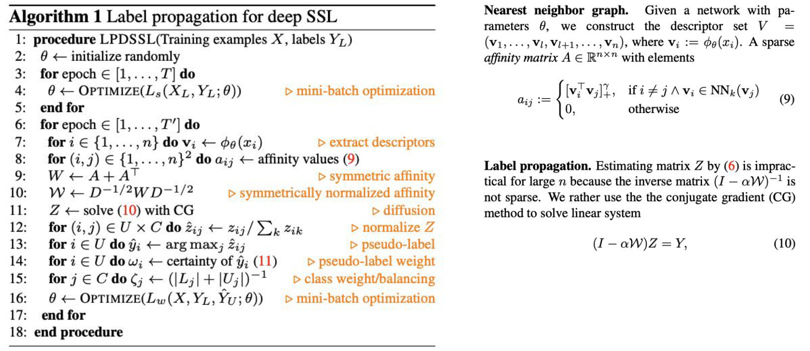
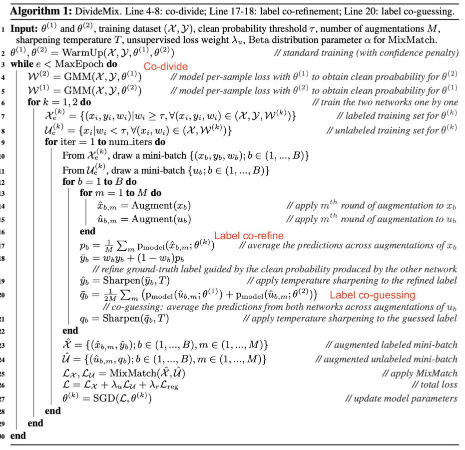

# PC4. Pseudo labeling (Label Propagation · DivideMix) — Pseudo code 핵심 정리 & 문제

> 범위: L07 p.10–14 (Label Propagation), p.31–33 (MixMatch 연산), p.49–55 (DivideMix). Pseudo code 원문 = **L07 p.11**, **L07 p.54**.
> 공부 포인트: 구현 디테일이 아니라 **"논문 core idea가 pseudo code의 어느 줄에 박혀 있나"**. 줄 번호 + 그 줄이 하는 일 + 왜 그렇게 했는지만 잡으면 됨.

## A. Annotated pseudo code

### Label Propagation for Deep SSL (Iscen et al., CVPR 2019) — L07 p.11



**Transcription** (슬라이드 p.11 그대로, `▷` = 슬라이드의 주황색 주석)

```
Algorithm 1 Label propagation for deep SSL
 1: procedure LPDSSL(Training examples X, labels Y_L)
 2:   θ ← initialize randomly
 3:   for epoch ∈ [1, . . . , T] do
 4:     θ ← OPTIMIZE(L_s(X_L, Y_L; θ))                ▷ mini-batch optimization
 5:   end for
 6:   for epoch ∈ [1, . . . , T′] do
 7:     for i ∈ {1, . . . , n} do v_i ← φ_θ(x_i)       ▷ extract descriptors
 8:     for (i, j) ∈ {1, . . . , n}^2 do a_ij ← affinity values (9)
 9:     W ← A + A^⊤                                   ▷ symmetric affinity
10:     𝒲 ← D^{−1/2} W D^{−1/2}                       ▷ symmetrically normalized affinity
11:     Z ← solve (10) with CG                        ▷ diffusion
12:     for (i, j) ∈ U × C do ẑ_ij ← z_ij / Σ_k z_ik  ▷ normalize Z
13:     for i ∈ U do ŷ_i ← arg max_j ẑ_ij             ▷ pseudo-label
14:     for i ∈ U do ω_i ← certainty of ŷ_i (11)      ▷ pseudo-label weight
15:     for j ∈ C do ζ_j ← (|L_j| + |U_j|)^{−1}       ▷ class weight/balancing
16:     θ ← OPTIMIZE(L_w(X, Y_L, Ŷ_U; θ))             ▷ mini-batch optimization
17:   end for
18: end procedure
```

슬라이드 오른쪽 텍스트 (p.11):
- **Nearest neighbor graph.** Given a network with parameters $\theta$, we construct the descriptor set $V=(\mathbf v_1,\dots,\mathbf v_l,\mathbf v_{l+1},\dots,\mathbf v_n)$, where $\mathbf v_i:=\phi_\theta(x_i)$. A sparse *affinity matrix* $A\in\mathbb R^{n\times n}$ with elements

$$a_{ij}:=\begin{cases}[\mathbf v_i^\top\mathbf v_j]_+^\gamma, & \text{if } i\neq j\ \wedge\ \mathbf v_i\in\mathrm{NN}_k(\mathbf v_j)\\ 0, & \text{otherwise}\end{cases}\qquad(9)$$

- **Label propagation.** Estimating matrix $Z$ by (6) is impractical for large $n$ because the inverse matrix $(I-\alpha\mathcal W)^{-1}$ is not sparse. We rather use the the conjugate gradient (CG) method to solve linear system ← "the the" 중복 오타 (원문 유지)

$$(I-\alpha\mathcal W)Z=Y\qquad(10)$$

- 슬라이드 플래그: 식 **(6)** (closed form $Z=(I-\alpha\mathcal W)^{-1}Y$)과 **(11)** ($\omega_i$ 정의)은 참조만 있고 슬라이드에 없음 ←. line 10의 $D$, 식 (10)의 $Y$도 정의 안 돼 있음 ←.

> 보충 (논문): $D=\mathrm{diag}(W\mathbf 1_n)$ = degree matrix. $Y$ = $n\times c$ 행렬, labeled 행만 one-hot, unlabeled 행은 0. $Z=\sum_{t\ge0}\alpha^t\mathcal W^tY$ = label이 graph를 $t$ hop 걸어 퍼진 양을 $\alpha^t$로 감쇠해 합친 것. (11)은 entropy 기반 $\omega_i=1-H(\hat z_i)/\log c$ (확신 높을수록 큼). 시험은 슬라이드 기준 "certainty of $\hat y_i$"로 기억하면 충분.

**핵심 줄 (Key lines)**

| line | what it does | which core idea it implements | 빈칸 후보 |
|---|---|---|---|
| 3–5 | **Phase 1**: labeled만으로 $T$ epoch 지도학습 $L_s(X_L,Y_L;\theta)$ (p.10 그림: "labeled examples only") | graph를 **feature로** 만드니까 먼저 쓸 만한 embedding이 필요 (limitation: *performance depends on feature quality*, p.14) | labeled, $L_s$ |
| 7–10 | $\mathbf v_i=\phi_\theta(x_i)$ → kNN affinity (9) → $W=A+A^\top$ → $\mathcal W=D^{-1/2}WD^{-1/2}$ | **Construct a similarity graph in the feature space** (p.10). kNN 관계는 비대칭이라 $A+A^\top$로 대칭화, 그다음 symmetric normalization | extract descriptors, $A+A^\top$, symmetric affinity |
| 11 | $Z\leftarrow$ solve $(I-\alpha\mathcal W)Z=Y$ with CG | **diffusion** = *propagate labels from labeled samples to nearby unlabeled samples*. pseudo label의 출처가 **network softmax가 아니라 graph** | diffusion |
| 12–13 | $\hat z_{ij}=z_{ij}/\sum_k z_{ik}$ → $\hat y_i=\arg\max_j\hat z_{ij}$ ($i\in U$) | diffusion 점수를 정규화해서 **hard pseudo label** = *assign pseudo labels based on neighborhood relationships* | normalize $Z$, arg max |
| 14–15 | $\omega_i$ = certainty of $\hat y_i$, $\zeta_j=(\lvert L_j\rvert+\lvert U_j\rvert)^{-1}$ | threshold로 **버리지 않고** 불확실한 label은 작은 weight (p.10 그림: 점 크기 ∝ certainty $\omega_i$) + class 불균형 보정 | certainty, pseudo-label weight, class weight/balancing |
| 16 (+6, 17) | $L_w(X,Y_L,\hat Y_U;\theta)$로 **all examples** 1 epoch 학습 → 다시 line 7로 ($T'$번) | **매 epoch graph 재구성** → embedding↑ → graph↑ → pseudo label↑ 선순환 | $L_w$, all examples |

**Pseudo code ↔ core idea 한 줄**: pseudo label = 자기 softmax argmax가 아니라 **line 7–11의 feature-space kNN graph 위 diffusion 결과** → line 13 argmax, line 14 $\omega_i$로 soft weighting, line 6 loop로 매 epoch graph 재구성.

- Implementation trivia (**low priority**): CG를 쓰는 이유 = $(I-\alpha\mathcal W)^{-1}$이 sparse하지 않아 큰 $n$에서 비현실적. $k,\gamma,\alpha$ 값은 슬라이드에 없음.

---

### DivideMix (Li et al., ICLR 2020 — 슬라이드엔 "ICML 2020" ←) — L07 p.54



**Transcription** (슬라이드 p.54 그대로, 300 dpi 확대로 확인. `[red: …]` = 슬라이드에 빨간 글씨로 덧붙인 라벨)

```
Algorithm 1: DivideMix. Line 4-8: co-divide; Line 17-18: label co-refinement; Line 20: label co-guessing.
 1 Input: θ^(1) and θ^(2), training dataset (𝒳, 𝒴), clean probability threshold τ, number of augmentations M,
     sharpening temperature T, unsupervised loss weight λ_u, Beta distribution parameter α for MixMatch.
 2 θ^(1), θ^(2) = WarmUp(𝒳, 𝒴, θ^(1), θ^(2))              // standard training (with confidence penalty)
 3 while e < MaxEpoch do                     [red: Co-divide]
 4 │ 𝒲^(2) = GMM(𝒳, 𝒴, θ^(1))   // model per-sample loss with θ^(1) to obtain clean proabability for θ^(2)  ← "probability" 오타
 5 │ 𝒲^(1) = GMM(𝒳, 𝒴, θ^(2))   // model per-sample loss with θ^(2) to obtain clean proabability for θ^(1)  ← 오타
 6 │ for k = 1, 2 do                                          // train the two networks one by one
 7 │ │ 𝒳_e^(k) = {(x_i, y_i, w_i) | w_i ≥ τ, ∀(x_i, y_i, w_i) ∈ (𝒳, 𝒴, 𝒲^(k))}   // labeled training set for θ^(k)
 8 │ │ 𝒰_e^(k) = {x_i | w_i < τ, ∀(x_i, w_i) ∈ (𝒳, 𝒲^(k))}                       // unlabeled training set for θ^(k)
 9 │ │ for iter = 1 to num_iters do
10 │ │ │ From 𝒳_e^(k), draw a mini-batch {(x_b, y_b, w_b); b ∈ (1, ..., B)}
11 │ │ │ From 𝒰_e^(k), draw a mini-batch {u_b; b ∈ (1, ..., B)}
12 │ │ │ for b = 1 to B do
13 │ │ │ │ for m = 1 to M do
14 │ │ │ │ │ x̂_{b,m} = Augment(x_b)                  // apply m^th round of augmentation to x_b
15 │ │ │ │ │ û_{b,m} = Augment(u_b)                  // apply m^th round of augmentation to u_b
16 │ │ │ │ end                                   [red: Label co-refine]
17 │ │ │ │ p_b = (1/M) Σ_m p_model(x̂_{b,m}; θ^(k))   // average the predictions across augmentations of x_b
18 │ │ │ │ ȳ_b = w_b y_b + (1 − w_b) p_b
   │ │ │ │      // refine ground-truth label guided by the clean probability produced by the other network
19 │ │ │ │ ŷ_b = Sharpen(ȳ_b, T)                    // apply temperature sharpening to the refined label
20 │ │ │ │ q̄_b = (1/2M) Σ_m ( p_model(û_{b,m}; θ^(1)) + p_model(û_{b,m}; θ^(2)) )   [red: Label co-guessing]
   │ │ │ │      // co-guessing: average the predictions from both networks across augmentations of u_b
21 │ │ │ │ q_b = Sharpen(q̄_b, T)                    // apply temperature sharpening to the guessed label
22 │ │ │ end
23 │ │ │ 𝒳̂ = {(x̂_{b,m}, ŷ_b); b ∈ (1, ..., B), m ∈ (1, ..., M)}     // augmented labeled mini-batch
24 │ │ │ 𝒰̂ = {(û_{b,m}, q_b); b ∈ (1, ..., B), m ∈ (1, ..., M)}     // augmented unlabeled mini-batch
25 │ │ │ ℒ_𝒳, ℒ_𝒰 = MixMatch(𝒳̂, 𝒰̂)                                  // apply MixMatch
26 │ │ │ ℒ = ℒ_𝒳 + λ_u ℒ_𝒰 + λ_r ℒ_reg                                // total loss
27 │ │ │ θ^(k) = SGD(ℒ, θ^(k))                                         // update model parameters
28 │ │ end
29 │ end
30 end
```

- 슬라이드 플래그: line 4·5 주석 **"proabability"** ← 오타 (원문 유지). line 26의 $\lambda_r$, $\mathcal L_{\text{reg}}$는 line 1 Input 목록에 없음 ← (원 논문도 동일). 출처 표기 "ICML 2020" ← ICLR 2020.
- 판독 불가 부분 없음.

**핵심 줄 (Key lines)**

| line | what it does | which core idea it implements | 빈칸 후보 |
|---|---|---|---|
| 2 | WarmUp: 두 network를 일반 학습 (with confidence penalty) | GMM이 먹히려면 loss가 갈라져 있어야 함: *early stage: clean samples show a rapid decrease in loss, noisy samples retain a high loss* (p.53 Q1) | WarmUp |
| 4–5 | $\mathcal W^{(2)}=\mathrm{GMM}(\mathcal X,\mathcal Y,\theta^{(1)})$, $\mathcal W^{(1)}=\mathrm{GMM}(\mathcal X,\mathcal Y,\theta^{(2)})$ | **co-divide**: per-sample loss에 **2-component GMM** → 샘플별 clean probability $w_i$. **위첨자 엇갈림** = $\theta^{(1)}$의 loss로 만든 분할은 $\theta^{(2)}$용 → *relies on the "clean"/"noisy" classification determined by the other party* (p.51) → confirmation bias↓ | GMM, per-sample loss, other network |
| 7–8 | $w_i\ge\tau$ → $\mathcal X_e^{(k)}$ ($x_i,y_i,w_i$ 유지) / $w_i<\tau$ → $\mathcal U_e^{(k)}$ ($x_i$만, **label 버림**) | **noisy-label learning → SSL 문제로 재정의** (p.50). noisy 샘플을 버리는 게 아니라 **GT label만 버리고 unlabeled로** 씀 (p.53 Q2) | $\tau$, labeled / unlabeled training set |
| 17–19 | $p_b$ = **현재 net $\theta^{(k)}$ 하나**의 $M$-aug 평균 → $\bar y_b=w_by_b+(1-w_b)p_b$ → Sharpen | **label co-refinement** (clean = labeled 샘플용): GT label을 **상대 net이 준 clean prob $w_b$만큼만** 믿고 나머지는 자기 예측으로 보정 (p.54 오른쪽: *combining the GT label with the model's prediction*) | $w_by_b+(1-w_b)p_b$ |
| 20–21 | $\bar q_b=\frac1{2M}\sum_m\big(p_{\text{model}}(\hat u_{b,m};\theta^{(1)})+p_{\text{model}}(\hat u_{b,m};\theta^{(2)})\big)$ → Sharpen | **label co-guessing** (noisy = unlabeled 샘플용): MixMatch label guessing(1 net × K aug)을 **두 net ensemble**(2 nets × M aug)로 확장 (p.54: *averaging the predictions from the two networks*) | $2M$, both networks |
| 23–26 | $\hat{\mathcal X},\hat{\mathcal U}$ 만들어 MixMatch → $\mathcal L=\mathcal L_{\mathcal X}+\lambda_u\mathcal L_{\mathcal U}+\lambda_r\mathcal L_{\text{reg}}$ | *DivideMix does not create a new learning algorithm; rather, it is a method for generating the labeled and unlabeled sets used by MixMatch* (p.52) | MixMatch |

- line 6 `for k = 1, 2`: 두 network를 **번갈아(one by one)** 학습. 둘은 **대등한 peer** (EMA teacher–student 아님 ← Mean Teacher와 혼동 금지). line 3 while loop = 매 epoch co-divide 다시 함 (p.52 "(5) Repeat").
- "co-"의 의미 정리: co-**divide** = 상대 net이 데이터 분할 / co-**refinement** = 상대 net의 $w_b$로 GT 보정 (예측 $p_b$는 자기 것) / co-**guessing** = 두 net 예측 평균.

**Pseudo code ↔ core idea 한 줄**: **line 4–8**이 loss GMM으로 noisy label 문제를 SSL 문제로 바꾸고 (clean → labeled, noisy → unlabeled, 분할은 상대 net), **line 17–21**이 MixMatch의 label guessing을 두 net 버전(co-refine / co-guess)으로 바꾼 뒤, **line 25**에서 MixMatch를 그대로 돌림.

- Implementation trivia (**low priority**): confidence penalty(warm-up), $\lambda_r\mathcal L_{\text{reg}}$, $\tau/M/T$ 구체값은 슬라이드에 설명 없음.

> 보충 (논문): confidence penalty = asymmetric noise에서 warm-up 중 over-confident해지는 걸 막는 negative entropy 항. $\mathcal L_{\text{reg}}$ = 평균 예측과 uniform prior 사이 KL → 전부 한 class로 예측하는 trivial solution 방지. 테스트 땐 두 net 출력 평균 (ablation "with $\theta^{(1)}$ test"가 조금 낮은 이유, p.55).

---

### (참고) DivideMix가 부르는 MixMatch 연산 — L07 p.31–33

- $\bar{\mathcal X},\bar{\mathcal U}=\mathrm{MixMatch}(\mathcal X,\mathcal U,T,K,\alpha)$ (p.31). $T$ = sharpening temperature, $K$ = unlabeled 샘플당 augmentation 수, $\alpha$ = MixUp Beta parameter (p.33).
- **Label guessing** (p.32): $\bar q_b=\frac1K\sum_{k=1}^{K}p_{\text{model}}(y\mid\hat u_{b,k};\theta)$ → **Average → Sharpen** 순서.
- **Sharpen** (p.32): $\mathrm{Sharpen}(p,T)_i:=p_i^{1/T}\big/\sum_{j=1}^{L}p_j^{1/T}$ — "adjusting the temperature" ($T\to0$이면 one-hot에 가까워짐 → entropy minimization 효과).
- **MixUp** (p.31): $\lambda\sim\mathrm{Beta}(\alpha,\alpha)$, $\lambda'=\max(\lambda,1-\lambda)$, $x'=\lambda'x_1+(1-\lambda')x_2$, $p'=\lambda'p_1+(1-\lambda')p_2$ → $\lambda'\ge0.5$라 섞인 결과가 **첫 번째 샘플 쪽**에 가까움.
- **Loss** (p.33): labeled $\mathcal L_s^{\text{MM}}$ = $D[y,p_\theta(y\mid\bar{\mathbf x}^l)]$ (CE류), unlabeled $\mathcal L_u^{\text{MM}}=\frac1{L\lvert\bar{\mathcal U}\rvert}\sum\lVert\hat y-p_\theta(y\mid\bar{\mathbf u})\rVert_2^2$ (**L2**).

| MixMatch (p.31–33) | DivideMix Alg.1 (p.54) | 바뀐 점 |
|---|---|---|
| label guessing: $\frac1K\sum_k$, **1 network** | line 20 co-guessing: $\frac1{2M}\sum_m$, **2 networks** | ensemble로 confirmation bias↓ |
| labeled target: $\hat{\mathcal X}=((\hat x_b,p_b))$, aug 1번 | line 17–19, 23: $(\hat x_{b,m},\hat y_b)$, aug $M$번 + co-refined·sharpened label | noisy할 수 있는 GT를 그대로 안 믿음 |
| Sharpen은 guessed label에 | line 19 (refined label) **와** line 21 (guessed label) 둘 다 | |
| MixUp + $\mathcal L_s$ / $\mathcal L_u$(L2) | line 25 `MixMatch(𝒳̂, 𝒰̂)` 안에서 그대로 | 재사용 |

> 해석: line 25의 "MixMatch"는 label guessing·sharpening이 line 17–21로 빠져나간 뒤 남은 **MixUp + loss 계산** 부분. 슬라이드에 이렇게 쓰여 있진 않고 p.31–33과 p.54를 비교한 해석임.

**기호 함정** (pseudo code 읽을 때 헷갈리는 것):
- $T$: LP = phase-1 **epoch 수** / MixMatch·DivideMix = **sharpening temperature**.
- $\mathcal W$: LP = **normalized affinity matrix** / DivideMix $\mathcal W^{(k)}$ = **clean probability** 모음.
- $p_b$: MixMatch p.31 = labeled 샘플의 label / DivideMix line 17 = **자기 net의 $M$-aug 평균 예측**.
- $\alpha$: LP = diffusion 식 (10)의 parameter / MixMatch·DivideMix = MixUp **Beta**($\alpha,\alpha$) parameter.
- augmentation 수: MixMatch $K$ / DivideMix $M$ (LP의 $k$는 kNN 이웃 수).

## B. Cross-method comparison

| | Pseudo Labeling (Lee, L07 p.4–7, p.13) | Label Propagation (Iscen, p.10–14) | DivideMix (Li, p.49–54) |
|---|---|---|---|
| 문제 설정 | labeled(clean) + unlabeled | labeled(clean) + unlabeled | labeled set 자체에 **noisy labels** → 일부를 unlabeled로 강등 |
| pseudo label 출처 | **current model의 자기 예측** argmax ("predict each sample **independently**") | feature-space kNN graph 위 **diffusion** $(I-\alpha\mathcal W)Z=Y$ → $\arg\max_j\hat z_{ij}$ (**neighbors**) | noisy: **두 net × $M$ aug 예측 평균** (co-guessing, line 20) / clean: GT와 자기 예측을 $w_b$로 섞음 (co-refinement, line 18) |
| 판단 기준 | **confidence**-based | **similarity**-based (manifold, cluster assumption) | **loss**-based (per-sample loss의 2-component GMM) |
| 불확실한 label 처리 | **high-confidence만** 사용 (threshold) | 다 쓰되 **certainty $\omega_i$로 weighting** + class balancing $\zeta_j$ | clean prob $w_i$: $\tau$로 labeled/unlabeled 분할, $w_b$로 GT↔예측 보정, **상대 net이 분할** (co-training) |
| label 형태 | hard (one-hot) | hard $\hat y_i$ + weight $\omega_i$ | soft (Sharpen($\cdot$,$T$)) |
| 갱신 주기 | current model이 바뀔 때마다 다시 예측 | phase 2 **매 epoch** graph 재구성 + diffusion (line 6–16) | co-divide **매 epoch** (line 3–5), guess/refine **매 mini-batch** (line 12–21) |
| network 수 | 1 | 1 | **2** (대등한 peer, EMA 아님) |
| 학습 loss | labeled CE + pseudo-labeled CE | $L_w(X,Y_L,\hat Y_U;\theta)$, **all examples** | MixMatch: $\mathcal L_{\mathcal X}+\lambda_u\mathcal L_{\mathcal U}+\lambda_r\mathcal L_{\text{reg}}$ |

> 보충: Lee(2013) 논문은 pseudo label을 매 weight update마다 다시 계산 (슬라이드엔 "using the current model"까지만).

- 한 줄: **PL** = 자기 확신으로 뽑음 / **LP** = 이웃 관계(graph)로 퍼뜨림 / **DivideMix** = loss로 GT label을 의심하고, 두 network가 서로 걸러줌.
- 공통 위험 = **confirmation bias** (틀린 label을 자기가 강화). LP는 graph·weight로, DivideMix는 두 net 교차(co-divide, co-guess)로 완화.

## C. Question pool (15 questions)

### Q1 [T/F]
In Label Propagation for deep SSL (Algorithm 1), the kNN similarity graph is constructed only once after the supervised phase, and the same graph is reused in every epoch of the second phase.
**Answer**: False — line 6 `for epoch ∈ [1,…,T′]` **안에** line 7–10 (descriptor 추출 → affinity → $W$ → $\mathcal W$)이 있음 → 현재 $\phi_\theta$로 **매 epoch graph 재구성**. p.10 그림 "Phase 2: Iterate $T'$ times". embedding↑ → graph↑ → pseudo label↑ 선순환이 핵심 (L07 p.10–11)

### Q2 [T/F]
In the second phase of Label Propagation (line 16), the network is trained on all examples $X$, using the given labels $Y_L$ for labeled samples and the propagated pseudo labels $\hat Y_U$ for unlabeled samples.
**Answer**: True — line 16 $\mathrm{OPTIMIZE}(L_w(X,Y_L,\hat Y_U;\theta))$, p.10 그림 "(all examples)". 함정 대비: **phase 1 = labeled only** ($L_s(X_L,Y_L;\theta)$), **phase 2 = all examples** ($L_w$) (L07 p.10–11)

### Q3 [T/F]
In DivideMix, label co-refinement (lines 17–18) is applied to samples in the unlabeled (noisy) set, while label co-guessing (line 20) is applied to samples in the labeled (clean) set.
**Answer**: False — **반대**. co-refinement는 **clean = labeled** 샘플 $x_b$의 GT label $y_b$를 보정 (GT가 있어야 $w_by_b$를 계산하지), co-guessing은 **noisy = unlabeled** 샘플 $u_b$의 label을 새로 추측. p.54 오른쪽: *Refines labels for samples classified as "Clean"* / *Generates pseudo-labels for noisy (unlabeled) samples* (L07 p.54)

### Q4 [T/F] (killer)
In line 17 of DivideMix, $p_b$ is computed by averaging the predictions of both networks $\theta^{(1)}$ and $\theta^{(2)}$ over the $M$ augmentations of $x_b$.
**Answer**: False — line 17 $p_b=\frac1M\sum_m p_{\text{model}}(\hat x_{b,m};\theta^{(k)})$ = **지금 학습 중인 network $\theta^{(k)}$ 하나**의 $M$-aug 평균. 두 net 평균은 **line 20 (co-guessing, $u_b$)** 에서만. co-refinement의 "co-"는 $w_b$가 **상대 net**에서 온다는 뜻 (line 18 주석 *"clean probability produced by the other network"*) (L07 p.54)

### Q5 [MCQ]
The following excerpt comes from the pseudo code of which method?
```
W ← A + A^⊤
𝒲 ← D^{−1/2} W D^{−1/2}
Z ← solve (I − α𝒲) Z = Y with CG
for i ∈ U do ŷ_i ← arg max_j ẑ_ij
```
(A) Pseudo-Label (Lee, 2013)
(B) Label Propagation for deep SSL (Iscen et al., 2019)
(C) DivideMix (Li et al., 2020)
(D) MixMatch (Berthelot et al., 2019)
**Answer**: (B) — affinity graph를 대칭화·정규화하고 linear system을 풀어 **diffusion** → 그 결과의 argmax가 pseudo label = LP (line 9–13). (A) graph 없이 각 샘플 softmax를 **독립적으로** argmax. (C) per-sample loss의 GMM + 두 network. (D) $K$-aug 평균 → Sharpen → MixUp, graph 없음 (L07 p.11)

### Q6 [MCQ]
In Algorithm 1 of Label Propagation, how are unreliable pseudo labels handled?
(A) Unlabeled samples whose maximum normalized score $\hat z_{ij}$ is below a fixed confidence threshold are removed from training
(B) Every unlabeled sample receives a pseudo label, but its loss is weighted by $\omega_i$, the certainty of $\hat y_i$, and each class is weighted by $\zeta_j=(\lvert L_j\rvert+\lvert U_j\rvert)^{-1}$
(C) A two-component GMM is fitted to the per-sample loss, and high-loss samples are treated as unlabeled
(D) Two networks exchange their pseudo labels so that each network is trained on the other's labels
**Answer**: (B) — line 13은 **모든 $i\in U$** 에 $\hat y_i$를 주고, line 14 $\omega_i$(pseudo-label weight)로 불확실한 건 약하게, line 15 $\zeta_j$(class weight/balancing)로 class 불균형 보정. p.10 그림 "size proportional to certainty $\omega_i$". (A) fixed threshold로 버리는 건 plain PL/FixMatch 스타일 (LP는 confidence-based 아님). (C) DivideMix co-divide. (D) DivideMix 류 two-network 아이디어, LP는 network 1개 (L07 p.10–11)

### Q7 [MCQ]
In DivideMix's Algorithm 1, which line makes network $\theta^{(1)}$ be trained on a clean/noisy division that was produced by network $\theta^{(2)}$?
(A) Line 4: $\mathcal W^{(2)}=\mathrm{GMM}(\mathcal X,\mathcal Y,\theta^{(1)})$
(B) Line 5: $\mathcal W^{(1)}=\mathrm{GMM}(\mathcal X,\mathcal Y,\theta^{(2)})$
(C) Line 17: $p_b=\frac1M\sum_m p_{\text{model}}(\hat x_{b,m};\theta^{(k)})$
(D) Line 20: $\bar q_b=\frac1{2M}\sum_m\big(p_{\text{model}}(\hat u_{b,m};\theta^{(1)})+p_{\text{model}}(\hat u_{b,m};\theta^{(2)})\big)$
**Answer**: (B) — line 5 = **$\theta^{(2)}$의 per-sample loss**로 GMM fit → clean probability **"for $\theta^{(1)}$"**. $k=1$일 때 line 7–8이 $\mathcal W^{(1)}$로 $\mathcal X_e^{(1)},\mathcal U_e^{(1)}$을 만듦 → $\theta^{(1)}$은 상대가 나눈 데이터로 학습 (*relies on the classification determined by the other party*, p.51). (A) 반대 방향 ($\theta^{(1)}$의 loss → $\theta^{(2)}$용). (C) 자기 net 예측 평균 (co-refinement 재료). (D) co-guessing, 분할과 무관 (L07 p.51, p.54)

### Q8 [MCQ] (killer)
Compare MixMatch's label guessing (p.32) with line 20 of DivideMix. What is the key difference?
(A) DivideMix sharpens each prediction first and then averages, whereas MixMatch averages first and then sharpens
(B) DivideMix averages the predictions of two networks $\theta^{(1)},\theta^{(2)}$ over $M$ augmentations, whereas MixMatch averages a single model's predictions over $K$ augmentations
(C) DivideMix converts the averaged prediction into a hard one-hot label with argmax, whereas MixMatch keeps a soft sharpened label
(D) DivideMix uses the prediction of an EMA teacher instead of averaging over augmentations
**Answer**: (B) — MixMatch $\bar q_b=\frac1K\sum_k p_{\text{model}}(y\mid\hat u_{b,k};\theta)$ (1 net) vs DivideMix $\frac1{2M}\sum_m(\cdot;\theta^{(1)}+\cdot;\theta^{(2)})$ (2 nets) → **co**-guessing. (A) 둘 다 **평균 → Sharpen** (line 20 → 21, p.32 Average → Sharpen). (C) 둘 다 Sharpen($\cdot$,$T$)로 **soft** target, argmax 아님. (D) EMA teacher 없음, $\theta^{(1)},\theta^{(2)}$는 따로 학습되는 peer (L07 p.32, p.54)

### Q9 [Blank]
In Label Propagation (Algorithm 1, line 9, "▷ symmetric affinity"), the kNN affinity matrix $A$ is not symmetric, so the algorithm sets $W \leftarrow$ ______ before normalizing it as $\mathcal W = D^{-1/2}WD^{-1/2}$.
**Answer**: $A+A^\top$ (accept: A + A^T, A plus its transpose) — 식 (9)에서 $a_{ij}\neq0$ 조건이 "$\mathbf v_i\in\mathrm{NN}_k(\mathbf v_j)$"라 $i$가 $j$의 이웃이어도 $j$는 $i$의 이웃이 아닐 수 있음 → 비대칭. 전치를 더해 대칭화한 뒤 line 10에서 symmetric normalization (L07 p.11)

### Q10 [Blank]
In Label Propagation, pseudo labels are not taken from the network's softmax. Line 11, "$Z \leftarrow$ solve (10) with CG", is annotated as "▷ ______": labels spread from labeled samples to nearby unlabeled samples over the graph by solving $(I-\alpha\mathcal W)Z=Y$.
**Answer**: diffusion (accept: graph diffusion, label propagation) — $Z$의 각 행 = 그 샘플에 graph를 타고 흘러온 class별 점수. 정규화(line 12) → argmax(line 13)로 pseudo label. **pseudo label 출처가 network가 아니라 graph**라는 게 LP vs plain PL의 차이 (similarity-based vs confidence-based, p.13) (L07 p.11, p.13)

### Q11 [Blank]
In Label Propagation, line 14 gives each pseudo-labeled sample $i\in U$ a weight $\omega_i$ equal to the (1) ______ of $\hat y_i$, and line 15 gives each class $j$ a weight $\zeta_j=(\lvert L_j\rvert+\lvert U_j\rvert)^{-1}$ for class (2) ______.
**Answer**: (1) certainty (accept: confidence of the propagated label) (2) balancing (accept: class weight/balancing, (class) imbalance correction) — $\omega_i$ = **샘플별** 신뢰도 ("▷ pseudo-label weight"), $\zeta_j$ = **class별** 역빈도 ("▷ class weight/balancing"). 둘을 뒤바꾸는 함정 주의. threshold로 버리는 대신 weight로 soft하게 처리 (L07 p.10–11)

### Q12 [Blank]
In DivideMix's co-divide step (Algorithm 1 caption: lines 4–8), lines 4–5 model each network's (1) ______ with a two-component (2) ______ to obtain a clean probability $w_i$ for every training sample.
**Answer**: (1) per-sample loss (accept: training loss, loss) (2) GMM (accept: Gaussian Mixture Model) — *During the early stages of training, clean samples show a rapid decrease in loss, noisy samples retain a high loss* → loss histogram이 대략 두 cluster → **low-loss = clean, high-loss = noisy** (p.51, p.53). 그래서 line 2 WarmUp을 먼저 함 (L07 p.51, p.53–54)

### Q13 [Blank]
In DivideMix lines 7–8, samples with clean probability $w_i \ge \tau$ form the (1) ______ training set $\mathcal X_e^{(k)}$, while samples with $w_i < \tau$ form the (2) ______ training set $\mathcal U_e^{(k)}$.
**Answer**: (1) labeled (2) unlabeled (clean / noisy는 샘플 성격 묘사로는 맞지만, 슬라이드가 set 이름으로 쓰는 말은 labeled / unlabeled. 시험 답은 이걸로) — 슬라이드 주석 "labeled training set for $\theta^{(k)}$" / "unlabeled training set for $\theta^{(k)}$". 이게 *DivideMix reformulates noisy-label learning as a semi-supervised learning problem* 의 실체. noisy 샘플은 **버리지 않음**, GT label만 버림 (p.53 Q2) (L07 p.50, p.53–54)

### Q14 [Blank]
Label co-refinement in DivideMix (line 18) computes $\bar y_b = w_b\,y_b + (1-w_b)\,$______, where $w_b$ is the clean probability produced by the other network.
**Answer**: $p_b$ (accept: the network's prediction averaged over the $M$ augmentations of $x_b$) — $p_b$는 line 17에서 자기 net $\theta^{(k)}$로 구한 $M$-aug 평균 예측. $w_b\approx1$(확실히 clean) → GT $y_b$ 그대로, $w_b$ 작을수록 → 모델 예측 쪽으로. 그다음 line 19에서 Sharpen (L07 p.54)

### Q15 [Blank] (killer)
Label co-guessing in DivideMix (line 20): $\bar q_b = \dfrac{1}{\underline{\qquad}}\sum_{m}\Big(p_{\text{model}}(\hat u_{b,m};\theta^{(1)}) + p_{\text{model}}(\hat u_{b,m};\theta^{(2)})\Big)$
**Answer**: $2M$ (accept: 2M, twice the number of augmentations) — **2 networks × $M$ augmentations = $2M$개 예측의 평균**. $\frac1M$이면 합이 2가 돼서 확률분포가 아님. MixMatch(p.32)는 1 net × $K$ aug라 $\frac1K$ (L07 p.32, p.54)

<!-- WRITTEN 2026-10-22 | author: opus | PC4 -->

<!-- VERIFIED 2026-10-22 | checked: 15 | fixed: 3 | deleted: 0 | reviewer: opus -->
<!-- A/B: LP Alg.1 (p.11, 250dpi) and DivideMix Alg.1 (p.54, 300dpi zoomed) transcriptions match line by line (w_i ≥ τ / < τ, W = A + A^⊤, D^{-1/2}WD^{-1/2}, θ^(k) in line 17, 1/2M in line 20, red labels, "proabability", "the the"); MixMatch p.31–33 formulas and section B consistent with slides -->
<!-- fix Q11: added accept "(class) imbalance correction" for blank (2), a natural paraphrase of "class weight/balancing" -->
<!-- fix Q12: stem said "co-divide (lines 4–5)" but the Algorithm 1 caption defines co-divide as lines 4–8; reworded so students don't memorize the wrong line range -->
<!-- fix Q13: stem gave the answers away ("together with their labels" / "their labels are dropped"); removed. Key tightened to labeled/unlabeled (the slide's set names); clean/noisy no longer listed as accept -->
