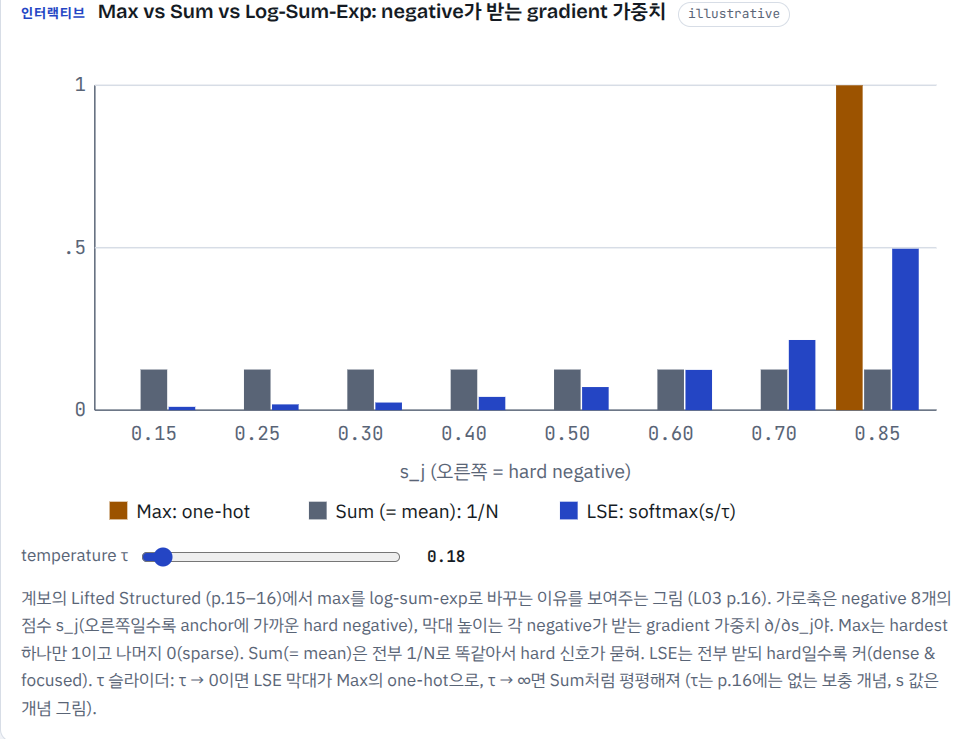
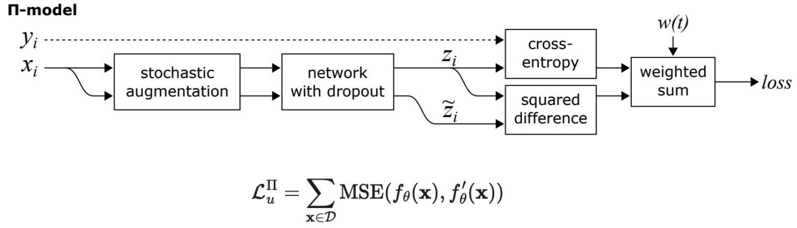

# Mock Quiz 2 — Advanced Representation Learning (Lectures 01–07)

> 20 questions · T/F + MCQ · 실전처럼 답 먼저 다 적고 맨 아래 정답 확인. 강의 태그 `[Lnn]`는 출처 강의.

### 1. [T/F] `[L01]`
A good representation keeps all information in the input image, including background, lighting, and camera angle, so that no information is lost.
> F

**채점** ✅ 정답 **False**
- 좋은 representation은 전부 남기는 게 아니라 **task에 필요한 것만 남기고 나머지는 버려**. 골든 리트리버 사진이면 모양·종 같은 semantic 정보는 남기고, **background · lighting · noise · camera angle**은 irrelevant information이라 discard (p.11).
- "정보를 하나도 안 잃는다"는 lossless copy 얘기라 정의와 반대야. 1-2 파트의 한 줄 요약이 **compression ∩ prediction**(줄이되 예측에 필요한 건 남김)이야.
- 비유: policy 입력 latent가 배경 텍스처·조명까지 다 담으면 오히려 sim-to-real 일반화가 나빠지는 것과 같은 얘기야.
- 📍 **HTML**: `1-1-2` **Representation** → **남길 것 vs 버릴 것** 문단 (L01 p.11) · [열기](flow.html#l01-1-2)

### 2. [MCQ] `[L01]`
In the order "What AI has been learning," which sequence is correct?
(A) Rules → Patterns → Features → Representations → World Knowledge
(B) Rules → Features → Patterns → World Knowledge → Representations
(C) Patterns → Rules → Features → Representations → World Knowledge
(D) Features → Rules → Patterns → Representations → World Knowledge
> ?? A?

**채점** ✅ (불안) 정답 **(A)**
- 5단계 "From rules to world knowledge": **Rules**(사람이 규칙을 직접) → **Patterns**(통계 패턴) → **Features**(edge·texture 같은 특징) → **Representations**(task 간 transfer되는 embedding, 이 수업) → **World Knowledge** (p.7).
- 방향: 사람이 넣는 지식은 **줄고**, data에서 배우는 것의 추상성·일반성은 **커져**. 이 방향만 기억하면 순서가 저절로 나와.
- 오답: (B) Patterns↔Features, Representations↔World Knowledge 뒤바뀜 · (C) Patterns가 Rules 앞 · (D) Features가 맨 앞.
- 📍 **HTML**: `1-1-1` **AI가 배워 온 것** → **핵심** 문단 (L01 p.7) · [열기](flow.html#l01-1-1)

### 3. [T/F] `[L02]`
To evaluate an SSL method, a shallow network is attached on the learned feature extractor and trained on the target task with a small amount of labeled data.
> T?

**채점** ✅ (불안) 정답 **True**
- SSL 평가 절차 그대로야: pretext로 학습한 encoder를 **고정(frozen)** → 그 위에 **shallow(linear) head**만 **적은 labeled data**로 학습 → downstream 성능으로 평가 (p.18).
- 왜 shallow? head가 크면 head가 알아서 잘해 버려서 점수가 encoder 덕인지 구분이 안 돼. head를 약하게 둬야 점수 차이 = representation 품질 차이.
- 짝 함정: "pretext task 정확도로 평가한다" → **False** (모의퀴즈 1의 4번).
- 📍 **HTML**: `2-1-3` **평가** → **핵심** · **왜 shallow?** 문단 (L02 p.18) · [열기](flow.html#l02-1-3)

### 4. [T/F] `[L02]`
In Context Encoders, the reconstruction (L2) loss makes the inpainted region sharp, while the adversarial loss alone causes blurry results.
> T?

**채점** ❌ 정답 **False** (sharp ↔ blurry 뒤집기 함정)
- 실제는 반대야. **L2(reconstruction)만 쓰면 blurry**, **adversarial loss가 sharp·realistic**하게 만들고, 둘을 **같이** 쓸 때 가장 좋아 (p.25–27).
- 왜 L2가 흐리게 만드나: 지운 자리에 올 수 있는 그럴듯한 그림이 여러 개면, L2(MSE)를 최소로 만드는 답은 그것들의 **평균**이야 → 경계가 뭉개져. flow matching에서 MSE regression 하나로 multimodal 분포를 맞추면 평균으로 뭉개지는 것과 똑같은 현상이야.
- adversarial loss는 discriminator가 "진짜 사진 vs 채운 사진"을 구별하게 해서, 평균이 아니라 **진짜 같은 한 장**을 그리도록 밀어.
- 같은 원리가 Colorization(2-2-4)에도 나와: regression은 색을 평균 내서 탁해짐 → 313-class classification.
- 📍 **HTML**: `2-2-2` **Context Encoders (Inpainting)** → **문제** 문단 (L2만 쓰면 blurry → adversarial 추가) (L02 p.25–27) · [열기](flow.html#l02-2-2)

> 그치.. 원래 **L2가 blurry**고, 차라리 L2이 sharp인걸 알고 있었는데 왜 이렇게 했을까..

### 5. [MCQ] `[L02]`
Which pretext task is matched with the learned concept **"Global Spatial Structure"**?
(A) Relative Position
(B) Inpainting
(C) Rotation
(D) Jigsaw
> D??

**채점** ✅ (불안) 정답 **(D)**
- p.45 요약표의 Learned Concept: Relative Position = **Local** Spatial Context · Inpainting = Context & Object Parts · **Jigsaw = Global Spatial Structure** · Colorization = Object Semantics · Rotation = Object-Centric Understanding.
- 직관: Jigsaw는 3×3 = 9조각을 섞고 **전체 배치(순열)**를 맞혀야 하니 global. Relative Position은 두 조각 사이 관계만 보니 local. Local ↔ Global 짝으로 외워.
- 📍 **HTML**: `2-2` **Hand-crafted pretext 5종** → 파트 끝 **"다섯 개를 한 표로"** 비교표의 **포인트(배우는 것)** 열 · 카드는 `2-2-3` Jigsaw (L02 p.45) · [열기](flow.html#l02-2-3)

### 6. [T/F] `[L03]`
The N-pair loss compares one positive against multiple negatives simultaneously, and its form is equivalent to the cross entropy loss of an N-way softmax classifier.
> T?

**채점** ✅ (불안) 정답 **True**
- **N-pair:** **1 positive ↔ N−1 negatives**를 한 번에 비교. $L = -\log\frac{\exp(s^+)}{\exp(s^+)+\sum_{j=1}^{N-1}\exp(s_j^-)}$ (p.17–20).
- 슬라이드 핵심 문장: "This seems familiar… **Cross entropy loss for a N-way softmax classifier!** I.e., learn to find the positive sample." → 이게 그대로 다음 단계 **InfoNCE**의 꼴이야.
- 왜 나왔나: Triplet·Lifted는 결국 1 positive ↔ 1 negative 비교라 정보가 적어. 한 번에 여러 negative를 보면 hard negative를 따로 고를 부담도 줄어 (softmax가 가까운 negative에 자동으로 큰 가중).
- 📍 **HTML**: `3-2-4` **N-pair loss** → **왜 나왔나** · **핵심** 문단 (L03 p.17–20) · [열기](flow.html#l03-2-4)

### 7. [T/F] `[L03]`
Hard negatives are samples that are close to the anchor but belong to a different class, and they provide weaker learning signals than easy negatives.
> F

**채점** ✅ 정답 **False**
- hard negative = embedding은 anchor와 **가까운데** class는 **다른** 샘플. 모델이 헷갈리는 샘플이라 **stronger** learning signal을 줘 (p.14 "Hard negatives provide stronger learning signals").
- easy negative는 이미 margin을 만족해서 loss 0, gradient 0 → 배울 게 없어. 그래서 Triplet의 한계가 "대부분의 triplet이 쓸모없다(easy)"이고, 해결책이 **hard negative mining**이야.
- 📍 **HTML**: `3-2-2` **Triplet loss** → 계보 단계 아래 **한계 (p.13–14)** 줄 · 관련 `4-1-1` 재료 3개 (L03 p.13–14) · [열기](flow.html#l03-2-2)

### 8. [MCQ] `[L03]`
Why is the `max` over negatives in the Lifted Structured Loss replaced by log-sum-exp?
(A) Log-sum-exp ignores all negatives except the hardest one, making the gradient sparse.
(B) Log-sum-exp gives every negative the same uniform weight, like an average.
(C) Log-sum-exp removes the need for a positive pair in the loss.
(D) `max` is not smooth; log-sum-exp is a smooth approximation of max that gives dense gradients with larger weights on harder negatives.
> ?? D??

**채점** ✅ (불안, 직감) 정답 **(D)**
- Lifted Structured는 negative 중 **가장 가까운 것(max)**에만 벌을 줬는데, max는 **not smooth**라서 log-sum-exp(LSE)로 완화(relax)했어 (p.15).
- LSE = **smooth max**: 모든 negative가 gradient를 받고(**dense**), 가까운(hard) negative일수록 softmax weight가 커(**focused**). p.16 "Why Replace Max?" 비교: max = 제일 hard한 하나만 (sparse) / sum = 다 같은 weight / **LSE = dense + hard 쪽에 집중**.
- 오답: (A)는 max의 특징 · (B)는 sum(평균)의 특징 · (C) positive 거리 $D_{ij}$는 식에 그대로 있어.
- RL 비유: soft Q-learning·SAC의 soft value $V = \alpha\log\sum\exp(Q/\alpha)$가 바로 이 log-sum-exp야. hard max 대신 soft max를 쓰는 이유도 같아.
- 📍 **HTML**: `3-2-3` **Lifted Structured** → **relax** · **p.16** 문단 (L03 p.15–16) · [열기](flow.html#l03-2-3)

> 이 figure 참고. Log-sum-exp은 온도도 있음.

### 9. [T/F] `[L04]`
In SimCLR, the loss is computed on the projection head output, and after training the projection head g is thrown away and the representation h is used.
> T?

**채점** ✅ (불안, 직감) 정답 **True**
- SimCLR 구조: encoder $f$의 출력 $h = f(x)$가 representation, 그 뒤 projection head(MLP) $g$의 출력 $z = g(h)$에 contrastive loss를 걸어. 학습이 끝나면 **"return f, throw away g"** → downstream엔 **h**를 써 (p.24–25).
- 왜 g를 버려? contrastive loss는 z를 augmentation에 흔들리지 않게(invariant) 만들면서 색·방향처럼 downstream에 쓸모 있는 정보까지 z에서 지워. g가 그 손실을 떠안아 주니까 **h에 정보가 더 많이 남아** (p.28).
- 짝 함정: "loss를 h에 건다" / "g의 출력을 downstream에 쓴다" → False.
- 📍 **HTML**: `4-3-1` **SimCLR 디테일** → **어떻게** (Algorithm 1) · **왜 g를 버려?** 문단 (L04 p.24–28) · [열기](flow.html#l04-3-1)

### 10. [T/F] `[L04]`
Like AutoAugment, Population Based Augmentation (PBA) learns a single fixed augmentation policy before training.
> ??? F?

**채점** ✅ (불안, 직감) 정답 **False**
- PBA(Population Based Augmentation)는 PBT(population based training)로 **학습 중에** augmentation **schedule**을 진화시켜 → epoch마다 policy가 바뀌어. 슬라이드 문장: "In contrast to AutoAugment, PBA learns a **schedule** instead of a **fixed policy**" (p.17).
- AutoAugment는 RL controller로 **고정 policy**를 미리 찾음 (child model을 매번 새로 학습해서 탐색이 비쌈).
- 함정 유형: "Like AutoAugment"처럼 **대비되는 둘을 같다고 묶는** 문장.
- 비유: PBT는 RL에서 hyperparameter를 population으로 exploit/explore하는 그 PBT야. 그래서 결과물이 "시간에 따라 바뀌는 schedule"이 돼.
- 📍 **HTML**: `4-2` **Augmentation 계열** → 파트 표의 **PBA** 행 (AutoAugment 행과 비교) (L04 p.15–17) · [열기](flow.html#l04-p2)

> 완전 잊ㄱ고 있었지만 이제는 알았음. 오케이.

### 11. [MCQ] `[L04]`
Which statement correctly describes RandAugment?
(A) It uses an RNN controller trained with reinforcement learning to maximize validation accuracy.
(B) It evolves augmentation schedules using population-based training.
(C) It randomly selects augmentations and uses only the number of operations (N) and one global magnitude (M).
(D) It enforces KL-divergence consistency between original and augmented unlabeled data.
> ??? C?

**채점** ✅ (불안, 직감) 정답 **(C)**
- RandAugment: 연산을 **랜덤**으로 고르고, 하이퍼파라미터는 **N(연산 개수)과 M(공통 강도) 두 개뿐** → 탐색 공간이 아주 작아 (p.16).
- 보기 = 표의 4행 그대로: (A) RNN controller + RL = **AutoAugment** · (B) PBT로 schedule 진화 = **PBA** · (D) 원본·augmented unlabeled 예측의 KL consistency = **UDA**.
- 외우기: **Auto = RL 탐색 / Rand = N·M 두 개 / PBA = schedule / UDA = KL consistency**.
- 📍 **HTML**: `4-2` **Augmentation 계열** → 파트 표의 **AutoAugment · RandAugment · PBA · UDA** 4행 (L04 p.15–18) · [열기](flow.html#l04-p2)

### 12. [T/F] `[L05]`
MoCo v2 adopts SimCLR's MLP projection head and stronger data augmentation while retaining MoCo's momentum encoder and queue, which lets it outperform SimCLR with a smaller batch size.
> T?

**채점** ✅ (불안, 직감) 정답 **True**
- MoCo v2 = MoCo 구조(**momentum encoder + queue**)는 그대로 + SimCLR 레시피 두 개(**MLP projection head**, **strong augmentation**) (p.16–17).
- 결과: batch **256**으로 batch 8192 SimCLR를 이겨 (p.18). 이유는 negative 수가 batch가 아니라 **queue 길이**로 정해지기 때문 ("Decoupling mini-batch size from the number of negatives").
- Key takeaway (p.17): "Non-linear projection head and strong data augmentation are crucial for contrastive learning."
- 📍 **HTML**: `5-1-4` **MoCo v2** → **한 줄** · **결과** 문단 (L05 p.16–18) · [열기](flow.html#l05-1-4)

### 13. [T/F] `[L05]`
DeepCluster uses k-means clusters to build positive/negative pairs and trains the network with a contrastive loss on those pairs.
> T??

**채점** ❌ (직감) 정답 **False** (앞은 맞고 뒤가 틀린 반쪽 함정)
- k-means를 쓰는 건 맞는데, DeepCluster는 **positive/negative pair를 아예 안 만들어** (p.23). k-means **cluster 번호를 pseudo label**로 써서 일반 **classification**(CE)으로 학습해.
- 과정: feature 뽑기 → k-means clustering → cluster 번호 = 가짜 정답 → 분류 학습 → 좋아진 feature로 다시 clustering … **"Alternate between clustering and classification"** (p.24).
- 장점: 비슷한 사진은 같은 label을 받으니 false negative를 피해. 단점: epoch마다 전체를 clustering하는 offline 방식.
- 힌트: DeepCluster가 들어 있는 파트 제목이 **5-2 "negative 말고 다른 신호"**야. contrastive가 아니라는 뜻.
- 비유: 평가 ↔ 개선을 번갈아 하는 policy iteration처럼, clustering(정답 만들기) ↔ classification(학습)을 번갈아 해.
- 📍 **HTML**: `5-2-1` **DeepCluster** → **핵심** · **차이** 문단 (L05 p.23–25) · [열기](flow.html#l05-2-1)

> 뒤에가 틀림. 애초에 pair를 안만듬.

### 14. [MCQ] `[L05]`
According to the comparison of End-to-End, Memory Bank, and MoCo, which row correctly describes MoCo?
(A) Key: current encoder / Negative source: mini-batch / Dictionary: small / Freshness: fresh
(B) Key: momentum encoder / Negative source: FIFO queue / Dictionary: large / Freshness: consistent
(C) Key: memory bank / Negative source: memory bank / Dictionary: large / Freshness: stale
(D) Key: momentum encoder / Negative source: mini-batch / Dictionary: small / Freshness: consistent
> ?? 전혀 몰겠넹.. D?

**채점** ❌ 정답 **(B)** ← 메모 "전혀 몰겠넹" (모의퀴즈 1 14번도 MoCo → **반복 약점**)
- p.14 비교표는 "key를 어디서 얻고, key encoder를 어떻게 갱신하나"의 차이야.
  - **End-to-End** (SimCLR식): key = 지금 encoder, negative = mini-batch → **small · fresh** → (A)
  - **Memory Bank**: key = 창고에 저장된 옛 feature → **large · stale**(옛 encoder로 만든 값이라 낡음) → (C)
  - **MoCo**: key = **momentum encoder**, negative = **FIFO queue** → **large · consistent** → (B)
- 푸는 요령: MoCo가 던진 질문이 "Can we keep a **large** dictionary while reducing feature **staleness**?" (p.9) → 답은 **large + consistent**. (D)는 momentum encoder인데 negative를 mini-batch에서만 → dictionary가 small이라 MoCo를 만든 이유가 사라진 가짜 조합이야.
- RL 비유: momentum encoder = **DQN target network의 soft update**($\theta_k \leftarrow m\theta_k + (1-m)\theta_q$), queue = 최근 key만 담는 **FIFO replay buffer**, memory bank의 stale = 오래된 policy로 모은 off-policy 데이터 문제.
- 이름이 답이야: **Mo**mentum **Co**ntrast = momentum encoder + queue.
- 📍 **HTML**: `5-1` **negative 창고 짓기** → `5-1-3` MoCo 카드 **바로 뒤 "세 방식 비교 (p.14)" 표** + MoCo 카드의 **질문** · **핵심** 문단 (L05 p.9–14) · [열기](flow.html#l05-1-3)

> 오잉? 이걸 왜.. 뭔가 잘못 된 곳에 입력한 것 같으넫?

### 15. [T/F] `[L06]`
In Mean Teacher, the teacher's parameters are updated only by EMA of the student, and no backpropagation is applied to the teacher.
> T? 

**채점** ✅ (불안) 정답 **True**
- Mean Teacher: teacher weight = student weight의 **EMA** $\theta' \leftarrow \beta\theta' + (1-\beta)\theta$, teacher엔 **backprop 없음** (p.23–24). gradient로 학습하는 건 student뿐이야.
- Temporal Ensembling과 차이: **예측(prediction)의 EMA → weight의 EMA**. 그래서 sample마다 예측을 저장할 필요가 없고, teacher가 **매 iteration** 갱신돼.
- RL 비유: DQN/DDPG target network의 soft update와 같은 구조. L04 BYOL의 target, DINO의 teacher도 같은 패턴.
- 짝 함정: "student가 teacher의 EMA" / "teacher를 backprop으로 학습" → False.
- 📍 **HTML**: `6-2-3` **Mean Teacher** → **핵심** · **식** · **어떻게** 문단 (L06 p.23–25) · [열기](flow.html#l06-2-3)

### 16. [T/F] `[L06]`
The low-density separation assumption states that decision boundaries should lie in high-density regions.
> F

**채점** ✅ 정답 **False**
- H3 Low-density separation: "Decision boundaries should lie in **low**-density regions" (p.13). boundary는 점이 **드문 곳**을 지나야 해.
- boundary가 점이 빽빽한 곳(cluster)을 가로지르면 한 cluster가 두 class로 쪼개져 → H2(cluster assumption)와도 충돌해. H2와 H3는 같은 직관을 양쪽에서 본 거야.
- 같은 포인트: 모의퀴즈 1의 19번 (entropy minimization → boundary가 low-density 쪽으로).
- 📍 **HTML**: `6-1-3` **가정 H1–H4** → **H3 Low-density separation** 줄 + **연결** 문단 (L06 p.13) · [열기](flow.html#l06-1-3)

### 17. [MCQ] `[L06]`
What is the main motivation of Temporal Ensembling over the Π-model?
(A) The Π-model cannot use unlabeled data.
(B) The Π-model stores a prediction for every training sample, which is memory intensive.
(C) The Π-model requires two forward passes for every input, which is computationally expensive.
(D) The Π-model uses ground-truth labels to find adversarial perturbations.
> B??

**채점** ❌ 정답 **(C)**
- **Π-model의 문제**: 같은 입력을 noise만 바꿔 **forward를 2번** 해서 계산 비용이 커 (p.19) → 이게 TE의 동기.
- **TE의 해결**: 두 번째 forward 대신 그 샘플의 **지난 epoch 예측들의 EMA**를 target으로 → forward 1번 (p.20, p.22).
- (B) "sample마다 예측을 저장 → 메모리"는 Π가 아니라 **TE 자신의 한계**(N×C 메모리 + epoch당 1번 갱신)고, 그게 **Mean Teacher의 동기**야 (p.22–23).
- 나머지 오답: (A) Π도 unlabeled를 써 (consistency loss가 unlabeled loss) · (D) adversarial perturbation은 VAT(6-3) 얘기야.
- 외우기 사슬: **Π (forward 2번) → TE (예측 저장, 느린 갱신) → MT (weight EMA, 매 iteration)**. 하나를 고치면 다음 문제가 생겨서 다음 방법이 나와.
- 📍 **HTML**: `6-2-2` **Temporal Ensembling** → **문제**(Π 비용) · **장단점**(TE 한계) 문단 → 이어서 `6-2-3` Mean Teacher **문제** 문단, 파트 끝 Π · TE · MT 비교표 (L06 p.19–23) · [열기](flow.html#l06-2-2)

> 완전히 다른거랑 헷갈림. 지금 하는건 아래 모델에 대한거임.

### 18. [T/F] `[L07]`
In Noisy Student, noise such as RandAugment, Dropout, and Stochastic Depth is added when training the student, which prevents the student from simply copying the teacher.
> T?

**채점** ✅ (불안) 정답 **True**
- Noisy Student: teacher가 pseudo label을 만들고 → student(teacher와 **같거나 더 큼**)를 학습 → student가 다음 teacher, 반복.
- noise(**RandAugment, Dropout, Stochastic Depth**)는 **student에만** 줘. teacher는 noise 없이 깨끗한 pseudo label을 만들어.
- 왜? noise가 없으면 student는 teacher를 그대로 베끼고 끝나. 흔들린 조건에서도 같은 답을 내야 하니까 더 robust한 boundary를 배워서 teacher보다 나아져 (p.17).
- 짝 함정: "teacher에 noise" / "student가 더 작다"(knowledge distillation과 혼동) → False.
- 📍 **HTML**: `7-1-3` **Self-training · Noisy Student** → **Noisy Student** · **왜 돼?** 문단 (L07 p.15–17) · [열기](flow.html#l07-1-3)

### 19. [T/F] `[L07]`
Compared with pseudo labeling, Label Propagation is confidence-based and predicts each sample independently.
> ?? T?

**채점** ❌ 정답 **False** (PL ↔ LP 뒤바꾸기 함정)
- p.13 비교표:
  - **Pseudo Labeling**: predict each sample **independently** · **confidence**-based · ignores data manifold
  - **Label Propagation**: exploit **neighborhood** relationships · **similarity**-based · leverages manifold structure
- 문장은 PL의 설명을 LP에 붙인 거야. LP는 feature 공간에 **kNN graph**를 만들고 labeled에서 unlabeled로 label을 **퍼뜨려(diffusion)**. 그 결과의 argmax를 pseudo label로, certainty를 weight로 써.
- 외우기: **PL = 혼자, 자신감 / LP = 이웃, 유사도**.
- 📍 **HTML**: `7-1-2` **Label Propagation** → 첫 문단("Pseudo-Label은 샘플을 하나씩 따로 보지만, 이건 주변 샘플을 봐") + 맨 아래 **confidence-based → similarity-based** 줄 (L07 p.10–14) · [열기](flow.html#l07-1-2)

### 20. [MCQ] `[L07]`
How does MixMatch produce the guessed label for an unlabeled sample?
(A) It averages the model's predictions over K augmentations and then sharpens the result with a temperature T
(B) It takes the argmax of a single weakly augmented prediction and keeps it only if it exceeds a confidence threshold
(C) It diffuses labels from labeled samples over a kNN similarity graph in feature space
(D) It uses a teacher network that is trained with feedback from the student's labeled loss
> ?? C

**채점** ❌ 정답 **(A)** (19번과 같은 원인: (C)는 Label Propagation)
- MixMatch의 **label guessing**: unlabeled 하나에 augmentation을 **K번** → 예측 K개를 **평균** $\bar q_b = \frac1K\sum_k p_{model}(y\mid\hat u_{b,k})$ → **sharpening**(temperature T로 뾰족하게) (p.32).
- 각 단계의 역할: 평균 = **consistency**(여러 view 의견 모으기), sharpening = **entropy minimization**. MixMatch는 이런 기존 아이디어를 하나로 묶은 holistic framework야 (p.30).
- 보기 매칭: (B) weak aug argmax + confidence threshold = **FixMatch** · (C) kNN graph로 label 퍼뜨리기 = **Label Propagation** · (D) student 피드백으로 teacher 학습 = **Meta Pseudo Labels**.
- 📍 **HTML**: `7-3-1` **MixMatch** → **한 줄** 아래 **Label guessing** · **Sharpening** 줄 (L07 p.30–32) · [열기](flow.html#l07-3-1)

---

<b>정답 & 해설 (클릭)</b>

**1.** `[L01]` False — background, lighting, noise, camera angle은 irrelevant information으로 discard (p.11)

**2.** `[L01]` (A) — From rules to world knowledge (p.7)

**3.** `[L02]` True — 평가 절차 그대로 (p.18)

**4.** `[L02]` False — 반대. L2만 쓰면 blurry, adversarial이 sharp/realistic하게 만들고, 둘을 함께 쓰는 게 최고 (p.25–27)

**5.** `[L02]` (D) — Relative Position = Local Spatial Context, Inpainting = Context & Object Parts, Rotation = Object-Centric Understanding (p.45)

**6.** `[L03]` True — "1 positive <-> many negatives", "Cross entropy loss for a N-way softmax classifier". (p.17–20)

**7.** `[L03]` False — hard negative는 anchor와 가깝지만 다른 class라서 **stronger** learning signal을 줌. easy negative가 loss·gradient 기여가 작음. (p.14)

**8.** `[L03]` (D) — "not smooth, so relaxed"; LSE = dense & focused gradient (softmax weight). (A)는 max, (B)는 sum의 특징. (p.15–16)

**9.** `[L04]` True — "return f, throw away g"; $h$가 더 많은 정보를 보존. (p.24–25, p.28)

**10.** `[L04]` False — PBA는 PBT로 학습 중 online으로 진화하는 **schedule**을 학습 ("In contrast to AutoAugment, PBA learns a schedule instead of a fixed policy"). (p.17)

**11.** `[L04]` (C) — (A) AutoAugment, (B) PBA, (D) UDA. (p.16)

**12.** `[L05]` True — negative 수와 batch size를 decouple해서 256 batch로 SimCLR 8192를 이김 (p.16, p.18)

**13.** `[L05]` False — DeepCluster는 pos/neg pair를 만들지 않고 cluster 결과를 pseudo label로 써서 classification 학습 (p.23–24)

**14.** `[L05]` (B) — (A)는 End-to-End, (C)는 Memory Bank. MoCo = 두 방식의 hybrid (p.14)

**15.** `[L06]` True — Teacher: "Parameters updated only by EMA / No backpropagation". (p.24)

**16.** `[L06]` False — boundary는 **low-density** region에 있어야 하고, cluster를 관통하지 말아야 함. (p.13)

**17.** `[L06]` (C) — "Π-model requires two forward passes for every input → high computational cost". (B)는 오히려 TE의 한계(→ Mean Teacher의 동기). (p.19, p.22)

**18.** `[L07]` True — student에만 noise → 더 robust한 decision boundary (p.17)

**19.** `[L07]` False — 그건 Pseudo Labeling. LP는 **similarity-based**, neighborhood relationships 활용 (p.13)

**20.** `[L07]` (A) — label guessing(평균) → sharpening. (B) FixMatch, (C) Label Propagation, (D) Meta PL (p.32)

---

## 채점 결과 (2026-10-29)

- **점수: 14 / 20**
- ❌ 틀림: 4, 13, 14, 17, 19, 20
- ✅인데 불안(?): 2, 3, 5, 6, 8, 9, 10, 11, 12, 15, 18
- 직감으로 찍은 8–13: 6개 중 **5개** 맞음 (13번만 틀림)

### 틀린 패턴 3개
1. **뒤집기·반쪽 함정**: 4 (sharp ↔ blurry), 13 (k-means는 맞는데 contrastive pair가 틀림), 19 (PL ↔ LP). → T/F는 **문장을 끝까지** 읽고, 주어와 서술어가 짝이 맞는지 확인해.
2. **같은 계보 안에서 "누구의 한계"인지 혼동**: 17 (Π의 한계 vs TE의 한계). → 사슬로 외워: Π (forward 2번) → TE (예측 저장) → MT (weight EMA).
3. **MoCo 반복 약점**: 14 (모의퀴즈 1의 14번도 MoCo). → **large + consistent = queue + momentum encoder**, 이 한 줄만.

### 시험 전에 다시 볼 곳 (flow.html)
- `2-2-2` Context Encoders → 문제 문단
- `5-1-3` MoCo → 질문 · 핵심 + 바로 뒤 "세 방식 비교" 표
- `5-2-1` DeepCluster → 차이 문단
- `6-2-1` → `6-2-2` → `6-2-3` (Π → TE → MT) + 파트 끝 비교표
- `7-1-2` Label Propagation · `7-3-1` MixMatch

> 찾는 법: 카드 번호는 CSS가 그려서 본문에선 Ctrl+F로 안 잡혀. 대신 Ctrl+F로 `5-1-3`을 치면 **맨 위 한눈에 요약** 줄이 잡히고, 그걸 누르면 카드로 바로 가. 위 `[열기]` 링크는 브라우저에서 열면 그 카드로 바로 가.
