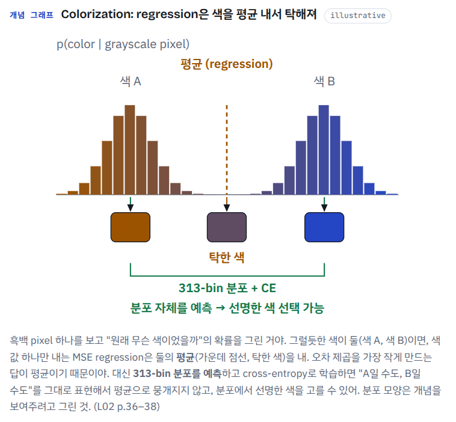
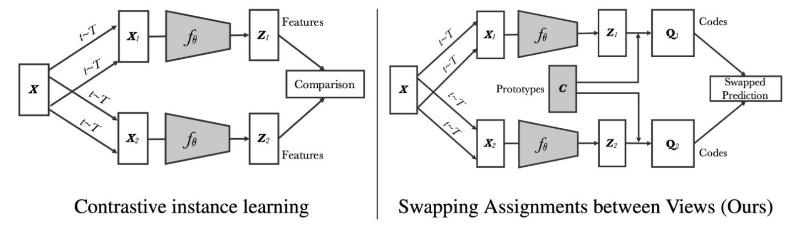

# Mock Quiz 3 — Advanced Representation Learning (Lectures 01–07)

> 20 questions · T/F + MCQ · 실전처럼 답 먼저 다 적고 맨 아래 정답 확인. 강의 태그 `[Lnn]`는 출처 강의.

### 1. [T/F] `[L01]`
Representation learning aims to map data points to a simpler, organized space, and the representation is often of lower dimension than the input.

> T

**채점** ✅ 정답 **True**
- 슬라이드 정의 그대로야 (p.12): "Representation learning aims to map data points to a **simpler, organized space**." 체크리스트 4개 중 하나가 "**Often in lower dimension**" ($D \ll \dim(x)$).
- 예: 224×224 컬러 사진 = 숫자 150,528개 → encoder가 훨씬 짧은 D차원 벡터로 줄여.
- 주의: 슬라이드 단어는 "**Often**"이야. "always lower"로 바꾸면 함정 문장이 될 수 있어.
- 비유: pixel observation을 작은 latent state로 줄여서 policy에 넣는 것과 같은 얘기야.
- 📍 **HTML**: `1-1-2` **Representation** → **정의** 문단 (체크리스트 줄) (L01 p.12) · [열기](flow.html#l01-1-2)

### 2. [MCQ] `[L01]`
Which representation of a dog image "aligns image with text semantics"?
(A) Color Histogram
(B) HOG descriptor
(C) CNN Feature
(D) CLIP Embedding
> D

**채점** ✅ 정답 **(D)**
- p.13 "The same data can have many different representations" 예시 3개: Color Histogram = "Captures global color distribution" · CNN Feature = "Captures hierarchical visual features" · **CLIP Embedding = "Aligns image with text semantics"**.
- CLIP은 이미지와 텍스트를 **같은 embedding 공간**에 놓으니까 "text semantics와 align" = CLIP이야. (B) HOG는 p.13 예시 3개에 없는 보기야.
- 📍 **HTML**: `1-1-2` **Representation** → **포인트** 문단 (같은 사진, 여러 표현) (L01 p.13) · [열기](flow.html#l01-1-2)

### 3. [T/F] `[L02]`
In colorization, multiple colors can be plausible and regression averages them, so the task is solved as classification over 313 color classes.
> ?? F?

**채점** ❌ 정답 **True** (네 답 F, 맞는 문장을 의심함)
- 슬라이드 p.37 그대로야: "Can it be solved by classification instead of regression. Multiple colors can be plausible. **Regression averages them.** → **313 color classes**".
- 흑백 자동차는 빨강도 파랑도 그럴듯해. L2 regression은 오차 기대값이 가장 작은 **평균색**(탁한 회색)으로 도망가. 그래서 ab 색공간을 313칸으로 나누고 pixel마다 **classification**(cross-entropy)을 해. 확률 분포를 내니까 "빨강일 수도, 파랑일 수도"를 평균으로 뭉개지 않아.
- 퀴즈 2의 4번(Context Encoders: L2만 쓰면 blurry)과 같은 원리야. **"L2 regression = 평균 = 흐릿·탁함"** 한 줄로 두 문제가 풀려.
- 313이라는 숫자가 수상해 보였을 수 있는데, 슬라이드에 화살표로 강조된 숫자 그대로야. 숫자는 외울 필요 없고 "regression → classification" 방향만 맞으면 True.
- 비유 (슬라이드 밖): distributional RL(C51)이 return 기대값을 regression하는 대신 atom 위 categorical 분포를 CE로 맞히는 것, VLA가 연속 action을 bin으로 나눠 token 분류하는 것과 같은 발상이야. flow matching이 노리는 것도 "평균으로 뭉개지지 않는 multimodal 분포"고.
- 📍 **HTML**: `2-2-4` **Colorization** → **문제** · **해결** 문단 (L02 p.37) · [열기](flow.html#l02-2-4)

> 이런게 있다는 것을 까먹고 있었다. 

### 4. [T/F] `[L02]`
In a Jigsaw-pretrained network, linear classifiers on the last (highest) layer give the best transfer performance, because higher layers generalize best.
> ? T

**채점** ❌ 정답 **False** (네 답 T)
- 슬라이드 p.49 제목 자체가 "**Higher layers do not generalize** ..."야. Problem 2) "the learned representations may not be general".
- Jigsaw로 학습한 ResNet의 layer마다 frozen feature에 linear classifier를 붙여 보면 **res4에서 최고, 마지막 res5에서 떨어져**. 마지막 layer는 "64개 순서 중 몇 번이냐"라는 pretext 자체에 특화되기 때문이야.
- 직관: 뒤쪽 layer일수록 그 과제 정답에 필요한 정보만 남겨. pretext ≠ downstream이니 그 특화가 오히려 손해야. 이게 pretext 방식의 한계 2번이고, contrastive learning(L03)으로 넘어가는 동기야.
- 함정 구조: "높은 layer = 좋은 feature"라는 상식을 그대로 문장으로 만든 거야. 슬라이드는 그 반대를 보여 줘.
- 비유: 한 task로 학습한 policy network의 마지막 layer feature는 그 task의 action에 특화돼서 다른 task로 잘 transfer되지 않는 것과 같아.
- 📍 **HTML**: `2-3-1` **Pretext의 한계** → **문제 2** 문단 (L02 p.49) · [열기](flow.html#l02-3-1)

> 이거는 좀 중요한 듯, 뭐 당여한 사실이기고하고. Pretext 훈련을 하다 보면.. 당연히 그거는 downstream task랑 다르고. Pretext가 훈련만 모델의 맨 끝단은 해당 pretext task 결과 도출에 전문화 될 수 밖에 없다.

### 5. [MCQ] `[L02]`
Why does the Jigsaw pretext task use only a subset of the possible permutations?
(A) 9! = 362,880 permutations are too many classes, so a subset of 64 permutations that maximize pairwise Hamming distance is used.
(B) Most permutations make the image look natural, so they are removed as easy negatives.
(C) A subset of 64 permutations that minimize pairwise Hamming distance makes the puzzle harder.
(D) Only permutations that keep the center tile fixed are needed for 8-way classification.
> A?

**채점** ✅ (불안) 정답 **(A)**
- 9! = 362,880가지 순서를 전부 class로 쓰기엔 너무 많아 → "Select a subset of 64 permutations that **maximize** pairwise Hamming distance" (p.30).
- Hamming distance = 두 순서에서 자리가 다른 칸 수. 서로 **많이 다른** 순서만 남겨야 class끼리 안 헷갈려 → maximize.
- 오답: (C)는 maximize ↔ minimize를 뒤집은 함정 (비슷한 순서끼리 모이면 구별이 어려워) · (D) center 고정 + 8-way는 Relative Position · (B)는 근거 없음.
- 64는 외울 필요 없어. (A)(C) 둘 다 64라 답을 가르는 건 **maximize**야.
- 📍 **HTML**: `2-2-3` **Jigsaw** → **어떻게** 문단 (L02 p.30) · [열기](flow.html#l02-2-3)

### 6. [T/F] `[L03]`
Pretext tasks such as rotation prediction, jigsaw puzzles, and colorization are handcrafted objectives, which motivates viewing representation learning more generally as learning similarity.
> T

**채점** ✅ 정답 **True**
- L02 pretext(rotation, jigsaw, colorization …)는 전부 사람이 손으로 설계한 objective야 ("They are all handcrafted Objectives", p.4). 어떤 과제가 좋은 feature를 줄지 미리 모르고, 하나하나 고안해야 해.
- 그래서 관점을 바꿔: "Good representations place semantically similar samples nearby." → **"Representation Learning = Learning Similarity"** (p.5). 이게 L03 contrastive learning의 출발점이야.
- L02 끝 `2-3-3`의 "변환된 이미지들은 같은 object니까 가깝게"와 같은 흐름이야.
- 📍 **HTML**: `L03 도입` **L03 Contrastive Learning I** → 단원 제목 바로 아래 **도입 문단** ("Representation Learning = Learning Similarity"), 3-1 파트 위 (L03 p.4–5) · [열기](flow.html#l03)

### 7. [T/F] `[L03]`
The InfoNCE loss uses a binary cross-entropy loss to classify each sample independently as data or noise.
> F

**채점** ✅ 정답 **False**
- 그건 **NCE** 설명이야: 샘플을 하나씩 보고 "data냐 noise냐"를 **binary**(sigmoid, logistic regression)로 분류해 (p.21–22).
- **InfoNCE**: "uses **categorical** cross-entropy loss to identify the positive sample amongst a set of unrelated noise samples" (p.23) → N개 후보를 한꺼번에 보고 softmax로 positive 1개를 골라 (N-way).
- 외우기: NCE = binary · 하나씩 / InfoNCE = categorical · N개 중 하나. 이름이 비슷해서 바꿔치기 단골이야.
- 📍 **HTML**: `3-2-6` **InfoNCE** → **정의** 문단 + 맨 아래 **NCE와 차이** 줄 (`3-2-5` NCE와 비교) (L03 p.21–23) · [열기](flow.html#l03-2-6)

### 8. [MCQ] `[L03]`
In the common setup for modern contrastive learning without labels, how are the positive and negatives obtained for an anchor?
(A) Positive = a sample of the same class; negatives = samples of other classes, using ground-truth labels.
(B) Positive = another augmented view of the same sample; negatives = other samples in the batch.
(C) Positive = the nearest neighbor in the current embedding; negatives = the farthest samples.
(D) Positive = a sample from the same K-means cluster; negatives = samples from other clusters.
> B?

**채점** ✅ (불안) 정답 **(B)**
- Modern setup (p.31): Anchor = 데이터셋의 샘플 x · **Positive = 같은 x를 다르게 augmentation한 view** · **Negatives = 같은 batch 안의 다른 샘플들**.
- (A)는 label이 **있을 때** 방식이야 (같은 class = positive, SupCon 쪽). 문제가 "without labels"라서 (B).
- (C) nearest neighbor를 positive로 = NNCLR(L05) 아이디어 · (D) 같은 cluster = DeepCluster·SwAV 쪽 발상. 둘 다 "common setup"은 아니야.
- 📍 **HTML**: `3-3-1` **Modern setup** → **부품 6개** 문단 (+ `3-1` 파트 끝 "label이 있든 없든" 문단) (L03 p.31–32) · [열기](flow.html#l03-3-1)

### 9. [T/F] `[L04]`
In Barlow Twins, the diagonal elements of the cross-correlation matrix are pushed toward 1 (invariance), and the off-diagonal elements are pushed toward 0 (redundancy reduction).
> ?? T?

**채점** ✅ (불안) 정답 **True**
- Barlow Twins: 두 view의 feature로 **D×D cross-correlation matrix** $C$를 batch 방향으로 계산하고, $C$를 **identity matrix**로 밀어 (p.35–36).
- $\mathcal L_{BT} = \sum_i (1-C_{ii})^2 + \lambda \sum_i\sum_{j\neq i} C_{ij}^2$
  - 대각 → 1 = **invariance**: 같은 차원은 augmentation이 달라도 같이 움직여.
  - 비대각 → 0 = **redundancy reduction**: 다른 차원끼리 중복 정보가 없어야 해 (논문 제목이 "via Redundancy Reduction").
- collapse가 안 나는 이유: 모든 차원이 같은 값만 내면 비대각도 1이 돼서 penalty를 받아.
- 나올 만한 함정: 대각 ↔ 비대각 뒤집기, "sample끼리 B×B로 비교"(그건 SimCLR).
- 📍 **HTML**: `4-3-3` **Barlow Twins 디테일** → **어떻게** 문단 (대각선 → 1, 비대각 → 0 두 줄) (L04 p.35–36) · [열기](flow.html#l04-3-3)

> 그러니까 대각선만 남기고 나머지는 지우는게 목적.

### 10. [T/F] `[L04]`
In BYOL, both the online and target networks are updated by gradient descent through backpropagation.
> F??

**채점** ✅ (불안) 정답 **False**
- gradient descent로 학습하는 건 **online**뿐이야. **target**은 출력에 stop-gradient(sg)가 붙어 **No backpropagation**이고, online의 **EMA**로만 갱신돼: $\xi \leftarrow \tau\xi + (1-\tau)\theta$ (p.30–31).
- 여기 τ는 temperature가 아니라 EMA 계수(momentum)야.
- RL 비유: target = **DQN target network의 soft update**(Polyak averaging). target net은 gradient를 안 받고 online을 천천히 따라가. MoCo key encoder, Mean Teacher teacher, DINO teacher도 전부 같은 패턴이야.
- 📍 **HTML**: `4-3-2` **BYOL 디테일** → **어떻게** 문단의 **target (ξ)** 줄 (L04 p.30–31) · [열기](flow.html#l04-3-2)

> 여기도 마찬가지로 EMA. 대부분 EMA 또는 적어도 stop gradient. 동등한 경우 둘다 학습하기도. teacher가 gradient로 학습되는 진짜 예외: Meta Pseudo Labels

### 11. [MCQ] `[L04]`
Which method generates harder negatives by mixing embeddings in the feature space?
(A) Mixup
(B) CutMix
(C) MoCHi
(D) UDA
> A

**채점** ❌ 정답 **(C) MoCHi** (네 답 A, 확신하고 틀림)
- 키워드 "**in the feature space**" + "**harder negatives**" = MoCHi (**M**ixing **o**f **C**ontrastive **H**ard negat**i**ves). Key Idea 원문: "Generate harder negatives by mixing embeddings in the feature space." (p.21)
- 어떻게: query와 similarity가 높은 **hardest negative**들을 골라 그 **embedding**끼리 섞어 합성 negative를 만들고, query까지 섞어서 더 어려운 negative를 만들어.
- (A) **Mixup**은 두 이미지를 **pixel 단위로 전체** 가중합해 (global, 입력 공간). label도 같은 비율로 섞어. negative를 만드는 방법이 아니야.
- (B) **CutMix**는 패치를 잘라 붙여 (region, 진짜 pixel) · (D) **UDA**는 KL consistency.
- 외우기: Mixup = **pixel · global** / CutMix = **pixel · region** / MoCHi = **feature · hard negative**. 이름 안에 **C**ontrastive **H**ard negative가 들어 있어.
- 📍 **HTML**: `4-2` **Augmentation 계열** → 파트 표 끝 세 줄 **Mixup · CutMix · MoCHi** 행 (L04 p.19–21) · [열기](flow.html#l04-p2)

> MixUp은 이미지를 합치는거고, MoCHi가 임베딩 합치는거.

### 12. [T/F] `[L05]`
At inference, CLIP performs zero-shot classification by encoding candidate text prompts and predicting the prompt with the highest image–text similarity, instead of using a learned classifier.
> ?? T?

**채점** ✅ (불안) 정답 **True**
- CLIP inference (p.33): class 이름을 "A photo of a {object}." prompt로 만들어 text encoder에 넣고, 이미지 embedding과 **similarity가 가장 높은 prompt**의 class를 답으로 해 → **zero-shot**.
- "Classification is performed by image-text matching instead of a trained classifier." text embedding들이 곧 classifier 역할이야. class 목록이 바뀌면 텍스트만 바꾸면 돼.
- **나올 만한 함정: "fine-tunes a linear classifier on labeled data" → False.**
- 연결 (슬라이드 밖): VLA의 vision-language backbone(SigLIP 등)이 이 계보야.
- 📍 **HTML**: `5-2-3` **CLIP** → **추론** 문단 (L05 p.33) · [열기](flow.html#l05-2-3)

### 13. [T/F] `[L05]`
SwAV requires offline clustering of the entire dataset and explicit pairwise comparisons between features.
> ??? T?

**채점** ❌ 정답 **False** (네 답 T, Key Idea를 뒤집은 문장)
- 슬라이드 p.26 원문: SwAV는 "Compute **online** cluster assignments" + "**Eliminate the need for** explicit pairwise comparisons or offline clustering." 문제는 이걸 정반대("requires")로 바꾼 문장이야.
- 둘 다 **이전 방법의 약점**이야: explicit pairwise comparisons = contrastive learning (feature ↔ feature, negative가 많이 필요) · offline clustering = **DeepCluster** (epoch마다 dataset 전체 k-means).
- SwAV: 학습되는 **prototype** K개와 비교해서 code(assignment)를 **mini-batch 안에서 그때그때** 계산 → view 1의 prediction으로 view 2의 code를 맞혀 (**swap**). p.30 표: Feature ↔ Feature → Feature ↔ **Prototype** / Pairwise comparison → **Online clustering**.
- 계보로 외워: DeepCluster (offline clustering → pseudo label) → SwAV (**online** clustering + swap).
- 비유: dataset 전체를 다시 훑어 갱신하는 offline batch 방식 대신, 들어오는 mini-batch로 바로 갱신하는 online update야.
- 📍 **HTML**: `5-2-2` **SwAV** → **문제** · **어떻게** 문단 (`5-2-1` DeepCluster 바로 다음) (L05 p.26, p.30) · [열기](flow.html#l05-2-2)

> 같은 사진의 두 view에 "어느 그룹이야?"를 각각 묻고, 한 view의 답을 다른 view가 맞히게 하는 방법 (Swapping Assignments between multiple Views).

> 여기에 있는 문제는 이전 단계의 문제임. 여기서 해결함. DeepCluster(이전 논문) (offline clustering → pseudo label) → **SwAV** (**online clustering** + swap). 즉 오프라인 clustering 필요 없음.

### 14. [MCQ] `[L05]`
Which of the following is NOT true about CURL?
(A) It applies contrastive learning to reinforcement learning.
(B) It uses random crop augmentation to create positive pairs.
(C) It employs a momentum encoder and contrastive loss, following MoCo.
(D) It first pre-trains the encoder with contrastive learning, then freezes it before training the RL policy.
> ? C?

**채점** ❌ 정답 **(D)** (네 답 C, NOT 문제)
- CURL (p.21): replay buffer에서 observation → **random crop** 두 번 = positive pair (B ✓) → **query encoder + momentum key encoder**로 contrastive (C ✓, MoCo 그대로) → "**Simultaneously** optimize the RL policy/value network using the learned representation".
- (D) "먼저 pre-train → freeze → RL"이 틀린 문장이라 NOT = (D). CURL은 contrastive loss를 RL loss와 **동시에** 최적화하는 **auxiliary** 목표야.
- (C)는 맞는 문장이야. CURL은 MoCo식 구조(momentum key encoder + contrastive loss)를 RL observation에 붙인 거야.
- RL 연결: pixel 관측 RL은 reward만으로 feature를 배우기엔 sample-inefficient해서, contrastive auxiliary loss를 같이 걸어 sample efficiency를 올린 거야. 반대로 "pre-train → freeze"는 frozen visual encoder를 쓰는 쪽 방식이야 (슬라이드 밖). 네 분야니까 이 구분은 꼭 챙겨.
- 📍 **HTML**: `5-1-5` **CURL** → **어떻게** · **차이** 문단 (L05 p.20–21) · [열기](flow.html#l05-1-5)

### 15. [T/F] `[L06]`
VAT replaces the ground-truth label used in adversarial training with the model's own current prediction, so the VAT loss can be applied to unlabeled samples as well.
> T

**채점** ✅ 정답 **True**
- AT 식의 GT label $q(y|\mathbf x^l)$ 자리에 **current model prediction** $p_{\hat\theta}(y|\mathbf x)$를 넣어 → "virtual" label. 그래서 "The VAT loss applies to both labeled and unlabeled samples." (p.34)
- $\mathcal L^{VAT}_u = D[p_{\hat\theta}(y|\mathbf x),\, p_\theta(y|\mathbf x + r_{vadv})]$. $r_{vadv}$ = D를 가장 키우는 방향 → local smoothness.
- $\hat\theta$는 상수 취급(stop-gradient)이야. semi-gradient TD target처럼 target 쪽으로는 gradient를 안 흘려.
- 📍 **HTML**: `6-3-3` **VAT** → **쉽게** · **식** 문단 (L06 p.34–35) · [열기](flow.html#l06-3-3)

### 16. [T/F] `[L06]`
Temporal Ensembling uses an exponential moving average of the model weights as the consistency target.
> F?

**채점** ✅ (불안) 정답 **False**
- TE의 target = **샘플별 prediction의 EMA**야 ("historical predictions of the same sample", p.19). $Z \leftarrow \alpha Z + (1-\alpha)z$를 epoch 끝마다 갱신하고, N×C 표에 저장해.
- **weight**의 EMA를 teacher로 쓰는 건 **Mean Teacher**야 (p.23).
- 외우기: TE = prediction EMA (샘플마다 메모리, epoch 단위) / MT = weight EMA (모델 하나, step 단위). 퀴즈 2의 17번 Π → TE → MT 사슬 그대로야.
- 📍 **HTML**: `6-2-2` **Temporal Ensembling** → **핵심** · **어떻게** 문단 (→ `6-2-3` Mean Teacher와 비교) (L06 p.19–23) · [열기](flow.html#l06-2-2)

### 17. [MCQ] `[L06]`
Compared with Mean Teacher, how does the "noisy samples as learning targets" approach form its consistency target?
(A) It uses self-consistency between the original and strongly augmented inputs with the same model.
(B) It uses an EMA of the student weights as the teacher.
(C) It averages the predictions of two temporal teachers.
(D) It uses the EMA of each sample's past predictions.
> B?

**채점** ❌ 정답 **(A)** (네 답 B, "Compared with X" 함정)
- 슬라이드 p.31 원문: "Compared with Mean Teacher — Uses **self-consistency between original and augmented inputs** instead of an EMA teacher as the learning target."
- (B) "EMA of the student weights as the teacher"는 **Mean Teacher 자기 자신**이야. "Mean Teacher와 비교해서 어떻게 다르냐"는 질문에 Mean Teacher를 고른 셈이야.
- 다른 오답: (C) 두 temporal teacher 평균 = PS-MT (`6-4-1`) · (D) 샘플별 과거 예측 EMA = Temporal Ensembling.
- Noisy samples as targets: teacher 없이 **같은 모델 하나**로 원본 예측을 target으로 두고 **strong augmentation** 버전의 예측을 맞춰. UDA·FixMatch 계열의 뿌리야. 같은 슬라이드의 다른 비교: Π-model은 network 안 stochastic noise(dropout), 이건 **입력 augmentation**.
- RL 비유: MT = target network(EMA)를 따로 두는 DQN, noisy samples = target network 없이 같은 network의 예측을 target으로 쓰는 쪽.
- 팁: "Compared with X, how does Y …?" 문제는 **X의 특징인 보기부터 지워**.
- 📍 **HTML**: `6-3-1` **Noisy samples as targets** → **쉽게** 문단의 **Mean Teacher와 차이** 줄 (L06 p.30–31) · [열기](flow.html#l06-3-1)

### 18. [T/F] `[L07]`
In Meta Pseudo Labels, the teacher is updated so that the student trained on its pseudo labels achieves a lower supervised loss on labeled data.
> ?? T?

**채점** ✅ (불안) 정답 **True**
- Meta PL (p.25): Step 1 (inner) student를 teacher의 pseudo label로 학습 → Step 2 (outer) "Update the teacher so that the resulting student achieves **lower supervised loss on labeled data**". "Evaluation is performed using correct answers (labels)."
- 보통 self-training은 teacher를 고정해. Meta PL은 student의 **진짜 label 성적**을 feedback으로 teacher도 학습해 → "자기 label로 자기 평가"하는 순환(confirmation bias)이 끊겨.
- RL 비유: teacher = policy, pseudo label = action, student의 labeled-data 성적 = reward로 보면 돼. inner update를 거쳐 outer를 고치는 bi-level 구조야.
- 📍 **HTML**: `7-2-2` **Meta Pseudo Labels** → **핵심** 문단 (outer (teacher) 줄) (L07 p.24–25) · [열기](flow.html#l07-2-2)

### 19. [T/F] `[L07]`
The key contribution of MixMatch is proposing a single new component, rather than combining existing SSL techniques.
> ?T?

**채점** ❌ 정답 **False** (네 답 T, Key Idea 뒤집기)
- p.30 Key Idea 원문: "**Rather than proposing a new component**, MixMatch **unifies** several successful semi-supervised learning techniques into a single framework." + "the first **holistic** framework". 문제는 이걸 정반대로 바꾼 문장이야.
- 합친 부품: consistency regularization · entropy minimization · pseudo labeling · label sharpening · MixUp.
- 논문 제목에도 답이 있어: "MixMatch: A **Holistic** Approach to Semi-Supervised Learning".
- 비유 (슬라이드 밖): DQN 개선 여러 개를 한데 합친 **Rainbow DQN**과 같은 성격의 논문이야.
- 📍 **HTML**: `7-3-1` **MixMatch** → **한 줄** 문단 (L07 p.30) · [열기](flow.html#l07-3-1)

### 20. [MCQ] `[L07]`
In ReMixMatch's Distribution Alignment, how is the prediction for an unlabeled sample adjusted?
(A) It is replaced by a one-hot label if its maximum probability exceeds a fixed threshold
(B) It is rescaled to further boost classes that already appear too often in the pseudo labels and suppress rare classes
(C) It is rescaled toward the labeled dataset's class distribution, suppressing over-represented classes and boosting under-represented classes
(D) It is averaged with the prediction of a second network trained in parallel
> A?

**채점** ❌ 정답 **(C)** (네 답 A)
- 문제: pseudo label이 진짜 class 분포를 안 따를 수 있어 (몇 class로 쏠려). DA: $\tilde q = \mathrm{Normalize}\big(p_\theta(y|u)\cdot p(y)\,/\,\tilde p(\hat y)\big)$ (p.37).
  - $p(y)$ = labeled dataset의 class 분포 (목표, yellow) · $\tilde p(\hat y)$ = 지금까지 pseudo label의 평균 분포 (현실, green).
  - 너무 자주 나오는 class는 비율 < 1이라 **깎이고**, 드문 class는 비율 > 1이라 **키워져** → "suppresses over-represented classes and boosts under-represented classes".
- 오답: (A) threshold를 넘으면 one-hot = **FixMatch**식 confidence thresholding (`7-3-3`) · (B) 방향을 뒤집은 함정 · (D) 두 network 예측 평균 = DivideMix co-guessing.
- 비유: "목표 분포 / 현재 분포" 비율로 다시 가중하는 건 **importance weighting**(off-policy RL의 importance ratio)과 같은 꼴이야.
- ReMixMatch 부품 3개를 같이 외워: **DA** (class 분포 맞추기) · **AA** (weak anchor → 여러 strong view, FixMatch의 원형) · rotation loss.
- 📍 **HTML**: `7-3-2` **ReMixMatch** → **Distribution Alignment (DA)** 줄 (L07 p.36–37) · [열기](flow.html#l07-3-2)

---

<b>정답 & 해설 (클릭)</b>

**1.** `[L01]` True — "simpler, organized space", "Often in lower dimension" (p.12)

**2.** `[L01]` (D) — Color Histogram = global color distribution, CNN Feature = hierarchical visual features (p.13)

**3.** `[L02]` True — regression → 313 color classes classification (p.37)

**4.** `[L02]` False — "Higher layers do not generalize": res4에서 최고, 마지막 res5에서 하락 → representation이 pretext에 특화 (p.49)

**5.** `[L02]` (A) — Hamming distance를 maximize (minimize 아님). (D)는 relative position과 헷갈리게 한 것 (p.30)

**6.** `[L03]` True — "They are all handcrafted Objectives" → "Representation Learning = Learning Similarity". (p.4–5)

**7.** `[L03]` False — 그건 NCE. InfoNCE는 **categorical cross-entropy**로 unrelated noise samples 중 positive를 식별. (p.23)

**8.** `[L03]` (B) — label 없을 땐 augmentation view가 positive, batch 내 다른 이미지가 negative. (A)는 label 있는 경우. (p.31–32)

**9.** `[L04]` True — target이 identity matrix. (p.35–36)

**10.** `[L04]` False — target은 online의 **EMA**로 갱신, **No backpropagation**. (p.30–31)

**11.** `[L04]` (C) — Mixup은 global pixel-wise, CutMix는 region-level pixel 혼합, UDA는 consistency regularization. (p.19–21)

**12.** `[L05]` True — CLIP Inference의 Key Idea (p.33)

**13.** `[L05]` False — SwAV는 online으로 assignment 계산, explicit pairwise comparison도 offline clustering도 필요 없음 (p.26, p.30)

**14.** `[L05]` (D) — CURL은 contrastive learning과 RL policy/value network를 **simultaneously** 최적화함 (p.20–21)

**15.** `[L06]` True — AT 식의 GT $q(y|\mathbf x^l)$ 자리에 current model prediction $p_{\hat\theta}(y|\mathbf x)$를 넣음 → "The VAT loss applies to both labeled and unlabeled samples." (슬라이드 화살표 라벨 "If GT is known,"은 원문 유지 ← 문맥상 "unknown"으로 읽어야 자연스러움) (p.34)

**16.** `[L06]` False — TE는 sample별 **prediction**의 EMA. weight EMA는 Mean Teacher. (p.19, p.23)

**17.** `[L06]` (A) — "Uses self-consistency between original and augmented inputs instead of an EMA teacher." (B)=MT, (C)=PS-MT, (D)=TE. (p.31)

**18.** `[L07]` True — outer optimization, evaluation is performed using correct labels (p.25)

**19.** `[L07]` False — "Rather than proposing a new component", 여러 SSL 기법을 **unify**한 holistic framework (p.30)

**20.** `[L07]` (C) — pseudo label이 true class 분포를 안 따를 수 있어서, labeled dataset의 class 분포(target prior) 쪽으로 rescale → "suppresses over-represented classes and boosts under-represented classes". (B)는 방향을 뒤집은 함정, (A)는 FixMatch식 threshold (p.37)

---

## 채점 결과 (2026-10-29)

- **점수: 12 / 20**
- ❌ 틀림: 3, 4, 11, 13, 14, 17, 19, 20
- ✅인데 불안(?): 5, 8, 9, 10, 12, 16, 18 → 7개 **전부 맞음**
- ?를 붙인 14문제 중 7개 맞음. 확신하고 틀린 건 11번(Mixup) 하나.

### 틀린 패턴 3개
1. **Key Idea 문장 뒤집기 T/F**: 13 (eliminate → requires), 19 (rather than a new component → a new component), 4 (higher layers do not generalize → generalize best). 반대로 3번은 슬라이드 그대로인 **맞는 문장**을 의심했어. → 방법마다 슬라이드 **Key Idea 한 줄**을 기억해 두면, T/F는 그 한 줄과 대조만 하면 돼. 퀴즈 2의 4, 13, 19도 같은 유형이라 **2연속**이야.
2. **"Compared with X" · 이웃 방법 혼동**: 17 (Mean Teacher 자기 자신을 고름), 20 (FixMatch threshold를 DA로 착각), 11 (Mixup ↔ MoCHi). → 보기마다 "이건 누구 방법?"을 붙여서 지워. L06 계보(Π → TE → MT → noisy samples)는 퀴즈 2 17번에 이어 **2연속**이야.
3. **NOT 문제에서 맞는 문장을 고름**: 14 (CURL은 pre-train → freeze가 아니라 simultaneously). → NOT 문제는 보기마다 T/F를 붙이고 F 하나를 찾아.

### 시험 전에 다시 볼 곳 (flow.html)
- `2-2-4` Colorization · `2-3-1` 문제 2 (L2 평균 원리 + higher layers do not generalize)
- `4-2` 표 끝 세 줄 (Mixup · CutMix · MoCHi)
- `5-2-1` → `5-2-2` (DeepCluster → SwAV, offline → online)
- `5-1-5` CURL (simultaneously)
- `6-3-1` Noisy samples + `6-2` 파트 (Π → TE → MT)
- `7-3-1` → `7-3-2` → `7-3-3` (MixMatch → ReMixMatch → FixMatch 부품 구분)

> 찾는 법: 카드 번호는 CSS가 그려서 본문에선 Ctrl+F로 안 잡혀. 대신 Ctrl+F로 `5-2-2`를 치면 **맨 위 한눈에 요약** 줄이 잡히고, 그걸 누르면 카드로 바로 가. 위 `[열기]` 링크는 브라우저에서 열면 그 카드로 바로 가.
