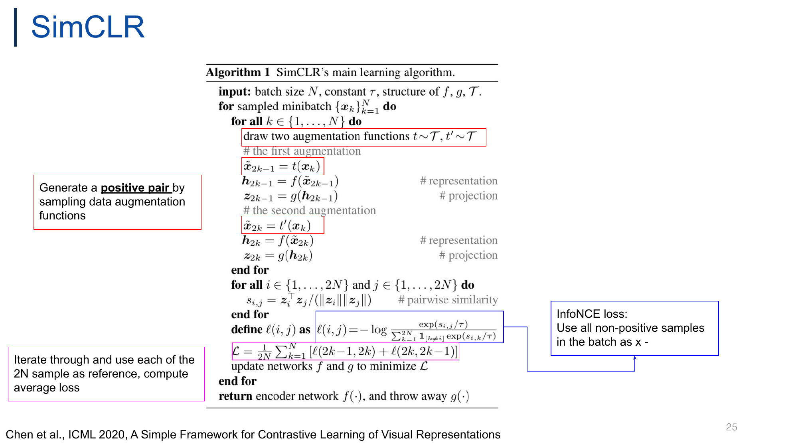
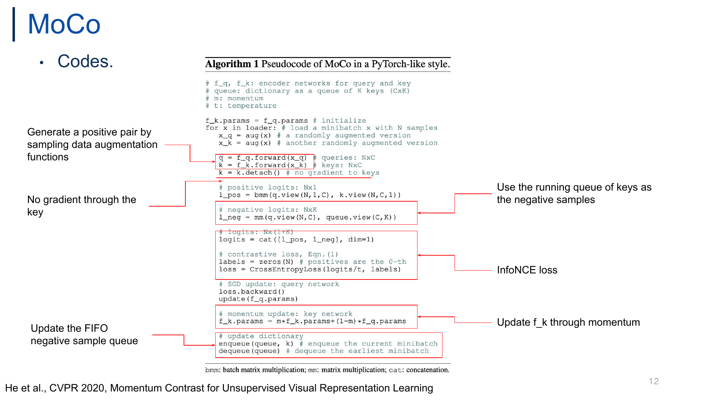
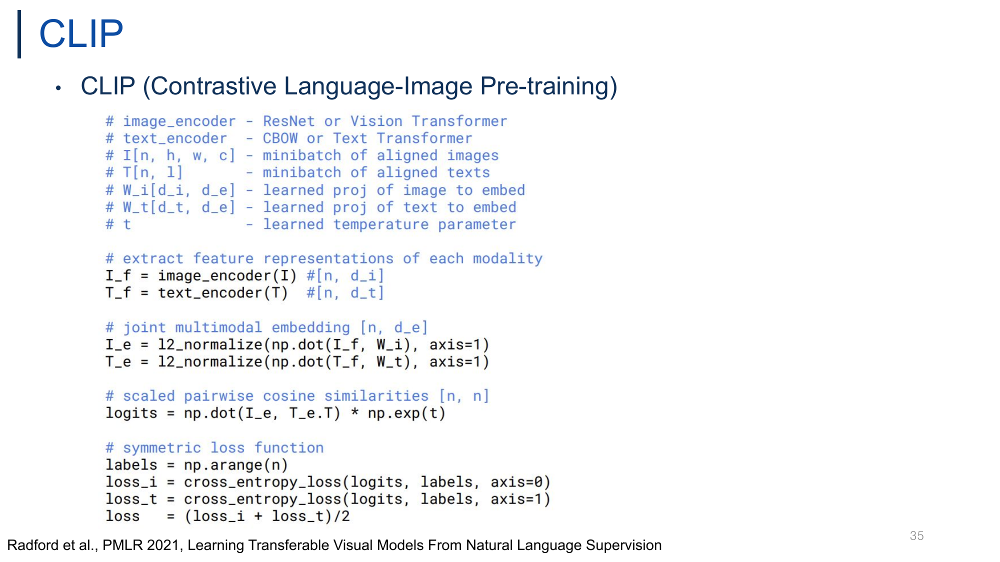
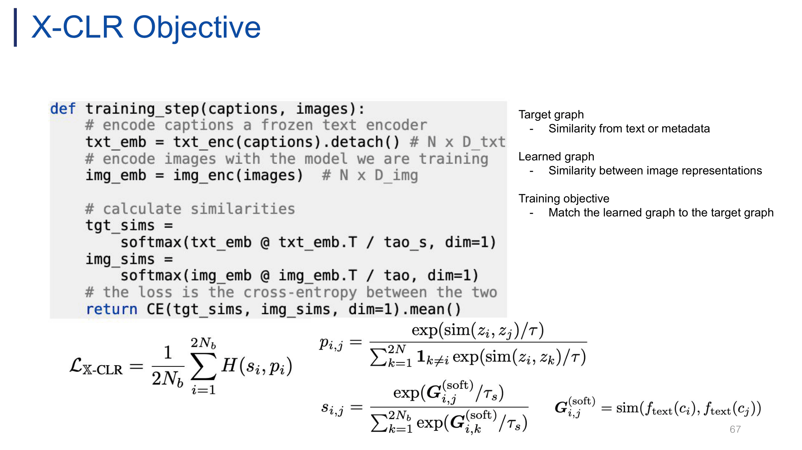
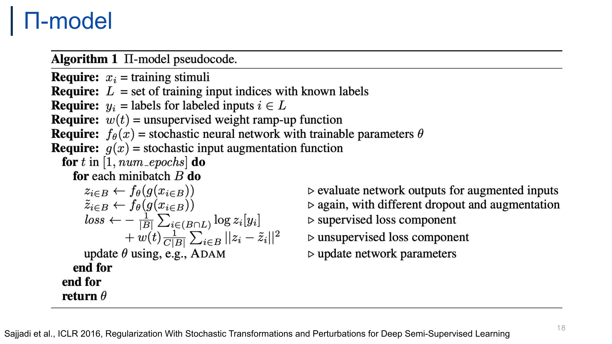
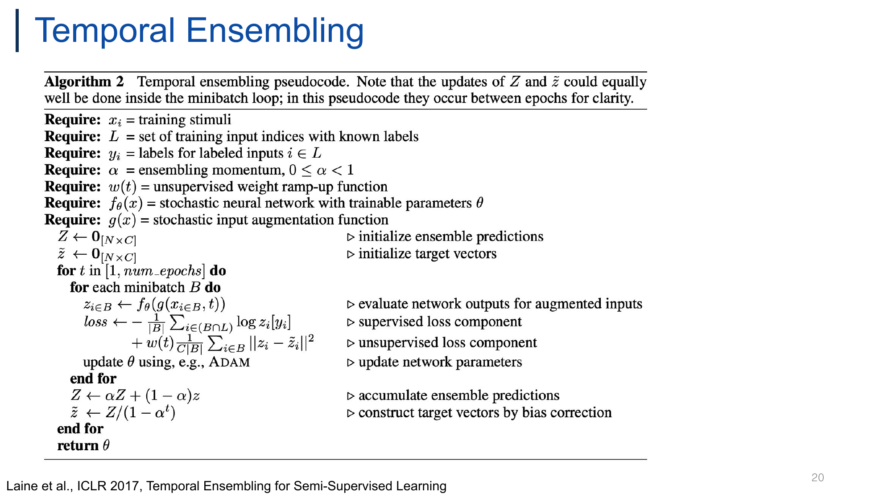

# 고급표현학습 중간고사 — Pseudo code 총정리 (L01–L07)

> **공지 (2026-10-22, 시험 전 마지막 수업)**: 퀴즈에 **빈칸 채우기(fill-in-the-blank)** 추가, **"pseudo code도 공부할 것"**. 완전 서술형은 없을 듯.
> 교수님이 pseudo code를 깊게 가르치진 않음 → 구현 디테일보다 **논문 core idea가 박힌 핵심 줄**이 나올 것. 그래도 **킬러 파트** 후보.
> 예상 유형: ① 핵심 줄 빈칸 (`k = k.______()`) ② "이 snippet은 어느 방법?" ③ "이 줄의 역할은?" / "X를 구현한 줄은?" ④ 코드 내용을 살짝 비튼 T/F.
> 문제 pool: `exam/_parts/pc_1~4_*.md` 의 **C. Question pool** (59문항, Opus 독립 검수 완료). 모의고사: `exam/mock_quiz_4~5.md`.

**범위 확인**: 슬라이드 508p 전부 육안 스캔 → **코드/Algorithm 박스는 아래 9개가 전부**. 번호만 붙은 단계형 절차는 맨 아래 [부록](#appendix).

## 목차

- [0. 한눈에 보기 — 9개 핵심 줄](#overview)
- [0.1 공통 패턴 — EMA · stop-gradient · labels · loss](#patterns)
- [0.2 함정 Top 12](#traps)
- [PC1. InfoNCE family — SimCLR · MoCo · CLIP](#pc1)
- [PC2. Self-distillation & soft targets — DINO · X-CLR · BYOL · DeepCluster](#pc2)
- [PC3. Consistency regularization — Π-model · Temporal Ensembling](#pc3)
- [PC4. Pseudo labeling — Label Propagation · DivideMix](#pc4)
- [부록. 단계형 절차 (Step lists)](#appendix)

---

<a id="overview"></a>

## 0. 한눈에 보기 — 9개 핵심 줄

| # | 방법 (강의 p.) | 형태 | 꼭 기억할 핵심 줄 | core idea 한 줄 |
|---|---|---|---|---|
| 1 | **X-CLR** (L03 p.67) | Python | `txt_emb = txt_enc(captions).detach()` · `tgt_sims = softmax(txt_emb @ txt_emb.T / tao_s)` · `CE(tgt_sims, img_sims)` | InfoNCE의 one-hot 정답을 **frozen text encoder의 soft similarity graph**로 교체 |
| 2 | **SimCLR** Alg.1 (L04 p.25) | 수식 박스 | `draw two augmentation functions t∼T, t′∼T` · $\ell(i,j)$의 $\mathbb 1_{[k\neq i]}$ · $\mathcal L=\frac{1}{2N}\sum_k[\ell(2k-1,2k)+\ell(2k,2k-1)]$ · `throw away g(·)` | 같은 이미지 두 view = positive, **같은 batch 나머지 $2N-2$개 = negative**, 양방향 평균, 끝나면 $g$ 버리고 $f$만 |
| 3 | **DINO** (L04 p.40) | PyTorch | `t = t.detach()` · `softmax((t - C) / tpt)` (center + sharpen) · `gt.params = l*gt.params + (1-l)*gs.params` · `C = m*C + (1-m)*cat([t1, t2]).mean(dim=0)` · `H(t1, s2)/2 + H(t2, s1)/2` | label 없는 **self-distillation**: student가 **EMA teacher**의 centered+sharpened 분포를 **다른 view**에서 CE로 따라감 |
| 4 | **MoCo** Alg.1 (L05 p.12) | PyTorch | `k = k.detach()` · `l_neg = mm(q.view(N,C), queue.view(C,K))` · `labels = zeros(N)` · `f_k.params = m*f_k.params+(1-m)*f_q.params` · `enqueue` / `dequeue` | **momentum encoder + FIFO queue** → batch size와 무관한 large & consistent dictionary |
| 5 | **CLIP** (L05 p.35) | numpy | `l2_normalize(np.dot(I_f, W_i), axis=1)` · `logits = np.dot(I_e, T_e.T) * np.exp(t)` · `labels = np.arange(n)` · `(loss_i + loss_t)/2` | image·text를 **shared embedding**으로, $n\times n$ 행렬의 **diagonal = positive**, axis 0/1 **symmetric** CE |
| 6 | **Π-model** Alg.1 (L06 p.18) | 수식 박스 | `z ← f_θ(g(x))` / `z̃ ← f_θ(g(x))` ▷ *again, with different dropout and augmentation* · $w(t)\frac{1}{C\lvert B\rvert}\sum_{i\in B}\lVert z_i-\tilde z_i\rVert^2$ | **같은 network를 다른 noise로 두 번 forward** → 출력 차이 MSE (label 없이 $B$ 전체에) |
| 7 | **Temporal Ensembling** Alg.2 (L06 p.20) | 수식 박스 | `Z ← αZ + (1−α)z` · `z̃ ← Z/(1−α^t)` (둘 다 **epoch 끝**) | target = **per-sample prediction EMA** (과거 예측 평균) → forward **1회**, 대신 $N\times C$ 메모리 + epoch당 1번 갱신 |
| 8 | **Label Propagation** Alg.1 (L07 p.11) | 수식 박스 | line 7–10: descriptor → kNN affinity → $W=A+A^\top$ → $\mathcal W=D^{-1/2}WD^{-1/2}$ · line 11: diffusion $(I-\alpha\mathcal W)Z=Y$ (CG) · line 13: $\arg\max$ · line 14: $\omega_i$ certainty | pseudo label을 자기 softmax가 아니라 **feature-space kNN graph 위 diffusion**으로, certainty로 weighting |
| 9 | **DivideMix** Alg.1 (L07 p.54) | 수식 박스 | line 4–8 **co-divide**: GMM on per-sample loss, **상대 net**용, $w_i\ge\tau$ → labeled / $<\tau$ → unlabeled · line 17–18 **co-refinement** $\bar y_b=w_by_b+(1-w_b)p_b$ · line 20 **co-guessing** $\frac{1}{2M}\sum_m(\theta^{(1)}+\theta^{(2)})$ · line 25 MixMatch | noisy label 문제를 **SSL로 재정의**, 두 network가 서로 데이터를 나눠줌 (confirmation bias↓) |

> 준-알고리즘 (본문 PC2에 같이 정리): **BYOL** 단계 (L04 p.32, predictor + EMA target + normalized MSE), **DeepCluster** Process (L05 p.24, k-means ↔ classification 교대).

<a id="patterns"></a>

### 0.1 공통 패턴 — EMA · stop-gradient · labels · loss

**무엇을 EMA 하나?** (방향은 항상 **느린 쪽 ← 빠른 쪽**: teacher/target/key가 student/online/query를 따라감)

| 방법 | EMA 대상 | 식 (슬라이드 표기) | momentum 기호 |
|---|---|---|---|
| MoCo (L05 p.12) | **key encoder** params | `f_k.params = m*f_k.params+(1-m)*f_q.params` | `m` |
| DINO (L04 p.40) | **teacher** params **+ center** (2개!) | `gt.params = l*gt.params + (1-l)*gs.params` / `C = m*C + (1-m)*...` | `l` (network), `m` (center) |
| BYOL (L04 p.30) | **target** params $\xi$ | $\xi \leftarrow \tau\xi + (1-\tau)\theta$ | $\tau$ (temperature 아님!) |
| Mean Teacher (L06 p.23–25) | **teacher weights** $\theta'$ | $\theta' \leftarrow \beta\theta' + (1-\beta)\theta$, 매 iteration | $\beta$ |
| Temporal Ensembling (L06 p.20) | **predictions** $Z$ (weight 아님!) | $Z \leftarrow \alpha Z + (1-\alpha)z$, epoch 끝 + bias correction | $\alpha$ |

→ **weight EMA**: MoCo · DINO · BYOL · Mean Teacher / **prediction EMA**: Temporal Ensembling만. DINO의 center는 parameter가 아니라 **teacher output 통계**의 EMA.

**어디서 gradient를 끊나?** (항상 **target 쪽**)

| 방법 | 끊는 줄 | 그래서 gradient 받는 쪽 |
|---|---|---|
| MoCo | `k = k.detach()  # no gradient to keys` | query encoder `f_q`만 (`update(f_q.params)`) |
| DINO | `t = t.detach()  # stop gradient` (in `H`) | student `gs`만 (`update(gs)`) |
| X-CLR | `txt_enc(captions).detach()` (frozen) | image encoder만 |
| BYOL | $\text{sg}(z')$ (p.30), "only parameters $\theta$ are optimized" | online network만 |
| DeepCluster | (cluster ID라 미분 경로 자체가 없음) | — |

**정답(labels / target)을 어떻게 만드나?**

| 방법 | target | 형태 |
|---|---|---|
| MoCo | `labels = zeros(N)` — positive를 logits **0번 column**에 concat | hard (index 0) |
| CLIP | `labels = np.arange(n)` — **diagonal** | hard (index $i$) |
| SimCLR | 명시적 labels 없음 — 분자에 positive $s_{i,j}$ 직접 | hard (pair index) |
| DINO | teacher의 **centered + sharpened softmax** | soft 분포 |
| X-CLR | text–text similarity softmax (`tgt_sims`) | soft 분포 |
| Π-model / TE | 두 번째 forward $\tilde z$ / 과거 예측 EMA $\tilde z = Z/(1-\alpha^t)$ | soft 벡터 |
| LP | diffusion 후 $\arg\max_j \hat z_{ij}$ + weight $\omega_i$ | hard + weight |
| DivideMix | refined $\bar y_b$ (clean) / co-guessed $\bar q_b$ (noisy) → Sharpen | soft |

**Loss 종류 & 대칭성**

| | CE / InfoNCE | MSE / L2 |
|---|---|---|
| 방법 | SimCLR · MoCo · CLIP (InfoNCE) / DINO · X-CLR · DeepCluster (CE) | BYOL (normalized MSE) / Π-model · TE ($\lVert z-\tilde z\rVert^2$) / MixMatch unlabeled (L2) |

- **Symmetric**: SimCLR ($\ell(2k-1,2k)+\ell(2k,2k-1)$), CLIP (axis 0 + axis 1), DINO (`H(t1,s2)+H(t2,s1)`, 교차), BYOL ($\mathcal L+\tilde{\mathcal L}$, view switch). **MoCo는 한 방향** (query → keys).
- **Temperature 위치**: SimCLR `/τ`, MoCo `logits/t`, DINO `s/tps`·`(t-C)/tpt`, X-CLR `/tao`·`/tao_s` → **나눔** / CLIP만 `* np.exp(t)` (**곱함**, learned).

<a id="traps"></a>

### 0.2 함정 Top 12 (T/F·MCQ에서 비틀기 좋은 곳)

1. MoCo: `k.detach()` → gradient는 **query** encoder로만. key encoder는 **momentum**으로만 갱신 (`f_q` ↔ `f_k` 뒤바꾸기 함정).
2. MoCo: `labels = zeros(N)` (positive = 0번째) ↔ CLIP: `labels = np.arange(n)` (diagonal). 서로 바꿔치기 단골.
3. MoCo: enqueue/dequeue는 loss·update **이후** → 현재 batch key는 이번 step에선 negative 아님. dequeue는 **earliest** minibatch.
4. SimCLR: negative 수 = $2N-2$ (softmax 크기 $2N-1$). 학습 후 **$g$ 버리고 $f$ 사용**.
5. CLIP: temperature를 **곱함** (`* np.exp(t)`), learned. encoder는 image/text **서로 다른** 2개.
6. DINO: centering + sharpening은 **teacher 쪽에만** (`(t - C) / tpt`). student는 `softmax(s / tps)`만.
7. DINO: center `C`는 **teacher output** 평균의 EMA (student output 아님). `l`은 숫자 1이 아니라 소문자 L.
8. DINO: loss는 **교차 view** `H(t1, s2)`, `H(t2, s1)` — 같은 view끼리 비교 안 함.
9. Π-model: 두 줄이 글자상 똑같은 건 **stochastic**(dropout + augmentation)이라서. forward **2회**. unsupervised 항은 $i\in B$ **전체** (labeled + unlabeled), supervised 항은 $B\cap L$만.
10. TE: EMA 대상은 **predictions** (weights 아님), 갱신은 **epoch 끝**, $\tilde z = Z/(1-\alpha^t)$ = **bias correction**. Mean Teacher는 **weights** EMA, **매 iteration**.
11. LP: pseudo label 출처는 **graph diffusion** (자기 softmax 아님). 불확실한 label은 버리지 않고 **certainty $\omega_i$로 weighting**, $\zeta_j$는 **class balancing**.
12. DivideMix: $\theta^{(1)}$의 loss로 만든 분할은 **$\theta^{(2)}$용** (상대 net). co-**refinement** = clean(labeled)용, 자기 net 예측 + 상대 net의 $w_b$ / co-**guessing** = noisy(unlabeled)용, **두 net** 평균. DivideMix는 새 학습 알고리즘이 아니라 **MixMatch용 데이터 분할 방법**.

---


<a id="pc1"></a>

## PC1. InfoNCE family (SimCLR · MoCo · CLIP)


> 교수님: *"study the pseudo code"* → 구현 디테일이 아니라 **"논문의 core idea가 코드 어느 줄에 박혀 있나"** 를 묻는다고 보고 정리함. 세 방법 모두 loss의 뼈대는 **InfoNCE = positive 1개 vs negatives의 softmax cross-entropy** 이고, 차이는 **negative를 어디서 가져오나 / label을 어떻게 만드나 / gradient가 어디로 흐르나** 뿐임.

### A. Annotated pseudo code

#### SimCLR (Chen et al., ICML 2020) — L04 p.25



**Transcription** (Algorithm 1, 수식형 pseudo code — 슬라이드 렌더 그대로)

```
Algorithm 1  SimCLR's main learning algorithm.

input: batch size N, constant τ, structure of f, g, T.
for sampled minibatch {x_k}_{k=1}^{N} do
    for all k ∈ {1, ..., N} do
        draw two augmentation functions t∼T, t′∼T
        # the first augmentation
        x̃_{2k−1} = t(x_k)
        h_{2k−1} = f(x̃_{2k−1})                    # representation
        z_{2k−1} = g(h_{2k−1})                     # projection
        # the second augmentation
        x̃_{2k} = t′(x_k)
        h_{2k} = f(x̃_{2k})                        # representation
        z_{2k} = g(h_{2k})                         # projection
    end for
    for all i ∈ {1, ..., 2N} and j ∈ {1, ..., 2N} do
        s_{i,j} = z_iᵀ z_j / (‖z_i‖ ‖z_j‖)         # pairwise similarity
    end for
    define ℓ(i,j) as  ℓ(i,j) = −log [ exp(s_{i,j}/τ) / Σ_{k=1}^{2N} 1_[k≠i] exp(s_{i,k}/τ) ]
    L = 1/(2N) Σ_{k=1}^{N} [ ℓ(2k−1, 2k) + ℓ(2k, 2k−1) ]
    update networks f and g to minimize L
end for
return encoder network f(·), and throw away g(·)
```

$$\ell(i,j) = -\log\frac{\exp(s_{i,j}/\tau)}{\sum_{k=1}^{2N}\mathbb{1}_{[k\neq i]}\exp(s_{i,k}/\tau)},\qquad \mathcal{L} = \frac{1}{2N}\sum_{k=1}^{N}\big[\ell(2k-1,2k)+\ell(2k,2k-1)\big]$$

슬라이드 callout (박스 → 대상 줄)
- 빨간 박스 "**Generate a positive pair by sampling data augmentation functions**" → `draw two augmentation functions t∼T, t′∼T`, $\tilde x_{2k-1}=t(x_k)$, $\tilde x_{2k}=t'(x_k)$
- 파란 박스 "**InfoNCE loss: Use all non-positive samples in the batch as x -**" → $\ell(i,j)$ 정의 ← "x -"는 $x^-$ (negative) 위첨자가 깨진 표기로 보임 (원문 유지)
- 분홍 박스 "**Iterate through and use each of the 2N sample as reference, compute average loss**" → $\mathcal L$ 줄 ← "each of the 2N sample**s**" 문법 오타 (원문 유지)
- 읽기 주의: $k$가 **두 가지 의미**로 재사용됨 — (i) 이미지 index: $x_k$, `for all k`, $\mathcal L$의 $\sum_{k=1}^{N}$ (k번째 이미지의 두 view = $2k-1, 2k$) / (ii) 분모의 dummy index $\sum_{k=1}^{2N}$ (2N개 view 전체를 훑음). 오타는 아니고 논문 표기 그대로.

**핵심 줄 (Key lines)**

| line | what it does | which core idea it implements | 빈칸 후보 |
|---|---|---|---|
| `draw two augmentation functions t∼T, t′∼T` → $\tilde x_{2k-1}=t(x_k)$, $\tilde x_{2k}=t'(x_k)$ | 같은 $x_k$에서 두 view 생성 → index $(2k-1, 2k)$가 positive pair | **augmentation이 곧 supervision** — "maximizing agreement between differently augmented views of the same sample" (p.23) | augmentation, $t'$ |
| $h=f(\tilde x)$ `# representation`, $z=g(h)$ `# projection` | base encoder $f$ → $h$, projection head $g$ → $z$ | loss는 **projection head 출력 $z$** 위에서 계산 (p.24) | representation / projection |
| $s_{i,j}=z_i^\top z_j/(\lVert z_i\rVert\lVert z_j\rVert)$ | $2N\times 2N$ 모든 쌍의 cosine similarity | in-batch 전체를 비교 대상으로 씀 (memory bank·queue 없음) | cosine, pairwise similarity |
| $\ell(i,j)$ with $\mathbb{1}_{[k\neq i]}$ | anchor $i$ 기준 $(2N-1)$-way softmax CE, 정답 = positive $j$ | **InfoNCE / NT-Xent**, negatives = 같은 batch의 나머지 **$2N-2$개** ("Use all non-positive samples in the batch") | $\mathbb{1}_{[k\neq i]}$, $\tau$, $2N$ |
| $\mathcal L=\frac{1}{2N}\sum_{k=1}^N[\ell(2k-1,2k)+\ell(2k,2k-1)]$ | 두 view가 번갈아 anchor → $2N$개 평균 | **symmetric**: 2N개 sample 모두 reference로 한 번씩 | $2N$, $2k-1$ |
| `return encoder network f(·), and throw away g(·)` | downstream엔 $f$(즉 $h$)만 사용 | $z$는 augmentation에 invariant → 정보 손실, $g$가 흡수 → **$h$에 정보 보존** (p.28) | $g(\cdot)$, $f(\cdot)$ |

**Pseudo code ↔ core idea 한 줄**: 같은 $x_k$에서 뽑은 $t,t'$ 두 view를 positive로, **같은 batch의 나머지 $2N-2$개를 negative**로 놓고 $\mathbb{1}_{[k\neq i]}$ InfoNCE를 **양방향 평균** → 학습 끝나면 **$g$ 버리고 $f$만** 남김. negative가 batch에서만 나오니 **large batch 필수** (p.24, p.29).

- Implementation trivia (low priority): large batch → backprop 메모리 커서 **TPU 분산 학습** (p.29).

---

#### MoCo (He et al., CVPR 2020) — L05 p.12



**Transcription** (Algorithm 1: Pseudocode of MoCo in a PyTorch-like style — 슬라이드 렌더 그대로)

```python
# f_q, f_k: encoder networks for query and key
# queue: dictionary as a queue of K keys (CxK)
# m: momentum
# t: temperature

f_k.params = f_q.params # initialize
for x in loader: # load a minibatch x with N samples
   x_q = aug(x) # a randomly augmented version
   x_k = aug(x) # another randomly augmented version

   q = f_q.forward(x_q) # queries: NxC
   k = f_k.forward(x_k) # keys: NxC
   k = k.detach() # no gradient to keys

   # positive logits: Nx1
   l_pos = bmm(q.view(N,1,C), k.view(N,C,1))

   # negative logits: NxK
   l_neg = mm(q.view(N,C), queue.view(C,K))

   # logits: Nx(1+K)
   logits = cat([l_pos, l_neg], dim=1)

   # contrastive loss, Eqn.(1)
   labels = zeros(N) # positives are the 0-th
   loss = CrossEntropyLoss(logits/t, labels)

   # SGD update: query network
   loss.backward()
   update(f_q.params)

   # momentum update: key network
   f_k.params = m*f_k.params+(1-m)*f_q.params

   # update dictionary
   enqueue(queue, k) # enqueue the current minibatch
   dequeue(queue) # dequeue the earliest minibatch
```
슬라이드 하단 주석: *bmm: batch matrix multiplication; mm: matrix multiplication; cat: concatenation.*

슬라이드 callout (박스/화살표 → 대상 줄)
- 좌 "**Generate a positive pair by sampling data augmentation functions**" → `q = f_q.forward(x_q)` / `k = f_k.forward(x_k)` 박스 ← 화살표가 `aug(x)` 두 줄이 아니라 **forward 두 줄**을 가리킴 (실제 augmentation은 `x_q = aug(x)`, `x_k = aug(x)`). 원문 유지
- 좌 "**No gradient through the key**" → `k = k.detach()` 줄 밑줄
- 우 "**Use the running queue of keys as the negative samples**" → `l_neg` 박스
- 우 "**InfoNCE loss**" → `logits` / `labels` / `loss` 박스 ← 박스 윗변이 `# logits: Nx(1+K)` 주석 줄을 가로질러 취소선처럼 보임 (내용은 그대로 주석)
- 우 "**Update f_k through momentum**" → momentum update 박스
- 좌 "**Update the FIFO negative sample queue**" → `enqueue` / `dequeue` 박스

**핵심 줄 (Key lines)**

| line | what it does | which core idea it implements | 빈칸 후보 |
|---|---|---|---|
| `k = k.detach()  # no gradient to keys` | key 쪽으로 gradient 차단 → `update(f_q.params)`로 **query encoder만 SGD** | "Compute gradients and update the encoder only through the queries" (p.11) — key encoder는 backprop 안 함 | `detach` |
| `l_pos = bmm(q.view(N,1,C), k.view(N,C,1))` | 각 query와 **자기 key만** 내적 → $N\times1$ | positive = 같은 $x$의 다른 augmentation을 key encoder에 통과시킨 key | `bmm`, `Nx1` |
| `l_neg = mm(q.view(N,C), queue.view(C,K))` | 각 query vs **queue의 K개 key** → $N\times K$ | "running queue of keys as the negative samples" → negative 수 $K$가 **batch size와 decouple** (p.11) | `queue`, `K`, `NxK` |
| `logits = cat([l_pos, l_neg], dim=1)` + `labels = zeros(N)` + `CrossEntropyLoss(logits/t, labels)` | positive를 **0번 column**에 붙이고 $(1+K)$-way CE | **InfoNCE를 일반 CE로 구현**: 모든 query의 정답 class = 0 | `zeros`, `0-th`, `1+K` |
| `f_k.params = m*f_k.params+(1-m)*f_q.params` | key encoder = query encoder의 **EMA** | **momentum encoder** → key encoder가 "slowly progressing" → queue 속 key들이 **consistent** (p.11, p.14) | `m`, `(1-m)` |
| `enqueue(queue, k)` / `dequeue(queue)` | 현재 batch의 **key**를 넣고 **가장 오래된(earliest)** batch를 뺌 | **FIFO queue** = memory bank를 대체하는 large & consistent dictionary (p.10) | `k`, `earliest` |

**Pseudo code ↔ core idea 한 줄**: `k.detach()` + momentum 줄 = **key encoder는 backprop 없이 EMA로만 천천히 변함(consistent keys)**, `l_neg`의 `queue` + 끝의 enqueue/dequeue = **batch size와 무관한 large dictionary**, `zeros(N)` = InfoNCE를 $(1+K)$-way CE로 구현. → "Replace the memory bank with a momentum-updated queue" (p.10).

- 순서 포인트: queue 갱신(enqueue/dequeue)은 loss·update **이후** → 현재 batch의 key는 이번 step에선 자기 query의 positive로만 쓰이고, negative로는 **다음 batch부터** 쓰임.
- Implementation trivia (low priority): 논문은 BN을 통한 batch 내 정보 leak을 막는 **Shuffling BN**을 쓰지만 pseudo code에선 생략 (슬라이드에 없음).

---

#### CLIP (Radford et al., PMLR 2021) — L05 p.35



**Transcription** (numpy-like pseudo code — 슬라이드 렌더 그대로, callout 박스 없음)

```python
# image_encoder - ResNet or Vision Transformer
# text_encoder  - CBOW or Text Transformer
# I[n, h, w, c] - minibatch of aligned images
# T[n, l]       - minibatch of aligned texts
# W_i[d_i, d_e] - learned proj of image to embed
# W_t[d_t, d_e] - learned proj of text to embed
# t             - learned temperature parameter

# extract feature representations of each modality
I_f = image_encoder(I) #[n, d_i]
T_f = text_encoder(T)  #[n, d_t]

# joint multimodal embedding [n, d_e]
I_e = l2_normalize(np.dot(I_f, W_i), axis=1)
T_e = l2_normalize(np.dot(T_f, W_t), axis=1)

# scaled pairwise cosine similarities [n, n]
logits = np.dot(I_e, T_e.T) * np.exp(t)

# symmetric loss function
labels = np.arange(n)
loss_i = cross_entropy_loss(logits, labels, axis=0)
loss_t = cross_entropy_loss(logits, labels, axis=1)
loss   = (loss_i + loss_t)/2
```

- 모호한 점: `loss_i`(axis=0) / `loss_t`(axis=1)가 각각 image→text인지 text→image인지는 슬라이드가 `cross_entropy_loss`의 axis 의미를 정의하지 않아서 **해석이 갈림** (원본 코드 그대로). → 시험 대비로는 **"axis만 다른 두 CE를 평균 = symmetric"** 까지만 확실히 기억.

**핵심 줄 (Key lines)**

| line | what it does | which core idea it implements | 빈칸 후보 |
|---|---|---|---|
| `I_f = image_encoder(I)`, `T_f = text_encoder(T)` | modality마다 **별도 encoder** (ResNet/ViT, CBOW/Text Transformer) | "Jointly learns image and text representations" (p.32) | `image_encoder`, `text_encoder` |
| `I_e = l2_normalize(np.dot(I_f, W_i), axis=1)` (T_e 동일) | learned projection $W_i, W_t$로 서로 다른 차원 $d_i, d_t$ → 공통 $d_e$, 그다음 L2 normalize | **shared (joint multimodal) embedding space**; normalize했으니 dot = cosine | `l2_normalize`, `W_i`, `d_e` |
| `logits = np.dot(I_e, T_e.T) * np.exp(t)` | $n\times n$ image–text cosine similarity matrix × scale | **N×N similarity matrix** (p.33) + **learned temperature** ($e^{t}$ 곱함, MoCo처럼 `/t` 아님) | `np.exp(t)`, `[n, n]`, cosine |
| `labels = np.arange(n)` | $i$번째 이미지의 정답 = $i$번째 text → **diagonal** | matched (image, caption) pair = positive, 같은 row/column의 나머지 $n-1$개 = **in-batch negatives** | `arange` |
| `loss_i ... axis=0`, `loss_t ... axis=1`, `loss = (loss_i + loss_t)/2` | 같은 logits·labels로 두 방향 CE 후 평균 | **symmetric contrastive loss** (p.33) | `axis`, `symmetric`, `/2` |

**Pseudo code ↔ core idea 한 줄**: 두 modality를 각자 encode → **learned projection + L2 norm으로 shared space** → $n\times n$ cosine matrix에서 **diagonal(`arange(n)`)을 정답**으로 axis 0/1 양방향 CE 평균 = **symmetric contrastive loss**. positive가 augmentation이 아니라 **자연어 caption**이라는 게 SimCLR와의 핵심 차이 (p.32).

- Implementation trivia (low priority): `t`는 log-scale parameter라 `np.exp(t)`로 항상 양수 scale을 보장 (> 보충, 슬라이드엔 "learned temperature parameter"만).

---

### B. Cross-method comparison

| | **SimCLR** (L04 p.25) | **MoCo** (L05 p.12) | **CLIP** (L05 p.35) |
|---|---|---|---|
| Positive | 같은 $x_k$의 두 augmented view ($2k-1$, $2k$) | 같은 $x$의 두 aug: query $q$ ↔ 자기 key $k$ (`l_pos`) | matched (image, caption) pair = **diagonal** |
| Negatives 출처 | **in-batch**: $2N-2$개 (anchor·positive 제외) | **queue**: $K$개 (`l_neg`; 현재 batch의 다른 key는 이번 step엔 안 씀) | **in-batch**: 방향당 $n-1$개 (같은 row/column의 off-diagonal) |
| softmax 크기 (anchor당) | $2N-1$ ($\mathbb 1_{[k\neq i]}$) | $1+K$ (`Nx(1+K)`) | $n$ |
| `labels` 구성 | 명시적 labels 없음 — 분자에 $s_{i,j}$로 positive를 직접 지정 | `zeros(N)` — positive를 **0번 column**에 concat | `np.arange(n)` — positive = **diagonal** |
| Symmetric? | **Yes** — $\ell(2k-1,2k)+\ell(2k,2k-1)$, $\frac{1}{2N}$ | **No** — query→keys 한 방향 | **Yes** — axis=0 + axis=1, `/2` |
| Similarity / temperature | cosine $s_{i,j}$, constant $\tau$ (`/τ`) | `q·k` 내적, `logits/t` | cosine (`l2_normalize`), `* np.exp(t)` (**learned** t) |
| Encoder 구성 | 하나의 $f$ (+ $g$)를 두 view가 공유 | 같은 구조 2개: $f_q$, $f_k$ (`f_k.params = f_q.params # initialize`) | **서로 다른** 2개: image encoder, text encoder (+ $W_i$, $W_t$) |
| Gradient 받는 것 | $f$와 $g$ ("update networks f and g") | **$f_q$만** (`k.detach()`, `update(f_q.params)`) | image/text encoder, $W_i$, $W_t$, $t$ 모두 |
| Momentum-updated | 없음 | **$f_k$** (EMA of $f_q$) | 없음 |
| 학습 후 버리는 것 | **$g(\cdot)$ 버림**, $f$ 사용 | 슬라이드 명시 없음 (> 보충: 논문은 $f_q$를 downstream에 사용) | 없음 — 추론 때 두 encoder 다 씀 (image + text prompt, p.33) |
| 큰 negative 수를 얻는 방법 | **large batch** (p.29) | **queue** — batch size와 decouple | **large batch** (in-batch) ← 슬라이드엔 명시 없음 (> 보충: 논문 batch 32,768) |

> 문제 pool: [`exam/_parts/pc_1_infonce.md`](_parts/pc_1_infonce.md) — C. Question pool

---


<a id="pc2"></a>

## PC2. Self-distillation & soft targets (DINO · X-CLR · BYOL · DeepCluster)


> 이 그룹 공통 질문: **"정답(target)을 어디서 만들어 오나?"**
> DINO = EMA teacher의 softmax 분포 / X-CLR = frozen text encoder의 similarity graph / BYOL = EMA target network의 projection / DeepCluster = k-means cluster ID.
> 공통점: **target 쪽으로는 gradient가 안 흐름** (`detach()` / `sg` / 이산 cluster ID). pseudo code 문제는 거의 다 "그 target을 만드는 줄"과 "gradient를 막는 줄"을 물어볼 거라고 보면 됨.

---

### A. Annotated pseudo code

#### DINO (Caron et al., ICCV 2021) — L04 p.40


**Transcription** (slide 오른쪽, 캡션: **Algorithm 1** DINO PyTorch pseudocode w/o multi-crop.)

```python
# gs, gt: student and teacher networks
# C: center (K)
# tps, tpt: student and teacher temperatures
# l, m: network and center momentum rates
gt.params = gs.params
for x in loader: # load a minibatch x with n samples
    x1, x2 = augment(x), augment(x) # random views

    s1, s2 = gs(x1), gs(x2) # student output n-by-K
    t1, t2 = gt(x1), gt(x2) # teacher output n-by-K

    loss = H(t1, s2)/2 + H(t2, s1)/2
    loss.backward() # back-propagate

    # student, teacher and center updates
    update(gs) # SGD
    gt.params = l*gt.params + (1-l)*gs.params
    C = m*C + (1-m)*cat([t1, t2]).mean(dim=0)

def H(t, s):
    t = t.detach() # stop gradient
    s = softmax(s / tps, dim=1)
    t = softmax((t - C) / tpt, dim=1) # center + sharpen
    return - (t * log(s)).sum(dim=1).mean()
```

코드 아래 수식 (slide 그대로):

$$c \leftarrow mc + (1-m)\frac{1}{B}\sum_{i=1}^{B} g_{\theta_t}(x_i),$$

slide 왼쪽 그림: $x \to x_1 \to$ **student $g_{\theta_s}$** $\to$ softmax $\to p_1$ / $x \to x_2 \to$ **teacher $g_{\theta_t}$** $\to$ **centering** $\to$ softmax $\to$ **sg** $\to p_2$ / student → teacher 화살표 "ema" / loss: $-p_2\log p_1$.

- ← **`l`은 소문자 L** (헤더 주석 `# l, m: network and center momentum rates`). slide 폰트(Courier)에서 숫자 `1`과 거의 똑같이 생겨서 `1*gt.params + (1-1)*gs.params`로 읽히기 쉬움 → 그렇게 읽으면 teacher가 영원히 안 변하는 말이 안 되는 식. `l` = network momentum ($\lambda$).
- ← 수식은 소문자 $c$, 코드는 대문자 `C` (같은 center). 수식은 batch $B$개 평균, 코드는 `cat([t1, t2])` = 두 view 합친 $2n$개 평균. 표기 차이일 뿐 의미 같음 (원문 유지).
- ← 그림은 $x_1$→student, $x_2$→teacher 한 방향만 + loss $-p_2\log p_1$. 코드는 두 view를 **둘 다** student/teacher에 넣고 **교차 대칭** loss → 그림은 단순화.
- slide엔 "$\tau_t < \tau_s$" 같은 부등식·수치가 없음. sharpening 근거는 `# center + sharpen` 주석이 전부.

**핵심 줄 (Key lines)**

| line | what it does | which core idea it implements | 빈칸 후보 |
|---|---|---|---|
| `gt.params = l*gt.params + (1-l)*gs.params` | teacher = student parameter의 **EMA**. teacher는 SGD 안 받음 | **Self-distillation without labels** — teacher를 외부 pretrained 모델이 아니라 **student 자신의 EMA**로 만듦 (p.39 "Update the teacher using an EMA of the student parameters") | `l`, `gs.params`, "EMA" |
| `loss = H(t1, s2)/2 + H(t2, s1)/2` | view 1의 teacher 분포 ↔ view 2의 student 분포 (교차), 대칭 평균. `H(t1, s1)` 같은 같은-view 쌍은 없음 | student가 **다른 view**에 대한 teacher 출력을 맞히게 → augmentation-invariant | `s2`, `s1`, `/2` |
| `t = t.detach() # stop gradient` | teacher 출력으로 gradient 차단 | teacher는 backprop 대상 아님 (그림의 **sg**) | `detach`, "stop gradient" |
| `t = softmax((t - C) / tpt, dim=1) # center + sharpen` | teacher logit에서 center 빼기(**centering**) + 낮은 teacher temperature로 나누기(**sharpening**) | negative 없이 **collapse 방지**. **teacher 쪽에만** 적용 (student는 `softmax(s / tps)`만) | `C`, `tpt`, "center", "sharpen" |
| `C = m*C + (1-m)*cat([t1, t2]).mean(dim=0)` | center = **teacher 출력** batch 평균의 EMA ($c \leftarrow mc + (1-m)\frac1B\sum g_{\theta_t}(x_i)$) | centering의 기준값. DINO는 EMA가 **두 개** (teacher params + center) | `t1, t2`, `m`, "teacher" |
| `return - (t * log(s)).sum(dim=1).mean()` | teacher 분포 $P_t$ → student 분포 $P_s$의 **cross-entropy** $-\sum_k P_t^{(k)}\log P_s^{(k)}$ | **Distribution matching** (BYOL의 feature matching·MSE와 대비, p.41) | "cross-entropy", `log(s)` |

**Pseudo code ↔ core idea 한 줄**: student(`gs`)는 SGD로, teacher(`gt`)는 student의 EMA로 갱신하고, student가 **다른 view**에 대한 teacher의 **centered + sharpened softmax 분포**를 CE로 따라감 → label 없는 self-distillation.

> 보충 (논문, slide엔 없음): centering만 하면 분포가 **uniform** 쪽으로, sharpening만 하면 **한 차원이 지배**하는 쪽으로 무너지려는 경향 → 반대 방향 두 효과가 균형을 잡아서 negative 없이 collapse 회피. 논문 값 $\tau_s=0.1$, $\tau_t$ 0.04→0.07 warmup. 원 논문은 multi-crop (student는 모든 crop, teacher는 global crop만) — slide 제목 "w/o multi-crop".

Implementation trivia (low priority): `dim=1` = K개 output 차원 방향 softmax, `.mean(dim=0)` = batch 축 평균이라 center는 K차원 벡터 (`# C: center (K)`), 출력 shape `n-by-K`.

---

#### X-CLR (Sobal et al., ICLR 2025) — L03 p.67



**Transcription** (slide 왼쪽 코드)

```python
def training_step(captions, images):
    # encode captions a frozen text encoder
    txt_emb = txt_enc(captions).detach() # N x D_txt
    # encode images with the model we are training
    img_emb = img_enc(images)  # N x D_img

    # calculate similarities
    tgt_sims =
        softmax(txt_emb @ txt_emb.T / tao_s, dim=1)
    img_sims =
        softmax(img_emb @ img_emb.T / tao, dim=1)
    # the loss is the cross-entropy between the two
    return CE(tgt_sims, img_sims, dim=1).mean()
```

slide 오른쪽: **Target graph** — Similarity from text or metadata / **Learned graph** — Similarity between image representations / **Training objective** — Match the learned graph to the target graph.

slide 아래 수식:

$$\mathcal{L}_{\mathbb{X}\text{-CLR}} = \frac{1}{2N_b}\sum_{i=1}^{2N_b} H(s_i, p_i)$$

$$p_{i,j} = \frac{\exp(\text{sim}(z_i,z_j)/\tau)}{\sum_{k=1}^{2N}\mathbf{1}_{k\neq i}\exp(\text{sim}(z_i,z_k)/\tau)} \qquad s_{i,j} = \frac{\exp(\boldsymbol{G}^{(\text{soft})}_{i,j}/\tau_s)}{\sum_{k=1}^{2N_b}\exp(\boldsymbol{G}^{(\text{soft})}_{i,k}/\tau_s)} \qquad \boldsymbol{G}^{(\text{soft})}_{i,j} = \text{sim}\big(f_\text{text}(c_i), f_\text{text}(c_j)\big)$$

- ← 주석 "encode captions **a** frozen text encoder" — "with" 빠진 문법 오타 (원문 유지).
- ← `tao`, `tao_s` = $\tau$, $\tau_s$ (tau 철자, 원문 유지).
- ← **대각항 불일치 (slide에서 직접 확인)**: 수식 $p_{i,j}$ 분모엔 $\mathbf{1}_{k\neq i}$ (자기 자신 제외)가 있는데 코드 `img_sims = softmax(img_emb @ img_emb.T / tao, dim=1)`엔 masking이 없어서 대각(자기 자신) 포함. 반면 target 쪽은 수식 $s_{i,j}$도 코드 `tgt_sims`도 **둘 다 mask 없음** → 불일치는 **learned graph($p$ ↔ `img_sims`) 쪽만**. (notes 03 §7.4의 플래그를 이렇게 좁혀서 읽으면 됨)
- ← 크기 불일치: 코드는 이미지당 1개, `N x D_txt` (N개). 수식은 2 view 기준 $2N_b$개, 게다가 $p_{i,j}$ 분모 상한만 $2N$ (나머지는 $2N_b$).
- ← 수식은 $\text{sim}(\cdot)$, 코드는 normalize 없이 raw dot product `@` → pseudo code 단순화.
- `CE(tgt_sims, img_sims, dim=1)`: 이미 softmax된 두 분포를 넣는 표기 = $H(s_i, p_i) = -\sum_j s_{i,j}\log p_{i,j}$. 인자 순서 **(target, prediction)** 이 수식 $H(s_i,p_i)$와 같음 (DINO의 `H(t, s)`도 target 먼저).

**핵심 줄 (Key lines)**

| line | what it does | which core idea it implements | 빈칸 후보 |
|---|---|---|---|
| `txt_emb = txt_enc(captions).detach()` | **frozen** text encoder로 caption 임베딩, gradient 차단 | target graph는 **외부 지식(text/metadata)** 에서 오고 학습 내내 **고정**. 학습되는 건 image encoder뿐 (p.66 "A fixed text encoder…") | `detach`, "frozen", "text" |
| `tgt_sims = softmax(txt_emb @ txt_emb.T / tao_s, dim=1)` | text–text similarity N×N → row-wise softmax = **target graph** $s_i$ | **Binary graph → soft similarity graph** (p.65). `tao_s`($\tau_s$)가 target을 얼마나 soft하게 할지 결정 (p.68) | `txt_emb.T`, `tao_s` |
| `img_sims = softmax(img_emb @ img_emb.T / tao, dim=1)` | image–image similarity → **learned graph** $p_i$ | batch 안 다른 샘플들과 비교하는 InfoNCE식 softmax 그대로 | `img_emb.T`, `tao` |
| `return CE(tgt_sims, img_sims, dim=1).mean()` | target graph ↔ learned graph의 **cross-entropy** | **InfoNCE의 one-hot label을 soft label로 교체**. "Match the learned graph to the target graph" | "CE", "cross-entropy" |

**Pseudo code ↔ core idea 한 줄**: InfoNCE의 one-hot 정답 행 대신 **frozen text encoder가 준 soft similarity 분포**(`tgt_sims`)를 정답으로 놓고, image similarity 분포(`img_sims`)가 그걸 CE로 따라가게 함 → "개는 피아노보다 고양이에 가깝다"를 학습.

- $\tau_s$ (p.68): **low** → strongest positive에 집중 → standard contrastive learning과 비슷 / **high** → related sample에 weight ↑ → target graph가 softer.
- **vs CLIP (L05 p.35)**: CLIP은 image–text **cross** similarity `np.dot(I_e, T_e.T) * np.exp(t)` + one-hot `labels = np.arange(n)`, text encoder도 같이 학습. X-CLR은 text–text(target)와 image–image(learned)를 **따로** 계산 → 두 modality를 공통 공간으로 맞출 필요 없음(`D_txt`와 `D_img`가 달라도 됨), text는 supervision 제공자일 뿐.

Implementation trivia (low priority): shape 주석 `N x D_txt`, `N x D_img`.

---

#### BYOL (Grill et al., NeurIPS 2020) — L04 p.32 (step list)

**Transcription** (slide bullet 그대로)

- Create two augmented views: $\mathbf{v} = t(\mathbf{x});\ \mathbf{v}' = t'(\mathbf{x})$ with augmentations sampled $t \sim \mathcal{T}, t' \sim \mathcal{T}'$;
- Then they are encoded into representations, $\mathbf{y}_\theta = f_\theta(\mathbf{v}), \mathbf{y}' = f_\xi(\mathbf{v}')$;
- Then they are projected into latent variables, $\mathbf{z}_\theta = g_\theta(\mathbf{y}_\theta), \mathbf{z}' = g_\xi(\mathbf{y}')$;
- The online network outputs a prediction $q_\theta(\mathbf{z}_\theta)$;
- Both $q_\theta(\mathbf{z}_\theta)$ and $\mathbf{z}'$ are L2-normalized, giving us $\bar{q}_\theta(\mathbf{z}_\theta) = q_\theta(\mathbf{z}_\theta)/|q_\theta(\mathbf{z}_\theta)|$ and $\bar{\mathbf{z}}' = \mathbf{z}'/|\mathbf{z}'|$;
- The loss $\mathcal{L}^{\text{BYOL}}_\theta$ is MSE between L2-normalized prediction $\bar{q}_\theta(\mathbf{z})$ and $\bar{\mathbf{z}}'$;
- The other symmetric loss $\tilde{\mathcal{L}}^{\text{BYOL}}_\theta$ can be generated by switching $\mathbf{v}'$ and $\mathbf{v}$; that is, feeding $\mathbf{v}'$ to online network and $\mathbf{v}$ to target network.
- The final loss is $\mathcal{L}^{\text{BYOL}}_\theta + \tilde{\mathcal{L}}^{\text{BYOL}}_\theta$ and only parameters $\theta$ are optimized.

**BYOL does not use negative pairs.**
**BYOL directly boostrapps the latent representation.** ← "boostrapps" 오타 (bootstraps), 원문 유지

- ← $|\cdot|$은 L2 norm $\|\cdot\|_2$ 의미. loss 줄의 $\bar q_\theta(\mathbf z)$는 앞 줄 $\bar q_\theta(\mathbf z_\theta)$와 첨자 불일치 (원문 유지).
- p.32 step list엔 **stop-gradient와 EMA 식이 없음** → p.30 그림과 같이 볼 것: target 끝에 $\text{sg}(z')$, 오른쪽 $\theta\!:\ \xi \leftarrow \tau\xi + (1-\tau)\theta$ "Exponential Moving Average (EMA)". 여기 $\tau$는 **momentum**이지 temperature 아님. p.31: Target network = "Provides a stable learning target / Updated by EMA / No backpropagation".

**핵심 줄 (Key lines)**

| line | what it does | which core idea it implements | 빈칸 후보 |
|---|---|---|---|
| $\mathbf y_\theta = f_\theta(\mathbf v),\ \mathbf y' = f_\xi(\mathbf v')$ (+ $g$ 줄) | 같은 구조 두 network: **online θ** vs **target ξ** | "Two neural networks interact and learn from each other" (p.30) | $\xi$, "target" |
| The online network outputs a prediction $q_\theta(\mathbf z_\theta)$ | **online에만** predictor | **비대칭** — online이 target projection을 **예측** ("Learn by prediction", p.34) | "predictor", "online" |
| L2-normalized … MSE between $\bar q_\theta$ and $\bar{\mathbf z}'$ | 정규화된 prediction과 target projection의 MSE | **negative 없이** positive pair만 맞추는 **feature matching** (p.41 "MSE Loss") | "L2", "MSE" |
| switching $\mathbf v'$ and $\mathbf v$ | v′를 online, v를 target에 넣어 대칭 loss | 두 view가 번갈아 online/target 역할 | "symmetric" |
| only parameters $\theta$ are optimized (+ p.30 EMA) | ξ는 gradient로 안 바뀜, $\xi \leftarrow \tau\xi + (1-\tau)\theta$ | **stable target** = 과거 자기 자신을 target으로 bootstrapping | "θ", "EMA" |

**Pseudo code ↔ core idea 한 줄**: online(θ)이 **predictor**로 EMA target(ξ)의 정규화된 projection을 **MSE로 예측** — contrastive가 아니라 regression이라 negative가 필요 없음.

> 보충: 정규화 벡터 MSE는 $\|\bar a - \bar b\|_2^2 = 2 - 2\langle \bar a, \bar b\rangle = 2 - 2\cos(a,b)$ → SimCLR loss에서 분모(negative 항)를 뺀 꼴. downstream엔 online encoder $f_\theta$만 씀.

Implementation trivia (low priority): $\mathcal T$ vs $\mathcal T'$ — 두 view의 augmentation 분포를 다르게 둘 수 있음.

---

#### DeepCluster (Caron et al., ECCV 2018) — L05 p.24 (Process)

**Transcription** (slide 그대로)

- **DeepCluster (2018)**
  - Cluster image features using the current representation.
  - Treat cluster assignments as pseudo labels.
  - Train the network to predict the assigned clusters.
  - Repeat clustering and representation learning iteratively.
- **Key Idea**: Alternate between clustering and classification.

Process
- Extract image representations.
- Cluster the representations using k-means.
- Assign pseudo labels from cluster IDs.
- Update the network using the pseudo labels.
- Repeat until convergence.

(L05 p.23: "Unlike contrastive learning, it does not create positive/negative pairs, but uses clustering results as pseudo labels." 그림: Input → Convnet → Clustering → **Pseudo-labels** → Classification, Classification에서 Convnet으로 **Backprop**.)

**핵심 줄 (Key lines)**

| line | what it does | which core idea it implements | 빈칸 후보 |
|---|---|---|---|
| Extract image representations. | **현재** convnet으로 데이터 feature 추출 | label의 원천이 network 자신 ("using the current representation") | "current representation" |
| Cluster the representations using k-means. | feature 공간에서 k-means | **clustering** step | "k-means" |
| Assign pseudo labels from cluster IDs. | cluster ID를 class label처럼 씀 | pos/neg pair 대신 **pseudo label** (p.23) | "cluster IDs", "pseudo labels" |
| Update the network using the pseudo labels. | 그 label을 맞히도록 classification 학습 (backprop) | **classification** step ("Train the network to predict the assigned clusters") | "pseudo labels" |
| Repeat until convergence. | 두 step을 번갈아 반복 | **Key Idea: Alternate between clustering and classification** | "alternate", "repeat" |

**Pseudo code ↔ core idea 한 줄**: k-means(clustering)로 pseudo label 만들고 → 그 label로 classification 학습 → 좋아진 feature로 다시 clustering… 를 **교대**로 반복 (EM 같은 alternating optimization).

- target에 gradient가 안 흐르는 이유: pseudo label은 k-means가 준 **이산 cluster ID**라 미분 경로 자체가 없음 → classification 단계에선 고정 정답.

> 보충 (논문, slide엔 없음): trivial solution 방지 — 빈 cluster는 다른 centroid를 perturb해서 재할당, 큰 cluster 쏠림 막으려 cluster 크기 기준 uniform sampling, cluster ID가 매번 뒤섞이니 마지막 classifier 재초기화.

Implementation trivia (low priority, slide 없음): 논문 k = 10,000, Sobel filter 입력.

---

### B. Cross-method comparison

| | Target (정답이 뭐냐) | Gradient 멈추는 곳 | EMA 되는 것 | Collapse 방지 | Loss | Page |
|---|---|---|---|---|---|---|
| **DINO** | EMA teacher의 **centered + sharpened softmax** $P_t$ (K차원 soft 분포) | `t = t.detach()` (teacher 출력) | **teacher params** (`l`) + **center `C`** (`m`) — 2개 | **centering + sharpening** (+ EMA teacher) | **CE** `-(t * log(s))` | L04 p.39–41 |
| **X-CLR** | **frozen text encoder**의 text–text similarity softmax $s_i$ (batch 샘플에 대한 soft 분포) | `txt_enc(captions).detach()` (text 쪽 전체) | 없음 (text encoder는 EMA가 아니라 **frozen**) | target이 image encoder와 무관하게 고정 + batch softmax의 contrastive 구조 유지 | **CE** `CE(tgt_sims, img_sims)` | L03 p.65–68 |
| **BYOL** | **target network projection** $\bar{\mathbf z}'$ (연속 벡터) | $\text{sg}(z')$ (target branch) | **target params ξ** ($\tau$) | **predictor (online만) + EMA target** + sg, negative 없음 | **L2-normalized MSE** ($2-2\cos$) | L04 p.30–34 |
| **DeepCluster** | **k-means cluster ID** (hard pseudo label) | 이산 ID라 미분 경로 없음 (고정 정답) | 없음 (EMA 아님, clustering을 반복 재계산) | slide 언급 없음 (보충: 빈 cluster 재할당, uniform sampling) | classification (**CE**) | L05 p.23–24 |
| *MoCo (대비용)* | momentum encoder의 **positive key** $k^+$ + queue negatives, one-hot `labels = zeros(N)` | `k = k.detach()` (key) | **key encoder** `f_k` (`m`) | **negatives** (queue) | InfoNCE = `CrossEntropyLoss(logits/t, labels)` | L05 p.11–12 |
| *Mean Teacher (대비용)* | EMA teacher의 **class prediction** (다른 perturbation) | teacher (no backprop) | **teacher params** ($\beta$) | labeled data의 supervised CE가 anchor | supervised CE + consistency ("distance between predictions"; 논문은 MSE) | L06 p.23–24 |

- **EMA 방향은 항상 "느린 쪽 ← 빠른 쪽"**: `gt.params = l*gt.params + (1-l)*gs.params` (DINO) / $\xi \leftarrow \tau\xi + (1-\tau)\theta$ (BYOL) / `f_k.params = m*f_k.params+(1-m)*f_q.params` (MoCo) / $\theta' \leftarrow \beta\theta' + (1-\beta)\theta$ (Mean Teacher). teacher/target/key가 student/online/query를 천천히 따라감, 반대 아님.
- **DINO만 EMA가 2개**: teacher parameter EMA + teacher **output** 평균(center)의 EMA. center는 parameter가 아니라 output 통계라는 점이 함정 포인트.
- **weight EMA vs prediction EMA**: DINO·BYOL·MoCo·Mean Teacher = **weight(parameter) EMA**. Temporal Ensembling(L06 p.20)만 sample별 **prediction EMA**.
- **detach 위치는 항상 target 쪽**: DINO = teacher 출력, X-CLR = text 임베딩, MoCo = key, BYOL = $z'$. 단 DINO teacher는 EMA로 계속 변하고, X-CLR text encoder는 frozen이라 **target graph가 학습 내내 고정**.
- **CE vs MSE**: target이 확률분포/label이면 **CE** (DINO, X-CLR, DeepCluster, MoCo), target이 feature 벡터면 **MSE** (BYOL). p.41: "BYOL Feature matching / MSE Loss ↔ DINO Distribution matching / Cross Entropy Loss".
- **soft vs hard target**: DINO(teacher softmax)·X-CLR(text graph) = **soft 분포**, DeepCluster(cluster ID)·MoCo(positive index 0) = **hard label**, BYOL = 연속 벡터.
- **같은 문자, 다른 뜻**: BYOL p.30의 $\tau$ = **EMA momentum** / DINO `tps`·`tpt`, X-CLR `tao`·`tao_s` = **softmax temperature**.
- **DINO vs Mean Teacher**: 둘 다 "teacher = student의 weight EMA". Mean Teacher는 label이 있어서 supervised loss가 collapse를 막아주지만, DINO는 label이 전혀 없어서 **centering + sharpening**이 따로 필요.

> 문제 pool: [`exam/_parts/pc_2_distill.md`](_parts/pc_2_distill.md) — C. Question pool

---


<a id="pc3"></a>

## PC3. Consistency regularization (Π-model · Temporal Ensembling)


> 범위: L06 p.16–25. Pseudo code 슬라이드는 **Π-model Algorithm 1 (p.18)**, **Temporal Ensembling Algorithm 2 (p.20)** 두 장. Mean Teacher는 pseudo code 슬라이드가 없어서(p.23–29) 비교 대상(foil)으로만 다룸.
> 공통 core idea (p.16): "Predictions should remain **consistent under small perturbations**" — $\mathcal L_u = D\big(f(x), f(\mathcal A(x))\big)$. 두 알고리즘 차이는 결국 **target $\tilde z_i$를 어디서 가져오냐** 하나임.

### A. Annotated pseudo code

#### Π-model (Sajjadi et al., ICLR 2016 ← 슬라이드 표기, 아래 flag 참고) — L06 p.18



**Transcription** (렌더한 슬라이드 그대로):

```
Algorithm 1  Π-model pseudocode.
Require: x_i  = training stimuli
Require: L    = set of training input indices with known labels
Require: y_i  = labels for labeled inputs i ∈ L
Require: w(t) = unsupervised weight ramp-up function
Require: f_θ(x) = stochastic neural network with trainable parameters θ
Require: g(x) = stochastic input augmentation function
  for t in [1, num_epochs] do
    for each minibatch B do
      z_{i∈B} ← f_θ(g(x_{i∈B}))                         ▷ evaluate network outputs for augmented inputs
      z̃_{i∈B} ← f_θ(g(x_{i∈B}))                         ▷ again, with different dropout and augmentation
      loss ← − (1/|B|) Σ_{i∈(B∩L)} log z_i[y_i]          ▷ supervised loss component
                + w(t) (1/(C|B|)) Σ_{i∈B} ||z_i − z̃_i||²  ▷ unsupervised loss component
      update θ using, e.g., ADAM                         ▷ update network parameters
    end for
  end for
  return θ
```

$$loss \leftarrow -\frac{1}{|B|}\sum_{i\in(B\cap L)}\log z_i[y_i] \;+\; w(t)\,\frac{1}{C|B|}\sum_{i\in B}\|z_i-\tilde z_i\|^2$$

- 슬라이드 citation `Sajjadi et al., ICLR 2016, Regularization With Stochastic Transformations and Perturbations for Deep Semi-Supervised Learning` ← 의심: "Algorithm 1 Π-model pseudocode"와 Π-model이라는 이름 자체는 Laine & Aila의 Temporal Ensembling 논문(ICLR 2017, Algorithm 1·2가 한 논문)에서 나온 것이고, Sajjadi et al.은 NIPS 2016. **시험은 슬라이드 표기 기준**으로 기억.
- $C$는 Require에 정의 안 됨 ← Algorithm 2의 $\mathbf 0_{[N\times C]}$로 보면 **class 수**. 그래서 $\frac{1}{C|B|}\sum\|\cdot\|^2$ = element 평균 **MSE** (p.17 $\mathcal L_u^{\Pi}=\sum \mathrm{MSE}(f_\theta(\mathbf x), f'_\theta(\mathbf x))$와 같은 것).
- $z_i$, $\tilde z_i$ 두 줄이 **글자상 완전히 똑같은 건 오타 아님** — $f_\theta$, $g$가 둘 다 **stochastic**이라 값이 다름. 차이는 ▷ 주석에만 있음.

**핵심 줄 (Key lines)**

| line | what it does | which core idea it implements | 빈칸 후보 |
|---|---|---|---|
| `z_{i∈B} ← f_θ(g(x_{i∈B}))` | augmented input을 dropout 있는 network에 1번째 forward | perturbation 두 출처 = **stochastic augmentation $g$** + **model stochasticity (dropout)** (p.16) | "stochastic input ______ function" → augmentation |
| `z̃_{i∈B} ← f_θ(g(x_{i∈B}))` ▷ again, with different dropout and augmentation | **같은 $f_\theta$ (같은 θ)** 로 2번째 forward, noise만 다름 → 이게 target | **핵심 trick**: 같은 input의 두 stochastic view → 출력이 같아야 함. 대가는 **forward 2회** (→ TE의 동기, p.19) | "again, with different ______ and ______" → dropout, augmentation |
| `− (1/\|B\|) Σ_{i∈(B∩L)} log z_i[y_i]` | supervised CE, **labeled 샘플만** | label은 아는 데서만 씀 | $B\cap L$ |
| `+ w(t) (1/(C\|B\|)) Σ_{i∈B} \|\|z_i − z̃_i\|\|²` | 두 출력의 **squared difference (MSE)**, **minibatch 전체** (labeled + unlabeled) | consistency regularization = label 없이 계산되는 $\mathcal L_u$ → unlabeled에서 학습 신호 (H1 smoothness) | $i\in B$ / squared difference / MSE |
| `Require: w(t) = unsupervised weight ramp-up function` | unsupervised 항 가중치를 epoch $t$에 따라 키움 | 초반 예측은 믿을 수 없으니 작게 시작 (p.10 $\mu(t)$ "increasing in time") | ramp-up |

**Pseudo code ↔ core idea 한 줄**: 똑같이 생긴 두 줄 `z ← f_θ(g(x))`, `z̃ ← f_θ(g(x))`가 Π-model 그 자체 — **같은 네트워크·다른 noise 두 번 forward → 출력 차이를 MSE로 줄임**, 이 항은 label이 없어도 되니 $i\in B$ 전체에 걸림.

- Implementation trivia (**low priority**): optimizer는 "e.g., ADAM"; supervised 항 분모가 $|B\cap L|$이 아니라 $|B|$.

---

#### Temporal Ensembling (Laine et al., ICLR 2017) — L06 p.20



**Transcription** (렌더한 슬라이드 그대로, caption 포함):

```
Algorithm 2  Temporal ensembling pseudocode. Note that the updates of Z and z̃ could equally
well be done inside the minibatch loop; in this pseudocode they occur between epochs for clarity.
Require: x_i  = training stimuli
Require: L    = set of training input indices with known labels
Require: y_i  = labels for labeled inputs i ∈ L
Require: α    = ensembling momentum, 0 ≤ α < 1
Require: w(t) = unsupervised weight ramp-up function
Require: f_θ(x) = stochastic neural network with trainable parameters θ
Require: g(x) = stochastic input augmentation function
  Z ← 0_[N×C]                                          ▷ initialize ensemble predictions
  z̃ ← 0_[N×C]                                          ▷ initialize target vectors
  for t in [1, num_epochs] do
    for each minibatch B do
      z_{i∈B} ← f_θ(g(x_{i∈B}, t))                      ▷ evaluate network outputs for augmented inputs
      loss ← − (1/|B|) Σ_{i∈(B∩L)} log z_i[y_i]          ▷ supervised loss component
                + w(t) (1/(C|B|)) Σ_{i∈B} ||z_i − z̃_i||²  ▷ unsupervised loss component
      update θ using, e.g., ADAM                         ▷ update network parameters
    end for
    Z ← αZ + (1 − α)z                                   ▷ accumulate ensemble predictions
    z̃ ← Z/(1 − α^t)                                     ▷ construct target vectors by bias correction
  end for
  return θ
```

$$Z \leftarrow \alpha Z + (1-\alpha)\,z, \qquad \tilde z \leftarrow \frac{Z}{1-\alpha^t}$$

- `z_{i∈B} ← f_θ(g(x_{i∈B}, t))` ← 의심(표기): 슬라이드에서 $t$는 **$g$의 두 번째 인자** (괄호가 $g(x_{i\in B}, t)$로 닫힘). 그런데 Require는 $g(x)$를 인자 1개로 정의했고 Algorithm 1에는 $t$가 없음 → 의미 설명 없음. 원문 유지, 시험 포인트 아님. (notes 06은 $f_\theta(g(x_i), t)$로 옮겼는데 **슬라이드 기준으로는 $t$가 $g$ 안**에 있음.)
- `Z ← αZ + (1 − α)z`의 $z$ ← 표기 축약: 루프 안에서는 $z_{i\in B}$만 정의되지만 여기선 **이번 epoch 동안 모은 N개 샘플 전체의 예측 ($N\times C$)** 을 뜻함.
- p.10 Notations와 표기 충돌 (low priority): p.10에선 $L$ = number of unique labels, $\alpha$ = MixUp parameter, $\mathbf z$ = logits인데, Algorithm에선 $L$ = labeled index **set**, $\alpha$ = **ensembling momentum**, $\log z_i[y_i]$를 쓰니 $z_i$는 사실상 softmax **확률** 벡터. 알고리즘 문맥 기준으로 읽을 것.

**핵심 줄 (Key lines)**

| line | what it does | which core idea it implements | 빈칸 후보 |
|---|---|---|---|
| `Z ← 0_[N×C]`, `z̃ ← 0_[N×C]` | **전체 training set N개 × C class** 크기 메모리 할당 | "EMA of the model prediction **per training sample**" → 한계: "Requires storing predictions for every sample", "Difficult to scale" (p.19, p.22) | $N\times C$ |
| `z_{i∈B} ← f_θ(g(x_{i∈B}, t))` (**한 줄뿐**) | minibatch당 forward **1회**. Π의 `z̃ ← f_θ(…)` 줄이 **삭제됨** | "Only **one forward pass** per iteration", "Lower computational cost" (p.22) | one forward pass |
| `+ w(t) (1/(C\|B\|)) Σ_{i∈B} \|\|z_i − z̃_i\|\|²` | loss 식은 Π와 **글자 하나 안 다름** — 하지만 $\tilde z_i$는 network가 아니라 **메모리에서 읽은 상수** | "use the **historical predictions of the same sample** as the consistency target" (p.19) | $\tilde z_i$ |
| `Z ← αZ + (1 − α)z` (**`end for` 다음 = epoch 끝**) | 샘플별 예측의 **EMA** 누적 | **핵심 trick**: 여러 epoch(다른 aug·dropout·weight)의 예측 평균 = **temporal ensemble** → "More stable target than Π-model"; 대신 "Updated only **once per epoch**" (p.22) | $\alpha Z + (1-\alpha)z$ / ensembling momentum |
| `z̃ ← Z/(1 − α^t)` | **bias correction**: $Z$가 0에서 시작해서 생기는 0쪽 편향 보정 | 초반 epoch에도 제 스케일의 target 확보 | $1-\alpha^t$ / bias correction |

**왜 $1-\alpha^t$?** — 예측이 $t$ epoch 동안 일정한 $z$라고 가정하면

$$Z_t = (1-\alpha)\sum_{k=0}^{t-1}\alpha^k z = (1-\alpha^t)\,z \;\;\Rightarrow\;\; \tilde z = \frac{Z_t}{1-\alpha^t} = z$$

→ 나누면 정확히 $z$로 복원. $t$는 **epoch index** (EMA가 epoch마다 1번이니까). Adam의 bias correction과 같은 원리.

**Pseudo code ↔ core idea 한 줄**: Π-model 코드에서 **`z̃ ← f_θ(g(x))` 줄을 지우고**, 대신 루프 밖에 **`Z ← αZ + (1−α)z` (prediction EMA) + `z̃ ← Z/(1−α^t)` (bias correction)** 두 줄을 붙인 것 = target을 "지금 한 번 더 forward"에서 "**과거 예측의 per-sample EMA**"로 바꿈.

- Caption 포인트: $Z,\tilde z$ 업데이트는 "could equally well be done **inside** the minibatch loop" — 안에 넣어도 **각 샘플은 epoch당 1번만 등장**하니 샘플별 target은 여전히 epoch당 1번 갱신 (→ 한계 "once per epoch"는 그대로).
- 첫 epoch엔 $\tilde z=\mathbf 0$ (초기화값)이 target → $w(t)$가 **ramp-up**이라 초반 가중치가 작아서 버팀. 두 Require가 짝으로 설계된 것.

> 보충 (low priority, 슬라이드엔 없음): 논문 기본값 $\alpha=0.6$, $w(t)$는 0에서 Gaussian 곡선으로 ramp-up.

---

### B. Cross-method comparison

| | **Π-model** (Alg.1, p.17–18) | **Temporal Ensembling** (Alg.2, p.19–22) | **Mean Teacher** (p.23–29, pseudo code 슬라이드 없음) |
|---|---|---|---|
| Forward passes per step | **2** (같은 θ, 다른 dropout + aug) | **1** | 2 (student θ with noise $\eta$, teacher θ' with $\eta'$) — backprop은 **student만** |
| Target이 오는 곳 | 같은 network의 2번째 stochastic forward $\tilde z_i$ | **per-sample 메모리** $\tilde z = Z/(1-\alpha^t)$ (과거 예측) | **teacher network** (EMA weight)의 prediction |
| 무엇을 EMA? | 없음 | **predictions $Z$** (momentum $\alpha$) | **weights** $\theta' \leftarrow \beta\theta' + (1-\beta)\theta$ (decay $\beta$) |
| EMA 줄 위치 / target 갱신 시점 | — / 매 step (새로 forward) | 루프 **밖** (`end for` 뒤) / **once per epoch** | 매 iteration / "Teacher updated **every iteration**" (p.25) |
| Bias correction | 없음 | **있음** $Z/(1-\alpha^t)$ | 슬라이드에 없음 |
| Memory cost | 추가 없음 | **$N\times C$** prediction 저장 → "Difficult to scale to large datasets" | weight 사본 1개, "**No per-sample prediction memory**", "Scales well to large datasets" (p.25) |
| Target 쪽 gradient | 슬라이드 미명시 | 메모리에서 읽은 **상수** | teacher는 "**No backpropagation**", "Parameters updated **only by EMA**" (p.24) |
| Unsupervised loss | $w(t)\frac{1}{C\lvert B\rvert}\sum_{i\in B}\lVert z_i-\tilde z_i\rVert^2$ (**MSE**, $B$ 전체) | Π와 **동일한 식** | student–teacher prediction 간 distance; "**MSE performs better than KL**" (p.28) |
| Supervised loss | CE, $i\in B\cap L$만 | 동일 | classification cost (labeled만, student) |
| Unsup. weight | $w(t)$ **ramp-up** | $w(t)$ **ramp-up** | 슬라이드 미명시 (일반 SSL objective의 $\mu(t)$ = "increasing in time", p.10) |
| 한 줄 | 두 번 돌려서 맞춰라 | 과거 내 예측의 평균에 맞춰라 | 내 weight 평균(teacher)의 예측에 맞춰라 |

> Mean Teacher를 Algorithm 2 스타일로 옮긴 **참고용 sketch** (슬라이드 아님, p.24 pipeline 기반):
> `for each minibatch B: z ← f_θ(x, η); z̃ ← f_θ'(x, η'); loss ← CE(labeled) + λ·‖z − z̃‖²; update θ; θ' ← βθ' + (1−β)θ` — **EMA 줄이 minibatch 루프 안**에 있고 대상이 **$Z$가 아니라 $\theta'$** 라는 게 TE와의 diff. (MoCo의 `f_k.params = m*f_k.params+(1-m)*f_q.params`, L05 p.12와 같은 모양)

> 문제 pool: [`exam/_parts/pc_3_consistency.md`](_parts/pc_3_consistency.md) — C. Question pool

---


<a id="pc4"></a>

## PC4. Pseudo labeling (Label Propagation · DivideMix)


> 범위: L07 p.10–14 (Label Propagation), p.31–33 (MixMatch 연산), p.49–55 (DivideMix). Pseudo code 원문 = **L07 p.11**, **L07 p.54**.
> 공부 포인트: 구현 디테일이 아니라 **"논문 core idea가 pseudo code의 어느 줄에 박혀 있나"**. 줄 번호 + 그 줄이 하는 일 + 왜 그렇게 했는지만 잡으면 됨.

### A. Annotated pseudo code

#### Label Propagation for Deep SSL (Iscen et al., CVPR 2019) — L07 p.11


**Transcription** (슬라이드 p.11 그대로, `▷` = 슬라이드의 주황색 주석)

```
Algorithm 1 Label propagation for deep SSL
 1: procedure LPDSSL(Training examples X, labels Y_L)
 2:   θ ← initialize randomly
 3:   for epoch ∈ [1, . . . , T] do
 4:     θ ← OPTIMIZE(L_s(X_L, Y_L; θ))                ▷ mini-batch optimization
 5:   end for
 6:   for epoch ∈ [1, . . . , T′] do
 7:     for i ∈ {1, . . . , n} do v_i ← φ_θ(x_i)       ▷ extract descriptors
 8:     for (i, j) ∈ {1, . . . , n}^2 do a_ij ← affinity values (9)
 9:     W ← A + A^⊤                                   ▷ symmetric affinity
10:     𝒲 ← D^{−1/2} W D^{−1/2}                       ▷ symmetrically normalized affinity
11:     Z ← solve (10) with CG                        ▷ diffusion
12:     for (i, j) ∈ U × C do ẑ_ij ← z_ij / Σ_k z_ik  ▷ normalize Z
13:     for i ∈ U do ŷ_i ← arg max_j ẑ_ij             ▷ pseudo-label
14:     for i ∈ U do ω_i ← certainty of ŷ_i (11)      ▷ pseudo-label weight
15:     for j ∈ C do ζ_j ← (|L_j| + |U_j|)^{−1}       ▷ class weight/balancing
16:     θ ← OPTIMIZE(L_w(X, Y_L, Ŷ_U; θ))             ▷ mini-batch optimization
17:   end for
18: end procedure
```

슬라이드 오른쪽 텍스트 (p.11):
- **Nearest neighbor graph.** Given a network with parameters $\theta$, we construct the descriptor set $V=(\mathbf v_1,\dots,\mathbf v_l,\mathbf v_{l+1},\dots,\mathbf v_n)$, where $\mathbf v_i:=\phi_\theta(x_i)$. A sparse *affinity matrix* $A\in\mathbb R^{n\times n}$ with elements

$$a_{ij}:=\begin{cases}[\mathbf v_i^\top\mathbf v_j]_+^\gamma, & \text{if } i\neq j\ \wedge\ \mathbf v_i\in\mathrm{NN}_k(\mathbf v_j)\\ 0, & \text{otherwise}\end{cases}\qquad(9)$$

- **Label propagation.** Estimating matrix $Z$ by (6) is impractical for large $n$ because the inverse matrix $(I-\alpha\mathcal W)^{-1}$ is not sparse. We rather use the the conjugate gradient (CG) method to solve linear system ← "the the" 중복 오타 (원문 유지)

$$(I-\alpha\mathcal W)Z=Y\qquad(10)$$

- 슬라이드 플래그: 식 **(6)** (closed form $Z=(I-\alpha\mathcal W)^{-1}Y$)과 **(11)** ($\omega_i$ 정의)은 참조만 있고 슬라이드에 없음 ←. line 10의 $D$, 식 (10)의 $Y$도 정의 안 돼 있음 ←.

> 보충 (논문): $D=\mathrm{diag}(W\mathbf 1_n)$ = degree matrix. $Y$ = $n\times c$ 행렬, labeled 행만 one-hot, unlabeled 행은 0. $Z=\sum_{t\ge0}\alpha^t\mathcal W^tY$ = label이 graph를 $t$ hop 걸어 퍼진 양을 $\alpha^t$로 감쇠해 합친 것. (11)은 entropy 기반 $\omega_i=1-H(\hat z_i)/\log c$ (확신 높을수록 큼). 시험은 슬라이드 기준 "certainty of $\hat y_i$"로 기억하면 충분.

**핵심 줄 (Key lines)**

| line | what it does | which core idea it implements | 빈칸 후보 |
|---|---|---|---|
| 3–5 | **Phase 1**: labeled만으로 $T$ epoch 지도학습 $L_s(X_L,Y_L;\theta)$ (p.10 그림: "labeled examples only") | graph를 **feature로** 만드니까 먼저 쓸 만한 embedding이 필요 (limitation: *performance depends on feature quality*, p.14) | labeled, $L_s$ |
| 7–10 | $\mathbf v_i=\phi_\theta(x_i)$ → kNN affinity (9) → $W=A+A^\top$ → $\mathcal W=D^{-1/2}WD^{-1/2}$ | **Construct a similarity graph in the feature space** (p.10). kNN 관계는 비대칭이라 $A+A^\top$로 대칭화, 그다음 symmetric normalization | extract descriptors, $A+A^\top$, symmetric affinity |
| 11 | $Z\leftarrow$ solve $(I-\alpha\mathcal W)Z=Y$ with CG | **diffusion** = *propagate labels from labeled samples to nearby unlabeled samples*. pseudo label의 출처가 **network softmax가 아니라 graph** | diffusion |
| 12–13 | $\hat z_{ij}=z_{ij}/\sum_k z_{ik}$ → $\hat y_i=\arg\max_j\hat z_{ij}$ ($i\in U$) | diffusion 점수를 정규화해서 **hard pseudo label** = *assign pseudo labels based on neighborhood relationships* | normalize $Z$, arg max |
| 14–15 | $\omega_i$ = certainty of $\hat y_i$, $\zeta_j=(\lvert L_j\rvert+\lvert U_j\rvert)^{-1}$ | threshold로 **버리지 않고** 불확실한 label은 작은 weight (p.10 그림: 점 크기 ∝ certainty $\omega_i$) + class 불균형 보정 | certainty, pseudo-label weight, class weight/balancing |
| 16 (+6, 17) | $L_w(X,Y_L,\hat Y_U;\theta)$로 **all examples** 1 epoch 학습 → 다시 line 7로 ($T'$번) | **매 epoch graph 재구성** → embedding↑ → graph↑ → pseudo label↑ 선순환 | $L_w$, all examples |

**Pseudo code ↔ core idea 한 줄**: pseudo label = 자기 softmax argmax가 아니라 **line 7–11의 feature-space kNN graph 위 diffusion 결과** → line 13 argmax, line 14 $\omega_i$로 soft weighting, line 6 loop로 매 epoch graph 재구성.

- Implementation trivia (**low priority**): CG를 쓰는 이유 = $(I-\alpha\mathcal W)^{-1}$이 sparse하지 않아 큰 $n$에서 비현실적. $k,\gamma,\alpha$ 값은 슬라이드에 없음.

---

#### DivideMix (Li et al., ICLR 2020 — 슬라이드엔 "ICML 2020" ←) — L07 p.54


**Transcription** (슬라이드 p.54 그대로, 300 dpi 확대로 확인. `[red: …]` = 슬라이드에 빨간 글씨로 덧붙인 라벨)

```
Algorithm 1: DivideMix. Line 4-8: co-divide; Line 17-18: label co-refinement; Line 20: label co-guessing.
 1 Input: θ^(1) and θ^(2), training dataset (𝒳, 𝒴), clean probability threshold τ, number of augmentations M,
     sharpening temperature T, unsupervised loss weight λ_u, Beta distribution parameter α for MixMatch.
 2 θ^(1), θ^(2) = WarmUp(𝒳, 𝒴, θ^(1), θ^(2))              // standard training (with confidence penalty)
 3 while e < MaxEpoch do                     [red: Co-divide]
 4 │ 𝒲^(2) = GMM(𝒳, 𝒴, θ^(1))   // model per-sample loss with θ^(1) to obtain clean proabability for θ^(2)  ← "probability" 오타
 5 │ 𝒲^(1) = GMM(𝒳, 𝒴, θ^(2))   // model per-sample loss with θ^(2) to obtain clean proabability for θ^(1)  ← 오타
 6 │ for k = 1, 2 do                                          // train the two networks one by one
 7 │ │ 𝒳_e^(k) = {(x_i, y_i, w_i) | w_i ≥ τ, ∀(x_i, y_i, w_i) ∈ (𝒳, 𝒴, 𝒲^(k))}   // labeled training set for θ^(k)
 8 │ │ 𝒰_e^(k) = {x_i | w_i < τ, ∀(x_i, w_i) ∈ (𝒳, 𝒲^(k))}                       // unlabeled training set for θ^(k)
 9 │ │ for iter = 1 to num_iters do
10 │ │ │ From 𝒳_e^(k), draw a mini-batch {(x_b, y_b, w_b); b ∈ (1, ..., B)}
11 │ │ │ From 𝒰_e^(k), draw a mini-batch {u_b; b ∈ (1, ..., B)}
12 │ │ │ for b = 1 to B do
13 │ │ │ │ for m = 1 to M do
14 │ │ │ │ │ x̂_{b,m} = Augment(x_b)                  // apply m^th round of augmentation to x_b
15 │ │ │ │ │ û_{b,m} = Augment(u_b)                  // apply m^th round of augmentation to u_b
16 │ │ │ │ end                                   [red: Label co-refine]
17 │ │ │ │ p_b = (1/M) Σ_m p_model(x̂_{b,m}; θ^(k))   // average the predictions across augmentations of x_b
18 │ │ │ │ ȳ_b = w_b y_b + (1 − w_b) p_b
   │ │ │ │      // refine ground-truth label guided by the clean probability produced by the other network
19 │ │ │ │ ŷ_b = Sharpen(ȳ_b, T)                    // apply temperature sharpening to the refined label
20 │ │ │ │ q̄_b = (1/2M) Σ_m ( p_model(û_{b,m}; θ^(1)) + p_model(û_{b,m}; θ^(2)) )   [red: Label co-guessing]
   │ │ │ │      // co-guessing: average the predictions from both networks across augmentations of u_b
21 │ │ │ │ q_b = Sharpen(q̄_b, T)                    // apply temperature sharpening to the guessed label
22 │ │ │ end
23 │ │ │ 𝒳̂ = {(x̂_{b,m}, ŷ_b); b ∈ (1, ..., B), m ∈ (1, ..., M)}     // augmented labeled mini-batch
24 │ │ │ 𝒰̂ = {(û_{b,m}, q_b); b ∈ (1, ..., B), m ∈ (1, ..., M)}     // augmented unlabeled mini-batch
25 │ │ │ ℒ_𝒳, ℒ_𝒰 = MixMatch(𝒳̂, 𝒰̂)                                  // apply MixMatch
26 │ │ │ ℒ = ℒ_𝒳 + λ_u ℒ_𝒰 + λ_r ℒ_reg                                // total loss
27 │ │ │ θ^(k) = SGD(ℒ, θ^(k))                                         // update model parameters
28 │ │ end
29 │ end
30 end
```

- 슬라이드 플래그: line 4·5 주석 **"proabability"** ← 오타 (원문 유지). line 26의 $\lambda_r$, $\mathcal L_{\text{reg}}$는 line 1 Input 목록에 없음 ← (원 논문도 동일). 출처 표기 "ICML 2020" ← ICLR 2020.
- 판독 불가 부분 없음.

**핵심 줄 (Key lines)**

| line | what it does | which core idea it implements | 빈칸 후보 |
|---|---|---|---|
| 2 | WarmUp: 두 network를 일반 학습 (with confidence penalty) | GMM이 먹히려면 loss가 갈라져 있어야 함: *early stage: clean samples show a rapid decrease in loss, noisy samples retain a high loss* (p.53 Q1) | WarmUp |
| 4–5 | $\mathcal W^{(2)}=\mathrm{GMM}(\mathcal X,\mathcal Y,\theta^{(1)})$, $\mathcal W^{(1)}=\mathrm{GMM}(\mathcal X,\mathcal Y,\theta^{(2)})$ | **co-divide**: per-sample loss에 **2-component GMM** → 샘플별 clean probability $w_i$. **위첨자 엇갈림** = $\theta^{(1)}$의 loss로 만든 분할은 $\theta^{(2)}$용 → *relies on the "clean"/"noisy" classification determined by the other party* (p.51) → confirmation bias↓ | GMM, per-sample loss, other network |
| 7–8 | $w_i\ge\tau$ → $\mathcal X_e^{(k)}$ ($x_i,y_i,w_i$ 유지) / $w_i<\tau$ → $\mathcal U_e^{(k)}$ ($x_i$만, **label 버림**) | **noisy-label learning → SSL 문제로 재정의** (p.50). noisy 샘플을 버리는 게 아니라 **GT label만 버리고 unlabeled로** 씀 (p.53 Q2) | $\tau$, labeled / unlabeled training set |
| 17–19 | $p_b$ = **현재 net $\theta^{(k)}$ 하나**의 $M$-aug 평균 → $\bar y_b=w_by_b+(1-w_b)p_b$ → Sharpen | **label co-refinement** (clean = labeled 샘플용): GT label을 **상대 net이 준 clean prob $w_b$만큼만** 믿고 나머지는 자기 예측으로 보정 (p.54 오른쪽: *combining the GT label with the model's prediction*) | $w_by_b+(1-w_b)p_b$ |
| 20–21 | $\bar q_b=\frac1{2M}\sum_m\big(p_{\text{model}}(\hat u_{b,m};\theta^{(1)})+p_{\text{model}}(\hat u_{b,m};\theta^{(2)})\big)$ → Sharpen | **label co-guessing** (noisy = unlabeled 샘플용): MixMatch label guessing(1 net × K aug)을 **두 net ensemble**(2 nets × M aug)로 확장 (p.54: *averaging the predictions from the two networks*) | $2M$, both networks |
| 23–26 | $\hat{\mathcal X},\hat{\mathcal U}$ 만들어 MixMatch → $\mathcal L=\mathcal L_{\mathcal X}+\lambda_u\mathcal L_{\mathcal U}+\lambda_r\mathcal L_{\text{reg}}$ | *DivideMix does not create a new learning algorithm; rather, it is a method for generating the labeled and unlabeled sets used by MixMatch* (p.52) | MixMatch |

- line 6 `for k = 1, 2`: 두 network를 **번갈아(one by one)** 학습. 둘은 **대등한 peer** (EMA teacher–student 아님 ← Mean Teacher와 혼동 금지). line 3 while loop = 매 epoch co-divide 다시 함 (p.52 "(5) Repeat").
- "co-"의 의미 정리: co-**divide** = 상대 net이 데이터 분할 / co-**refinement** = 상대 net의 $w_b$로 GT 보정 (예측 $p_b$는 자기 것) / co-**guessing** = 두 net 예측 평균.

**Pseudo code ↔ core idea 한 줄**: **line 4–8**이 loss GMM으로 noisy label 문제를 SSL 문제로 바꾸고 (clean → labeled, noisy → unlabeled, 분할은 상대 net), **line 17–21**이 MixMatch의 label guessing을 두 net 버전(co-refine / co-guess)으로 바꾼 뒤, **line 25**에서 MixMatch를 그대로 돌림.

- Implementation trivia (**low priority**): confidence penalty(warm-up), $\lambda_r\mathcal L_{\text{reg}}$, $\tau/M/T$ 구체값은 슬라이드에 설명 없음.

> 보충 (논문): confidence penalty = asymmetric noise에서 warm-up 중 over-confident해지는 걸 막는 negative entropy 항. $\mathcal L_{\text{reg}}$ = 평균 예측과 uniform prior 사이 KL → 전부 한 class로 예측하는 trivial solution 방지. 테스트 땐 두 net 출력 평균 (ablation "with $\theta^{(1)}$ test"가 조금 낮은 이유, p.55).

---

#### (참고) DivideMix가 부르는 MixMatch 연산 — L07 p.31–33

- $\bar{\mathcal X},\bar{\mathcal U}=\mathrm{MixMatch}(\mathcal X,\mathcal U,T,K,\alpha)$ (p.31). $T$ = sharpening temperature, $K$ = unlabeled 샘플당 augmentation 수, $\alpha$ = MixUp Beta parameter (p.33).
- **Label guessing** (p.32): $\bar q_b=\frac1K\sum_{k=1}^{K}p_{\text{model}}(y\mid\hat u_{b,k};\theta)$ → **Average → Sharpen** 순서.
- **Sharpen** (p.32): $\mathrm{Sharpen}(p,T)_i:=p_i^{1/T}\big/\sum_{j=1}^{L}p_j^{1/T}$ — "adjusting the temperature" ($T\to0$이면 one-hot에 가까워짐 → entropy minimization 효과).
- **MixUp** (p.31): $\lambda\sim\mathrm{Beta}(\alpha,\alpha)$, $\lambda'=\max(\lambda,1-\lambda)$, $x'=\lambda'x_1+(1-\lambda')x_2$, $p'=\lambda'p_1+(1-\lambda')p_2$ → $\lambda'\ge0.5$라 섞인 결과가 **첫 번째 샘플 쪽**에 가까움.
- **Loss** (p.33): labeled $\mathcal L_s^{\text{MM}}$ = $D[y,p_\theta(y\mid\bar{\mathbf x}^l)]$ (CE류), unlabeled $\mathcal L_u^{\text{MM}}=\frac1{L\lvert\bar{\mathcal U}\rvert}\sum\lVert\hat y-p_\theta(y\mid\bar{\mathbf u})\rVert_2^2$ (**L2**).

| MixMatch (p.31–33) | DivideMix Alg.1 (p.54) | 바뀐 점 |
|---|---|---|
| label guessing: $\frac1K\sum_k$, **1 network** | line 20 co-guessing: $\frac1{2M}\sum_m$, **2 networks** | ensemble로 confirmation bias↓ |
| labeled target: $\hat{\mathcal X}=((\hat x_b,p_b))$, aug 1번 | line 17–19, 23: $(\hat x_{b,m},\hat y_b)$, aug $M$번 + co-refined·sharpened label | noisy할 수 있는 GT를 그대로 안 믿음 |
| Sharpen은 guessed label에 | line 19 (refined label) **와** line 21 (guessed label) 둘 다 | |
| MixUp + $\mathcal L_s$ / $\mathcal L_u$(L2) | line 25 `MixMatch(𝒳̂, 𝒰̂)` 안에서 그대로 | 재사용 |

> 해석: line 25의 "MixMatch"는 label guessing·sharpening이 line 17–21로 빠져나간 뒤 남은 **MixUp + loss 계산** 부분. 슬라이드에 이렇게 쓰여 있진 않고 p.31–33과 p.54를 비교한 해석임.

**기호 함정** (pseudo code 읽을 때 헷갈리는 것):
- $T$: LP = phase-1 **epoch 수** / MixMatch·DivideMix = **sharpening temperature**.
- $\mathcal W$: LP = **normalized affinity matrix** / DivideMix $\mathcal W^{(k)}$ = **clean probability** 모음.
- $p_b$: MixMatch p.31 = labeled 샘플의 label / DivideMix line 17 = **자기 net의 $M$-aug 평균 예측**.
- $\alpha$: LP = diffusion 식 (10)의 parameter / MixMatch·DivideMix = MixUp **Beta**($\alpha,\alpha$) parameter.
- augmentation 수: MixMatch $K$ / DivideMix $M$ (LP의 $k$는 kNN 이웃 수).

### B. Cross-method comparison

| | Pseudo Labeling (Lee, L07 p.4–7, p.13) | Label Propagation (Iscen, p.10–14) | DivideMix (Li, p.49–54) |
|---|---|---|---|
| 문제 설정 | labeled(clean) + unlabeled | labeled(clean) + unlabeled | labeled set 자체에 **noisy labels** → 일부를 unlabeled로 강등 |
| pseudo label 출처 | **current model의 자기 예측** argmax ("predict each sample **independently**") | feature-space kNN graph 위 **diffusion** $(I-\alpha\mathcal W)Z=Y$ → $\arg\max_j\hat z_{ij}$ (**neighbors**) | noisy: **두 net × $M$ aug 예측 평균** (co-guessing, line 20) / clean: GT와 자기 예측을 $w_b$로 섞음 (co-refinement, line 18) |
| 판단 기준 | **confidence**-based | **similarity**-based (manifold, cluster assumption) | **loss**-based (per-sample loss의 2-component GMM) |
| 불확실한 label 처리 | **high-confidence만** 사용 (threshold) | 다 쓰되 **certainty $\omega_i$로 weighting** + class balancing $\zeta_j$ | clean prob $w_i$: $\tau$로 labeled/unlabeled 분할, $w_b$로 GT↔예측 보정, **상대 net이 분할** (co-training) |
| label 형태 | hard (one-hot) | hard $\hat y_i$ + weight $\omega_i$ | soft (Sharpen($\cdot$,$T$)) |
| 갱신 주기 | current model이 바뀔 때마다 다시 예측 | phase 2 **매 epoch** graph 재구성 + diffusion (line 6–16) | co-divide **매 epoch** (line 3–5), guess/refine **매 mini-batch** (line 12–21) |
| network 수 | 1 | 1 | **2** (대등한 peer, EMA 아님) |
| 학습 loss | labeled CE + pseudo-labeled CE | $L_w(X,Y_L,\hat Y_U;\theta)$, **all examples** | MixMatch: $\mathcal L_{\mathcal X}+\lambda_u\mathcal L_{\mathcal U}+\lambda_r\mathcal L_{\text{reg}}$ |

> 보충: Lee(2013) 논문은 pseudo label을 매 weight update마다 다시 계산 (슬라이드엔 "using the current model"까지만).

- 한 줄: **PL** = 자기 확신으로 뽑음 / **LP** = 이웃 관계(graph)로 퍼뜨림 / **DivideMix** = loss로 GT label을 의심하고, 두 network가 서로 걸러줌.
- 공통 위험 = **confirmation bias** (틀린 label을 자기가 강화). LP는 graph·weight로, DivideMix는 두 net 교차(co-divide, co-guess)로 완화.

> 문제 pool: [`exam/_parts/pc_4_pseudolabel.md`](_parts/pc_4_pseudolabel.md) — C. Question pool

---


<a id="appendix"></a>

## 부록. 단계형 절차 (Step lists) — 코드 박스는 아니지만 "순서" 문제로 나올 수 있는 것

> 508p 전수 육안 스캔 결과 (2026-10-22): **코드/Algorithm 박스는 위 9개가 전부**. 아래는 번호·Step으로 절차가 적힌 슬라이드. "순서 맞추기", "Step 2는 뭐야?" 빈칸, "which step is NOT …" 정도로 나올 수 있음. 단어는 슬라이드 원문 그대로.

### 번호 붙은 절차 (Tier 2)

| 방법 | 페이지 | 단계 (슬라이드 원문) | 핵심 한 줄 |
|---|---|---|---|
| **Space-Time Cubic Puzzles** | L02 p.60 | 1. Divide a video into a 2×2×4 grid → 2. Sample four video cubes → 3. Randomly permute the cubes → 4. Predict the original arrangement | 4 cubes → $4! = 24$ permutations. Jigsaw의 video(시공간) 버전 pretext task |
| **MCL** (Multistage CL) | L03 p.51 | ① Train → ② Cluster → ③ Select Negatives Within Clusters → ④ Repeat → ⑤ Concatenate Representations | "Each stage removes the shortcut used in previous stages." 같은 cluster 안에서 negative를 뽑으니 이전 stage가 쓴 feature로는 구분 불가 → 새 feature 학습 |
| **SimCLR** | L04 p.23–24 | 1. minibatch $N$개 × 두 augmentation → $2N$ samples → 2. positive 1쌍, 나머지 $2(N-1)$개는 negative; base encoder $f(\cdot)$ → 3. loss는 projection head $g(\cdot)$ 위에서, cosine similarity $\text{sim}(\cdot)$ | large batch 필요 (negative 충분히). Alg.1 (p.25)의 말 버전 |
| **DINOv2 data curation** (LVD-142M) | L04 p.58 | 1. Start with curated and uncurated datasets → 2. Remove duplicates (embedding space에서 near-duplicate 제거) → 3. Retrieve similar images (uncurated를 curated 예시에 매칭, rebalance) | "useful scaling requires curated data" |
| **DINOv2 distillation** | L04 p.65 | Step 1. Train a large ViT-g teacher on LVD-142M → Step 2. Freeze the large teacher, distill into smaller ViT models | distilled ViT-L > scratch ViT-L. "Train one large model, then transfer" |
| **Adversarial training** (VAT 동기) | L06 p.33 | 1. Compute the adversarial perturbation that maximally changes the prediction → 2. Add the perturbation to the input → 3. Minimize the prediction difference between clean and perturbed inputs | worst-case perturbation을 gradient 방향(FGSM)으로 근사 |
| **Noisy Student** | L07 p.17–18 | teacher로 pseudo label 생성 → student를 **additional noise**(RandAugment, Dropout, Stochastic Depth)로 학습 → student가 새 teacher → 반복 (p.18 loop flowchart) | "Noise prevents the student from simply copying the teacher." |
| **Meta Pseudo Labels** | L07 p.25 | Step 1. Student Update (**Inner** Optimization): teacher의 pseudo label로 student 학습 → Step 2. Teacher Update (**Outer** Optimization): student의 labeled-data supervised loss가 낮아지도록 teacher 갱신 | teacher를 직접 평가하지 않고, **student 성능으로 teacher를 학습** |
| **DivideMix** | L07 p.51–52 | (1) Train Two Networks → (2) Co-Divide (각 network가 loss에 2-component GMM fit, low-loss=clean / high-loss=noisy, **상대방** 판정 사용) → (3) Construct Training Sets → (4) MixMatch Training → (5) Repeat | "DivideMix does not create a new learning algorithm" → MixMatch용 labeled/unlabeled set을 만드는 방법. Alg.1 (p.54)의 말 버전 |
| **SimCLRv2** (Big Self-Sup. Models) | L07 p.59 | 1. Self-Supervised Pre-training → 2. Supervised Fine-tuning → 3. Self-Training (pseudo label + knowledge distillation) | pre-training = general, fine-tuning = adapt, self-training = unlabeled 추가 활용 |
| **IFMatch** confidence-based identification | L07 p.102 | Step 1. Measure Target Confidence → Step 2. Identify the Sample → Step 3. Assign Perturbations | (Branch II) strong image aug 후에도 confidence 높음 → "easy" → weak feature perturbation 추가 / 낮음 → "difficult" → feature perturbation 안 줌 |

### 번호 없는 순차 bullet (Tier 3) — 핵심만

| 방법 | 페이지 | 순서 |
|---|---|---|
| Pseudo Labeling | L07 p.4 | current model로 예측 → **high-confidence** 예측을 pseudo label로 → labeled + pseudo-labeled로 학습 |
| Label Propagation | L07 p.10 | Learn feature embeddings → Build a similarity graph → Propagate labels → Use propagated labels for training |
| Self-Training | L07 p.16 | labeled로 학습 → unlabeled에 pseudo label → high-confidence를 labeled set에 추가 → 반복 |
| FreeMatch SAT | L07 p.69 | unlabeled 평균 confidence → **EMA**로 누적 → global threshold로 사용 (모델이 confident해질수록 threshold ↑) |
| Barlow Twins | L04 p.35 | two views → shared encoder → cross-correlation matrix $C$ → $C \to I$ (identity) |
| BYOL | L04 p.32 | (본문 PC2 참고) |
| DeepCluster | L05 p.24 | (본문 PC2 참고) |

> 그 외 Tier 3 (시험 비중 낮음): SynCLR caption 생성 루프 (L04 p.49), SSCD dedup (L04 p.60), DINOv3 Gram Anchoring (L04 p.69), CURL (L05 p.21), T-VAT (L06 p.50), Dual Teacher (L06 p.61), S4Former PatchShuffle (L06 p.70), AllMatch BCC (L07 p.83).
