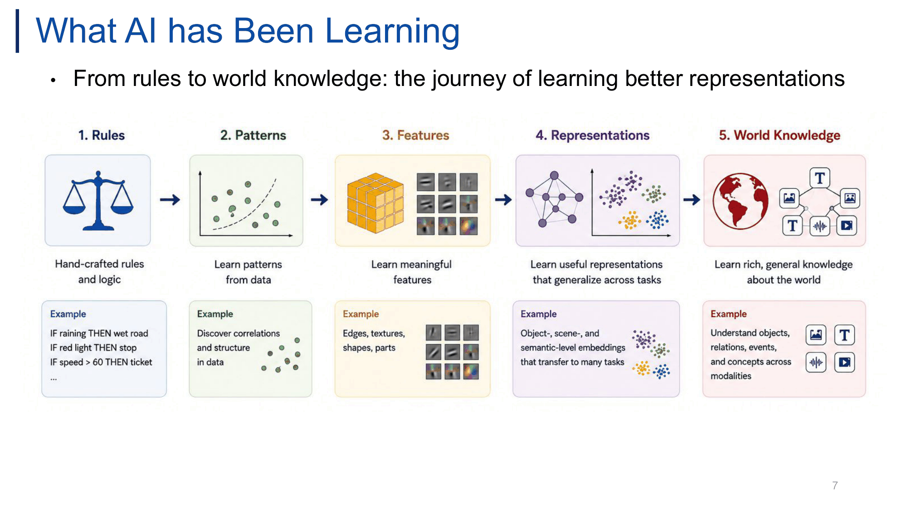
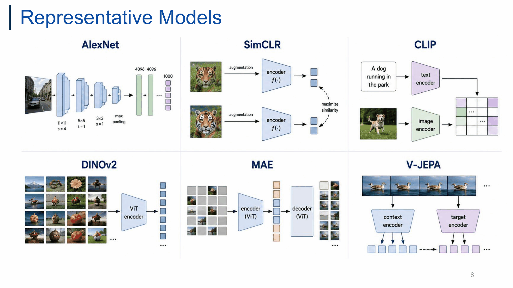
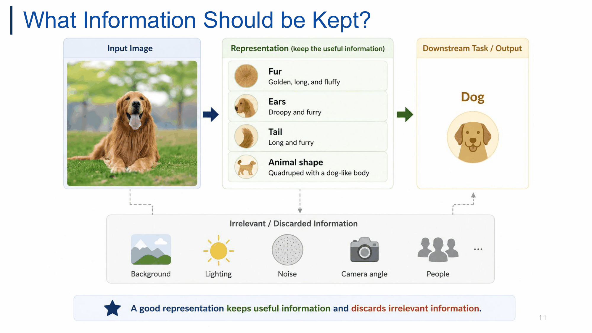
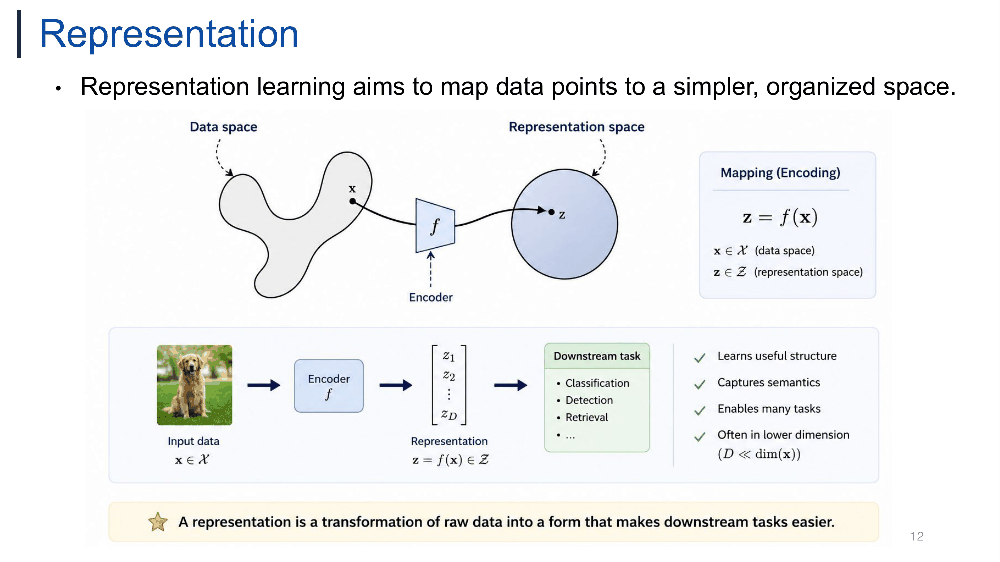
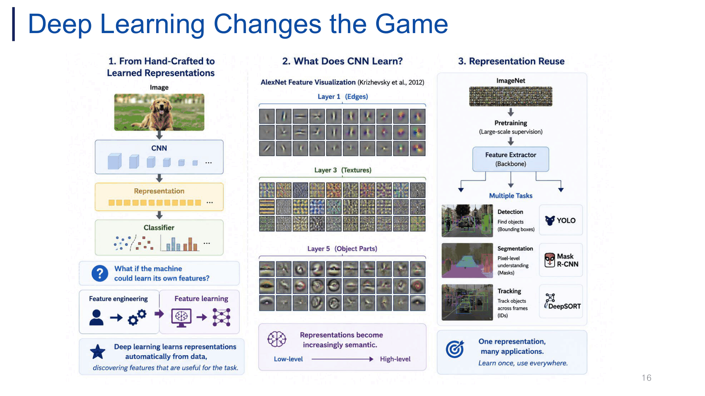
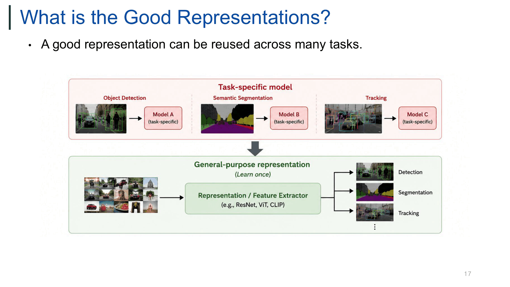
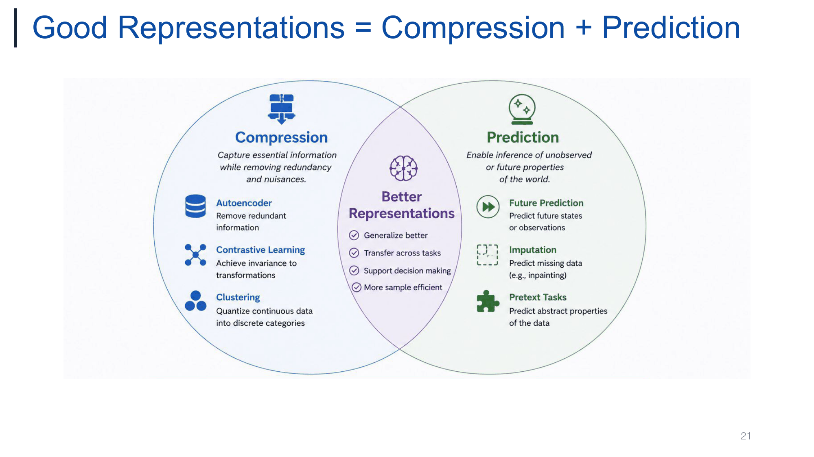

# 01. Introduction — Representation Learning이란 무엇이고, 좋은 Representation은 무엇인가

> **한 줄 요약**: raw data $\mathbf{x}$를 encoder $f$로 downstream task가 쉬워지는 공간의 $\mathbf{z}=f(\mathbf{x})$로 보내는 게 representation learning이고, 좋은 representation은 **Compression(무관한 정보 제거) + Prediction(관측 안 된 것 추론)** 을 동시에 만족하는 것.

출처: `lectures/01_Introduction.pdf` (24p) · 페이지 번호는 PDF 기준

---

## 이 강의의 큰 그림

**핵심 질문**
1. 컴퓨터는 이미지를 어떻게 "이해"하나? → raw pixel은 이해가 아님 → **representation** 필요
2. Representation을 누가 만드나? → 사람(hand-crafted, ~2012) → **데이터로부터 학습**(deep learning)
3. "좋은" representation이란? → **reusable** + **Compression ∩ Prediction**
4. 그걸 어떤 방법으로 학습하나? → Autoencoding / Contrastive / Clustering (Compression 계열) vs Future prediction / Imputation / Pretext (Prediction 계열)

**흐름도**

```
[AI가 학습해 온 것] Rules → Patterns → Features → Representations → World Knowledge   (p.6–8)
        │
        ▼
[Representation이란?] raw pixel ≠ understanding → 유용한 정보만 유지 → z = f(x)   (p.9–13)
        │
        ▼
[누가 feature를 만드나?] hand-crafted(SIFT/HOG/SURF) 의 한계 → deep learning(feature learning, reuse)   (p.14–16)
        │
        ▼
[좋은 representation] reusable → Compression + Prediction → (Disentangled, Interpretable, Actionable, Transferable)   (p.17–22)
        │
        ▼
[학습 방법 분류] 6종 learner 표 → 다음 주: SSL & Pretext Tasks   (p.23–24)
```

**목차**
- 0. 강의 운영 정보 (p.1–5)
- 1. AI가 학습해 온 것과 대표 모델 (p.6–8)
- 2. Representation이란? (p.9–13)
- 3. Feature Engineering → Feature Learning (p.14–16)
- 4. 좋은 Representation의 조건 (p.17–22)
- 5. Representation Learner의 유형 (p.23–24)
- 시험 대비 핵심 정리

---

## 0. 강의 운영 정보 (p.1–5)

### 0.1 기본 정보 (p.1–3)

- 과목: **Advanced Representation Learning (고급표현학습)**, Prof. Donghyeon Cho (조동현), 한양대 Computer Science
  - Office: IT.BT rm 504 / Tel: 02-2220-2657 / Web: cvlab.hanyang.ac.kr / Email: doncho@hanyang.ac.kr, cdh12242@gmail.com
  - Research area: computer vision, visual intelligence → 강의 예시도 이미지·비디오 중심
- **Smart-F (Flip Learning)**: Online + offline (1.5h)
  - Online: basic concept / Offline: review + extra
  - 원하면 offline 시간에 **paper presentation** 가능
  - 슬라이드엔 "Online + offline (1.5h)"로만 적혀 있어 1.5h가 offline 시간인지 전체인지 불명확
- Prerequisite: **Deep learning** — 입문 과정 아님, "(slightly) Advanced" topics, AI 전공 대상
- **No textbook!** → 슬라이드 + 인용 논문이 사실상 교재. 시험 범위도 슬라이드 + 논문 핵심 아이디어로 보는 게 안전
- 과목명의 **Representation Learning** = raw data(이미지, 영상, 텍스트 등)를 downstream task에 유용한 **feature(표현)** 로 바꾸는 방법을 학습하는 분야. "Advanced" ← supervised DL 이후 주제(SSL, contrastive, semi-/weakly-supervised, active learning, MAE)를 다루기 때문

> 보충: flipped learning = "수업 전 개념 학습(영상) → 수업 중 토론·문제풀이"로 순서를 뒤집는 방식.

### 0.2 Time Table (p.4)

| Week | Date | Lecture | Details |
|---|---|---|---|
| 1 | 9/3(목) | Introduction | |
| 2 | 9/10(목) | No class (휴강) | ECCV Periods |
| 3 | 9/17(목) | Self-Supervised Learning | |
| 4 | 9/24(목) | Contrastive Learning I | Chuseok Periods (online) |
| 5 | 10/1(목) | Contrastive Learning II | |
| 6 | 10/8(목) | Contrastive Learning III | |
| 7 | 10/15(목) | Semi-Supervised Learning I | |
| 8 | 10/22(목) | Semi-Supervised Learning II | |
| 9 | 10/29(목) | **Midterm Quiz** | |
| 10 | 11/5(목) | Weakly-Supervised Learning I | |
| 11 | 11/12(목) | Weakly-Supervised Learning II | |
| 12 | 11/19(목) | Active Learning I | |
| 13 | 11/26(목) | Active Learning II | |
| 14 | 12/3(목) | Masked Autoencoder (MAE) | |
| 15 | 12/10(목) | **Final Quiz** | |
| 16 | 12/17(목) | VideoMAE+ | |

- 흐름: **SSL → Contrastive ×3 → Semi ×2 → (Midterm) → Weakly ×2 → Active ×2 → MAE → (Final) → VideoMAE+**
- 16주차 VideoMAE+는 기말 이후라 기말 범위 밖일 가능성 ← 슬라이드에 명시 없음, 확인 필요
- 해석(필기자): **label 의존도가 낮아지는 순서**로 학습 패러다임을 훑는 구성 — SSL(label 없음) → Semi(일부 label) → Weakly(약한 label) → Active(label을 골라서 요청)

### 0.3 Grading (p.5)

| Attendance | Participation | Mid Quiz | Final Quiz |
|---|---|---|---|
| 10% | **30%** | 30% | 30% |

- **Participation 30%로 큼** → 수업 참여 / paper presentation(p.2)이 크게 반영될 수 있음 (추정). 시험 합계 60%

---

## 1. AI가 학습해 온 것과 대표 모델 (p.6–8)

### 1.1 강의 로드맵 인포그래픽 (p.6)

6칸(2×3) 인포그래픽 + 하단 배너 **"From understanding data to understanding the world."**

| 칸 | 캡션 | 의미 |
|---|---|---|
| **Feature Learning** | Learn useful features | 입력 $x$ → encoder $f_\theta$ → $z=f_\theta(x)$. feature를 사람이 설계하지 않고 데이터에서 학습 |
| **Self-Supervised Learning** | Learn from unlabeled data | label 없이 데이터 자체에서 supervision 생성. 그림: 같은 이미지의 두 augmented view → "두 view는 비슷한 표현" (SimCLR와 연결) |
| **Foundation Models** | Generalize to many tasks | 대규모 데이터로 한 번 사전학습 → 여러 downstream task·modality로 generalize |
| **Video Representation Learning** | Capture temporal dynamics | 시간적 변화를 담는 표현 (VideoMAE+, V-JEPA) |
| **Multimodal Representation Learning** | Align across modalities | 이미지/텍스트/오디오를 **공통 embedding 공간에서 align** (CLIP) |
| **Applications** | — | Classification, Detection, Segmentation, Generation, ... |

> 보충: "Foundation model" 용어는 Bommasani et al., 2021 ("On the Opportunities and Risks of Foundation Models")에서 대중화.

### 1.2 What AI has Been Learning — 5단계 진화 (p.7)



*p.7 — Rules → Patterns → Features → Representations → World Knowledge, "From rules to world knowledge".*

| 단계 | 캡션 | Example | 해설 |
|---|---|---|---|
| **1. Rules** | Hand-crafted rules and logic | IF raining THEN wet road / IF red light THEN stop / IF speed > 60 THEN ticket | 전문가가 규칙 직접 작성 (symbolic AI). 규칙 밖 상황에 취약, 확장 불가 |
| **2. Patterns** | Learn patterns from data | Discover correlations and structure in data | 데이터에서 통계적 상관·구조 학습 (classical ML: SVM, logistic regression). 단 **입력 feature는 여전히 사람이 설계** |
| **3. Features** | Learn meaningful features | Edges, textures, shapes, parts | 모델이 feature 자체를 학습 (CNN 초기 층 = Gabor 유사 edge detector) |
| **4. Representations** | Learn useful representations that generalize across tasks | Object-, scene-, semantic-level embeddings that transfer to many tasks | task 간 **transfer** 되는 고수준 embedding ← **이 강의의 중심 단계** |
| **5. World Knowledge** | Learn rich, general knowledge about the world | Understand objects, relations, events, concepts across modalities | 여러 modality에 걸친 범용 지식 (foundation model, multimodal) |

- **핵심 메시지**: 진화의 축 = **사람이 넣는 지식(규칙, feature 설계)은 줄고, 데이터에서 배우는 표현의 추상 수준·일반성은 커짐**
- **3 vs 4 차이 (시험 포인트)**: 3 = 저수준(edge, texture)~중간 수준(parts) feature / 4 = 여러 task로 **transfer 가능한 고수준 semantic embedding**

> 보충: 3단계 계층적 feature는 Zeiler & Fergus (2014) 시각화로 잘 알려짐.

### 1.3 Representative Models (p.8)



*p.8 — AlexNet / SimCLR / CLIP / DINOv2 / MAE / V-JEPA 아키텍처 개요.*

슬라이드 그림 구성:
- **AlexNet**: 거리 이미지 → conv(11×11 s=4, 5×5 s=1, 3×3 s=1, max pooling) → FC 4096, 4096 → 1000
- **SimCLR**: 호랑이 이미지 → augmentation 2개 → 공유 encoder $f(\cdot)$ → 두 표현 사이 "maximize similarity"
- **CLIP**: "A dog running in the park" → text encoder, 강아지 이미지 → image encoder → 격자(similarity matrix)
- **DINOv2**: 다양한 이미지 → ViT encoder → feature 열
- **MAE**: 4열×5행 패치 대부분 masked(회색) → encoder (ViT) → visible token(파랑) + mask token(주황) → decoder (ViT) → 복원 패치
- **V-JEPA**: 오리 영상 프레임 → context encoder / target encoder → context 표현에서 target 표현을 예측(점선 화살표)

**모델 비교 표** (저자·연도·설명은 슬라이드에 없음 → 일반 지식 보충)

| 모델 | 학습 방식 | 핵심 아이디어 | 학습 신호 / loss (개념) | 강의 연결 |
|---|---|---|---|---|
| **AlexNet** (Krizhevsky et al., 2012) | **Supervised** | ImageNet에서 deep CNN이 hand-crafted feature를 압도 | 1000-class cross-entropy | 출발점 |
| **SimCLR** (Chen et al., 2020) | **Contrastive** SSL | 같은 이미지의 두 augmented view = positive, 다른 이미지 = negative | InfoNCE (NT-Xent) | 4–6주차 |
| **CLIP** (Radford et al., 2021) | **Vision-language contrastive** | image–text 쌍을 공통 공간에 정렬, $N\times N$ similarity 행렬의 대각선이 positive | 대칭 InfoNCE | multimodal |
| **DINOv2** (Oquab et al., 2023) | **Self-distillation** SSL | 대규모 curated 데이터 + teacher–student, fine-tuning 없이 쓰는 범용 visual feature | teacher 출력 분포 맞추기 (CE) | foundation model |
| **MAE** (He et al., 2022) | **Masked reconstruction** SSL | 패치 대부분(원논문 75%) mask, **visible 패치만 encoder**, decoder가 pixel 복원 | masked 패치 pixel MSE | 14주차 |
| **V-JEPA** (Bardes et al., 2024) | **Latent prediction** (JEPA) | context 표현으로 target 영역의 **표현(feature space)** 예측 | latent space regression | VideoMAE+, 16주차 |

- 계열 흐름(필기자 정리): **supervised → contrastive → vision-language contrastive → self-distillation → masked reconstruction → latent prediction for video**
- **SimCLR vs CLIP**: 둘 다 contrastive지만 positive pair가 (view, view) vs (image, text) → **modality 차이**
- **MAE vs V-JEPA**: **pixel 복원**(decoder 필요) vs **feature space 예측** → nuisance(pixel 디테일)까지 모델링하느냐의 차이 (4.5와 연결)

---

## 2. Representation이란? (p.9–13)

### 2.1 Raw Pixels Are Not Understanding (p.9–10)

- p.9: "**How Does a Computer Understand an Image?**" — 골든 리트리버 사진(이후 running example). 사람은 바로 "개"라고 알지만 컴퓨터는?
- p.10: "To a computer, an image is initially just a **matrix of numbers**." — 개 코 부근 패치를 확대한 10×7 픽셀 값 표 (100/128/130, 마지막 두 행 끝 열 150). 열 단위로 거의 같은 toy 값 ← 실제 패치 값은 아닌 설명용

**정의**: 디지털 이미지 $x \in \{0,\dots,255\}^{H\times W\times C}$
- $H, W$: 높이·너비, $C$: 채널 수(RGB면 3)

**직관**
- **픽셀 하나하나엔 의미(semantics)가 없음**. 같은 개라도 조명·위치·각도가 조금만 바뀌면 픽셀 값이 완전히 달라짐
- 즉 **pixel space의 거리(L2 등) ≠ 의미적 유사성** → 이것이 representation이 필요한 이유

> 보충: 이미지를 1픽셀만 shift해도 pixel vector L2 거리는 크게 변하지만 의미는 동일. pixel space는 translation 같은 nuisance factor에 불변하지 않음.

### 2.2 What Information Should be Kept? (p.11)



*p.11 — Input Image → Representation(유용한 정보만) → "Dog", 아래는 버려지는 정보.*

- **Representation (keep the useful information)**: Fur(Golden, long, fluffy) / Ears(Droopy, furry) / Tail(Long, furry) / Animal shape(Quadruped, dog-like body)
- **Irrelevant / Discarded Information**: Background, Lighting, Noise, Camera angle, People, ...
- ★ "**A good representation keeps useful information and discards irrelevant information.**"

**직관**
- 유지 정보 = 개를 다른 동물과 **구별해 주는 semantic/shape 속성**
- 버리는 정보 = 같은 개라도 촬영 조건에 따라 바뀌는 **nuisance factor**
- → **invariance** 개념: 좋은 representation은 **nuisance 변화엔 invariant**, **task 관련 변화엔 sensitive**
- **"유용함"은 task에 상대적** — 배경 분류 task라면 background가 핵심 정보. → 2.4(many representations), 3.2(task-specific 문제)로 이어짐

> 보충: Information Bottleneck (Tishby et al., 2000) — 좋은 표현 $Z$는 입력 정보 $I(X;Z)$는 작게, 타깃 정보 $I(Z;Y)$는 크게. 4.3에서 수식으로 다시 정리.

### 2.3 Representation의 정의 (p.12)



*p.12 — 구불구불한 Data space $\mathcal{X}$ → Encoder $f$ → 정돈된 Representation space $\mathcal{Z}$.*

- "Representation learning aims to map data points to a **simpler, organized space**."

**정의 (Mapping / Encoding)**

$$
\mathbf{z} = f(\mathbf{x}), \qquad \mathbf{x}\in\mathcal{X},\;\; \mathbf{z}\in\mathcal{Z},\;\; f:\mathcal{X}\to\mathcal{Z}
$$

- $\mathbf{x}$: 원본 데이터 (이미지 픽셀 등), $\mathcal{X}$: **data space**
- $f$: **encoder** — 학습 가능한 매핑 (신경망 등)
- $\mathbf{z} = [z_1, z_2, \dots, z_D]^\top$: $D$차원 **representation** (feature, embedding, latent code라고도 함), $\mathcal{Z}$: **representation space**
- 파이프라인: Input data $\mathbf{x}$ → Encoder $f$ → $\mathbf{z}$ → Downstream task (Classification, Detection, Retrieval, ...)

**체크리스트 (슬라이드)**
- Learns useful structure
- Captures semantics
- Enables many tasks ← 같은 $\mathbf{z}$를 여러 task에 재사용
- Often in lower dimension: $D \ll \dim(\mathbf{x})$

★ "**A representation is a transformation of raw data into a form that makes downstream tasks easier.**"

**직관**
- 그림에서 data space는 manifold처럼 구불구불, representation space는 단순한 원 → "simpler, organized". data space에선 의미적으로 비슷한 점들이 복잡하게 흩어져 있지만, representation space에선 **비슷한 것끼리 가깝게 정돈**되어 downstream task가 쉬워짐
- **차원 축소** 예: $224\times224\times3 = 150{,}528$ 차원 → 2048 차원 (ResNet-50 pooled feature)
- "**Often**"인 이유: 항상은 아님 — overcomplete representation(예: sparse coding)은 입력보다 차원이 클 수도 있음
- p.11의 "유용한 정보만 유지"를 수학적으로 쓴 게 encoder $f$의 역할

### 2.4 Many Possible Representations (p.13)

- "The same data can have **many different representations**." — 같은 개 사진에서 3갈래

| Representation | 슬라이드 캡션 | 담는 정보 | 버리는 정보 / 한계 |
|---|---|---|---|
| **Color Histogram** | Captures global color distribution | Hue(0°–360°)별 frequency, **전역 색 분포** | 공간 구조·형태 → 개/고양이 구분엔 부적합 |
| **CNN Feature** | Captures hierarchical visual features | low-level edge → high-level part/object의 **계층적 특징**, 고차원 벡터 (e.g., 2048-D: [0.21, −0.17, 0.63, 1.24, −0.91, ..., 0.31]) | 텍스트 의미와 직접 연결 안 됨 |
| **CLIP Embedding** | Aligns image with text semantics | 이미지–텍스트를 같은 공간에 **align** → 프롬프트(A dog, A golden retriever, A cat, A car, A tree)와의 similarity 히트맵 → **zero-shot** 인식 | — |

- 결론: **"좋은 representation"은 절대적 개념이 아니라 task/목적 의존**. 어떤 정보를 담고 버릴지(p.11)가 표현마다 다름
- 이 강의의 방법들(supervised, self-supervised, contrastive, generative 등)은 결국 "**어떤 representation을 어떻게 얻을 것인가**"에 대한 서로 다른 답

> 보충: CLIP = Contrastive Language-Image Pre-training (Radford et al., 2021, OpenAI). 4억 image–text 쌍으로 image/text encoder를 contrastive loss로 공동 학습.

---

## 3. Feature Engineering → Feature Learning (p.14–16)

### 3.1 Before Deep Learning: Hand-crafted Features (p.14)

- 질문: "**Who design the features?**" ← 원문 문법 그대로 ("designs"가 맞음) → 답: **사람**
- 파이프라인: Image → **Hand-crafted Features** (SIFT / HOG / SURF) → **Classifier** (e.g., SVM, Random Forest, k-NN)
- 그림: SIFT keypoints(여러 스케일의 노란 원, "Keypoint + orientation + descriptor"), HOG 시각화(셀별 gradient 방향 막대로 개 윤곽, 8방향 orientation histogram)
- ★ "**Feature Engineering Era:** Humans manually designed features. *Different tasks require different features.*"

| Feature | 계산 방식 | 성질 / 용도 |
|---|---|---|
| **SIFT** (Scale-Invariant Feature Transform) | scale space에서 keypoint 검출 → 주변 gradient 방향 histogram으로 orientation·descriptor | **scale/rotation invariant** |
| **HOG** (Histogram of Oriented Gradients) | 격자 cell별 gradient 방향 histogram | 윤곽/형태 포착 (보행자 검출) |
| **SURF** (Speeded-Up Robust Features) | SIFT 근사, integral image + box filter(Hessian 근사) | SIFT 가속 버전 |

- 핵심: **feature 추출과 classifier 학습이 분리**, feature 부분은 데이터로부터 학습되지 않음 (사람 직관 기반). 그 위에 얕은(shallow) classifier만 학습

> 보충: SIFT — Lowe (2004), HOG — Dalal & Triggs (2005), SURF — Bay et al. (2006).

### 3.2 Why is This Problematic? (p.15)

- (슬라이드 하단 번호 "5" ← 오기, 실제 p.15)

| 문제 | 내용 |
|---|---|
| **Human-designed** | 전문가가 craft, domain knowledge 필요, time-consuming & labor-intensive → 비용 + 사람의 편향 |
| **Task-specific** | 한 task에 최적화 → 다른 task로 일반화 안 됨, **New task = new feature design** |
| **Limited scalability** | 복잡한 데이터로 scale 안 됨, 모든 variation을 커버 불가, **performance ceiling** 존재 |

- 예시 그림 (서로 "≠"):
  - **Object Recognition** (개, 자동차, 비행기, 의자, 자전거, 컵) — "specific features for objects and shapes"
  - **Face Recognition** — "specific features for facial patterns"
  - **Medical Imaging** (X-ray, MRI, 망막, CT, 초음파, 병리) — "specific features for medical patterns"
- ⚠ "**Every new task requires new features.** *This limits generalization, efficiency, and performance.*"
- → 동기: "feature 자체를 데이터로부터 **학습**하면?"

### 3.3 Deep Learning Changes the Game (p.16)



*p.16 — (1) hand-crafted → learned, (2) AlexNet layer별 feature 시각화, (3) ImageNet pretraining 후 representation reuse.*

**(1) From Hand-Crafted to Learned Representations**
- Image → **CNN** → **Representation** → **Classifier**
- "**What if the machine could learn its own features?**" → **Feature engineering**(사람 → 톱니) ⇒ **Feature learning**(신경망 → 네트워크)
- ★ "**Deep learning learns representations automatically from data,** *discovering features that are useful for the task.*"
- CNN이 raw image에서 representation을 **end-to-end**로 학습 → p.15의 세 문제 해결을 노림

**(2) What Does CNN Learn?** — AlexNet Feature Visualization (Krizhevsky et al., 2012)
- **Layer 1 (Edges)**: 방향성 edge, Gabor 유사 패턴, 색 blob
- **Layer 3 (Textures)**: 격자/질감 반복 패턴
- **Layer 5 (Object Parts)**: 눈, 바퀴/원형 등 부분 형태
- "**Representations become increasingly semantic.**" Low-level → High-level
- 포인트: SIFT/HOG처럼 사람이 설계하지 않았는데도 **데이터로부터 계층(hierarchy)이 자동으로 나타남**

**(3) Representation Reuse**
- **ImageNet** → **Pretraining (Large-scale supervision)** → **Feature Extractor (Backbone)** → Multiple Tasks
  - Detection (Find objects, bounding boxes) — YOLO
  - Segmentation (Pixel-level understanding, masks) — Mask R-CNN
  - Tracking (Track objects across frames, IDs) — DeepSORT
- ★ "**One representation, many applications.** *Learn once, use everywhere.*" → "새 task = 새 feature" 문제 해소 (transfer learning / fine-tuning)
- **남은 한계**: pretraining이 **large-scale supervision(라벨)** 에 의존 → 라벨 비용 → 이후 **self-supervised** representation learning의 동기 (강의 흐름상 추정)

> 보충: AlexNet = Krizhevsky, Sutskever, Hinton (2012), ILSVRC 2012 우승. 층별 시각화는 Zeiler & Fergus (2014) 스타일과 유사 (슬라이드는 Krizhevsky et al., 2012로 표기). YOLO (Redmon et al., 2016), Mask R-CNN (He et al., 2017), DeepSORT (Wojke et al., 2017).

### 3.4 비교: Hand-crafted vs Learned

| 구분 | Hand-crafted (Feature Engineering) | Learned (Feature Learning, DL) |
|---|---|---|
| 누가 feature를 만드나 | 사람 (전문가) | 데이터로부터 자동 학습 |
| 예 | SIFT, HOG, SURF | CNN (AlexNet), ViT |
| 파이프라인 | feature 추출 ↔ classifier **분리** | **end-to-end** |
| task 확장 | 새 task = 새 feature 설계 | backbone 재사용 (learn once, use everywhere) |
| scalability | 성능 상한, variation 커버 불가 | 데이터·모델 크기에 따라 scale |
| 한계 | domain knowledge·노동 집약 | 대규모 **라벨** 필요 (supervised pretraining) |

---

## 4. 좋은 Representation의 조건 (p.17–22)

### 4.1 Reusable across tasks (p.17)



*p.17 — 위: task마다 Model A/B/C를 따로 학습 / 아래: 한 번 학습한 feature extractor를 여러 task에 재사용.*

- "**A good representation can be reused across many tasks.**"
- **Task-specific model**: Object Detection → Model A, Semantic Segmentation → Model B, Tracking → Model C (각각 처음부터)
- **General-purpose representation (Learn once)**: 다양한 이미지 → **Representation / Feature Extractor** (e.g., ResNet, ViT, CLIP) → Detection / Segmentation / Tracking / ⋮
- 가장 실용적인 정의: **task-agnostic하게 재사용 가능한 feature**. task별 head만 얹거나 가볍게 fine-tune → 데이터·연산 비용 절감

> 보충: pretrain → transfer (fine-tuning / linear probing) 패러다임의 동기. representation 품질은 보통 downstream 성능(linear probe 정확도 등)으로 평가. ResNet (He et al., 2016), ViT (Dosovitskiy et al., 2020).

### 4.2 What Makes a Good Representation? — 3조건 (p.18)

A good representation should:
1. **Compress information**
2. **Support prediction**
3. **Generalize across tasks**

- 1, 2가 핵심 축(p.19, p.20에서 각각 상세), 3은 1·2를 만족하면 따라오는 결과로 p.21 교집합("Generalize better, Transfer across tasks")에 다시 등장

### 4.3 Compression (p.19)

"Captures just the **essential characteristics** of the data."

| 이점 | 슬라이드 | 해설 |
|---|---|---|
| **Less Memory** | Smaller representations are easier to store | 차원이 작으면 저장·전송·검색 쉬움 |
| **Invariance** | Remove nuisance factors that do not affect semantics | 조명·시점·배경·노이즈 제거 → 같은 의미 입력은 비슷한 $\mathbf{z}$ |
| **Occam's Razor** | Among equally useful representations, prefer the simpler one | 단순할수록 일반화 유리, overfitting 억제 |

★ "**Compression is not about losing information. It is about removing irrelevant information.**"
- 즉 task-relevant 정보는 보존, irrelevant 정보만 버림 (p.11과 동일한 메시지)

> 보충 — **Information Bottleneck** (Tishby et al., 2000), 슬라이드에 없음:
> $$\min_{p(z|x)}\; I(X;Z) - \beta\, I(Z;Y)$$
> - $I(X;Z)$: 표현 $Z$가 입력 $X$에 대해 가진 정보 → 작게 (= compression)
> - $I(Z;Y)$: 표현 $Z$가 타깃 $Y$에 대해 가진 정보 → 크게 (= 유용성 보존)
> - $\beta$: 둘 사이 trade-off 계수
> → "압축 = 무관한 정보 제거"를 정보이론으로 쓴 것.

### 4.4 Prediction (p.20)

- "Why do we need representations?" → "**To predict what we cannot directly observe.**"

| 유형 | 그림 | 예시 (슬라이드) |
|---|---|---|
| **1. Future** | Current frame(주행 영상) → Future frame | Video prediction, **V-JEPA** |
| **2. Past** | Today → Yesterday? (흐릿한 추정 이미지) | State estimation, Temporal reasoning |
| **3. Missing Data** | Corrupted image(패치 가림) → Inpainting | **MAE**, Image completion |

★ "**Prediction means inferring unobserved properties of the world.**"
- 예측을 잘 하려면 데이터의 **구조·인과·규칙성**을 이해해야 함 → **예측 과제 자체가 좋은 representation을 학습시키는 신호** (= SSL의 핵심 논리)
- (슬라이드의 "예시" 라벨은 한영 혼용 원문)

> 보충: V-JEPA (Bardes et al., 2024, Meta) — latent space에서 가려진 영역 예측. MAE (He et al., 2022) — 가려진 patch의 pixel 복원.

### 4.5 Good Representations = Compression + Prediction (p.21)



*p.21 — Compression 원(Autoencoder/Contrastive/Clustering)과 Prediction 원(Future/Imputation/Pretext)의 교집합 = Better Representations.*

- **Compression**: "Capture essential information while removing redundancy and nuisances."
  - Autoencoder — Remove redundant information
  - Contrastive Learning — Achieve invariance to transformations
  - Clustering — Quantize continuous data into discrete categories
- **Prediction**: "Enable inference of unobserved or future properties of the world."
  - Future Prediction — Predict future states or observations
  - Imputation — Predict missing data (e.g., inpainting)
  - Pretext Tasks — Predict abstract properties of the data
- **Better Representations** (교집합): ✓ Generalize better ✓ Transfer across tasks ✓ Support decision making ✓ **More sample efficient**

**직관 — 왜 둘 다 필요한가 (서술형 단골)**
- **압축만** 하면: task에 필요한 정보까지 버리거나 trivial solution(모든 입력 → 같은 $\mathbf{z}$, collapse)에 빠질 수 있음
- **예측만** 하면: nuisance까지 모델링하려 함 (예: pixel 단위 복원은 배경 텍스처·노이즈까지 맞춰야 함)
- → **둘의 균형**이 핵심. 이후 강의의 각 방법을 이 틀로 해석
- **More sample efficient** = 좋은 representation 위에선 **적은 라벨로도** downstream 학습 가능 → semi-/weakly-/active learning 주제와 연결

### 4.6 Beyond Compression and Prediction (p.22)

"Good representations often exhibit additional desirable properties."

| 성질 | 의미 | 그림 / 대표 |
|---|---|---|
| **1. Disentangled** | 변동 요인(Identity, Pose, Lighting, Background)이 서로 다른 축/차원에 분리 인코딩 | VAE, $\beta$-VAE, Disentangled Representation Learning |
| **2. Interpretable** | 개별 뉴런/차원이 사람이 이해 가능한 개념(털, 눈, 꼬리 등)과 대응 | Neuron 1/2/3 ↔ 개 부위 |
| **3. Actionable** | representation에서 바로 decision → action | 로봇 팔, 자율주행 |
| **4. Transferable** | 하나의 representation → 여러 task | One Representation → 검출, segmentation, 검색 등 (p.17과 연결) |

- "These properties are often **consequences** of learning representations that are both" ← 문장이 "both"에서 끊김 (원문 유지; 의도는 "both compressive and predictive"로 추정)
- 포인트: 이 성질들은 **직접 목표라기보다 흔히 결과(consequence)** 로 나타남 ("often") — 항상 보장되진 않음

> 보충 — $\beta$-VAE (Higgins et al., 2017):
> $$\mathcal{L}(\theta,\phi;x) = \mathbb{E}_{q_\phi(z|x)}\big[\log p_\theta(x|z)\big] - \beta\, D_{KL}\big(q_\phi(z|x)\,\|\,p(z)\big)$$
> - $q_\phi(z|x)$: encoder(approx. posterior), $p_\theta(x|z)$: decoder, $p(z)=\mathcal{N}(0,I)$: prior
> - 첫 항: reconstruction(예측), 둘째 항: KL로 latent를 prior 쪽으로 압축
> - $\beta>1$이면 압축 압력↑ → 독립 축으로 분리(disentangle) 유도
> - 단, inductive bias 없는 비지도 disentanglement는 보장 불가 (Locatello et al., 2019)

---

## 5. Representation Learner의 유형 (p.23–24)

### 5.1 Types of Representation Learners (p.23) — 원본 표

| Learning Method | Learning Principle | Short Summary |
|---|---|---|
| Autoencoding | Compression | Remove redundant information |
| Contrastive | Compression | Achieve invariance to viewing transformations |
| Clustering | Compression | Quantize continuous data into discrete categories |
| Future prediction | Prediction | Predict the future |
| Imputation | Prediction | Predict missing data |
| Pretext tasks | Prediction | Predict abstract properties of your data |

### 5.2 방법 비교 표 (loss·장단점은 보충)

| 방법 | 원리 | 핵심 아이디어 | 대표 loss (보충) | 장점 | 한계 |
|---|---|---|---|---|---|
| **Autoencoding** | Compression | bottleneck latent로 압축 후 복원 → 중복 제거 | $\|x - g(f(x))\|^2$ | 단순, label 불필요 | pixel 디테일(nuisance)까지 복원하려 함 |
| **Contrastive** | Compression | 같은 sample의 augmentation(viewing transformation)은 가깝게, 다른 sample은 멀게 → **invariance** | InfoNCE: $-\log\frac{\exp(\mathrm{sim}(z_i,z_j)/\tau)}{\sum_{k\neq i}\exp(\mathrm{sim}(z_i,z_k)/\tau)}$ | augmentation에 invariant한 semantic feature | augmentation 설계 의존, negative 필요(큰 batch) |
| **Clustering** | Compression | 연속 feature를 이산 cluster/codebook으로 **quantize** | k-means: $\sum_i \min_k \|z_i-\mu_k\|^2$ | 의미 단위 그룹화 | cluster 수 설정, degenerate solution |
| **Future prediction** | Prediction | 과거·현재로 미래 상태/관측 예측 | $\|\hat{z}_{t+1} - z_{t+1}\|^2$ 또는 pixel 예측 | temporal dynamics·인과 포착 | 미래의 불확실성(multi-modal) |
| **Imputation** | Prediction | 가려진/결측 부분 예측 (inpainting, MAE) | masked 영역 $\|x_M - \hat{x}_M\|^2$ | 구조·문맥 이해 강제 | pixel 단위면 nuisance까지 학습 |
| **Pretext tasks** | Prediction | 인위적으로 만든 추상 속성 예측 (예: 회전 각도, patch 순서) | 분류 cross-entropy | 구현 쉬움 | pretext가 downstream과 어긋나면 feature가 task 특화됨 |

- 기호: $f$ encoder, $g$ decoder, $\mathrm{sim}$ = cosine similarity, $\tau$ = temperature, $(i,j)$ = positive pair, $\mu_k$ = cluster center, $M$ = mask 위치
- 같은 방법이 두 원리에 걸칠 수 있음 (분류는 대표적 해석 기준). 예: MAE = autoencoder 구조지만 학습 신호는 imputation

> 보충: contrastive를 "compression"에 넣은 건 augmentation invariance = nuisance 제거(압축)라는 관점. 일부 문헌은 contrastive를 mutual information 최대화(InfoNCE bound)로 해석하기도 함 → 이 경우 오히려 "정보 보존" 쪽으로 읽힘.

### 5.3 Next Week (p.24)

- **Self-Supervised Learning and Pretext Tasks** — Prediction 계열 방법의 구체 사례

---

## 시험 대비 핵심 정리

### 꼭 외울 수식·정의

1. **Representation**: $\mathbf{z} = f(\mathbf{x})$, $\mathbf{x}\in\mathcal{X}$ (data space), $\mathbf{z}\in\mathcal{Z}$ (representation space), $f$ = encoder, 보통 $D \ll \dim(\mathbf{x})$
   - "A representation is a transformation of raw data into a form that makes downstream tasks easier."
2. **Good representation**: "keeps useful information and discards irrelevant information" / "can be reused across many tasks"
3. **3조건**: Compress information / Support prediction / Generalize across tasks
4. **Compression** = Less Memory + Invariance + Occam's Razor. "not about losing information, about removing irrelevant information"
5. **Prediction** = "inferring unobserved properties of the world" — Future / Past / Missing Data
6. **Good Representations = Compression + Prediction** → Generalize better, Transfer across tasks, Support decision making, More sample efficient
7. (보충) Information Bottleneck $\min I(X;Z) - \beta I(Z;Y)$, $\beta$-VAE loss

### 꼭 외울 분류·순서

- AI 5단계: **Rules → Patterns → Features → Representations → World Knowledge**
- Learner 6종: **Compression** = Autoencoding / Contrastive / Clustering, **Prediction** = Future prediction / Imputation / Pretext tasks
- 추가 성질 4개: **Disentangled / Interpretable / Actionable / Transferable** (often consequences)
- Hand-crafted 문제 3개: **Human-designed / Task-specific / Limited scalability**
- AlexNet layer: **L1 Edges → L3 Textures → L5 Object Parts** (increasingly semantic)
- 대표 모델 학습 방식: AlexNet(supervised), SimCLR(contrastive), CLIP(vision-language contrastive), DINOv2(self-distillation), MAE(masked reconstruction), V-JEPA(latent prediction)

### 비교 포인트

| 비교 | 핵심 차이 |
|---|---|
| Features(3단계) vs Representations(4단계) | 저·중수준 feature vs task 간 transfer되는 semantic embedding |
| Hand-crafted vs Learned | 사람 설계·분리 파이프라인 vs 데이터 학습·end-to-end·재사용 |
| Task-specific model vs General-purpose representation | task마다 처음부터 vs learn once, use everywhere |
| Color histogram vs CNN feature vs CLIP embedding | 전역 색 분포 vs 계층적 시각 특징 vs image–text 정렬(zero-shot) |
| SimCLR vs CLIP | positive pair가 (view, view) vs (image, text) |
| MAE vs V-JEPA | pixel 복원 vs feature space 예측 |
| Compression only vs Prediction only | 필요한 정보까지 버림/collapse vs nuisance까지 모델링 |

### 예상 서술형 질문 + 모범답안 방향

1. **Raw pixel이 "understanding"이 아닌 이유는?**
   → 이미지는 숫자 행렬일 뿐 픽셀에 semantics 없음. 조명·각도·위치(nuisance)가 조금만 바뀌어도 픽셀 값이 크게 변해 pixel 거리 ≠ 의미 유사성. 그래서 nuisance에 invariant하고 semantic을 담는 representation 필요.
2. **Representation learning을 수식과 함께 정의하고, $D \ll \dim(\mathbf{x})$가 "Often"인 이유를 설명하라.**
   → $\mathbf{z}=f(\mathbf{x})$, $f:\mathcal{X}\to\mathcal{Z}$, 기호 설명. simpler, organized space로 보내 downstream을 쉽게. 압축이 일반적이지만 overcomplete(sparse coding)처럼 더 큰 경우도 있어 "often".
3. **Hand-crafted feature의 한계 3가지와 딥러닝이 이를 어떻게 해결했나?**
   → Human-designed / Task-specific / Limited scalability. DL은 end-to-end feature learning(계층적 feature 자동 발견) + pretrained backbone 재사용으로 해결. 단 large-scale supervision 의존이 남음 → SSL 동기.
4. **"Compression is not about losing information"의 의미는?**
   → 압축 = task와 무관한 nuisance(배경, 조명, 노이즈) 제거, task-relevant 정보는 보존. Invariance·Occam's razor·less memory 이점. (IB 수식 쓰면 가점)
5. **Prediction이 좋은 representation 학습 신호가 되는 이유와 3가지 유형은?**
   → 관측 안 된 것(Future/Past/Missing)을 맞추려면 데이터의 구조·규칙성을 이해해야 함. 예: V-JEPA(future), state estimation(past), MAE(missing).
6. **좋은 representation에 Compression과 Prediction이 모두 필요한 이유는?**
   → 압축만: 유용 정보 손실/collapse. 예측만: nuisance까지 모델링. 교집합에서 generalize, transfer, decision making, sample efficiency 확보.
7. **Representation learner 6종을 원리별로 분류하고 각 한 줄 요약.**
   → 5.1 표 그대로. Contrastive가 Compression인 이유(augmentation invariance = nuisance 제거)까지 쓰면 좋음.
8. **Task-specific model 대비 general-purpose representation의 장점은?**
   → learn once로 detection/segmentation/tracking 등에 재사용, head만 추가/fine-tune → 데이터·연산 절감, sample efficient.
9. **Disentangled / Interpretable / Actionable / Transferable을 설명하고, 이들과 Compression+Prediction의 관계는?**
   → 각 정의. 직접 목표라기보다 compressive·predictive한 표현을 학습한 결과로 "often" 나타남 (보장은 아님).
10. **AI 학습 대상의 5단계 진화를 설명하고 3단계와 4단계의 차이를 쓰라.**
    → Rules → Patterns → Features → Representations → World Knowledge, 사람이 넣는 지식↓ 학습 표현의 추상성·일반성↑. 3: edge/texture/parts, 4: task 간 transfer되는 semantic embedding.
