# 02. Self-Supervised Learning (SSL)

> **한 줄 요약**: label 없이 **data 자체에서 supervision을 만들어**(pretext task) representation을 학습하는 방법. 사람이 설계한 pretext task 5종(Relative Position, Inpainting, Jigsaw, Colorization, Rotation) → 그 한계(tedious, not general) → multi-task / video / audio-visual 확장 → **"무엇을 invariant하게, 무엇을 equivariant하게 남길 것인가"** 로 마무리, 다음 주 contrastive learning으로 연결.

- 출처: `lectures/02_SSL.pdf` (80p), Instructor: Donghyeon Cho (Hanyang Univ.)
- 페이지 번호는 PDF 페이지 기준

---

## 이 강의의 큰 그림

```
[1] Why SSL? (p.3–10)
    supervised pre-training은 잘 됨 → 하지만 label이 비싸고 scale 안 됨
    (22 human years, long-tail, 복잡한 concept/video, 의료 등 도메인 차이)
          ↓
[2] What is SSL? (p.11–18)
    data의 일부로 다른 일부를 예측 = self-generated supervision
    pretext task (label-free 학습) → downstream task (적은 label로 transfer)
    평가: pretext 성능 X, downstream 성능 O (linear probing / fine-tuning)
          ↓
[3] Image pretext tasks 5종 (p.19–43)
    Relative Position → Inpainting → Jigsaw → Colorization → Rotation
    공통 이슈: shortcut(low-level cue) 막기
          ↓
[4] Pretext task의 한계 (p.44–49)
    1) task 하나하나 사람이 설계 → tedious
    2) 학습된 representation이 general하지 않을 수 있음 (마지막 layer가 pretext에 특화)
          ↓
[5] 확장 시도 (p.50–70)
    multi-task (CDJP) / 더 general한 pretext = "same object vs different object" (→ contrastive)
    video: Space-Time Cubic Puzzles / multi-modal: Audio-Visual Temporal Sync (negative 구성, curriculum)
          ↓
[6] Pretext가 "무엇을 보존하는가" (p.71–79)
    Invariance f(t(x)) = f(x)  vs  Equivariance f(t(x)) = φ(t, f(x))
    STL: transformation label 없이 transformation representation 학습
          ↓
[Next] Contrastive Learning (p.80)
```

**핵심 질문**
1. label 없이 어떻게 supervision signal을 만드는가? (pretext task 설계)
2. pretext를 잘 푸는 것이 왜 좋은 feature로 이어지는가? → "풀려면 semantic 이해가 필요해야 함" + "shortcut으로 풀리면 안 됨"
3. SSL은 어떻게 평가하는가? → downstream transfer (linear probing / fine-tuning)
4. hand-crafted pretext의 한계는 무엇이고, 어떻게 더 general하게 만드는가?
5. representation은 transformation에 대해 invariant해야 하는가, equivariant해야 하는가?

---

## 1. Why Self-Supervised Learning? — Supervised learning의 한계 (p.3–10)

### 1.1 Supervised pre-training의 성공 (p.4–5)

- ImageNet(1000-class)으로 ConvNet을 학습하면 마지막 classifier뿐 아니라 **중간 feature(representation)** 도 범용적으로 쓸 수 있음 ← classification은 목적이 아니라 **representation을 얻는 수단**
- 학습된 feature를 detection, segmentation 등 **downstream task**에 transfer(fine-tuning / linear probing) → 성능 크게 향상
- 슬라이드 그림의 중괄호 "Learn a representation"은 이미지 입력~ConvNet~출력 파이프라인 전체를 묶음 ← 의도는 label 예측이 아니라 **ConvNet이 배우는 feature가 representation**이라는 점
- **Recipe** (p.5): (1) 대규모 "supervised"(labeled) dataset 수집 → (2) ConvNet 학습 → (3) pre-train 모델로 사용
  - 슬라이드 bullet 순서가 "Pre-train → Collect → Train"으로 실제 절차와 뒤섞여 있음 ← 순서 어색 (원문 유지)
  - 병목은 **labeled image를 모으는 단계(= labeling)**

> 보충: ImageNet pre-training 효과는 DeCAF (Donahue et al., 2014), R-CNN (Girshick et al., 2014)에서 대표적으로 확인됨. downstream label이 적을 때 효과가 특히 큼

### 1.2 Labeling의 어려움 (p.6–8)

- **"Real" label은 어렵고 비쌈**: ImageNet 14M장 = **22 human years** (슬라이드 수치)
- 대안 **semi-automatic** label: **hashtag**(Instagram 등), **GPS location** → 사람 노동은 줄지만 label이 **noisy**하고 개념이 제한적 ← 결국 "누군가 의미를 부여한 신호"에 의존하므로 근본 해결책 아님

> 보충: hashtag 기반 weakly supervised pre-training = Mahajan et al., 2018 (3.5B Instagram images), GPS 기반 = PlaNet (Weyand et al., 2016). 22 human years 수치의 출처는 슬라이드에 없음

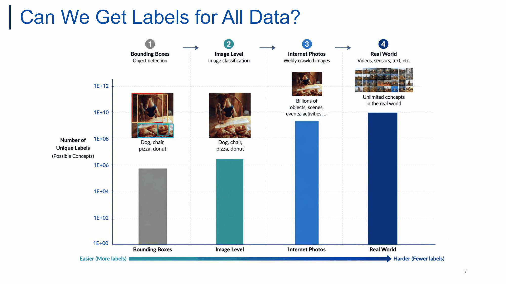

*p.7 — label 종류별 필요한 concept 수(log scale): Bounding Box < Image Level < Internet Photos < Real World. 오른쪽일수록 concept 수는 폭증, label 확보는 어려워짐*

- **"Can We Get Labels for All Data?"** (p.7) → 답은 **아니오**
  - box annotation(~1e6 규모) → image-level → 웹 crawling(수십억 concept) → real world(video, sensor, text, 사실상 무한 concept)
  - y축은 "label 개수"가 아니라 **possible concept 수** ← 헷갈리지 말 것. 막대가 커지는 건 "라벨링해야 할 개념이 많다"는 뜻
  - 하단 화살표 "Easier (More labels)" → "Harder (Fewer labels)"와 막대 증가 방향이 얼핏 모순돼 보임 ← 막대 = 필요한 concept 수, 화살표 = 실제 확보 가능한 label 양. 서로 다른 축
- **복잡한 concept** (p.8): 행동, 사건, 시간 맥락이 있는 **video**는 label 정의부터 어려움
  - 핵심 주장: **Labelling cannot scale to the size of the data we generate** (데이터 생성 속도 >> annotation 속도)

### 1.3 Rare concepts — long-tail 분포 (p.9)

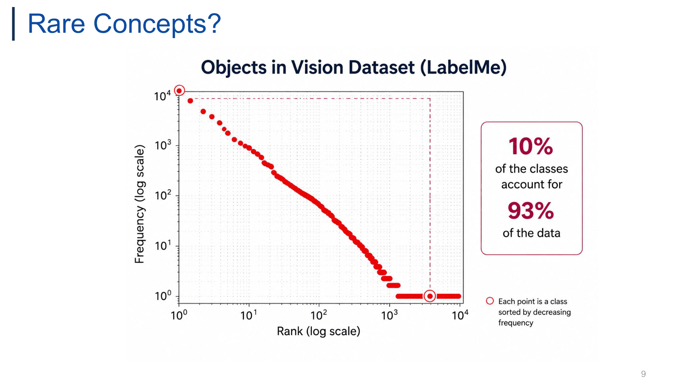

*p.9 — LabelMe class 빈도의 rank-frequency log-log plot. 10%의 class가 93%의 data를 차지 (long-tail)*

- 자연 데이터의 class 빈도는 **power law (Zipf-like)**: $f(r) \propto r^{-\alpha} \Rightarrow \log f = -\alpha \log r + c$ → log-log plot에서 직선
  - $r$ = 빈도 순위(rank), $f(r)$ = 그 class의 빈도, $\alpha$ = 감소 속도
- **10% of the classes account for 93% of the data** → 나머지 90% class는 합쳐도 7%뿐인 **rare concepts**, 상당수는 sample 1개 수준(rank ~1e3 이후 빈도 1에서 plateau)
- 함의: supervised는 class당 충분한 labeled sample이 필요한데 rare concept은 수집 자체가 어려움 → label 없이 data 구조에서 배우는 SSL 필요

> 보충: LabelMe = Russell et al., 2008 (MIT CSAIL). long-tail 문제는 이후 long-tailed recognition (LVIS 등)에서 본격적으로 다뤄짐

### 1.4 Different domains (p.10)

- 뇌 MRI 필름 그림 (텍스트 bullet 없음)
- 의료영상 같은 **specialized domain**은 natural image와 분포가 다르고, 라벨링에 **전문가(의사)** 가 필요해 비용이 매우 큼 → 도메인마다 대규모 labeled set을 만들 수 없음
- 반면 unlabeled 데이터는 병원에 대량으로 쌓여 있음 → SSL 동기가 큰 대표 사례

**정리 (p.8–10의 흐름)**: (1) 복잡한 개념/video는 label이 안 따라옴, (2) rare concept은 sample 부족, (3) 도메인이 다르면 처음부터 다시 labeling → **supervised labeling의 scalability 한계** → SSL

---

## 2. What is Self-Supervised Learning? (p.11–16)

### 2.1 정의 (p.12)

- **Obtain "labels" from the data itself by using a "semi-automatic" process. Predict part of the data from other parts.**
- 흐름: **Observed Data** → **Create Pseudo Labels** (e.g., masked parts; "automatically define a prediction target from the data itself") → **Predict** (model) → **Learn useful representations**
- **"semi-automatic"인 이유**: label 자체는 자동으로 얻지만, **어떤 부분을 가리고 어떤 변형을 줄지(pretext task 설계)는 사람이 함**
- 목적은 예측 자체가 아니라 **예측을 잘하려다 생기는 representation**
- pseudo label이 "masked parts"인 것은 BERT/MAE류 masked prediction을 암시

### 2.2 Supervised vs Unsupervised vs Self-Supervised (p.13)

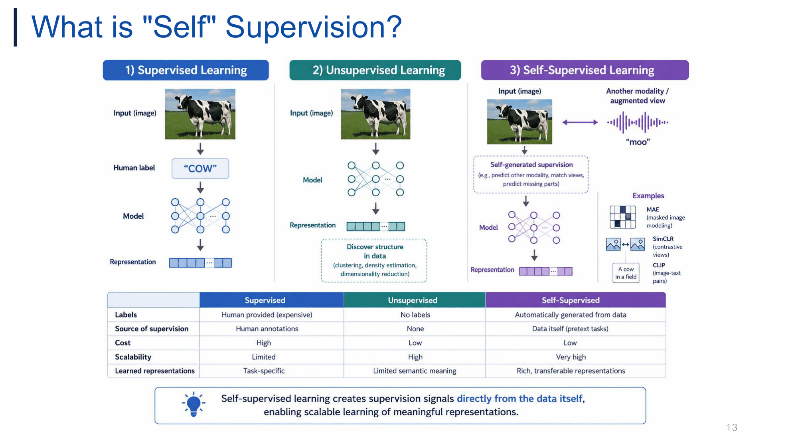

*p.13 — 세 학습 패러다임 비교 도식 + 비교 표. SSL의 supervision은 다른 modality / augmented view / 가려진 부분에서 옴 (예: MAE, SimCLR, CLIP)*

| | Supervised | Unsupervised | Self-Supervised |
|---|---|---|---|
| Labels | Human provided (expensive) | No labels | Automatically generated from data |
| Source of supervision | Human annotations | None | Data itself (pretext tasks) |
| Cost | High | Low | Low |
| Scalability | Limited | High | Very high |
| Learned representations | Task-specific | Limited semantic meaning | Rich, transferable representations |

- **Supervised**: $(x, y)$에서 $y$가 사람 annotation. 비싸고, 표현이 해당 task에 특화
- **Unsupervised**: label 없이 data 구조 발견 (clustering, density estimation, dimensionality reduction; 예: PCA, k-means). 싸고 확장성 좋지만 semantic 수준이 제한적
- **Self-supervised**: label은 없지만 **data에서 supervision을 만들어** supervised 형태의 objective(분류/회귀/contrastive)로 학습 ← unsupervised의 확장성 + supervised의 강한 학습 신호
- **Unsupervised vs SSL 구분 포인트**: 둘 다 사람 label이 없지만 SSL은 **pretext task라는 명시적 target**이 있음
- SSL supervision의 3가지 출처 ↔ 예시
  - **missing parts 예측** → **MAE** (masked image modeling)
  - **augmented view 매칭** → **SimCLR** (contrastive views)
  - **다른 modality 매칭** → **CLIP** (image-text pairs; 그림에선 소 이미지 ↔ "moo" 소리)
- 하단 문장: *Self-supervised learning creates supervision signals directly from the data itself, enabling scalable learning of meaningful representations.*

> 보충: MAE (He et al., 2022), SimCLR (Chen et al., 2020), CLIP (Radford et al., 2021). 세부 방법은 이후 강의에서 다룸

### 2.3 NLP에서의 성공: Word2vec, BERT (p.14)

- **Fill in the blanks is a powerful signal to learn representations** ← 문장 자체가 정답 단어를 제공하므로 annotation 불필요
- Word2vec 그림 구조: **Projection layer**(context 단어 embedding 합/평균) → **Hidden layer**(context embedding) → **Softmax classifier**(vocabulary 전체에 대한 확률)
  - 예: history $h$ = "the cat sits on the" → target $w_t$ = "mat"
- 수식 (슬라이드 도식을 풀어 쓴 것, 슬라이드에는 수식 없음):

$$P(w_t \mid h) = \frac{\exp(\mathbf{u}_{w_t}^\top \mathbf{c})}{\sum_{w'=1}^{V} \exp(\mathbf{u}_{w'}^\top \mathbf{c})}, \qquad \mathbf{c}=\sum_{w\in h} g(\mathbf{e}_w)$$

  - $\mathbf{e}_w$ = 단어 $w$의 input embedding, $g$ = embedding lookup/결합 함수, $\mathbf{c}$ = context representation(hidden), $\mathbf{u}_{w}$ = output(softmax) 쪽 단어 벡터, $V$ = vocabulary 크기
- 결과: **비슷한 context에 나타나는 단어는 비슷한 embedding** (distributional hypothesis). 예측 task는 부산물이고 embedding이 목적
- 슬라이드 그림은 history 다음 단어를 예측하는 형태 ← 엄밀한 CBOW(좌우 context로 중심 단어 예측)보다는 next-word(LM식) 예측에 가까움. context 합산 → softmax 구조만 CBOW와 공통
- **BERT** (Devlin et al., 2018): Transformer + 일부 token을 [MASK]로 가리고 복원(masked language modeling) → 문맥 의존 word/sentence representation. vision의 **MAE**가 이 아이디어를 이미지로 옮긴 것

> 보충: Word2vec = Mikolov et al., 2013 (CBOW, Skip-gram). 실제로는 full softmax 비용을 피하려고 hierarchical softmax / negative sampling 사용

### 2.4 Why self-supervision? (p.15)

- **Helps us learn using observations and interactions** ← 사람/에이전트처럼 label 없이 관찰·상호작용으로 학습
- **Does not require exhaustive annotation of concepts** ← p.8–10 문제(복잡한 개념, rare concept, 도메인 차이) 우회
- **Leverage multiple modalities or structure in the domain** ← 이미지-소리, 이미지-텍스트, video의 시간 구조, 이미지의 공간 구조가 공짜 supervision

### 2.5 SSL Paradigm: Pretext task → Downstream task (p.16)

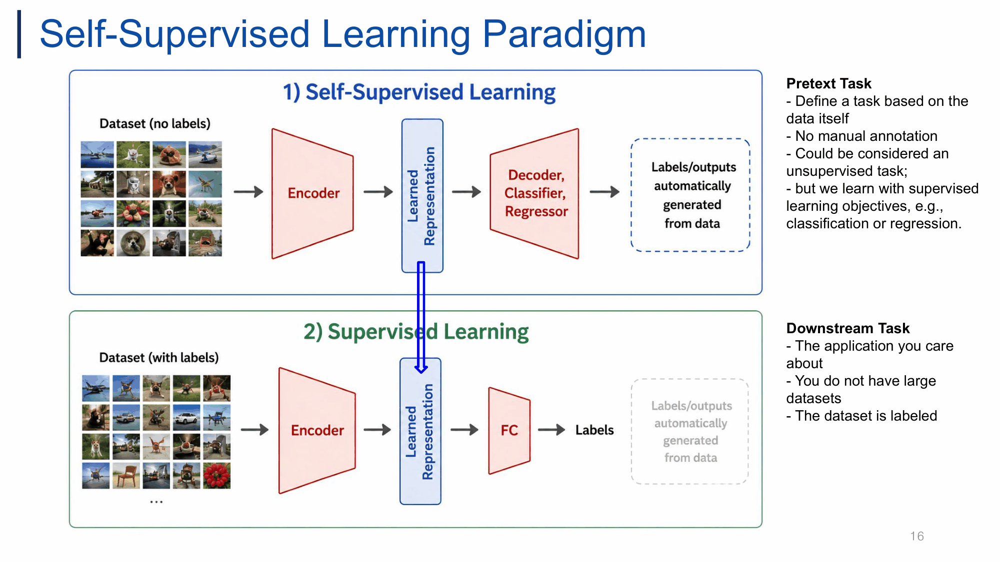

*p.16 — SSL로 학습한 Encoder/Learned Representation을 supervised downstream으로 transfer. pretext head(decoder/classifier/regressor)는 버리고 FC만 새로 붙임*

| | Pretext Task | Downstream Task |
|---|---|---|
| 정의 | Define a task based on the data itself | The application you care about |
| 데이터 | 대규모, **no manual annotation** | **작은** dataset, **labeled** |
| Head | Decoder / Classifier / Regressor | FC |
| Loss | supervised 형태 (classification / regression) | task loss |

- 슬라이드: pretext는 *"Could be considered an unsupervised task; but we learn with supervised learning objectives, e.g., classification or regression."* ← 용어 구분이 모호하므로 "label은 없지만 supervised 형태의 loss를 쓴다"로 이해
- **Encoder + Learned Representation은 공유**, head만 다름. pretext head는 버리는 것이 일반적
- **왜 이렇게 설계?**: 큰 unlabeled data로 **일반적 feature**를 먼저 만들고 적은 label로 적응 → scratch supervised보다 data efficiency ↑ (p.8–10 문제의 해법)

### 2.6 Pretext task의 기본 아이디어 (p.17, p.20)

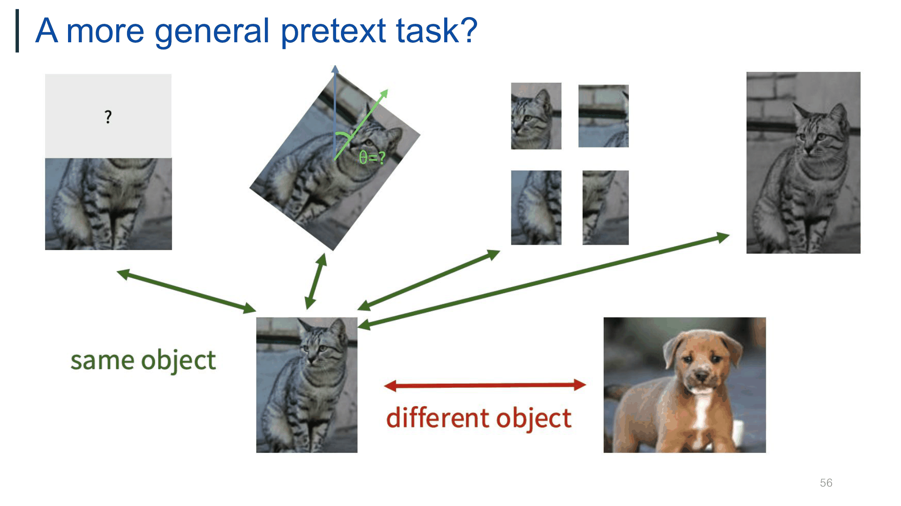

*p.56 (p.17·p.55와 같은 4개 변환 예시 포함) — image completion, rotation prediction, jigsaw puzzle, colorization. 아래 "same/different object" 화살표는 §8에서 다룸*

- **Pretext task** (p.20): *Self-supervised task used for learning representations. Often, not the "real" task (like image classification) we care about.*
- 예시 (p.17): learn to **predict image transformations** / **complete corrupted images**
  - image completion, rotation prediction ($\theta=?$), "jigsaw puzzle", colorization
- 핵심 논리 2가지 (p.17)
  1. **Solving the pretext tasks allow the model to learn good features.** ← 풀려면 물체 형태·구조·의미 같은 semantic 이해 필요
  2. **We can automatically generate labels for the pretext tasks.** ← 대규모 unlabeled data 활용 가능
- 두 계열
  - **변환 예측형 (discriminative)**: rotation, jigsaw, relative position → classification
  - **복원형 (generative)**: completion(inpainting), colorization → reconstruction ← 단, Zhang et al.의 colorization은 양자화된 색 bin에 대한 classification으로 정식화(§4.4)하므로 "복원 = regression"은 일반화일 뿐
- **설계 원칙**: 풀기 위해 high-level semantic 이해가 필요하되, **low-level shortcut**(경계선 연속성, chromatic aberration 등)으로 풀리지 않아야 함 → 각 task마다 반복 등장하는 주제 (§4.6)

---

## 3. SSL 평가 방법 (p.18, p.48–49)

### 3.1 평가 파이프라인 (p.18)

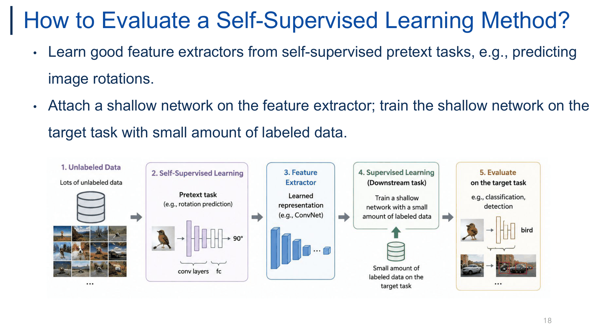

*p.18 — Unlabeled data → pretext 학습 → feature extractor → 소량 labeled data로 shallow network 학습 → target task 평가*

1. 많은 unlabeled data로 pretext task(e.g., rotation prediction) 학습
2. encoder(conv layers)만 떼어 **feature extractor**로 사용 (pretext 전용 fc head는 버림)
3. 그 위에 **shallow network**를 붙여 target task의 **소량 labeled data**로 학습
4. target task(classification, detection 등) 성능으로 평가

- **SSL 방법의 좋고 나쁨은 pretext 성능이 아니라 downstream 성능으로 평가** ← pretext는 수단
- **shallow network만 학습하는 이유**: 성능 차이를 **feature extractor의 representation 품질** 덕으로 돌리기 위함 → **linear probing / linear evaluation** 아이디어
- 슬라이드는 encoder freeze 여부를 명시하지 않음 (linear probing 관점은 해석)
- 소량 label만 쓰는 이유: label-scarce 상황에서 SSL pretraining의 효용을 보여주기 위함

> 보충: 평가 방식 종류 — (a) frozen encoder + linear probe, (b) full fine-tuning, (c) few-shot / semi-supervised (1%, 10% labels), (d) detection/segmentation transfer. 이 강의의 표들에서 "fc8 / fc6-8 / all"은 fine-tune하는 layer 범위를 뜻함 (fc8만 ≈ linear, fc6-8 = 비선형 FC 3층이라 엄밀한 linear probing은 아님, all = full fine-tuning)

### 3.2 Linear classifiers on "fixed" features (p.48)

- Pre-training(weak or self-supervised, e.g., Jigsaw)으로 ConvNet 학습 → Transfer 단계에서 ConvNet을 **고정(fixed)** 하고 **중간 layer들 위에 linear classifier**만 학습
- fine-tuning보다 가혹하지만 **representation 품질을 더 정직하게** 보여줌
- 여러 layer에 붙여 보는 이유: **어느 깊이의 layer가 transfer에 가장 유용한지** 보기 위함 → p.49

> 보충: 이 그림/평가 방식은 Goyal et al., ICCV 2019 ("Scaling and Benchmarking Self-Supervised Visual Representation Learning") 스타일로 보이나 슬라이드에 출처 미표기

---

## 4. Image Pretext Tasks (p.19–43)

### 4.1 Pretext Task 1: Relative Position of Patches (p.21–23)

**출처**: Doersch et al., ICCV 2015, *Unsupervised Visual Representation Learning by Context Prediction*

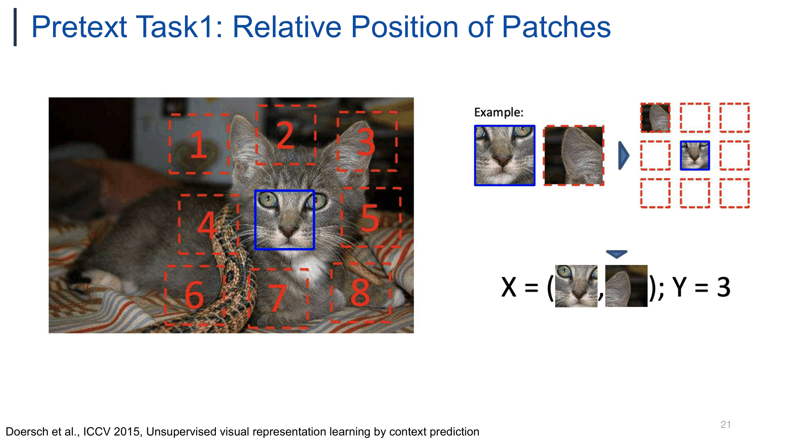

*p.21 — 중앙 patch(파랑) 기준 8개 이웃 위치(빨강, 1~8) 중 어디에서 온 patch인지 맞히는 8-way classification. X = (중앙 patch, 이웃 patch), Y = 위치 index*

**정의**
- 이미지에서 중앙 patch와 이웃 8방향 중 하나의 patch를 뽑아 쌍 $X$로 만들고, 이웃 patch가 **8개 위치 중 어디**인지 맞히는 **8-way classification**. 정답 $Y$ = 위치 index → cross-entropy로 학습
- label은 patch를 어디서 잘랐는지에서 자동으로 나옴
- 슬라이드 예시: X = (고양이 얼굴, 귀 patch), **Y = 3** ← 왼쪽 그림의 번호 규칙(1=좌상단, 3=우상단)이면 귀 patch가 좌상단에 놓인 예시 격자와 Y=3이 맞지 않아 보임 (원문 유지, 번호 규칙 확인 필요)

**직관**
- 위치를 맞히려면 "고양이 귀는 얼굴 위쪽 좌/우에 있다" 같은 **object part 간 공간 관계**를 알아야 함 → part 수준 semantic 학습

**구조** (p.22)

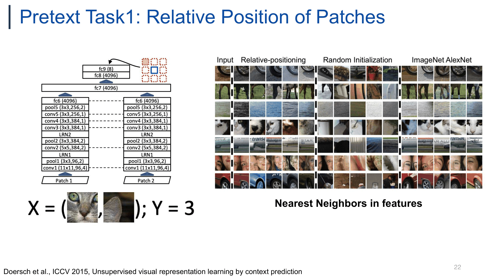

*p.22 — 좌: weight sharing 2-tower AlexNet(fc6까지 공유 → concat → fc7–fc9(8)). 우: feature 공간 nearest neighbor 비교 (Relative-positioning / Random init / ImageNet AlexNet)*

- **Siamese (two-stream)**: Patch 1, Patch 2가 각각 **같은 weight**의 AlexNet 유사 tower 통과
  - conv1 (11×11, 96, 4) → pool1 → LRN1 → conv2 (5×5, 384, 2) → pool2 → LRN2 → conv3 (3×3, 384, 1) → conv4 (3×3, 384, 1) → conv5 (3×3, 256, 1) → pool5 → **fc6 (4096)** ← 표기는 (kernel, #filters, stride)로 보임
  - 두 fc6 출력을 합쳐 → fc7 (4096) → fc8 (4096) → **fc9 (8)** = 8-way head
- **왜 따로 embedding 후 늦게 합치나**: encoder가 patch **하나만 보고도** 의미 있는 feature("이건 고양이 귀")를 만들어야 함 → 이것이 downstream에 재사용할 feature extractor. fc7 이후는 pretext 전용 head
- **Nearest neighbor 결과**: Relative-positioning은 같은 종류 물체(바퀴, 고양이, 비행기)를 잘 찾음 / Random init은 색·질감 같은 low-level만 비슷 / ImageNet AlexNet(supervised)이 가장 의미적으로 일관 ← 정성적 비교일 뿐, 정량적 동등성 의미 X

> 보충: 원 논문은 **shortcut 방지**를 위해 patch 사이 gap(약 half patch)과 random jitter(최대 7 pixel)를 둠 (경계 pixel 연속성 차단). **chromatic aberration** shortcut은 color projection / color dropping으로 대응 → p.23 표의 "Ours-projection", "Ours-color-dropping". LRN = Local Response Normalization

**실험 결과** (p.23, VOC-2007 detection, R-CNN fine-tune, mAP)

| Method | mAP |
|---|---|
| DPM-v5 | 33.7 |
| [8] w/o context | 38.5 |
| Regionlets | 41.7 |
| Scratch-R-CNN | 40.7 |
| Scratch-Ours | 39.8 |
| Ours-projection | 45.7 |
| **Ours-color-dropping** | **46.3** |
| Ours-Yahoo100m | 44.2 |
| Ours-VGG | 53.0 |
| ImageNet-R-CNN (supervised) | 54.2 |

(원 표는 20개 class별 AP 포함; 여기선 mAP만 발췌)

- 캡션: *R-CNN performance with our unsupervised pre-training is **5% MAP better than training from scratch**, but still **8% below** pre-training with ImageNet label supervision.*
  - scratch 대비 +5.0~5.6 (Scratch-R-CNN 40.7 기준), +5.9~6.5 (Scratch-Ours 39.8 기준)
- 당시 SSL은 supervised에 못 미쳤지만 **label 없이도 의미 있는 pretrain이 가능**하다는 증거
- Ours-Yahoo100m(44.2) < color-dropping(46.3) ← 데이터가 많다고 반드시 좋아지진 않음 (원 논문 설정 차이 확인 필요)
- Ours-VGG(53.0)는 ImageNet-R-CNN(54.2)에 근접

### 4.2 Pretext Task 2: Inpainting — Context Encoders (p.24–28)

**출처**: Pathak et al., CVPR 2016, *Context Encoders: Feature Learning by Inpainting*

**개념** (p.24)
- *Can we predict missing regions from surrounding context?*
- 이미지 일부(보통 중앙 block)를 가리고 **주변 context로부터 가려진 영역을 생성**. 정답 = 원본의 해당 영역
- 빈칸을 채우려면 network가 이해해야 하는 것: **Object parts**, **Scene structure**, **Semantic context**
- Relative position과의 차이: relative position은 **discriminative**(8-way classification), inpainting은 **generative / pixel-level reconstruction** → 출력이 pixel이라 spatial 정보가 풍부하게 필요

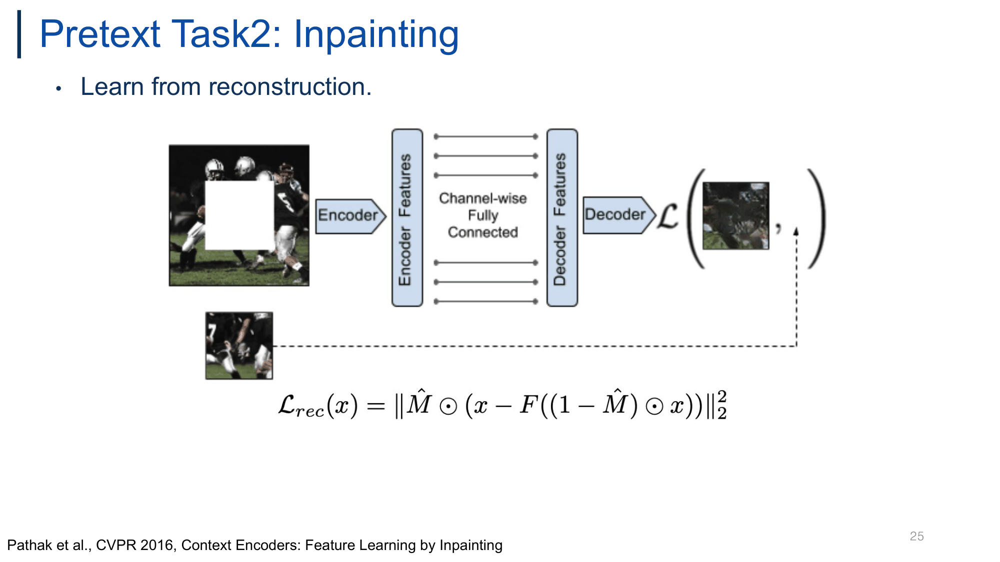

*p.25 — Context Encoder: masked 입력 → Encoder → Channel-wise FC → Decoder → 복원 patch를 정답 patch와 비교 (reconstruction loss)*

**구조**: Encoder → Encoder Features → **Channel-wise Fully Connected** → Decoder Features → Decoder → 복원 patch
- **Channel-wise FC**: 일반 FC는 parameter가 너무 많음 → 각 feature channel **내부에서만** 공간 전체를 연결(채널 간 연결 X), 이후 1×1 conv 등으로 채널을 섞음
  - 목적: feature map 한쪽 끝의 context를 반대쪽까지 전달 (conv receptive field 한계 극복) + parameter 절감

**Loss 1: Reconstruction** (p.25)

$$\mathcal{L}_{rec}(x) = \left\| \hat{M} \odot \left( x - F\big((1-\hat{M}) \odot x\big) \right) \right\|_2^2$$

- $x$ = 원본 이미지, $\hat{M}$ = binary mask (가려진 영역 = 1, 나머지 = 0), $(1-\hat{M})\odot x$ = 가려진 영역을 0으로 만든 입력, $F$ = encoder-decoder (context encoder), $\odot$ = element-wise 곱
- $\hat{M}\odot(\cdot)$ 때문에 **loss는 가려진 영역에서만 계산** ← 보이는 영역은 그냥 복사하면 되므로 의미 없음
- $\|\cdot\|_2^2$ = mask 영역 pixel들의 제곱오차 합 (평균 내면 MSE와 상수배 차이)
- 문제: L2만 쓰면 여러 그럴듯한 정답의 **평균**을 예측 → **blurry**

**Loss 2: Adversarial** (p.26)

$$\mathcal{L}_{adv} = \max_D \ \mathbb{E}_{x \in \mathcal{X}}\left[ \log D(x) + \log\big(1 - D(F((1-\hat{M}) \odot x))\big) \right]$$

- $D$ = discriminator: 진짜 이미지 $x$ → 1, $F$가 채운 이미지 → 0으로 구분하도록 학습. $F$는 반대로 $D$를 속이도록 학습 (GAN minimax: $D$에 대해 max, $F$에 대해 min)
- **역할 분담**: Reconstruction = **coarse structure**(전체 구조) / Adversarial = **sharp, realistic** (실제 이미지 분포처럼)
- 총 loss (슬라이드에 없음, 보충): $\mathcal{L} = \lambda_{rec}\mathcal{L}_{rec} + \lambda_{adv}\mathcal{L}_{adv}$

> 보충: GAN = Goodfellow et al., 2014. 논문에서 $\lambda_{rec}=0.999$, $\lambda_{adv}=0.001$ 정도로 reconstruction 비중이 매우 큼 (기억 기준, 확실하지 않음). Context Encoder는 이후 MAE 같은 masked modeling의 선구 격

**결과** (p.27)

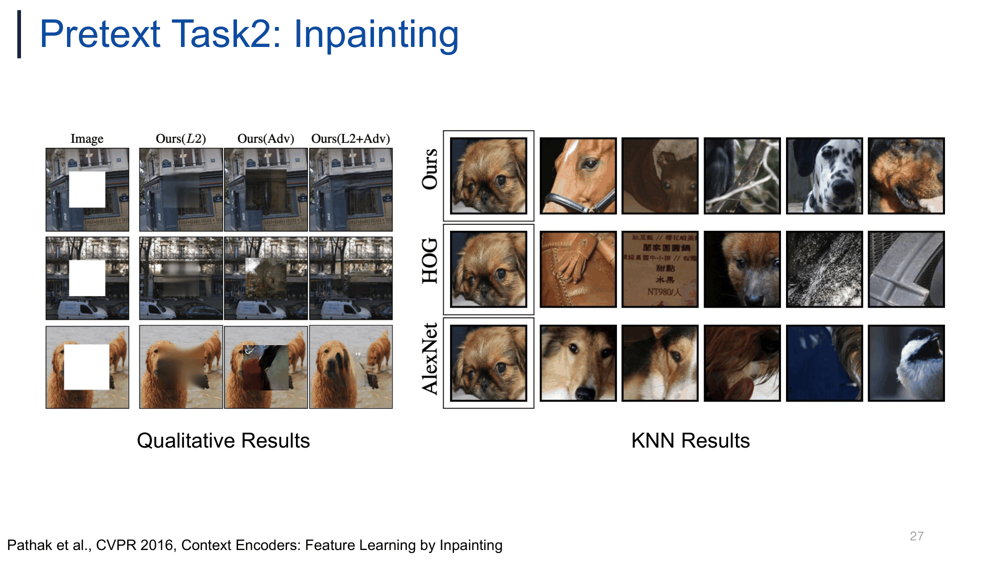

*p.27 — 좌: L2 / Adv / L2+Adv 정성 비교. 우: 페키니즈 쿼리에 대한 feature 공간 KNN (Ours / HOG / AlexNet)*

- **Qualitative**: L2만 → 흐릿한 평균색(blur) / Adv만 → 선명하지만 맥락과 안 맞는 이질적 내용 / **L2+Adv → 가장 자연스럽고 선명** ← 두 loss 조합 필요
- **KNN**: Ours는 대체로 동물 얼굴(말, 달마시안, 로트와일러 등; 나뭇가지 하나는 예외) / HOG는 가죽 장갑, 간판 글자, 어두운 텍스처 등 low-level 유사성 / AlexNet(supervised)은 앞쪽은 개 계열이지만 뒤쪽엔 파란 천, 새 등 섞임
  - → feature가 pixel/gradient 유사성(HOG)이 아니라 **semantic 수준 유사성**을 포착. 단 AlexNet보다 낫다/못하다 단정은 어려움

> 보충: HOG = Histogram of Oriented Gradients, hand-crafted low-level descriptor

**Downstream 비교** (p.28, PASCAL VOC transfer)

| Pretraining Method | Supervision | Pretraining time | Classification | Detection | Segmentation |
|---|---|---|---|---|---|
| ImageNet | 1000 class labels | 3 days | 78.2% | 56.8% | 48.0% |
| Random Gaussian | initialization | < 1 minute | 53.3% | 43.4% | 19.8% |
| Autoencoder | - | 14 hours | 53.8% | 41.9% | 25.2% |
| Agrawal et al. | egomotion | 10 hours | 52.9% | 41.8% | - |
| Wang et al. | motion | 1 week | 58.7% | 47.4% | - |
| Doersch et al. (Relative Position) | relative context | 4 weeks | 55.3% | 46.6% | - |
| **Ours (Context Encoder)** | context | 14 hours | 56.5% | 44.5% | **30.0%** |

- Random 대비 모든 task 향상, 특히 **Segmentation 19.8 → 30.0** (pixel-level 복원이라 dense task에 유리). pretraining **14시간**으로 Doersch(4주)보다 훨씬 효율적
- 하지만 Ours가 모든 항목 1등은 아님: Detection은 Wang(47.4), Doersch(46.6) > Ours(44.5), Classification도 Wang(58.7) > Ours(56.5)
- ImageNet supervised와는 여전히 큰 격차 → 초기 SSL의 한계

> 보충: Agrawal et al. (ICCV 2015, Learning to See by Moving) = egomotion 예측, Wang & Gupta (ICCV 2015) = video tracking 기반

### 4.3 Pretext Task 3: Jigsaw Puzzles (p.29–33)

**출처**: Noroozi & Favaro, ECCV 2016, *Unsupervised Learning of Visual Representations by Solving Jigsaw Puzzles*

**개념** (p.29)
- 이미지에서 3×3 = 9개 tile을 뽑아 섞고 **원래 배치(permutation)** 를 맞힘
- 풀려면 **각 부분이 무엇인지(object part) + 그 부분들의 공간 배열(구조)** 를 알아야 함
- Relative position(patch 2개)을 9개 patch로 일반화한 형태 → local이 아니라 **global spatial structure** 학습

**구조와 정식화** (p.30)

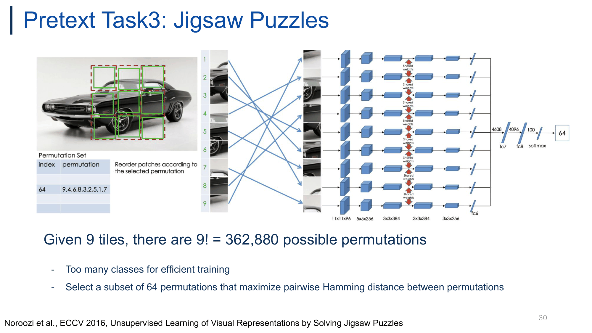

*p.30 — Permutation set에서 index를 고르고 그 순서대로 tile을 섞음 → 9개 shared-weight branch → concat → fc → permutation index 분류*

- **Context-Free Network (CFN)**: 각 tile이 독립적으로 **shared weights** AlexNet-style branch 통과 (11×11×96 → 5×5×256 → 3×3×384 → 3×3×384 → 3×3×256 → fc6) → fc6 출력들 concat → fc7 → fc8 → softmax → **permutation index**
  - weight sharing → parameter가 늘지 않음
  - 각 branch는 tile 내용만 보고 판단해야 함(tile 간 정보는 마지막 FC에서만 결합) → object 수준 표현 학습
- **Given 9 tiles, there are $9! = 362{,}880$ possible permutations** → *too many classes for efficient training*
- **Select a subset of 64 permutations that maximize pairwise Hamming distance**
  - Hamming distance = 두 permutation에서 서로 다른 위치의 수
  - 서로 크게 다른 permutation만 써야 비슷한 permutation 간 모호성이 사라지고 퍼즐이 명확히 정의됨
- ← 그림의 softmax 100 / 출력 64 / fc7 4608 표기가 텍스트(64)와 혼재 (원문 유지; 원 논문은 fc7 4096, 출력 = permutation 수이며 100, 1000개 등도 실험)

> 보충: 원 논문은 greedy하게 max-min Hamming distance가 되도록 부분집합을 만듦

**Cheating (shortcut) 방지** (p.31)

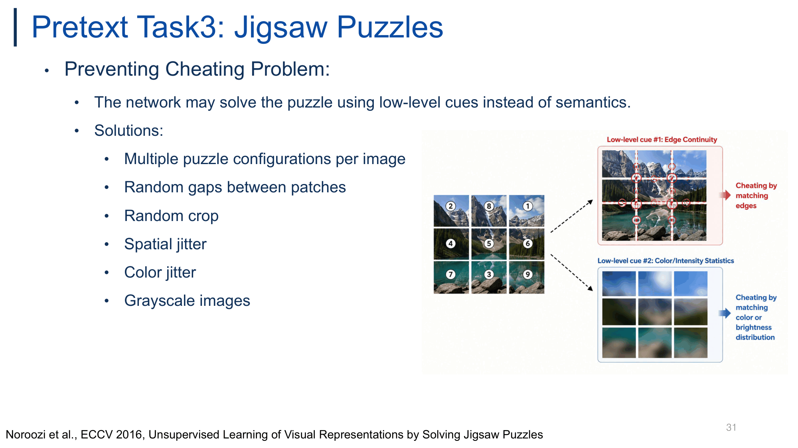

*p.31 — Low-level cue #1 Edge Continuity (경계 edge 매칭), #2 Color/Intensity Statistics (색·밝기 분포 매칭)*

- *The network may solve the puzzle using low-level cues instead of semantics.*
- **Shortcut learning**: semantic 이해 없이 쉬운 길로 풀면 pretext는 풀리지만 feature는 downstream에 쓸모없음

| Low-level cue | 대응책 |
|---|---|
| **Edge continuity** (tile 경계에서 선이 이어짐) | Random gaps between patches, Random crop, Spatial jitter |
| **Color / intensity statistics** (하늘은 위, 물은 아래 등) | Color jitter, Grayscale images, (tile별 normalization) |
| **Chromatic aberration** (렌즈 색수차로 채널이 위치에 따라 어긋남 → 절대 위치 단서) | Grayscale, color(channel) jitter |
| 특정 단서 암기 | **Multiple puzzle configurations per image** |

> 보충: 논문은 각 tile을 **독립적으로** 평균/표준편차 normalization해서 밝기 통계 단서를 줄임

**결과** (p.32, PASCAL VOC 2007; 다른 방법 수치는 Pathak et al.에서 가져옴)

| Method | Pretraining time | Supervision | Classification | Detection | Segmentation |
|---|---|---|---|---|---|
| Krizhevsky et al. (ImageNet) | 3 days | 1000 class labels | 78.2% | 56.8% | 48.0% |
| Wang and Gupta | 1 week | motion | 58.4% | 44.0% | - |
| Doersch et al. (Relative Position) | 4 weeks | context | 55.3% | 46.6% | - |
| Pathak et al. (Inpainting) | 14 hours | context | 56.5% | 44.5% | 29.7% |
| **Ours (Jigsaw)** | 2.5 days | context | **67.6%** | **53.2%** | **37.6%** |

- 같은 supervision 유형(context)에서 **퍼즐 task가 훨씬 강한 semantic 표현** → supervised(78.2)와 격차 크게 좁힘
- 학습 시간 2.5일: Doersch(4주)보다 짧고 Pathak(14시간)보다는 김
- p.28 표와 같은 방법 수치가 일부 다름 ← Wang and Gupta Cls 58.7 vs 58.4, Det 47.4 vs 44.0, Pathak Seg 30.0 vs 29.7 (슬라이드 간 불일치, 원문 유지)

**Ablation** (p.33)

Table 4: permutation set의 영향

| # permutations | Avg Hamming | Min Hamming | Jigsaw acc | Detection |
|---|---|---|---|---|
| 1000 | 8.00 | 2 | 71 | **53.2** |
| 1000 | 6.35 | 2 | 62 | 51.3 |
| 1000 | 3.99 | 2 | 54 | 50.2 |
| 100 | 8.08 | 2 | 88 | 52.6 |
| 95 | 8.08 | 3 | 90 | 52.4 |
| 85 | 8.07 | 4 | 91 | 52.7 |
| 71 | 8.07 | 5 | 92 | 52.8 |
| 35 | 8.13 | 6 | 94 | 52.6 |
| 10 | 8.57 | 7 | 97 | 49.2 |
| 7 | 8.95 | 8 | 98 | 49.6 |
| 6 | 9 | 9 | 99 | 49.7 |

- 윗 블록 (1000개 고정, avg Hamming ↓): jigsaw acc 71 → 54, detection 53.2 → 50.2 → **permutation끼리 충분히 멀어야 좋은 표현**
- 아랫 블록 (permutation 수 ↓): jigsaw acc 88 → 99로 계속 오르지만(task가 너무 쉬워짐) detection은 35개까지 ~52.6 유지 후 **10개 이하에서 ~49로 하락**
- → **pretext accuracy가 높다고 representation이 좋은 게 아님**. 적당히 어려운 task가 downstream에 유리

Table 5: shortcut 방지 장치의 영향

| Gap | Normalization | Color jittering | Jigsaw acc | Detection |
|---|---|---|---|---|
| ✗ | ✓ | ✓ | 98 | 47.7 |
| ✓ | ✗ | ✓ | 90 | 43.5 |
| ✓ | ✓ | ✗ | 89 | 51.1 |
| ✓ | ✓ | ✓ | 88 | **52.6** |

- 장치를 하나라도 빼면 jigsaw acc는 **오히려 올라감** (shortcut으로 쉽게 풀림) / detection은 **떨어짐** → **shortcut을 막아야 의미 있는 feature 학습**
- **Normalization 제거 시 하락폭 최대** (43.5)
- Gap = edge 연속성 차단 / Normalization = tile별 pixel 통계 단서 제거 / Color jittering = 색수차 단서 교란

> 보충: Detection performance는 PASCAL VOC detection mAP(%)로 알려져 있음 (슬라이드에는 명시 없음)

### 4.4 Pretext Task 4: Colorization (p.34–39)

**출처**: Zhang et al., ECCV 2016, *Colorful Image Colorization*

**개념** (p.34)
- *Can a network recover colors from grayscale images? — Color prediction requires semantic understanding.*
- 잔디 = 초록, 하늘/바다 = 파랑, 무당벌레 = 빨강/주황 → 맞추려면 **물체와 장면을 인식**해야 함
- 앞의 pretext(patch 간 공간 관계)와 달리 **pixel-level dense prediction**이며 같은 이미지의 **채널 간 관계(L → ab)** 를 이용

**문제 정의** (p.35)
- **CIE Lab color space** 사용: $L$ = lightness(명도 = 흑백 이미지), $a$ = green–red 축, $b$ = blue–yellow 축
- 입력 $\mathbf{X} \in \mathbb{R}^{H \times W \times 1}$ ($L$ channel) → 출력 $\widehat{\mathbf{Y}} = \mathcal{F}(\mathbf{X}) \in \mathbb{R}^{H \times W \times 2}$ ($ab$ channels) → 입력 $L$과 합치면 컬러 이미지
- **RGB 대신 Lab인 이유**: 밝기와 색도(chrominance)가 분리되어 $L$을 주고 $ab$ 두 채널만 예측하면 됨 + Lab은 **perceptually uniform** (거리 ≈ 지각 차이)

**네트워크와 L2 loss** (p.36)

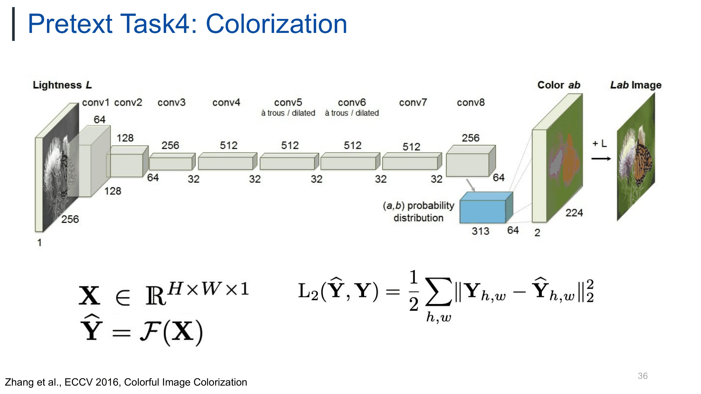

*p.36 — Lightness L → conv1~conv8 (conv5·6은 à trous/dilated) → (a,b) probability distribution (313) → Color ab → +L → Lab image*

- VGG 스타일 fully convolutional, conv1~conv8. **conv5, conv6에 dilated (atrous) convolution** → 해상도를 더 줄이지 않으면서 **receptive field 확대** (넓은 문맥으로 색 판단). conv8 이후 upsampling
- Regression 버전 loss:

$$L_2(\widehat{\mathbf{Y}}, \mathbf{Y}) = \frac{1}{2}\sum_{h,w} \left\| \mathbf{Y}_{h,w} - \widehat{\mathbf{Y}}_{h,w} \right\|_2^2$$

  - $\mathbf{Y}_{h,w} \in \mathbb{R}^2$ = pixel $(h,w)$의 정답 $ab$, $\widehat{\mathbf{Y}}_{h,w}$ = 예측
- ← 그림은 313-bin 분포를 출력하는 classification 버전 구조인데 수식은 L2(regression)만 있음. p.37과 연결해서 볼 것

**Regression → Classification** (p.37)

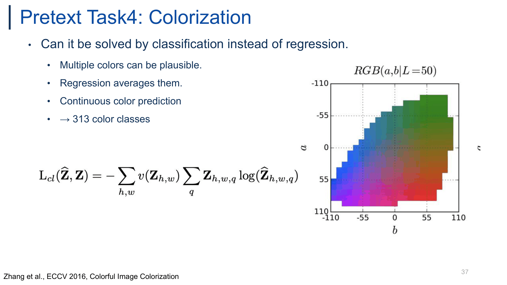

*p.37 — $ab$ 공간을 격자로 양자화, $L=50$에서 in-gamut인 313개 bin을 class로 사용. pixel별 313-way cross-entropy*

- 문제: 색은 본질적으로 **multimodal** (*Multiple colors can be plausible*) → **Regression averages them** → 채도 낮은 회색빛(desaturated) 결과
- 해결: 연속 $ab$ 공간 → **313 color classes** (in-gamut bin), pixel마다 **313-way classification**

$$L_{cl}(\widehat{\mathbf{Z}}, \mathbf{Z}) = -\sum_{h,w} v(\mathbf{Z}_{h,w}) \sum_{q} \mathbf{Z}_{h,w,q}\,\log\big(\widehat{\mathbf{Z}}_{h,w,q}\big)$$

  - $\widehat{\mathbf{Z}}_{h,w} \in [0,1]^{Q}$, $Q=313$: pixel별 bin 예측 확률
  - $\mathbf{Z}_{h,w}$: 정답 $ab$를 **soft-encoding**한 target 분포 (원 논문: 가까운 5개 bin에 Gaussian kernel로 분산), $\mathbf{Z}_{h,w,q}$는 bin $q$의 값
  - $\sum_q \mathbf{Z}\log\widehat{\mathbf{Z}}$: pixel별 **cross-entropy**
  - $v(\cdot)$: **class rebalancing weight** ← 자연 이미지는 배경(하늘, 벽 등) 저채도 색이 압도적이므로 드문(고채도) 색의 loss를 크게 가중. 슬라이드엔 정의 없음

> 보충: $v(\mathbf{Z}_{h,w}) = w_{q^*}$, $q^*=\arg\max_q \mathbf{Z}_{h,w,q}$, $w \propto \big((1-\lambda)\tilde p + \lambda/Q\big)^{-1}$ ($\tilde p$ = Gaussian smoothing한 경험적 색 분포, $\lambda=1/2$). 추론 시에는 **annealed-mean** (temperature $T=0.38$)으로 분포 → $ab$ 값 변환 (mean과 mode의 절충)

**정성 결과** (p.38)

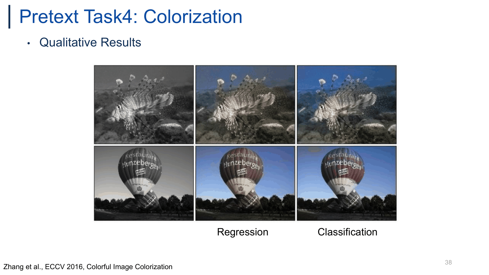

*p.38 — 같은 구조에서 loss만 바꾼 비교: Regression(L2)은 탁하고, Classification은 vivid (열기구의 붉은색이 살아남)*

- lionfish: regression은 누런 세피아/탁한 톤, classification은 배경이 더 선명한 파랑
- 열기구: regression은 풍선이 칙칙한 갈색/보라, classification은 선명한 빨강 (하늘은 둘 다 파랑)
- → regression의 **평균색 → desaturation** 문제를 시각적으로 확인

**Transfer 결과** (p.39, PASCAL; Class./Det. = %mAP, Seg. = %mIU)

| Method | Class. fc8 | Class. fc6-8 | Class. all | Det. all | Seg. all |
|---|---|---|---|---|---|
| ImageNet (supervised) | 76.8 | 78.9 | 79.9 | 56.8 | 48.0 |
| Gaussian (random) | – | – | 53.3 | 43.4 | 19.8 |
| Autoencoder | 24.8 | 16.0 | 53.8 | 41.9 | 25.2 |
| k-means | 32.0 | 39.2 | 56.6 | 45.6 | 32.6 |
| Agrawal et al. | 31.2 | 31.0 | 54.2 | 43.9 | – |
| Wang & Gupta | 28.1 | 52.2 | 58.7 | 47.4 | – |
| *Doersch et al. | 44.7 | 55.1 | 65.3 | **51.1** | – |
| *Pathak et al. | – | – | 56.5 | 44.5 | 29.7 |
| *Donahue et al. | 38.2 | 50.2 | 58.6 | 46.2 | 34.9 |
| Ours (gray) | **52.4** | **61.5** | **65.9** | 46.1 | 35.0 |
| Ours (color) | **52.4** | **61.5** | 65.6 | 46.9 | **35.6** |

- 열 = fine-tune하는 layer 범위 (fc8만 ≈ linear classifier / fc6-8 / all)
- **적은 layer만 fine-tune할 때(fc8, fc6-8) 기존 방법보다 큰 폭으로 우수** → feature 자체가 이미 잘 분리되는 좋은 표현
- all: Class.는 Doersch(65.3)와 비슷하거나 약간 우세, Det.은 Doersch(51.1)가 더 높고, Seg.은 Ours(color) 35.6 최고
- ImageNet 이미지로 학습했지만 label은 안 썼고, 평가는 다른 dataset/task → "dataset and task generalization"
- `*` 의미는 슬라이드에 설명 없음 ← 원 논문에서 다른 설정/구조 표기로 추정. Ours (gray)/(color)는 gray/color 입력으로 fine-tune한 비교

> 보충: Donahue et al. (ICLR 2017) = BiGAN

### 4.5 Pretext Task 5: Rotation Prediction — RotNet (p.40–43)

**출처**: Gidaris et al., ICLR 2018, *Unsupervised Representation Learning by Predicting Image Rotations*

**개념** (p.40)
- *Which orientation is correct? — To recognize rotation, the network must recognize objects.*
- 예시: 새(90°), 눈 위 개(270°), 졸업 가운 사람(180°), 개구리(0°), 선반 물체(270°)
- 회전을 맞히려면 "새는 머리가 위", "개구리는 땅에 앉아 있음" 같은 **물체의 canonical orientation**을 알아야 함 → object를 localize하고 category/자세를 인식하는 **object-centric** feature 학습

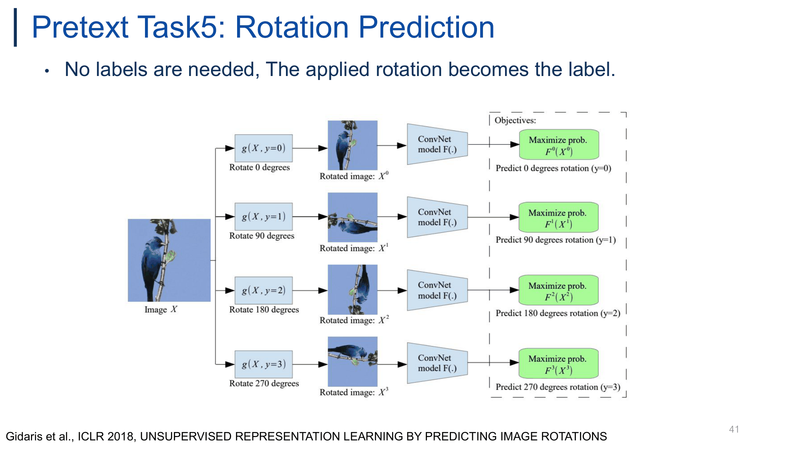

*p.41 — 원본 X를 $g(X, y)$로 0°/90°/180°/270° 회전 → 같은 ConvNet F → 각 회전 class 확률 $F^y(X^y)$ maximize*

**정의** (p.41) — *No labels are needed, the applied rotation becomes the label.*

$$\min_\theta \; -\frac{1}{4}\sum_{y=0}^{3} \log F^{y}\big(g(X, y);\theta\big)$$

- $X$ = 원본, $g(X, y)$ = $y \times 90°$ 회전 ($y \in \{0,1,2,3\}$), $F^y(\cdot)$ = ConvNet softmax 출력 중 $y$번째 회전 class 확률
- 슬라이드는 "Maximize prob. $F^y(X^y)$" 형태 → 위 식은 이를 cross-entropy로 쓴 것 (보충)
- **4-way classification**

**장점 (이전 pretext 대비)**
- 입력에 변환 하나만 가하면 됨 → **구현이 매우 단순**
- 정답이 4가지로 고정 → chance level 25%로 명확, 학습 안정
- 전체 이미지를 회전 → jigsaw의 tile 경계·색수차 같은 **low-level shortcut이 적음**

> 보충: 원 논문은 한 이미지의 4가지 회전 버전을 한 batch에 함께 넣어 학습. 90° 배수 회전은 flip/transpose로 구현되어 경계 artifact 단서가 생기지 않음 (45° 등 임의 각도와 대비). 약점: 회전 대칭 물체, 방향이 모호한 이미지(aerial 등)

**회전 개수 ablation** (p.42, CIFAR-10; RotNet 4 conv block 중 2nd block feature 위에 3-layer FC non-linear classifier)

| # Rotations | Rotations | CIFAR-10 Acc |
|---|---|---|
| **4** | 0°, 90°, 180°, 270° | **89.06** |
| 8 | 0°, 45°, …, 315° | 88.51 |
| 2 | 0°, 180° | 87.46 |
| 2 | 90°, 270° | 85.52 |

- 8개(45° 간격)는 오히려 약간 낮음 ← 45° 회전은 모서리 잘림/빈 영역(padding) 같은 **인위적 artifact**, pixel grid 보존 X
- 2개 중 {0°,180°} > {90°,270°} ← 90° vs 270°는 둘 다 옆으로 누워 구분이 어렵고 얻는 정보가 적음. 또 2-class는 task가 너무 쉬움
- → **4개가 난이도(정보량)와 artifact 없음 사이의 sweet spot**

**Downstream 결과** (p.43, PASCAL VOC; Cls·Det = %mAP, Seg = %mIoU)

| Method | Cls fc6-8 | Cls all | Det all | Seg all |
|---|---|---|---|---|
| ImageNet labels | 78.9 | 79.9 | 56.8 | 48.0 |
| Random | | 53.3 | 43.4 | 19.8 |
| Random rescaled (Krähenbühl 2015) | 39.2 | 56.6 | 45.6 | 32.6 |
| Egomotion (Agrawal 2015) | 31.0 | 54.2 | 43.9 | |
| Context Encoders / Inpainting (Pathak 2016) | 34.6 | 56.5 | 44.5 | 29.7 |
| Tracking (Wang & Gupta 2015) | 55.6 | 63.1 | 47.4 | |
| Context / Relative Position (Doersch 2015) | 55.1 | 65.3 | 51.1 | |
| Colorization (Zhang 2016) | 61.5 | 65.6 | 46.9 | 35.6 |
| BiGAN (Donahue 2016) | 52.3 | 60.1 | 46.9 | 34.9 |
| Jigsaw Puzzles (Noroozi 2016) | - | 67.6 | 53.2 | 37.6 |
| NAT (Bojanowski 2017) | 56.7 | 65.3 | 49.4 | |
| Split-Brain (Zhang 2016) | 63.0 | 67.1 | 46.7 | 36.0 |
| ColorProxy (Larsson 2017) | | 65.9 | | 38.4 |
| Counting (Noroozi 2017) | - | 67.7 | 51.4 | 36.6 |
| **RotNet (Ours)** | **70.87** | **72.97** | **54.4** | **39.1** |

- 상한 ImageNet labels(79.9 / 56.8 / 48.0), 하한 Random(53.3 / 43.4 / 19.8)
- RotNet이 이전 pretext 전부(슬라이드 빨간 박스: Inpainting, Context, Colorization, Jigsaw)를 앞섬
- 특히 **fc6-8만 학습할 때 격차가 큼** (Colorization 61.5, Split-Brain 63.0 vs **70.87**) → conv feature 자체가 transfer에 유용 (단 fc6-8은 비선형 FC 3층이라 엄밀한 linear probing은 아님)
- Inpainting fc6-8이 34.6으로 상당히 낮음 → 픽셀 복원은 semantic feature 학습에 비효율적일 수 있음

> 보충: Random rescaled = data-dependent initialization, NAT = Noise-As-Targets, Counting = visual primitive counting. (슬라이드에 설명 없는 일반 지식)

### 4.6 공통 주제: Shortcut(trivial solution) 문제 종합

| 방법 | 가능한 shortcut | 대응 |
|---|---|---|
| Relative Position | patch 경계 연속성, chromatic aberration | gap + jitter, color projection / dropping |
| Jigsaw | edge continuity, color/intensity statistics, chromatic aberration | random gap, crop, spatial jitter, color jitter, grayscale, tile별 normalization, 이미지당 여러 퍼즐 |
| Rotation | (90° 배수 회전이라 적음) 45° 회전은 모서리 artifact | 0/90/180/270만 사용 |
| ST Cubic Puzzle (video, §9) | chromatic aberration, cube boundary matching, low-level statistics | channel replication, spatio-temporal jittering, upside-down classification |

- 일반 원리: **pretext accuracy ↑ ≠ representation ↑**. shortcut을 막으면 pretext accuracy는 떨어지지만 downstream은 올라감 (Jigsaw Table 5)

---

## 5. Pretext Task 요약 및 비교 (p.44–46)

### 5.1 슬라이드 요약 표 (p.45)

| Task | Core Question | Learned Concept |
|---|---|---|
| Relative Position | Where is the neighboring patch? | Local Spatial Context |
| Jigsaw | How should patches be arranged? | Global Spatial Structure |
| Inpainting | What is missing? | Context & Object Parts |
| Colorization | What color should it be? | Object Semantics |
| Rotation | Which orientation is correct? | Object-Centric Understanding |

- local → global → context/part → semantic → object-centric 순으로 점점 high-level 개념을 요구하는 흐름으로 읽을 수 있음

### 5.2 종합 비교 표

| 방법 | 핵심 아이디어 | loss | 장점 | 한계 |
|---|---|---|---|---|
| **Relative Position** (Doersch, ICCV'15) | 중앙 patch 기준 이웃 patch 위치 맞히기 | 8-way CE | 단순, part 간 공간 관계 학습, siamese로 single-patch encoder 획득 | shortcut(경계, 색수차) 취약, 학습 4주, local context만 |
| **Inpainting** (Pathak, CVPR'16) | 가린 영역을 주변 context로 복원 | $\mathcal{L}_{rec}$ (masked L2) + $\mathcal{L}_{adv}$ | pixel-level → segmentation에 유리, 14시간 | L2만 쓰면 blur, cls/det feature 약함 (fc6-8 34.6) |
| **Jigsaw** (Noroozi, ECCV'16) | 9 tile permutation index 분류 (max Hamming 부분집합) | permutation CE | global spatial structure, 당시 큰 폭 향상 (67.6) | shortcut 방지 장치 필수, permutation set 설계에 민감 |
| **Colorization** (Zhang, ECCV'16) | $L \to ab$ 예측, 313 bin 분류 | rebalanced pixel-wise CE $L_{cl}$ | object semantics, fc8/fc6-8 feature 강함 | 색은 multimodal (regression 시 desaturation), 색 정보 의존 |
| **Rotation** (Gidaris, ICLR'18) | 0/90/180/270° 중 회전 각도 분류 | 4-way CE | 구현 최단순, shortcut 적음, 최고 성능 (72.97) | 회전 대칭/방향 모호 이미지에 약함 |
| **CDJP** (Kim, WACV'18) | jigsaw + inpainting + colorization 통합, damaged puzzle | $L_{jig} + L_{inp} + L_{col}$ | 단일 task보다 일반적 (Cls 69.2, Seg 39.3) | 여전히 사람이 고른 task 집합에 묶임 |

### 5.3 Pretext task의 성격 (p.46)

- Pretext tasks focus on **"visual common sense"** (rotation, inpainting, rearrangement, colorization) ← 사람이 당연히 아는 시각 상식(물체는 똑바로 섬, 하늘은 위, 잔디는 초록)
- *The models are forced learn good features about natural images* ← "forced learn"은 "forced to learn"의 오타로 보임
- **pretext task 자체의 성능은 관심 없음** → learned feature가 downstream(classification, detection, segmentation)에 얼마나 유용한지가 관심
- **Problems: 1) coming up with individual pretext tasks is tedious.** ← task마다 사람이 설계, 새 domain마다 새 pretext, 어떤 task가 좋은 feature를 줄지 사전에 모름

---

## 6. Pretext Task의 한계 (p.46–49)

### 6.1 Problem 1: tedious (p.46)
- 위 §5.3 참고

### 6.2 The Hope of Generalization (p.47)

- *We really hope that the pre-training task and the transfer task are **"aligned"**.*
- Pre-training(weak: hashtag "#sun #nofilter …" / self-supervised: jigsaw) → Transfer tasks(PASCAL VOC 20 class 등)
- 비판적 질문
  - **Why should solving Jigsaw puzzles teach about "semantics"?**
  - **Why should performing a non-semantic task produce good features?**
- pretext를 잘 푸는 능력과 downstream에 필요한 능력이 겹친다는 보장이 없음 → 사실상 "희망(hope)"에 기댐
- weak supervision과 self-supervision을 함께 묶은 이유: 둘 다 정확한 label 없는 대규모 데이터에서 학습

### 6.3 Problem 2: Higher layers do not generalize (p.49)

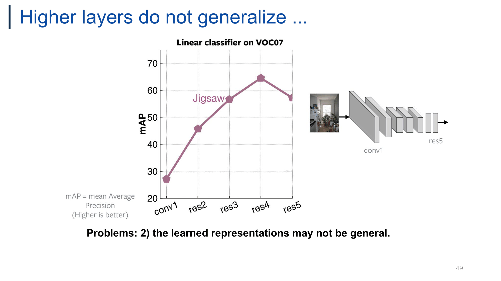

*p.49 — Jigsaw 학습 네트워크의 layer별 linear classifier(VOC07 mAP). res4에서 최고, 마지막 res5에서 하락*

- layer별 feature를 freeze + linear classifier → VOC07 mAP
  - conv1 ≈ 27, res2 ≈ 46, res3 ≈ 57, **res4 ≈ 64.5 (최고)**, res5 ≈ 57 (하락) (그래프 눈대중)
- **Problems: 2) the learned representations may not be general.**
- 이유: 마지막 layer들은 **pretext task 자체(permutation 맞히기)에 특화** → downstream의 semantic 정보와 어긋남. **representation이 pretext에 overfit**
- supervised ImageNet pretraining은 마지막 layer feature가 가장 좋은 것과 대비

> 보충: layer-wise linear probe는 Goyal et al., ICCV 2019 스타일. 이후 SSL에서 projection head 앞 feature를 쓰는 관행(SimCLR 등)도 "최종 층 특화" 관찰과 관련 있음 (직접적 기원이라 단정 X)

---

## 7. Multiple Pretext Tasks — CDJP (p.50–53)

**출처**: Kim et al., WACV 2018, *Learning Image Representations by Completing Damaged Jigsaw Puzzles*

**아이디어** (p.50–51)
- 한 입력으로 **jigsaw + inpainting + colorization을 동시에** 풀게 함: 섞인 patch 위치 맞히기 + 빠진 patch 채우기 + grayscale → color 복원
- 동기: 단일 pretext는 그 task에 묶임(p.49) → 여러 task를 합쳐 **더 general한 표현**
- 각 task를 "conventional" vs "complicated" 버전으로 만들어 통합 (Figure 2)
  - (a) conventional 2×2 jigsaw / (b) 각 patch의 **L 또는 ab 채널 drop** / (c) patch 하나 **완전히 drop**
  - (d) conventional inpainting / (e) **L 채널만 입력 → 가린 영역의 ab 출력**
  - (f) conventional colorization / (g) **이미지 1/4만** 주고 colorization
- = **damaged jigsaw**: 퍼즐을 풀면서 누락 정보를 채우고 색도 복원해야 함
- **왜 complicated하게?**: task를 어렵게 해야 경계 색/선 연속성 같은 shortcut으로 못 풀고 semantic 이해가 필요해짐 + 한 network가 세 task를 공유 weight로 풀어 표현 일반화

**구조** (p.52)

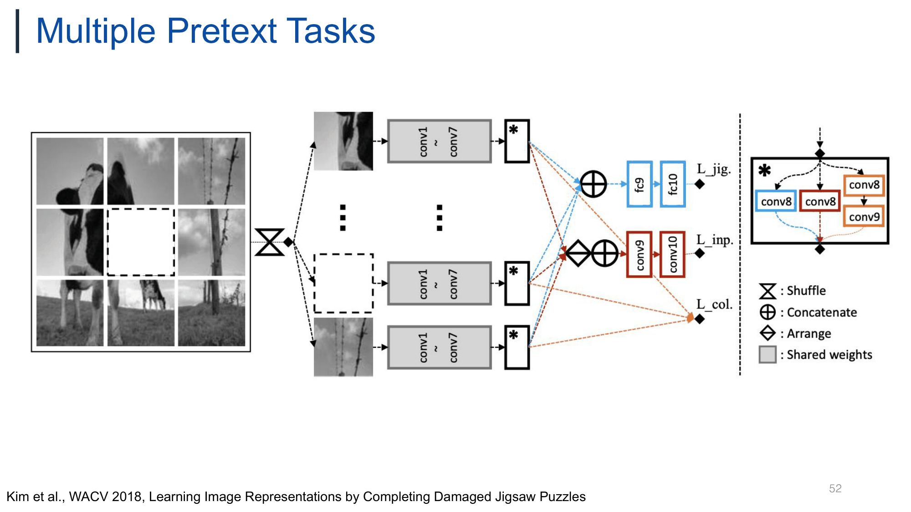

*p.52 — Shuffle → patch별 shared conv1~7 → (jigsaw) concat → fc9, fc10 → $L_{jig}$ / (inpainting) arrange → concat → conv9, conv10 → $L_{inp}$ / (colorization) → $L_{col}$*

- **공유 backbone (conv1~conv7)** 을 patch 단위 siamese로 돌리고 conv8부터 **task별 head**
  - **Jigsaw head**: patch feature concat → fc9 → fc10 → permutation 분류 ($L_{jig}$, classification)
  - **Inpainting head**: feature를 **원래 위치로 arrange** 후 concat → conv9 → conv10 → 빠진 patch 복원 ($L_{inp}$, reconstruction)
  - **Colorization head**: conv8 → conv9 → ab 예측 ($L_{col}$)
- 전체 loss는 세 loss의 (가중)합으로 보임 ← 슬라이드에 합 식 없음: $\mathcal{L} \approx L_{jig} + L_{inp} + L_{col}$

**결과** (p.53, Class. %mAP / Det. %mAP / Segm. %mIU)

| Method | Class. | Det. | Segm. |
|---|---|---|---|
| ImageNet | 79.9 | 56.8 | 48.0 |
| Random | 53.3 | 43.4 | 19.8 |
| RelativePosition | 65.3 | 51.1 | - |
| Jigsaw | 67.6 | **53.2** | 37.6 |
| Ego-motion | 54.2 | 43.9 | - |
| Adversarial | 58.6 | 46.2 | 34.9 |
| Inpainting | 56.5 | 44.5 | 29.7 |
| Colorization | 65.9 | 46.9 | 35.6 |
| Split-Brain | 67.1 | 46.7 | 36.0 |
| ColorProxy | 65.9 | - | 38.4 |
| WatchingObjectMove | 61.0 | 52.2 | - |
| Counting | 67.7 | 51.4 | 36.6 |
| **CDJP** | **69.2** | 52.4 | **39.3** |

- CDJP: Class.·Segm. 최고, Det.은 Jigsaw(53.2) 다음 (52.4)
- 산점도(Class. vs Segm.): Jig. → Jig.+Inp. → Jig.+Col. → CDJP로 우상향 → **task를 합치면 대체로 향상**
- 단일 task 편차가 큼: Segm. 최저 = Inpainting(29.7), Class. 최저 = Ego-motion(54.2), 그다음 Inpainting(56.5)
- 그래도 supervised(79.9)와 격차 큼

**한계** (p.55): *Learned representations may be tied to a specific pretext task (**even multi tasks**)!* → 합쳐도 **사람이 고른 task 집합에 묶임**

---

## 8. Toward Contrastive Learning (p.54–56)

- 지금까지의 pretext = 원본에 **변환(가림, 회전, 셔플, 탈색)** 을 가하고 그걸 되돌리거나 변환 정보를 예측 (p.55)
- 문제: 표현이 **해당 변환 정보(회전각, 퍼즐 순서)에 특화** → *Can we come up with a more general pretext task?*
- 아이디어 (p.56, §2.6 그림): 변환된 이미지들은 모두 **같은 object의 view** → 표현이 **가까워야(same object)**, 다른 object(강아지)와는 **멀어야(different object)**
  - **positive pair** = (원본, 변환본), **negative pair** = (원본, 다른 이미지)
- 이전과의 차이: "변환을 되돌려라/맞혀라"(**task-specific**) → "같은 것끼리 가깝게, 다른 것끼리 멀게"(**task-agnostic**) → 표현이 **변환에 invariant**해지고 object identity 같은 semantic 정보를 담음

> 보충: 이후 SimCLR (Chen et al., 2020), MoCo (He et al., 2020) 등이 InfoNCE 계열 loss를 사용. SimCLR NT-Xent 형태: $\mathcal{L}=-\log\frac{\exp(\mathrm{sim}(z_i,z_j)/\tau)}{\sum_{k\neq i}\exp(\mathrm{sim}(z_i,z_k)/\tau)}$ ($z_i, z_j$ = 같은 이미지의 두 view embedding, $\tau$ = temperature). MoCo는 queue의 negative로 InfoNCE 구성. 다음 주 본격적으로 다룸

---

## 9. Video SSL: Space-Time Cubic Puzzles (p.57–66)

**출처**: Kim, Cho, Kweon, AAAI 2019, *Self-Supervised Video Representation Learning with Space-Time Cubic Puzzles* (KAIST; 2저자가 본 강의 instructor)

### 9.1 동기: 이미지 → 비디오 (p.58)

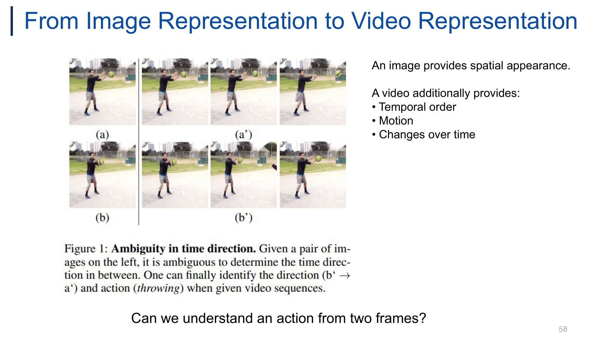

*p.58 — Ambiguity in time direction: 두 프레임만으로는 시간 방향이 모호, 시퀀스를 보면 b' → a' 방향과 throwing action이 확정*

- **An image provides spatial appearance. A video additionally provides: temporal order, motion, changes over time**
- 두 프레임만 보면 공이 손으로 *오는*지(catch) *가는*지(throw) 모호 → *Can we understand an action from two frames?* → 부족. **여러 프레임에 걸친 temporal context** 필요
- 비디오 라벨링은 이미지보다 훨씬 비쌈 → SSL 이득이 큼

> 보충: 선행 비디오 SSL — Shuffle & Learn (Misra et al., 2016, frame 순서 검증), OPN (Lee et al., 2017, Order Prediction Network). Cubic Puzzle은 image Jigsaw(Noroozi 2016)를 **시간+공간 동시 퍼즐**로 확장한 것. time direction 모호성은 Arrow of Time 연구와도 연결

### 9.2 Pretext task 정의 (p.59–61)

- **Arrange shuffled video cubes into their original space-time order**
  - **Spatial puzzle**: *Where* was each cube located? (image jigsaw의 비디오 버전)
  - **Temporal puzzle**: *When* did each cube occur? (frame order prediction의 cube 버전)

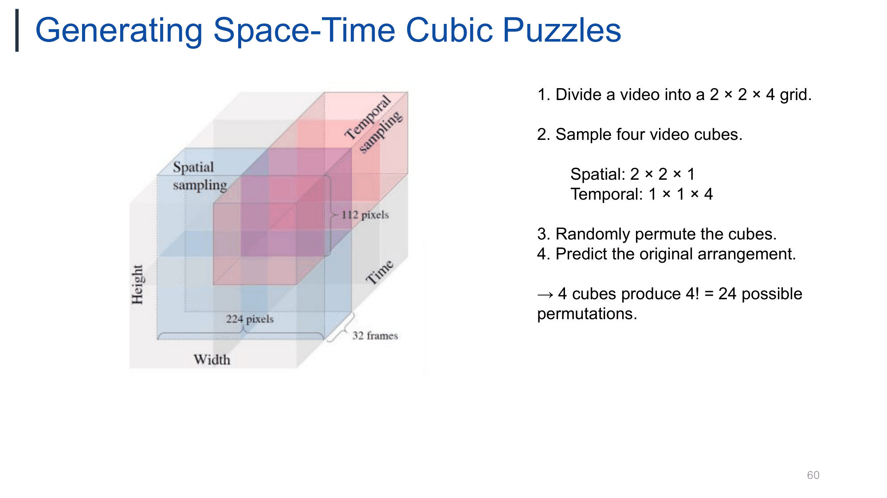

*p.60 — 비디오 볼륨(Width × Height × Time)을 2×2×4 격자로 나누고, spatial(파랑, 2×2×1) 또는 temporal(빨강, 1×1×4) 방식으로 cube 4개 샘플링*

**생성 절차** (p.60)
1. 비디오를 **2 × 2 × 4 grid**로 분할 (H 2 × W 2 × T 4 = 16 cell)
2. **4개 cube 샘플링**: Spatial = 2×2×1 (한 시간 구간의 공간 4위치) / Temporal = 1×1×4 (한 공간 위치의 시간 4구간)
3. cube를 **randomly permute**
4. 원래 배열 예측 → **4! = 24 permutations** → classification

$$f_\theta\big(c_{\pi(1)},\dots,c_{\pi(4)}\big) \;\to\; \pi \in S_4,\qquad |S_4| = 4! = 24$$

- $c_i$ = cube, $\pi$ = 적용된 순열, $S_4$ = 4원소 순열 집합 (보충 정식화)
- Jigsaw처럼 regression이 아니라 **permutation classification**. 순열이 24개뿐이라 Hamming 부분집합 없이 전체 사용
- 슬라이드 그림 치수: 전체 Width 224 pixels, cube 112 pixels, 32 frames → 학습 입력은 그 안에서 crop한 **80×80×16** (p.62–63)

**예시** (p.61, Figure 4): *Q. Can you arrange these?* — 정답은 거꾸로 인쇄 (Spatial: A-D-B-C, Temporal: B-D-A-C)
- Spatial: 관중석은 위, 모래는 아래 → 장면 레이아웃 이해 필요
- Temporal: 달려오기 → 도약 → 공중 → 착지 순서 이해 필요 → motion/action 진행 순서

### 9.3 구조: 4-tower shared 3D CNN (p.62)

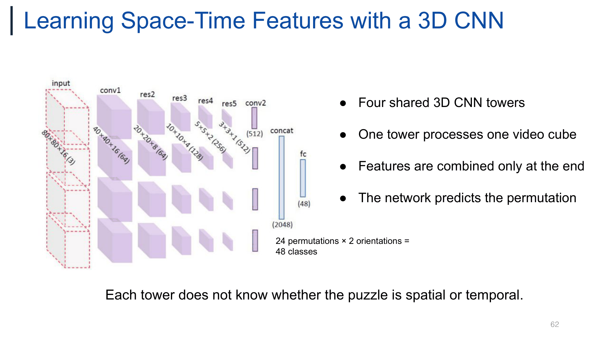

*p.62 — cube 4개(80×80×16) 각각 shared 3D CNN tower(conv1 → res2~res5 → conv2, 512) → concat(2048) → fc(48)*

- input 80×80×16 (3) → conv1 40×40×16 (64) → res2 20×20×8 (64) → res3 10×10×4 (128) → res4 5×5×2 (256) → res5 3×3×1 (512) → conv2 (512) → 4개 concat **(2048)** → **fc (48)**
- **Four shared 3D CNN towers / One tower processes one video cube / Features are combined only at the end / The network predicts the permutation**
- **48 classes = 24 permutations × 2 orientations** (upside-down, p.63)
- **왜 late fusion?**: 중간에 섞으면 cube 경계 low-level 단서로 풀어버림 → 각 tower가 **cube 내부 semantic feature만으로** 표현을 만들도록 강제 (Jigsaw CFN과 같은 철학)
- **왜 3D conv?**: 시간축까지 kernel이 걸쳐 motion/temporal 패턴을 직접 학습. downstream에서는 tower 하나를 feature extractor로 사용
- *Each tower does not know whether the puzzle is spatial or temporal.* → 하나의 표현이 공간+시간 퍼즐에 모두 쓰이는 **범용 spatio-temporal feature**가 됨
- backbone = **3D ResNet-18**

### 9.4 Shortcut 방지 (p.63)

- 큰 cube 112×112×32 안에서 작은 cube 80×80×16을 임의 위치로 crop

| Possible shortcut | Regularization |
|---|---|
| **Chromatic aberration** (색수차로 cube 공간 위치 노출) | **Channel replication** (한 채널을 3채널로 복제 → 색수차 단서 제거) |
| **Matching cube boundaries** (인접 cube 경계 매칭) | **Spatio-temporal jittering** (112×112×32에서 80×80×16 랜덤 crop → gap + 위치 흔들림) |
| **Low-level image statistics** (밝기, 색, noise, 압축 artifact) | **Upside-down classification** (cube 상하 반전 여부도 예측 → 48 class; 장면의 상하 구조 이해 필요) |

> 보충: Doersch 2015, Noroozi 2016에서 관찰된 shortcut과 대응책(gap, channel drop/gray)을 비디오로 확장

### 9.5 결과

**Ablation: Spatial and temporal context are complementary** (p.64, UCF101 top-1, 3D ResNet-18, 3 split 평균)

| Method | UCF101 (%) |
|---|---|
| 3D AE | 48.7 |
| 3D AE + future | 50.1 |
| 3D inpainting | 50.9 |
| 3D S-puzzle | 58.5 |
| 3D T-puzzle | 59.3 |
| 3D ST score ensemble | 61.3 |
| **3D ST-puzzle (full)** | **65.8** |

- 캡션의 "UCF10"은 "UCF101" 오타로 보임 (원문 유지)
- 퍼즐형(S 58.5, T 59.3) > 복원/생성형(48.7~50.9), 약 7.6~10.6점 ← **discriminative pretext가 semantic structure를 강제**
- 따로 학습 후 ensemble 61.3 vs **joint 학습 65.8** (+4.5) → *Joint space-time learning performs better than learning each dimension separately.* 공간·시간 맥락은 **complementary**, joint에서 시너지

**Transfer to action recognition** (p.65, top-1, 3D ResNet-18, 3 split 평균)

| Initialization | UCF101 (%) | HMDB51 (%) |
|---|---|---|
| Random init. | 42.4 | 17.1 |
| **3D ST-puzzle (ours)** | **65.8** | **33.7** |
| Kinetics 1/8 | 64.2 | 33.2 |
| Kinetics 1/4 | 71.1 | 41.1 |
| Kinetics 1/2 | 78.0 | 48.6 |
| Kinetics full | 84.4 | 56.4 |
| ImageNet-inflated | 60.3 | 30.7 |

- random 대비 **+23.4 (UCF101), +16.6 (HMDB51)**
- label 없이 ImageNet-inflated(60.3/30.7)보다 높고 Kinetics 1/8 supervised(64.2/33.2)보다 약간 높음. Kinetics full(84.4/56.4)에는 크게 못 미침 → supervised의 완전 대체는 아니지만 **label 없이 상당 부분 따라잡음**

> 보충: inflation = I3D (Carreira & Zisserman, 2017)의 아이디어, 2D filter를 시간축으로 복제하고 1/T로 scale해 3D filter 초기화

**Learned filters** (p.66, conv1의 64개 filter 시각화)
- (a) self-supervised 3D 7×7×7 / (b) Kinetics-pretrained 3D 7×7×7 / (c) ImageNet-pretrained 2D 7×7
- 시간축 slice마다 filter 모양이 달라짐 → **temporal change(움직임)** 도 인코딩함을 시사. 2D ImageNet filter는 정적 패턴만
- (a)와 (b)가 질적으로 유사 → *our representation incorporates temporal dynamics and has rich temporal structure, without requiring massive human labels*
- 한계: 정성적 증거일 뿐, 정량 근거는 p.65 표

---

## 10. Multi-modal SSL: Audio-Visual Temporal Synchronization (p.67–70)

**출처**: Korbar, Tran, Torresani, NeurIPS 2018, *Cooperative Learning of Audio and Video Models from Self-Supervised Synchronization* (AVTS)

### 10.1 Pretext task (p.68)

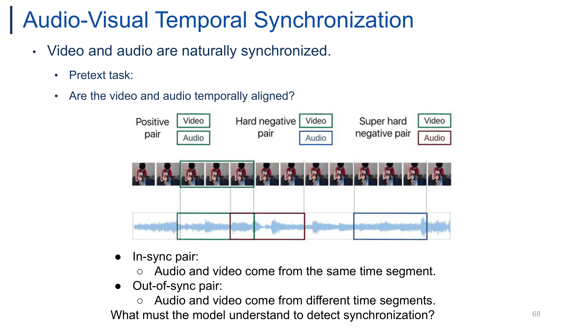

*p.68 — 기타 연주 영상: 같은 구간의 video-audio = positive(초록), 멀리 떨어진 구간 audio = hard negative(파랑), 바로 인접한 구간 audio = super hard negative(빨강)*

- *Video and audio are naturally synchronized.* → **Are the video and audio temporally aligned?** (binary classification)
  - **In-sync pair**: 같은 time segment의 audio와 video
  - **Out-of-sync pair**: 다른 time segment
- Negative 종류

| 종류 | 정의 | 난이도 |
|---|---|---|
| Easy negative | **다른 비디오**의 audio (p.70) | 장면 종류만 봐도 구분 |
| Hard negative (파랑) | **같은 비디오**의 **멀리 떨어진(겹치지 않는)** 구간 audio | 같은 장면이라 내용 비슷 |
| Super hard negative (빨강) | **같은 비디오**의 **인접(부분 겹침, 짧은 shift)** 구간 audio | 소리 내용이 거의 같아 가장 어려움 |

- *What must the model understand to detect synchronization?* → 장면 종류가 아니라 **소리와 동작의 시간적 대응** (손이 현을 튕기는 순간 ↔ 소리 발생 시점) → semantic + temporal audio-visual correspondence

### 10.2 구조: Cooperative two-stream (p.69)

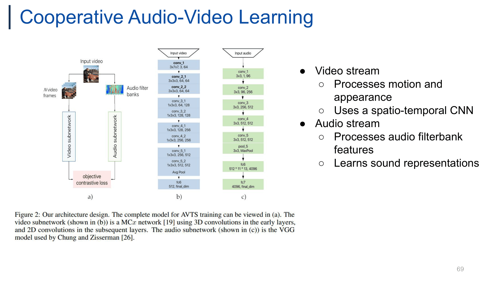

*p.69 — (a) N video frames → Video subnetwork, audio filter banks → Audio subnetwork → contrastive loss. (b) video = MCx, (c) audio = VGG형*

- **Video stream** (processes motion and appearance, spatio-temporal CNN): **MCx** (Mixed Convolution)
  - conv_1 (3×7×7), conv_2_x (3×3×3) = **초기 layer는 3D conv** → motion
  - conv_3~5 (1×3×3) = **후반 layer는 2D conv** → appearance, parameter/연산 절약
  - → Avg Pool → fc6 (512, final_dim)
- **Audio stream** (processes audio filterbank features): filterbank(spectrogram류 2D 표현)를 이미지처럼 **VGG형 2D CNN** (Chung & Zisserman)으로 처리 → conv_1~5 → pool_5 → fc6 (512·11·13 → 4096) → fc7 (4096 → final_dim)
- 두 stream을 같은 차원(final_dim)으로 projection → **contrastive loss**로 in-sync는 가깝게, out-of-sync는 멀게 ← 두 modality가 서로의 supervision이 되므로 **"cooperative"**
- 두 출력은 fusion되는 게 아니라 **loss에 함께 입력**됨

> 보충: 논문의 contrastive loss (슬라이드에 수식 없음):
> $$L = \frac{1}{2N}\sum_{n=1}^{N} \Big[ y_n\, d_n^2 + (1-y_n)\max(m - d_n, 0)^2 \Big],\qquad d_n = \|f_v(x_n^v) - f_a(x_n^a)\|_2$$
> $y_n = 1$이면 in-sync, $m$ = margin. MCx = Tran et al., 2018 ("A Closer Look at Spatiotemporal Convolutions")

### 10.3 The choice of negative pairs matters — Curriculum learning (p.70)

AVTS accuracy on Kinetics test (easy negative만 포함)

| Method | Negative type | Epochs | Acc (%) |
|---|---|---|---|
| Single stage | easy | 1–90 | 69.0 |
| Single stage | 75% easy, 25% hard | 1–90 | 58.9 |
| Single stage | hard | 1–90 | 52.3 |
| Single stage | easy | 1–50 | 67.2 |
| **Curriculum** (1–50 easy 후 2nd stage) | **75% easy, 25% hard** | 51–90 | **78.4** |
| Curriculum | hard | 51–90 | 65.7 |

- 처음부터 hard를 섞으면 **오히려 하락** (69.0 → 58.9 → 52.3)
  - 가능한 이유 (슬라이드 명시 X): 초기에는 표현이 약해 hard negative가 너무 어려움 + 평가셋이 easy-only라 train/test negative 분포 불일치
- **Curriculum**: easy로 50 epoch (67.2) → hard 섞어 fine-tune → **78.4** (single 최고 69.0 대비 +9.4)
- 2nd stage를 hard only로 하면 65.7 → **easy를 일부 유지하는 mix가 중요**
- 주의: 69.0(easy 90 epoch)과 67.2(easy 1–50 = curriculum의 1st stage)는 다른 행
- 결론: ***A good pretext task depends not only on the labels, but also on how positive and negative examples are constructed.*** ← contrastive learning에서 negative 설계의 중요성으로 이어짐

---

## 11. Invariance vs Equivariance — STL (p.71–79)

**출처**: Yu, Choi, Lee, Hong, Kim (KAIST), NeurIPS 2024, *Self-supervised Transformation Learning for Equivariant Representations*

### 11.1 Pretext task가 보존하는 정보 (p.72)

- **Rotation prediction** → model must preserve **rotation** information
- **Colorization** → must preserve **object and color** information
- **Jigsaw puzzle** → must preserve **spatial relationships**
- ***A pretext task determines what information is preserved in the representation.***
- 대비: invariance 기반(contrastive) 방법은 augmentation에 invariant해지면서 **그 변환 정보를 버림**. rotation prediction처럼 변환 자체를 맞히는 pretext는 그 정보를 **보존**하도록 강제 (엄밀한 equivariance와는 구분; colorization·jigsaw는 변환 예측이 아님)
- 시사점: downstream에 필요한 정보와 pretext가 보존하는 정보가 맞아야 transfer가 잘 됨

### 11.2 Should everything be invariant? (p.73–74)

- Modern SSL은 image transformation 사용: **random crop, color jitter, horizontal flip, Gaussian blur** → 두 view를 만들고 표현이 같아지도록 = **이 변환들을 ignore(invariant)** 하도록 학습
- 효과: 변하지 않는 semantic만 남김 / 대가: 변환이 담던 정보(위치, 색, 방향)가 **버려짐**
- *But is invariance always desirable?*

| Downstream | 질문 | 필요 정보 |
|---|---|---|
| Classification | "What is the object?" | invariance가 유용할 수 있음 |
| Detection | "Where is the object?" | **spatial information** 필요 (crop/flip invariance는 불리) |
| Flower classification | "What color is the flower?" | **color information** 필요 (color jitter invariance는 불리) |

- → **고정된 invariance는 task-agnostic하지 않음** → 변환 정보를 구조적으로 보존하는 **equivariance** 필요

> 보충: contrastive/Siamese loss는 $\mathcal{L}(f(t_1(x)), f(t_2(x)))$ 최소화 형태라 invariance를 직접 강제. 어떤 augmentation을 쓰느냐 = "어떤 정보를 버릴지"에 대한 prior. AugSelf (Lee et al., 2021), EquiMod (Devillers & Lefort, ICLR 2023)도 같은 동기

### 11.3 정의 (p.75)

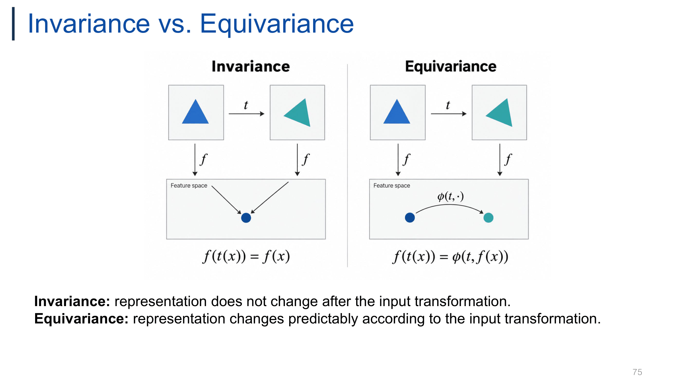

*p.75 — Invariance: 변환 전후가 feature space의 같은 점으로 / Equivariance: 서로 다른 점이 되지만 $\phi(t,\cdot)$로 연결됨*

$$\textbf{Invariance:}\quad f(t(x)) = f(x)$$

$$\textbf{Equivariance:}\quad f(t(x)) = \phi\big(t, f(x)\big)$$

- $f$ = encoder, $t$ = input-space transformation, $\phi(t,\cdot)$ = feature space에서 $t$에 대응하는 **action (예측 가능한 map)**
- Invariance: *representation does not change after the input transformation* → 변환 정보 완전히 버림
- Equivariance: *representation changes predictably according to the input transformation* → 변환 정보가 표현 안에 구조화되어 남음
- **Invariance는 $\phi(t,\cdot) = \mathrm{id}$인 equivariance의 특수한 경우**
- 직관: 삼각형 회전 시 invariant 표현은 "삼각형" 그대로, equivariant 표현은 "회전된 삼각형"을 반영해 이동

> 보충: CNN convolution은 translation **equivariant**, global pooling을 거치면 approximately **invariant** — 고전적 예시

### 11.4 Self-supervised Transformation Learning (STL) (p.76)

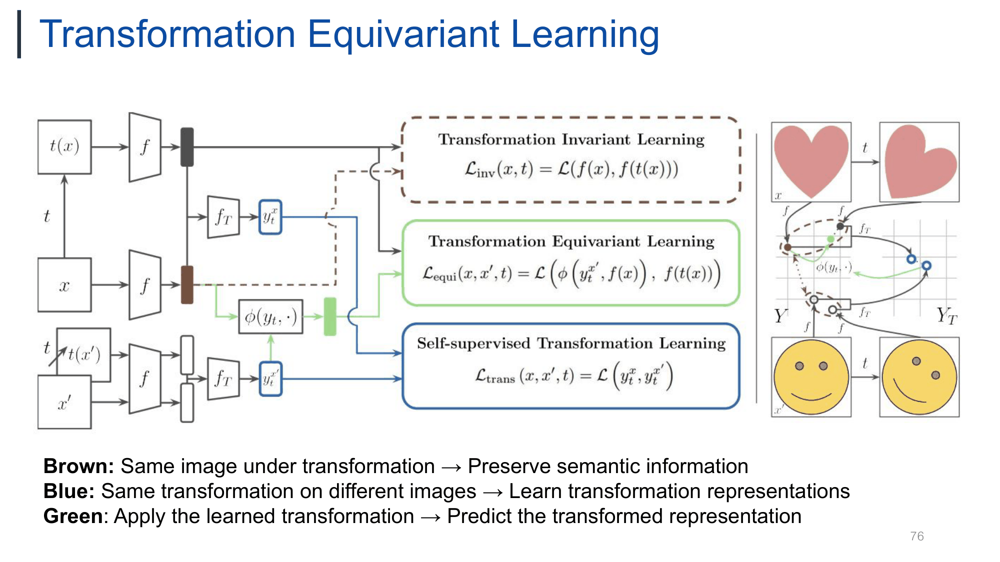

*p.76 — $x, t(x)$와 다른 이미지 $x', t(x')$(같은 $t$)를 encoder $f$, transformation head $f_T$에 통과시켜 세 loss(Invariant / Equivariant / Transformation learning)로 학습*

- 기호: $f$ = encoder, $f_T$ = transformation head, $y_t^{x}$ = 이미지 쌍 $(x, t(x))$의 feature로부터 $f_T$가 뽑은 변환 $t$의 **transformation representation** ← 입력 구성은 그림 기준 해석, $\phi(y_t, \cdot)$ = 변환 표현을 받아 feature를 변환하는 module, $\mathcal{L}(\cdot,\cdot)$ = 두 표현을 가깝게 하는 SSL loss

| 색 | Loss | 수식 | 역할 |
|---|---|---|---|
| **Brown** | Transformation Invariant Learning | $\mathcal{L}_{\text{inv}}(x,t) = \mathcal{L}\big(f(x),\, f(t(x))\big)$ | 같은 이미지의 변환 전후 → **semantic 정보 보존** (기존 invariance 학습) |
| **Blue** | Self-supervised Transformation Learning | $\mathcal{L}_{\text{trans}}(x,x',t) = \mathcal{L}\big(y_t^{x},\, y_t^{x'}\big)$ | **다른 이미지에 같은 변환** → transformation representation 학습 |
| **Green** | Transformation Equivariant Learning | $\mathcal{L}_{\text{equi}}(x,x',t) = \mathcal{L}\Big(\phi\big(y_t^{x'}, f(x)\big),\; f(t(x))\Big)$ | 학습된 변환을 적용해 **변환 후 표현 예측** → equivariance |

- **$\mathcal{L}_{\text{trans}}$가 핵심**: 이미지 내용이 달라도 "같은 $t$"라는 사실만 공유 신호 → $f_T$가 content가 아니라 **변환 정보만** 뽑도록 유도. crop 좌표, jitter 강도 같은 **transformation label(parameter) 없이** 학습
- **$\mathcal{L}_{\text{equi}}$**: **다른 이미지 $x'$** 에서 뽑은 $y_t^{x'}$를 $x$의 표현에 적용해 $f(t(x))$를 맞혀야 함 → 변환 표현이 실제로 변환을 "일으킬" 수 있어야 함
- 기존 equivariant 방법(EquiMod, AugSelf)은 **augmentation parameter를 직접 입력/예측** → STL은 parameter 없이 학습하므로 parameterize하기 어려운 변환도 다룰 수 있음
- 세 loss를 함께 쓰는 이유 (슬라이드 색 설명 기반 해석): invariance만 → 변환 정보 소실 / equivariance 항만 → semantic 보존 신호 없음 → Brown(semantic) + Blue/Green(변환 학습·적용)

### 11.5 STL은 무엇을 배우는가 (p.77–78)

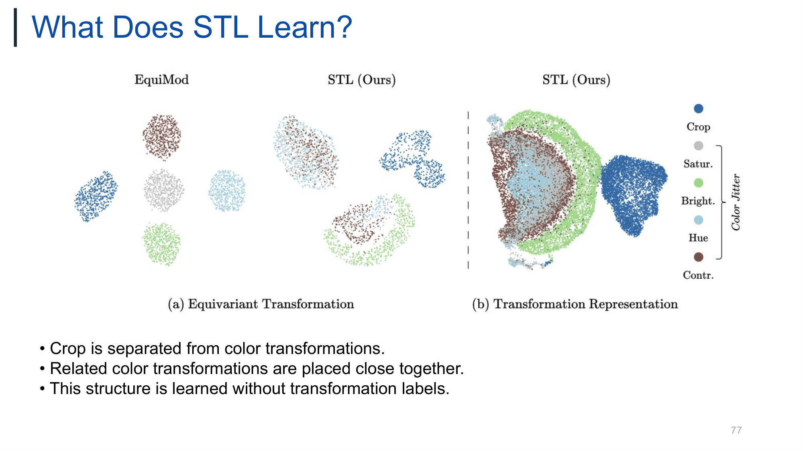

*p.77 — EquiMod는 변환별로 분리된 둥근 cluster, STL은 Crop을 color 계열과 분리하고 관련 color 변환(Satur., Bright., Hue, Contr.)끼리 가깝게 배치*

- **Crop is separated from color transformations. Related color transformations are placed close together. This structure is learned without transformation labels.**
- EquiMod: 변환 종류마다 서로 분리된 cluster (변환 간 구조 없음; 거리가 모두 같다는 뜻은 아님)
- STL: 의미적으로 관련된 color jitter 4성분은 가깝게, 성질이 다른 crop(spatial)은 멀리 → **변환 간 구조(어떤 변환끼리 비슷한가)를 스스로 발견**, one-hot식 분리가 아닌 의미 있는 geometry
- **Intensity 구조** (p.78, UMAP, ResNet-18 pretrained on STL10 with a transformation backbone, 진한 색 = 높은 intensity)
  - Different types form different regions
  - Similar intensities are located nearby
  - Intensity changes continuously in the representation space
  - → **type은 군집, intensity는 연속 축(manifold)**. *STL captures both transformation type and intensity without direct parameter supervision.*
  - 원인은 슬라이드에 명시 X ($\mathcal{L}_{\text{trans}}$가 같은 $t$ 쌍을 가깝게 하기 때문으로 추정)
  - ← 데이터셋 "STL10"(이미지 데이터셋 STL-10)과 방법 이름 STL 철자가 겹쳐 혼동 주의

### 11.6 Downstream 결과 (p.79)

Table 4: Object Detection (ImageNet100-pretrained ResNet-50 → VOC07+12 fine-tune)

| Method | AP_all | AP_50 | AP_75 |
|---|---|---|---|
| SimCLR | 45.67 | 72.50 | 47.83 |
| AugSelf | 45.99 | 72.46 | 49.23 |
| EquiMod | 51.55 | 78.03 | 56.17 |
| STL (Ours) | 51.95 | 78.34 | 56.96 |
| **STL with AugMix** | **52.70** | **78.81** | **57.76** |

Table 5: Transformation Prediction (표현 쌍으로부터 변환 회귀 MSE ↓ / type 분류 acc ↑)

| Method | Crop ↓ | Color ↓ | All ↓ | Trans. Type (%) ↑ |
|---|---|---|---|---|
| SimCLR | 0.02 | 0.13 | 0.08 | 68.54 |
| AugSelf | **0.01** | 0.04 | 0.03 | 88.49 |
| EquiMod | **0.01** | 0.07 | 0.04 | 82.20 |
| **STL** | **0.01** | **0.03** | **0.02** | **93.67** |

- Detection: invariance 중심 SimCLR(45.67) << equivariant 계열 EquiMod(51.55), STL(51.95), STL+AugMix(52.70)
  - 특히 **AP_75**(엄격한 IoU = localization 정확도)에서 차이 큼 (47.83 → 57.76) → **위치 정보 보존이 localization에 도움**
  - AP_all = 여러 IoU 임계값 평균, AP_50 / AP_75 = IoU 0.5 / 0.75 기준
  - 모든 지표가 단조 개선은 아님 (AugSelf AP_50 72.46 < SimCLR 72.50)
- Transformation prediction: STL이 color/all 회귀와 type 분류(93.67%) 최고. SimCLR은 invariance로 변환 정보가 가장 많이 소실 (color MSE 0.13, type 68.54%)
- 결론: ***Preserving transformation information improves localization and generalization.***

> 보충: SimCLR (Chen et al., 2020, invariance 기반 contrastive), AugSelf (Lee et al., 2021, augmentation parameter 차이를 예측하는 auxiliary task), EquiMod (Devillers & Lefort, ICLR 2023, augmentation parameter를 받는 predictor로 equivariance), AugMix (Hendrycks et al., 2020, 여러 augmentation chain을 섞는 기법)

### 11.7 Invariance / Equivariance 방법 비교

| 방법 | 핵심 아이디어 | loss | 장점 | 한계 |
|---|---|---|---|---|
| **SimCLR** (invariance) | 같은 이미지의 두 augmented view를 가깝게 | NT-Xent (contrastive) | 범용, task-agnostic, classification에 강함 | 변환 정보(위치·색) 소실 → detection, 색 의존 task에 불리 |
| **AugSelf** | invariance + augmentation parameter 차이 예측 | contrastive + param 회귀 | 변환 정보 일부 보존 | parameter label 필요, detection 향상 작음 |
| **EquiMod** | augmentation parameter를 받는 predictor로 $f(t(x))$ 예측 | contrastive + equivariance | detection 크게 향상 | parameter 필요, 변환 간 구조 학습 X |
| **STL** | 다른 이미지·같은 변환으로 transformation representation 학습 | $\mathcal{L}_{\text{inv}} + \mathcal{L}_{\text{trans}} + \mathcal{L}_{\text{equi}}$ | parameter 없이 학습, 변환 type·intensity 구조 학습, detection·변환 예측 최고 | 모델 구성 복잡 (transformation head, $\phi$) |

---

## 12. Next Week (p.80)

- **Contrastive Learning** ← 이번 강의의 "same vs different object", AVTS의 negative 구성, invariance 관점이 본격적으로 형식화됨

---

## 시험 대비 핵심 정리

### A. 꼭 외울 정의

- **Self-supervised learning**: data 자체에서 **semi-automatic**하게 label을 만들어(data의 일부로 다른 일부 예측) representation을 학습. "semi-automatic" = label은 자동이지만 pretext 설계는 사람
- **Pretext task**: representation 학습을 위한 self-supervised task, 우리가 관심 있는 "real" task가 아님. label 자동 생성, supervised 형태 loss
- **Downstream task**: 실제 관심 application, labeled 소규모 dataset. pretext encoder를 transfer
- **SSL 평가**: pretext 성능이 아니라 downstream 성능. linear probing (frozen + linear) / fc6-8 / full fine-tuning
- **Shortcut (trivial solution)**: semantic 이해 없이 low-level cue(edge continuity, chromatic aberration, color/intensity statistics)로 pretext를 푸는 것
- **Invariance** $f(t(x)) = f(x)$ / **Equivariance** $f(t(x)) = \phi(t, f(x))$, invariance = $\phi=\mathrm{id}$인 특수 경우

### B. 꼭 외울 수식

| 방법 | 수식 |
|---|---|
| Inpainting reconstruction | $\mathcal{L}_{rec}(x) = \| \hat{M} \odot ( x - F((1-\hat{M}) \odot x) ) \|_2^2$ |
| Inpainting adversarial | $\mathcal{L}_{adv} = \max_D \mathbb{E}_{x}[ \log D(x) + \log(1 - D(F((1-\hat{M}) \odot x)))]$ |
| Colorization regression | $L_2(\widehat{\mathbf{Y}}, \mathbf{Y}) = \frac{1}{2}\sum_{h,w} \| \mathbf{Y}_{h,w} - \widehat{\mathbf{Y}}_{h,w} \|_2^2$ |
| Colorization classification | $L_{cl}(\widehat{\mathbf{Z}}, \mathbf{Z}) = -\sum_{h,w} v(\mathbf{Z}_{h,w}) \sum_{q} \mathbf{Z}_{h,w,q}\log\widehat{\mathbf{Z}}_{h,w,q}$ |
| Rotation | maximize $F^{y}(g(X, y))$, $y\in\{0,1,2,3\}$ (4-way CE) |
| STL invariant | $\mathcal{L}_{\text{inv}}(x,t) = \mathcal{L}(f(x), f(t(x)))$ |
| STL transformation | $\mathcal{L}_{\text{trans}}(x,x',t) = \mathcal{L}(y_t^{x}, y_t^{x'})$ |
| STL equivariant | $\mathcal{L}_{\text{equi}}(x,x',t) = \mathcal{L}(\phi(y_t^{x'}, f(x)), f(t(x)))$ |

### C. 꼭 외울 숫자

- ImageNet 14M장 = 22 human years / LabelMe: 10% class = 93% data
- Relative position: 8-way, scratch 대비 +5% mAP, ImageNet 대비 −8% (VOC07 det 46.3 vs 54.2)
- Jigsaw: $9! = 362{,}880$ → max Hamming 부분집합 (슬라이드 64개), Cls 67.6 / Det 53.2 / Seg 37.6
- Colorization: Lab, $L$ → $ab$, **313** bins
- Rotation: 4개 (89.06) > 8개 (88.51) > {0,180} (87.46) > {90,270} (85.52); PASCAL Cls all **72.97**
- CDJP: Cls 69.2, Seg 39.3
- ST Cubic Puzzle: 2×2×4 grid, 4 cube, 4! = 24 × 2 orientation = **48** class, cube 80×80×16; S 58.5 / T 59.3 / ensemble 61.3 / **joint 65.8**; random 대비 UCF101 +23.4, HMDB51 +16.6
- AVTS: curriculum (easy 50 epoch → 75% easy + 25% hard) **78.4** vs single easy 69.0
- STL detection AP_75: SimCLR 47.83 → STL+AugMix 57.76

### D. 비교 포인트

1. **Supervised vs Unsupervised vs SSL** (label / supervision source / cost / scalability / representation) — §2.2 표
2. **Discriminative(분류형) vs Generative(복원형) pretext**: relative position·jigsaw·rotation vs inpainting·colorization. 비디오 실험에서도 puzzle(58~66) > AE/inpainting(48~51)
3. **L2 regression vs adversarial / classification**: inpainting은 L2(blur) + adv(sharp), colorization은 L2(desaturated, 평균색) → 313-bin CE (multimodal 대응)
4. **pretext accuracy ≠ representation quality**: Jigsaw Table 4 (permutation 적을수록 acc ↑, det ↓), Table 5 (shortcut 장치 빼면 acc ↑, det ↓), p.49 (res5 < res4)
5. **Hand-crafted pretext → multi-task → contrastive(same vs different) → equivariance**로 가는 흐름의 각 단계 동기
6. **Image vs Video vs Audio-visual SSL**: spatial / spatio-temporal / cross-modal supervision
7. **Invariance vs Equivariance**: classification은 invariance 유리, detection(위치)·flower(색)는 equivariance 필요. SimCLR vs EquiMod vs STL

### E. 예상 서술형 질문 + 모범답안 방향

1. **SSL이 필요한 이유를 supervised learning의 한계와 연결해 서술하라.**
   → label 비용(22 human years), semi-automatic label의 noise, long-tail(10% class = 93% data), 복잡한 concept/video, 도메인 차이(의료) → labeling이 data 생성 속도를 못 따라감 → data 자체에서 supervision 생성하는 SSL. pretext로 general feature 학습 후 적은 label로 transfer하면 data efficiency ↑

2. **Pretext task와 downstream task의 관계, 그리고 SSL을 어떻게 평가하는지 설명하라. 왜 shallow network/linear classifier만 학습하는가?**
   → pretext = 자동 label로 encoder 학습, head는 버림 / downstream = 소량 labeled data로 encoder 위 head 학습. 평가는 downstream 성능. shallow만 학습해야 성능 차이를 representation 품질로 귀속 가능 (linear probing). fine-tuning 결과도 함께 봄

3. **Context Encoder의 loss를 쓰고 각 항의 역할을 설명하라. 왜 adversarial loss가 필요한가?**
   → $\mathcal{L}_{rec}$: mask 영역에서만 L2 (보이는 영역은 복사하면 되므로), coarse structure. L2는 multimodal 정답의 평균 → blur. $\mathcal{L}_{adv}$: discriminator를 속이도록 → sharp/realistic. 둘의 가중합 (L2+Adv가 qualitative 최고). Channel-wise FC로 context 전파

4. **Colorization에서 regression 대신 classification을 쓰는 이유와 $L_{cl}$의 각 항을 설명하라.**
   → 색은 multimodal, L2 regression은 평균으로 수렴 → desaturated. Lab의 $ab$를 313 in-gamut bin으로 양자화, pixel별 CE. $\mathbf{Z}$ = soft-encoded target, $\widehat{\mathbf{Z}}$ = 예측 분포, $v(\cdot)$ = class rebalancing (저채도 색이 압도적이므로 희귀 색 가중). Lab 쓰는 이유 = 밝기/색도 분리 + perceptually uniform

5. **Jigsaw puzzle에서 shortcut이란 무엇이며 어떻게 막는가? ablation이 주는 교훈은?**
   → edge continuity, color/intensity statistics, chromatic aberration. random gap/crop/jitter, color jitter, grayscale, tile별 normalization, 이미지당 여러 퍼즐. Table 5: 장치 제거 시 jigsaw acc ↑, detection ↓ (normalization 제거 시 최대 하락) → pretext acc ≠ feature quality. Table 4: permutation끼리 Hamming distance가 커야 하고, 너무 쉬운 task(10개 이하)는 detection ↓

6. **Rotation prediction이 좋은 feature를 학습하는 이유와 회전 개수 ablation을 설명하라.**
   → 회전을 맞히려면 object의 canonical orientation을 알아야 함 → object-centric feature. 구현 단순, 90° 배수라 artifact/shortcut 적음. 4개(89.06)가 최적: 8개는 45° 회전 artifact, 2개는 task가 너무 쉽고 {90,270}은 구분 정보가 적음

7. **Hand-crafted pretext task의 두 가지 문제와 이를 극복하려는 시도를 서술하라.**
   → 1) task마다 사람이 설계 (tedious), 2) representation이 pretext에 특화되어 general하지 않음 (p.49 res5 < res4, "hope of generalization": jigsaw가 왜 semantic을?). 시도: multi-task(CDJP; 그래도 task 집합에 묶임) → 더 general한 pretext = same object(변환본)는 가깝게, different object는 멀게 (contrastive) → task-agnostic, 변환 invariant

8. **Space-Time Cubic Puzzle의 설계(퍼즐 구성, 구조, shortcut 대응)와 결과의 의미를 설명하라.**
   → 2×2×4 grid에서 spatial(2×2×1) 또는 temporal(1×1×4) cube 4개 → 순열 24 × upside-down 2 = 48 class. 4 shared 3D CNN tower, 마지막에만 concat (late fusion → 경계 cue 차단, tower는 퍼즐 종류 모름 → 범용 feature). shortcut: chromatic aberration / boundary / statistics ↔ channel replication / spatio-temporal jittering / upside-down. joint ST 65.8 > ensemble 61.3 > S·T 단독 → 공간·시간 complementary. random 대비 +23.4/+16.6

9. **AVTS에서 negative 종류와 curriculum learning의 효과를 설명하라.**
   → easy(다른 비디오), hard(같은 비디오 먼 구간), super-hard(인접·부분 겹침). hard negative는 장면 인식이 아니라 시간적 sync 자체를 학습하게 함. 처음부터 hard를 섞으면 하락(69.0 → 58.9 → 52.3), easy로 먼저 학습 후 75/25 mix → 78.4. 좋은 pretext는 label뿐 아니라 positive/negative 구성에 의존

10. **Invariance와 equivariance를 정의하고, 모든 것을 invariant하게 학습하면 안 되는 이유와 STL의 해법을 설명하라.**
    → $f(t(x))=f(x)$ vs $f(t(x))=\phi(t,f(x))$, invariance는 $\phi=\mathrm{id}$. augmentation invariance는 위치·색 정보를 버림 → detection(where), flower(color)에 불리. STL: $\mathcal{L}_{\text{inv}}$(semantic 보존) + $\mathcal{L}_{\text{trans}}$(다른 이미지·같은 변환 → label 없이 transformation representation) + $\mathcal{L}_{\text{equi}}$(다른 이미지에서 뽑은 변환으로 $f(t(x))$ 예측). 결과: 변환 type·intensity 구조 학습, detection AP_75 크게 향상, 변환 예측 최고
