# 03. Contrastive Learning I

> **한 줄 요약**: representation learning을 **"similarity 학습"** 으로 재정의하고, pair → triplet → batch 전체 → N-way softmax(InfoNCE)로 발전한 **contrastive objective의 계보**를 정리한 뒤, 최신 연구 3편(**GenView / MCL / X-CLR**)으로 contrastive learning이 **views · features · relationships** 에 의존한다는 점을 보는 강의.

- 강의: 고급표현학습 (Donghyeon Cho, 한양대) — Lecture 03, PDF 74p
- 원본: `lectures/03_Contrastive_Learning_I.pdf` / 페이지 표기는 PDF 페이지 기준

---

## 이 강의의 큰 그림

```
[1] Toward Contrastive Learning (p.3–9)
    handcrafted pretext task의 한계 → "Representation Learning = Learning Similarity"
    → metric learning (x, x⁺, x⁻) → Siamese network → score(f(x),f(x⁺)) ≫ score(f(x),f(x⁻))
        │
[2] Contrastive Training Objectives (p.10–29)
    Contrastive (pair, 2005)
      → Triplet (anchor-pos-neg, 상대 순서, 2015) ── 문제: O(N³), easy triplet → hard negative mining
      → Lifted Structured (batch 내 모든 pair, max → log-sum-exp, 2016)
      → N-pair (1 pos vs N-1 neg, = N-way softmax CE, 2016)
      ↘ 확률적 해석: NCE (data vs noise 이진 분류, 2010)
      → InfoNCE (N-way categorical CE, density ratio, MI 하한, 2018)
      → Soft-NN (multiple positives, temperature)
        │
[3] Common Setup (p.30–32)
    anchor / positive(augmented view) / negatives(batch) / encoder / cosine sim / InfoNCE(NT-Xent)
    positive pair 구성: label 있음(같은 class) vs 없음(augmentation)
        │
[4] 최신 연구: "pair 구성·학습이 항상 올바른가?" (p.33–73)
    ① views         — GenView (ECCV'24): 생성 모델로 positive view 만들고 품질로 weighting
    ② features      — MCL (ECCV'24): feature suppression → stage별 negative를 cluster 내에서 뽑기
    ③ relationships — X-CLR (ICLR'25): binary target → soft similarity graph
```

**핵심 질문**
1. pretext task를 따로 설계하지 않고 representation을 배울 수 있나? → **similarity 자체를 supervision으로**
2. "positive는 가깝게, negative는 멀게"를 어떤 미분 가능한 loss로 쓸 것인가? → contrastive / triplet / lifted / N-pair / InfoNCE
3. 왜 negative를 많이 쓰고, 왜 max 대신 log-sum-exp(softmax)를 쓰나? → **dense & focused gradient = soft hard negative mining**
4. InfoNCE는 확률적으로 무엇을 학습하나? → **density ratio $p(x|c)/p(x)$**, mutual information 하한
5. positive view·학습되는 feature·샘플 간 관계가 항상 올바른가? → GenView / MCL / X-CLR

---

## 1. Pretext Task에서 Contrastive Learning으로 (p.3–7)

### 1.1 Handcrafted pretext task의 한계 (p.4)

- 이전 강의의 self-supervised **pretext task**들: **image completion**(가려진 부분 예측), **rotation prediction**(회전각 $\theta$ 예측), **jigsaw puzzle**(조각 배치 예측), **colorization**(흑백 → 색 예측)
- 공통점: 라벨 없이 데이터에서 supervision을 만들지만 **"무엇을 예측시킬지"는 사람이 설계한 handcrafted objective**
- 문제점
  - task마다 설계 노하우 필요
  - task 특유의 **shortcut** 학습 위험 (예: jigsaw에서 조각 경계의 chromatic aberration 단서) → representation이 일반화 안 될 수 있음
  - task가 바뀌면 새로 설계해야 함
- 슬라이드 질문: **"Can we learn representations without designing a task?"**

> 보충: image completion = Context Encoder (Pathak et al., 2016), rotation = RotNet (Gidaris et al., 2018), jigsaw = Noroozi & Favaro (2016), colorization = Zhang et al. (2016). 슬라이드엔 출처 미표기.

### 1.2 더 일반적인 pretext task = similarity (p.5–6)

- 관점 전환: 위 pretext task들은 사실 **"같은 물체(원본 고양이)의 다른 view"** 를 만든 것 → 이들이 서로 가깝게 임베딩되길 바라는 것. 반대로 **다른 물체(강아지)** 는 멀어야 함
- 좋은 representation = **semantically similar한 샘플은 embedding 공간에서 가깝고, 다른 샘플은 멂**
- 그래서 **Representation Learning = Learning Similarity** (p.5)
- **Similarity as Supervision** (p.6): "같은 물체 / 다른 물체"라는 관계 자체가 학습 신호. 같은 물체 view끼리 **attract**, 다른 물체와 **repel**
  - 클래스 라벨 없이도 augmentation으로 positive pair를 자동 생성 가능 → **self-supervised** 학습 가능
- 이전 방법과의 차이: 이전엔 "회전각을 맞혀라" 같은 **특정 예측 task**의 부산물로 feature를 얻었다면, 여기선 **embedding 간 거리/유사도 관계 자체**가 목표

### 1.3 Metric Learning (p.7)

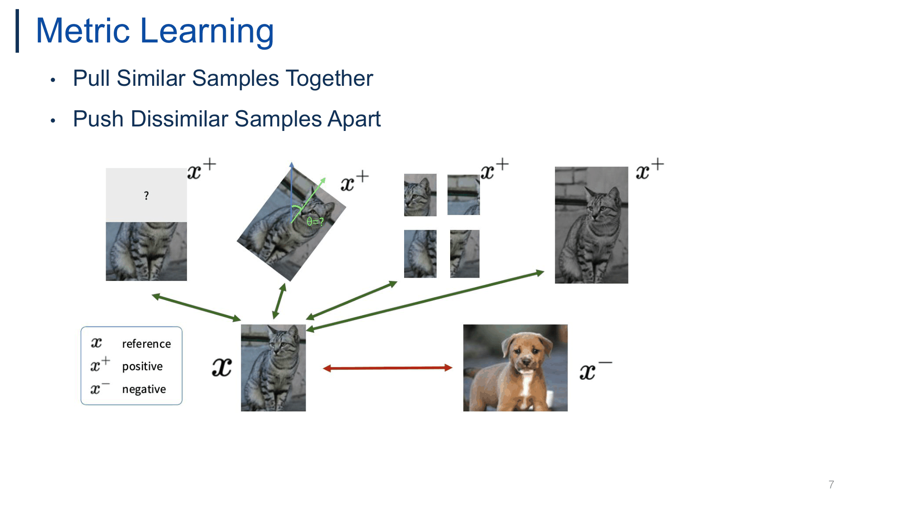

*p.7 — reference $x$(고양이), positive $x^+$(pretext 변형들, 초록), negative $x^-$(강아지, 빨강)로 표현한 metric learning 도식.*

- **Pull Similar Samples Together / Push Dissimilar Samples Apart**
- 용어
  - $x$ : **reference(anchor)**
  - $x^+$ : **positive** — $x$와 semantically 비슷한 샘플
  - $x^-$ : **negative** — $x$와 다른 샘플
- 목표: $d(f(x), f(x^+))$ 는 작게, $d(f(x), f(x^-))$ 는 크게 만드는 encoder $f$ 학습 = **metric learning (distance metric learning)**
- 이후 loss들(Contrastive, Triplet, N-pair, InfoNCE …)은 대체로 이 $(x, x^+, x^-)$ 구조를 **어떻게 loss로 쓰느냐**의 차이

> 보충: metric learning은 원래 supervised(라벨로 positive/negative 정의)로 시작했고, self-supervised에서는 augmentation으로 positive를 정의함.

---

## 2. Siamese Network와 Contrastive Learning의 목표 (p.8–9)

### 2.1 Siamese Network (p.8)

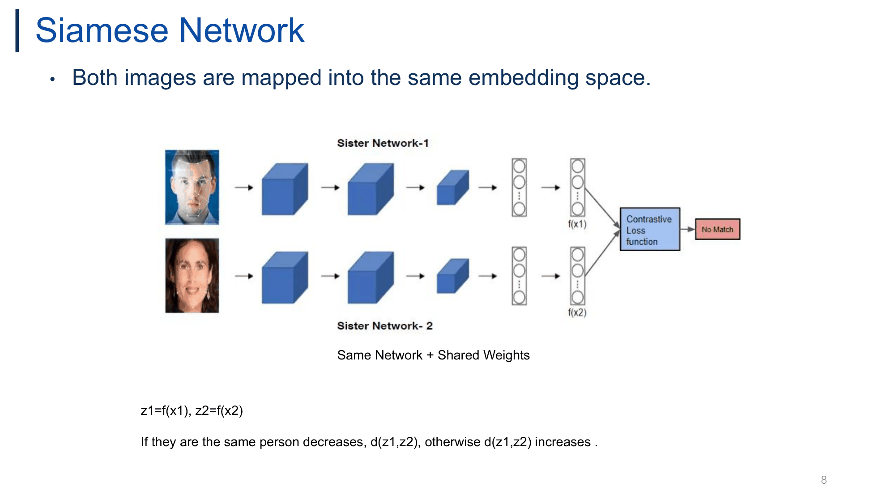

*p.8 — 두 sister network가 **같은 가중치**로 두 얼굴을 임베딩하고 contrastive loss로 비교 ("No Match").*

- 구조: **동일한 네트워크 $f$ (shared weights)** 를 두 입력에 각각 적용

$$z_1 = f(x_1), \quad z_2 = f(x_2)$$

- 같은 사람(positive pair)이면 $d(z_1, z_2)$ **감소**, 다른 사람(negative pair)이면 **증가** ← 슬라이드 문장 "If they are the same person decreases, d(z1,z2), otherwise d(z1,z2) increases ." 는 어순이 어색함 (원문 유지)
- **왜 weight sharing인가**
  - 두 입력이 **같은 embedding 공간**에 매핑돼야 거리 비교가 의미 있음 (가중치가 다르면 서로 다른 좌표계)
  - 입력 순서에 대칭: $d(z_1,z_2)=d(z_2,z_1)$
  - 파라미터 수 절반
- 얼굴 인증(face verification)이 대표 예시인 이유: 클래스(사람) 수가 많고 새 사람이 계속 등장 → 분류기 대신 **거리 기반 비교**가 적합

> 보충: Siamese network의 원조는 Bromley et al. (1993, 서명 검증), Chopra, Hadsell & LeCun (2005, 얼굴 검증). 그림상 $f$는 CNN + FC.

### 2.2 Contrastive Representation Learning의 정의 (p.9)

- **embedding space**를 학습: 비슷한 pair는 가깝게, 다른 pair는 멀게
- **supervised / unsupervised 둘 다** 적용 가능
- 원하는 것:

$$\text{score}(f(x), f(x^+)) \gg \text{score}(f(x), f(x^-))$$

- 기호: $x$ = reference, $x^+$ = positive, $x^-$ = negative, $f$ = encoder, score = 유사도 함수(cosine, dot product, −distance 등)
- **score function은 미리 고정**하고 $f$만 학습함
- 핵심은 절대값이 아니라 **상대적 대소관계($\gg$)** → 이후 모든 loss는 이 부등식을 **미분 가능한 objective로 바꾸는 서로 다른 방식**
- supervised/unsupervised 차이 = **positive 정의만 다름**
  - supervised: 같은 label = positive, 다른 label = negative
  - self-supervised: 같은 이미지의 서로 다른 augmentation(view) = positive, 다른 이미지 = negative

> 보충: classification cross-entropy와 달리 label 개수에 묶이지 않아, 학습 때 못 본 class(새 얼굴 등)에도 거리 기반으로 일반화 가능 (face verification, retrieval에 유리).

---

## 3. Contrastive Training Objectives (p.10–29)

### 3.1 Contrastive Loss (p.11)

**Intuitive goal**: encoder $f_\theta(x)$가 만드는 embedding 공간에서
- **Positive pair (same class) — Minimize distance**: 당김
- **Negative pair (different class) — Maximize distance**: margin $\varepsilon$ 너머까지 밂

**수식** (Chopra et al., 2005)

$$L_{\text{cont}} = \mathbb{1}_{[y_i = y_j]}\,\|f_\theta(x_i) - f_\theta(x_j)\|_2^2 + \mathbb{1}_{[y_i \neq y_j]}\,\max\big(0,\ \varepsilon - \|f_\theta(x_i) - f_\theta(x_j)\|_2\big)^2$$

- $(x_i, x_j)$: 입력 pair, $y_i, y_j$: class label, $\mathbb{1}[\cdot]$: indicator (둘 중 하나만 켜짐), $\varepsilon$: **margin** (다른 class 사이 최소 거리)
- 경우 분리
  1. 같은 class ($y_i = y_j$): $L = \|f_\theta(x_i) - f_\theta(x_j)\|_2^2$ → 거리 제곱, 같은 점으로 모일수록 감소
  2. 다른 class ($y_i \neq y_j$): $L = \max(0, \varepsilon - d)^2$ (**hinge**)
     - $d < \varepsilon$ → loss > 0 → 밀어냄
     - $d \ge \varepsilon$ → loss = gradient = 0 → **충분히 멀면 더 밀지 않음** (embedding 발산 방지)
- 구조적으로 Siamese network(p.8)처럼 같은 $f_\theta$를 공유

**한계** (슬라이드 하단)
- **Contrastive loss considers only pairs** → 한 번에 상대 하나만 비교, 정보량 적음
- **Many negatives become inactive** → 대부분 negative는 이미 $d \ge \varepsilon$ 라 gradient = 0
- **Does not explicitly enforce relative ordering** → positive는 0으로, negative는 $\varepsilon$ 이상으로 **각각 독립적인 절대 목표**만 줌 → **triplet loss의 동기**

> 보충: Hadsell et al. 2006 (DrLIM) 등에서는 $\frac12$ 계수와 $Y$ label 표기를 쓰는 변형이 흔함. 슬라이드는 indicator 표기.

### 3.2 Triplet Loss — FaceNet (p.12–13)

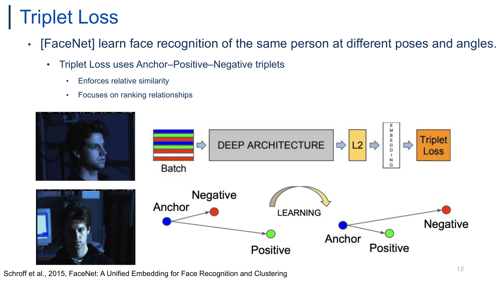

*p.12 — FaceNet 파이프라인(Batch → Deep Architecture → L2 → Embedding → Triplet Loss)과 학습 전후 anchor/positive/negative 배치 변화.*

- **FaceNet** (Schroff, Kalenichenko, Philbin; Google, CVPR 2015): 같은 사람의 다른 pose/각도 얼굴을 인식
  - 얼굴을 Euclidean embedding으로 직접 매핑 → **거리 자체가 얼굴 유사도**. verification = threshold, recognition = k-NN, clustering = k-means로 해결
  - 파이프라인의 **L2 normalization**: embedding을 단위 hypersphere 위에 놓아 거리 스케일 제한, 학습 안정
- **Triplet** = (Anchor $x$, Positive $x^+$, Negative $x^-$)
  - **Enforces relative similarity / Focuses on ranking relationships**
  - 그림: 학습 전엔 negative가 positive보다 anchor에 가까움 → LEARNING 후 positive는 가깝고 negative는 멀어짐

**수식** (p.13)

$$L_{\text{triplet}} = \sum \max\big(0,\ \|f(x) - f(x^+)\|_2^2 - \|f(x) - f(x^-)\|_2^2 + \varepsilon\big)$$

- $d_{ap} = \|f(x)-f(x^+)\|_2^2$, $d_{an} = \|f(x)-f(x^-)\|_2^2$ 로 두면 $L = \max(0,\ d_{ap} - d_{an} + \varepsilon)$
- **margin $\varepsilon$**: anchor–positive 거리와 anchor–negative 거리 사이에 요구되는 **최소 격차(offset)**
- $d_{an} - d_{ap} \ge \varepsilon$ 이면 **loss = 0** → 만족된 triplet은 gradient 없음. 위반 triplet만 $d_{ap}$↓, $d_{an}$↑ 방향 gradient
- **Key**: 아무 negative나 뽑으면 이미 조건 만족 → loss 0. 그래서 **hard negative 선택이 핵심**

**Contrastive vs Triplet**

| | Contrastive | Triplet |
|---|---|---|
| 단위 | pair $(x_i, x_j)$ | triplet $(x, x^+, x^-)$ |
| 목표 | positive → 거리 0, negative → $\varepsilon$ 이상 (**각각 절대 목표**) | $d_{an} - d_{ap} \ge \varepsilon$ (**상대 격차**) |
| margin 의미 | 절대 거리 기준 | 거리 차이 기준 |
| 유연성 | positive를 한 점으로 모으려 함 | positive를 한 점에 모을 필요 없음 → **intra-class variance 허용** |

**문제점** (p.13 하단)
- **Problem 1: Triplet Explosion** — N개 샘플이면 가능한 triplet 수 $O(N^3)$ → 전수 사용 불가, 샘플링 필요
- **Problem 2: Most Triplets are Useless** — 학습이 진행되면 **easy triplet이 지배** → loss = 0, gradient = 0, 계산 낭비. 소수의 hard triplet이 학습을 좌우

> 보충: FaceNet 원 논문은 $\|f(x)\|_2 = 1$ 제약 하에서 squared L2를 쓰고, hardest 대신 **semi-hard negative** ($d_{ap} < d_{an} < d_{ap} + \varepsilon$)를 batch 안에서 online으로 고르는 게 안정적이라고 보고함 (hardest만 쓰면 collapse 위험).

### 3.3 Hard Negative Mining (p.14)

- **Easy negative**: 대부분 negative는 이미 anchor에서 멀리 있음 → loss/gradient 기여가 거의 0 → 평균 내면 학습 신호 희석
- **Hard negative**: anchor와 **embedding 상 가깝지만 다른 class**인 샘플 → 모델이 헷갈리는 샘플이라 gradient가 크고 정보량 큼 (**stronger learning signal**)
- **Hard Negative Mining** = 학습을 가장 어려운 샘플에 집중시키는 전략 (예: batch 안에서 가장 가까운 negative를 고르는 online mining)
- 그림: query $z$ 주변 동심원 음영(가까울수록 진함), 가장 가까운 두 negative만 빨간 원(hard)으로 강조

> 보충: 너무 hard한 것만 쓰면 label noise/outlier에 과적합하거나 collapse가 생길 수 있어 semi-hard나 softmax 가중 방식이 쓰임 → 다음 두 슬라이드(Lifted, LSE)가 이를 부드럽게 구현.

### 3.4 Lifted Structured Loss (p.15, p.17)

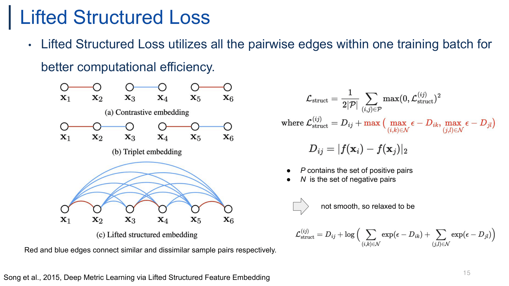

*p.15 — (a) contrastive는 독립 pair 3개, (b) triplet은 triplet 2개, (c) lifted structured는 batch 안의 **모든 pairwise edge** 사용 (빨강 = similar, 파랑 = dissimilar).*

- **동기**: mini-batch에는 이미 $O(N^2)$개 pairwise 거리가 계산돼 있음 → contrastive/triplet처럼 일부만 쓰지 말고 **batch 내 모든 pair 관계를 한 번에 활용** (computational efficiency)

**수식** (Song et al., 2015/CVPR 2016)

$$\mathcal{L}_{\text{struct}} = \frac{1}{2|\mathcal{P}|} \sum_{(i,j)\in\mathcal{P}} \max\big(0,\ \mathcal{L}_{\text{struct}}^{(ij)}\big)^2$$

$$\mathcal{L}_{\text{struct}}^{(ij)} = D_{ij} + \max\Big(\max_{(i,k)\in\mathcal{N}} \epsilon - D_{ik},\ \max_{(j,l)\in\mathcal{N}} \epsilon - D_{jl}\Big), \qquad D_{ij} = |f(\mathbf{x}_i) - f(\mathbf{x}_j)|_2$$

← $D_{ij}$ 노름이 단일 막대로 표기됨 ($\|\cdot\|_2$ 오타로 보임, 원문 유지)

- $\mathcal{P}$: positive pair 집합, $\mathcal{N}$: negative pair 집합, $D_{ij}$: embedding 간 Euclidean 거리
- positive pair $(i,j)$마다 $i$ 또는 $j$와 연결된 **모든 negative $k, l$** 과 비교
- 직관: positive 거리 $D_{ij}$는 줄이고, **가장 가까운(= $\epsilon - D$가 가장 큰) negative**와의 거리는 $\epsilon$ 이상으로
  - 즉 **batch 내 hardest negative 선택(hard negative mining)이 loss에 내장**됨 (슬라이드의 빨간 `max`)
  - $\frac{1}{2|\mathcal{P}|}$: positive pair 수로 평균, $\frac12$은 제곱 hinge 미분 편의
- **문제**: `max`는 **not smooth** → positive pair당 (i쪽·j쪽 각각) hardest negative 하나에만 gradient → 수렴/안정성 나쁨
- **해결**: `max`를 **log-sum-exp로 relax**

$$\tilde{\mathcal{L}}_{\text{struct}}^{(ij)} = D_{ij} + \log\Big(\sum_{(i,k)\in\mathcal{N}} \exp(\epsilon - D_{ik}) + \sum_{(j,l)\in\mathcal{N}} \exp(\epsilon - D_{jl})\Big)$$

  → smooth하고, hard negative에 큰 가중을 주면서 다른 negative도 gradient를 받음

> 보충: 원 논문은 relaxed 버전을 $\max(0,\cdot)^2$ 안에 넣어 사용. $\log\sum\exp$는 이후 N-pair/InfoNCE의 softmax 형태와 같은 계열.

**Lifted Structured의 한계** (p.17 — 제목은 Lifted지만 실제로는 한계 정리 + N-pair 전환 슬라이드)
- **Dense pairwise 비교 $O(N^2)$** → 비용이 batch size 제곱으로 증가
- **Still fundamentally pair-based** → "(anchor, 샘플 하나)" 쌍 관계를 최적화. anchor가 **여러 class를 동시에 직접 비교**하지 않음
- **Multi-class batch 구조를 충분히 활용 못 함** → **1 positive ↔ 1 negative**
- 최적화가 점점 복잡해짐
- 질문: **"Can we compare one positive against all negatives simultaneously?"** → **N-pair Loss (NIPS 2016)**: 1 positive ↔ many negatives → more information → no need hard negative mining

← "No need hard negative mining"은 단순화된 주장. 원 논문(Sohn 2016)도 class 수가 매우 많을 땐 **negative class mining**을 별도로 제안함 → "여러 negative를 동시에 쓰므로 instance-level hard mining 의존도가 낮아짐" 정도로 이해하는 게 정확
← p.17은 "NIPS 2016", p.18은 "NeurIPS 2016" 표기 (같은 학회, 이름만 바뀜)

### 3.5 Why Replace Max? — Max vs Sum vs Log-Sum-Exp (p.16)

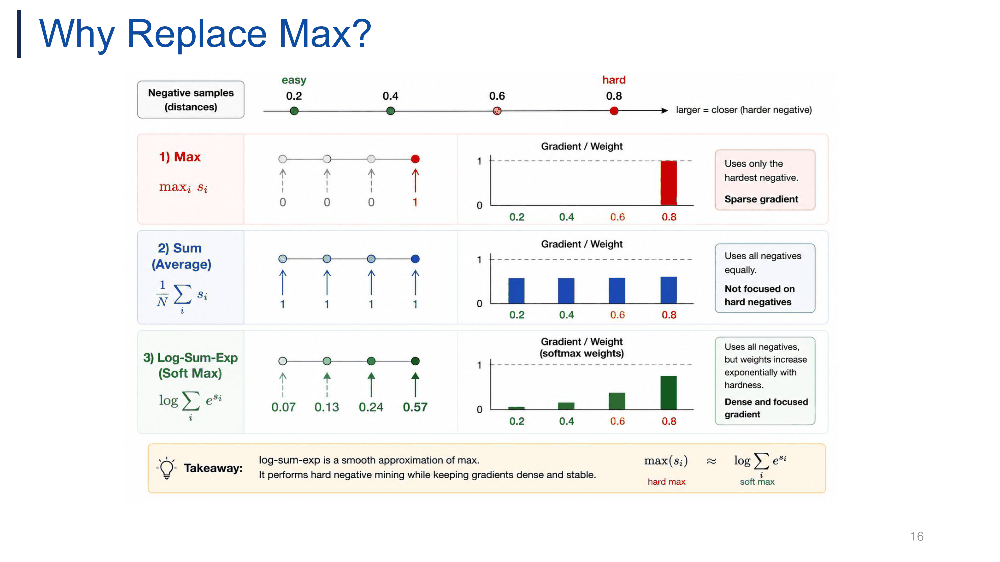

*p.16 — 여러 negative를 하나의 scalar로 묶는 세 방식의 gradient 가중치 비교. LSE = 어려울수록 지수적으로 큰 가중의 "dense & focused gradient".*

- 세 aggregation은 여러 negative score $s_i$를 하나로 요약하는 방식. 핵심은 $s_j$로 미분했을 때 각 negative가 받는 **gradient 가중치**
- 축: $s_i$ 클수록 anchor에 가까운 **harder negative** (0.2 easy ~ 0.8 hard)

| aggregation | 식 | $\partial / \partial s_j$ | 특징 |
|---|---|---|---|
| **Max** | $\max_i s_i$ | $\mathbb{1}[j = \arg\max]$ | hardest 하나만 → **sparse gradient**. 정보 낭비, outlier/noisy negative에 민감, 불연속이라 불안정 |
| **Sum (Average)** | $\frac1N \sum_i s_i$ | $1/N$ (균등) | 모든 negative 사용하지만 **hard에 비집중**. easy가 대부분이라 hard 신호 희석 |
| **Log-Sum-Exp** | $\log\sum_i e^{s_i}$ | $\dfrac{e^{s_j}}{\sum_i e^{s_i}}$ = **softmax weight** | 모든 negative가 gradient 받음(**dense**) + 어려울수록 지수적으로 큰 가중(**focused**) → **soft hard negative mining** |

- **Takeaway**: log-sum-exp는 max의 **smooth approximation**

$$\max_i s_i \;\le\; \text{LSE}(s) = \log\sum_i e^{s_i} \;\le\; \max_i s_i + \log N$$

  → hard negative mining을 하면서 gradient는 **dense하고 안정적**
- 이 관점이 Lifted의 relaxation을 정당화하고, **softmax/InfoNCE 계열 loss가 hard negative를 자동으로 강조하는 이유**와 직결

> 보충: temperature를 넣은 $\tau\log\sum_i e^{s_i/\tau}$ 에서 $\tau \to 0$ 이면 $\max_i s_i$ 에 수렴(gradient 가중치 $\text{softmax}(s/\tau)$가 one-hot), $\tau \to \infty$ 면 가중치가 균등($1/N$)해져 평균처럼 동작. **temperature = "얼마나 hard-focused한가"를 조절하는 knob**.

← 슬라이드 의심점: (1) Sum 행 막대 높이 ≈ 0.55로 그려졌으나 평균이면 가중치는 $1/N = 0.25$ — 크기 비교용 도식으로만 해석. (2) LSE 행의 0.07/0.13/0.24/0.57은 $s=(0.2,0.4,0.6,0.8)$에 그대로 softmax한 값(≈0.18/0.22/0.27/0.33)과 **불일치** — 더 작은 temperature를 가정한 예시값으로 보임 (원문 유지)

### 3.6 N-pair Loss (p.18–20, p.26)

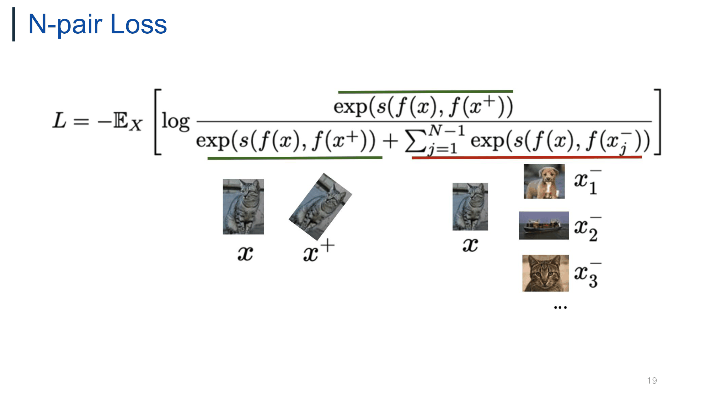

*p.19 — N-pair loss: 초록 = positive pair score (고양이 $x$ ↔ 회전/크롭된 $x^+$), 빨강 = N-1개 negative score (강아지, 배, **다른 고양이**…).*

- **Multi-class N-pair loss**: triplet loss를 **여러 negative와 동시 비교**로 일반화 (Sohn et al., NeurIPS 2016)
- 입력: $(N+1)$-tuplet $\{\mathbf{x}, \mathbf{x}^+, \mathbf{x}_1^-, \dots, \mathbf{x}_{N-1}^-\}$ = anchor 1 + positive 1 + negative $N-1$ (분류 후보 = $N$개)

$$\mathcal{L}_{\text{N-pair}} = \log\Big(1 + \sum_{i=1}^{N-1} \exp\big(f(\mathbf{x})^\top f(\mathbf{x}_i^-) - f(\mathbf{x})^\top f(\mathbf{x}^+)\big)\Big)
= -\log \frac{\exp\big(f(\mathbf{x})^\top f(\mathbf{x}^+)\big)}{\exp\big(f(\mathbf{x})^\top f(\mathbf{x}^+)\big) + \sum_{i=1}^{N-1} \exp\big(f(\mathbf{x})^\top f(\mathbf{x}_i^-)\big)}$$

- **두 형태가 같은 이유 (유도)**: positive score $b$, negative score $a_i$ 라 하면

$$\log\Big(1+\sum_i e^{a_i-b}\Big) = \log\frac{e^{b}+\sum_i e^{a_i}}{e^{b}} = -\log\frac{e^{b}}{e^{b}+\sum_i e^{a_i}}$$

  → **log(1+Σexp(neg − pos)) = softmax cross-entropy**
- 의미: positive score가 모든 negative score보다 커질수록 합 항 → 0 → loss → 0. triplet의 margin 비교(neg 1개 vs pos 1개)를 **N-1개 negative 전체에 대한 smooth 동시 비교**로 일반화
- **class마다 negative를 하나씩 뽑으면 multi-class softmax loss와 동치**

**일반형** (p.19–20, p.26)

$$L = -\mathbb{E}_X\left[\log \frac{\exp\big(s(f(x), f(x^+))\big)}{\exp\big(s(f(x), f(x^+))\big) + \sum_{j=1}^{N-1}\exp\big(s(f(x), f(x_j^-))\big)}\right]$$

- 내적을 일반 similarity $s(\cdot,\cdot)$ (cosine, dot product 등)로 추상화. $\mathbb{E}_X$ = anchor를 데이터에서 뽑아 평균
- 분자·분모 첫 항 = **score for the positive pair** / 분모 합 = **score for the N-1 negative pairs** → loss를 줄이려면 positive는 키우고 negative는 줄여야 함
- **"This seems familiar… Cross entropy loss for a N-way softmax classifier!"** (p.20)
  - $s(f(x),\cdot)$를 **logit**으로 보고 softmax → 정답 class = positive인 **categorical CE**
  - 즉 metric learning을 "거리 크기 맞추기"가 아니라 **"N개 중에서 positive 찾기" 분류 문제**로 재정의 → label 없는 self-supervised(positive = augmentation)에도 바로 적용 → InfoNCE, SimCLR NT-Xent로 이어짐
  - 일반 supervised softmax와 차이: 분류 head의 class weight가 아니라 **다른 샘플의 embedding 자체가 "class prototype" 역할** (후보 수가 batch마다 동적)
- p.26 하단 메모: **"Anchor (x) can be regarded as context (c)"** → InfoNCE의 $f(\mathbf{x}',\mathbf{c}) \leftrightarrow \exp(s(f(x), f(x')))$ (후보 $x' \in \{x^+, x_1^-, \dots, x_{N-1}^-\}$)로 대응
- 그림(p.19)의 시사점: positive $x^+$는 **같은 이미지의 augmentation**(회전·crop) — SimCLR식 positive 생성과 연결. negative에 **같은 class인 다른 고양이($x_3^-$)** 도 섞여 있음 → 라벨 없이 뽑으면 **false negative** 가능성

**Triplet / Lifted → N-pair 비교**
- Triplet: negative 1개 → N-pair: N-1개 → 정보량 증가
- Lifted: pair별 hinge/max → N-pair: **anchor 하나의 softmax 분모에 모든 negative 합산** → 어려운 negative가 exp 때문에 자동으로 큰 가중 (soft hard-mining)

> 보충: 원 논문은 batch를 N개 서로 다른 class에서 pair $(\mathbf{x}_i, \mathbf{x}_i^+)$ 하나씩 뽑아 구성하고, 다른 pair의 positive를 anchor의 negative로 재사용 → forward $2N$번으로 $N$개의 (N+1)-tuple 확보 (naive하면 $N(N+1)$번). embedding norm 폭주를 막는 L2 regularization도 추가.
> 보충: false negative(같은 의미인데 negative 취급)는 이후 supervised contrastive, debiased contrastive loss에서 다뤄짐.

### 3.7 NCE — Noise Contrastive Estimation (p.21–22)

- 질문 (p.21): **negative를 noise로 볼 수 있나? 확률적으로 해석 가능한가?** → **Yes**
  - **Positive vs Negative → Data vs Noise**
  - target data와 noise를 구분하는 **logistic regression**을 돌림 → NCE = 통계 모델의 **파라미터 추정법**

**수식** (Gutmann & Hyvärinen, 2010)
- target 샘플 $\mathbf{x} \sim P(\mathbf{x}|C=1;\theta) = p_\theta(\mathbf{x})$, noise 샘플 $\tilde{\mathbf{x}} \sim P(\tilde{\mathbf{x}}|C=0) = q(\tilde{\mathbf{x}})$
  - $C=1$: data, $C=0$: noise, $p_\theta$: 학습할 모델 분포, $q$: 알고 있고 샘플링 가능한 noise 분포
- logistic regression은 **logit(log-odds)** 를 모델링 → 샘플 $u$가 data에서 왔을 logit:

$$\ell_\theta(\mathbf{u}) = \log\frac{p_\theta(\mathbf{u})}{q(\mathbf{u})} = \log p_\theta(\mathbf{u}) - \log q(\mathbf{u})$$

- sigmoid로 확률 변환 후 **binary cross-entropy**:

$$\mathcal{L}_{\text{NCE}} = -\frac{1}{N}\sum_{i=1}^{N}\Big[\log\sigma(\ell_\theta(\mathbf{x}_i)) + \log\big(1-\sigma(\ell_\theta(\tilde{\mathbf{x}}_i))\big)\Big], \qquad \sigma(\ell) = \frac{1}{1+\exp(-\ell)} = \frac{p_\theta}{p_\theta + q}$$

- **$\sigma(\ell) = p_\theta/(p_\theta+q)$ 확인**: $\sigma(\log\frac{p}{q}) = \frac{p/q}{1+p/q} = \frac{p}{p+q}$. data:noise = 1:1 가정 시 Bayes rule의 $P(C=1|u)$ 와 같음
- 해석: 진짜 data는 $\sigma \to 1$, noise는 $\sigma \to 0$ 이 되도록 → 최소화하면 $p_\theta$가 data 분포에 접근
- ← 슬라이드는 data와 noise를 같은 index $i$로 합산(1:1)하므로, noise 비율 $k \ne 1$ 이면 $\sigma$ 식에 $k$ 보정 필요 (슬라이드는 생략)

> 보충: NCE의 원래 동기는 **unnormalized model**의 partition function $Z(\theta)=\int \tilde p_\theta(x)dx$ 계산이 불가능할 때, 이를 직접 계산하지 않고 분류 문제로 바꿔 학습하는 것 ($Z$를 학습 파라미터로 취급하거나 생략). 최적점이 정규화 상수까지 포함해 올바른 $p_\theta$가 됨이 증명됨. word2vec의 negative sampling은 NCE의 단순화 버전.

### 3.8 InfoNCE (p.23–28)

**정의** (van den Oord et al., 2018, CPC)
- **categorical cross-entropy**로 unrelated noise 샘플들 사이에서 positive를 식별

$$\mathcal{L}_{\text{InfoNCE}} = -\mathbb{E}\left[\log \frac{f(\mathbf{x},\mathbf{c})}{\sum_{\mathbf{x}'\in X} f(\mathbf{x}',\mathbf{c})}\right]$$

- $\mathbf{c}$: context (anchor 역할), $\mathbf{x}$: context와 짝인 positive, $X = \{\mathbf{x}_1, \dots, \mathbf{x}_N\}$: positive 1 + noise $N-1$, $f(\mathbf{x},\mathbf{c})$: **양의 score 함수** (exp 꼴)
- 분수 = N개 후보 중 positive를 고를 softmax 확률 → $-\log$ = **N-way categorical CE**
- 분모에 positive 자신도 포함 (확률 정규화를 위해 필요)
- negative가 많을수록 문제가 어려워지고, 경험적으로 더 좋은 표현을 학습하는 경향 (항상 보장은 아님)

**확률적 유도** (p.23–24)

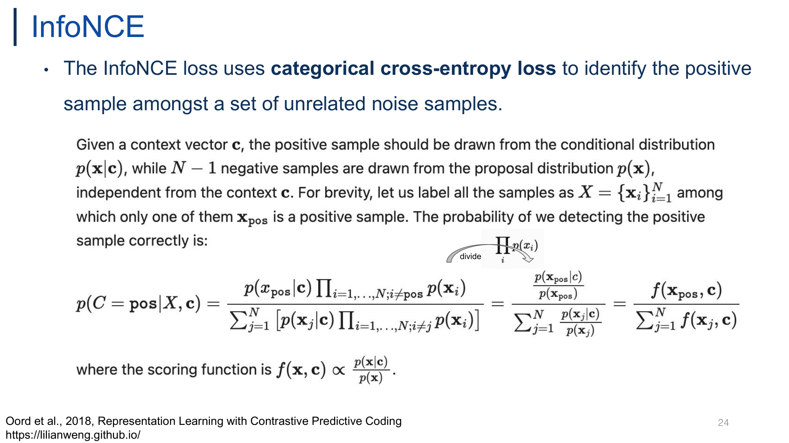

*p.24 — Bayes rule 식의 분자·분모를 $\prod_i p(\mathbf{x}_i)$로 나눠("divide") density ratio $f(\mathbf{x},\mathbf{c}) \propto p(\mathbf{x}|\mathbf{c})/p(\mathbf{x})$ 를 얻는 유도.*

- 설정: positive는 **조건부 분포 $p(\mathbf{x}|\mathbf{c})$** 에서, negative $N-1$개는 $\mathbf{c}$와 무관한 **proposal(marginal) 분포 $p(\mathbf{x})$** 에서 샘플링. $N$개 중 어느 위치가 positive인지를 $C$로 두고 "그 위치를 맞출 확률"을 구함
- ① **Bayes rule** (Likelihood × Prior / Marginal):

$$P(C=\text{pos}\mid X,\mathbf{c}) = \frac{P(X\mid C=\text{pos},\mathbf{c})\,P(C=\text{pos})}{\sum_{k=1}^{N}P(X\mid C=k,\mathbf{c})\,P(C=k)}$$

- ② **Likelihood**: positive 위치만 $p(\mathbf{x}|\mathbf{c})$, 나머지는 독립 $p(\mathbf{x}_i)$

$$P(X\mid C=\text{pos},\mathbf{c}) = p(\mathbf{x}_{\text{pos}}\mid\mathbf{c})\prod_{i\neq \text{pos}}p(\mathbf{x}_i)$$

- ③ **Prior**: 모든 위치 균등 $P(C=k) = 1/N$ → 분자·분모에서 약분
- ④ 분자·분모를 $\prod_{i=1}^N p(\mathbf{x}_i)$ 로 나누면 각 항에 $\mathbf{x}_j$ 하나만 비율로 남음:

$$p(C=\text{pos}\mid X,\mathbf{c}) = \frac{p(\mathbf{x}_{\text{pos}}|\mathbf{c})\prod_{i\neq\text{pos}}p(\mathbf{x}_i)}{\sum_{j=1}^{N}\Big[p(\mathbf{x}_j|\mathbf{c})\prod_{i\neq j}p(\mathbf{x}_i)\Big]} = \frac{\dfrac{p(\mathbf{x}_{\text{pos}}|\mathbf{c})}{p(\mathbf{x}_{\text{pos}})}}{\sum_{j=1}^{N}\dfrac{p(\mathbf{x}_j|\mathbf{c})}{p(\mathbf{x}_j)}} = \frac{f(\mathbf{x}_{\text{pos}},\mathbf{c})}{\sum_{j=1}^{N}f(\mathbf{x}_j,\mathbf{c})}$$

$$\Rightarrow\quad f(\mathbf{x},\mathbf{c}) \propto \frac{p(\mathbf{x}|\mathbf{c})}{p(\mathbf{x})} \quad (\textbf{density ratio})$$

- 핵심: 최적 score $f$는 **density ratio에 비례**. 실제로는 density를 직접 모델링하지 않고 $f$를 neural net (예: $\exp(z^\top W c)$, $\exp(\text{sim}/\tau)$)으로 근사
- **N-pair와 같은 식**: $\exp(s(\cdot))$가 $f$ 역할. N-pair는 metric learning에서, InfoNCE는 확률/MI 관점에서 도달한 **같은 식**

**Mutual information 관점** (p.27–28)

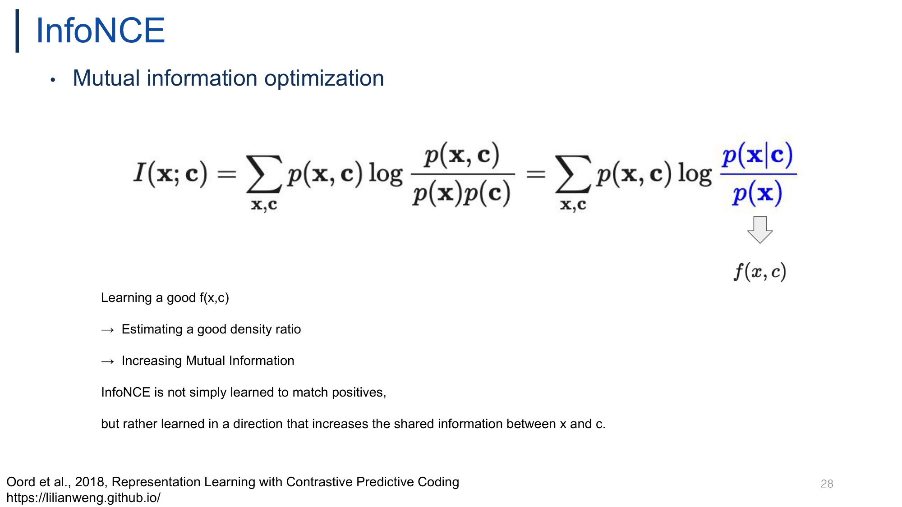

*p.28 — MI 식 안의 $p(\mathbf{x}|\mathbf{c})/p(\mathbf{x})$ 가 곧 $f(x,c)$가 추정하는 density ratio → "좋은 $f$ = 좋은 ratio 추정 = MI 증가".*

$$I(\mathbf{x};\mathbf{c}) = \sum_{\mathbf{x},\mathbf{c}} p(\mathbf{x},\mathbf{c})\log\frac{p(\mathbf{x},\mathbf{c})}{p(\mathbf{x})p(\mathbf{c})} = \sum_{\mathbf{x},\mathbf{c}} p(\mathbf{x},\mathbf{c})\log\frac{p(\mathbf{x}|\mathbf{c})}{p(\mathbf{x})}$$

- MI = $D_{KL}\big(p(\mathbf{x},\mathbf{c}) \,\|\, p(\mathbf{x})p(\mathbf{c})\big)$. 독립이면 0, 정보를 많이 공유할수록 큼 → "c를 알면 x에 대해 얼마나 더 아는가"
- 둘째 등식: $p(\mathbf{x},\mathbf{c}) = p(\mathbf{x}|\mathbf{c})p(\mathbf{c})$
- log 안의 비 = InfoNCE의 $f$가 추정하는 density ratio (log ratio = pointwise MI)
- 흐름: **Learning a good $f(x,c)$ → Estimating a good density ratio → Increasing Mutual Information**
- 메시지: **InfoNCE는 단순히 positive를 맞추는 matching이 아니라, x와 c의 shared information을 늘리는 방향으로 학습됨**
- 왜 density ratio인가: $p(\mathbf{x}|\mathbf{c})$를 생성모델로 직접 추정하는 건 고차원(이미지)에서 어렵고 불필요한 세부까지 모델링해야 함 → **ratio만 추정하면 분류 문제(NCE)로 풀 수 있음**

> 보충: CPC 논문은 $I(\mathbf{x};\mathbf{c}) \ge \log N - \mathcal{L}_{\text{InfoNCE}}$ 라는 **MI 하한**을 보임. $N$이 클수록 하한이 tight → **negative 수를 늘리는 게 중요한 이유**. 단 $\log N$ 에서 saturate하므로 큰 MI는 추정 어려움. CPC의 원래 $f$는 log-bilinear $f_k(x_{t+k}, c_t) = \exp(z_{t+k}^\top W_k c_t)$, $c$는 autoregressive 모델이 요약한 과거 context. 이름 = Info(MI 하한) + NCE.

**NCE vs InfoNCE**

| | NCE | InfoNCE |
|---|---|---|
| 문제 | 샘플 하나씩 **data vs noise 이진 분류** | 후보 N개 중 **positive 하나 고르기 (N-way)** |
| 확률 | sigmoid | softmax |
| loss | binary CE | categorical CE |
| 추정 대상 | $p_\theta$ (log ratio $\log p_\theta/q$) | density ratio $p(x\vert c)/p(x)$ (→ MI 하한) |

### 3.9 Soft-Nearest Neighbors Loss (p.29)

- InfoNCE/N-pair를 **multiple positive samples**로 확장
- batch $\{\mathbf{x}_i, y_i\}_{i=1}^{B}$ ($y_i$ = class label), 유사도 측정 함수 $f(\cdot,\cdot)$, temperature $\tau$:

$$\mathcal{L}_{\text{snn}} = -\frac{1}{B}\sum_{i=1}^{B}\log\frac{\sum_{i\neq j,\,y_i=y_j,\,j=1,\dots,B}\exp\big(-f(\mathbf{x}_i,\mathbf{x}_j)/\tau\big)}{\sum_{i\neq k,\,k=1,\dots,B}\exp\big(-f(\mathbf{x}_i,\mathbf{x}_k)/\tau\big)}$$

- 분자 = **Neighbors of the same class** (anchor와 같은 class인 모든 $j$), 분모 = **All neighbors** (자기 자신 제외 전부)
- 해석: anchor의 이웃을 soft하게 뽑았을 때 **같은 class일 확률**의 $-\log$ → 이웃 중 같은 class 비율을 높이는 방향
- **Temperature $\tau$**: representation space에서 feature가 **얼마나 concentrated 되는지** 조절
  - 작으면 가장 가까운 소수 이웃이 지배 (class별로 뭉침), 크면 먼 샘플도 기여 (분포 퍼짐)
- ← 슬라이드는 "$f$ = similarity"라 쓰지만 식이 $\exp(-f/\tau)$ 이므로 부호상 **$f$는 거리(distance)** 로 쓰이는 게 맞음 (원문 유지)
- 출처: Salakhutdinov & Hinton 2007 (NCA 계열), Frosst, Papernot & Hinton 2019

> 보충: NCA는 Goldberger et al. (2004). Frosst et al. (2019)이 deep net hidden layer의 class 얽힘(entanglement)을 재는 loss로 재조명. Supervised Contrastive Learning(SupCon)의 전신 격.

### 3.10 Objective 총정리 비교 표

| 방법 | 핵심 아이디어 | loss | 장점 | 한계 |
|---|---|---|---|---|
| **Contrastive** (Chopra 2005) | pair 단위, positive는 당기고 negative는 margin까지 밂 | $\mathbb{1}_{y_i=y_j}d^2 + \mathbb{1}_{y_i\ne y_j}\max(0,\varepsilon-d)^2$ | 단순, Siamese로 바로 적용 | pair만 봄, inactive negative 다수, 상대 순서 강제 X |
| **Triplet** (FaceNet 2015) | anchor-pos-neg의 **상대 거리 순서** | $\max(0, d_{ap}^2 - d_{an}^2 + \varepsilon)$ | relative ordering, intra-class variance 허용 | $O(N^3)$ 조합, easy triplet 지배 → mining 필요 |
| **Lifted Structured** (Song 2016) | batch 내 **모든 pairwise edge**, hardest negative 내장 → LSE로 smooth화 | $\frac{1}{2\vert \mathcal{P}\vert }\sum\max(0, D_{ij} + \text{LSE}(\epsilon - D))^2$ | batch 정보 최대 활용, 내장 mining | $O(N^2)$, 여전히 pair-based (1 pos ↔ 1 neg) |
| **N-pair** (Sohn 2016) | 1 positive vs **N-1 negatives 동시** | $-\log\frac{e^{s^+}}{e^{s^+}+\sum_j e^{s_j^-}}$ | N-way softmax CE, 정보량↑, mining 의존↓ | false negative 가능, batch 크기 의존 |
| **NCE** (Gutmann 2010) | negative = noise, **data vs noise 이진 분류** | $-[\log\sigma(\ell) + \log(1-\sigma(\tilde\ell))]$, $\ell=\log p_\theta/q$ | unnormalized model 추정, 확률적 근거 | 샘플별 이진 분류, noise 분포 $q$ 필요 |
| **InfoNCE** (Oord 2018) | N개 중 positive 찾기, $f \propto p(x\vert c)/p(x)$ | $-\mathbb{E}\log\frac{f(x,c)}{\sum_{x'} f(x',c)}$ | MI 하한 $\log N - \mathcal{L}$, 현대 CL의 표준 | 많은 negative 필요, MI는 $\log N$에서 saturate |
| **Soft-NN** (Frosst 2019) | **multiple positives** (같은 class 전부) | $-\frac1B\sum\log\frac{\sum_{same}e^{-f/\tau}}{\sum_{all}e^{-f/\tau}}$ | label 활용, $\tau$로 집중도 조절 | label 필요 |

**발전 흐름 정리**: negative 1개(pair/triplet) → batch 전체(lifted) → N-1개 동시(N-pair) / max → **log-sum-exp(softmax)** / 거리 hinge → **확률적 분류(NCE → InfoNCE)** / positive 1개 → 여러 개(Soft-NN)

---

## 4. Common Setup for Modern Contrastive Learning (p.30–32)

### 4.1 공통 파이프라인 (p.31)

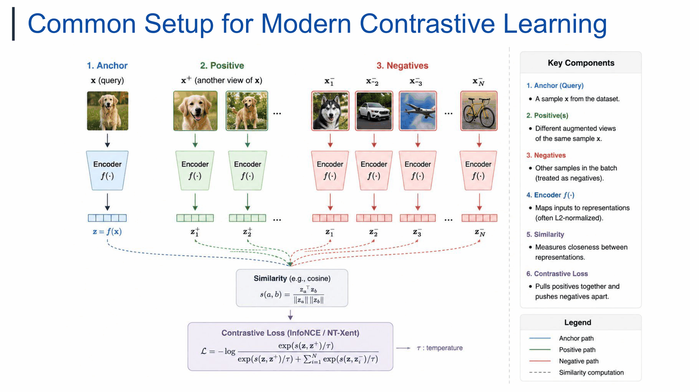

*p.31 — Anchor / Positive(another view) / Negatives(batch 내 다른 샘플) → 공유 encoder $f(\cdot)$ → cosine similarity → InfoNCE(NT-Xent) loss.*

**Key Components 6개**
1. **Anchor (Query)**: 데이터셋의 샘플 $\mathbf{x}$
2. **Positive(s)**: 같은 샘플 $\mathbf{x}$의 **다른 augmented view**
3. **Negatives**: batch 안의 다른 샘플들
4. **Encoder $f(\cdot)$**: 입력 → representation (보통 **L2-normalized**), 모든 branch가 weight 공유
5. **Similarity**: 보통 cosine $s(a,b)=\dfrac{\mathbf{z}_a^\top \mathbf{z}_b}{\|\mathbf{z}_a\|\|\mathbf{z}_b\|}$
6. **Contrastive Loss**: positive는 당기고 negative는 밂

$$\mathcal{L}=-\log\frac{\exp\big(s(\mathbf{z},\mathbf{z}^+)/\tau\big)}{\exp\big(s(\mathbf{z},\mathbf{z}^+)/\tau\big)+\sum_{i=1}^{N}\exp\big(s(\mathbf{z},\mathbf{z}_i^-)/\tau\big)} \qquad (\text{InfoNCE / NT-Xent})$$

- **L2-normalize + cosine**: 벡터 크기 영향 제거, 방향만 비교 → 학습 안정
- **temperature $\tau$**: $s \in [-1,1]$라 그대로 exp하면 분포가 너무 평평 → $\tau$로 나눠 sharpness 조절. **작은 $\tau$ → hard negative에 더 큰 가중** (3.5절 LSE 논리)
- N-pair(p.26)와 구조 동일 + **$s/\tau$ temperature 추가**
- ← p.26은 negative 합이 $N-1$, p.31은 $N$ — 총 후보 수 정의 차이일 뿐 구조 동일
- 한 식에서 positive logit을 올리고(pull) negative logit을 내림(push)

> 보충: NT-Xent = Normalized Temperature-scaled Cross Entropy (SimCLR, Chen et al., 2020).

### 4.2 Positive Pair Construction (p.32)

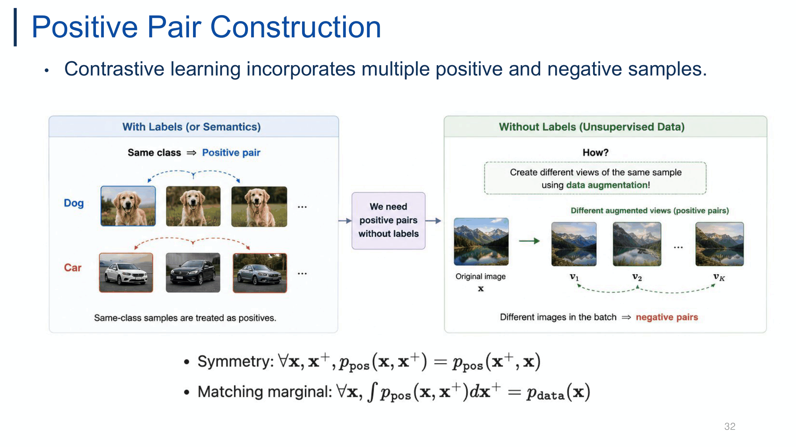

*p.32 — label 있으면 같은 class = positive / label 없으면 같은 이미지의 augmentation view끼리 positive, batch 내 다른 이미지 = negative.*

- **With labels (or semantics)**: same class ⇒ positive pair (Soft-NN, SupCon 방식). anchor당 positive 다수
- **Without labels**: "We need positive pairs without labels" → **data augmentation으로 같은 샘플의 다른 view** $\mathbf{v}_1, \dots, \mathbf{v}_K$ 생성 = positive, **batch 내 다른 이미지 = negative**
  - 이때 **augmentation 선택이 "무엇에 invariant해야 하는가"를 정의**
- positive pair 분포 $p_{\text{pos}}$의 조건
  - **Symmetry**: $\forall \mathbf{x},\mathbf{x}^+,\ p_{\text{pos}}(\mathbf{x},\mathbf{x}^+)=p_{\text{pos}}(\mathbf{x}^+,\mathbf{x})$ → anchor/positive 역할 구분 없음 (두 augmentation view는 대칭)
  - **Matching marginal**: $\forall \mathbf{x},\ \int p_{\text{pos}}(\mathbf{x},\mathbf{x}^+)\,d\mathbf{x}^+=p_{\text{data}}(\mathbf{x})$ → positive 샘플링이 데이터 분포를 왜곡하지 않음, 모든 샘플이 데이터 분포대로 anchor로 등장

> 보충: 두 조건은 Wang & Isola (2020) "Understanding Contrastive Representation Learning through Alignment and Uniformity"의 $p_{\text{pos}}$ 가정과 같은 형태 (슬라이드엔 출처 없음). 같은 논문은 loss를 **alignment**(positive 가깝게) + **uniformity**(hypersphere 상 균일 분포)로 분해.
> 보충: "different images ⇒ negative" 는 같은 class 다른 이미지가 negative가 되는 **false negative** 문제를 내포 → 다음 섹션 질문으로 연결.

---

## 5. Views: GenView — 더 좋은 positive view 만들기 (p.33–45)

> 질문 (p.33): **"Are positive and negative pairs always constructed correctly?"**
> 논문: **GenView: Enhancing View Quality with Pretrained Generative Model for Self-Supervised Learning** (Li et al., ECCV 2024; HIT Shenzhen, Peng Cheng Lab, KAUST, NTU S-Lab)

### 5.1 Handcrafted view의 한계 (p.35–37)

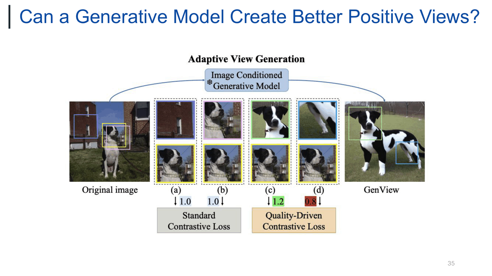

*p.35 — 원본 crop으로 만든 (a) 개가 없는 view, (b) 거의 같은 view는 가중치 1.0 / 생성 모델 view (c) 좋은 pair 1.2, (d) 품질 낮은 pair 0.8.*

- **Standard augmentation의 두 한계** (p.36)
  - **(a) False Positive Pair**: strong crop이 main object를 제거 (벽돌 배경만) → loss는 배경 ↔ 개를 같게 당김 → noisy supervision
  - **(b) Limited Diversity**: weak crop은 거의 동일한 두 view → invariance로 배울 게 적어 학습 신호 약함, pose/viewpoint/배경 변화에 robust해지지 못함
  - 둘은 **trade-off**: 세게 하면 (a), 약하게 하면 (b). handcrafted는 이미지별 강도 조절 불가 (전 이미지 동일 augmentation 분포)
- **A good positive pair should preserve semantics while introducing diversity**
- 생성 모델의 장점 (p.37)
  - (c) **object semantics는 유지하면서 pose와 background가 바뀜** → crop으로는 불가능한 변화
  - (d) 생성 결과 품질이 낮을 수 있음 → **낮은 가중치 0.8**
- **GenView의 목표: pose, viewpoint, background는 바꾸고 object identity는 유지**
- 가중치 1.0/1.2/0.8은 개념 설명용 예시값

> 보충: SimCLR(Chen et al., 2020)에서 random crop + color distortion이 핵심 augmentation이지만, crop은 object가 없는 view를 만들 수 있다는 점이 지적돼 왔음.

### 5.2 GenView Framework (p.38–42)

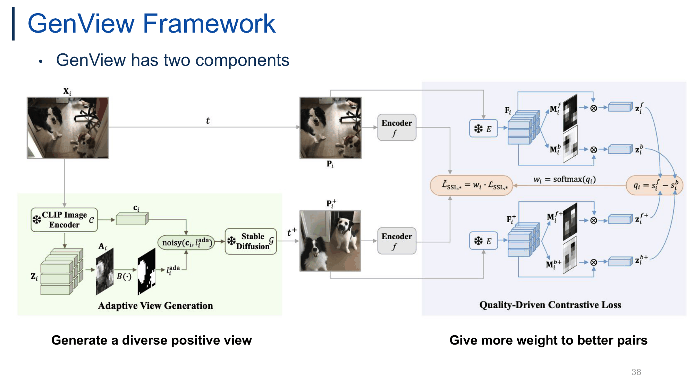

*p.38 — 왼쪽(초록): Adaptive View Generation (CLIP image encoder → adaptive noise → Stable Diffusion), 오른쪽(파랑): Quality-Driven Contrastive Loss ($q_i = s_i^f - s_i^b$, $w_i = \text{softmax}(q_i)$).*

**두 구성요소**
1. **Adaptive View Generation** — *Generate a diverse positive view*
2. **Quality-Driven Contrastive Loss** — *Give more weight to better pairs*

**(1) 두 positive view 생성** (p.39)
- 위 경로: $\mathbf{X}_i$ → random predefined augmentation $t$ → $\mathbf{P}_i$
- 아래 경로: $\mathbf{X}_i$ → frozen **CLIP image encoder** $\mathcal{C}$ → embedding $\mathbf{c}_i$ + feature $\mathbf{Z}_i$ → foreground map $\mathbf{A}_i$ → binarize $B(\cdot)$ → **$l_i^{\text{ada}}$** (foreground 비율로 정한 noise level) → $\text{noisy}(\mathbf{c}_i, l_i^{\text{ada}})$ → frozen **Stable (un)CLIP Diffusion** $\mathcal{G}$ → $t^+$ → $\mathbf{P}_i^+$

$$\mathbf{X}_i^{+} = \mathcal{G}\big(\mathbf{z}_T,\ \mathrm{noisy}(\mathbf{c}_i,\ l_i^{\mathrm{ada}}),\ w\big)$$

- $\mathcal{G}$: frozen Stable unCLIP (diffusion)
- $\mathbf{z}_T$: 시작 Gaussian noise latent (T = 최대 diffusion step)
- $\mathbf{c}_i$: **conditional image embedding** (원본의 CLIP embedding) → semantic을 담아 object identity 유지
- $\text{noisy}(\mathbf{c}_i, l_i^{\text{ada}})$: 조건에 noise를 섞어 생성 결과를 원본에서 멀어지게 → **diversity**
- $l_i^{\text{ada}}$: **perturbation strength**, 이미지별 adaptive
- $w$: classifier-free guidance scale로 보임 ← 슬라이드에서 정의 안 됨, loss 가중치 $w_i$와 혼동 주의
- 결과 positive pair = **(augmentation view $\mathbf{P}_i$, generated view $\mathbf{P}_i^+$)** → 두 방식 장점 혼합

> 보충: Stable unCLIP은 Stable Diffusion을 text 대신 **CLIP image embedding**으로 conditioning하도록 fine-tune한 모델 (DALL·E 2의 unCLIP 아이디어), image variation 생성 가능. 슬라이드에 "Stable Diffusion"과 "Stable unCLIP" 표기 혼재.

**(2) Adaptive noise level — 얼마나 변형할까?** (p.40)

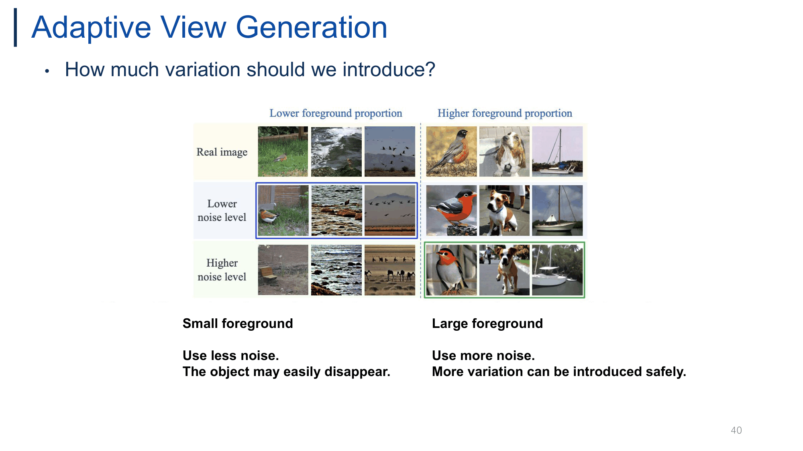

*p.40 — foreground가 작은 이미지는 낮은 noise(파랑 박스), 큰 이미지는 높은 noise(초록 박스)일 때 object를 유지하면서 변화를 줌.*

- **Small foreground → Use less noise**: noise를 많이 주면 object가 쉽게 사라짐 (semantic drift / false positive)
- **Large foreground → Use more noise**: object 정보가 embedding에 충분 → 더 큰 변화를 안전하게 도입
- 고정 noise level의 한계(작은 객체는 망가지고 큰 객체는 변화 부족) 해결
- 정확한 함수식은 슬라이드에 없음

**(3) Apply SSL loss** (p.41)
- 두 positive view $\mathbf{P}_i, \mathbf{P}_i^+$를 target encoder $f$에 넣고 base SSL loss 계산 — **various loss functions can be used**
- $\mathcal{L}_{\text{SSL},*}$의 $*$ = 어떤 SSL loss든(InfoNCE/SimCLR, MoCo, BYOL, SimSiam, SwAV…) → **loss-agnostic plug-in framework**

**(4) Evaluate pair quality** (p.42)
- **별도의 frozen encoder $E$** 가 pair 품질 평가 (gradient 없음, 학습 대상 아님)
  1. 두 view의 feature map $\mathbf{F}_i, \mathbf{F}_i^+$ 추출
  2. foreground mask $\mathbf{M}^f$ / background mask $\mathbf{M}^b$ 로 나눠 pooling → $\mathbf{z}_i^f, \mathbf{z}_i^b, \mathbf{z}_i^{f+}, \mathbf{z}_i^{b+}$
  3. 두 view 사이 foreground 유사도 $s_i^f = \text{sim}(\mathbf{z}_i^f, \mathbf{z}_i^{f+})$, background 유사도 $s_i^b = \text{sim}(\mathbf{z}_i^b, \mathbf{z}_i^{b+})$
- **좋은 positive pair 조건: Similar foreground + Different background**

$$q_i = s_i^f - s_i^b, \qquad w_i = \mathrm{softmax}(q_i), \qquad \tilde{\mathcal{L}}_{\mathrm{SSL},*} = w_i \cdot \mathcal{L}_{\mathrm{SSL},*}$$

- **왜 $q = s^f - s^b$ 인가**: semantics(foreground)는 같고 nuisance(background)는 달라야 encoder가 **background shortcut이 아니라 object에 invariant**하게 학습됨
  - 생성 view가 semantic drift로 object가 바뀌면 $s^f$↓ → $q$↓
  - background가 거의 그대로면(정보량 적음) $s^b$↑ → $q$↓
- $w_i$로 **고품질 pair에 큰 가중** → noisy pair 영향 감소
- softmax 정규화 범위는 batch 내 샘플로 보는 게 자연스러움 ← 슬라이드엔 명시 없음
- CLIP image encoder $\mathcal{C}$, Stable Diffusion $\mathcal{G}$, 품질 평가 encoder $E$ **세 모델 모두 frozen** → 학습 대상은 SSL encoder $f$뿐

### 5.3 실험 결과 (p.43–44)

- **생성 결과** (p.43): ImageNet/CIFAR-10에서 GenView는 **background, object pose, viewpoint**를 바꾸고 **main semantics는 유지**
  - 단 일부 예(낚시 사진 인물이 바뀜 등)는 semantic이 완전히 같지 않음 → semantic drift → quality weighting 필요
- **ImageNet-1K linear evaluation (ResNet-50 등)** (p.44) — backbone freeze + linear classifier만 학습한 Top-1

| Method | Arch | Epochs | Top-1 | + GenView |
|---|---|---|---|---|
| MoCov2 | R50 | 200 | 67.5 | **70.0** (+2.5) |
| MoCov2 + C-Crop | R50 | 200 | 67.8 | — |
| SwAV* | R50 | 200 | 70.5 | **71.7** (+1.2) |
| SimSiam | R50 | 200 | 70.0 | **72.2** (+2.2) |
| BYOL* | R50 | 200 | 71.8 | **73.2** (+1.4) |
| MoCov3 | R50 | 100 | 68.9 | **72.7** (+3.8) |
| MoCov3 | R50 | 300 | 72.8 | **74.8** (+2.0) |
| MoCov3 | ViT-S | 300 | 73.2 | **74.5** (+1.3) |
| MoCov3 | ViT-B | 300 | 76.7 | **77.8** (+1.1) |

(참고 baseline: InstDisc 56.5, SimCLR 66.8, PCL 67.6, Adco 68.6, InfoMin 70.1, NNCLR 70.7, LEVEL 72.8 (200ep), Barlow Twins 71.4 (300ep), CLIP 74.3 (대규모 image-text, 조건 다름). *: 재현)

- 관찰
  - **서로 다른 SSL 프레임워크 모두 향상** (+1.1 ~ +3.8%p)
  - 다른 view-construction 기법 C-Crop은 +0.3, GenView는 +2.5 → 더 나은 view construction이 효과적
  - MoCov3 100ep + GenView (72.7) ≈ GenView 없는 300ep (72.8) → 학습 효율 향상 시사
- 슬라이드 주장: **benefit comes from better pair construction, not simply from adding more images** ← 표만으로 직접 입증은 안 됨 (데이터 양 맞춘 ablation은 슬라이드에 없음)
- **Contrastive learning depends on the quality of its positive views.**

### 5.4 GenView의 한계 (p.45)

- **Frozen CLIP, Stable unCLIP의 prior knowledge에 의존** → target dataset만으로 학습하는 **fully independent SSL이 아님** (비교 공정성 이슈)
- 생성은 offline이지만 **추가 연산·저장 공간** 필요
- foreground ratio 기반 noise level은 단순 **heuristic** (최적 보장 X)
- quality weighting은 semantic drift 영향을 **줄일 뿐 완전히 제거하지 못함**

---

## 6. Features: Feature Suppression과 MCL (p.46–61)

> 질문 (p.46): **"Even with good positive pairs, does contrastive learning preserve every useful feature?"**
> 논문: **Learning the Unlearned: Mitigating Feature Suppression in Contrastive Learning** (Zhang et al., ECCV 2024; CUHK, NUS, Shanghai AI Lab)
> GenView가 **데이터/입력 측**(pair 구성) 개선이었다면, 여기는 pair가 좋아도 representation이 정보를 잃는 **representation 측** 문제.

### 6.1 Feature Suppression이란 (p.48–49)

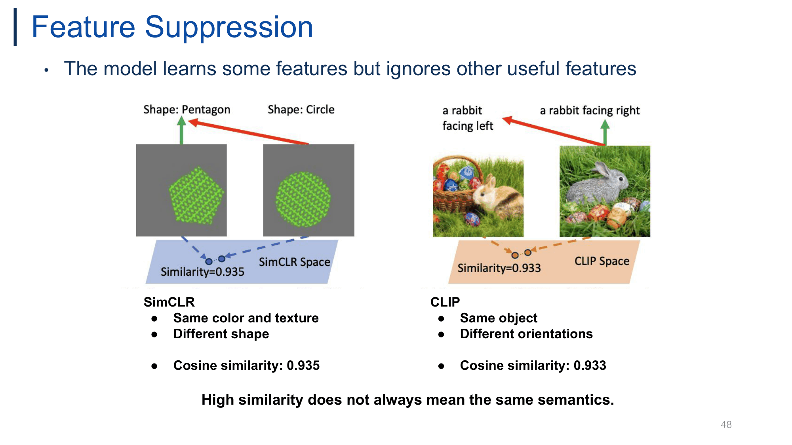

*p.48 — SimCLR은 색·텍스처가 같고 모양이 다른 두 이미지를 0.935로, CLIP은 방향이 다른 두 토끼를 0.933으로 거의 같게 봄.*

- **The model learns some features but ignores other useful features**
  - **SimCLR**: same color & texture, **different shape** → cosine similarity **0.935** → shape 억제
  - **CLIP**: same object(rabbit), **different orientation** (facing left/right) → **0.933** → orientation 억제
- **High similarity does not always mean the same semantics.**
- **정의** (p.49): 입력에 있는 **useful information이 representation에서 사라지는 현상** = **feature suppression**
  - 두 표현의 유사도가 높아도 downstream에 결정적인 정보가 다를 수 있음
  - shape이 중요한 task에서 SimCLR 표현으로 linear probing하면 성능이 낮을 것
- 억제되는 feature가 모델마다 다름 (SimCLR = shape, CLIP = orientation). 원인으로 SimCLR의 augmentation 불변성, CLIP caption이 주로 object 이름 위주라 방향 정보를 요구하지 않음 등을 추측 가능 (슬라이드엔 원인 설명 없음, 보충 추론)

> 보충: Chen et al. (2021) "Intriguing Properties of Contrastive Losses"에서 feature suppression / competing features로 분석됨 — 한 feature가 이미 loss를 줄이면 다른 feature 학습 압력이 줄어드는 경쟁 현상.

### 6.2 왜 발생하나? (p.50)

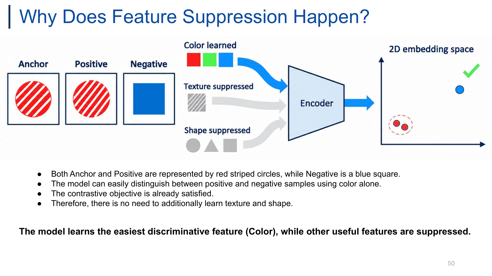

*p.50 — anchor·positive(빨간 줄무늬 원) vs negative(파란 사각형): 색만으로 구분되니 color만 학습되고 texture·shape는 suppressed.*

- anchor와 positive는 빨간 줄무늬 원, negative는 파란 사각형 → **색만으로 positive/negative 구분 가능**
- **contrastive objective가 이미 만족됨** → texture, shape를 추가로 배울 필요 없음
- **The model learns the easiest discriminative feature (Color), while other useful features are suppressed.**
- 수식 관점 (보충, InfoNCE 가정):

$$\mathcal{L} = -\log \frac{\exp(\mathrm{sim}(z_a, z_p)/\tau)}{\exp(\mathrm{sim}(z_a, z_p)/\tau) + \sum_{n}\exp(\mathrm{sim}(z_a, z_n)/\tau)}$$

  색만으로 negative score가 충분히 낮음 → loss 이미 작음 → gradient 작음 → 다른 feature 학습 **incentive 없음**
- 원인은 모델 능력이 아니라 **목적함수가 "구분 가능"이라는 충분조건만 요구** → shortcut 학습 허용, **simplicity bias** (가장 쉬운 feature가 먼저 학습되고 나머지 억제)
- → MCL 설계 동기: **shortcut(색)을 쓸 수 없게 negative를 고르면 됨**

> 보충: supervised의 shortcut learning / simplicity bias (Geirhos et al., 2020 "Shortcut learning in deep neural networks")와 같은 맥락.

### 6.3 Multistage Contrastive Learning (MCL) (p.51–55)

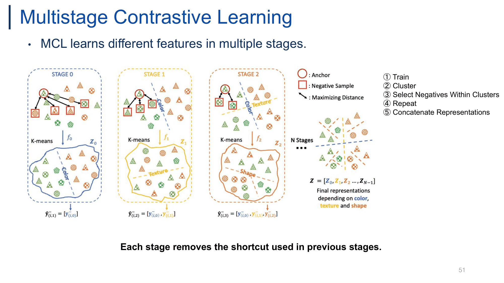

*p.51 — Stage 0(color) → Stage 1(같은 color cluster 안 negative → texture) → Stage 2(같은 color+texture → shape), 최종 $\mathbf{Z} = [\mathbf{Z}_0, \dots, \mathbf{Z}_{N-1}]$.*

- **MCL learns different features in multiple stages** — 한 번에 모든 feature를 얻으려 하지 않고 stage마다 다른 지배 feature를 학습
- **5단계**: ① **Train** → ② **Cluster** (K-means) → ③ **Select Negatives Within Clusters** → ④ **Repeat** → ⑤ **Concatenate Representations**
- **Each stage removes the shortcut used in previous stages.**

**Stage별 동작**
- **Stage 0** (p.52): **standard contrastive learning** (batch 내 무작위 negative)
  - 가장 단순한 feature인 **color를 먼저 학습한다고 가정** → $Z_0$ 공간이 색 기준으로 분할
  - $Z_0$에 **K-means** → 같은 cluster = 이전 stage의 지배 feature(색)가 같은 샘플 → 클러스터링이 "이 stage가 쓴 shortcut"을 라벨 없이 **추출**
  - 색은 예시. 실제로 무엇이 먼저 학습될지는 데이터/augmentation에 따라 다름 (슬라이드의 'assumed')
- **Stage 1** (p.53): negative를 **anchor와 같은 cluster 안에서만** 선택 (anchor = 초록 텍스처 삼각형, negative = 다른 초록 물체들)
  - 모든 negative가 같은 색 → **색으로는 구분 불가** → **texture** 같은 다른 feature를 배워야 함
  - 새 encoder $f_1$ → $Z_1$ → 다시 K-means (texture 기준 분할)
  - 직관: 한 번의 학습에서는 색이 gradient를 독점하지만, **색을 negative 쪽에서 무력화**하면 억눌린 feature가 드러남
- **Stage 2** (p.54): Stage 0 **AND** Stage 1 cluster가 모두 같은 그룹 안에서 negative 선택 (same-color + same-texture) → 남는 단서는 **shape**
- 누적 cluster 라벨: Stage $k$의 negative 조건 $\hat{\mathbf{y}}^-_{(i,k)} = [\mathbf{y}^-_{(i,0)}, \dots, \mathbf{y}^-_{(i,k-1)}]$ (슬라이드에선 각 stage 패널 아래, 즉 stage가 끝난 뒤 다음 stage용으로 표기). 기호 정의는 슬라이드에 없음 — 해석은 추정
- stage가 늘수록 negative pool이 교집합으로 **점점 작아짐** → cluster 수 K와 데이터 크기 trade-off (보충 추론)

**Concatenation** (p.55)

$$\mathbf{Z} = [\mathbf{Z}_0, \mathbf{Z}_1, \mathbf{Z}_2, \dots, \mathbf{Z}_{N-1}] \in \mathbb{R}^{Nd} \quad (\text{stage당 차원 } d)$$

- **Concatenation preserves features learned at all stages.**
- 상위 stage encoder 단독은 이전 feature(color, texture)에 둔감해질 수 있음 → concat으로 모두 보존 → downstream에서 color/texture/shape 중 무엇이 필요해도 linear classifier가 해당 차원 사용 가능
- 단점: 차원이 stage 수에 비례, 학습 비용 N배

> 보충: MCL은 Zhang et al. (ECCV 2024) 논문의 방법 (슬라이드 p.51에는 출처 미표기).

### 6.4 MCL vs Hard Negative Mining (p.56)

| | Hard Negative Mining | MCL |
|---|---|---|
| negative 선택 기준 | **현재 embedding**에서 anchor와 가까운 샘플 | **이전 stage cluster**가 anchor와 같은 샘플 |
| 목적 | 어려운 샘플로 gradient↑, 판별 경계 세밀화 | **이전에 학습한 feature 재사용 방지** → 새 feature 학습 (feature suppression 완화) |
| encoder | 같은 모델 계속 학습 | stage마다 새 encoder + concat |

- **"While MCL may appear similar to hard negative mining, its objective is different."**
- 보충 추론: hard negative mining은 false negative를 뽑을 위험, MCL도 같은 cluster = 비슷한 샘플이라 유사한 위험 가능 (슬라이드 언급 없음)

> 보충: hard negative mining 대표 논문 Robinson et al. (ICLR 2021) "Contrastive Learning with Hard Negative Samples".

### 6.5 실험 결과 (p.57–59)

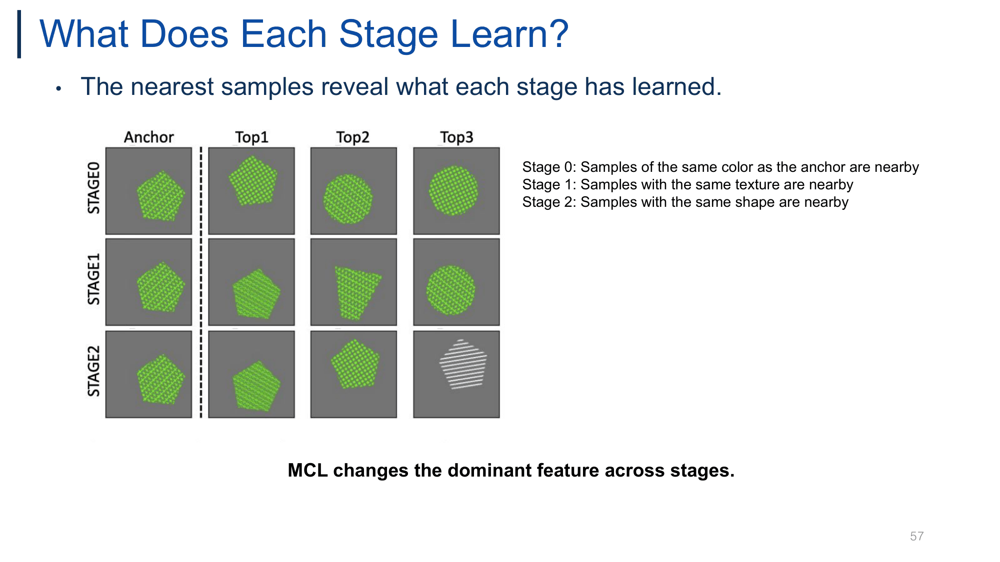

*p.57 — Trifeature에서 anchor의 Top-3 nearest sample: Stage 0 = 같은 색, Stage 1 = 같은 텍스처, Stage 2 = 같은 모양.*

- **What does each stage learn?** (p.57): nearest neighbor가 각 stage가 **무엇을 기준으로 유사하다고 보는지** 드러냄 (정성적 probe)
  - Stage 0: same color / Stage 1: same texture / Stage 2: same shape (Top3가 흰 줄무늬 오각형 → 색·텍스처 무시)
  - **MCL changes the dominant feature across stages.**
- **Results on suppressed features** (p.58, Table 2, linear evaluation) — **MCL improves suppressed features without losing previously learned features**

| | Tri: Shape | Texture | Color | CelebA: Hair | Smiling | Gender | C-M: CIFAR | MNIST | **Avg** |
|---|---|---|---|---|---|---|---|---|---|
| IFM | 0.99 | 0.99 | **1.00** | 0.82 | 0.70 | 0.93 | 0.11 | **0.99** | 0.82 |
| TS | 0.93 | **1.00** | **1.00** | 0.62 | 0.65 | 0.87 | 0.09 | **0.99** | 0.77 |
| FD | 0.75 | 0.73 | 0.78 | 0.81 | **0.89** | 0.94 | 0.78 | 0.86 | 0.82 |
| SimCLR | 0.81 | 0.99 | **1.00** | 0.84 | 0.75 | 0.94 | 0.29 | 0.98 | 0.83 |
| **MCL** | **1.00** | **1.00** | **1.00** | **0.85** | 0.79 | **0.95** | **0.87** | **0.99** | **0.93** |

  - Trifeature: shape/texture/color 독립 변화 합성 데이터 / CelebA: 얼굴 속성 / CIFAR-MNIST: CIFAR 물체 + MNIST 숫자 합성
  - SimCLR: Shape 0.81(색·텍스처 지배), CIFAR 0.29(MNIST가 쉬운 shortcut) → **suppression 증거**
  - IFM, TS: CIFAR 0.11/0.09 ≈ chance → CIFAR 완전 억제
  - FD: CIFAR 0.78로 좋지만 Trifeature·MNIST 하락 → 억눌린 feature를 올리는 대신 기존 feature를 잃음
  - MCL: Trifeature 전부 1.00, CIFAR 0.87·MNIST 0.99, Avg 0.93 (SimCLR 대비 +0.10). 단 Smiling은 FD(0.89) > MCL(0.79) — 전 항목 1등은 아님
  - 주의: MCL은 concat이라 차원이 baseline보다 큼
- **Multimodal feature suppression** (p.59, Table 3: MCL-tuned CLIP on **MMVP**)
  - **Feature suppression is not unique to SimCLR**: CLIP은 object category는 잘 표현하지만 **orientation, count, spatial relationship** 같은 fine-grained detail을 놓침
  - STAGE0 = 원본 OpenAI pre-trained CLIP, STAGE1–3 = MCL 추가 stage, MCL = 4 stage concat
  - 평균: **ResNet 19.3 → 24.4**, **ViT 20.0 → 32.6** (+12.6p) — 두 backbone 모두 MCL이 최고
  - stage별로 잘하는 범주가 다름 (ViT Stage1 S&C 66.7, Stage3 C&A 66.7), 단조 증가 아님 (ViT Stage1 29.6 > Stage2 23.7), MCL이 개별 stage보다 낮은 범주도 있음 (ResNet O&D 0.0)
  - 절대 정확도가 30% 안팎 → 개선폭은 크지만 문제 해결은 아님
  - ← 표에 6.7과 6.67 표기 혼재 (원문 유지)

> 보충: MMVP는 Tong et al. (2024) "Eyes Wide Shut? Exploring the Visual Shortcomings of Multimodal LLMs"의 benchmark — CLIP 임베딩은 비슷하지만 시각적으로 다른 이미지 쌍. 열 약어(O&D, PSF, S&C, …)의 정확한 대응은 슬라이드에 없음.

### 6.6 Summary & Limitation (p.60–61)

- **Standard CL learns the easiest discriminative features** → MCL **selects negatives with similar learned features** → **each stage learns previously suppressed features**
- **Contrastive learning may learn enough to separate samples, but not enough to preserve all useful information.** → **sample discrimination ≠ information preservation**
- **한계**
  - 여러 stage·encoder 학습 → **연산량 증가**
  - concat → **feature dimension 증가** (baseline과 차원이 달라 비교 공정성 이슈; overfitting 우려는 추정)
  - **K-means cluster가 실제 semantic feature를 정확히 반영한다는 보장 없음**
  - **단순 concat은 최적이 아닐 수 있음** (stage별 중요도·중복 미고려)

> 보충: learned weighting, attention 기반 결합 등이 개선 방향이 될 수 있음 (슬라이드엔 없음).

---

## 7. Relationships: X-CLR — Soft Similarity Graph (p.62–72)

> 질문 (p.62): **"Are all negative samples equally unrelated?"**
> 논문: **X-Sample Contrastive Loss: Improving Contrastive Learning with Sample Similarity Graphs** (Sobal et al., ICLR 2025; Meta FAIR, NYU, Brown, Genentech, CIFAR; Yann LeCun 등) ← 소속 "New York Univeristy" 원문 오타

### 7.1 문제: binary target (p.64)

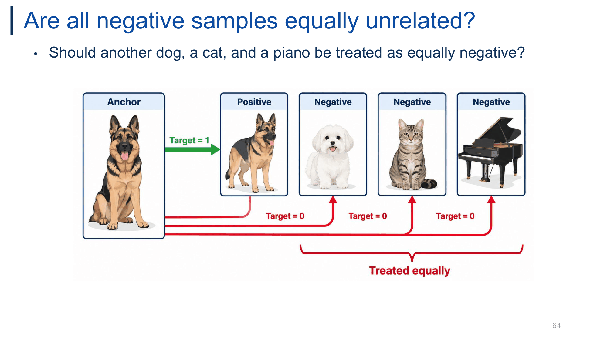

*p.64 — anchor(셰퍼드)에 대해 positive만 Target = 1, 말티즈·고양이·피아노는 모두 Target = 0 "Treated equally".*

- **Should another dog, a cat, and a piano be treated as equally negative?**
- 표준 InfoNCE/SimCLR target은 **binary**: positive = 1, 나머지 = 0 → 말티즈(같은 "개"), 고양이(중간), 피아노(매우 멂)가 **똑같이 밀려남**
- semantic structure 훼손 + 같은 class 샘플을 밀어내는 **false negative** 문제
- MCL과의 관계: MCL은 **"negative를 어떻게 고를지"** 를, X-CLR은 **"negative의 target 값 자체"** 를 바꿈 — 둘 다 negative를 균질하게 취급하지 말자는 관점

### 7.2 Contrastive learning as a similarity graph (p.65)

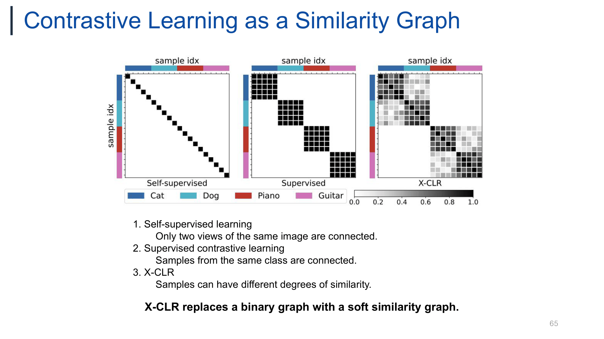

*p.65 — target graph 비교: Self-supervised(대각만) / Supervised(같은 class 블록, binary) / X-CLR(연속값 soft graph).*

- 행렬 $(i,j)$ = 샘플 i, j가 "얼마나 positive인가"의 target
  1. **Self-supervised**: 같은 이미지의 두 view만 연결 (단위행렬 꼴) → 같은 class 다른 이미지도 negative
  2. **Supervised contrastive (SupCon)**: 같은 class끼리 연결 (binary 블록) → class 내부는 전부 1, class 간 관계는 0
  3. **X-CLR**: 샘플마다 **다른 정도의 similarity** (Cat–Dog, Piano–Guitar 사이에도 회색 값) → "개와 고양이는 피아노보다 가깝다" 반영
- **X-CLR replaces a binary graph with a soft similarity graph.** (binary 0/1 → continuous $[0,1]$)

### 7.3 Graph의 source (p.66)

- similarity graph source: **text captions / class descriptions / semantic hierarchies / other metadata**
- 예 (ImageNet): class name을 문장으로 → "a photo of a German shepherd", "a photo of a Maltese dog" → **fixed(frozen) text encoder**로 임베딩 → 두 문장 임베딩의 similarity = 두 샘플의 **target similarity**
- **caption이 있는 데이터셋이면 그대로 사용**
- image encoder만 학습, text encoder는 supervision 제공자

> 보충: CLIP은 image-text 쌍 정렬이 목표(text encoder도 학습), X-CLR은 text를 **target graph 생성에만** 쓰고 목표는 image representation 품질.

### 7.4 X-CLR Objective (p.67)


*p.67 — X-CLR 의사코드와 loss: text 기반 target graph $s_i$와 image 기반 learned graph $p_i$의 cross-entropy.*

- **Target graph**: text/metadata similarity / **Learned graph**: image representation 간 similarity / **Objective**: learned graph를 target graph에 맞춤

$$\mathcal{L}_{\text{X-CLR}} = \frac{1}{2N_b}\sum_{i=1}^{2N_b} H(s_i, p_i)$$

$$p_{i,j} = \frac{\exp(\text{sim}(z_i,z_j)/\tau)}{\sum_{k=1}^{2N}\mathbf{1}_{k\neq i}\exp(\text{sim}(z_i,z_k)/\tau)} \qquad s_{i,j} = \frac{\exp(G^{(\text{soft})}_{i,j}/\tau_s)}{\sum_{k=1}^{2N_b}\exp(G^{(\text{soft})}_{i,k}/\tau_s)}, \quad G^{(\text{soft})}_{i,j}=\text{sim}\big(f_\text{text}(c_i), f_\text{text}(c_j)\big)$$

← $p_{i,j}$ 분모 상한 $2N$ vs 나머지 $2N_b$ — 표기 불일치 (원문 유지)

- 기호: $N_b$ = batch size (view 2개 → 샘플 $2N_b$), $z_i$ = 이미지 representation, $\text{sim}$ = cosine, $\tau$ = image 쪽 temperature, $c_i$ = caption/text, $f_\text{text}$ = frozen text encoder, $G^{(\text{soft})}$ = soft target graph, $\tau_s$ = target temperature, $H(s,p) = -\sum_j s_j \log p_j$
- $p_i$: 이미지 i가 batch 내 다른 샘플과 얼마나 비슷한지의 softmax 분포 (자기 제외) = **InfoNCE의 softmax와 동일**
- $s_i$: text similarity의 softmax = **soft label 분포**
- 핵심: **InfoNCE의 one-hot label을 soft label $s_i$로 교체**. $s_i$가 one-hot이면 SimCLR/InfoNCE로 환원
- 직관: "어느 샘플이 내 positive인가" 분류의 정답 분포를 hard → soft = **label smoothing / knowledge distillation과 유사**
- 코드: `txt_emb = txt_enc(captions).detach()` → target은 상수 (gradient 없음)
- ← 코드의 `softmax(txt_emb @ txt_emb.T / tao_s)`엔 대각(자기 자신) 항 포함, 수식 $p_{i,j}$엔 $k \ne i$ 마스크. `CE(tgt_sims, img_sims)`도 이미 softmax된 확률을 넣는 의사코드 수준 표기 (의심 표기)

### 7.5 두 temperature의 역할 (p.68)

- **$\tau$**: image representation similarity의 일반 contrastive temperature
- **$\tau_s$**: target graph를 **얼마나 soft하게** 만들지
  - **Low $\tau_s$**: 가장 강한 positive에 집중 → target ≈ one-hot → **standard contrastive learning과 유사**
  - **High $\tau_s$**: 관련 샘플에 더 큰 weight → target graph가 softer
  - 너무 크면 모든 샘플이 비슷해져 true positive 신호가 묻힘
- **The graph should preserve the true positive while including soft positives.** → $\tau_s$ = "SimCLR ↔ 완전 soft" 사이 knob

### 7.6 X-CLR이 학습하는 것 & 실험 (p.69–71)

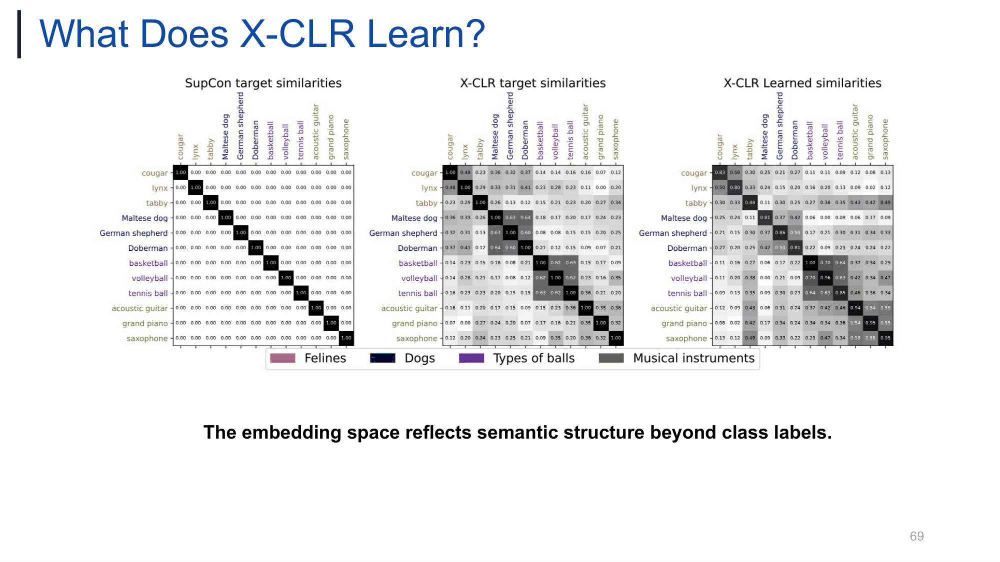

*p.69 — SupCon target(단위행렬) vs X-CLR target(Felines/Dogs/Balls/Instruments 그룹 구조) vs X-CLR learned similarity(구조를 거의 재현).*

- **SupCon target**: 단위행렬 → class 간 관계 정보 0
- **X-CLR target**: 같은 상위 그룹 내 값이 높음 (Maltese–German shepherd 0.63, basketball–tennis ball 0.63, cougar–lynx 0.48), 그룹 간 낮음 (cougar–grand piano 0.07)
- **X-CLR learned**: 대각 0.80~1.00, 그룹 내 블록 구조가 target과 유사 (volleyball–basketball 0.70, grand piano–acoustic guitar 0.54). 일부 그룹 간 값은 target보다 큼 (tabby–saxophone 0.49)
- **The embedding space reflects semantic structure beyond class labels.** → 상위 카테고리 label 없이도 의미 구조 반영
- learned ≠ target인 이유(추측): $\tau$와 $\tau_s$ scale 차이, 실제 시각적 유사성 반영

**Does the soft graph help?** (p.70, Table 1, linear probing)

| Method | Soft loss | Labels | ImageNet | IN Real | BG Same | BG Mixed | ObjectNet | MIT Obj | MIT Attr |
|---|---|---|---|---|---|---|---|---|---|
| SCE | ✓ | ✗ | 71.3 | 78.7 | 61.7 | 58.4 | 20.2 | 44.5 | 31.0 |
| ReSSL (1 crop) | ✓ | ✗ | 69.4 | 76.9 | 56.3 | 53.2 | 18.3 | 44.5 | 31.2 |
| VICReg | ✗ | ✗ | 72.4 | 79.0 | 60.8 | 56.8 | 20.5 | 43.5 | 26.9 |
| Barlow Twins | ✗ | ✗ | 72.8 | 80.0 | 62.7 | 59.4 | 21.6 | **45.9** | **31.7** |
| SimCLR | ✗ | ✗ | 63.4 | 67.8 | 44.7 | 38.9 | 12.1 | 40.9 | 29.1 |
| SupCon | ✗ | ✓ | 74.3 | 79.7 | 64.0 | 59.1 | 24.4 | 45.6 | 30.8 |
| **X-CLR** | ✓ | ✓ | **75.6** | **81.5** | **66.6** | **62.7** | **27.5** | **45.9** | 31.1 |

- **X-CLR improves classification and background robustness.**
- SimCLR 63.4 → SupCon 74.3 (label 효과) → X-CLR 75.6 (soft 효과). SupCon 대비 ObjectNet +3.1, BG Mixed +3.6 → **robustness 향상폭이 상대적으로 큼**
- 전 지표 1등은 아님 (MIT Attributes: Barlow Twins 31.7 > 31.1)
- label 없이 soft loss만 쓰는 SCE, ReSSL은 X-CLR보다 낮음 → **soft + 외부 semantic 정보**가 중요

> 보충: SCE = Similarity Contrastive Estimation (Denize et al.), ReSSL = Relational Self-Supervised Learning (Zheng et al.) — soft relation을 쓰는 SSL.

**Low-data settings** (p.71)
- CC3M/CC12M (web caption) 학습, caption similarity 사용

| Data | Method | ImageNet | IN Real | BG Same | BG Mixed | ObjectNet |
|---|---|---|---|---|---|---|
| CC3M | SimCLR | 57.0 | 64.0 | 24.4 | 18.9 | 10.8 |
| CC3M | CLIP | 41.0 | 47.6 | 12.5 | 10.6 | 7.8 |
| CC3M | **X-CLR** | **58.2** | **65.6** | **26.7** | **20.3** | **11.5** |
| CC12M | SimCLR | 58.9 | 66 | 24.6 | 19.8 | 12.7 |
| CC12M | CLIP | 58.8 | 66.1 | 20.5 | 17.1 | 11.9 |
| CC12M | **X-CLR** | **59.4** | **66.7** | **26.1** | **20.4** | **13.4** |

- 작은 데이터(CC3M)에서 CLIP 41.0 vs X-CLR 58.2로 격차 큼, CC12M에선 CLIP이 따라잡음
- samples-per-class 그래프: class당 샘플이 적을 때 SimCLR은 크게 뒤처짐 (160/class에서 ~21 vs ~43–45), X-CLR ≈ SupCon (SupCon보다 우위는 아님)
- **Soft relationships are especially useful when training data is limited.** → binary graph는 positive가 적지만 soft graph는 **모든 샘플 쌍이 학습 신호** → data-efficient

### 7.7 X-CLR의 한계 (p.72)

- similarity graph 구성에 **caption / label / metadata 필요** → 순수 self-supervised 아님
- **graph quality가 낮으면 representation quality도 낮음** (target이 표현 품질의 상한)
- **noisy text**(CC caption 등)는 정확한 semantic 관계를 못 줄 수 있음
- 전체 샘플 graph 저장은 $O(N^2)$ **memory** → 실제로는 **batch-level 계산 또는 pre-computation**
- **text encoder의 bias**가 target graph로 전파 → image encoder에 전이

---

## 8. 정리: Three Views of Better Contrastive Learning (p.73–74)

| Paper | Main question | Solution | 축 | 핵심 수식/장치 | 한계 |
|---|---|---|---|---|---|
| **GenView** (ECCV'24) | Are positive views good enough? | Generate and weight better positive views | **views** | $\mathbf{X}_i^+ = \mathcal{G}(\mathbf{z}_T, \text{noisy}(\mathbf{c}_i, l_i^{\text{ada}}), w)$, $q_i = s_i^f - s_i^b$, $w_i = \text{softmax}(q_i)$ | 외부 prior 의존, 연산·저장, heuristic noise, drift 잔존 |
| **MCL** (ECCV'24) | Are useful features suppressed? | Learn different features across stages | **features** | cluster 내 negative 선택, $\mathbf{Z} = [\mathbf{Z}_0, \dots, \mathbf{Z}_{N-1}]$ | 연산량, 차원 증가, K-means 신뢰성, 단순 concat |
| **X-CLR** (ICLR'25) | Are sample relations binary? | Learn from a soft similarity graph | **relationships** | $\mathcal{L} = \frac{1}{2N_b}\sum H(s_i, p_i)$, $s_i$ = text sim softmax | metadata 필요, graph 품질 의존, $O(N^2)$ 메모리, text bias |

- **Contrastive learning depends on the views, the features, and the relationships used for training.**
  1. 어떤 pair를 positive로 만드느냐 (views)
  2. 어떤 feature를 학습하느냐 (features)
  3. 샘플 간 관계를 어떻게 정의하느냐 (relationships)
- 공통 흐름: 표준 InfoNCE의 **암묵적 가정**(augmentation view는 좋은 positive / 구분만 되면 충분 / negative는 모두 동등)을 하나씩 깨는 연구들
- Next week (p.74): **Continue on Contrastive Learning** (Part II)

---

## 시험 대비 핵심 정리

### A. 꼭 외울 수식

| 이름 | 수식 |
|---|---|
| 목표 부등식 | $\text{score}(f(x), f(x^+)) \gg \text{score}(f(x), f(x^-))$ |
| Contrastive | $\mathbb{1}_{[y_i=y_j]}\Vert f(x_i)-f(x_j)\Vert _2^2 + \mathbb{1}_{[y_i\ne y_j]}\max(0, \varepsilon - \Vert f(x_i)-f(x_j)\Vert _2)^2$ |
| Triplet | $\sum\max(0, \Vert f(x)-f(x^+)\Vert _2^2 - \Vert f(x)-f(x^-)\Vert _2^2 + \varepsilon)$ |
| Lifted (relaxed) | $\mathcal{L}^{(ij)} = D_{ij} + \log\big(\sum_{(i,k)\in\mathcal{N}} e^{\epsilon - D_{ik}} + \sum_{(j,l)\in\mathcal{N}} e^{\epsilon - D_{jl}}\big)$, $\mathcal{L} = \frac{1}{2\vert \mathcal{P}\vert }\sum_{\mathcal{P}}\max(0,\mathcal{L}^{(ij)})^2$ |
| LSE ≈ max | $\max_i s_i \le \log\sum_i e^{s_i} \le \max_i s_i + \log N$, $\partial\text{LSE}/\partial s_j = \text{softmax}_j$ |
| N-pair | $\log(1+\sum_i e^{f^\top f_i^- - f^\top f^+}) = -\log\frac{e^{f^\top f^+}}{e^{f^\top f^+} + \sum_i e^{f^\top f_i^-}}$ |
| NCE | $\ell_\theta = \log p_\theta - \log q$, $\sigma(\ell) = \frac{p_\theta}{p_\theta+q}$, $\mathcal{L} = -\frac1N\sum[\log\sigma(\ell(x_i)) + \log(1-\sigma(\ell(\tilde x_i)))]$ |
| InfoNCE | $-\mathbb{E}\log\frac{f(x,c)}{\sum_{x'\in X} f(x',c)}$, $f(x,c) \propto \frac{p(x\vert c)}{p(x)}$ |
| MI | $I(x;c) = \sum p(x,c)\log\frac{p(x\vert c)}{p(x)}$, $I(x;c) \ge \log N - \mathcal{L}_{\text{InfoNCE}}$ (보충) |
| Soft-NN | $-\frac1B\sum_i\log\frac{\sum_{j\ne i, y_j=y_i} e^{-f(x_i,x_j)/\tau}}{\sum_{k\ne i} e^{-f(x_i,x_k)/\tau}}$ |
| NT-Xent | $-\log\frac{e^{s(z,z^+)/\tau}}{e^{s(z,z^+)/\tau} + \sum_i e^{s(z,z_i^-)/\tau}}$, $s$ = cosine |
| $p_{\text{pos}}$ 조건 | Symmetry $p_{\text{pos}}(x,x^+) = p_{\text{pos}}(x^+,x)$ / Matching marginal $\int p_{\text{pos}}(x,x^+)dx^+ = p_{\text{data}}(x)$ |
| GenView | $\mathbf{X}_i^+ = \mathcal{G}(\mathbf{z}_T, \text{noisy}(\mathbf{c}_i, l_i^{\text{ada}}), w)$, $q_i = s_i^f - s_i^b$, $w_i = \text{softmax}(q_i)$, $\tilde{\mathcal{L}} = w_i\mathcal{L}_{\text{SSL}}$ |
| MCL | $\mathbf{Z} = [\mathbf{Z}_0, \dots, \mathbf{Z}_{N-1}]$, Stage $k$ negative: $[\mathbf{y}_{(i,0)}, \dots, \mathbf{y}_{(i,k-1)}]$ cluster 일치 |
| X-CLR | $\frac{1}{2N_b}\sum_i H(s_i, p_i)$, $s_{i,j} = \text{softmax}_j(G^{(\text{soft})}_{i,j}/\tau_s)$, $G^{(\text{soft})}_{i,j} = \text{sim}(f_\text{text}(c_i), f_\text{text}(c_j))$ |

### B. 꼭 외울 정의

- **Metric learning**: reference $x$, positive $x^+$, negative $x^-$ — pull together / push apart
- **Siamese network**: same network + **shared weights** (같은 embedding 공간, 대칭성, 파라미터 절약)
- **Margin $\varepsilon$**: contrastive = 절대 거리 하한, triplet = 거리 차이 하한
- **Hard negative**: embedding 상 anchor와 가깝지만 다른 class인 샘플
- **Feature suppression**: 입력의 유용한 정보가 representation에서 사라지는 현상 (가장 쉬운 discriminative feature만 학습)
- **False positive / Limited diversity**: strong crop이 object 제거 / weak crop이 거의 같은 view
- **Soft similarity graph**: binary(0/1) 대신 연속값 target으로 샘플 간 관계 표현

### C. 비교 포인트

1. **Contrastive vs Triplet**: 절대 목표 vs 상대 순서 (triplet은 intra-class variance 허용)
2. **Triplet의 두 문제**: $O(N^3)$ explosion, easy triplet 지배 → hard / semi-hard mining
3. **Lifted vs N-pair**: pair-based $O(N^2)$ + 내장 max vs 1 pos ↔ N-1 neg softmax
4. **Max vs Sum vs LSE**: sparse / 균등(비집중) / dense & focused (= soft hard mining), temperature로 조절
5. **N-pair = InfoNCE = N-way softmax CE**: metric learning 관점과 확률/MI 관점이 같은 식에 도달, anchor = context
6. **NCE vs InfoNCE**: sigmoid 이진 분류(data vs noise) vs softmax N-way 분류
7. **Positive 구성**: label 있음(같은 class, multiple positives) vs 없음(augmentation, 1 positive + false negative 위험)
8. **MCL vs Hard negative mining**: 이전 stage cluster 기준·feature 재사용 방지 vs 현재 embedding 거리 기준·어려운 샘플 찾기
9. **SimCLR vs SupCon vs X-CLR graph**: 대각(두 view만) vs class 블록(binary) vs soft graph
10. **GenView / MCL / X-CLR**: views / features / relationships — 각 질문·해법·한계

### D. 예상 서술형 질문 + 모범답안 방향

1. **Q. Pretext task 기반 SSL의 한계와 contrastive learning이 이를 어떻게 일반화하는지 설명하라.**
   → handcrafted objective(설계 의존, shortcut, task 특화). pretext 변형들은 결국 "같은 물체의 다른 view" → **similarity 자체를 supervision**으로: positive attract / negative repel = Representation Learning = Learning Similarity. 라벨 없이 augmentation으로 positive 생성.

2. **Q. Contrastive loss의 수식을 쓰고, margin의 역할과 한계를 설명하라. Triplet loss는 이를 어떻게 개선하나?**
   → 수식 + $d \ge \varepsilon$이면 gradient 0 (발산 방지, but inactive negative 다수). pair만 보고 상대 순서를 강제 안 함. Triplet은 $d_{an} - d_{ap} \ge \varepsilon$ **상대 격차**만 요구 → ranking 학습, intra-class variance 허용. 대신 $O(N^3)$, easy triplet 문제 → hard negative mining.

3. **Q. Lifted structured loss에서 max를 log-sum-exp로 바꾸는 이유를 gradient 관점에서 설명하라.**
   → max는 non-smooth, hardest 하나에만 gradient (sparse, outlier 민감). sum은 균등 → hard 신호 희석. LSE의 미분 = softmax weight → 모든 negative가 gradient를 받되 어려울수록 지수적으로 큼 = **dense & focused**, max의 smooth approximation ($\max \le \text{LSE} \le \max + \log N$). temperature로 hardness 조절.

4. **Q. N-pair loss가 N-way softmax cross-entropy와 같음을 유도하고, triplet 대비 장점을 쓰라.**
   → $\log(1+\sum e^{a_i - b}) = -\log\frac{e^b}{e^b + \sum e^{a_i}}$. positive = 정답 class인 categorical CE. negative 1개 → N-1개 동시 비교로 정보량↑, exp 가중으로 hard negative 자동 강조 → mining 의존↓. 다른 샘플 embedding이 class prototype 역할.

5. **Q. InfoNCE를 Bayes rule로 유도하고, 최적 score 함수가 무엇에 비례하는지와 그 의미를 설명하라.**
   → positive ~ $p(x|c)$, negative ~ $p(x)$. likelihood = $p(x_{\text{pos}}|c)\prod_{i\ne\text{pos}}p(x_i)$, uniform prior 약분, $\prod p(x_i)$로 나누면 softmax 형태 → $f \propto p(x|c)/p(x)$ (density ratio). log ratio = PMI → MI $I(x;c) = \mathbb{E}\log\frac{p(x|c)}{p(x)}$와 연결, $I \ge \log N - \mathcal{L}$. 생성 모델 없이 분류로 ratio 추정. negative 많을수록 하한 tight.

6. **Q. NCE와 InfoNCE의 공통점과 차이점을 설명하라.**
   → 공통: negative를 noise로 보고 분류 문제로 분포/ratio 추정. 차이: NCE = 샘플별 sigmoid 이진 분류(BCE), logit = $\log p_\theta/q$, unnormalized model 추정 목적 / InfoNCE = N개 후보 softmax categorical CE, context 조건부 density ratio, MI 하한.

7. **Q. Modern contrastive learning의 공통 구성요소를 쓰고, L2 normalization과 temperature의 역할을 설명하라.**
   → anchor, positive(augmented view), negatives(batch), shared encoder, cosine similarity, InfoNCE/NT-Xent. L2-norm: 크기 영향 제거, 방향만 비교, 안정성. $\tau$: cosine 범위 [-1,1]의 logit을 sharpen, 작을수록 hard negative 강조 (LSE 논리).

8. **Q. Handcrafted augmentation의 두 한계와 GenView의 해결 방식을 설명하라. 왜 $q_i = s_i^f - s_i^b$ 인가?**
   → false positive(strong crop) / limited diversity(weak crop), trade-off. GenView: CLIP embedding 조건 + foreground 비율 기반 adaptive noise로 Stable unCLIP 생성 (작은 foreground → 적은 noise) + frozen encoder로 fg/bg 유사도 평가, softmax weight. 좋은 pair = similar foreground(semantic 보존) + different background(diversity, background shortcut 방지). 한계: 외부 prior, 비용, heuristic, drift 잔존.

9. **Q. Feature suppression의 정의·원인을 쓰고, MCL이 이를 어떻게 완화하는지, hard negative mining과 무엇이 다른지 설명하라.**
   → 정의 + SimCLR(shape 0.935)/CLIP(orientation 0.933) 예. 원인: 가장 쉬운 feature(color)로 objective가 이미 만족 → 다른 feature 학습 유인 없음 (shortcut/simplicity bias). MCL: Train → K-means → 같은 cluster 안에서 negative → Repeat → Concat; stage 0 color, 1 texture, 2 shape. HNM은 현재 embedding 거리로 어려운 샘플 찾기, MCL은 이전 stage feature 재사용 방지가 목적. 결과: Trifeature/CIFAR-MNIST avg 0.93, CLIP MMVP ViT 20.0 → 32.6. 한계 4가지.

10. **Q. X-CLR이 binary target을 soft similarity graph로 바꾸는 방식과 두 temperature의 역할을 설명하라.**
    → 표준 CL은 다른 개/고양이/피아노를 모두 target 0으로 동등 취급 (false negative, 의미 구조 훼손). X-CLR은 frozen text encoder로 caption/class description 임베딩 similarity → $\tau_s$ softmax = soft target $s_i$, image softmax $p_i$와 CE → InfoNCE의 one-hot을 soft label로 교체 ($s_i$ one-hot이면 SimCLR). $\tau_s$↓ → standard CL, $\tau_s$↑ → softer (true positive 유지 필요). 효과: ImageNet 75.6, robustness·low-data 이득. 한계: metadata 필요, graph 품질 의존, $O(N^2)$ 메모리, text bias.
