# 04. Contrastive Learning II

> **한 줄 요약**: contrastive learning이 잘 되려면 무엇이 필요한가(augmentation, large batch, hard/false negative) → augmentation을 어떻게 설계·자동화·혼합하는가 → 같은 이미지의 두 view로 학습하는 방법이 **negative 의존을 점점 줄이는 방향**(SimCLR → BYOL → Barlow Twins → DINO)으로 발전 → positive를 **생성**하는 SynCLR, 그리고 SSL을 **foundation model**로 키운 DINOv2/v3까지.

- 출처: 고급표현학습 (Donghyeon Cho, 한양대), PDF 72p. 페이지 번호는 PDF 기준.

---

## 이 강의의 큰 그림

```
[1] Key Ingredients (p.3–11)
    Heavy augmentation ─ Large batch ─ Hard negative mining
                                         └─ false negative(sampling bias) → Debiased Contrastive Loss
        │
[2] Augmentation (p.12–21)
    Basic aug(crop, color jitter, …) → 자동화: AutoAugment → RandAugment → PBA
    → unlabeled 활용: UDA → 혼합: Mixup / CutMix(pixel) / MoCHi(feature, hard negative 합성)
        │
[3] Parallel Augmentation (p.22–44)  "같은 이미지의 두 view"
    SimCLR      : negative 있음 (InfoNCE / NT-Xent, large batch)
    BYOL        : negative 없음 (online/target, predictor, EMA, stop-grad, MSE)
    Barlow Twins: negative 없음 (D×D cross-correlation → identity)
    DINO        : negative 없음 (student/teacher self-distillation, CE on softmax, centering+sharpening)
        │
[4] Generated positives (p.45–54)
    SynCLR: LLM caption → T2I diffusion 이미지 4장 = positive set → multi-positive contrastive
        │
[5] SSL → Visual Foundation Model (p.55–70)
    DINOv2 = DINO + iBOT + KoLeo + Curated Data(LVD-142M) + Scaling(+distillation)
    DINOv3 : 긴 학습 → dense feature 열화 → Gram anchoring
        │
[6] 열린 질문 (p.71)
```

**핵심 질문**
1. Contrastive learning의 성능을 좌우하는 요소는 무엇이고, 각각 왜 중요한가? (augmentation / batch / negative의 질)
2. Random negative sampling의 **false negative** 문제를 label 없이 어떻게 보정하는가? (Debiased loss)
3. 좋은 augmentation이란? 그리고 그걸 어떻게 **자동으로** 찾는가?
4. **negative 없이** collapse를 어떻게 피하는가? (BYOL / Barlow Twins / DINO 각자의 전략)
5. positive를 augmentation이 아니라 **생성**할 수 있는가? 그때 "positive"의 granularity는 무엇이 정하는가?
6. SSL을 범용 foundation model로 만들려면 loss 외에 무엇이 필요한가? (데이터, patch-level, 안정화, distillation)

---

## 1. Contrastive Learning의 핵심 요소 (p.3–11)

### 1.1 Heavy Data Augmentation (p.4)

- Needed for creating **noise versions** of given training data — **positive** sample로 쓰되 **semantic은 바꾸지 않음**
- Proper data augmentation setup is critical for learning good and **generalizable** embedding features

- Self-supervised contrastive learning에는 label이 없으므로 **positive pair를 만드는 유일한 수단이 augmentation**임. 한 이미지 $x$에 서로 다른 augmentation $t, t'$를 적용해 anchor $t(x)$, positive $t'(x)$를 만들고 둘을 가깝게 당김.
- "noise version" = 원본에 crop, color jitter, blur 등 변형을 가한 버전. 핵심 제약은 **semantic 보존** ← 의미가 바뀌면 positive pair 자체가 틀린 supervision이 됨.
- 반대로 너무 약하면 모델이 low-level shortcut(색 histogram, 위치 등)만으로 두 view를 맞춰버려 **trivial solution**에 빠짐. → "heavy하게 주되 semantic은 보존"의 균형이 핵심이고, 이 setup이 **generalizable embedding**을 결정함.

> 보충: SimCLR(Chen et al., 2020)는 augmentation 조합 중 **random crop + color distortion**이 특히 중요하다고 ablation으로 보고함.

### 1.2 Large Batch Size (p.5)

- Provides a large number of **in-batch negative** samples / Increases the **diversity** of negatives
- **Reduces false similarity** between different instances → more **discriminative** representations
- Essential for methods relying on InfoNCE (e.g., SimCLR, CLIP)

- InfoNCE류 loss는 batch 안의 다른 샘플을 전부 negative로 씀. batch size $N$이면 SimCLR 기준 anchor당 negative가 $2(N-1)$개 → **batch가 클수록 negative 수·다양성 증가**.
- negative가 다양하면 우연히 비슷한 대상과의 "가짜 유사성(false similarity)"에 기대지 않고 다양한 대조 대상에 대해 구분하게 되어 discriminative해짐.
- InfoNCE는 $N$-way classification 기반의 mutual information lower bound라서 $N$이 클수록 bound가 tight해짐.

> 보충: $I(x;c) \ge \log N - \mathcal{L}_{\text{InfoNCE}}$ (van den Oord et al., 2018, CPC). 분모의 negative 항 수가 batch size에 비례. SimCLR는 batch 4096~8192, CLIP은 32768 수준 → 큰 GPU/TPU 메모리 비용.

### 1.3 Hard Negative Mining (p.6)

- Hard **negatives** are **close to the anchor** in the embedding space → easy negative보다 **informative**한 supervision
- **Easy in supervised** (class label 있음) / **Challenging in self-supervised** (label 없음 → hard negative 식별 어려움)
- Larger batches (or memory banks) increase the chance of finding hard negatives
- **Trade-off**: better negatives vs. higher memory cost

- **Hard negative** = 의미는 다른데 embedding 공간에서 anchor와 가까운 샘플. 이미 멀리 있는 **easy negative**는 loss/gradient가 거의 0이라 기여가 작고, hard negative가 decision boundary를 정교하게 만듦.
- supervised면 "다른 class인데 가까운 것"을 바로 찾지만, SSL에서는 무엇이 진짜 negative인지조차 모름.
- 현실적 대안: **batch를 키우거나 memory bank/queue**로 negative pool을 키워 hard negative가 포함될 확률을 높임. 대가는 메모리/연산.

> 보충: MoCo(He et al., 2020)는 momentum encoder + queue로 큰 negative set을 저렴하게 유지. hard negative reweighting은 Robinson et al., 2021.

### 1.4 Sampling Bias = False Negative (p.7)

- Sampling bias can refers to false negative samples ← "can refers to" 문법 오류(can refer to), 원문 유지
  - → lead to a **big performance drop**

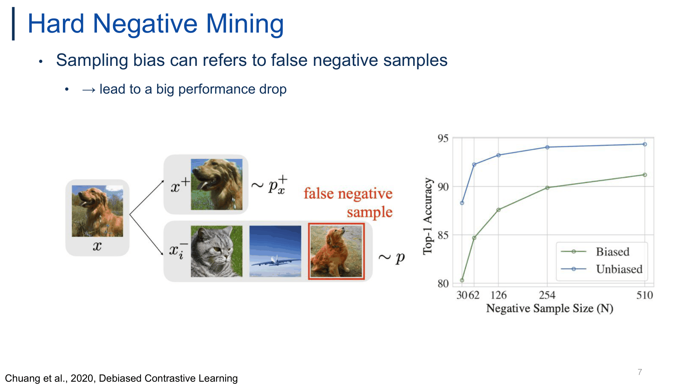

*p.7 — anchor(골든 리트리버)의 negative 중 같은 class(붉은 테두리)가 섞이는 false negative, 그리고 Biased vs Unbiased의 negative 수별 Top-1.*

- 그림(좌): anchor $x$, positive $x^+\sim p_x^+$, negative $x_i^-\sim p$ (고양이, 비행기, **같은 golden retriever = false negative**).
- 그림(우): x축 Negative Sample Size $N$ (30, 62, 126, 254, 510), y축 Top-1. **Unbiased**(파랑) 약 88 → 92 → 93 → 94 → 94.4로 빠르게 포화, **Biased**(초록) 약 80 → 85 → 87.5 → 90 → 91로 느리게 상승. 모든 $N$에서 Unbiased > Biased, $N$이 작을수록 gap 큼($N=30$에서 약 8p). (수치는 그림에서 읽은 근사값, 데이터셋 명시 없음)
- 해석
  - random negative에 **anchor와 같은 class 샘플**이 섞이면, 그걸 밀어내는 순간 같은 class 표현이 오히려 분리됨 → representation 망가짐.
  - negative의 **수**뿐 아니라 **질**(false negative 제거)이 중요.
  - Biased는 $N$↑일수록 좋아지지만(큰 batch 효과) Unbiased는 작은 $N$에서도 이미 높음 → debiasing은 **작은 batch에서 특히 이득**.

### 1.5 Debiased Contrastive Loss (p.8–11)

**문제·아이디어 (p.8)**
- Problem: random negative sampling may include **false negatives**.
- Idea: Estimate the **true negative distribution**. ← label 없이 직접 뽑을 순 없지만, 전체 분포가 "같은 class 분포 + 다른 class 분포의 혼합"임을 이용해 **수학적으로 추정**.

**true negative 분포 유도 (p.9)**

기호
- $h_x$: $x$의 latent class (관측 불가, 개념상 존재)
- $\rho(c)=\eta^+$: anchor class 확률 (class uniform 가정 → $\eta^+ = 1/K$, $K$ = class 수). **hyperparameter**임, 학습값 아님
- $\eta^- = 1-\eta^+$: 다른 class일 확률
- $p_x^+(x') = p(x' \mid h_{x'} = h_x)$: true positive 분포
- $p_x^-(x') = p(x' \mid h_{x'} \ne h_x)$: **true negative 분포** (원하는 것)
- $p(x')$: 실제 random sampling 분포

law of total probability로 분해:

$$p(x') = p(x', h_{x'}=h_x) + p(x', h_{x'}\ne h_x) = \eta^+ p_x^+(x') + \eta^- p_x^-(x')$$

$$\boxed{\,p_x^-(x') = \frac{p(x') - \eta^+ p_x^+(x')}{\eta^-}\,}$$

- 슬라이드 박스: **True Negative = (Random Sampling − Positive Contribution) / $\eta^-$**
- 직관: random 분포에서 positive 성분을 빼고 $\eta^-$로 정규화하면 true negative 분포. $p^-$는 직접 샘플링 못 하지만 **기댓값 안에서는** $p$(random)와 $p^+$(augmentation으로 만든 positive)만으로 계산 가능.
- 표준 InfoNCE는 $p$에서 뽑은 걸 전부 negative 취급 = 사실상 $\eta^+\approx 0$ 가정과 동일.

> 보충: Chuang, Robinson, Lin, Torralba, Jegelka, "Debiased Contrastive Learning", NeurIPS 2020. 논문은 class prior를 $\tau^+$로 쓰지만 슬라이드는 $\eta^+$ (temperature $\tau$와 혼동 방지로 보임).

**최종 loss (p.10)**

negative 항 추정치:

$$g\big(x, \{u_i\}_{i=1}^N, \{v_i\}_{i=1}^M\big) = \max\left\{ \frac{1}{\eta^-}\left( \frac{1}{N}\sum_{i=1}^{N} e^{f(x)^\top f(u_i)} - \frac{\eta^+}{M}\sum_{i=1}^{M} e^{f(x)^\top f(v_i)} \right),\; e^{-1/\tau} \right\}$$

$$\mathcal{L}_{\text{debias}}^{N,M}(f) = \mathbb{E}_{x,\{u_i\}\sim p;\ x^+,\{v_i\}\sim p^+}\left[ -\log \frac{e^{f(x)^\top f(x^+)}}{e^{f(x)^\top f(x^+)} + N\, g(x, \{u_i\}, \{v_i\})} \right]$$

- 표준 InfoNCE 분모의 negative 합 $\sum_{i=1}^N e^{f(x)^\top f(u_i)}$를 **true negative 기댓값 추정치 $N g$**로 교체한 것 (슬라이드 빨간 화살표).
- $g$의 구성
  - $u_i\sim p$ ($N$개): random sample → "Random Sampling" 항, $\mathbb{E}_{p}[e^{\cdot}]$의 Monte Carlo 추정
  - $v_i\sim p^+$ ($M$개): anchor의 positive(augmented view) → "Positive Contribution" 항, $\eta^+\mathbb{E}_{p^+}[e^{\cdot}]$ 추정
  - 빼고 $1/\eta^-$ = p.9 공식을 $e^{f(x)^\top f(\cdot)}$의 기댓값에 적용 → $\mathbb{E}_{x'\sim p^-}[e^{f(x)^\top f(x')}]$ 추정
- **$\max\{\cdot, e^{-1/\tau}\}$ 이유**: 유한 샘플에서는 뺄셈 결과가 **음수**가 될 수 있어 $\log$ 정의 불가/불안정 → 이론적 하한으로 clamp. ($\|f(x)\| = 1/\sqrt\tau$로 정규화하면 $f(x)^\top f(x')\ge -1/\tau$이므로 $e^{\cdot}\ge e^{-1/\tau}$)
- **$M$의 역할**: positive 샘플 수. $M=1$이면 $x^+$ 하나로 추정(분산 큼), 키우면 정확해짐.
- 구현 이점: 기존 SimCLR 코드에서 **loss 몇 줄만** 수정, 추가 label/모델 불필요.

> 보충: 논문은 $N\to\infty$에서 ideal unbiased loss로 수렴함을 보이고, 유한 $N$의 estimation error bound도 제시함.

**t-SNE 결과 (p.11)**

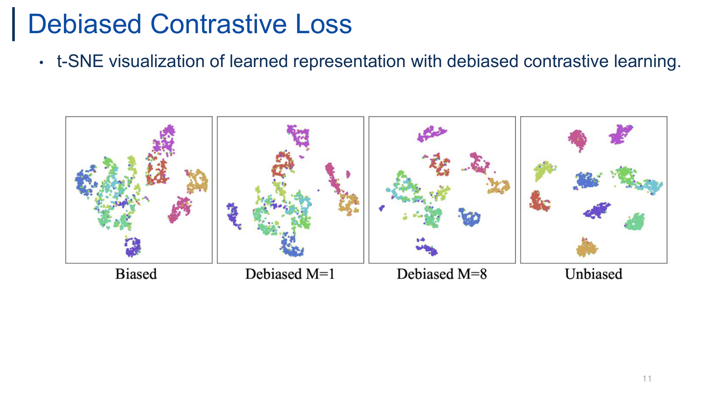

*p.11 — Biased → Debiased(M=1) → Debiased(M=8) → Unbiased 순으로 class cluster가 선명해짐.*

- **Biased**(기존 loss): 가운데 여러 색이 뒤엉킨 큰 덩어리. **Debiased M=1**: 일부(보라, 자홍, 빨강) 분리, 중앙은 혼재. **Debiased M=8**: 더 뚜렷하게 분리. **Unbiased**: true label로 false negative 제거한 이상적 경우, 대부분 compact cluster (연두/청록은 맞닿아 있음).
- 메시지: debiasing이 label 없이도 Unbiased에 근접. $M$↑ → positive 기댓값 추정 정확 → 군집 품질↑. Unbiased는 실제 SSL에서 못 쓰는 **upper bound reference**.

> 보충: 데이터셋은 슬라이드 명시 없음(CIFAR-10/STL10으로 알려짐). t-SNE는 정성적 증거, 정량은 linear probing 표.

---

## 2. Augmentation (p.12–21)

### 2.1 좋은 augmentation의 조건 (p.13)

- Create different **views** of the same image / Significantly change **visual appearance** / Preserve the **semantic meaning** / Form **positive pairs**
- 그림: View 1 ↔ View 2 (같은 개, 색감·흐림 다름), "(Same semantic meaning)"

- 두 조건이 **동시에** 필요:
  1. **appearance는 크게 변화** ← 안 그러면 pixel/low-level만으로 맞춰서 trivial solution
  2. **semantic은 보존** ← 안 그러면 잘못된 invariance 학습
- 즉 **augmentation이 모델이 배울 invariance를 정의**함 → 어떤 augmentation을 쓰는지가 표현 품질을 크게 좌우.

### 2.2 Basic Image Augmentations (p.14)

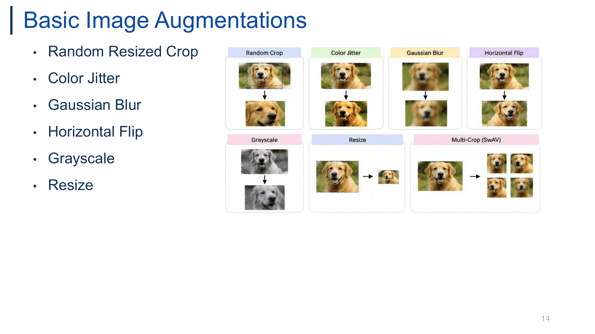

*p.14 — 기본 augmentation 7종 예시 (Random Crop, Color Jitter, Gaussian Blur, Horizontal Flip, Grayscale, Resize, Multi-Crop(SwAV)).*

| 연산 | 내용 | 막는 shortcut / 학습하는 invariance |
|---|---|---|
| **Random Resized Crop** | 무작위 영역·비율 crop 후 고정 크기 resize | global-to-local, 부분 간 일관성 |
| **Color Jitter** | brightness/contrast/saturation/hue 랜덤 | 색 histogram으로 같은 이미지 맞추는 shortcut 차단 |
| **Gaussian Blur** | 고주파 디테일 제거 | texture 의존 감소 |
| **Horizontal Flip** | 좌우 반전 | 좌우 대칭 불변성 |
| **Grayscale** | 색 정보 제거(확률적 적용) | 색 의존 감소 |
| **Resize** | 해상도 변경 | scale 불변성 |
| **Multi-Crop (SwAV)** | 큰 global view 몇 개 + 작은 local view 여러 개 | 적은 계산으로 더 많은 positive, local-to-global |

> 보충: Multi-Crop은 Caron et al., SwAV, NeurIPS 2020. SimCLR에서는 crop + color distortion 중 하나만 쓰면 성능이 크게 낮음.

### 2.3 Augmentation 자동화: AutoAugment → RandAugment → PBA (p.15–17)

**AutoAugment (p.15)** — Cubuk et al., CVPR 2019
- Automatically searches for the **best augmentation policy**, augmentation search를 **reinforcement learning** 문제로, validation accuracy 최대화. **Key Idea: Learn which augmentations to apply.**
- Operations: ShearX/Y, TranslateX/Y, Rotate, AutoContrast, Invert, Equalize, Solarize, Posterize, Contrast, Color, Brightness, Sharpness, Cutout, Sample Pairing.

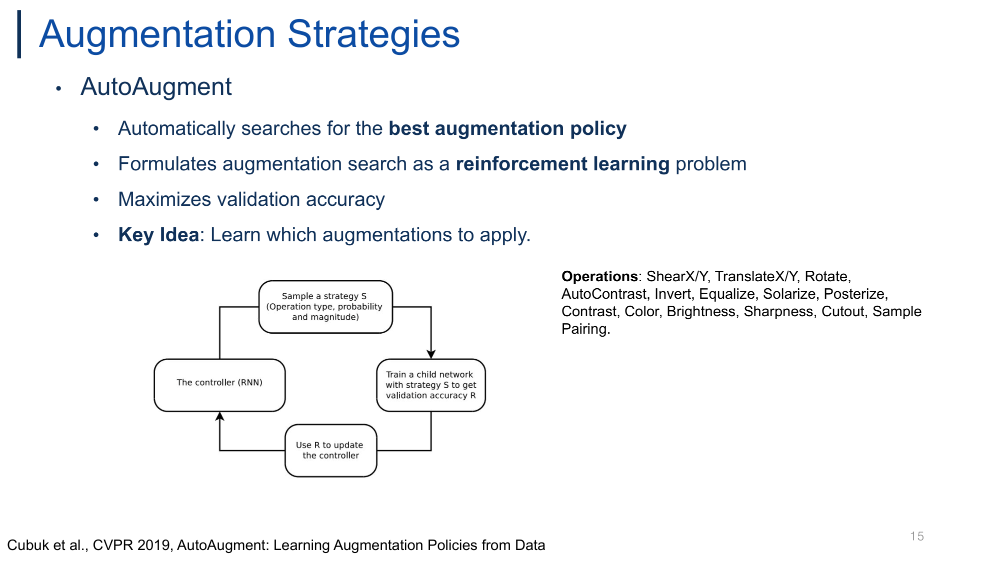

*p.15 — AutoAugment 루프: controller(RNN)가 strategy S 샘플 → child network 학습 → validation acc R을 reward로 controller 업데이트.*

- 루프: **controller(RNN)**가 policy S(operation 종류, 확률, magnitude) 샘플 → S로 **child network** 학습, validation accuracy $R$ 측정 → $R$을 **reward**로 controller를 RL 업데이트 → 반복.
- 장점: hand-crafting을 데이터셋 맞춤으로 자동화. 단점: child를 매번 학습 → **search 비용 막대**(→ RandAugment, PBA 동기).
- 주의: 원래 목적은 **supervised 분류 정확도**. contrastive positive 생성에 최적인지는 별개.

> 보충: controller는 PPO로 학습, policy = sub-policy(연산 2개 × (확률, magnitude)) 여러 개. 수천 GPU 시간.

**RandAugment (p.16)** — Cubuk et al., 2019 ← 슬라이드는 2019 표기 (arXiv 2019, 정식은 CVPR Workshops 2020)
- Eliminates the expensive search, **randomly** selected augmentations, 단일 magnitude로 전체 제어. **Key Idea: Simpler and more efficient than AutoAugment.**
- 비교: AutoAugment는 operation/probability/magnitude 전부 탐색 → **huge search space**. RandAugment는 2개 hyperparameter만 → **very small search space**:
  - $N$: 이미지당 적용할 operation 수 (균등 무작위 선택)
  - $M$: 모든 operation 공통 global magnitude
- proxy task/child 학습 없이 작은 grid search로 충분. 성능은 AutoAugment와 비슷하거나 더 좋음.
- 해석(슬라이드 명시 없음): 세부 policy 값보다 **다양한 연산 + 적절한 전역 강도**가 중요하다는 관점.

**PBA: Population Based Augmentation (p.17)** — Ho et al., ICML 2019
- Evolves augmentation policies during training, **population-based training (PBT)**, **continuously updates**. **Key Idea: Learn augmentations online via evolutionary optimization.** AutoAugment와 달리 fixed policy가 아니라 **schedule**을 학습.
- 그림 비교: (a) AutoAugment = RNN controller를 **PPO로 15,000 child model**에 걸쳐 학습 → **fixed policy**. (b) PBA = $p_{init}$ = (op, mag=0, prob=0)×30에서 시작 → **16 child model PBT 1회 실행** → policy **schedule** $f_{p_0\ldots p_T}(x,t)$.
- PBT: 여러 child를 병렬 학습하며 성능 나쁜 모델이 좋은 모델의 가중치·정책을 복사(exploit) + 정책 약간 변형(explore) → 정책이 학습 중 계속 바뀜 → 시간 $t$의 schedule.
- 초기값이 "augmentation 없음"에서 점점 강해지는 형태 ← 초기엔 약하게, 후기엔 강하게가 유리하다는 직관과 일치.
- 핵심 차이: AutoAugment = **offline search → fixed policy**, PBA = **online evolutionary → schedule**.

> 보충: PBT는 Jaderberg et al., 2017 (DeepMind). PBA는 AutoAugment와 비슷한 성능을 약 1000배 적은 연산으로 달성(논문 주장).

### 2.4 UDA: Unsupervised Data Augmentation (p.18) — Xie et al., NeurIPS 2020

- Applies augmentations to **unlabeled** data, 원본·augmented 예측 간 **consistency**, **KL** divergence 최소화. **Key Idea: consistency regularization으로 unlabeled data 학습.**
- 구조: labeled → supervised CE / unlabeled $x$ → $p_{\tilde\theta}(y|x)$ (고정 사본, stop-grad) vs augmented $\hat x$(Back translation, RandAugment, TF-IDF word replacement) → $p_\theta(y|\hat x)$ → consistency loss. 둘 합쳐 Final Loss.

> 보충(슬라이드에 수식 없음):
> $$\mathcal{L} = \mathbb{E}_{x\in L}[-\log p_\theta(y^*|x)] + \lambda\,\mathbb{E}_{x\in U}\mathbb{E}_{\hat x\sim q(\hat x|x)}\Big[D_{KL}\big(p_{\tilde\theta}(y|x)\,\|\,p_\theta(y|\hat x)\big)\Big]$$

- 왜 효과적: "입력이 조금 변해도 출력은 같아야 한다" = **smoothness / cluster assumption** 강제. 단순 noise 대신 **강한 augmentation**(RandAugment, back-translation)을 쓰는 게 포인트.
- 위치: AutoAugment/PBA = "좋은 augmentation 찾기", UDA = "augmentation으로 unlabeled 활용하기".
- 슬라이드 본문은 "images"인데 그림엔 텍스트용 augmentation도 있음 ← 이미지/텍스트 혼용, 원문 유지.

### 2.5 Image Mixture: Mixup / CutMix / MoCHi (p.19–21)

**Mixup (p.19)** — Zhang et al., ICLR 2018. **global-level** (pixel-wise 가중합)

$$\tilde x = \lambda x_i + (1-\lambda)x_j,\qquad \tilde y = \lambda y_i + (1-\lambda) y_j$$

- $x_i,x_j$: 두 입력, $y_i,y_j$: one-hot label, $\lambda\in[0,1]$ 혼합 비율 (보통 $\lambda\sim\text{Beta}(\alpha,\alpha)$, 보충). **이미지와 label을 같은 비율로** 보간.
- 직관: 샘플 사이 **선형 동작** 유도 regularizer, ERM의 memorization 감소·decision boundary 평활 (Vicinal Risk Minimization 관점, 보충).

| Dataset | Model | ERM | mixup |
|---|---|---|---|
| CIFAR-10 | PreAct ResNet-18 | 5.6 | **4.2** |
| CIFAR-10 | WideResNet-28-10 | 3.8 | **2.7** |
| CIFAR-10 | DenseNet-BC-190 | 3.7 | **2.7** |
| CIFAR-100 | PreAct ResNet-18 | 25.6 | **21.1** |
| CIFAR-100 | WideResNet-28-10 | 19.4 | **17.5** |
| CIFAR-100 | DenseNet-BC-190 | 19.0 | **16.8** |

- test error (낮을수록 좋음). 모든 조합에서 감소, CIFAR-100에서 개선폭 큼. test error 곡선(DenseNet-190)도 epoch 100 LR decay 이후 mixup이 계속 낮음(약 2.7 vs 3.8).

**CutMix (p.20)** — Yun et al., ICCV 2019. **region-level**

$$I_{\text{cutmix}} \leftarrow \mathbf{M}_b \odot I_1 + (1-\mathbf{M}_b)\odot I_2,\qquad \mathbf{M}_b\in\{0,1\}^{I}$$

- $\mathbf{M}_b$: 이미지 크기의 binary mask (1 = $I_1$ 픽셀, 0 = $I_2$), $\odot$: element-wise 곱. label은 **면적 비율**로 섞음 (그림: Dog 0.6, Cat 0.4).

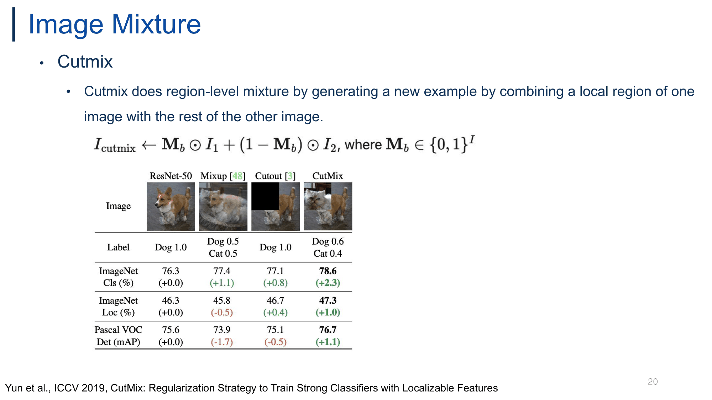

*p.20 — ResNet-50 / Mixup / Cutout / CutMix 예시 이미지·label과 ImageNet Cls/Loc, VOC Det 성능 비교.*

| | ResNet-50 | Mixup | Cutout | CutMix |
|---|---|---|---|---|
| ImageNet Cls (%) | 76.3 | 77.4 (+1.1) | 77.1 (+0.8) | **78.6 (+2.3)** |
| ImageNet Loc (%) | 46.3 | 45.8 (−0.5) | 46.7 (+0.4) | **47.3 (+1.0)** |
| Pascal VOC Det (mAP) | 75.6 | 73.9 (−1.7) | 75.1 (−0.5) | **76.7 (+1.1)** |

- 왜 설계했나: **Mixup**은 반투명하게 섞여 **부자연스러운 이미지** → localization에 손해(Loc −0.5, Det −1.7). **Cutout**은 영역을 지워 **정보 낭비**. **CutMix**는 지운 자리를 **다른 이미지의 실제 패치로 채워** 정보 손실 없이 정규화 + localizable feature 학습 → 세 지표 모두 개선되는 유일한 방법.

> 보충: 패치 비율 $\lambda\sim\text{Beta}(\alpha,\alpha)$, 박스 면적이 $(1-\lambda)$가 되도록 샘플링.

**MoCHi: Mixing of Contrastive Hard Negatives (p.21)** — Kalantidis et al., NeurIPS 2020
- query와 similarity 기준으로 **hardest negative** 식별 → hard negative embedding 보간으로 **synthetic hard negative** 생성 → **query와 hard negative**를 섞어 더 어려운 negative 생성. **Key Idea: feature space에서 embedding을 섞어 harder negative 생성.**
- 그림: 회색 x(memory negatives) 사이, 빨간 query 주변에 파란 역삼각형(synthetic negatives)이 촘촘히 생성.
- 배경: MoCo 등에서 negative가 많아도 대부분 **easy**라 gradient 기여가 작음 → 성능은 hard negative가 좌우.

> 보충 수식(슬라이드에 없음): hard negative끼리 $h' = \alpha n_i + (1-\alpha)n_j$, $\tilde h = h'/\|h'\|$ ($\alpha\in(0,1)$); query와 mix $s' = \beta q + (1-\beta)n_j$, $\tilde s = s'/\|s'\|$ ($\beta<0.5$로 제한 → query보다 negative 쪽에 가깝게).

- **embedding space**에서 섞으므로 추가 encoder forward 비용 거의 없음 ← Mixup/CutMix(pixel space)와 대비. "Image Mixture" 섹션이지만 실제론 feature 혼합.

### 2.6 Augmentation 계열 비교

| 방법 | 핵심 아이디어 | 수준 | 장점 | 한계 |
|---|---|---|---|---|
| Basic aug | crop/color/blur 등 hand-crafted | pixel | 단순, contrastive 기본 | 설계에 사람 개입, invariance 고정 |
| AutoAugment | RNN controller + RL(PPO)로 policy 탐색 | policy search | 데이터 맞춤 | 15,000 child, 비용 막대, fixed policy |
| RandAugment | 무작위 선택, $N$, $M$만 튜닝 | policy search | 탐색 공간 극소, 성능 유사 | 세밀한 policy 없음 |
| PBA | PBT로 online schedule 학습 | policy schedule | 16 child 1회, 시간 따라 변화 | PBT 인프라 필요 |
| UDA | unlabeled에 강한 aug + KL consistency | 학습 방식 | label 효율 | semi-supervised (label 일부 필요) |
| Mixup | 이미지·label 선형 보간 | pixel (global) | 강한 regularizer | 부자연스러운 이미지, Loc/Det 손해 |
| CutMix | 패치 교체 + 면적 비율 label | pixel (region) | Cls/Loc/Det 모두 개선 | 패치가 객체를 가리면 label noise |
| MoCHi | hard negative를 feature space에서 합성 | feature | 거의 공짜로 hard negative | 합성 negative가 false negative일 위험 |

---

## 3. Parallel Augmentation: SimCLR, BYOL, Barlow Twins, DINO (p.22–44)

> "Parallel augmentation" = 한 샘플에 두 augmentation을 **병렬로** 적용해 두 view를 얻고 이 둘을 맞추는 계열 (섹션 이름에 대한 해석).

### 3.1 SimCLR (p.23–29) — Chen et al., ICML 2020

**개념 (p.23)**: maximizing agreement between differently augmented views of the same sample, contrastive loss in the latent space.

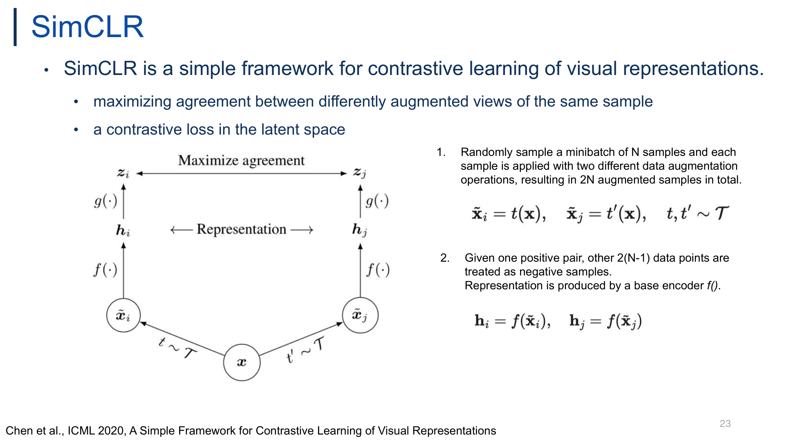

*p.23 — SimCLR 프레임워크: $x \to (t, t') \to f \to h \to g \to z$, $z_i \leftrightarrow z_j$ maximize agreement.*

1. minibatch $N$개, 각 샘플에 두 augmentation → **2N개** augmented sample
   $$\tilde x_i = t(x),\quad \tilde x_j = t'(x),\quad t, t'\sim\mathcal{T}$$
2. positive pair 하나 기준 나머지 **$2(N-1)$개는 negative**. base encoder $f$로 representation
   $$h_i = f(\tilde x_i),\quad h_j = f(\tilde x_j)$$
3. projection head $g$ 위에서 cosine similarity로 loss (p.24)
   $$z_i = g(h_i),\quad \mathcal{L}^{(i,j)}_{\text{SimCLR}} = -\log\frac{\exp(\text{sim}(z_i,z_j)/\tau)}{\sum_{k=1}^{2N}\mathbb{1}_{[k\ne i]}\exp(\text{sim}(z_i,z_k)/\tau)}$$
   - SimCLR needs a **large batch size** to incorporate enough negatives.

기호
- $\mathcal{T}$: augmentation family (crop+resize, color distortion, Gaussian blur 등), $t,t'$: 독립 샘플
- $f$: base encoder (ResNet, $h$ = avgpool 출력, **downstream에 쓰는 값**)
- $g$: projection head (MLP, hidden 1층 + ReLU)
- $\text{sim}(u,v) = u^\top v / (\|u\|\|v\|)$: cosine similarity, 범위 $[-1,1]$
- $\tau$: **temperature** — 작을수록 분포 sharp → hard negative에 큰 가중
- $\mathbb{1}_{[k\ne i]}$: 자기 자신(유사도 항상 1)을 분모에서 제외

**Algorithm 1 (p.25)**

```
input: batch size N, constant τ, structure of f, g, T
for sampled minibatch {x_k}_{k=1..N}:
    for all k:
        draw t ~ T, t' ~ T                          # positive pair 생성 (빨간 박스)
        x̃_{2k-1} = t(x_k);  h_{2k-1} = f(x̃_{2k-1});  z_{2k-1} = g(h_{2k-1})
        x̃_{2k}   = t'(x_k); h_{2k}   = f(x̃_{2k});    z_{2k}   = g(h_{2k})
    for all i, j in 1..2N:  s_{i,j} = z_iᵀz_j / (‖z_i‖‖z_j‖)
    ℓ(i,j) = -log exp(s_{i,j}/τ) / Σ_k 1[k≠i] exp(s_{i,k}/τ)    # InfoNCE (파란 박스)
    L = 1/(2N) Σ_k [ℓ(2k-1,2k) + ℓ(2k,2k-1)]                     # 2N개 모두 reference (분홍 박스)
    update f, g to minimize L
return f, throw away g
```

- 해석: 분자 = positive 유사도, 분모 = anchor 제외 **$2N-1$개**(positive 1 + negative $2N-2$). → **(2N−1)-way softmax CE로 positive 맞추기** = InfoNCE / **NT-Xent**(Normalized Temperature-scaled Cross Entropy).
- 슬라이드 주석: "Use all non-positive samples in the batch as $x^-$" → memory bank 없이 **in-batch negatives**만 사용 (MoCo와 차이).
- **대칭 손실**: $\ell(2k-1,2k)+\ell(2k,2k-1)$ → 두 view가 번갈아 anchor, $\frac{1}{2N}$ 평균.
- **augmentation이 곧 supervision 신호**: "같은 이미지에서 파생" 사실만으로 positive를 정의.
- 학습 후 **$g$ 버리고 $f$만** 사용 (이유는 p.28).
- "2(N−1)" = 2N − anchor − positive, 오타 아님.

**Linear evaluation (p.26)**: ImageNet 전체로 SimCLR 사전학습 → encoder **freeze** → linear classifier만 label로 학습.

- 결과(그림 근사값, 논문 값과 일치): ResNet-50(~24M)에서 **SimCLR 69.3** vs CPCv2 63.8, PIRL 63.6, MoCo 60.6, InstDisc 54.0 등. **SimCLR(2x) 74.2, SimCLR(4x) 76.5 ≈ Supervised(~76.5)**.
- (2x)/(4x) = ResNet 채널 폭 배수. 모델이 커질수록 self-supervised 이득이 더 큼(논문 관찰).

**Semi-supervised fine-tuning (p.27)**: 라벨 1% / 10%로 encoder **fine-tune** (ImageNet Top-5). ← 슬라이드 제목은 "Training Linear Classifier"인데 내용은 fine-tuning, 제목 불일치(원문 유지)

| Method | Arch | 1% | 10% |
|---|---|---|---|
| Supervised baseline | ResNet-50 | 48.4 | 80.4 |
| Pseudo-label | ResNet-50 | 51.6 | 82.4 |
| VAT+Entropy Min. | ResNet-50 | 47.0 | 83.4 |
| UDA (w. RandAug) | ResNet-50 | – | 88.5 |
| FixMatch (w. RandAug) | ResNet-50 | – | 89.1 |
| S4L (Rot+VAT+En.M.) | ResNet-50 (4×) | – | 91.2 |
| InstDisc | ResNet-50 | 39.2 | 77.4 |
| BigBiGAN | RevNet-50 (4×) | 55.2 | 78.8 |
| PIRL | ResNet-50 | 57.2 | 83.8 |
| CPC v2 | ResNet-161 | 77.9 | 91.2 |
| **SimCLR** | ResNet-50 | 75.5 | 87.8 |
| **SimCLR** | ResNet-50 (2×) | 83.0 | 91.2 |
| **SimCLR** | ResNet-50 (4×) | **85.8** | **92.6** |

- 1% 라벨에서 supervised 48.4 대비 SimCLR 1× +27.1, 4× +37.4. label-propagation 기법보다도 2×/4×가 우수(단 1× 10% 87.8은 UDA 88.5, FixMatch 89.1보다 낮음). CPC v2는 ResNet-161이라 공정 비교 아님.
- linear eval(freeze) vs semi-supervised(fine-tune) 구분 중요.

**Design choice 1 — Projection head (p.28)**

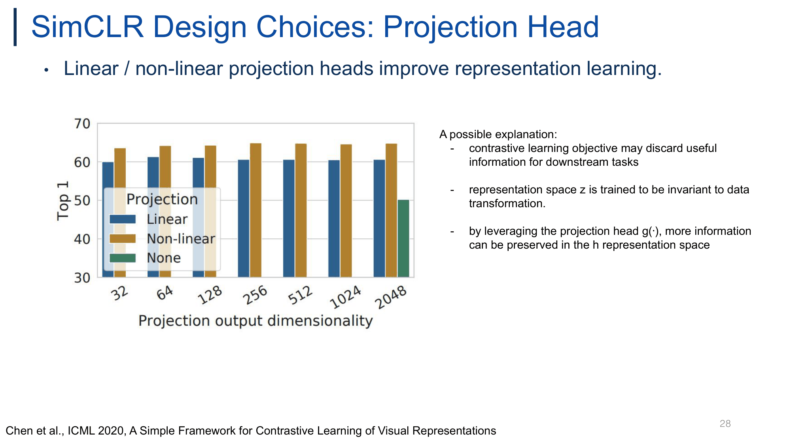

*p.28 — projection 출력 차원별 Top-1: Non-linear(~64) > Linear(~60) > None(~50), 차원에는 둔감.*

- Non-linear > Linear > None. 출력 차원(32~2048)에 거의 무관 → head의 **존재·비선형성**이 중요.
- 슬라이드 가설 ("A possible explanation"):
  - contrastive objective는 downstream에 유용한 정보를 버릴 수 있음
  - $z$는 data transformation에 **invariant**하도록 학습됨 → color, 방향 같은 정보가 $z$에서 사라짐
  - $g$가 이 invariance 부담을 흡수 → **$h$에 더 많은 정보 보존**
- 그래서 학습 후 **$g$ 버리고 $h$ 사용**.

> 보충: 논문 Table 3 — $h$와 $z$로 적용된 변환(회전, 색 변환 등)을 예측하면 $h$가 훨씬 잘 맞힘 → $h$가 변환 정보를 더 보존.

**Design choice 2 — Large batch size (p.29)**: Large training batch size is crucial! 큰 batch → backprop 메모리 큼 → **TPU 분산 학습** 필요.

- Figure 9: batch 256~8192 × epoch 100~1000. **대체로 batch↑ → Top-1↑**(큰 batch끼리는 역전도, 예 400 epoch에서 4096 > 8192). **짧은 학습(100 epoch)에서 격차 큼**: 256 ≈ 57.5 vs 8192 ≈ 64.8. epoch↑면 격차 감소(1000 epoch ~67 vs ~69).
- 이유: in-batch negative 수($2N-2$)↑ → 더 다양/어려운 negative, softmax 분모 근사 개선.
- 단점: 메모리 → 일반 GPU 재현 어려움 → **MoCo(queue), BYOL(negative 불필요)** 등장 동기.

> 보충: 큰 batch 안정화를 위해 LARS optimizer 사용.

### 3.2 BYOL: Bootstrap Your Own Latent (p.30–34) — Grill et al., NeurIPS 2020

**개념 (p.30)**: **negative 없이** SOTA. 두 네트워크가 상호작용하며 학습 — **Online** ($\theta$), **Target** ($\xi$).

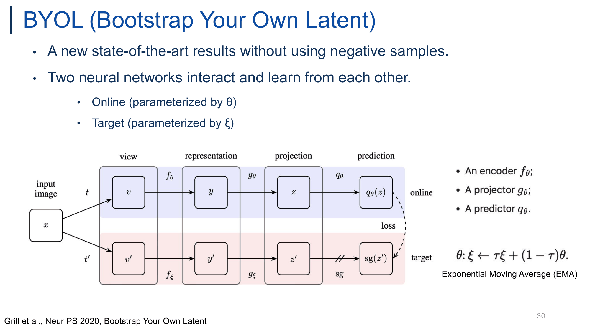

*p.30 — BYOL 구조: online(encoder $f_\theta$, projector $g_\theta$, predictor $q_\theta$) vs target($f_\xi, g_\xi$, stop-gradient), target은 EMA로 갱신.*

- online: $x \xrightarrow{t} v \xrightarrow{f_\theta} y \xrightarrow{g_\theta} z \xrightarrow{q_\theta} q_\theta(z)$
- target: $x \xrightarrow{t'} v' \xrightarrow{f_\xi} y' \xrightarrow{g_\xi} z' \xrightarrow{\text{sg}} \text{sg}(z')$
- **predictor $q_\theta$는 online에만** → 비대칭 구조가 collapse 방지에 기여.
- target 갱신 = **EMA**:
  $$\xi \leftarrow \tau\xi + (1-\tau)\theta$$
  - $\tau$: momentum coefficient (1에 가까움, 논문 0.996 → 1 cosine schedule). **SimCLR의 temperature $\tau$와 다른 의미** 주의.
  - ← 슬라이드 "$\theta: \xi \leftarrow \dots$"의 "$\theta:$" 표기 모호(원문 유지). 의미는 "online $\theta$로 target $\xi$ 갱신".
- **stop-gradient**: target으로 gradient 안 흐름 → backprop 없이 EMA로만 변화.

**왜 두 네트워크인가 (p.31)**
- **Online**: gradient descent로 학습, target representation을 **예측**.
- **Target**: **안정적인 학습 목표** 제공, EMA로 갱신, **backprop 없음**.
- 하나의 네트워크가 자기 출력을 target으로 삼으면 target도 같이 요동 → 불안정·collapse. 분리하고 target을 천천히 바꾸면 **bootstrapping**(과거 자신을 target으로) 안정화. ← DQN의 target network와 같은 발상.

**Loss (p.32)**
1. $v = t(x),\ v' = t'(x)$, $t\sim\mathcal{T},\ t'\sim\mathcal{T}'$ ← 두 view의 augmentation 분포를 다르게 둘 수 있음 (SimCLR는 같은 $\mathcal{T}$)
2. $y_\theta = f_\theta(v),\ y' = f_\xi(v')$
3. $z_\theta = g_\theta(y_\theta),\ z' = g_\xi(y')$
4. online 예측 $q_\theta(z_\theta)$
5. L2 normalize: $\bar q_\theta(z_\theta) = q_\theta(z_\theta)/\|q_\theta(z_\theta)\|$, $\bar z' = z'/\|z'\|$
6. MSE:
   $$\mathcal{L}^{\text{BYOL}}_\theta = \big\|\bar q_\theta(z_\theta) - \bar z'\big\|_2^2 = 2 - 2\cdot\frac{\langle q_\theta(z_\theta), z'\rangle}{\|q_\theta(z_\theta)\|\,\|z'\|}$$
7. $v \leftrightarrow v'$ 바꿔 대칭 loss $\tilde{\mathcal{L}}^{\text{BYOL}}_\theta$, 최종 $\mathcal{L}^{\text{BYOL}}_\theta + \tilde{\mathcal{L}}^{\text{BYOL}}_\theta$, **$\theta$만 최적화**.

- **BYOL does not use negative pairs. BYOL directly boostrapps the latent representation.** ← "boostrapps" 오타(bootstraps), 원문 유지
- 정규화 벡터 간 MSE = $2 - 2\cos$ → SimCLR의 분자(positive 유사도)만 있고 **분모(negative 항)가 없는** 형태 (유도는 보충).
- downstream에는 online encoder $f_\theta$만 사용 ($g_\theta, q_\theta$ 버림).
- ← 슬라이드 p.32는 $z'$에 stop-gradient 미표기, p.30 그림에는 sg 있음.

**성능 (p.33)**

| Linear eval (ImageNet, ResNet-50) | Top-1 | Top-5 |
|---|---|---|
| Local Agg. | 60.2 | – |
| PIRL | 63.6 | – |
| CPC v2 | 63.8 | 85.3 |
| CMC | 66.2 | 87.0 |
| SimCLR | 69.3 | 89.0 |
| MoCo v2 | 71.1 | – |
| InfoMin Aug. | 73.0 | 91.1 |
| **BYOL** | **74.3** | **91.6** |

| Semi-supervised | Top-1 1% | Top-1 10% | Top-5 1% | Top-5 10% |
|---|---|---|---|---|
| Supervised | 25.4 | 56.4 | 48.4 | 80.4 |
| InstDisc | – | – | 39.2 | 77.4 |
| PIRL | – | – | 57.2 | 83.8 |
| SimCLR | 48.3 | 65.6 | 75.5 | 87.8 |
| **BYOL** | **53.2** | **68.8** | **78.4** | **89.0** |

- negative 없이 SimCLR +5.0p, MoCo v2 +3.2p. 1% 라벨에서도 supervised 25.4 → 53.2.

> 보충: 더 큰 ResNet(200w2)으로 79.6%. BYOL은 SimCLR보다 batch size·augmentation 변화에 덜 민감(논문 주장).

**요약 (p.34)**: Learn by predicting another augmented view — **learn by prediction / no negative samples / Online → Target**.
- contrastive("같은 건 가깝게, 다른 건 멀게")가 아니라 predictor가 target projection을 맞히는 **regression**.
- negative 없음 → 큰 batch/memory bank/queue 불필요. 대신 **collapse 위험** → (1) predictor 비대칭, (2) EMA target + stop-gradient로 회피.

> 보충: collapse 회피의 완전한 이론 설명은 논문에서도 empirical. MoCo의 momentum encoder(He et al., CVPR 2020)와 유사 아이디어.

### 3.3 Barlow Twins (p.35–38) — Zbontar et al., ICML 2021

**개념 (p.35)**: 두 augmented view → **shared encoder** → 두 표현의 **cross-correlation matrix** → **identity**로 학습. **Key Idea: negative 없이 invariant yet non-redundant representation.**

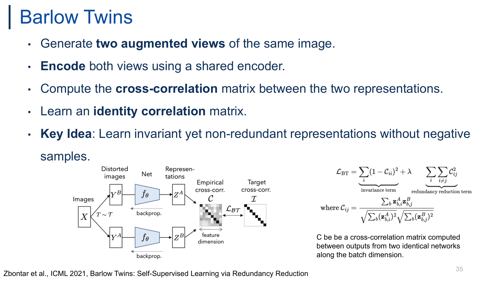

*p.35 — Barlow Twins: 두 distorted view → 같은 $f_\theta$ → empirical cross-corr $\mathcal{C}$를 target identity $\mathcal{I}$에 맞춤, 양쪽 branch 모두 backprop.*

$$\mathcal{L}_{\text{BT}} = \underbrace{\sum_i (1-\mathcal{C}_{ii})^2}_{\text{invariance term}} + \lambda\underbrace{\sum_i\sum_{j\ne i}\mathcal{C}_{ij}^2}_{\text{redundancy reduction term}}$$

$$\mathcal{C}_{ij} = \frac{\sum_b z^A_{b,i}\, z^B_{b,j}}{\sqrt{\sum_b (z^A_{b,i})^2}\sqrt{\sum_b (z^B_{b,j})^2}}$$

- 슬라이드 주석: "C be be a cross-correlation matrix computed between outputs from two identical networks **along the batch dimension**." ← "be be" 오타, 원문 유지
- (그림 표기상 위쪽 $Y^B\to Z^A$, 아래 $Y^A\to Z^B$로 첨자가 엇갈려 있음)

기호
- $b$: batch 내 샘플 index, $i,j$: feature(embedding 차원) index
- $z^A_{b,i}$: view A의 $b$번째 샘플의 $i$번째 feature
- $\mathcal{C}$: **$D\times D$** ($D$ = embedding 차원), $\mathcal{C}_{ij}\in[-1,1]$
- $\lambda$: 두 항 균형 계수

**계산 도식 (p.36)**

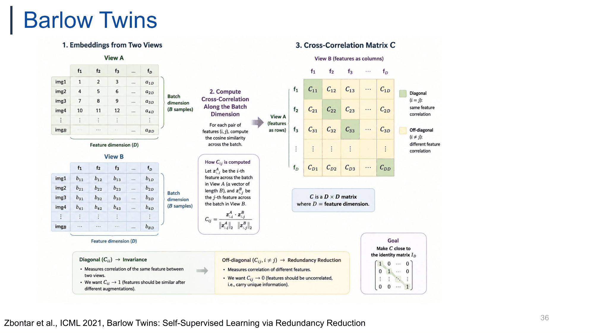

*p.36 — (B×D) embedding 두 개 → batch 방향으로 feature 쌍별 cosine → D×D 행렬 C. 대각 = invariance(→1), 비대각 = redundancy reduction(→0), 목표 = $I_D$.*

$$C_{ij} = \frac{z^A_{:,i}\cdot z^B_{:,j}}{\|z^A_{:,i}\|_2\,\|z^B_{:,j}\|_2}$$

- $z^A_{:,i}$: view A에서 $i$번째 feature의 **batch 전체 벡터(길이 $B$)**. → 샘플 간이 아니라 **feature 축 간** 비교. 결과는 $B\times B$가 아닌 **$D\times D$** (SimCLR는 샘플끼리 $B\times B$ similarity).
- **Diagonal $C_{ii}\to 1$ (Invariance)**: 같은 feature가 두 augmentation에서 같이 움직임 → augmentation 불변.
- **Off-diagonal $C_{ij}\to 0$ (Redundancy Reduction)**: 서로 다른 feature가 decorrelated → 각 차원이 고유 정보.
- 그림 표의 숫자(1,2,3…)는 더미 값.

**왜 collapse가 안 되나**: 모든 feature가 같은 값/방향으로 붕괴하면 비대각 상관이 커져 penalty → **negative, predictor, stop-gradient, EMA 없이** collapse 자연 방지. SimCLR/MoCo가 "다른 샘플은 멀리"로 막은 것과 대비.

> 보충: 논문은 $\mathcal{C}$ 계산 전 feature를 batch 방향 mean-centering + std 정규화 → 엄밀한 상관계수. 이름은 신경과학자 H. Barlow의 redundancy reduction 원리(1961). 기본 $\lambda\approx 5\times10^{-3}$, projector 8192차원 MLP. 비대각 0은 **decorrelation**이지 완전한 statistical independence는 아님.

**성능 (p.37)**: competitive with SOTA, **naturally avoids trivial constants**(collapsed representations), **robust to batch size**.

| Linear eval (ResNet-50) | Top-1 | Top-5 |
|---|---|---|
| Supervised | 76.5 | |
| MoCo | 60.6 | |
| PIRL | 63.6 | – |
| SimCLR | 69.3 | 89.0 |
| MoCo v2 | 71.1 | 90.1 |
| SimSiam | 71.3 | – |
| SwAV (w/o multi-crop) | 71.8 | – |
| BYOL | <u>74.3</u> | 91.6 |
| SwAV | <u>75.3</u> | – |
| **Barlow Twins** | <u>73.2</u> | 91.0 |

| Semi-supervised | Top-1 1% | Top-1 10% | Top-5 1% | Top-5 10% |
|---|---|---|---|---|
| Supervised | 25.4 | 56.4 | 48.4 | 80.4 |
| PIRL | – | – | 57.2 | 83.8 |
| SimCLR | 48.3 | 65.6 | 75.5 | 87.8 |
| BYOL | 53.2 | 68.8 | 78.4 | 89.0 |
| SwAV | 53.9 | **70.2** | 78.5 | **89.9** |
| **Barlow Twins** | **55.0** | 69.7 | **79.2** | 89.3 |

- linear eval은 top-3, 1% 라벨에서는 **최고**. 단순한 loss로 이 수준이 포인트.
- batch robustness 이유: loss가 $D\times D$ 상관행렬 기반 → **negative 수와 무관**. (너무 작은 batch면 상관 추정이 불안정할 수 있으나 256 정도에서도 하락 작음)

> 보충: SwAV 75.3은 multi-crop 사용, 71.8은 미사용. SimSiam(Chen & He, CVPR 2021) = stop-grad + predictor, no negative, no EMA.

**요약 (p.38)**: cross-correlation loss / no negatives / **positive pair만 정렬** / feature 차원 간 redundancy 제거 / decorrelated representation.
- "다른 샘플 밀어내기" 역할을 **feature 차원 간 decorrelation**이 대신함. 대칭 구조, EMA·predictor 불필요.

> 보충: VICReg(Bardes et al., ICLR 2022)가 variance/invariance/covariance 항으로 확장.

### 3.4 DINO: Self-Distillation with No Labels (p.39–44) — Caron et al., ICCV 2021

**개념 (p.39)**: **self-distillation**으로 표현 학습. 동일 구조의 **student / teacher**, student가 teacher의 **output distribution**을 따라가도록, teacher는 student의 **EMA**. **Key Idea: Self-distillation without labels.**
- 일반 KD는 사전학습된 큰 teacher → 작은 student. DINO는 teacher를 **student 자신의 EMA**로 만들어 label 없이 self-distillation (DI-NO = self-**di**stillation with **no** labels).

**구조와 pseudocode (p.40)**

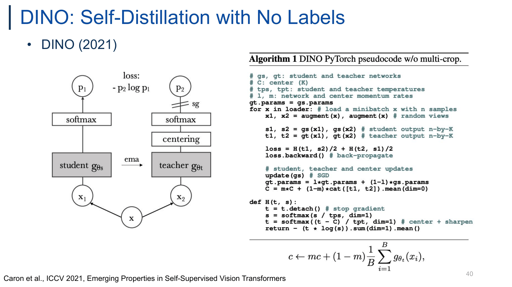

*p.40 — DINO: $x_1 \to$ student → softmax → $p_1$, $x_2 \to$ teacher → centering → softmax(sg) → $p_2$, loss $-p_2\log p_1$, teacher는 EMA. 오른쪽은 PyTorch pseudocode와 center 갱신식.*

```python
gt.params = gs.params
for x in loader:
    x1, x2 = augment(x), augment(x)
    s1, s2 = gs(x1), gs(x2)          # student output n-by-K
    t1, t2 = gt(x1), gt(x2)          # teacher output n-by-K
    loss = H(t1, s2)/2 + H(t2, s1)/2 # view 교차 대칭
    loss.backward(); update(gs)      # SGD
    gt.params = l*gt.params + (1-l)*gs.params            # teacher EMA
    C = m*C + (1-m)*cat([t1, t2]).mean(dim=0)            # center EMA
def H(t, s):
    t = t.detach()                         # stop gradient
    s = softmax(s / tps, dim=1)
    t = softmax((t - C) / tpt, dim=1)      # center + sharpen
    return - (t * log(s)).sum(dim=1).mean()
```

수식으로 정리

$$P_s(x)^{(i)} = \frac{\exp(g_{\theta_s}(x)^{(i)}/\tau_s)}{\sum_k \exp(g_{\theta_s}(x)^{(k)}/\tau_s)},\qquad P_t(x)^{(i)} = \text{softmax}\big((g_{\theta_t}(x) - c)/\tau_t\big)^{(i)}$$

$$\mathcal{L} = \tfrac12 H\big(P_t(x_1), P_s(x_2)\big) + \tfrac12 H\big(P_t(x_2), P_s(x_1)\big),\quad H(a,b) = -\sum_k a_k\log b_k$$

$$\theta_t \leftarrow \lambda\theta_t + (1-\lambda)\theta_s,\qquad c \leftarrow m c + (1-m)\frac1B\sum_{i=1}^B g_{\theta_t}(x_i)$$

기호
- $g_{\theta_s}, g_{\theta_t}$: student/teacher (backbone + head), 출력 $K$차원 logit ($K$ = prototype 수, 논문 65536)
- $\tau_s, \tau_t$ (`tps`, `tpt`): temperature, **$\tau_t < \tau_s$** (논문 $\tau_s=0.1$, $\tau_t$ 0.04→0.07 warmup)
- $c$ (`C`): center = teacher 출력의 이동평균, $m$: center momentum
- $\lambda$ (`l`): network momentum
- 같은 view끼리는 비교 안 함(교차). ← 그림의 "$-p_2\log p_1$"은 한 방향 단순화(원문 유지)

**collapse 방지: centering + sharpening**
- **Centering**: teacher logit에서 평균 $c$를 뺌 → **한 차원이 항상 지배**하는 collapse 방지. 단, 그것만 하면 uniform으로 가려는 경향.
- **Sharpening**: 낮은 $\tau_t$ → 분포 뾰족 → **uniform collapse** 방지.
- 두 효과가 서로 반대 방향이라 균형 → negative 없이 collapse 회피.

> 보충: 원 논문은 multi-crop(global 2 + local 여러 개). student는 모든 crop, teacher는 global crop만 → **local-to-global correspondence** 학습.
> $$\min_{\theta_s}\sum_{x\in\{x_1^g, x_2^g\}}\ \sum_{x'\in V,\,x'\ne x} H\big(P_t(x), P_s(x')\big)$$
> head는 3-layer MLP + weight-normalized 마지막 층.

**BYOL vs DINO (p.41)**

| BYOL | DINO |
|---|---|
| Feature matching | Distribution matching |
| MSE Loss | Cross Entropy Loss |
| Predictor | Softmax probability |
| EMA Teacher | EMA Teacher |
| No labels | No labels |

- "Unlike BYOL, which matches feature vectors, DINO performs self-distillation by matching the **probability distributions** produced by a momentum teacher."
- 표에서 Predictor ↔ Softmax probability는 **대응 위치일 뿐**, 실제 DINO에는 predictor가 없고 collapse 방지는 centering + sharpening 담당.

**Emergent property: self-attention (p.42)**

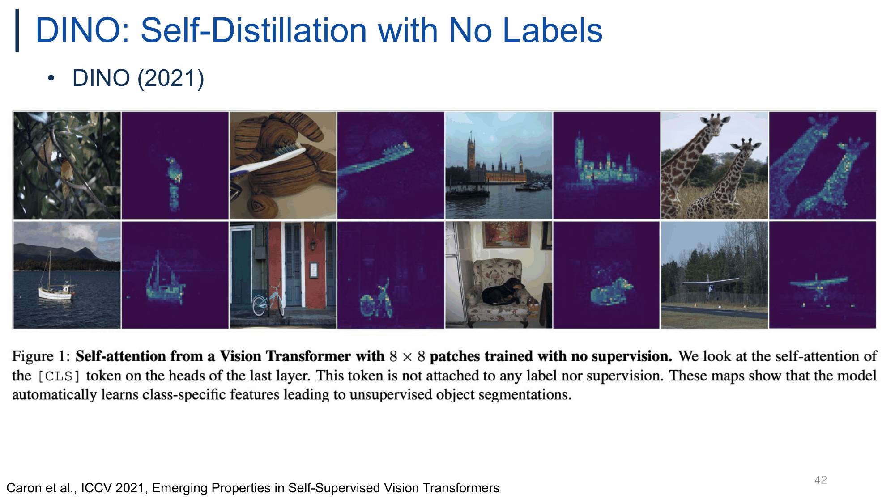

*p.42 — label 없이 학습한 ViT(8×8 patch)의 마지막 층 [CLS] self-attention이 전경 객체 형태를 따라감 → unsupervised object segmentation.*

- [CLS] token이 각 patch에 주는 attention이 배경이 아니라 **객체 윤곽**(새, 기린, 배의 돛, 자전거, 비행기)을 따라 켜짐.
- label 없이 → **emergent property**, unsupervised object segmentation/discovery. supervised ViT에서는 이렇게 깨끗한 map이 잘 안 나옴(논문 주장).
- "8×8 patches" = ViT-S/8 등, 작은 patch일수록 고해상도 attention map.

> 보충: attention mask를 threshold해 PASCAL VOC12 Jaccard로 정량 평가. DAVIS-2017 video segmentation은 attention이 아니라 feature nearest-neighbor propagation으로 평가.

**성능 (p.43)**: Linear(backbone freeze + linear) / **k-NN**(추가 학습 없이 feature 공간 최근접 투표 → **semantic clustering 품질** 직접 반영)

| ResNet-50 | Linear | k-NN |
|---|---|---|
| Supervised | 79.3 | 79.3 |
| SCLR(SimCLR) | 69.1 | 60.7 |
| MoCov2 | 71.1 | 61.9 |
| InfoMin | 73.0 | 65.3 |
| BarlowT | 73.2 | 66.0 |
| OBoW | 73.8 | 61.9 |
| BYOL | 74.4 | 64.8 |
| DCv2 | 75.2 | 67.1 |
| SwAV | **75.3** | 65.7 |
| **DINO** | **75.3** | **67.5** |

| ViT-S (21M) | Linear | k-NN |
|---|---|---|
| Supervised | 79.8 | 79.8 |
| BYOL* | 71.4 | 66.6 |
| MoCov2* | 72.7 | 64.4 |
| SwAV* | 73.5 | 66.3 |
| **DINO** | **77.0** | **74.5** |

| Across architectures | Arch (Param) | Linear | k-NN |
|---|---|---|---|
| SCLR | RN50w4 (375M) | 76.8 | 69.3 |
| SwAV | RN50w2 (93M) | 77.3 | 67.3 |
| BYOL | RN50w2 (93M) | 77.4 | – |
| **DINO** | ViT-B/16 (85M) | 78.2 | 76.1 |
| SwAV | RN50w5 (586M) | 78.5 | 67.1 |
| BYOL | RN50w4 (375M) | 78.6 | – |
| BYOL | RN200w2 (250M) | 79.6 | 73.9 |
| **DINO** | ViT-S/8 (21M) | 79.7 | **78.3** |
| SCLRv2 | RN152w3+SK (794M) | 79.8 | 73.1 |
| **DINO** | ViT-B/8 (85M) | **80.1** | 77.4 |

- ResNet-50: linear 동률 1위, **k-NN 단독 1위**. ViT-S: **k-NN 74.5 vs 최고 66.6 (약 +8)** → DINO는 **ViT와 궁합**이 특히 좋음. ViT-S/8은 21M로 linear 79.7, k-NN 78.3 → 파라미터 효율.
- ← 약어: SCLR = SimCLR, DCv2 = DeepCluster-v2, SCLRv2 = SimCLRv2 (논문 원문 그대로). * = 저자들이 직접 실행.

> 보충: patch /16 → /8이면 정확도↑ but throughput 급감(ViT-B 312 → 63 im/s).

**왜 중요한가 (p.44)**: label 없이 **semantic representation** / ViT의 **object-centric attention** / emergent segmentation & object discovery / **많은 현대 SSL의 기반** (iBOT, DINOv2 등).

### 3.5 Parallel Augmentation 방법 비교 (핵심 표)

| 방법 | 핵심 아이디어 | loss | collapse 방지 | 장점 | 한계 |
|---|---|---|---|---|---|
| **SimCLR** | 같은 이미지 두 view를 당기고 batch 내 나머지는 밀어냄 | NT-Xent / InfoNCE: $-\log\frac{e^{s_{ij}/\tau}}{\sum_{k\ne i}e^{s_{ik}/\tau}}$ | **negative** (in-batch) | 단순, memory bank 없음, projection head 발견 | **large batch 필수**(4096~8192), TPU, false negative |
| **Debiased CL** | random 분포에서 positive 성분 빼서 true negative 추정 | InfoNCE 분모를 $Ng$로 교체 | negative (보정됨) | 몇 줄 수정, 작은 batch에서 이득 | $\eta^+$ prior 필요, 추정 분산 |
| **BYOL** | online이 target(EMA)의 projection을 **예측** | $\|\bar q_\theta(z) - \bar z'\|^2 = 2-2\cos$, 대칭 | predictor 비대칭 + EMA + stop-grad | negative 불필요, batch/aug에 덜 민감, 74.3% | collapse 회피의 이론적 근거 불명확, 두 네트워크 |
| **Barlow Twins** | 두 view 간 $D\times D$ cross-correlation → identity | $\sum_i(1-\mathcal{C}_{ii})^2 + \lambda\sum_{i\ne j}\mathcal{C}_{ij}^2$ | **redundancy reduction**(비대각 0) | negative/predictor/EMA 모두 불필요, 대칭, batch robust | 큰 projector 차원(8192) 필요, 상관 추정에 batch 필요 |
| **DINO** | student가 EMA teacher의 **softmax 분포**를 따라감 (self-distillation) | $H(P_t, P_s) = -\sum P_t\log P_s$, view 교차 | **centering + sharpening** + EMA + stop-grad | ViT와 궁합, k-NN 강함, emergent segmentation | temperature/center 등 hyperparameter 민감 |

- 흐름: **negative 필수(SimCLR) → negative 제거 + 비대칭(BYOL) → 대칭인데 feature decorrelation(Barlow Twins) → 분포 matching self-distillation(DINO)**.
- 비교 축: sample-level ($B\times B$, SimCLR) vs feature-level ($D\times D$, Barlow Twins) / feature matching (MSE, BYOL) vs distribution matching (CE, DINO).

---

## 4. Positive를 생성하기: SynCLR (p.45–54)

> 섹션 질문 (p.45): **Can positive views be generated rather than augmented?**
> 논문: Tian, Fan, Chen, Katabi, Krishnan, Isola, **"Learning Vision from Models Rivals Learning Vision from Data"**, CVPR 2024 (Google Research + MIT CSAIL) (p.46). 제안 방법 = **SynCLR**: real image 없이 **LLM + text-to-image diffusion**이 만든 synthetic data만으로 contrastive 학습. 제목 = "모델로부터 배운 표현이 데이터로부터 배운 표현에 필적".

### 4.1 Augmentation → Generation (p.47)

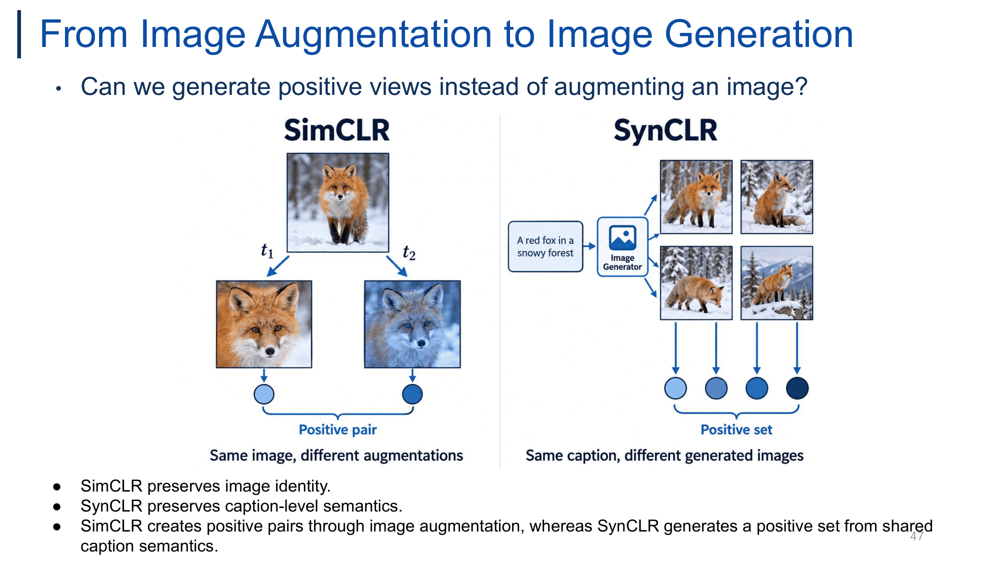

*p.47 — SimCLR: 같은 이미지 + 다른 augmentation = positive pair / SynCLR: 같은 caption + 다른 생성 이미지 = positive set.*

- SimCLR preserves **image identity**. SynCLR preserves **caption-level semantics**.
- SimCLR = image augmentation으로 positive **pair**, SynCLR = shared caption semantics로 positive **set**.

| | SimCLR | SynCLR |
|---|---|---|
| invariance 단위 | 같은 원본 이미지(instance identity) | 같은 caption(semantics) |
| positive 수 | pair (2개) | set (caption당 4개) |
| positive 생성 수단 | augmentation (crop, color jitter) | image generator |
| 학습되는 변이 | low-level (픽셀 변환) | high-level (pose, 구도, 배경, 질감) |

- 설계 이유: augmentation은 픽셀 수준이라 **객체 자체의 변이**(자세, 장면)를 못 줌. 생성 모델은 caption이 정한 **semantic은 같고 시각적으로 다양한** positive를 공급.

### 4.2 What Defines a Positive Pair? (p.48)

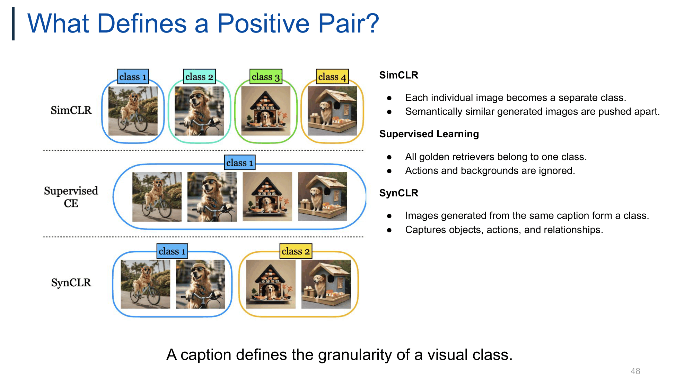

*p.48 — 같은 골든 리트리버 4장: SimCLR는 4 class, Supervised CE는 1 class, SynCLR는 caption 기준 2 class. "A caption defines the granularity of a visual class."*

| | positive 단위 | 결과 | 입도 |
|---|---|---|---|
| **SimCLR** | 이미지 1장 = 1 class | 의미상 비슷한 이미지(자전거 타는 개 두 장)도 **pushed apart** → false negative | 너무 세밀 |
| **Supervised CE** | "golden retriever" 하나 = 1 class | **행동·배경 무시** | 너무 거침 |
| **SynCLR** | 같은 caption에서 생성된 이미지 = 1 class | **객체 + 행동 + 관계** 반영 | 중간 |

- 결론: **caption이 visual class의 granularity를 조절하는 손잡이**. 텍스트의 풍부함으로 supervised label보다 세밀하고, instance discrimination보다 의미적으로 일관된 positive 구조.
- ← SimCLR 행의 "class 1~4"는 instance 단위 negative 구조를 설명하는 비유(원문 유지).

### 4.3 데이터 생성 파이프라인 (p.49–50)

**Step 1 — Iterative caption generation with Llama-2 (p.49)**

- (1) 예시 3개를 초기 context로 샘플 → (2) Llama-2가 새 caption 생성 → (3) 생성 caption을 context에 추가 → (4) 반복해 다양한 caption 생성.
- prompt 형식: "Generate an image caption with an object category and an environment category:"
  - `tiger, forest => Two tigers are running together in the forest.`
  - `groom, wedding ceremony => father of groom congratulating him after the wedding ceremony.`
  - `fountain, park => Water cascades from an ornate fountain, ...`
  - `red fox, yard =>` → "wild red fox sitting on a partially snow covered front yard of a house in the suburbs of a small city"
- **in-context learning** 기반: `(object, environment) => caption` few-shot.
- **iterative**(생성 결과를 context에 되돌림, 초록 화살표) → prompt가 계속 바뀌어 같은 형식 반복을 막고 **diversity** 확보.
- 왜: caption이 "class" 역할이므로(p.48) caption의 **다양성·coverage = 학습되는 visual concept의 다양성**. 사람 라벨 없이 scalable.

> 보충: 원 논문은 ImageNet-21K, Places-365 등 concept 목록에서 object/environment 쌍 구성, 약 150M caption.

**Step 2 — From a caption to positive views (p.50)**

- 하나의 synthetic caption을 condition으로 → **서로 다른 random noise**에서 출발 → caption당 **이미지 4장** → **low CFG scale**로 diversity↑.
- Same caption, shared semantics: appearance·composition은 다르고 objects·relationships는 같음 → **positive set**.
- "Different noise produces visual diversity, while the caption preserves common semantics."
- **150M captions × 4 = 600M synthetic images**
- 예시: paella / 연기 뿜는 발전소 / 눈 덮인 울타리 위 junco 새 — 각 4장이 구도·조명·자세가 다름.
- **Low CFG를 쓰는 이유**: guidance가 크면 caption에 강하게 맞추느라 샘플이 비슷한 mode로 몰림 → diversity↓. 낮추면 충실도는 약간 떨어지지만 이미지 간 변이↑ → positive 간 "다양한 view" 효과(= augmentation 역할)↑.

> 보충: 원 논문은 Stable Diffusion 1.5 사용, 기본보다 낮은 CFG가 representation에 유리하다고 보고(정확한 값은 슬라이드에 없음).

### 4.4 Multi-Positive Contrastive Loss (p.51)

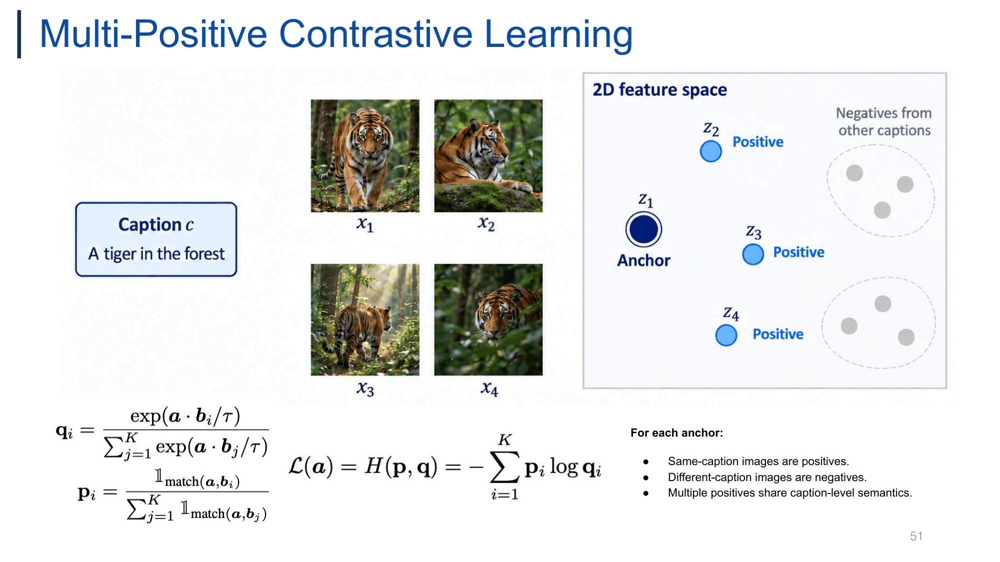

*p.51 — "A tiger in the forest"로 생성한 $x_1..x_4$: anchor $z_1$과 positive $z_2, z_3, z_4$는 당기고, 다른 caption의 negative는 밀어냄.*

$$\mathbf{q}_i = \frac{\exp(\mathbf{a}\cdot\mathbf{b}_i/\tau)}{\sum_{j=1}^{K}\exp(\mathbf{a}\cdot\mathbf{b}_j/\tau)},\qquad \mathbf{p}_i = \frac{\mathbb{1}_{\text{match}(\mathbf{a},\mathbf{b}_i)}}{\sum_{j=1}^{K}\mathbb{1}_{\text{match}(\mathbf{a},\mathbf{b}_j)}}$$

$$\mathcal{L}(\mathbf{a}) = H(\mathbf{p},\mathbf{q}) = -\sum_{i=1}^{K}\mathbf{p}_i\log\mathbf{q}_i$$

기호
- $\mathbf{a}$: anchor embedding (정규화), $\mathbf{b}_i$: batch 내 $i$번째 후보 ($K$개), $\tau$: temperature
- $\mathbf{q}_i$: anchor가 $b_i$를 고를 모델 softmax 확률
- $\mathbb{1}_{\text{match}(a,b_i)}$: **같은 caption에서 나왔으면 1**
- $\mathbf{p}$: 그 indicator를 정규화한 **target 분포** (positive $m$개면 각 $1/m$)

- 결과적으로 $\mathcal{L} = -\frac1m\sum_{i\in\text{pos}}\log q_i$. 분모에 positive + negative 모두 → positive는 당기고 negative는 밀어냄.
- **$m=1$이면 $\mathbf{p}$가 one-hot → 기존 InfoNCE와 동일**. 즉 InfoNCE의 multi-positive 일반화.
- **SupCon**(Khosla et al., 2020)도 multi-positive지만 positive 정의가 **class label**. 여기선 **caption(생성 조건)**이 정의.
- positive들이 **서로 다른 이미지** → 같은 원본에서 나올 필요 없음.

> 보충: StableRep(Tian et al., NeurIPS 2023)의 multi-positive loss와 같은 계열. SynCLR는 patch-level masking 목적도 함께 쓴다고 알려짐(슬라이드에 없음).

### 4.5 결과: Does Learning from Models Work? (p.52–53)

**ImageNet linear eval + fine-grained transfer (Table 6, p.52)** — backbone freeze + linear

| method | text | img | #imgs | backbone | ImageNet | Aircraft | Cars | Average(10) |
|---|---|---|---|---|---|---|---|---|
| StableRep | real | syn | 100M | ViT-B/16 | 75.7 | 59.2 | 83.5 | 83.4 |
| CLIP | real | real | 400M | ViT-B/16 | 80.2 | 59.5 | 86.7 | 85.7 |
| CLIP | real | real | 400M | ViT-L/14 | 83.9 | 69.4 | 90.9 | 88.9 |
| OpenCLIP | real | real | 400M | ViT-B/16 | 78.9 | 61.1 | 92.3 | 86.3 |
| OpenCLIP | real | real | 400M | ViT-L/14 | 82.3 | 67.1 | 94.0 | 88.4 |
| OpenCLIP | real | real | 2B | ViT-L/14 | 83.4 | 71.7 | 95.3 | 89.8 |
| DINO v2* | – | real | 142M | ViT-B/14 | 83.9† | 79.4 | 88.2 | 89.0 |
| DINO v2* | – | real | 142M | ViT-L/14 | 85.7† | 81.5 | 90.1 | 90.1 |
| **SynCLR** | syn | syn | 600M | ViT-B/16 | 80.7 | 81.7 | 93.8 | **89.0** |
| **SynCLR** | syn | syn | 600M | ViT-L/14 | 83.0 | **85.6** | 94.2 | **90.4** |

(Average = ImageNet, Aircraft, Cars, DTD, Flowers, Pets, SUN397, Caltech-101, Food-101, VOC2007 10개 평균. 나머지 열은 원 슬라이드 참조)

- `text`/`img` = real vs synthetic. **SynCLR만 text·image 모두 synthetic** = real data를 전혀 안 씀.
- ImageNet: SynCLR ViT-B 80.7 ≈ CLIP ViT-B 80.2 > OpenCLIP ViT-B 78.9. ViT-L 83.0은 CLIP 83.9, DINOv2 85.7에 근접.
- **Average**: ViT-B 89.0 = DINOv2 ViT-B, **ViT-L 90.4로 표에서 최고**.
- **Aircraft**에서 특히 강함(81.7, 85.6 — 모든 행 중 최고). Cars는 OpenCLIP 2B(95.3)보다 낮음. fine-grained 강점은 caption이 세밀한 object/attribute를 담는다는 p.48과 연결 가능(인과 증명은 아님).
- 캡션 주의: DINOv2(*)는 **ViT-g에서 distill** → 비교에 유리. † = 여러 layer concat 대신 `cls`만 써서 재실행. ← 캡션 "classificaton", "modes" 원문 오타

**ADE20K semantic segmentation (Table 7, p.53)** — mIoU, UperNet, single scale 512×512

| method | pre-train data | distill | ViT-B | ViT-L |
|---|---|---|---|---|
| StableRep | hybrid, 100M | | 49.4 | – |
| MoCo v3 | real, IN1K-1M | | 47.3 | 49.1 |
| BEiT | real, IN1K-1M+DALLE | | 47.1 | 53.3 |
| MAE | real, IN1K-1M | | 48.1 | 53.6 |
| iBOT | real, IN1K-1M | | 50.0 | – |
| CLIP | real, WIT-400M | | 52.6 | – |
| BEiT v2 | real, WIT-400M, IN1K | ✓ | 53.1 | 56.7 |
| DINO v2 | real, LVD-142M | ✓ | **54.4**† | 57.5† |
| **SynCLR** | synthetic, 600M | | **54.3** | **57.7**† |

- "Synthetic pretraining also produces strong **dense** features." distill 없이 ViT-B는 DINOv2와 거의 같고, **ViT-L은 DINOv2 초과**. real data 기반(MoCo v3, MAE, iBOT, CLIP)보다 높음.
- † = patch 14 → 518×518. ← ViT-B SynCLR에는 † 없음, 행별 적용 불명확(원문 유지)

### 4.6 What changed? (p.54)

- **Hand-designed augmentation → Generative semantic views** (변형이 pixel 수준이 아니라 의미 수준)
- **Positive pairs do not need to originate from the same image.**
- **Captions provide controllable semantic classes.** (granularity 조절)
- **Generative models can serve as a scalable data source.**
- **Representation learning can be performed without real images.** (근거: p.52–53)

> 보충(한계): 생성 모델 자체가 real data로 학습됨 → "real data 없이"는 표현 학습 단계에만 해당. 생성 모델의 **bias·coverage를 그대로 물려받음**.

---

## 5. SSL → Visual Foundation Model: DINOv2 (p.55–67)

> 섹션 질문 (p.55): **How can DINO become a general-purpose visual foundation model?**

### 5.1 DINOv2 목표 (p.56) — Oquab et al., TMLR 2024

- Learn general-purpose visual features **from images alone** — **No labels, No captions**
- **Frozen features** for many downstream tasks
- Strong **global and patch-level** representations
- DINO demonstrated emergent representations → DINOv2 aims to make them **general-purpose features**.

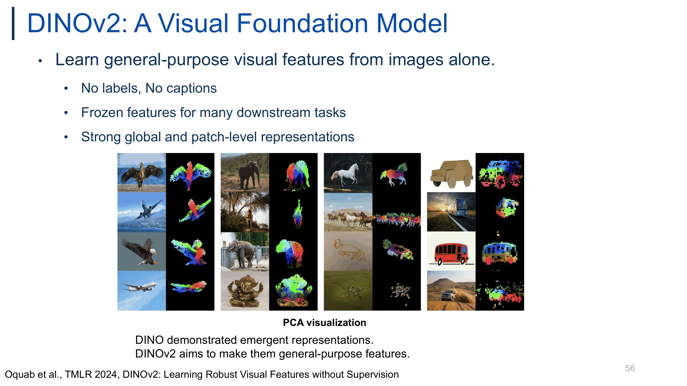

*p.56 — DINOv2 patch feature PCA: 새↔비행기, 코끼리↔조각상, 사진↔스케치처럼 category·domain이 달라도 대응 부위가 같은 색.*

- CLIP이 text supervision으로 foundation model이 된 것과 대비되는 **순수 image-only SSL** 노선.
- global = `cls` token (분류, retrieval), patch-level = patch token (segmentation, depth 등 dense task).
- **PCA 시각화 읽는 법**: patch feature에 PCA → 주성분을 RGB로. **같은 색 = 비슷한 feature**. 다른 category/domain에서도 **의미적으로 대응되는 부위가 같은 색** → **part-level semantic correspondence**.
- DINO = 연구 결과(emergence), DINOv2 = 데이터·모델 규모 확장 + 학습 안정화로 **범용 backbone**화.

> 보충: 원 논문 방식 — 첫 성분으로 전경 분리(배경 마스킹) 후 전경 patch에 다시 PCA, 상위 3성분을 RGB.

### 5.2 DINO → DINOv2: 무엇이 바뀌었나 (p.57)

| | DINO | DINOv2 |
|---|---|---|
| 데이터 | ImageNet-1K | Curated 142M images |
| 학습 수준 | Image-level self-distillation | Image-level **and patch-level** |
| 모델 크기 | ViT-S/B | Up to ViT-g (~1B params) |
| 표현 | Semantic representation | General-purpose visual features |
| 위상 | Research method | Foundation model family |

$$\boxed{\text{DINOv2} = \text{DINO} + \text{iBOT} + \text{KoLeo} + \text{Curated Data} + \text{Scaling}}$$

- "The core of DINOv2 is **not a single, entirely new loss function**; it is an **integrated system** that combines existing SSL components and stabilizes training to enable scaling up both data and model size."
- 구성 요소 역할
  - **DINO**: CLS token image-level self-distillation → global semantic
  - **iBOT**: masked patch-level self-distillation → local/spatial
  - **KoLeo**: feature를 embedding 공간에 고르게 퍼뜨림
  - **Curated Data (LVD-142M)**: dedup + retrieval로 정제
  - **Scaling**: 큰 teacher 학습 → 작은 모델로 distill
- 데이터 약 100배(1.28M → 142M), 모델 ~1B. 기여는 loss보다 **engineering/recipe** 쪽.

> 보충: untied head, Sinkhorn-Knopp centering, 고해상도 adaptation, efficient stochastic depth, FSDP 등 포함.

### 5.3 데이터 큐레이션: LVD-142M (p.58–60)

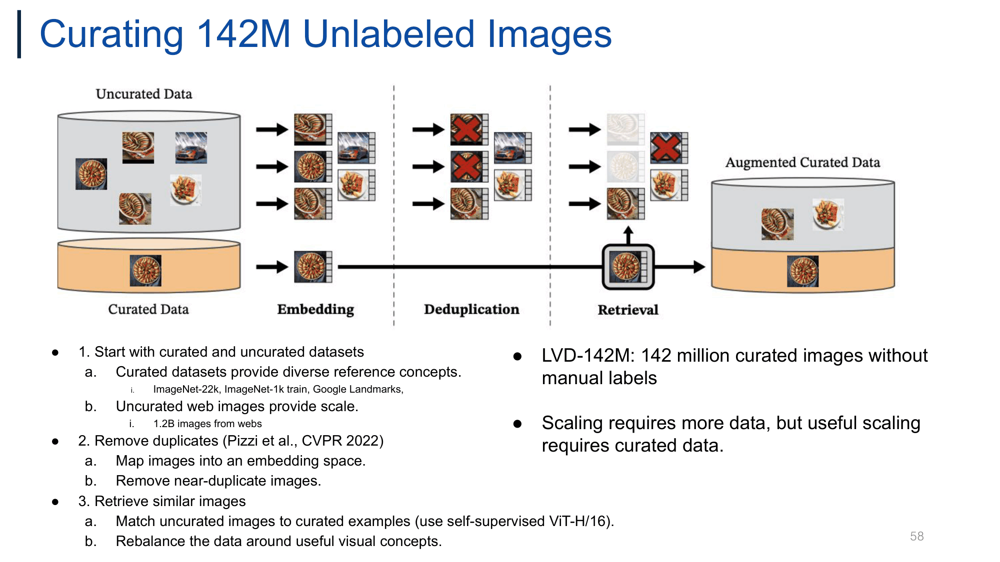

*p.58 — Uncurated(1.2B) + Curated → Embedding → Deduplication → Retrieval → Augmented Curated Data.*

1. **Start with curated and uncurated datasets**
   - curated = 다양한 reference concept (ImageNet-22k, ImageNet-1k train, Google Landmarks, …)
   - uncurated = **1.2B web images** → scale
2. **Remove duplicates** (Pizzi et al., CVPR 2022): embedding 공간에 매핑 → near-duplicate 제거
3. **Retrieve similar images**: self-supervised **ViT-H/16** embedding으로 uncurated를 curated 예시에 매칭 → 유용한 visual concept 중심으로 **rebalance**
- 결과 **LVD-142M** = 수동 라벨 없는 142M 이미지 (약어 풀이는 슬라이드·논문 모두 명시 안 함)
- **"Scaling requires more data, but useful scaling requires curated data."**

- 문제의식: 웹 이미지는 long-tail, 중복, 저품질 → 그냥 키우면 scaling 효과↓. 
- 직관: curated set을 **원하는 개념의 anchor**로, 그와 가까운 웹 이미지만 끌어옴 → **label 없이 curation** (label은 안 쓰지만 curated 분포를 간접 활용).
- DINO는 ImageNet-1K 그대로, DINOv2는 **데이터 자체를 설계 대상**으로.

**구성 표 (p.59, Table 15/18)** — 레퍼런스용, 구조만 기억
- Retrieval 방식: **as is**(그대로), **sample**(sample-based: query별 k-NN), **cluster**(cluster-based: uncurated를 k-means 후 cluster 단위 샘플). 대형 curated(ImageNet-22k 등)는 sample, 작은 set은 cluster.
- cluster 방식은 데이터셋당 **최대 1M cap** (예: Food-101 21.67M 검색 → 1M).
- 최대 비중: ImageNet-22k (as-is 14.2M + sample 56.8M), ImageNet-1k (sample 41.0M). **합계 142,109,386**.
- Table 18: 데이터셋별 (pretraining as-is / retrieval anchor / eval) 용도. ImageNet-A/C/R/Sketch, iNaturalist, video 등은 **eval 전용** → 도메인 밖 일반화 평가.
- 평가 benchmark의 train split을 retrieval anchor로 쓰는 점은 논란 소지 — label은 안 쓰고 test split은 제외.

**Near-duplicate 탐지 (p.60)** — SSCD (Pizzi et al., CVPR 2022)
- 각 이미지 → compact descriptor → cosine similarity → nearest neighbor → **$\text{sim}(z_i, z_j) > \tau$ 이면 near-duplicate → Remove**
- SSCD = image copy detection용 self-supervised descriptor (SimCLR 계열 + entropy regularizer).
- 왜: 웹 이미지는 resize/crop/색 변화/워터마크 중복이 많음 → 과대표현·bias·memorization + 평가셋 **leakage**. **pixel hash로 못 잡는 변형 중복**을 embedding 유사도로 잡음.
- 1.2B 규모 → approximate NN(Faiss 등) 필요. threshold 값은 슬라이드에 없음.

### 5.4 학습 목적: image-level + patch-level (p.61)

**Image-level (DINO, Caron et al., 2021)** — student/teacher **CLS-token** 분포 매칭, global semantic

$$\mathcal{L}_{\text{DINO}} = -\sum p_t\log p_s$$

**Patch-level (iBOT, Zhou et al., ICLR 2022)** — student patch 일부 **mask**, teacher의 patch를 target, local/spatial 학습

$$\mathcal{L}_{\text{iBOT}} = -\sum_i p_{ti}\log p_{si}\qquad (i = \text{masked patch 위치})$$

- **Separate the DINO head and the iBOT head.**
- ← 하단 출처 "Caron et al., ICCV 2019"는 연도 오타 의심 (DINO는 ICCV 2021)

- $p_t$: teacher softmax(target), $p_s$: student softmax. 합은 prototype 차원 위.
- iBOT = BERT의 masked language modeling의 vision 버전. student는 masked 입력, teacher는 mask 없는 전체를 보고, **가려진 위치 $i$**에서 student patch 분포가 teacher patch 분포를 따라감 → dense task(segmentation, depth)에 유리.
  - ← "Use the visible teacher patches as targets"는 "teacher는 전체(visible) patch를 보고 그 중 student가 가려진 위치의 token이 target"으로 읽어야 함 (표현 모호)
- **Untied heads 이유**: head 공유 시 두 목표가 간섭. 작은 scale에선 공유가 patch-level에 좋아도 큰 scale에선 분리가 낫다고 보고.
- DINO는 CLS(전역)만 → dense 약함. DINOv2는 **global + local 동시**.

> 보충: 최종 $\mathcal{L} = \mathcal{L}_{\text{DINO}} + \mathcal{L}_{\text{iBOT}} + 0.1\,\mathcal{L}_{\text{KoLeo}}$. 실제는 temperature + centering(SK) 적용 softmax. iBOT의 "online tokenizer" = 별도 dVAE 없이 teacher 자체가 tokenizer.

### 5.5 Collapse와 Crowding 방지: KoLeo, Sinkhorn-Knopp (p.62–63)

**KoLeo regularizer** (Sablayrolles et al., ICLR 2019, "Spreading vectors for similarity search")

$$\mathcal{L}_{\text{koleo}} = -\frac1n\sum_{i=1}^n \log(d_{n,i}),\qquad d_{n,i} = \min_{j\ne i}\|x_i - x_j\|$$

- $x_i$: $\ell_2$-normalized (CLS) feature, $d_{n,i}$: batch 내 **최근접 이웃 거리**, $n$: batch 크기.
- $-\log d$ 최소화 = 최근접 거리를 **키움** → 서로 밀어내 hypersphere 위에 **균일하게 분포** (crowding 방지). Kozachenko-Leonenko entropy 추정치 형태 → batch entropy↑.
- 최근접 이웃만 보므로 저렴, $\log$ 때문에 이미 먼 점에는 gradient 작고 가까운 점에 집중.
- image-level feature에만 적용.

**Sinkhorn-Knopp centering** (Caron et al., 2020 = SwAV, NeurIPS 2020)
- teacher 출력의 normalization/centering — prototype 할당이 **고르게 분포**하도록 재정규화
- 많은 이미지가 소수 prototype에만 매핑되는 경우 방지 → student가 **더 informative하고 덜 degenerate한 target**을 받음

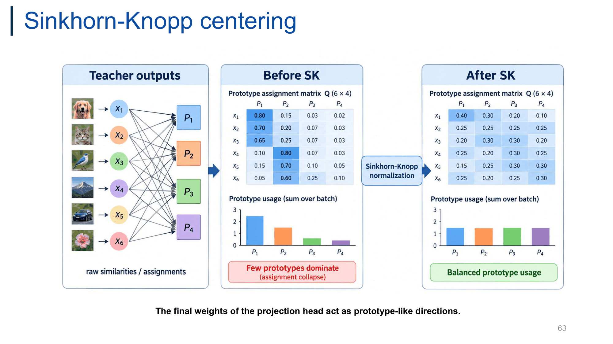

*p.63 — Before SK: $P_1, P_2$에 쏠림(assignment collapse) → SK normalization → After SK: prototype 사용량 균등.*

- **$Q$** (assignment matrix): 행 = 샘플, 열 = prototype, $Q_{ik}$ = 샘플 $i$의 prototype $k$ 할당 확률(teacher softmax), 행 합 = 1.
- Before: $x_1..x_3 \to P_1$, $x_4..x_6 \to P_2$, $P_3, P_4$ 거의 미사용 = **dead prototype / assignment collapse**.
- After: 행 합 1 유지 + **열 합 균등($B/K$ = 6/4 = 1.5)** = equipartition.
- 알고리즘: 열 정규화(각 prototype 총량 $B/K$)와 행 정규화(각 샘플 합 1)를 번갈아 수 iteration — optimal transport 기반.
- "The final weights of the projection head act as prototype-like directions." → head 마지막 linear의 weight 열 = prototype 벡터, feature·prototype 내적 = logit.
- ← 그림 수치 의심: Before 막대 $P_2$ ≈ 1.5인데 열 합은 2.70, $P_4$ ≈ 0.4인데 열 합 0.26. After 열 합도 $P_3$=1.60, $P_4$=1.40으로 정확히 1.5 아님 → 개념 도식으로 이해.

| | 막는 것 | 작용 위치 |
|---|---|---|
| **KoLeo** | **crowding** (feature 밀집) | student feature 공간의 uniformity |
| **SK centering** | **assignment collapse** (prototype 쏠림) | teacher target 분포의 균형 |
| (DINO) centering + sharpening | 한 차원 지배 / uniform collapse | teacher logit (running mean + 낮은 $\tau_t$) |

> DINO의 단순 mean centering → DINOv2에서 SK centering으로 교체 (iBOT head에도 적용).

### 5.6 전체 파이프라인 요약 (p.64)

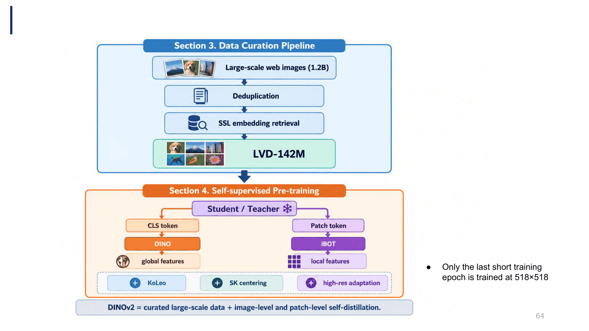

*p.64 — Section 3 데이터 큐레이션(1.2B → dedup → SSL retrieval → LVD-142M) + Section 4 pretraining(CLS→DINO→global, Patch→iBOT→local, + KoLeo, SK centering, high-res adaptation).*

- **DINOv2 = curated large-scale data + image-level and patch-level self-distillation.**
- teacher 옆 눈송이 = gradient 없음(EMA).
- **high-res adaptation**: "Only the last short training epoch is trained at **518×518**" — dense task엔 고해상도가 유리하지만 전 과정 고해상도는 비쌈 → 마지막 짧은 구간만 (본 학습 224). 518 = 14(patch) × 37.

### 5.7 Scaling the Teacher, Distilling the Students (p.65)

- Step 1: 큰 **ViT-g teacher**를 LVD-142M으로 학습. Step 2: teacher **freeze** → 작은 ViT로 distill.

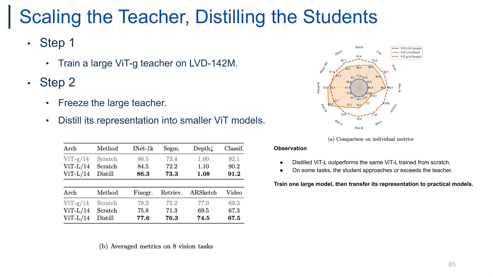

*p.65 — ViT-L Distill이 ViT-L Scratch보다 거의 모든 축에서 좋고 ViT-g teacher에 근접(radar chart + 8 task 평균 표).*

| Arch / Method | INet-1k | Segm. | Depth↓ | Classif. | Finegr. | Retriev. | ARSketch | Video |
|---|---|---|---|---|---|---|---|---|
| ViT-g/14 Scratch (teacher) | 86.5 | 73.4 | 1.00 | 92.1 | 78.3 | 75.2 | 77.0 | 69.3 |
| ViT-L/14 Scratch | 84.5 | 72.2 | 1.10 | 90.2 | 75.8 | 71.3 | 69.5 | 67.3 |
| **ViT-L/14 Distill** | **86.3** | **73.3** | **1.08** | **91.2** | **77.6** | **76.3** | **74.5** | **67.5** |

- Distilled ViT-L > scratch ViT-L (INet +1.8, Retrieval +5.0, ARSketch +5.0). 일부는 teacher에 근접(Segm 73.3 vs 73.4), **Retrieval은 teacher 초과**(76.3 vs 75.2).
- **"Train one large model, then transfer its representation to practical models."**
- 왜: 작은 모델 scratch SSL은 capacity 부족 + SSL 신호 약함. 큰 모델이 만든 표현 공간을 **모방**하는 건 더 쉬운 문제 → **scaling은 teacher에서, 배포 가능성은 student에서**.
- 기존 self-distillation(DINO = 같은 크기 EMA teacher)과 달리 **frozen 대형 teacher → 소형 student**의 일반 KD 형태.

### 5.8 One Frozen Encoder, Many Tasks (p.66)

- **Global features**: classification, fine-grained, image retrieval / **Dense features**: semantic segmentation, monocular depth, pixel correspondence
- 8개 패널(x = flops, log): DINOv2(파랑)가 거의 모든 task에서 SSL(주황)보다 위, flops↑에 따라 상승해 **WSL(텍스트 감독, CLIP류) 최고선**에 도달/초과. Depth는 낮을수록 좋음. **Segmentation·Depth·Retrieval에서 WSL 크게 상회**.
- **"The same frozen backbone supports both image-level and pixel-level tasks."**
- frozen encoder 평가 = backbone 고정 + 얇은 head → 표현 자체의 범용성.
- SSL도 **scaling이 통함**. 텍스트 supervision은 global semantics엔 강하지만 **pixel-level엔 약함** → image + patch loss 설계의 결과.

### 5.9 DINOv2의 교훈 (p.67)

- **The SSL objective alone is not enough.**
  1. **Data quality** determines what the model can learn.
  2. **Patch-level learning** improves dense representations.
  3. Large models require **stable and efficient training**.
  4. **Distillation** makes large-scale SSL models practical.
- → **Can we continue scaling DINOv2 indefinitely?** (DINOv3로의 hook)

---

## 6. DINOv3: 긴 학습의 문제와 Gram Anchoring (p.68–70)

### 6.1 Scaling reveals a new problem (p.68)

- Longer training **improves global features** (classification 계속 상승)
- **Dense features gradually degrade**: patch similarity noisy, segmentation 하락

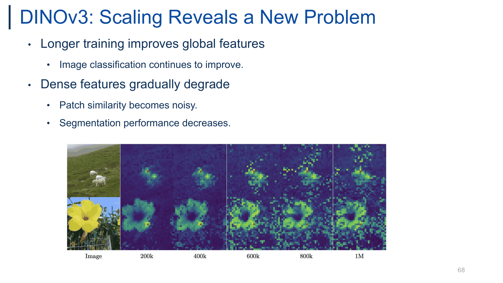

*p.68 — query patch(빨간 점)와의 cosine map: 200k~400k iteration엔 객체에 응집, 600k~1M으로 갈수록 배경에 점상 노이즈.*

- 좋은 dense feature면 같은 객체 부위에서만 유사도가 높아야 함. iteration↑ → 무관한 배경도 높아짐 → patch feature의 **locality / spatial consistency 붕괴**.
- 원인 직관(보충): CLS-level global objective가 계속 최적화되면서 patch token이 global 정보를 흡수 → patch 간 구분 약화 (global–local trade-off).

> 보충: DINOv3 = Siméoni et al., 2025. ViT-7B, 약 17억 장 데이터(슬라이드 외 정보).

### 6.2 Gram Anchoring (p.69–70)

- **깨끗한 patch feature를 가진 earlier model** 선택 → 그 patch feature 간 pairwise similarity 계산 → 긴 학습 동안 **이 similarity 구조를 보존**.

$$\mathcal{L}_{\text{Gram}} = \big\|\mathbf{X}_S\mathbf{X}_S^\top - \mathbf{X}_G\mathbf{X}_G^\top\big\|_F^2$$

기호 (슬라이드에 정의 없음, 보충)
- $\mathbf{X}_S\in\mathbb{R}^{P\times D}$: **S**tudent(현재 모델)의 한 이미지 $P$개 patch feature (L2-normalized)
- $\mathbf{X}_G$: **G**ram teacher(깨끗했던 earlier checkpoint)의 patch feature
- $\mathbf{X}\mathbf{X}^\top\in\mathbb{R}^{P\times P}$: patch 간 cosine similarity = **Gram matrix**
- $\|\cdot\|_F^2$: Frobenius norm 제곱 (원소 차 제곱합)

- **왜 feature 자체가 아니라 Gram matrix인가**: feature를 직접 맞추면 student 공간이 teacher에 묶여 global 개선 여지가 줄어듦. Gram matrix는 **직교변환(회전)에 불변** — $(\mathbf{X}R)(\mathbf{X}R)^\top = \mathbf{X}\mathbf{X}^\top$ — 이라 patch 간 **관계 구조만** 보존하고 feature 자체는 자유 → global은 계속 개선, dense 구조는 유지.
- 일반 feature distillation(p.65) = 값 매칭 / Gram anchoring = **second-order(similarity) 구조** 매칭.

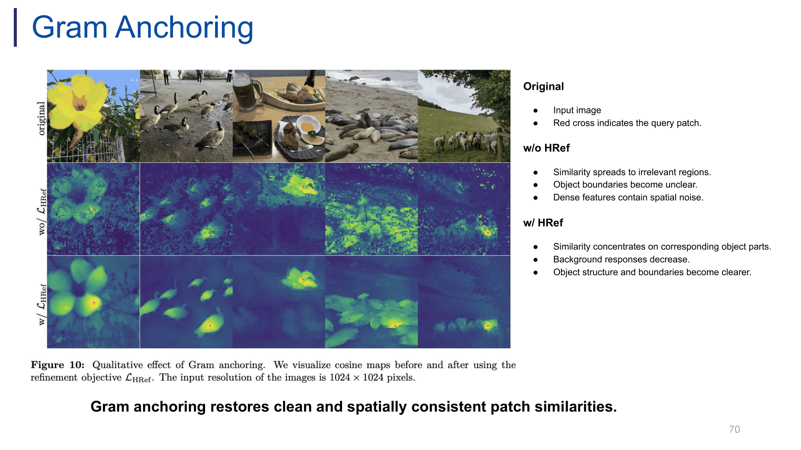

*p.70 — Figure 10: w/o $\mathcal{L}_{\text{HRef}}$는 유사도가 배경으로 번지고 노이즈, w/ $\mathcal{L}_{\text{HRef}}$는 대응 객체 부위에 집중·경계 선명 (입력 1024×1024).*

- w/o HRef: similarity가 무관한 영역으로 퍼짐, 경계 불분명, dense feature에 spatial noise.
- w/ HRef: 대응 객체 부위에 집중, 배경 응답 감소, 구조·경계 선명.
- **"Gram anchoring restores clean and spatially consistent patch similarities."**
- ← p.69는 $\mathcal{L}_{\text{Gram}}$, p.70은 $\mathcal{L}_{\text{HRef}}$로 설명 없이 혼용. HRef = high-resolution refinement로 추정. "Red cross indicates the query patch"라 했지만 원본 행엔 표시 없고 cosine map 행에 빨간 점이 있음.

> 보충: style transfer의 Gram loss(Gatys et al., 2016)와 같은 형태. $\mathcal{L}_{\text{HRef}}$ = Gram teacher에 고해상도 입력을 넣어 얻은 더 좋은 patch feature를 student 해상도로 downsample한 뒤 Gram loss.

### 6.3 DINO 계열 진화 정리

| | DINO (2021) | DINOv2 (2024) | DINOv3 (2025) |
|---|---|---|---|
| 핵심 | EMA teacher self-distillation, CE on softmax | DINO + iBOT + KoLeo + curated data + scaling + distill | 긴 학습 + Gram anchoring |
| 데이터 | ImageNet-1K | LVD-142M (curated) | 더 큰 규모 |
| collapse 방지 | centering + sharpening | SK centering + KoLeo | (계승) |
| 문제 의식 | label 없이 semantic 표현 | 범용 frozen feature (global + dense) | 긴 학습 시 dense feature 열화 |

---

## 7. 열린 질문 (p.71–72)

- Can positive views be **generated** rather than augmented? → SynCLR
- Can SSL scale into a **general-purpose visual foundation model**? → DINOv2/v3가 부분적 답
- Do we still need **carefully designed augmentations**?
- Recent studies reconsider how views are **generated, matched, and scaled**.
- Next week: Contrastive Learning 계속.

---

## 시험 대비 핵심 정리

### A. 꼭 외울 수식

| 이름 | 수식 | 포인트 |
|---|---|---|
| InfoNCE bound | $I(x;c)\ge\log N - \mathcal{L}_{\text{InfoNCE}}$ | $N$↑ → bound tight → large batch |
| True negative 분포 | $p_x^- = (p - \eta^+ p_x^+)/\eta^-$ | 혼합분포 $p = \eta^+p^+ + \eta^-p^-$에서 유도 |
| Debiased $g$ | $\max\{\frac{1}{\eta^-}(\frac1N\sum e^{f^\top f(u_i)} - \frac{\eta^+}{M}\sum e^{f^\top f(v_i)}), e^{-1/\tau}\}$ | 분모 negative 합을 $Ng$로 교체, clamp는 음수 방지 |
| Mixup | $\tilde x = \lambda x_i + (1-\lambda)x_j$, $\tilde y$ 동일 | global, label도 보간 |
| CutMix | $\mathbf{M}_b\odot I_1 + (1-\mathbf{M}_b)\odot I_2$ | region, label = 면적비 |
| SimCLR NT-Xent | $\ell(i,j) = -\log\frac{\exp(s_{ij}/\tau)}{\sum_{k=1}^{2N}\mathbb{1}_{[k\ne i]}\exp(s_{ik}/\tau)}$, $\mathcal{L} = \frac{1}{2N}\sum_k[\ell(2k{-}1,2k)+\ell(2k,2k{-}1)]$ | positive 1 + negative $2N-2$ |
| BYOL | $\|\bar q_\theta(z_\theta) - \bar z'\|_2^2 = 2 - 2\cos$, $\xi\leftarrow\tau\xi + (1-\tau)\theta$ | negative 없음, 대칭, $\theta$만 학습 |
| Barlow Twins | $\sum_i(1-\mathcal{C}_{ii})^2 + \lambda\sum_i\sum_{j\ne i}\mathcal{C}_{ij}^2$, $\mathcal{C}_{ij} = \frac{\sum_b z^A_{b,i}z^B_{b,j}}{\sqrt{\sum_b (z^A_{b,i})^2}\sqrt{\sum_b (z^B_{b,j})^2}}$ | batch 방향, $D\times D$ |
| DINO | $H(P_t,P_s) = -\sum P_t\log P_s$, $\theta_t\leftarrow\lambda\theta_t + (1-\lambda)\theta_s$, $c\leftarrow mc + (1-m)\frac1B\sum g_{\theta_t}(x_i)$ | centering + sharpening ($\tau_t<\tau_s$) |
| Multi-positive (SynCLR) | $\mathbf{q}_i = \text{softmax}(\mathbf{a}\cdot\mathbf{b}_i/\tau)$, $\mathbf{p}_i = \mathbb{1}_{\text{match}}/\sum\mathbb{1}_{\text{match}}$, $\mathcal{L} = H(\mathbf{p},\mathbf{q})$ | $m=1$이면 InfoNCE |
| iBOT | $-\sum_i p_{ti}\log p_{si}$ ($i$ = masked patch) | patch-level |
| KoLeo | $-\frac1n\sum_i\log d_{n,i}$, $d_{n,i} = \min_{j\ne i}\|x_i - x_j\|$ | crowding 방지 |
| Gram anchoring | $\|\mathbf{X}_S\mathbf{X}_S^\top - \mathbf{X}_G\mathbf{X}_G^\top\|_F^2$ | 회전 불변, 관계 구조만 보존 |

### B. 꼭 외울 정의

- **Hard negative**: anchor와 의미는 다르지만 embedding 공간에서 가까운 negative.
- **False negative / sampling bias**: random negative에 anchor와 같은 latent class 샘플이 섞이는 것 → 같은 class를 밀어내 성능 저하.
- **Linear evaluation**: encoder freeze + linear classifier만 학습. **Semi-supervised fine-tuning**: 1%/10% label로 encoder까지 fine-tune. **k-NN**: 학습 없이 최근접 투표 (semantic clustering 품질).
- **Collapse**: 모든 입력이 같은(또는 소수의) 출력으로 매핑되는 trivial solution. **Crowding**: 서로 다른 이미지 feature가 좁은 영역에 몰림. **Assignment collapse**: 소수 prototype만 사용.
- **EMA teacher / stop-gradient**: target/teacher는 gradient 없이 online/student의 이동평균으로만 갱신.
- **Projection head**: loss는 $z = g(h)$에서, downstream은 $h$ 사용.
- **Positive set (SynCLR)**: 같은 caption에서 서로 다른 noise로 생성한 이미지들.

### C. 비교 포인트

1. **SimCLR vs BYOL vs Barlow Twins vs DINO** — negative 필요 여부, collapse 방지 수단(negative / predictor+EMA+sg / redundancy reduction / centering+sharpening), loss(InfoNCE / MSE / cross-corr / CE), batch 의존성.
2. **Sample-level ($B\times B$) vs feature-level ($D\times D$)** — SimCLR vs Barlow Twins.
3. **Feature matching vs distribution matching** — BYOL(MSE, predictor) vs DINO(CE, softmax).
4. **AutoAugment vs RandAugment vs PBA** — RL search fixed policy (15,000 child) / random + $N$, $M$ / PBT online schedule (16 child).
5. **Mixup vs Cutout vs CutMix vs MoCHi** — global pixel / 영역 삭제 / 영역 교체 / feature-space hard negative 합성.
6. **SimCLR vs Supervised vs SynCLR의 positive 정의** — image identity(너무 세밀) / label(너무 거침) / caption(중간, 객체·행동·관계).
7. **DINO vs DINOv2** — 데이터, 학습 수준(image vs image+patch), 모델 크기, 표현 성격, 위상.
8. **KoLeo vs SK centering** — student feature uniformity vs teacher target 균형.
9. **Feature distillation vs Gram anchoring** — 값 매칭 vs similarity 구조 매칭.

### D. 예상 서술형 질문 + 모범답안 방향

1. **Contrastive learning에서 large batch가 왜 필요한가? 한계와 대안은?**
   → in-batch negative 수 $2(N-1)$↑, 다양성↑, InfoNCE MI bound tight. SimCLR Fig.9: 짧은 학습에서 특히 효과. 한계: 메모리·TPU. 대안: memory bank/queue(MoCo), negative-free(BYOL, Barlow Twins, DINO), debiased loss(작은 batch에서 이득).

2. **False negative 문제를 설명하고 Debiased contrastive loss가 이를 어떻게 해결하는지 유도하라.**
   → random 분포 $p = \eta^+p^+ + \eta^-p^-$ → $p^- = (p - \eta^+p^+)/\eta^-$. 기댓값에서 $p$ 샘플 $N$개와 positive $M$개로 true negative 항을 추정해 분모를 $Ng$로 교체. 음수 방지 위해 $e^{-1/\tau}$ clamp. $M$↑일수록 Unbiased에 근접(t-SNE).

3. **SimCLR에서 projection head를 쓰고 학습 후 버리는 이유는?**
   → contrastive loss가 $z$를 augmentation에 invariant하게 만들어 색·방향 등 downstream에 유용한 정보를 버림. $g$가 이를 흡수해 $h$에 정보 보존. 실험: non-linear > linear > none(~10%p 차이), 출력 차원엔 둔감.

4. **BYOL은 negative 없이 어떻게 collapse를 피하는가? 두 네트워크가 필요한 이유는?**
   → online에만 predictor(비대칭) + target은 EMA(천천히 변하는 안정적 target) + stop-gradient. 하나의 네트워크로 자기 출력을 target으로 쓰면 target이 같이 요동해 불안정. DQN target network와 같은 발상. loss = $2-2\cos$, 분모(negative) 없음.

5. **Barlow Twins의 loss를 쓰고 각 항의 의미와 collapse 방지 원리를 설명하라.**
   → 대각 $\to 1$: augmentation 불변(invariance), 비대각 $\to 0$: feature decorrelation(redundancy reduction). $\mathcal{C}$는 batch 방향으로 계산한 $D\times D$. 모든 feature가 같아지면 비대각 상관↑ → penalty → negative/predictor/EMA 없이 collapse 방지, batch size에 robust.

6. **DINO의 centering과 sharpening은 각각 어떤 collapse를 막는가? BYOL과 비교하라.**
   → centering: 한 차원 지배 방지(대신 uniform 경향), sharpening(낮은 $\tau_t$): uniform 방지 → 상호 균형. BYOL = feature matching(MSE) + predictor, DINO = distribution matching(CE) + centering/sharpening, 공통 = EMA teacher, no label, no negative. DINO는 ViT에서 k-NN 강함, emergent segmentation.

7. **SynCLR가 SimCLR와 positive를 정의하는 방식의 차이와 그 장점·한계는?**
   → SimCLR: 같은 이미지 + 다른 augmentation(pair, image identity, low-level 변이). SynCLR: LLM caption → diffusion 4장(set, caption semantics, pose·구도·배경 등 high-level 변이), low CFG로 diversity. caption이 class granularity를 조절 → SimCLR의 false negative, supervised의 행동/배경 무시를 완화. loss는 multi-positive CE ($m=1$이면 InfoNCE). 결과: synthetic-only로 CLIP급 linear, ADE20K에서 DINOv2급. 한계: 생성 모델의 bias·coverage 상속.

8. **"DINOv2는 새 loss가 아니라 system이다"의 의미를 구성 요소별로 설명하라.**
   → DINO(image-level CLS) + iBOT(masked patch-level) + KoLeo(feature uniformity) + LVD-142M(dedup + retrieval curation) + scaling(ViT-g → distill). 추가로 SK centering, untied head, high-res adaptation(마지막만 518). 교훈: objective만으론 부족, 데이터 품질·patch-level·안정화·distillation.

9. **LVD-142M 큐레이션 과정과 "useful scaling requires curated data"의 의미는?**
   → 1.2B 웹 + curated set → SSCD descriptor cosine > $\tau$로 near-duplicate 제거 → ViT-H/16 embedding으로 curated와 가까운 이미지 retrieval(sample / cluster, cluster는 1M cap) → 142M. 웹 데이터의 중복·long-tail·저품질을 label 없이 rebalance. 중복은 bias, memorization, leakage 유발.

10. **DINOv3에서 발견된 문제와 Gram anchoring이 feature가 아니라 Gram matrix를 맞추는 이유는?**
    → 긴 학습 시 global(분류)은 개선되지만 dense(patch similarity, segmentation)는 열화. 깨끗했던 earlier model의 patch Gram matrix를 anchor로 $\|X_SX_S^\top - X_GX_G^\top\|_F^2$. Gram은 회전 불변 → 관계 구조만 고정하고 feature 자체는 자유롭게 → global 개선과 dense 품질 동시 유지.

### E. 숫자 체크리스트 (자주 나올 만한 것)

- SimCLR linear: ResNet-50 **69.3**, 2× 74.2, 4× **76.5** (≈ supervised). batch 4096~8192.
- BYOL linear **74.3**, Barlow Twins **73.2**, SwAV 75.3, MoCo v2 71.1, DINO RN50 **75.3 / k-NN 67.5**, DINO ViT-S **77.0 / 74.5**, ViT-B/8 80.1.
- Semi-sup 1% Top-1: SimCLR 48.3 / BYOL 53.2 / Barlow Twins **55.0** / Supervised 25.4.
- CutMix: Cls +2.3, Loc +1.0, Det +1.1 (Mixup은 Loc −0.5, Det −1.7).
- AutoAugment 15,000 child (PPO) vs PBA 16 child (PBT 1회).
- SynCLR: 150M caption × 4 = **600M** images, Average ViT-L **90.4**, ADE20K ViT-L **57.7**.
- DINOv2: 1.2B → **LVD-142M**, ViT-g ~1B, high-res **518×518**, KoLeo weight 0.1.
