# 05. Contrastive Learning III — Memory Bank · Clustering · Supervised Datasets

> **한 줄 요약**: contrastive learning의 두 축, 곧 **"negative를 어떻게 많이·일관되게 확보하나"**(Memory Bank → MoCo)와 **"positive를 무엇으로 정의하나"**(cluster/prototype → DeepCluster·SwAV, text·label → CLIP·SupCon)를 정리하고, 최근 확장(NNCLR/All4One, PAPN, SCL-RHE)까지 다룬 강의.

---

## 이 강의의 큰 그림

```
Contrastive learning = (positive 정의) × (negative 확보 방식)

 ┌─ 1. Learning from Memory Bank  ── "negative를 싸고 많게"
 │     InstDisc(memory bank, 2018) → MoCo(queue + momentum encoder, 2020) → MoCo v2 → CURL(RL 적용)
 │
 ├─ 2. Clustering                  ── "instance 말고 cluster 단위로"
 │     DeepCluster(offline k-means + pseudo label) → SwAV(online code + swapped prediction)
 │
 ├─ 3. Working with Supervised Datasets ── "positive를 supervision으로 정의"
 │     CLIP(image–text pair = positive) / SupCon(같은 class = positive)
 │
 └─ 4. 확장 주제 (최근 논문)
       4.1 memory bank에서 positive도 꺼내기: NNCLR → All4One (ICCV 2023)
       4.2 cluster/prototype 기반 SSL이 fine-grained 디테일을 보존하나: PAPN (ICCV 2025)
       4.3 SupCon에 label noise가 있으면: SCL-RHE (ECCV 2024)
```

**핵심 질문**
1. negative가 많을수록 좋은데, batch 크기에 묶이지 않고 **많고 일관된(consistent)** negative를 어떻게 얻나? → memory bank, MoCo
2. instance discrimination은 같은 class 이미지도 negative로 미는 **false negative** 문제가 있음 → cluster(DeepCluster/SwAV), label(SupCon), nearest neighbor(NNCLR)로 positive를 넓히기
3. label/text 같은 supervision을 contrastive에 결합하면? → CLIP(zero-shot), SupCon(CE보다 robust)
4. 그 supervision 자체가 틀렸으면? → SCL-RHE (FP가 지배적, easy positive를 덜 신뢰)

> 보충: 원 논문 — InstDisc = Wu et al., CVPR 2018 / MoCo = He et al., CVPR 2020 / MoCo v2 = Chen et al., 2020 / CURL = Srinivas et al., 2020 (ICML) / DeepCluster = Caron et al., ECCV 2018 / SwAV = Caron et al., NeurIPS 2020 / CLIP = Radford et al., ICML(PMLR) 2021 / SupCon = Khosla et al., NeurIPS 2020 / All4One = Estepa et al., ICCV 2023 / PAPN = Tan et al., ICCV 2025 / SCL-RHE = Long et al., ECCV 2024.

---

## 1. Learning from Memory Bank (p.3–21)

### 1.1 왜 Memory Bank인가 (p.4)

- **많은 negative가 contrastive 성능을 올림** ← InfoNCE 분모의 합이 전체 데이터 분포를 더 잘 근사하고, hard negative가 포함될 확률이 커짐
- 문제: 모든 negative의 embedding을 매번 계산(forward + backward)하는 건 비쌈. SimCLR식 **mini-batch negative**는 batch size에 묶임 → 큰 batch는 GPU 메모리 한계
- 해결: 과거 iteration에서 계산한 embedding을 **memory에 저장(Store)** 하고 negative로 **재사용(Reuse)** → negative 수가 batch size와 분리(decouple)
- **Key Idea**: Trade stale representations for efficient large-scale contrastive learning
- 대가 = **staleness**: 저장된 embedding은 과거 encoder 파라미터로 만든 값이라 현재 encoder와 불일치

| | 수 | 신선도 |
|---|---|---|
| Mini-batch negatives | Limited (적음) | **Fresh** (항상 현재 encoder) |
| Memory bank negatives | **Large** (많음) | Slightly Stale (과거 encoder) |

→ 이 trade-off가 MoCo(momentum encoder + queue)의 동기.

### 1.2 Instance Discrimination with Memory Bank (Wu et al., CVPR 2018) (p.5–9)

#### 개념 (p.5)

- **Instance contrastive learning**: 각 이미지를 **하나의 고유 class**로 봄
  - Positive pair: 같은 이미지 (실제 구현은 같은 이미지의 augmentation)
  - Negative pairs: 나머지 모든 이미지
- 데이터셋 N개 이미지 → **N-way 분류**를 pretext task로 정의. label 불필요, 데이터 자체가 supervision
- 일반 classification과의 차이: class 수가 N(ImageNet이면 약 128만)으로 매우 많고, class당 샘플이 1개뿐

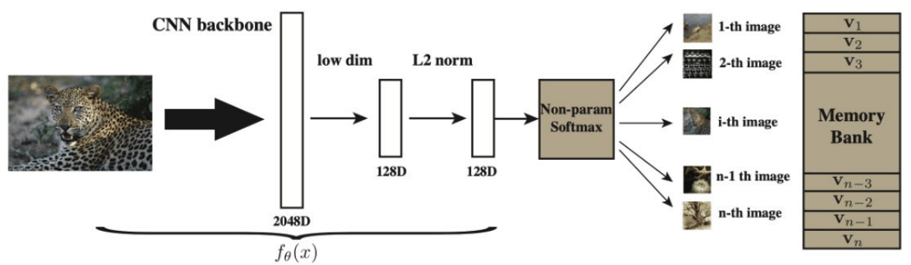

*p.6 — 이미지 → CNN backbone(2048D) → 128D → L2 norm = $f_\theta(x)$ → Non-param Softmax, 오른쪽 Memory Bank의 각 행 $\mathbf v_i$가 softmax의 각 class(이미지)에 대응.*

- 그림 해석: 단위 구면 위 128D 벡터를 i번째 이미지(class)에 대한 확률로 변환. memory bank의 각 행이 softmax 출력 노드와 대응 → **bank = 분류기 weight 행렬 역할**

> 보충: 직관은 supervised network의 softmax 출력에서 표범 사진에 대해 시각적으로 비슷한 class(jaguar, cheetah)에는 높은 확률이, 무관한 class에는 매우 낮은 확률이 나온다는 관찰. label 없이도 class 간 유사도가 학습된다는 점 → class를 instance까지 쪼개 학습해도 의미적 유사도를 배울 수 있다는 아이디어.

#### 왜 그냥 softmax를 못 쓰나 → NCE + Memory Bank (p.6)

- N이 백만 단위면 N-way softmax는 (1) 파라미터 $N\times d$가 크고 (2) 정규화 상수(분모)를 매번 N개 전부로 계산 → **Unfeasible**
- 해결 두 가지
  - **NCE (Noise Contrastive Estimation)**: N-way 분류를 "데이터 분포에서 온 샘플 vs noise 분포에서 온 샘플"의 **이진 분류**로 바꾸고 negative를 M개만 샘플링
  - **Memory bank**: 각 이미지 i의 최신 feature $\mathbf v_i$를 저장해 class weight로 재사용. 매 iteration 갱신되는 건 batch에 포함된 이미지 항목뿐

#### Non-parametric Softmax (p.7)

$$P(C=i \mid \mathbf{v}) = \frac{\exp(\mathbf{v}_i^\top \mathbf{v}/\tau)}{\sum_{j=1}^{n}\exp(\mathbf{v}_j^\top \mathbf{v}/\tau)},\qquad \mathbf v = f_\theta(x),\quad V=\{\mathbf v_i\}$$

- $x$: 입력 이미지, $f_\theta$: CNN encoder, $\mathbf v$: L2-normalized 128D embedding ($\|\mathbf v\|=1$)
- $\mathbf v_i$: memory bank에 저장된 i번째 이미지 embedding (= class $i$의 prototype/weight)
- $\tau$: temperature ← 작을수록 분포가 sharp, hard negative에 큰 가중
- $n$: 전체 이미지 수 (= class 수)
- **"Non-parametric"인 이유**: 일반 softmax의 학습 weight $\mathbf w_i$를 **$\mathbf v_i$(feature 자체)로 대체** → 별도 분류기 파라미터 없음
- 장점: train/test 같은 metric(cosine) → test 시 kNN으로 바로 평가 가능. L2 norm 덕에 $\mathbf v_i^\top\mathbf v\in[-1,1]$, $\tau$로 스케일 조절
- 식 구조는 InfoNCE softmax와 **유사**(단, bank 전체를 후보로 하는 N-way 분류)

> 보충: 논문에서는 bank 항목을 현재 feature로 덮어쓰고 다시 L2 normalize. 기본값 $\tau=0.07$, 128D, $M=4096$, $\lambda=0.5$ (기억 기반, 확인 필요).

#### Monte Carlo 근사 + NCE loss + Proximal regularization (p.8)

분모를 N개 전부 계산하는 건 너무 비쌈 → 무작위 M개로 **Monte Carlo 근사**:

$$P(i\mid\mathbf{v}) = \frac{\exp(\mathbf{v}^\top\mathbf{f}_i/\tau)}{\sum_{j=1}^{N}\exp(\mathbf{v}_j^\top\mathbf{f}_i/\tau)} \simeq \frac{\exp(\mathbf{v}^\top\mathbf{f}_i/\tau)}{\frac{N}{M}\sum_{k=1}^{M}\exp(\mathbf{v}_{j_k}^\top\mathbf{f}_i/\tau)}$$

- M개 평균 × N = 분모의 불편 추정량. 계산량 $O(N)\to O(M)$. $j_k$ = k번째로 샘플된 index
- ← 슬라이드 표기 주의: 여기선 $\mathbf f_i$ = 이미지 i의 **현재 feature**, $\mathbf v$ = **bank 항목**으로 읽어야 함. p.7과 $\mathbf v$의 의미가 뒤바뀜 (논문 원문 표기)

NCE loss (proximal 항 포함):

$$\mathcal{L}_{\text{instance}} = -\mathbb{E}_{P_d}\Big[\log h(i,\mathbf{v}_i^{(t-1)}) - \lambda\|\mathbf{v}_i^{(t)}-\mathbf{v}_i^{(t-1)}\|_2^2\Big] - M\,\mathbb{E}_{P_n}\Big[\log\big(1-h(i,\mathbf{v}'^{(t-1)})\big)\Big]$$

$$h(i,\mathbf{v}) = \frac{P(i\mid\mathbf{v})}{P(i\mid\mathbf{v})+M P_n(i)},\qquad P_n = 1/N \ (\text{uniform noise})$$

- **$h(i,\mathbf v)$**: "feature $\mathbf v$와 ID $i$가 주어졌을 때, 이 쌍이 **실제 데이터에서 왔을 확률**" (NCE 이진분류의 posterior). 분모의 $MP_n(i)$ = noise가 그 쌍을 만들 확률(negative를 M배 더 뽑으므로 M배)
- 첫 항: positive에 대해 $\log h$ ↑ → 자기 ID와 feature가 맞다고 분류
- 둘째 항: noise 샘플 $\mathbf v'$에 대해 $h$ ↓ → negative를 noise로 분류
- **Proximal regularization** $\lambda\|\mathbf v_i^{(t)}-\mathbf v_i^{(t-1)}\|_2^2$: (t) 현재, (t−1) 이전 iteration. 각 class(이미지)가 **epoch당 한 번만 방문**돼 학습이 불안정·진동 → 이전 값에서 크게 벗어나지 않게 함. 수렴하면 $\mathbf v^{(t)}\approx\mathbf v^{(t-1)}$이라 **점차 사라짐**
- 기호: $P_d$ 데이터 분포, $P_n$ noise 분포, $\lambda$ proximal 가중, $M$ negative 수, $\mathbf v'$ noise에서 샘플된 bank 항목
- 부호: 전체에 −가 붙어 최소화하므로 proximal 항은 결과적으로 $+\lambda\|\cdot\|^2$ 페널티

> 보충: 논문은 normalizing constant $Z$를 첫 배치에서 Monte Carlo로 추정해 상수로 고정. 슬라이드의 $N/M$ 스케일이 그 근사.

#### Memory Bank Pros/Cons (p.9)

| Pros | Cons |
|---|---|
| Large number of negative samples | Stored embeddings become **stale** |
| Low computational cost (매 step 전체 재-forward 불필요, batch 크기와 무관) | 현재 query를 **outdated feature**와 비교 (bank 항목은 보통 한 epoch 전 encoder 출력) |

- 학습 초반처럼 encoder가 빨리 변할수록 불일치 큼
- **Question: Can we keep a large dictionary while reducing feature staleness?** → MoCo

> 보충: Wu et al.은 mini-batch 샘플의 bank 항목을 현재 feature로 덮어쓰고 proximal regularization으로 안정화. 근본적으로 bank 항목이 "과거 encoder 출력"이라는 점은 그대로.

### 1.3 MoCo — Momentum Contrast (He et al., CVPR 2020) (p.10–15)

#### 아이디어 (p.10)

- contrastive learning = **dictionary look-up**: query $q$가 dictionary의 key들 중 자기 positive key $k^+$와 매칭되도록 학습
- 좋은 dictionary 조건: **(1) 크기가 클 것, (2) key들이 일관된 encoder로 만들어졌을 것**
  - memory bank: (1) O, (2) X
  - end-to-end(SimCLR): (2) O, (1)이 batch 크기에 묶임
- MoCo: **FIFO queue**에 최근 mini-batch의 key를 쌓고(가장 오래된 batch는 dequeue), key는 **momentum encoder**로 생성
- **Key Idea**: Replace the memory bank with a momentum-updated queue

#### 구조·loss·momentum update (p.11)

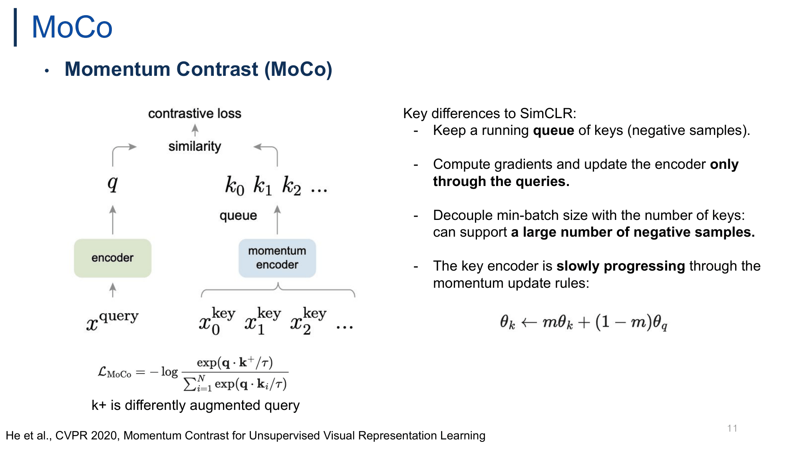

*p.11 — $x^{query}$→encoder→$q$, $x^{key}$들→momentum encoder→queue의 $k_0,k_1,\dots$, similarity → contrastive loss. 오른쪽은 SimCLR와의 차이.*

$$\theta_k \leftarrow m\theta_k + (1-m)\theta_q$$

$$\mathcal{L}_{\text{MoCo}} = -\log \frac{\exp(\mathbf{q}\cdot\mathbf{k}^+/\tau)}{\sum_{i=1}^{N}\exp(\mathbf{q}\cdot\mathbf{k}_i/\tau)}$$

- 기호: $q=f_q(x^q)$ query encoder 출력, $k=f_k(x^k)$ key encoder 출력, $k^+$ = 같은 이미지에서 나온 positive key, $k_i$ = queue의 key(negative), $\tau$ temperature, $\theta_q,\theta_k$ 각 encoder 파라미터, $m\in[0,1)$ momentum 계수
- 슬라이드 "k+ is differently augmented query" ← 정확히는 같은 이미지를 **다른 augmentation**으로 변환해 **key encoder**에 통과시킨 key (query 자체 아님). 분모 합에 $k^+$도 포함되어야 함 (논문은 $K+1$개 key, $k_0=k^+$)
- Loss = **InfoNCE**: positive 1개 + negative K개에 대한 $(1+K)$-way softmax CE. L2 normalize면 $q\cdot k$ = cosine similarity
- **Momentum update**: $\theta_k$는 backprop 없이 $\theta_q$의 **EMA**로만 갱신. $m$이 1에 가까울수록(기본 0.999) key encoder가 천천히 변해 queue 안 key들이 **일관(consistent)**
- **SimCLR와의 Key differences**
  - running **queue** of keys를 negative로 유지
  - gradient는 **query 쪽으로만** 흐름 (key는 stop-gradient)
  - mini-batch size와 key 수를 **decouple** → 많은 negative ← 슬라이드 "min-batch"는 mini-batch 오타
  - key encoder는 momentum으로 **slowly progressing**

> 보충: 논문 ablation — $m=0$(momentum 없음)이면 학습 수렴 실패, $m=0.9$면 성능 저하, 0.99~0.999에서 양호. 즉 **느린 진화가 핵심**.

#### Pseudocode (p.12)

```python
# f_q, f_k: encoder networks for query and key
# queue: dictionary as a queue of K keys (CxK)
# m: momentum,  t: temperature
f_k.params = f_q.params # initialize
for x in loader: # load a minibatch x with N samples
    x_q = aug(x) # a randomly augmented version
    x_k = aug(x) # another randomly augmented version
    q = f_q.forward(x_q) # queries: NxC        ← "Generate a positive pair"
    k = f_k.forward(x_k) # keys: NxC
    k = k.detach()       # no gradient to keys ← "No gradient through the key"
    l_pos = bmm(q.view(N,1,C), k.view(N,C,1))  # positive logits: Nx1
    l_neg = mm(q.view(N,C), queue.view(C,K))   # negative logits: NxK ← "running queue as negatives"
    logits = cat([l_pos, l_neg], dim=1)        # Nx(1+K)
    labels = zeros(N)                          # positives are the 0-th ← "InfoNCE loss"
    loss = CrossEntropyLoss(logits/t, labels)
    loss.backward(); update(f_q.params)        # SGD update: query network
    f_k.params = m*f_k.params+(1-m)*f_q.params # ← "Update f_k through momentum"
    enqueue(queue, k); dequeue(queue)          # ← "Update the FIFO negative sample queue"
```

- 한 step: (1) augmentation 2번 → $x_q,x_k$ (2) $q$, $k$ 계산, $k$ detach (3) positive logit $N\times1$, negative logit $N\times K$ (4) concat → $N\times(1+K)$, **label은 항상 0**(positive가 0번째 열)이라 일반 CE로 InfoNCE 구현 (5) $f_q$만 SGD (6) $f_k$ EMA (7) enqueue/dequeue
- 순서 주의: queue 갱신은 loss 계산 **후** → 현재 batch의 $k$가 자기 negative로 들어가지 않음
- 왜 detach? 수만 개 key에 backprop 안 해도 됨 → 메모리·연산 절약, dictionary 크기를 batch와 분리 가능

> 보충: 논문은 BN을 통한 batch 내 정보 leak(shortcut)을 막으려 **Shuffling BN** 사용 (pseudocode에선 생략).

#### End-to-end vs Memory bank vs MoCo (p.13–14)

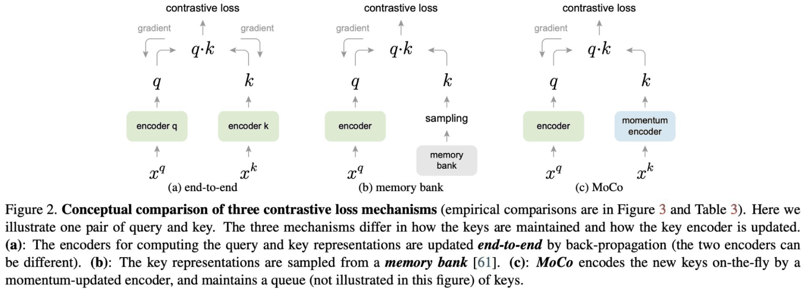

*p.13 (MoCo Figure 2) — 세 mechanism의 차이는 key를 어떻게 유지하고 key encoder를 어떻게 갱신하느냐. (a) 양쪽 gradient, (b) bank에서 sampling, (c) momentum encoder.*

| | End-to-End | Memory Bank | MoCo |
|---|---|---|---|
| Query | Current encoder | Current encoder | Current encoder |
| Key | Current encoder | Memory bank | Momentum encoder |
| Negative Source | Mini-batch | Memory bank | FIFO queue |
| Dictionary Size | Small | Large | Large |
| Feature Freshness | Fresh | Stale | **Consistent** |
| Encoder Update | Backpropagation | Backpropagation | Momentum Update |

- MoCo = **end-to-end + memory bank의 hybrid**: memory bank처럼 큰 dictionary + momentum encoder로 더 일관된 key
- 핵심 trade-off = **Dictionary Size × Freshness**: end-to-end (작음, 신선) / memory bank (큼, stale) / MoCo (큼, consistent)
- "Fresh" ≠ "Consistent": MoCo key는 약간 과거의 momentum encoder 출력이라 완전히 fresh는 아니지만, queue 내 key들이 **서로 비슷한 encoder**로 만들어져 일관됨
- ← 표의 MoCo "Momentum Update"는 **key encoder**에만 해당. query encoder는 backprop (표만 보면 오해 소지)

#### 실험 결과 (p.15)

- **Table 1 (ImageNet linear classification)**: MoCo R50(24M) **60.6** > InstDisc 54.0, LocalAgg 58.8. R50w4x(375M)에서 **68.6** (CMC 68.4†, AMDIM large 68.1†보다 약간 높음). 대체로 최신 contrastive 방식(MoCo/CMC/AMDIM)이 pretext task 방식(Jigsaw 44.6, Rotation 55.4, Colorization 39.6)보다 높음. 단 항상은 아님(CPC v1 48.7 < Rotation 55.4)
  - 기타: Exemplar 46.0, RelativePosition 51.4, DeepCluster(VGG) 48.4, BigBiGAN 56.6/61.3, CPC v2 65.9, CMC 64.1†/68.4†, AMDIM 63.5†/68.1†. MoCo RX50 63.9, R50w2x 65.4
  - ← †: 원 논문에서 ImageNet label로 supervised된 FastAutoAugment를 pre-training에 쓴 결과 표기 (확인 필요)
- **Table 2 (PASCAL VOC detection, Faster R-CNN)**: unsupervised pre-training이 **ImageNet supervised와 대등하거나 능가**, 특히 AP75. 데이터를 IG-1B(Instagram 1B)로 키우면 이득 증가
  - R50-dilated-C5: super. IN-1M 81.4/54.0/59.1, MoCo IN-1M 81.1/54.6/59.9, MoCo IG-1B 81.6/55.5/61.2
  - R50-C4: super. 81.3/53.5/58.8, MoCo IN-1M 81.5/55.9/62.6, MoCo IG-1B 82.2/57.2/63.7
- **Table 3 (세 mechanism 직접 비교, VOC detection)**:

| pre-train | R50-dil-C5 AP50 | AP | AP75 | R50-C4 AP50 | AP | AP75 |
|---|---|---|---|---|---|---|
| end-to-end | 79.2 | 52.0 | 56.6 | 80.4 | 54.6 | 60.3 |
| memory bank | 79.8 | 52.9 | 57.9 | 80.6 | 54.9 | 60.6 |
| **MoCo** | **81.1** | **54.6** | **59.9** | **81.5** | **55.9** | **62.6** |

→ **MoCo > memory bank > end-to-end**: "큰 dictionary + 일관성"의 중요성 실증. end-to-end가 가장 낮은 건 batch 크기 제약(작은 dictionary) 때문.

### 1.4 MoCo v2 (Chen et al., 2020) (p.16–19)

- **새 구조가 아니라 SimCLR에서 검증된 레시피를 MoCo에 이식한 improved baseline** (짧은 tech report)
  - **MLP projection head** (linear FC → 2-layer MLP with ReLU)
  - **Stronger data augmentation** (Gaussian blur 추가, 강한 color distortion)
  - (+ cosine LR schedule, 더 긴 학습)
- queue + momentum encoder는 **유지** → 큰 batch 불필요, 일반 8-GPU 머신에서 학습 가능
- **Key Idea**: Combine MoCo with SimCLR's effective training strategies

#### Ablation (p.17, Table 1, ResNet-50)

| case | MLP | aug+ | cos | epochs | ImageNet acc. | VOC AP50 | AP | AP75 |
|---|---|---|---|---|---|---|---|---|
| supervised | | | | | 76.5 | 81.3 | 53.5 | 58.8 |
| MoCo v1 | | | | 200 | 60.6 | 81.5 | 55.9 | 62.6 |
| (a) | ✓ | | | 200 | 66.2 | 82.0 | 56.4 | 62.6 |
| (b) | | ✓ | | 200 | 63.4 | 82.2 | 56.8 | 63.2 |
| (c) | ✓ | ✓ | | 200 | 67.3 | **82.5** | 57.2 | 63.9 |
| (d) | ✓ | ✓ | ✓ | 200 | 67.5 | 82.4 | 57.0 | 63.6 |
| (e) | ✓ | ✓ | ✓ | **800** | **71.1** | **82.5** | **57.4** | **64.0** |

- MLP만 +5.6%p, aug만 +2.8%p, 둘 다 67.3 → **MLP 효과 > augmentation**, 둘은 대체로 가산적
- cosine LR +0.2%p 미미, 200 → 800 epoch로 71.1 → contrastive는 **오래 학습할수록 이득**
- linear acc는 크게 오르지만 VOC detection 변화폭은 작음(81.5 → 82.5). 그래도 이미 supervised(81.3/53.5) 능가
- 왜 MLP head가 도움? head가 contrastive loss 특화 정보(augmentation invariance)를 담당하고, 그 앞 backbone 출력은 downstream에 유용한 정보를 보존 (SimCLR 논지)
- **Key takeaway**: Non-linear projection head and strong data augmentation are crucial

#### MoCo v2 vs SimCLR (p.18, Table 2)

| case | MLP | aug+ | cos | epochs | batch | ImageNet acc. |
|---|---|---|---|---|---|---|
| MoCo v1 | | | | 200 | 256 | 60.6 |
| SimCLR | ✓ | ✓ | ✓ | 200 | 256 | 61.9 |
| SimCLR | ✓ | ✓ | ✓ | 200 | 8192 | 66.6 |
| **MoCo v2** | ✓ | ✓ | ✓ | 200 | 256 | **67.5** |
| SimCLR | ✓ | ✓ | ✓ | 1000 | 4096 | 69.3 |
| **MoCo v2** | ✓ | ✓ | ✓ | 800 | 256 | **71.1** |

- 같은 batch 256에서 MoCo v2가 SimCLR보다 **+5.6%p**. SimCLR는 8192로 키워도 66.6으로 여전히 낮음
- 이유: SimCLR의 negative는 같은 batch 내 $2N-2$개 → **negative 수 = batch size 종속**. MoCo는 queue(예: 65536)로 **decoupling**
- 긴 학습도 MoCo v2(800ep, batch 256) 71.1 > SimCLR(1000ep, batch 4096) 69.3 → 더 짧고 훨씬 작은 batch로 더 좋음

#### Memory / time (p.19, Table 3, 8×V100 16G)

| mechanism | batch | memory/GPU | time/200-ep |
|---|---|---|---|
| **MoCo** | 256 | **5.0G** | **53 hrs** |
| end-to-end (=SimCLR) | 256 | 7.4G | 65 hrs |
| end-to-end | 4096 | 93.0G† (추정) | n/a |

- MoCo의 key encoder는 gradient 불필요(no backprop), queue negative는 이미 계산된 feature → 추가 forward/backward 불필요
- end-to-end batch 4096은 GPU당 ~93GB → 16GB V100으론 불가. **큰 batch 의존 방식은 하드웨어 진입장벽 ↑**
- 정리: MoCo v2는 **정확도 + 메모리/시간** 모두 SimCLR 대비 이득

### 1.5 CURL — Contrastive Unsupervised Representations for RL (Srinivas et al., 2020) (p.20–21)

- contrastive learning을 **강화학습(RL)** 의 pixel observation에 적용. 목적 = **sample efficiency** (적은 환경 상호작용으로 높은 성능)
- 배경: pixel 입력 RL은 고차원 이미지에서 control용 feature를 reward 신호만으로 배워야 해서 샘플이 매우 많이 필요 → contrastive auxiliary task로 representation을 별도 신호로 학습
- positive pair = 같은 observation에 **random crop** 2번. 다른 observation의 crop = negative (instance discrimination 그대로)
- **MoCo 따라** query encoder + momentum key encoder + InfoNCE
- **Key Idea**: Improve sample-efficient RL through contrastive representation learning

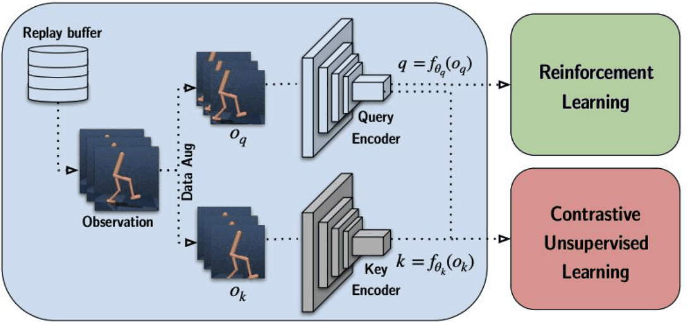

*p.21 — Replay buffer → observation → Data Aug로 $o_q, o_k$ → Query/Key Encoder. $q$는 RL과 contrastive **양쪽**으로, $k$는 contrastive로만 감.*

- 흐름: replay buffer에서 샘플 → 서로 다른 crop $o_q,o_k$ → $q=f_{\theta_q}(o_q)$, $k=f_{\theta_k}(o_k)$ → contrastive loss로 encoder 학습 + **동시에** $q$를 policy/value network 입력으로 사용
- key encoder는 EMA: $\theta_k\leftarrow m\theta_k+(1-m)\theta_q$ (슬라이드엔 수식 없음)
- **핵심 설계**: pretrain 후 freeze가 아니라 RL loss와 **jointly(auxiliary loss)** 최적화 → RL 데이터 분포 변화에 representation이 계속 적응
- MoCo/SimCLR 대비 차이: downstream이 이미지 분류가 아니라 **RL 정책 학습**, positive의 source가 replay buffer

> 보충: CURL은 similarity로 **bilinear product** $q^\top Wk$ (학습되는 $W$) 사용, 입력은 연속 frame stack이며 stack 전체에 같은 crop 적용. SAC/Rainbow DQN 위에 얹힘. DeepMind Control Suite, Atari에서 pixel 기반이 state 기반에 근접한 sample efficiency. (슬라이드엔 없음)

---

## 2. Clustering (p.22–30)

### 2.1 DeepCluster (Caron et al., ECCV 2018) (p.23–25)

#### 개념·알고리즘 (p.23–24)

- **positive/negative pair를 만들지 않고**, convnet feature를 k-means로 clustering한 결과(cluster ID)를 **pseudo label**로 삼아 일반 classification처럼 학습

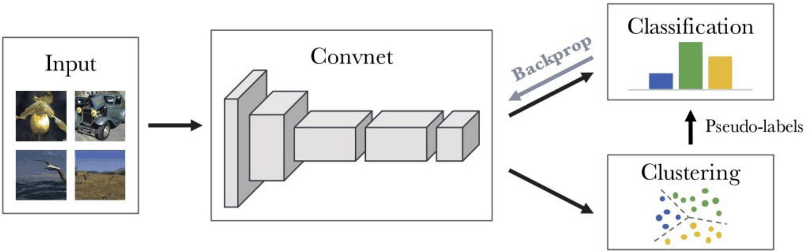

*p.23 — Input → Convnet → Clustering → Pseudo-labels → Classification, classification loss의 gradient를 Backprop.*

- Process
  1. 현재 representation으로 전체 데이터셋 feature 추출
  2. **k-means**로 clustering
  3. cluster ID를 pseudo label로 할당
  4. pseudo label로 network 업데이트 (cross-entropy)
  5. 수렴까지 반복
- **Key Idea**: Alternate between clustering and classification (EM과 유사한 교대 최적화)
- 수식으로 쓰면(슬라이드엔 없음):

$$\min_{\theta, W}\ \frac{1}{N}\sum_n \ell\big(g_W(f_\theta(x_n)),\ y_n\big),\qquad y_n \text{ from } \min_{C,\{y_n\}} \sum_n \lVert f_\theta(x_n) - C y_n\rVert^2$$

  - $f_\theta$: convnet, $g_W$: classifier head, $C$: centroid 행렬, $y_n$: one-hot cluster 할당
- 매 epoch clustering을 새로 → feature 개선 → 더 좋은 cluster → 더 좋은 label의 **self-reinforcing** 구조
- **Contrastive와의 차이**: instance 단위(같은 이미지 vs 다른 이미지)가 아니라 **cluster(그룹) 단위 의미적 유사성** → 비슷한 이미지가 같은 label을 받아 **false negative 문제를 구조적으로 회피**

> 보충: degenerate solution 방지 장치 — (1) **빈 cluster**는 비어있지 않은 centroid를 perturb해 재할당, (2) 큰 cluster 쏠림 방지를 위해 **cluster 크기에 대해 uniform sampling**, (3) cluster ID가 epoch마다 permutation되므로 마지막 classifier를 **매 epoch 재초기화**. 입력에 Sobel filter로 색 shortcut 감소. 단점: 매 epoch **전체 데이터 forward + k-means(예: k=10,000)** 필요 → online 방식보다 비효율. 출발점은 random 초기화 convnet도 어느 정도 구조적 prior를 갖는다는 관찰.

#### 결과·기여 (p.25)

- **Table 1** (frozen AlexNet conv layer별 linear classification): DeepCluster가 conv3~5에서 기존 pretext 방법 능가. ImageNet conv5 **36.1** (기존 최고 Zhang[43] 32.8), Places conv5 33.1. 반면 **conv1은 12.9**로 낮음(Random 11.6 수준) → 상위층 semantic 구조에 맞춰 학습돼 저수준 filter는 덜 최적화. supervised(conv5 50.5)와는 격차
  - DeepCluster 행: ImageNet 12.9/29.2/38.2/39.8/36.1, Places 18.6/30.8/37.0/37.5/33.1
- **Table 2** (Pascal VOC transfer, fc6-8 / ALL): DeepCluster classification 70.4/**73.7**, detection 51.4/**55.4**, segmentation 43.2/**45.1** → 당시 unsupervised 최고. ImageNet supervised(79.9/56.8/48.0) 대비 detection(−1.4)·segmentation(−2.9)은 근접, classification은 6.2%p 격차
- **Contributions**
  - clustering 기반 SSL 도입
  - pseudo-label learning을 contrastive의 **대안**으로 확립
  - 당시 unsupervised SOTA
  - SwAV, DINO 같은 후속 clustering 계열에 영향

### 2.2 SwAV — Swapping Assignments between multiple Views (Caron et al., NeurIPS 2020) (p.26–30)

#### 개념 (p.26)

- cluster assignment(code)를 **예측**하며 학습
- augmented view들에 대해 **online**으로 code 계산 (mini-batch 안에서)
- **한 view의 assignment를 다른 view로부터 예측**
- **explicit pairwise comparison도, offline clustering도 불필요**
- **Key Idea**: Learn by swapping cluster assignments between multiple views
- DeepCluster(clustering) + contrastive(multi-view augmentation) 결합. DeepCluster의 offline 비효율, contrastive의 큰 batch/memory bank 필요성을 둘 다 해소. feature를 **K개 prototype과만** 비교

> 보충: 논문 제목 "Contrasting Cluster Assignments" = instance가 아니라 cluster assignment 수준에서 contrast한다는 의미.

#### 구조·Swapped loss (p.27)

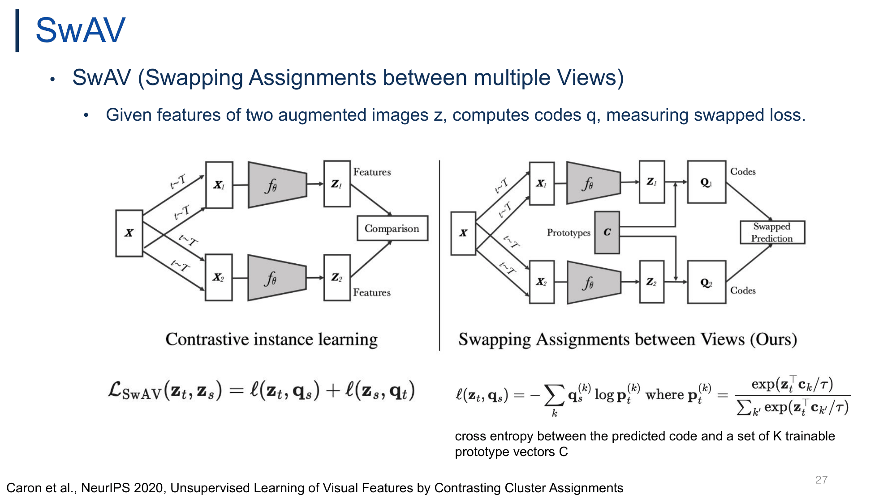

*p.27 — 왼쪽: feature끼리 직접 비교(contrastive instance learning). 오른쪽: prototype $C$로 code $Q_1,Q_2$를 만들고 swapped prediction.*

$$\mathcal{L}_{\text{SwAV}}(\mathbf{z}_t,\mathbf{z}_s)=\ell(\mathbf{z}_t,\mathbf{q}_s)+\ell(\mathbf{z}_s,\mathbf{q}_t)$$

$$\ell(\mathbf{z}_t,\mathbf{q}_s)=-\sum_k \mathbf{q}_s^{(k)}\log \mathbf{p}_t^{(k)},\qquad \mathbf{p}_t^{(k)}=\frac{\exp(\mathbf{z}_t^\top \mathbf{c}_k/\tau)}{\sum_{k'}\exp(\mathbf{z}_t^\top \mathbf{c}_{k'}/\tau)}$$

- $\mathbf z_t,\mathbf z_s$: 같은 이미지의 두 augmented view의 normalized feature
- $\mathbf C=[\mathbf c_1,\dots,\mathbf c_K]$: **K개의 trainable prototype** (centroid 역할)
- $\mathbf p_t$: $\mathbf z_t$와 prototype 내적 → softmax한 **예측 분포**, $\tau$ temperature
- $\mathbf q_s$: view $s$의 **code**(target assignment) = $\mathbf z_s$와 $C$로 계산
- "cross entropy between the predicted code and a set of K trainable prototype vectors C"
- **왜 swap?** 자기 view로 자기 code를 예측하면 trivial. **다른 view의 code를 맞춰야 view-invariant** feature가 학습됨

> 보충: code $\mathbf q$는 batch 내에서 **Sinkhorn-Knopp**으로 계산, 모든 prototype에 샘플이 균등 분배되도록 **equipartition** 제약 → 모든 샘플이 한 cluster로 붕괴하는 collapse 방지. $\mathbf q$에는 gradient 안 흐름. 2개 full-res crop 외에 small crop 여러 개를 쓰는 **multi-crop**도 제안 ("multiple views").

#### 결과 (p.28–29)

- **ImageNet linear eval (ResNet-50)**: **SwAV 75.3** vs supervised 76.5 (격차 1.2%p), SimCLR 70.0, MoCo v2 71.1, PCL 65.9, CPC v2 63.8, PIRL 63.6, SeLa 61.5, MoCo 60.6, NPID++ 59.0, LA 58.8, BigBiGAN 56.6, NPID 54.0, Jigsaw 45.7, Colorization 39.6
- width ×2/×4/×5: SwAV 77.3/77.9/78.5 vs supervised 78.0/78.9/79.1 → 격차 0.7/1.0/0.6%p (단조 감소는 아님). 같은 파라미터에서 SimCLR보다 일관되게 높음
- **Transfer (Table 2)**: 6개 전부 SwAV > supervised

| | Places205 | VOC07 | iNat18 | VOC07+12 det | COCO (Mask R-CNN) | COCO (DETR) |
|---|---|---|---|---|---|---|
| Supervised | 53.2 | 87.5 | 46.7 | 81.3 | 39.7 | 40.8 |
| SwAV | **56.7** | **88.9** | **48.6** | **82.6** | **41.6** | **42.1** |

- 의미: pairwise 비교/큰 negative 없이도 contrastive SOTA를 넘음, label 없이 배운 표현이 supervised보다 **전이 능력**이 높을 수 있음 (supervised는 ImageNet 1000 class에 특화)

> 보충: 75.3은 multi-crop 설정 값. VOC07 linear는 mAP, 나머지 linear는 top-1, detection은 AP50(VOC)/AP(COCO).

#### Contrastive vs SwAV (p.30)

| Contrastive Learning | SwAV |
|---|---|
| Feature ↔ Feature | Feature ↔ Prototype |
| Positive/Negative pairs | Prototype assignments |
| Similarity matching | Swapped assignment prediction |
| Pairwise comparison | Online clustering |

- 비교 횟수: pairwise($B^2$) → $B\times K$ → memory/compute 효율
- negative가 명시적으로 없으므로 큰 batch/queue 불필요. 대신 **equipartition(Sinkhorn)이 collapse 방지 기능을 대체** (negative와 수학적으로 동일한 건 아님)
- DeepCluster 대비: offline k-means(epoch 단위, hard label) → **online, soft code**, 두 view 간 swapped prediction
- "without explicit negative pairs" ≠ collapse 방지 장치 불필요

---

## 3. Working with Supervised Datasets (p.31–42)

### 3.1 CLIP — Contrastive Language-Image Pre-training (Radford et al., 2021) (p.32–37)

#### 개념 (p.32)

- **image encoder와 text encoder를 동시에** 학습, 두 embedding을 **shared space**에 정렬(align)
- 이미지와 해당 caption을 **contrastive**하게 매칭
- 자연어 prompt로 **zero-shot recognition** 가능
- **Key Idea**: Learn visual representations by aligning images and text
- 앞 방법들(SimCLR, SwAV)은 image augmentation으로 positive를 만들었지만, CLIP의 positive는 **자연어 caption(supervision)** → 섹션명 "Supervised Datasets"의 이유

#### 학습·추론 파이프라인 (p.33, p.34는 동일 슬라이드 중복)

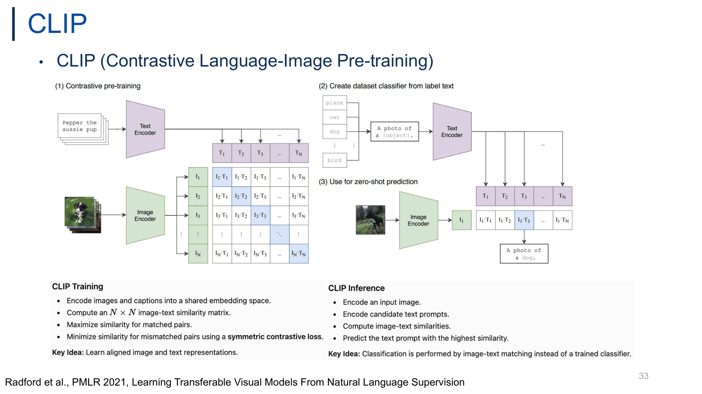

*p.33 — (1) N개 (image, text) pair로 $N\times N$ 유사도 행렬, 대각선 = positive. (2) class 이름 → "A photo of a {object}." → text embedding = classifier. (3) zero-shot prediction.*

| CLIP Training | CLIP Inference |
|---|---|
| image/caption을 shared embedding space로 encode | 입력 이미지 encode |
| $N\times N$ image-text similarity matrix 계산 | 후보 text prompt encode |
| matched pair similarity 최대화 | image-text similarity 계산 |
| mismatched pair 최소화 (**symmetric contrastive loss**) | 가장 높은 prompt 예측 |
| **Key Idea**: aligned image/text representation | **Key Idea**: 학습된 classifier 대신 image-text matching으로 분류 |

- batch 내 $N^2$ 조합 중 **대각선 N개만 positive**, 나머지 $N^2-N$은 **in-batch negative**. "같은 이미지의 다른 augmentation" 대신 **"같은 의미의 (image, caption) 쌍"이 positive** → 이미 짝지어진 두 modality가 서로의 view 역할
- 행 = "이 이미지에 맞는 text를 N개 중 고르는 N-way 분류", 열 = "이 text에 맞는 이미지 고르기" → **symmetric loss**의 근거
- **Zero-shot**: 고정 classifier head 없음. class 이름을 prompt template에 넣어 text encoder로 embedding → 그게 곧 **classifier weight**. 이미지 embedding과 cosine similarity 최대인 prompt 선택 → 학습 때 못 본 class도 text만 바꾸면 적용 (**open-vocabulary**)
- 기존 supervised와 차이: 고정 label set의 one-hot 예측 vs 자연어 설명과의 매칭

> 보충: prompt template을 쓰는 이유 — 단어 하나만 넣으면 polysemy(예: crane = 학/기중기) 문제. 문맥을 주면 정확도 ↑ (prompt engineering/ensembling).

#### Pseudo-code와 loss (p.35)

```python
# image_encoder - ResNet or Vision Transformer
# text_encoder  - CBOW or Text Transformer
# I[n, h, w, c] - minibatch of aligned images
# T[n, l]       - minibatch of aligned texts
# W_i[d_i, d_e] - learned proj of image to embed
# W_t[d_t, d_e] - learned proj of text to embed
# t             - learned temperature parameter
I_f = image_encoder(I) #[n, d_i]
T_f = text_encoder(T)  #[n, d_t]
I_e = l2_normalize(np.dot(I_f, W_i), axis=1)   # joint multimodal embedding [n, d_e]
T_e = l2_normalize(np.dot(T_f, W_t), axis=1)
logits = np.dot(I_e, T_e.T) * np.exp(t)        # scaled pairwise cosine similarities [n, n]
labels = np.arange(n)                          # symmetric loss function
loss_i = cross_entropy_loss(logits, labels, axis=0)
loss_t = cross_entropy_loss(logits, labels, axis=1)
loss   = (loss_i + loss_t)/2
```

수식으로 ($z_i^I$, $z_j^T$: L2-normalized image/text embedding, $\tau=e^{-t}$):

$$\mathcal{L} = \frac{1}{2N}\sum_{i=1}^{N}\left[-\log\frac{\exp(z^I_i\cdot z^T_i/\tau)}{\sum_{j=1}^{N}\exp(z^I_i\cdot z^T_j/\tau)} \;-\; \log\frac{\exp(z^I_i\cdot z^T_i/\tau)}{\sum_{j=1}^{N}\exp(z^I_j\cdot z^T_i/\tau)}\right]$$

- **Projection $W_i, W_t$**: 차원이 다른 두 modality feature($d_i$, $d_t$)를 공통 차원 $d_e$로 보내는 learned linear projection
- **L2 normalize**: 내적 = cosine similarity, 크기 말고 방향만 비교 → 안정적
- **Learned temperature $t$**: logits에 $\exp(t)$(= $1/\tau$) 곱함. SimCLR처럼 고정 hyperparameter가 아니라 **학습 파라미터**, log-parameterization으로 양수 보장. cosine $[-1,1]$을 그대로 softmax하면 너무 flat하므로 scale을 키워줌
- `labels = arange(n)`: i번째 행의 정답은 i번째 열(대각선)
- symmetric: 이미지→text + text→이미지 두 방향 CE 평균 ← axis가 어느 방향인지는 구현 관점에 따라 해석이 다름 (원본 코드 그대로)
- **SimCLR(InfoNCE/NT-Xent)와의 관계**: 구조는 InfoNCE(positive 1 vs in-batch negatives)와 동일. 차이는 (1) positive가 **다른 modality** 쌍, (2) **양방향** loss, (3) **learnable temperature**, (4) modality별 **별도 encoder**

> 보충: batch size 32,768로 in-batch negative를 크게 늘림 → "negative 많을수록 유리" 원칙과 연결.

#### Contrastive vs Predictive 효율 (p.36)

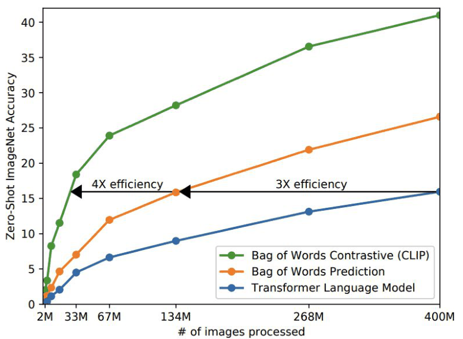

*p.36 — 처리한 이미지 수 vs zero-shot ImageNet accuracy. BoW Contrastive(CLIP) > BoW Prediction > Transformer LM, 같은 정확도 도달에 4×, 3× 효율.*

- (a) **Transformer LM**: 이미지 → caption을 단어 단위 생성 (가장 어려운 예측), 400M에서 ~16
- (b) **BoW Prediction**: caption의 단어 집합 예측 (순서 버림), ~26.5
- (c) **BoW Contrastive (CLIP)**: 정확한 단어 예측 대신 **매칭 여부만 구분**, ~41
- **Key Findings**
  - contrastive가 caption prediction보다 **약 4× data-efficient** (BoW pred는 Transformer LM 대비 3×)
  - 단순 **BoW text encoder가 Transformer LM을 능가**
  - rich language supervision > complex text modeling
  - contrastive alignment가 대규모 vision-language pretraining을 효율적으로 만듦
- 왜? 같은 이미지에도 설명 방식은 무수히 많아(comment, alt-text) 정확한 문장 예측은 노이즈가 큼. contrastive는 "맞는 쌍 vs 틀린 쌍"만 구별 → 표현 학습에 더 직접적
- "The success of CLIP comes less from sophisticated language modeling and more from **contrastive alignment between images and natural language**." → 성능을 가르는 건 모델 복잡도가 아니라 **objective와 supervision의 종류**

#### Why is CLIP Special? (p.37)

- **Natural language를 supervision으로**: 고정 label(ImageNet 1000 class) 대신 인터넷 caption/alt-text → 수작업 label 비용 없이 확장
- **400M image–text pairs** (WIT): noisy하지만 양으로 상쇄 (weakly-supervised)
- **Zero-shot recognition**: fine-tuning 없이 prompt만 바꿔 새 task
- **Transferable representation**: 고정 label은 그 label set에 과적합되기 쉬움, 자연어는 속성·문맥·관계 등 풍부한 개념을 담음

> 보충: 30개 이상 dataset에서 zero-shot으로 fully supervised ResNet-50과 경쟁, distribution shift(ImageNet-R, Sketch 등)에 robust.

### 3.2 Supervised Contrastive Learning — SupCon (Khosla et al., NeurIPS 2020) (p.38–42)

#### 개념 (p.38–39)

- contrastive learning을 **fully supervised** 설정으로 확장
- **같은 class의 모든 샘플을 positive**로: same class는 **pull**, different class는 **push**
- **Key Idea**: class label을 써서 cross-entropy보다 더 discriminative한 representation 학습
- self-supervised(SimCLR/MoCo): positive = 같은 이미지의 두 augmentation, 나머지 전부 negative → **같은 class 이미지도 negative로 미는 false negative 문제**
- vs CE: CE는 logit을 label에 맞추는 손실이라 embedding 공간 구조(class 내 compact, class 간 separation)를 간접적으로만 형성. SupCon은 **embedding 간 거리 관계를 직접 최적화**

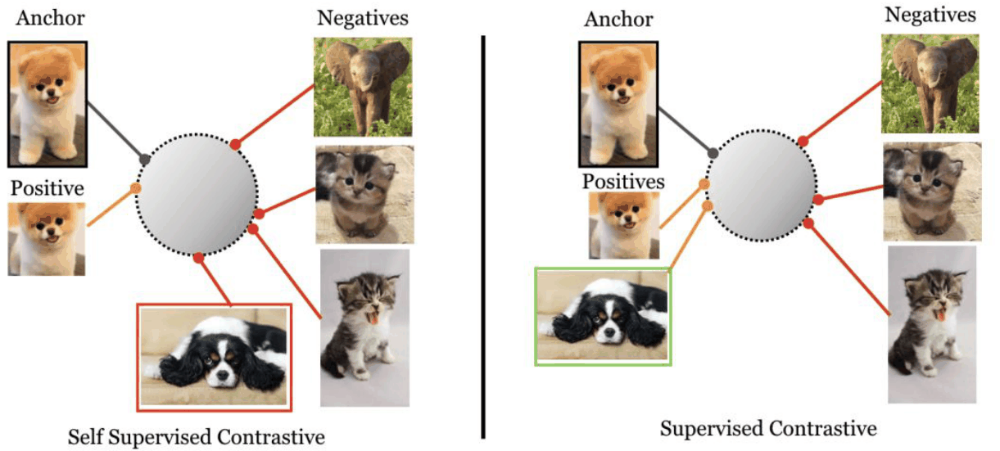

*p.39 — 같은 "개"인 스패니얼이 self-supervised에서는 negative(빨간 테두리, 잘못 밀어냄), supervised contrastive에서는 positive(초록 테두리).*

- positive가 **1개(augmentation) → 여러 개(같은 class 전체)** 로 늘어 anchor당 학습 신호가 풍부
- 결과적으로 class별 **cluster** 형성, cluster 간 거리 ↑

> 보충: 논문 동기 — CE는 label noise·adversarial perturbation에 약하고 margin이 부족. 평가는 학습 후 encoder freeze + linear classifier (2-stage).

#### SupCon loss (p.40)

$n$개 (image, label) $\{\mathbf x_i, y_i\}_{i=1}^n$에 augmentation 2번 → $2n$개 $\{\tilde{\mathbf x}_i, \tilde y_i\}_{i=1}^{2n}$.

$$\mathcal{L}_{\text{supcon}} = -\sum_{i=1}^{2n} \frac{1}{2|N_i| - 1} \sum_{j \in N(y_i),\, j \neq i} \log \frac{\exp(\mathbf{z}_i \cdot \mathbf{z}_j / \tau)}{\sum_{k \in I,\, k \neq i} \exp(\mathbf{z}_i \cdot \mathbf{z}_k / \tau)}$$

- $I=\{1,\dots,2n\}$: 모든 view index, $\mathbf z_i$: i번째 view의 normalized projection, $\tau$: temperature
- **분자** $\exp(\mathbf z_i\cdot\mathbf z_j/\tau)$: **Positive similarity** (anchor $i$ ↔ positive $j$)
- **분모**: anchor 자신 제외 **모든 view**(positive+negative) → softmax 정규화. 다른 positive도 분모에 들어감 = InfoNCE 구조를 "as is" 유지
- $j\in N(y_i), j\ne i$: **For each positive** — anchor와 같은 label인 다른 view들
- $|N_i|$: anchor와 같은 class의 positive 집합 크기 = batch의 **원본 n개 중** 같은 label 샘플 수(augmentation 미포함). 각 샘플이 2 view라 자기 자신 빼면 같은 class view 수 = $2|N_i|-1$ → 이걸로 나눠 **평균** (논문 최종식은 $\frac{-1}{|P(i)|}$ 표기)
- log가 positive 합 **바깥쪽**에서 각 positive별로 취해지는 형태 = $\mathcal L^{sup}_{out}$ (논문의 out/in 두 변형 중 성능 좋은 쪽)
- **"SimCLR의 InfoNCE를 그대로 쓰되, positive 하나 대신 같은 class 전부를 positive로 하여 각각 InfoNCE를 계산하고 평균"**
- positive가 1개($|P|=1$)면 SimCLR NT-Xent와 **정확히 일치** → SupCon = InfoNCE의 일반화
- "very similar to **soft nearest-neighbor loss**"

> 보충: Soft nearest-neighbor loss(Salakhutdinov & Hinton 2007, Frosst et al. 2019; 뿌리는 NCA, Goldberger et al. 2004) = 같은 class 샘플끼리 nearest neighbor가 되도록 하는 loss, SupCon의 선조.

#### 결과 (p.41–42)

| Dataset | SimCLR | Cross-Entropy | Max-Margin | **SupCon** |
|---|---|---|---|---|
| CIFAR10 | 93.6 | 95.0 | 92.4 | **96.0** |
| CIFAR100 | 70.7 | 75.3 | 70.5 | **76.5** |
| ImageNet | 70.2 | 78.2 | 78.0 | **78.7** |

- ResNet-50 top-1, **loss만 바꿔** 비교. CE 대비 +1.0 / +1.2 / +0.5 → 모두 1등이지만 **ImageNet에서 격차 작음**
- SimCLR가 CE보다 크게 낮은 건(70.2 vs 78.2) label 미사용의 대가
- **Key Takeaway**: label이 있어도 **contrastive objective가 유익** ("label 있으면 contrastive 불필요"가 아님)
- p.42: SupCon은
  - CE를 이기지만 **"only by a small amount"**
  - **robustness benchmark(ImageNet-C**: noise, blur, contrast 등 자연적 corruption)에서 CE보다 좋음 ← 슬라이드 "occuring" 오타 (occurring)
  - **hyperparameter 변화에 덜 민감** → 튜닝 부담 ↓
- 정리: SupCon = 소폭 정확도 이득 + robustness + hyperparameter 안정성

> 보충: Max-Margin [32]은 Elsayed et al., 2018 "Large margin deep networks for classification"으로 추정. 논문은 ImageNet-C mCE로 개선 보고.

---

## 4. 확장 주제 (최근 논문)

### 4.1 Memory bank에서 positive도 꺼내기: NNCLR → All4One (Estepa et al., ICCV 2023) (p.43–53)

> 섹션 질문 (p.43): **"Can the memory bank provide more than negatives?"** — 지금까지 memory bank는 negative 공급원. positive도 얻을 수 있나?

- All4One: *Symbiotic Neighbour Contrastive Learning via Self-Attention and Redundancy Reduction* (p.44). 제목 키워드가 방법 요약: **Neighbour Contrastive**(NNCLR 계열), **Self-Attention**(neighbor를 Transformer로 요약해 centroid 생성), **Redundancy Reduction**(Barlow Twins식 feature-level loss). "Symbiotic" = 세 loss가 서로 보완

> 보충: NNCLR = Dwibedi et al., ICCV 2021 "With a Little Help from My Friends"; Barlow Twins = Zbontar et al., ICML 2021.

#### NNCLR vs All4One (p.45)

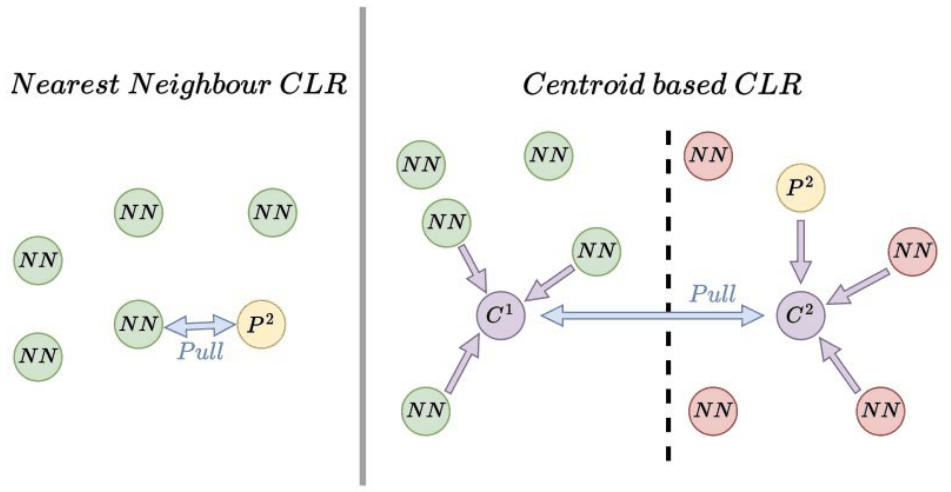

*p.45 — 왼쪽: 가장 가까운 neighbor 1개와 $P^2$를 pull. 오른쪽: 두 view 각각의 K개 neighbor를 centroid $C^1, C^2$로 요약해 pull.*

- **NNCLR**: 과거 representation을 **support set**(queue)에 저장 → query와 가장 가까운 이웃 **1개**를 positive로 사용. 같은 이미지 augmentation보다 **다양한(같은 class의 다른 이미지)** positive
  - 한계: 1-NN은 noisy할 수 있음(다른 class일 수도) → 잘못 고르면 신호 오염
- **All4One**: **K개** neighbor를 꺼내 하나의 표현(centroid)으로 **요약** → contrastive loss **한 번** 계산. 개별 neighbor noise에 덜 민감, neighbor 간 context 활용
- **"NNCLR uses one neighbor. All4One summarizes multiple neighbors into one representation."**

#### All4One 전체 구조 (p.46)

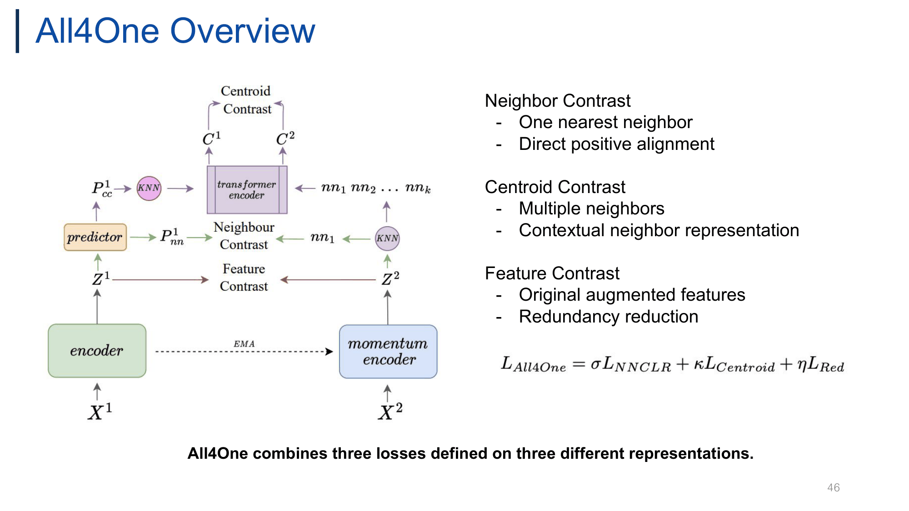

*p.46 — encoder(+predictor)와 momentum encoder(EMA). Neighbour Contrast($P^1_{nn}$ vs $nn_1$), Centroid Contrast(transformer encoder 출력 $C^1, C^2$), Feature Contrast($Z^1$ vs $Z^2$).*

$$L_{All4One} = \sigma L_{NNCLR} + \kappa L_{Centroid} + \eta L_{Red}$$

- 구조: BYOL/NNCLR 계열 **비대칭 online–momentum**. online(encoder + predictor)이 view 1, momentum encoder(EMA, gradient 없음)가 view 2
- 세 loss가 **서로 다른 representation**에 정의됨 ("All4One combines three losses defined on three different representations")

| Objective | 입력 representation | 성격 |
|---|---|---|
| Neighbor Contrast ($L_{NNCLR}$) | predictor 출력 $P^1_{nn}$ vs 1-NN | One nearest neighbor, **direct positive alignment** |
| Centroid Contrast ($L_{Centroid}$) | K-NN을 Transformer로 요약한 $C^1,C^2$ | Multiple neighbors, **contextual** neighbor representation |
| Feature Contrast ($L_{Red}$) | 원래 augmented feature $Z^1,Z^2$ | **Redundancy reduction** (Barlow Twins) |

- $\sigma,\kappa,\eta$: 가중치 hyperparameter
- 설계 이유: neighbor 기반 loss만 쓰면 neighbor가 틀릴 때 흔들리고 dimensional collapse 위험 → feature-level loss로 원본 view 정보를 직접 정렬 + 차원 중복 제거
- ← 그림만으로는 어느 KNN 경로가 $C^1$/$C^2$에 각각 대응되는지 모호 ($P^1_{cc}$→KNN과 momentum 쪽 KNN의 $nn_1\dots nn_k$가 모두 transformer encoder로 들어감)

#### Neighbor Contrast (p.47)

$$L_i^{NNCLR} = -\log\frac{\exp(nn_i^1 \cdot p_i^2/\tau)}{\sum_{k=1}^{N}\exp(nn_i^1\cdot p_k^2/\tau)}$$

- $nn_i^1$: support set에서 찾은 nearest neighbor, $p_i^2$: 두 번째 view의 online prediction, $p_k^2$: batch 내 다른 prediction(→ $k\ne i$는 negative), $N$: batch size
- 같은 이미지의 두 view를 직접 비교하지 않고, **첫 view와 가장 가까운 support set 표현**을 찾아 두 번째 view의 positive로 사용
- **"The nearest neighbor replaces one augmented view in the positive pair."**
- 효과: **intra-class 변동(다른 instance, 다른 pose)** 을 positive로 학습 → 더 풍부한 invariance
- ← 수식의 $p^2$(view 2 prediction)와 그림의 $P^1_{nn}$(view 1) 표기 불일치. NNCLR이 대칭 loss라 두 view를 번갈아 쓰기 때문으로 추정 (원문 유지)

> 보충: NNCLR 원 loss $-\log\frac{\exp(NN(z_i,Q)\cdot z_i^+/\tau)}{\sum_k\exp(NN(z_i,Q)\cdot z_k^+/\tau)}$, $Q$ = support set. NN 연산은 non-differentiable → gradient는 $z_i^+$ 쪽으로만.

#### Centroid Contrast (p.48)

$$L_i^{centroid} = -\log\frac{\exp(c_i^1\cdot c_i^2/\tau)}{\sum_{n=1}^{N}\exp(c_i^1\cdot c_n^2/\tau)}$$

← 슬라이드는 분모 합 상한이 소문자 $n$, index도 $n$으로 겹침 (보통 $\sum_{n=1}^{N}$)

- 과정: (1) query마다 K개 neighbor 검색 → (2) neighbor 시퀀스를 작은 **Transformer encoder**에 입력 → (3) **self-attention**으로 neighbor 정보 통합 → (4) **첫 번째 출력 토큰**(CLS 역할)을 centroid $c$로 사용
- 두 view의 centroid $(c_i^1, c_i^2)$를 positive, 다른 sample의 $c_n^2$를 negative로 InfoNCE → "K neighbors, one contrastive comparison"
- **"The centroid is produced by self-attention. It is not an average or a cluster center."** → 학습되는 attention으로 neighbor별 중요도 가중 = **learned aggregation**. 틀린 neighbor는 낮은 weight로 억제 가능
- NNCLR 대비: 1개 → K개 context, 개별 noise에 robust

> 보충: Transformer 입력은 neighbor 시퀀스 앞에 query embedding을 첫 토큰으로 두는 구성으로 알려짐 (슬라이드엔 명시 없음).

#### Feature Contrast — Barlow Twins식 (p.49)

$$L_{Red.} = \frac{1}{2}\sqrt{\frac{1}{2D}\sum_{i=1}^{D}\left((1-cc^{1}_{ii})^2 + (1-cc^{2}_{ii})^2\right)} + \frac{1}{2}\sqrt{\frac{1}{2D(D-1)}\sum_{i=1}^{D}\sum_{j\neq i}^{D}\left((cc^{1}_{ij})^2 + (cc^{2}_{ij})^2\right)}$$

- $Z$: projector를 통과한 두 augmented view 표현($D$차원), $cc_{ij}$: batch 방향 정규화한 두 view의 feature $i$, $j$ 사이 **cross-correlation** 원소. $cc^1, cc^2$는 두 방향(대칭)의 cross-correlation matrix로 보임 ← 슬라이드에 정의 없음
- **Diagonal** $(1-cc_{ii})^2$: 같은 feature dimension이 두 view에서 상관 1 → augmentation **invariance** ("same feature dimension remains consistent across views")
- **Off-diagonal** $(cc_{ij})^2$: 다른 dimension끼리 상관 0 → **redundancy 제거**, dimensional collapse 방지
- 원 Barlow Twins $\sum_i(1-C_{ii})^2+\lambda\sum_{i\ne j}C_{ij}^2$ 대비: 두 항을 항 개수로 평균($\frac{1}{2D}$, $\frac{1}{2D(D-1)}$)하고 sqrt 후 1/2씩 → $\lambda$를 따로 두지 않는 구성으로 보임
- **"Neighbor losses compare samples. Feature contrast compares feature dimensions."** → neighbor/centroid는 sample 단위(행), feature contrast는 dimension 단위(열) 비교

> 보충: Barlow Twins 이름은 neuroscientist H. Barlow의 redundancy-reduction principle에서. negative, predictor, stop-gradient 없이 collapse 회피.

#### Ablation·분석 (p.50–53)

**Objective ablation (p.50, CIFAR-100, v0 = vanilla NNCLR)**

| Method | NNCLR | Cen. | Feat. | EMA | Top-1 | k-NN Top-1 | NN Top-1 |
|---|---|---|---|---|---|---|---|
| v0 | ✓ | | | | 69.62 | 62.16 | 68.8 (77.8*) |
| v1 | | ✓ | | | 67.4 | 59.61 | 82.8 |
| v2 | ✓ | ✓ | | | 71.02 | 63.21 | 85.28 |
| v3 | ✓ | ✓ | | ✓ | 71.08 | 63.83 | **86.16** |
| v4 | | ✓ | ✓ | ✓ | 71.31 | 63.72 | 80.6 |
| v5 | ✓ | | ✓ | ✓ | 71.64 | 64.58 | 78.8 |
| v6 | ✓ | ✓ | ✓ | ✓ | **72.17** | **64.84** | 82.16 |

- NN Top-1 = 검색된 neighbor의 class가 query와 같은 비율. *: queue 65503 → 98304 ← 65503은 65536의 오타 가능성 (원문 유지)
- **Centroid 단독(v1) 67.4 < NNCLR 69.62** → centroid는 대체재 아님. 단 NN retrieval 82.8로 이웃 구조는 개선
- Neighbor + Centroid(v2) 71.02 (+1.4) → multiple-neighbor context가 도움
- Full(v6) **72.17** → 셋이 함께일 때 최고
- **"Centroid contrast is useful as a complementary objective, not as a replacement for neighbor contrast."**

**Neighbor retrieval 분석 (p.51)** ← 제목 "Analysi" 오타
- retrieval 정확도는 NNCLR+Cent.(~0.86)가 가장 높고 full(~0.82)은 그보다 낮은데, **linear eval은 full이 최고** → retrieval 정확도 ≠ 표현 품질
- Top-5 NN 예시(트럭, 수중 동물, 단풍나무): 대부분 시각·의미적으로 유사, 일부는 다른 class지만 **유용한 시각 유사성**을 담음
- **"Class-correct neighbor retrieval is helpful, but it is not the final objective."**

**Linear evaluation (p.52, Solo-learn 수치)**

| Method | CIFAR-10 | CIFAR-100 | ImageNet100 |
|---|---|---|---|
| BYOL | 92.58 | 70.46 | 80.16 |
| MoCoV3 | 93.10 | 68.83 | 80.36 |
| SimCLR | 90.74 | 65.78 | 77.64 |
| SwAV | 89.17 | 64.88 | 74.04 |
| BT (Barlow Twins) | 92.10 | 70.90 | 80.38 |
| NNCLR | 91.88 | 69.62 | 79.80 |
| **All4One** | **93.24** | **72.17** | **81.93** |

(Top-1만 발췌. 그 외 DC V2 88.85/63.61/75.36, DINO 89.52/66.76/74.84, MoCoV2+ 92.94/69.89/78.20, ReSSL 90.63/65.92/76.92, SimSiam 90.51/66.04/74.54, VIbCReg 91.18/67.37/79.86, VICReg 92.07/68.54/79.22, W-MSE 88.67/61.33/67.60. Top-5도 All4One이 전부 최고: 99.88/93.35/96.23)

- NNCLR 대비 +1.36 / **+2.55** / +2.13, BT 대비 +1.14 / +1.27 / +1.55 → neighbor 계열과 redundancy reduction 계열 **둘 다** 개선
- 개선폭 **CIFAR-100에서 최대** → 비슷한 class가 많은 데이터에서 multiple-neighbor context가 더 유용할 것 ("likely", 가설)

**How many neighbors? (p.53)**

| Transformer layers | Top-1 | k-NN | | # NN | Top-1 | k-NN |
|---|---|---|---|---|---|---|
| **3** | **72.17** | **64.84** | | **5** | **72.17** | **64.84** |
| 6 | 71.86 | 64.50 | | 10 | 72.00 | 64.54 |
| 9 | 71.75 | 64.52 | | 15 | 71.92 | 64.63 |
| | | | | 20 | 71.79 | 64.6 |

- **작은 Transformer(3층)면 충분**: 너무 강하면 backbone 대신 표현 생성 역할을 가져갈 **수도** 있음("might"). 목표는 downstream용 **backbone** 학습이므로 작은 보조 모듈이 적절
- **neighbor 5개 최적**: 많을수록 관련성 낮은 sample이 섞여 context를 **희석(dilute)** + 연산 ↑
- ← 차이가 0.4 이내로 작음, 반복 실험/분산 언급 없음

### 4.2 Cluster 기반 SSL과 Fine-grained: PAPN (Tan et al., ICCV 2025) (p.54–64)

> 섹션 질문 (p.54): **"Can cluster-based SSL preserve fine-grained visual details?"**
> 논문 (p.55): *Prototype-based Contrastive Learning with Stage-wise Progressive Augmentation for Self-Supervised Fine-Grained Learning* — 키워드 = prototype-based CL / stage-wise progressive augmentation / self-supervised fine-grained learning

#### 문제: fine-grained는 디테일이 필요 (p.56)

- **Generic recognition** — "Is this a bird?" → global shape로 충분
- **Fine-grained recognition** — "Which bird species is this?" → **부리·머리·날개·꼬리 무늬** 같은 작은 part가 class를 가름. class 간 variance 작고 class 내 variance(자세, 배경) 큼
- **"Fine-grained recognition requires both holistic and part-level representations."**
- 일반 cluster/prototype SSL은 전역 의미 중심으로 묶어 세부 디테일이 뭉개질 위험

> 보충: 대표 benchmark — CUB-200-2011(새 200종), Stanford Cars, FGVC-Aircraft.

#### 관찰 1: Multi-stage alignment는 fine-grained에서 실패 (p.57)

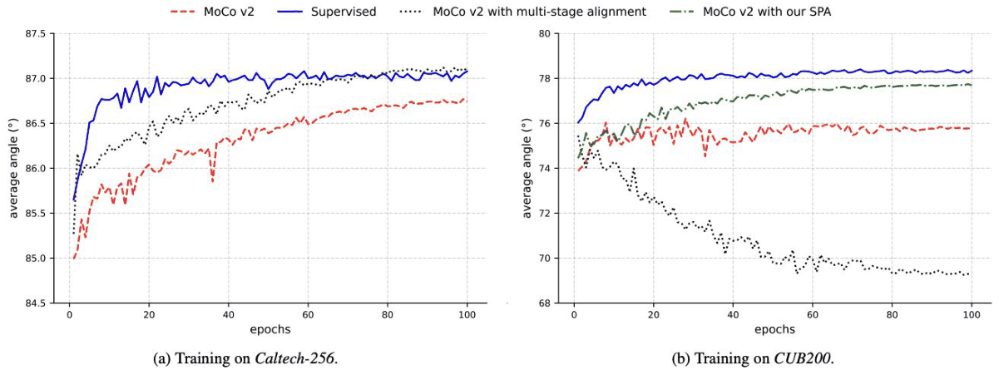

*p.57 — y축 = 서로 다른 이미지 representation 간 평균 각도(클수록 잘 분리). (a) Caltech-256에서는 multi-stage alignment(검정 점선)가 도움, (b) CUB200에서는 계속 하락. SPA(초록)는 CUB에서도 supervised에 근접.*

- **Multi-stage alignment**: 마지막 층뿐 아니라 여러 backbone stage feature에도 positive pair alignment loss
- Caltech-256(generic): MoCo v2 ~86.7 → multi-stage ~87.1로 supervised(~87)에 근접 → **도움**
- CUB200(fine-grained): supervised ~78.3, SPA ~77.7, MoCo v2 ~75.8, multi-stage는 ~74 → ~69로 **계속 하락** → 샘플들이 뭉침(collapse에 가까움) → **해로움**
- average angle: 클수록 샘플 간 분리(uniformity) 좋음, 작을수록 뭉침
- 우상단 그림(Low/Mid/High-Level Feature): shallow feature는 색·에지·질감, deep은 semantic
- **"Why does the same alignment strategy fail on fine-grained data?"**

#### 관찰 2: 강한 augmentation은 shallow feature를 크게 바꿈 (p.58)

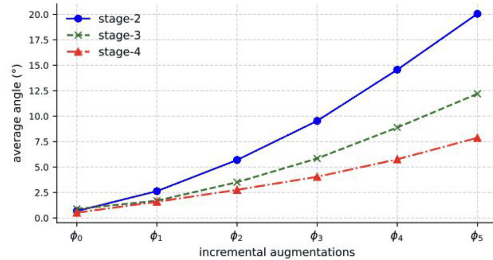

*p.58 (Figure 2) — y축 = embedding과 그 positive view 사이 평균 각도(작을수록 일관). augmentation 강도 $\phi_0\to\phi_5$가 커질수록 stage-2(shallow)가 가장 크게 벌어짐.*

- 여기 average angle은 **같은 이미지의 positive pair 간 불일치** (p.57의 "다른 이미지 간 분리도"와 다름!)
- $\phi_5$에서 stage-2 ~20°, stage-3 ~12.2°, stage-4 ~7.8° → **shallow > deep 순으로 민감**
- 강한 augmentation이면 shallow layer는 같은 새의 두 사진을 **다른 개체**로 인식, deep layer는 전체 semantic에 집중해 덜 영향받음
- **→ One augmentation strength does not fit every stage.** → p.57 실패 원인: 강한 aug view의 shallow feature를 억지로 맞추면 해로움

> 보충: $\phi_0\sim\phi_5$의 구체 구성은 논문 Section 3에 정의 (슬라이드엔 없음). $f_q,f_k$는 MoCo의 query/momentum key encoder.

#### 해법 ① Stage-wise Progressive Augmentation (SPA) (p.59)

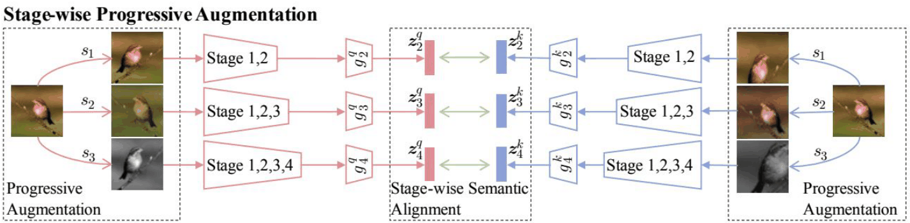

*p.59 — progressive view $s_1$(약)·$s_2$·$s_3$(강, grayscale)를 각각 Stage 1,2 / 1,2,3 / 1,2,3,4까지 통과시켜 $z_2,z_3,z_4$를 만들고 query/key끼리 stage별 정렬.*

- **Mild augmentation for shallow stages, Strong augmentation for deep stages**, stage-wise semantic alignment

$$\mathcal{L}_{SPA} = \sum_{i=1}^{T} \left\| \hat{\boldsymbol{z}}^{k}_{L-T+i} - \hat{\boldsymbol{z}}^{q}_{L-T+i} \right\|_2^2,\qquad \hat{\boldsymbol{z}} = \boldsymbol{z}/\|\boldsymbol{z}\|_2$$

- $L$: backbone 총 stage 수(그림 $L=4$), $T$: 정렬에 쓰는 마지막 stage 수(그림 $T=3$ → $i=1,2,3$에서 index $L-T+i$ = stage 2,3,4)
- $\boldsymbol z^q_j, \boldsymbol z^k_j$: j번째 stage 출력에 projection head $g_j$를 통과시킨 query/key embedding
- 직관: $\|\hat a-\hat b\|_2^2 = 2-2\cos\theta$ → **cosine similarity 최대화(각도 최소화)** 와 동치. BYOL/SimSiam류처럼 negative 없는 alignment term
- **"Positive pairs are created based on the intensity of augmentation that each stage can withstand."**
- 이전(multi-stage alignment)과 차이: 모든 stage에 **같은 강도** view → **stage마다 다른 강도**
- query/key 양쪽 같은 구조인 이유: MoCo처럼 $f_q$(gradient)와 $f_k$(momentum) 짝으로 stage별 정렬

> 보충: "Stage 1,2 / 1,2,3 / 1,2,3,4"는 별개 네트워크가 아니라 같은 backbone 앞부분을 각 view에 통과시켜 중간 feature를 projection head로 추출한 것으로 해석. 정확한 구현은 슬라이드로 확정 불가.

#### 해법 ② Prototype-based Holistic-Partial Learning (PHP) (p.60–61)

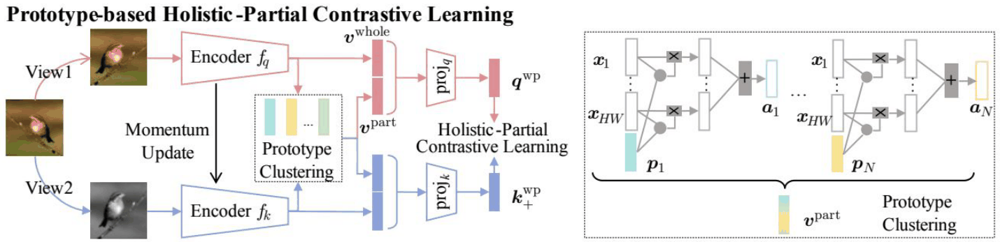

*p.60 — View1(컬러)→$f_q$, View2(grayscale)→$f_k$(momentum). $v^{whole}$과 prototype clustering으로 얻은 $v^{part}$를 결합해 $q^{wp}, k^{wp}_+$로 contrast. 오른쪽: spatial descriptor $x_1..x_{HW}$와 prototype $p_i$의 유사도로 가중합해 $a_i$ 생성.*

- Learn prototypes from **spatial descriptors** (final feature map = spatial descriptor 집합), part-level 표현 추출, global + local 결합

**Part representation**:

$$\boldsymbol{X}_L = [\boldsymbol{x}_1, \ldots, \boldsymbol{x}_{HW}],\quad \boldsymbol{P} = [\boldsymbol{p}_1, \ldots, \boldsymbol{p}_N],\quad \boldsymbol{M} = \hat{\boldsymbol{P}}^\top \hat{\boldsymbol{X}}_L \ \ (\text{prototype similarity})$$

$$\boldsymbol{A} = \boldsymbol{X}_L \boldsymbol{M}^\top = [\boldsymbol{a}_1, \ldots, \boldsymbol{a}_N],\qquad \boldsymbol{v}^{\text{part}} = \frac{1}{N}\sum_{i=1}^{N} \boldsymbol{a}_i$$

- $\boldsymbol X_L$: 마지막 stage feature map $(H\times W\times C)$을 $HW$개 local feature $\boldsymbol x_j\in\mathbb R^C$로 본 것
- $\boldsymbol P$: **N개 learnable prototype** ($\boldsymbol p_i\in\mathbb R^C$), 각자 반복되는 시각 패턴(새 머리 질감, 날개 무늬 등) 대표
- $\boldsymbol M$ ($N\times HW$): 정규화된 prototype–descriptor **cosine similarity** → prototype별로 이미지 어느 위치에 반응하는지 = attention/heatmap (p.63에서 시각화)
- $\boldsymbol A$: 유사도를 가중치로 descriptor **가중합** → $\boldsymbol a_i$ = "prototype $i$와 비슷한 위치 feature 모음" = 해당 **part의 표현**
- $\boldsymbol v^{part}$: N개 part 표현 평균
- descriptor를 prototype에 soft assignment하는 clustering과 유사 → "Prototype Clustering". label 없이 part 발견
- $\boldsymbol M$에서는 정규화 $\hat{\boldsymbol X}_L$, $\boldsymbol A$에서는 비정규화 $\boldsymbol X_L$ (슬라이드 표기 그대로, 의도된 것으로 보임)

**Whole + Part 결합 (p.61)**:

$$\boldsymbol{v}^{\text{whole}} = \left[\text{pool}(\boldsymbol{X}_{L-T+1}); \ldots; \text{pool}(\boldsymbol{X}_L)\right],\qquad \boldsymbol{v}^{\text{wp}} = [\boldsymbol{v}^{\text{whole}}; \boldsymbol{v}^{\text{part}}]$$

$$\mathcal{L}_{PHP} = -\log \frac{\exp(\boldsymbol{q}^{\text{wp}} \cdot \boldsymbol{k}_+^{\text{wp}} / \tau)}{\sum_{i=0}^{K} \exp(\boldsymbol{q}^{\text{wp}} \cdot \boldsymbol{k}_i^{\text{wp}} / \tau)}$$

- $\boldsymbol v^{whole}$: 마지막 $T$개 stage를 각각 global pooling 후 concat(;) → overall object appearance (SPA와 같은 stage 범위)
- $\boldsymbol v^{part}$: local discriminative patterns
- concat한 $\boldsymbol v^{wp}$ → projection head($\text{proj}_q,\text{proj}_k$) → $\boldsymbol q^{wp},\boldsymbol k^{wp}$ → **MoCo형 InfoNCE** ($K$ = queue negative 수, $i=0$ 항이 positive로 보임)
- **"Do not choose between global and local features—contrast both together."**
- 기존 MoCo는 global pooling 벡터 하나만 → 미세한 part 단서가 평균에 묻힘. PHP는 part를 명시적으로 InfoNCE 입력에 포함

> 보충: prototype $\boldsymbol P$의 업데이트 방식(gradient? EMA? clustering?)은 슬라이드에 없음. "learnable prototypes"(p.64)라 loss로 학습되는 파라미터로 보임.

#### 결과 (p.62–64)

**Ablation (p.62, CUB200)**

| Config | SPA | PHP | top-1 | rank-1 | rank-5 |
|---|---|---|---|---|---|
| #1 (MoCo v2) | | | 63.98 | 39.72 | 67.14 |
| #2 | ✓ | | 67.65 (+3.67) | 43.77 | 71.34 |
| #3 | | ✓ | 67.91 (+3.93) | 43.31 | 70.70 |
| #4 | ✓ | ✓ | **69.93 (+5.95)** | **45.39** | **72.81** |

- 각각 약 +4%p, 함께 +5.95 → **보완적이지만 sub-additive** (3.67+3.93=7.60 > 5.95, 개선폭 일부 겹침). SPA는 학습 신호/augmentation 설계, PHP는 표현 구조/part 정보로 서로 다른 축
- 한계: CUB200 하나에서만 ablation

**Part localization (p.63, Figure 5)**: prototype heatmap이 label 없이도 의미 있는 part에 반응
- Bird: head, wing, tail / Aircraft: engine, wing, tail / Car: wheel, hood, body
- **"Progressive augmentation preserves semantics; prototypes expose discriminative parts."** ← 이 그림은 PHP(prototype) 시각화라 SPA 효과는 직접 보여주지 않음

**Main results (p.64, Table 1)**

| Method | Cls CUB | Cars | Aircraft | Ret CUB r-1 | r-5 | Cars r-1 | r-5 | Air r-1 | r-5 |
|---|---|---|---|---|---|---|---|---|---|
| ResNet-50† (IN-1k frozen) | 63.06 | 61.41 | 49.79 | 40.39 | 68.94 | 29.28 | 54.66 | 29.48 | 51.39 |
| supervised | 77.46 | 88.60 | 85.93 | 74.43 | 90.99 | 80.54 | 94.35 | 74.16 | 90.47 |
| SimSiam | 46.75 | 45.72 | 38.52 | 16.24 | - | 12.45 | - | 18.49 | - |
| MoCo v2 | 63.98 | 62.02 | 51.13 | 39.72 | 67.14 | 30.51 | 56.15 | 30.02 | 52.87 |
| BarlowTwins | 33.45 | 31.91 | 34.77 | - | - | - | - | - | - |
| VICReg | 37.78 | 30.80 | 36.00 | - | - | - | - | - | - |
| DINOv2* (ViT-S) | 66.02 | 64.47 | 54.67 | 41.65 | 70.28 | 34.01 | 57.12 | 32.79 | 57.64 |
| LDF | 66.17 | 65.60 | 55.28 | 42.06 | 69.59 | 35.81 | **61.94** | 33.27 | 56.80 |
| **PAPN** | **69.93** | **67.48** | **60.13** | **45.39** | **72.81** | **35.98** | 59.94 | **35.13** | **58.75** |

(그 외 LEWEL 64.59/62.91/51.90, ContrastiveCrop 64.23/63.29/52.04, SAM-SSL-Bilinear 64.94/62.85/52.83, LCR 65.24/63.96/53.22)

- classification 세 데이터셋 모두 최고 (LDF 대비 CUB +3.76, Aircraft +4.85). retrieval도 대부분 최고, 단 **Cars rank-5는 LDF(61.94) > PAPN(59.94)**
- SimSiam/BarlowTwins/VICReg(negative-free/redundancy reduction 계열)는 이 fine-grained 설정에서 30–47%대로 크게 낮음
- supervised 상한과는 여전히 큰 격차(Aircraft 85.93 vs 60.13)
- 3 takeaways: (1) augmentation 강도를 **feature depth에 맞춤**, (2) **learnable prototype으로 local pattern 발견**, (3) **whole + part를 InfoNCE에서 함께 contrast**
- **"From clustering images to discovering reusable visual parts."** → 이미지 단위 clustering에서 여러 이미지가 공유하는 부위 패턴 발견으로의 전환

### 4.3 SupCon에 label noise가 있으면: SCL-RHE (Long et al., ECCV 2024) (p.65–75)

> 섹션 질문 (p.65): **"What if a mini-batch contains Imprecise Class Labels?"** — SupCon은 label이 같으면 positive, 다르면 negative → label 오류가 곧 pair 관계 오류.
> 논문 (p.66): *Understanding and Mitigating Human-Labelling Errors in Supervised Contrastive Learning* (Univ. of Glasgow). 기존 noisy label 연구는 synthetic(랜덤) noise 위주였지만 실제 human error는 성질이 다름.

#### CE vs SCL: 오류의 단위가 다름 (p.67)

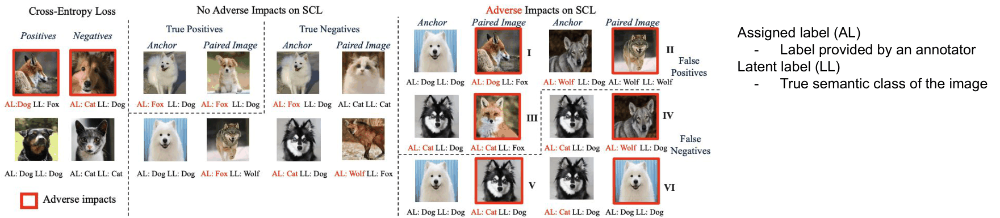

*p.67 — AL(assigned label) / LL(latent label). CE는 mislabel 샘플 자체가 오답 신호. SCL은 label이 틀려도 pair 관계가 맞으면 무해, I–III은 False Positive, IV–VI는 False Negative.*

- **Assigned label (AL)**: annotator가 붙인 label / **Latent label (LL)**: 이미지의 진짜 semantic class
- **CE**: 샘플 하나가 독립 신호 → label 틀리면 그 샘플 gradient가 곧장 틀림 (오류 단위 = **sample**)
- **SCL**: 두 샘플의 관계로 학습 (오류 단위 = **pair relationship**). 둘 다 틀려도 같은 잘못된 label이고 latent도 같으면 관계는 옳음
- **"A mislabeled sample does not always produce an incorrect contrastive pair."**
- **"The incorrect pair relationships resulting from label errors, rather than the label errors themselves, directly impact SCL."**
- → "label error rate"와 "SCL에 해로운 pair error rate"는 다른 양

#### Human error ≠ Synthetic error (p.68)

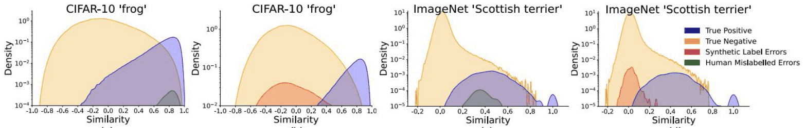

*p.68 — anchor와의 similarity 분포(log density). Human mislabelled error(초록)는 true positive(파랑)와 겹치고, synthetic error(빨강)는 낮은 similarity 쪽 true negative와 겹침.*

| | Synthetic label errors | Human label errors |
|---|---|---|
| 생성 | label을 랜덤하게 변경 | 사람이 **시각적으로 비슷한 class를 혼동** |
| 특징 | 틀린 샘플이 assigned class와 생김새가 다름 | 틀린 샘플이 assigned class **근처에 남아 있음** |
| similarity | 낮음 → negative 분포와 섞임 → 쉽게 걸러짐 | 높음 → **true positive와 overlap** → similarity 필터링 실패 |

- **"Human labeling errors overlap strongly with true positives."**
- → synthetic noise로 검증한 noisy-label 기법은 human noise에 일반화 안 될 수 있음

#### False Positive가 지배적 (p.69–70, p.73)

- **False positive (FP)**: AL 같음 & LL 다름 → 다른 class를 잘못 **pull**
- **False negative (FN)**: AL 다름 & LL 같음 → 같은 class를 잘못 **push**

$\tau$ = label error rate, $C$ = class 수:

$$P_{FN} = \frac{\tau^2}{(C-2)^2} + \frac{2\tau - 2\tau^2}{C-1} \;\approx\; \frac{2\tau}{C-1}$$

$$P_{FP} = \underbrace{2\tau - \tau^2}_{\text{at least one error}} - \underbrace{\frac{\tau^2}{(C-1)^2}}_{\text{both wrong but same latent class}} \;\approx\; 2\tau$$

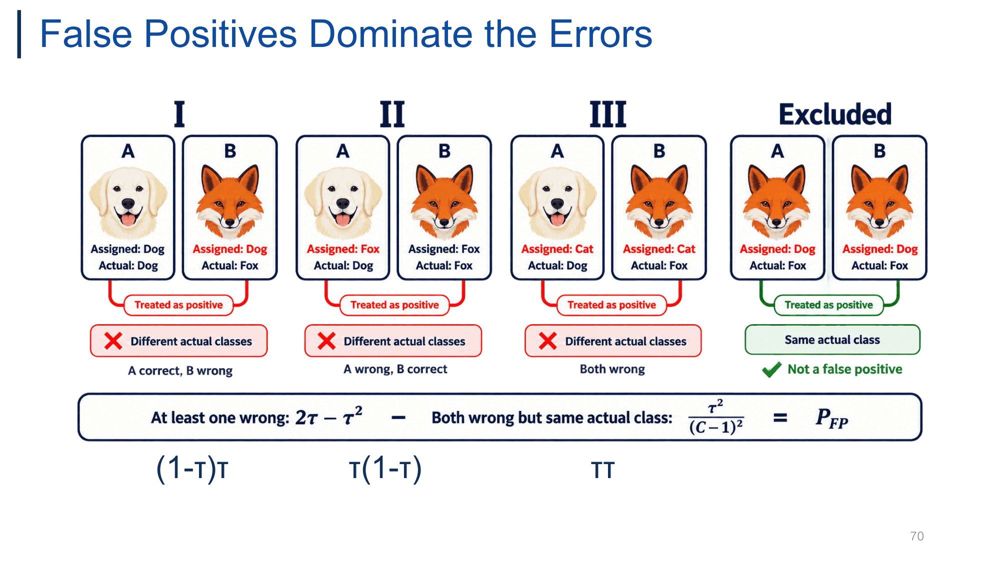

*p.70 — $P_{FP}$ 케이스 분해: I (A 맞고 B 틀림) $(1-\tau)\tau$, II (A 틀리고 B 맞음) $\tau(1-\tau)$, III (둘 다 틀림) $\tau\tau$, Excluded (둘 다 틀렸지만 실제로 같은 class → FP 아님).*

- **$P_{FP}$ 유도**: $(1-\tau)\tau + \tau(1-\tau) + \tau^2 = 2\tau-\tau^2$ = 적어도 하나 틀릴 확률 $1-(1-\tau)^2$. 여기서 둘 다 틀렸지만 원래 같은 class(Fox, Fox)인 경우 $\tau^2/(C-1)^2$는 AL·LL 모두 같으니 FP 아님 → 제외. → **FP ≈ label error rate의 약 2배**, C와 무관
- **$P_{FN}$**: FN이 되려면 두 샘플의 latent class가 같아야 함 → 확률이 약 $1/C$ 수준이라 $\frac{1}{C-1}$ 인자 → C 클수록 감소. 한쪽만 틀려 AL이 갈라지는 $\frac{2\tau-2\tau^2}{C-1}$이 주항
- **"With many classes, almost all incorrect SCL signals come from false positives."**
- ← 슬라이드 식은 AL 같음/다름을 조건화한 확률인지 결합확률인지 명시 없음, $\tau^2/(C-2)^2$ 항 유도도 없음 (논문 확인 필요). p.70 III의 "같은 AL을 가질 확률" 조건화도 생략된 근사

**실측 (p.73)**

| Dataset | FP 비율 | FN 비율 |
|---|---|---|
| CIFAR-100 | **99.04%** | 0.96% |
| ImageNet-1K | **99.91%** | 0.09% |

- FP만 고쳐도 거의 모든 오류 신호 해결, negative 보정은 이득 작음 → **SCL-RHE는 positive sampling에 집중**
- **"Positive pairs are the main source of label-error propagation in SCL."**

> 보충: 구조적 이유 — 무작위 negative가 실제로 같은 class일 확률은 낮고, class 수가 많을수록(ImageNet 1000) 더 낮아짐 (0.96% → 0.09%).

#### Easy positive의 함정 (p.71)

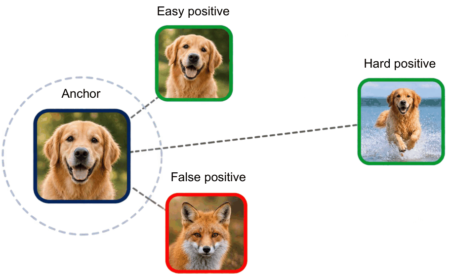

*p.71 — anchor 근처에 easy positive(같은 개)와 false positive(여우)가 함께 있고, hard positive(물 위를 뛰는 같은 개)는 멀리 있음.*

- Human labeling error는 **same assigned label + high feature similarity**를 동시에 만족 → 모델이 **high-confidence positive**로 간주
- 기존 noise mitigation(small-loss trick, confidence 기반 weighting)의 위험: confident pair에 **높은 가중** → human error가 confident해 보임 → **FP 관계를 오히려 강화**
- 일반적으로 가까운 positive는 신뢰할 만하다고 보지만, human error는 시각적으로 닮아서 틀린 것이라 이미 anchor 근처에 있음
- **"High similarity does not always imply a correct positive pair."** (similarity ≠ correctness)
- 반대로 진짜 positive 중 **hard positive**(포즈·배경이 달라 멀리 있는 같은 class)가 정보량 큼

#### SCL-RHE: easy positive 우선순위 낮추기 (p.72)

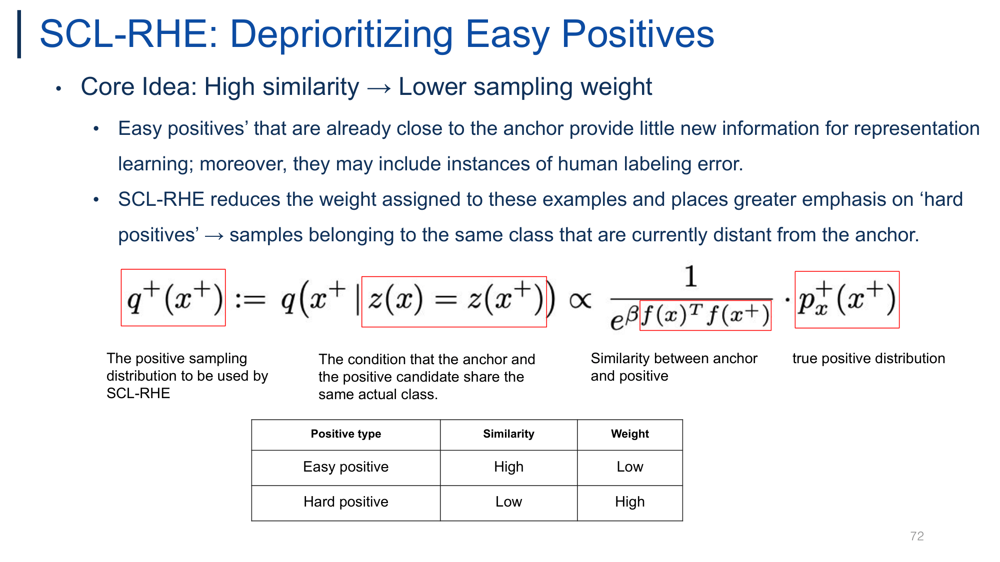

*p.72 — 높은 similarity → 낮은 sampling weight. 수식의 각 항 의미와 easy/hard positive 가중 표.*

$$q^+(x^+) := q\big(x^+ \mid z(x)=z(x^+)\big) \;\propto\; \frac{1}{e^{\beta f(x)^\top f(x^+)}} \cdot p_x^+(x^+) = e^{-\beta f(x)^\top f(x^+)}\, p_x^+(x^+)$$

- $q^+(x^+)$: SCL-RHE가 쓸 **positive sampling distribution**
- $z(x)=z(x^+)$: anchor와 positive 후보가 **같은 실제 class**라는 조건 ← 실제로는 latent를 모르므로 assigned label로 근사했을 것 (슬라이드에 명시 없음)
- $f(x)^\top f(x^+)$: anchor–positive similarity, $f$는 (정규화된) encoder
- $p_x^+(x^+)$: true positive distribution
- $\beta\ge0$: hardness 집중도. **$\beta=0$이면 원래 SupCon(uniform positive)**
- similarity가 클수록 sampling 확률이 **지수적으로 감소** → hard positive 강조

| Positive type | Similarity | Weight |
|---|---|---|
| Easy positive | High | **Low** |
| Hard positive | Low | **High** |

- 설계 이유: (1) easy positive는 이미 가까워 새 정보가 적음, (2) human error가 여기 몰려 있음 → 가중 ↓로 노이즈 영향 ↓. **noise robustness + hard positive mining** 동시
- 기존 방법과 정반대: confident pair에 높은 가중(기존) vs similar할수록 낮은 가중(SCL-RHE)
- **Robinson et al. (ICLR 2021) hard negative sampling** $q^-(x^-)\propto e^{+\beta f(x)^\top f(x^-)}p(x^-)$과 **부호만 반대**인 대칭 구조 (negative는 가까울수록, positive는 멀수록 강조)
- ← (추측, 슬라이드에 없음) 멀리 있는 샘플이 강조되므로 synthetic noise처럼 멀리 있는 오라벨은 오히려 강조될 위험 → 이 방법은 human noise(가까운 오류)를 겨냥
- ← RHE 약자 풀이는 슬라이드에 없음

> 보충: Robinson et al.처럼 sampling을 loss의 importance weight로 구현하는 방식으로 이해하면 됨 (슬라이드엔 구현 설명 없음).

#### 결과 (p.74–75)

**From scratch (p.74, Table 1, acc@1, "Ours" = SCL-RHE)**

| Model | Loss | CIFAR-10 | CIFAR-100 | ImageNet-1K |
|---|---|---|---|---|
| BEiT-3 | CE | 71.70 | 59.67 | 77.91 |
| BEiT-3 | SupCon | 88.96 | 60.77 | 82.57 |
| BEiT-3 | Sel-CL | 86.33 | 59.51 | 81.87 |
| BEiT-3 | TCL | 85.16 | 59.22 | 81.74 |
| BEiT-3 | **Ours** | **90.16** | **64.47** | **84.21** |
| ResNet-50 | CE | 95.00 | 75.30 | 78.20 |
| ResNet-50 | SupCon | 96.00 | 76.50 | 78.70 |
| ResNet-50 | Sel-CL | 93.10 | 74.29 | 77.85 |
| ResNet-50 | TCL | 92.80 | 74.14 | 77.17 |
| ResNet-50 | **Ours** | **96.39** | **77.82** | **79.15** |

- SCL-RHE > SupCon 일관: BEiT-3 +1.20/**+3.70**/+1.64, ResNet-50 +0.39/+1.32/+0.45 → **BEiT-3에서 이득 더 큼**
- **Sel-CL, TCL(heavy synthetic noise용)은 오히려 SupCon보다 낮음**: synthetic noise를 공격적으로 제거하도록 설계됐는데 실제 human noise 비율은 낮아서 **샘플을 과하게 걸러 학습 데이터만 줄어듦**

> 보충: ViT 계열은 inductive bias가 약해 from scratch에서 data/label 품질에 더 민감 → 보정 이득이 크다는 해석 가능 (슬라이드의 설명은 아님). Sel-CL = Li et al., CVPR 2022 / TCL = Huang et al., CVPR 2023.

**Corrected test labels (p.75, Table 2, BEiT-3)** — test set label에도 human error가 있음

| Loss | Test | CIFAR-10 | CIFAR-100 | ImageNet-1K |
|---|---|---|---|---|
| CE | Orig → Corr | 71.70 → 71.79 (+0.09) | 59.67 → 59.82 (+0.15) | 77.91 → 78.24 (+0.33) |
| SupCon | Orig → Corr | 88.96 → 89.11 (+0.15) | 60.77 → 61.49 (+0.72) | 82.57 → 83.74 (+1.17) |
| Sel-CL | Orig → Corr | 86.33 → 86.21 (−0.12) | 59.51 → 58.62 (−0.89) | 81.87 → 81.35 (−0.52) |
| TCL | Orig → Corr | 85.16 → 84.97 (−0.19) | 59.22 → 58.14 (−1.08) | 81.74 → 81.28 (−0.46) |
| **Ours** | Orig → Corr | 90.16 → **90.41 (+0.25)** | 64.47 → **65.34 (+0.87)** | 84.21 → **86.02 (+1.81)** |

- original label이 틀려 있으니 실제 이득이 **과소평가(underestimate)**. corrected에서 SCL-RHE 상승폭이 가장 큼, Sel-CL/TCL은 오히려 하락

**Fine-tuning pre-trained BEiT-3 (p.75, Table 4)**: SCL-RHE가 **8개 downstream 전부 최고** (CIFAR-100 93.81, CUB-200 98.95, Caltech-256 99.41, Flowers 95.89, Pets 96.41, iNat2017 76.25, Places365 62.53, ImageNet-1K 86.51). SupCon 대비 **iNat2017 +3.4%p**, **Places365 +2.2%p**
- ← Table 4 ViT CE ImageNet 77.91이 Table 1 BEiT-3 from-scratch CE 값과 동일 (원문 유지, 출처 혼동 가능성)
- 결론: **"Human labeling errors often become easy false positives. SCL-RHE reduces their influence by emphasizing informative hard positives."**

---

## 5. 전체 방법 비교

| 방법 | 핵심 아이디어 | loss | 장점 | 한계 |
|---|---|---|---|---|
| **InstDisc** (memory bank, 2018) | 각 이미지 = 1 class, bank feature를 class weight로 | non-param softmax + NCE (MC 근사, proximal) | negative 많음, 계산 저렴 | bank feature **stale** |
| **MoCo** (2020) | memory bank → **FIFO queue + momentum encoder** | InfoNCE $(1+K)$-way, $\theta_k\leftarrow m\theta_k+(1-m)\theta_q$ | 큰 + **consistent** dictionary, batch와 decouple | key encoder가 완전히 fresh하진 않음, queue 관리 |
| **MoCo v2** | MoCo + SimCLR 레시피(MLP head, strong aug, cos LR) | InfoNCE | batch 256으로 SimCLR(8192) 능가, 메모리·시간 효율 | 새 구조 아님 (improved baseline) |
| **CURL** | MoCo식 contrastive를 RL 보조 loss로 | InfoNCE (bilinear sim) + RL loss 동시 | pixel RL sample efficiency ↑ | RL 특화 |
| **DeepCluster** (2018) | k-means cluster ID = pseudo label, 교대 최적화 | cross-entropy on pseudo label | pair 불필요, false negative 회피 | **offline**(매 epoch 전체 데이터 + k-means), degenerate solution 방지 장치 필요 |
| **SwAV** (2020) | online code + **swapped prediction** | $\ell(z_t,q_s)+\ell(z_s,q_t)$, prototype softmax CE | negative/큰 batch 불필요, $B\times K$ 비교, 75.3% | collapse 방지에 Sinkhorn equipartition 필요 |
| **CLIP** (2021) | image–text pair = positive, shared space | symmetric InfoNCE ($N\times N$), learnable $\tau$ | **zero-shot**, open-vocabulary, 전이·robust | 4억 pair·초대형 batch 필요 |
| **SupCon** (2020) | 같은 class 전부 positive | InfoNCE를 positive별로 계산해 평균 | false negative 해소, CE보다 robust·hyperparam 둔감 | 정확도 이득 작음, **label noise에 취약(FP)** |
| **NNCLR** | support set의 1-NN = positive | InfoNCE($nn^1_i$, $p^2_i$) | 다양한 intra-class positive | 1-NN이 틀리면 오염 |
| **All4One** (2023) | 1-NN + K-NN centroid(self-attention) + Barlow Twins | $\sigma L_{NNCLR}+\kappa L_{Centroid}+\eta L_{Red}$ | NNCLR·BT 둘 다 능가, noise robust | Transformer·K 튜닝, 구조 복잡 |
| **PAPN** (2025) | stage별 aug 강도(SPA) + prototype part(PHP) | $\mathcal L_{SPA}$ (stage별 normalized L2) + $\mathcal L_{PHP}$ (InfoNCE on whole+part) | fine-grained SOTA, part 자동 발견 | supervised와 큰 격차, ablation 1 dataset |
| **SCL-RHE** (2024) | similarity 높은 easy positive의 sampling weight ↓ | $q^+\propto e^{-\beta f(x)^\top f(x^+)}p^+_x$ | human label noise에 robust, Sel-CL/TCL보다 우수 | 멀리 있는 오라벨(synthetic)엔 역효과 가능(추측) |

**정리 축**
- negative 확보: mini-batch(SimCLR) → memory bank(InstDisc) → queue+momentum(MoCo) → 불필요(SwAV equipartition, Barlow Twins)
- positive 정의: 같은 이미지 aug(SimCLR/MoCo) → 같은 cluster(DeepCluster/SwAV) → 같은 caption(CLIP) → 같은 label(SupCon) → nearest neighbor(NNCLR/All4One) → (label이 틀리면) hard positive 위주(SCL-RHE)

---

## 6. 시험 대비 핵심 정리

### 꼭 외울 수식

1. **Non-parametric softmax**: $P(C=i\mid\mathbf v)=\dfrac{\exp(\mathbf v_i^\top\mathbf v/\tau)}{\sum_{j=1}^n\exp(\mathbf v_j^\top\mathbf v/\tau)}$ — $\mathbf w_i$를 bank feature $\mathbf v_i$로 대체
2. **MC 근사**: 분모 $\approx \frac{N}{M}\sum_{k=1}^M\exp(\cdot)$, **NCE posterior** $h(i,\mathbf v)=\dfrac{P(i\mid\mathbf v)}{P(i\mid\mathbf v)+MP_n(i)}$, $P_n=1/N$
3. **Momentum update**: $\theta_k\leftarrow m\theta_k+(1-m)\theta_q$ ($m\approx0.999$)
4. **MoCo InfoNCE**: $-\log\dfrac{\exp(q\cdot k^+/\tau)}{\sum_{i=0}^{K}\exp(q\cdot k_i/\tau)}$, pseudocode에서 `labels = zeros(N)`
5. **SwAV**: $\mathcal L=\ell(z_t,q_s)+\ell(z_s,q_t)$, $\ell=-\sum_k q_s^{(k)}\log p_t^{(k)}$, $p_t^{(k)}=\text{softmax}_k(z_t^\top c_k/\tau)$
6. **CLIP symmetric loss**: $N\times N$ logits $= I_eT_e^\top\cdot e^{t}$, `labels = arange(n)`, $(\text{loss}_i+\text{loss}_t)/2$
7. **SupCon**: $-\sum_i\frac{1}{2|N_i|-1}\sum_{j\in N(y_i),j\ne i}\log\dfrac{\exp(z_i\cdot z_j/\tau)}{\sum_{k\ne i}\exp(z_i\cdot z_k/\tau)}$ — positive 1개면 SimCLR
8. **All4One**: $\sigma L_{NNCLR}+\kappa L_{Centroid}+\eta L_{Red}$, $L_{Red}$의 diagonal→1 / off-diagonal→0
9. **SPA**: $\sum_{i=1}^T\|\hat z^k_{L-T+i}-\hat z^q_{L-T+i}\|_2^2$, $\|\hat a-\hat b\|^2=2-2\cos\theta$
10. **Prototype part**: $M=\hat P^\top\hat X_L$ → $A=X_LM^\top$ → $v^{part}=\frac1N\sum a_i$, $v^{wp}=[v^{whole};v^{part}]$
11. **FP/FN 확률**: $P_{FP}=2\tau-\tau^2-\frac{\tau^2}{(C-1)^2}\approx2\tau$, $P_{FN}\approx\frac{2\tau}{C-1}$
12. **SCL-RHE**: $q^+(x^+)\propto e^{-\beta f(x)^\top f(x^+)}p_x^+(x^+)$ ($\beta=0$이면 SupCon)

### 꼭 외울 정의

- **Instance discrimination**: 각 이미지 = 고유 class, positive = 같은 이미지, negative = 나머지 전부
- **Staleness**: bank 항목이 과거 encoder 출력이라 현재 query와 불일치
- **Consistent vs Fresh**: MoCo key는 fresh하진 않지만 queue 내 key들이 비슷한 encoder로 만들어져 일관
- **Pseudo label** (DeepCluster): k-means cluster ID
- **Code / Prototype** (SwAV): code = target assignment, prototype = K개 학습되는 centroid
- **Zero-shot** (CLIP): prompt text embedding을 classifier weight로 사용
- **AL / LL**, **False positive**(AL 같음·LL 다름, 잘못 pull) / **False negative**(AL 다름·LL 같음, 잘못 push)
- **Easy vs Hard positive**: anchor와 similarity 높음/낮음

### 비교 포인트

- **End-to-end vs Memory bank vs MoCo** 표 (key 출처, negative source, dictionary size, freshness, update 방식) → MoCo = hybrid
- **SimCLR vs MoCo**: negative 출처(batch vs queue), gradient 경로(양쪽 vs query만), batch size 의존 여부, 메모리(7.4G vs 5.0G)
- **MoCo v1 → v2**: MLP head(+5.6) > strong aug(+2.8), 800ep 71.1
- **DeepCluster vs SwAV**: offline k-means/hard label vs online/soft code/swapped prediction
- **Contrastive vs SwAV**: feature↔feature vs feature↔prototype, pairwise vs online clustering
- **CLIP vs SimCLR**: cross-modal positive, 양방향, learnable $\tau$, 별도 encoder. **contrastive vs predictive**: 4× data-efficient, BoW > Transformer LM
- **SupCon vs CE**: 거리 구조 직접 최적화, robustness(ImageNet-C), hyperparam 둔감, 정확도 이득은 작음
- **NNCLR vs All4One**: 1-NN 직접 vs K-NN self-attention centroid, centroid는 평균/cluster center가 아님
- **Neighbor contrast vs Feature contrast**: sample(행) 비교 vs dimension(열) 비교
- **p.57 angle vs p.58 angle**: 다른 이미지 간(클수록 좋음) vs positive pair 간(작을수록 좋음)
- **Human vs synthetic noise**: similarity 분포 위치(true positive와 overlap vs true negative와 overlap)
- **Robinson hard negative vs SCL-RHE hard positive**: 지수 부호 + vs −

### 예상 서술형 질문 + 모범답안 방향

1. **Memory bank의 장단점과 MoCo가 이를 어떻게 해결했는지 설명하라.**
   → 장점: 많은 negative, 낮은 비용 / 단점: stale feature. MoCo는 FIFO queue로 오래된 key를 버리고, momentum encoder(EMA, $m\approx0.999$)로 key를 만들어 queue 내 key 일관성 확보 + key에 gradient 없음 → batch와 dictionary 크기 decouple. Table 3에서 MoCo > memory bank > end-to-end.

2. **MoCo에서 momentum 계수 $m$이 1에 가까워야 하는 이유와 key encoder에 gradient를 흘리지 않는 이유는?**
   → $m$ 작으면 key encoder가 급변해 queue 안 key들이 서로 다른 encoder 산물이 되어 불일치(m=0이면 수렴 실패). detach는 수만 개 key backprop 비용 제거 + 큰 queue 가능. 대신 key encoder는 EMA로만 갱신.

3. **MoCo v2가 batch 256으로 SimCLR batch 8192보다 높은 이유는?**
   → SimCLR negative 수는 batch에 종속, MoCo는 queue로 분리해 작은 batch로도 65536개 negative. 여기에 SimCLR의 MLP head + strong aug를 이식(67.5 vs 66.6). 메모리도 5.0G vs 7.4G.

4. **DeepCluster와 SwAV를 비교하고, SwAV에서 'swap'하는 이유를 설명하라.**
   → DeepCluster: offline k-means, hard pseudo label, 매 epoch 전체 데이터. SwAV: mini-batch online code(Sinkhorn equipartition), prototype과 비교, 한 view feature로 다른 view code 예측. 자기 code 예측은 trivial이므로 swap해야 view-invariant 학습. negative 없이 collapse는 equipartition이 방지.

5. **CLIP의 학습 loss와 zero-shot 분류 과정을 설명하라. 왜 caption 생성보다 contrastive가 유리한가?**
   → $N\times N$ cosine 행렬(learnable temperature), 대각선 positive, 행/열 양방향 CE 평균. 추론은 class명을 prompt로 text embedding → classifier weight → 최대 similarity. 같은 이미지의 설명 방식이 무수해 정확한 문장 예측은 노이즈 큼, 매칭만 구분하는 contrastive가 4× data-efficient.

6. **SupCon loss를 쓰고 SimCLR loss와의 관계를 설명하라. label이 있는데 왜 CE 대신 쓰는가?**
   → 같은 class 모든 view를 positive로, positive별 InfoNCE를 평균. positive 1개면 SimCLR와 동일(일반화). 같은 class를 negative로 미는 false negative 해소. CE 대비 정확도는 소폭(+0.5~1.2), 대신 ImageNet-C robustness와 hyperparameter 안정성.

7. **All4One의 세 objective를 각각 무엇을 비교하는지 중심으로 설명하고, ablation이 말하는 바는?**
   → Neighbor(1-NN과 prediction, direct alignment), Centroid(K-NN을 Transformer self-attention으로 요약한 centroid끼리, contextual), Feature(Barlow Twins cross-correlation, dimension 단위 redundancy reduction). Centroid 단독 67.4 < NNCLR 69.62 → 보완재. 셋 다 72.17 최고. retrieval 정확도 최고(v3)가 최종 성능 최고는 아님.

8. **Multi-stage alignment가 fine-grained 데이터에서 실패하는 이유와 PAPN의 해결책은?**
   → shallow stage는 강한 augmentation에 민감(stage-2 ~20° vs stage-4 ~8°) → 강한 aug view의 shallow feature를 억지로 맞추면 표현이 뭉침(CUB angle 하락). SPA: shallow엔 mild, deep엔 strong view로 stage별 정렬. PHP: prototype으로 part feature를 뽑아 whole과 concat해 InfoNCE. 각 +3.67/+3.93, 함께 +5.95(sub-additive).

9. **SupCon에서 label noise가 만드는 오류가 거의 false positive인 이유를 확률로 설명하라.**
   → FP는 한쪽만 틀려도 발생: $2\tau-\tau^2-\tau^2/(C-1)^2\approx2\tau$ (C 무관). FN은 latent class가 같아야 해서 $\approx2\tau/(C-1)$, C 클수록 소멸. 실측 CIFAR-100 99.04%, ImageNet 99.91%가 FP → positive 쪽 보정이 핵심.

10. **기존 confidence 기반 noisy-label 기법이 human labeling error에 역효과인 이유와 SCL-RHE의 대응은?**
    → human error는 시각적으로 닮은 class 혼동이라 same AL + high similarity → confident positive로 보여 가중 ↑ → FP 강화 (synthetic noise는 low similarity라 걸러짐). SCL-RHE는 $e^{-\beta s}$로 similar할수록 sampling weight ↓, hard positive 강조 (Robinson hard negative의 부호 반대). Sel-CL/TCL은 과잉 제거로 데이터 손실해 SupCon보다도 낮음.

> 다음 주 (p.76): **Semi-supervised learning** (소량 labeled + 다량 unlabeled).
