# 06. Semi-Supervised Learning I — Consistency Regularization

> **한 줄 요약**: labeled data가 적을 때 unlabeled data를 같이 쓰는 **semi-supervised learning (SSL)** 의 기본 가정(H1–H4)과, unsupervised loss 설계의 첫 번째 축인 **Consistency Regularization** 계열(Π-model → Temporal Ensembling → Mean Teacher → VAT → ICT → UDA)을 정리하고, 최근 teacher–student 확장(PS-MT, Dual Teacher, S⁴Former)까지 다룬 강의.

---

## 이 강의의 큰 그림

```
SSL objective:  L = L_s (labeled, CE)  +  μ(t) · L_u (unlabeled, ???)
                                              └─ L_u를 어떻게 설계하나? = Key Question
                                                 ├─ Consistency Regularization  ← 이번 강의
                                                 └─ Pseudo Label                ← 다음 주

Consistency Regularization:  "perturbation을 줘도 예측은 같아야 한다"   (H1 smoothness를 loss로)
 │
 ├─ target을 어떻게 안정화?  (target 쪽 개선)
 │    Π-model (같은 step 두 번 forward)
 │      → Temporal Ensembling (sample별 prediction EMA)
 │        → Mean Teacher (weight EMA)
 │
 ├─ perturbation을 어떻게 고르나?  (input 쪽 개선)
 │    Noisy samples (strong aug) / VAT (adversarial direction) / ICT (MixUp interpolation) / UDA (RandAugment)
 │
 └─ 최근 teacher–student 확장 (semi-supervised semantic segmentation)
      PS-MT (CVPR 2022)        : teacher target을 더 reliable하게 → 더 강한 perturbation 가능
      Dual Teacher (NeurIPS 23): teacher가 student와 너무 닮는 것(coupling) 방지
      S⁴Former (CVPR 2024)     : ViT의 input / feature / output 어디에 consistency를 걸까
```

**핵심 질문**
1. labeled가 적을 때 **왜 unlabeled data가 도움이 되나?** → $p(\mathbf x)$의 구조(cluster, density, manifold)가 $p(y|\mathbf x)$에 대한 정보를 준다는 가정 H1–H4
2. label 없이 loss를 어떻게 만드나? → 같은 입력의 두 perturbation 예측을 일치시킴 (consistency)
3. target이 noisy하면? → ensemble로 안정화 (temporal / weight EMA / 2 teachers)
4. 어떤 perturbation이 좋은가? → random < adversarial < **semantic strong augmentation**, 그리고 **model 구조를 반영한** perturbation

> 보충: 원 논문 — Π-model = Laine & Aila, ICLR 2017 (슬라이드 출처는 Sajjadi et al., NeurIPS 2016 "Regularization With Stochastic Transformations…" ← 슬라이드엔 ICLR 2016으로 표기) / Temporal Ensembling = Laine & Aila, ICLR 2017 / Mean Teacher = Tarvainen & Valpola, NeurIPS 2017 / Adversarial Training (FGSM) = Goodfellow et al., ICLR 2015 / VAT = Miyato et al., TPAMI 2018 / ICT = Verma et al., IJCAI 2019 (슬라이드는 Neural Networks 2022 저널판) / UDA = Xie et al., NeurIPS 2020 / PS-MT = Liu et al., CVPR 2022 / Dual Teacher = Na et al., NeurIPS 2023 / S⁴Former = Hu et al., CVPR 2024.

---

## 1. Semi-Supervised Learning (p.3–14)

### 1.1 Labeled data 부족을 극복하는 4가지 방법 (p.4–7)

| 방법 | 정의 (슬라이드) | unlabeled data 활용 | 추가 human label |
|---|---|---|---|
| **Pre-training + fine-tuning** (p.4) | Pre-train a powerful **task-agnostic** model on a large unsupervised data corpus, then fine-tune on the downstream task with a small set of labeled samples | pre-train 단계에서 self-supervised로 (**2-stage, sequential**) | 불필요 |
| **Active learning** (p.5) | Select most valuable unlabeled samples to be collected next; act smartly with a **limited budget** | 라벨링 후보 pool → 골라서 oracle(사람)에게 질의 → 반복 | **필요** |
| **Pre-training + dataset auto-generation** (p.6) | Given a capable pre-trained model, **auto-generate** a lot more labeled samples. Popular in language domain (few-shot learning 성공 덕) | pre-trained model이 label을 합성 | 불필요 |
| **Semi-supervised learning** (p.7) | Learn from the labeled and unlabeled samples **together** | labeled와 **joint**로 한 번에 학습 | 불필요 |

- **SSL vs pre-train/fine-tune**: **joint vs sequential**. SSL은 한 번의 학습에서 두 종류 데이터를 동시에 씀.
- **SSL vs active learning**: active learning은 **라벨링 대상을 고르는** 문제(여전히 사람 필요), SSL은 있는 unlabeled만으로 학습.
- p.7 슬라이드 철자 "labelled" ← 영국식, 나머지 슬라이드는 "labeled".

> 보충: active learning의 "informative" 기준으로 uncertainty sampling(entropy, margin), query-by-committee, diversity-based selection 등이 흔히 쓰임. auto-generation은 LLM으로 합성 데이터를 만드는 Self-Instruct류나 distillation과 같은 흐름. 둘 다 슬라이드엔 구체 기준·논문 없음.

### 1.2 SSL objective (p.8)

- Learn from **both labeled and unlabeled data** / Improve generalization when labeled data are scarce / Most SSL methods combine **supervised** and **unsupervised** objectives.

$$\boxed{\mathcal{L} = \mathcal{L}_s + \mu(t)\,\mathcal{L}_u}$$

- $\mathcal{L}_s$: labeled data의 supervised loss (보통 CE)
- $\mathcal{L}_u$: unlabeled data의 unsupervised loss
- $\mu(t)$: **weighting term, increasing in time** (p.10 notation)
- **왜 $\mu(t)$가 시간에 따라 증가(ramp-up)하나**: 학습 초기엔 모델 예측이 부정확 → unlabeled에 대한 target도 쓰레기 → $\mathcal{L}_u$를 크게 주면 **틀린 target을 강화(confirmation bias)** 하거나 trivial solution으로 붕괴. 그래서 0 근처에서 시작해 점점 키움.

> 보충: 대표 ramp-up은 Laine & Aila의 Gaussian ramp-up $w(t)=w_{\max}\exp\!\big[-5(1-t/T)^2\big]$ ($t\le T$, 약 80 epoch까지), 이후 $w_{\max}$ 유지. Mean Teacher도 sigmoid-shaped ramp-up 사용. 슬라이드엔 함수 형태 없음.

### 1.3 Key Question: unsupervised loss를 어떻게 설계하나? (p.9)

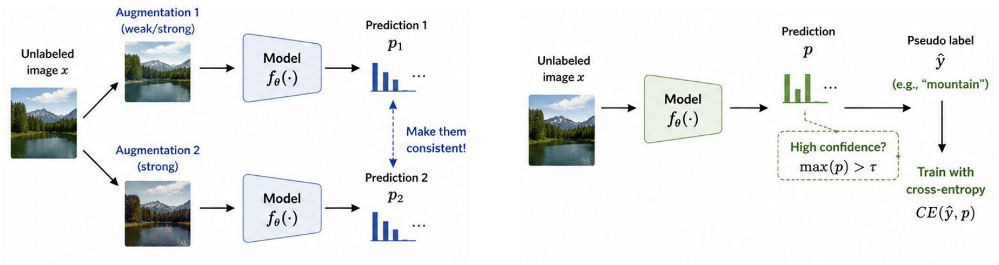

| | **Consistency Regularization** (왼쪽) | **Pseudo Label** (오른쪽) |
|---|---|---|
| 아이디어 | 같은 $x$의 두 augmentation(weak/strong, strong) → $p_1, p_2$ → **"Make them consistent!"** | 예측 $p$가 confident하면($\max(p)>\tau$) **pseudo label $\hat y$** 로 삼아 CE 학습 |
| loss 형태 | $\mathcal{L}_u = D\big(f_\theta(\text{Aug}_1(x)),\, f_\theta(\text{Aug}_2(x))\big)$ | $\mathcal{L}_u = \mathbb{1}[\max(p)>\tau]\; CE(\hat y, p)$, $\hat y=\arg\max p$ |
| supervision | 두 **예측 간 일치** | 예측을 **hard target으로 변환** |
| 다루는 강의 | **이번 강의 (SSL I)** | 다음 주 (p.76) |

- 공통점: **모델 자신의 예측에서 supervision을 만들어냄** (label 불필요).
- pseudo label 수식은 슬라이드 그림("High confidence? max(p) > τ", "CE(ŷ, p)")을 풀어 쓴 것.

> 보충: 두 계열을 합친 게 **FixMatch** — weak aug 예측에서 thresholded pseudo label을 만들고, strong aug 예측에 CE로 학습. p.9 두 그림을 겹친 모양. Pseudo-Label 원조는 Lee, 2013.

### 1.4 Notations (p.10)

| Symbol | Meaning |
|---|---|
| $L$ | Number of unique labels |
| $(\mathbf x^l, y)\sim\mathcal X,\ y\in\{0,1\}^L$ | Labeled dataset. $y$ is a **one-hot** representation of the true label |
| $\mathbf u\sim\mathcal U$ | Unlabeled dataset |
| $\mathcal D=\mathcal X\cup\mathcal U$ | The entire dataset (labeled + unlabeled) |
| $\mathbf x$ | Any sample (labeled or unlabeled) |
| $\bar{\mathbf x}$ | $\mathbf x$ with augmentation applied |
| $\mathbf x_i$ | The $i$-th sample |
| $\mathcal L, \mathcal L_s, \mathcal L_u$ | Loss, supervised loss, unsupervised loss |
| $\mu(t)$ | The unsupervised loss weight, **increasing in time** |
| $p(y\mid\mathbf x),\ p_\theta(y\mid\mathbf x)$ | Conditional probability over the label set given the input |
| $f_\theta(\cdot)$ | The implemented neural network with weights $\theta$ |
| $\mathbf z=f_\theta(\mathbf x)$ | A vector of **logits** |
| $\hat y=\mathrm{softmax}(\mathbf z)$ | The predicted label distribution |
| $D[\cdot,\cdot]$ | Distance between two distributions (MSE, cross entropy, KL divergence, …) |
| $\beta$ | **EMA** weighting hyperparameter for teacher model weights |
| $\alpha,\lambda$ | Parameters for **MixUp**, $\lambda\sim\mathrm{Beta}(\alpha,\alpha)$ |
| $T$ | Temperature for **sharpening** the predicted distribution |
| $\tau$ | **Confidence threshold** for selecting the qualified prediction |

- **기호 충돌 주의** (시험에서 수식 읽을 때 헷갈림):
  - EMA decay: Notation/Mean Teacher(p.23) = $\beta$, Temporal Ensembling(p.20) = $\alpha$ (ensembling momentum), PS-MT(p.47) = $\gamma$, Dual Teacher(p.60) = $\alpha$
  - MixUp의 $\alpha$ (Beta 분포 파라미터)와 EMA의 $\alpha$는 전혀 다른 것
  - ramp-up weight: $\mu(t)$ (notation, p.30) = $w(t)$ (Π-model/TE pseudocode) = $w_t$ (ICT 그림)

> 보충: sharpening은 보통 $\mathrm{Sharpen}(p)_i = p_i^{1/T}/\sum_j p_j^{1/T}$ (MixMatch). $T$, $\tau$는 이번 강의 본문엔 안 나오고 pseudo label 계열(다음 주)에서 쓰일 기호.

### 1.5 Hypotheses — 왜 unlabeled data가 도움이 되나 (p.11–14)

**H1. Smoothness Assumption** (p.11)
- Nearby samples should have similar predictions. / Small perturbations should not change the label.
- 그림: feature space의 high-density region에서 가까운 두 점, 그리고 원본 $x$의 여러 augmentation view(crop, color jitter, flip)의 prediction이 서로 $\approx$.
- 두 문장은 같은 가정: "다른 샘플 간 가까움"과 "같은 샘플의 perturbation"은 모두 **입력 공간의 근방**. → **consistency regularization의 직접적 근거** (label 없이도 검사 가능: 두 view 예측이 같은지만 보면 됨).

> 보충: Chapelle et al.의 원래 정의는 "**high-density region에서** 가까운 두 점은 output도 가깝다"로 density 조건이 붙음. 슬라이드 그림에서 "high-density region"을 강조한 이유.

**H2. Cluster Assumption** (p.12)
- Samples within the same cluster are likely to share the same label. / Decision boundaries should **not split a cluster**.
- 직관: cluster 안에 labeled 점이 **하나만** 있어도 cluster 전체로 label을 전파할 수 있음 → unlabeled data는 **cluster의 모양**을 알려줌.
- H1이 local 성질이라면 H2는 가까움이 chain으로 이어진 **global** 성질.

**H3. Low-Density Separation** (p.13)
- Decision boundaries should lie in **low-density regions**. / Separate clusters rather than cutting through them.

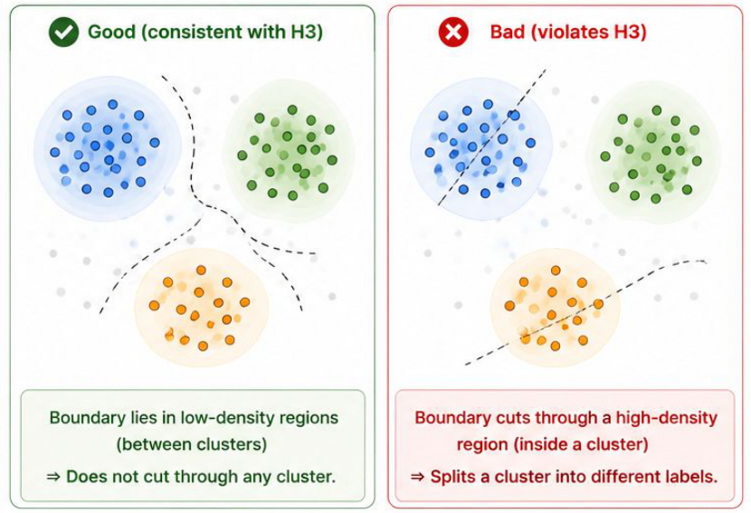

- labeled만 보면 cluster를 관통하는 boundary도 똑같이 좋아 보이지만, **unlabeled 점이 어디 몰려 있는지** 알면 그런 boundary를 배제 가능 → unlabeled data가 boundary를 **low-density 쪽으로 밀어줌**.
- **H2 vs H3**: 사실상 같은 직관의 두 표현. H2 = label의 구조(cluster ⇒ 같은 label), H3 = boundary의 위치(low-density ⇒ boundary).

> 보충: TSVM(unlabeled 포함 max margin), entropy minimization, pseudo labeling이 모두 H3를 암묵적으로 구현 — 예측을 confident하게 만들면 unlabeled 점이 boundary 근처(예측이 애매한 곳)에 못 있게 됨.

**H4. Manifold Assumption** (p.14)
- High-dimensional data lie on a **low-dimensional manifold**. / Similar samples are connected on the underlying manifold.
- 그림: observation space 차원 $D$ (이미지 픽셀 100K+) vs intrinsic dimension $d\ll D$ ($d=2$ 예시, 좌표 $z_1,z_2$).
- 유사도는 ambient space의 Euclidean 거리가 아니라 **manifold 위의 거리(geodesic)** 로 재야 함.
- SSL에 도움인 이유: 고차원에선 curse of dimensionality로 labeled만으로 구조 파악 불가 → unlabeled가 manifold 모양을 조밀하게 추정해줌. 저차원 표현 $z$를 배우는 것 = **representation learning의 동기**와 직결.

> 보충: two-moons 데이터 — Euclidean으로는 두 moon이 가깝지만 manifold 거리로는 멀다. Graph-based SSL(label propagation, kNN graph)이 H4의 대표 구현.

| 가정 | 한 줄 정의 (영어) | 대응 기법 |
|---|---|---|
| H1 Smoothness | Nearby samples should have similar predictions | Consistency regularization |
| H2 Cluster | Samples in the same cluster share the same label | Cluster/label propagation |
| H3 Low-density separation | Decision boundaries lie in low-density regions | Entropy min., pseudo label, ICT |
| H4 Manifold | High-dim data lie on a low-dim manifold | Graph-based SSL, representation learning |

> 보충: 가정이 틀리면(예: class 경계가 high-density 영역을 지나는 데이터) unlabeled data가 오히려 성능을 깎을 수 있음.

---

## 2. Consistency Regularization (p.15–42)

### 2.1 Core Idea (p.16)

- Predictions should remain **consistent under small perturbations**.
- Perturbations may come from: **Data augmentations** / **Model stochasticity** (e.g., Dropout)

$$\mathcal{L}_u = D\big(f(x),\ f(\mathcal{A}(x))\big)$$

- **label $y$가 수식에 없음** → unlabeled에도 계산 가능. H1(smoothness)을 loss로 바꾼 것.
- 방법들의 차이는 결국 세 가지 선택:
  1. **perturbation**: dropout / augmentation / adversarial / mixup / strong aug
  2. **target 쪽 모델**: 같은 모델(동시 forward) / 과거 예측 EMA / EMA weight teacher
  3. **$D$**: MSE / KL / CE

> 보충: 상수 함수는 consistency loss를 0으로 만들지만 $\mathcal{L}_s$가 같이 있어서 막아줌. 또 대부분 방법은 한쪽(target)에 **stop-gradient**를 걸어 target처럼 취급.

### 2.2 Π-model (p.17–18)

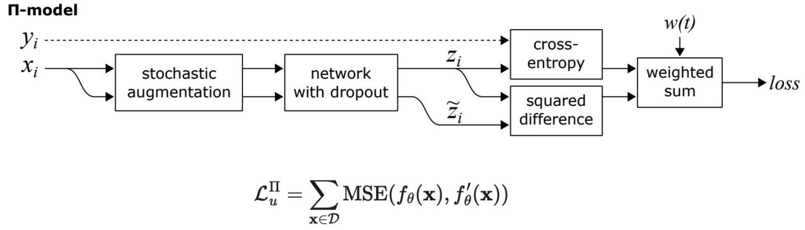

- Two versions of the same input with different **stochastic augmentation and dropout masks** pass through the network and the outputs are expected to be consistent.

$$\mathcal{L}_u^{\Pi} = \sum_{\mathbf x\in\mathcal D}\mathrm{MSE}\big(f_\theta(\mathbf x),\, f'_\theta(\mathbf x)\big)$$

- $f_\theta$와 $f'_\theta$는 **같은 파라미터, 다른 stochastic perturbation** (파라미터가 다른 게 아님).
- $\mathbf x\in\mathcal D$ (labeled + unlabeled 전체) → unlabeled로도 학습 신호 발생.
- 이름: 입력이 두 갈래로 갔다 합쳐지는 그림 모양이 **Π**.

**Algorithm 1 (p.18)** — Require: $x_i$ training stimuli, $L$ labeled index set, $y_i$ labels, $w(t)$ unsupervised weight ramp-up, $f_\theta(x)$ stochastic network, $g(x)$ stochastic input augmentation.

```
for t in [1, num_epochs]:
  for each minibatch B:
    z_i  ← f_θ(g(x_i))          ▷ evaluate network outputs for augmented inputs
    z̃_i  ← f_θ(g(x_i))          ▷ again, with different dropout and augmentation
    loss ← supervised + unsupervised
    update θ (e.g., ADAM)
```

$$\mathcal{L} = \underbrace{-\frac{1}{|B|}\sum_{i\in B\cap L}\log z_i[y_i]}_{\text{supervised CE (labeled만)}} \;+\; w(t)\,\underbrace{\frac{1}{C\,|B|}\sum_{i\in B}\|z_i-\tilde z_i\|^2}_{\text{consistency (전체)}}$$

- $C$ = class 수 → $\frac{1}{C|B|}\sum\|\cdot\|^2$ = element 평균 **MSE**.
- $z_i[y_i]$ = 정답 class 확률 → $-\log z_i[y_i]$ = CE. 분모가 $|B\cap L|$이 아니라 **$|B|$** ← labeled 비율만큼 supervised 항이 자동 scaling.
- $z$와 $\tilde z$의 식이 글자상 같은 건 오타 아님 — **stochastic**이라 값이 다름 (▷ 주석).
- **단점: 입력당 forward 2회** → 연산 2배 → Temporal Ensembling의 동기.

> 보충: MSE를 쓰는 이유 — softmax 출력 간 squared difference는 KL보다 bounded하고 outlier(확률 0 근처)에 덜 민감해 gradient가 안정적. 원 Π-model은 $\tilde z$ 쪽에도 gradient가 흐름 (양쪽 다 학습).

### 2.3 Temporal Ensembling (p.19–22)

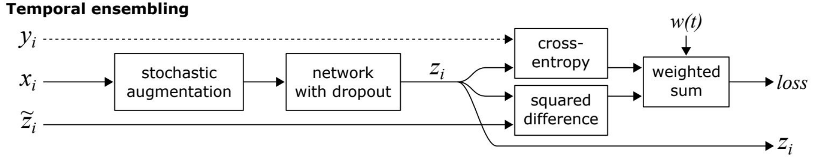

- Π-model requires two forward passes → **high computational cost**.
- Instead → use the **historical predictions of the same sample** as the consistency target (**EMA of the model prediction in time per training sample**).
- 그림: $\tilde z_i$가 network 출력이 아니라 **외부(메모리)에서 들어오는 입력**, $z_i$는 밖으로 나가 메모리를 갱신.

**Algorithm 2 (p.20)** — 추가 Require: $\alpha$ = ensembling momentum, $0\le\alpha<1$.

```
Z ← 0[N×C]       ▷ initialize ensemble predictions
z̃ ← 0[N×C]       ▷ initialize target vectors
for t in [1, num_epochs]:
  for each minibatch B:
    z_i  ← f_θ(g(x_i), t)       ▷ 한 번만 forward
    loss ← -(1/|B|) Σ_{i∈B∩L} log z_i[y_i] + w(t) (1/(C|B|)) Σ_{i∈B} ||z_i − z̃_i||²
    update θ
  Z ← αZ + (1−α) z              ▷ accumulate ensemble predictions
  z̃ ← Z / (1 − α^t)             ▷ construct target vectors by bias correction
```

- 슬라이드 캡션: $Z$, $\tilde z$ 갱신은 minibatch loop 안에서 해도 동등, clarity 위해 epoch 사이에 둠.
- $f_\theta(g(x), t)$의 $t$ ← 의심: Algorithm 1의 $f_\theta(g(x))$와 표기가 다름. 의도 설명 없음 (원문 유지).
- $Z,\tilde z\in\mathbb R^{N\times C}$ = **전체 데이터 $N$개 각각의 예측을 저장**. target $\tilde z$는 gradient 없는 상수.

**Bias correction 유도** — $Z_0=\mathbf 0$에서 시작하니 EMA가 0쪽으로 편향됨. 예측이 $t$ epoch 동안 일정한 $z$라 가정하면

$$Z_t = (1-\alpha)\sum_{k=0}^{t-1}\alpha^k z = (1-\alpha^t)\,z \;\;\Rightarrow\;\; \tilde z = \frac{Z_t}{1-\alpha^t} = z$$

- $t=1$이면 $Z=(1-\alpha)z$ → $\tilde z=z$. $t$가 커지면 $\alpha^t\to0$이라 보정 효과 소멸. (**Adam의 bias correction과 같은 원리**)
- 첫 epoch엔 $\tilde z=\mathbf 0$이지만 $w(1)\approx0$이라 문제 없음 → ramp-up과 짝으로 설계됨.

> 보충: 논문 기본값 $\alpha=0.6$. 과거 여러 epoch(서로 다른 dropout/aug/weight 상태)의 예측 평균 = **ensemble 예측** → 단일 noisy 예측보다 분산이 작고 정확한 target. "self-ensembling".

**실험 (p.21)** — Table 1: CIFAR-10, error rate (%), averages of 10 runs (4 runs for all labels)

| Method | 4000 labels | All (50000) |
|---|---|---|
| Supervised-only | 35.56 ± 1.59 | 7.33 ± 0.04 |
| &nbsp;&nbsp;with augmentation | 34.85 ± 1.65 | 6.05 ± 0.15 |
| Conv-Large, Γ-model (Rasmus et al., 2015) | 20.40 ± 0.47 | |
| CatGAN (Springenberg, 2016) | 19.58 ± 0.58 | |
| GAN of Salimans et al. (2016) | 18.63 ± 2.32 | |
| Π-model | 16.55 ± 0.29 | 6.90 ± 0.07 |
| &nbsp;&nbsp;Π-model with augmentation | 12.36 ± 0.31 | **5.56 ± 0.10** |
| &nbsp;&nbsp;Temporal ensembling with augmentation | **12.16 ± 0.24** | 5.60 ± 0.10 |

- 4000 labels: 35.56 → Π 16.55 → +aug 12.36 → TE 12.16. unlabeled + consistency로 error 약 1/3.
- **augmentation 시너지**: supervised는 aug를 넣어도 34.85로 거의 그대로인데 Π는 16.55 → 12.36. consistency가 있어야 aug의 다양한 view가 학습 신호가 됨.
- TE vs Π: 정확도는 거의 동급 (All labels에선 Π가 근소 우세) → **TE의 장점은 정확도보다 효율(forward 1회) + target 안정성**.
- All labels에서도 consistency가 도움 (6.05 → 5.56) → 순수 regularization 효과.

**장단점 (p.22)**

| Advantages | Limitations |
|---|---|
| Only **one forward pass** per iteration | EMA target is maintained **per training sample** |
| **More stable target** than Π-model | Requires storing predictions for every sample ($N\times C$) |
| Lower computational cost | Updated only **once per epoch** (stale) |
| | Difficult to scale to large datasets |

- → **Next: Mean Teacher** (EMA over **model parameters** instead of predictions).

### 2.4 Mean Teacher (p.23–29)

**Motivation & Core Idea (p.23)**
- Temporal Ensembling stores an EMA prediction **for every training sample** → memory intensive, targets updated only **once per epoch**.
- **Replace the EMA of predictions with an EMA of model weights.** The teacher is the EMA of the student:

$$\boxed{\theta' \leftarrow \beta\,\theta' + (1-\beta)\,\theta}$$

- $\theta$ = student (gradient descent), $\theta'$ = teacher, $\beta$ = EMA decay. 전개하면 $\theta'_t \approx (1-\beta)\sum_i\beta^i\theta_{t-i}$ → **여러 step student의 weight-space ensemble**.

> 보충: 논문은 $\alpha$로 표기 ($\theta'_t=\alpha\theta'_{t-1}+(1-\alpha)\theta_t$). Polyak averaging과 같은 계열이지만, 평균 모델을 evaluation용이 아니라 **학습 target 생성용**으로 쓴다는 게 차이. 앞 강의 MoCo의 momentum encoder($\theta_k\leftarrow m\theta_k+(1-m)\theta_q$)와 같은 식 — MoCo는 key 일관성, Mean Teacher는 target 안정화가 목적.

**Training Pipeline (p.24)**

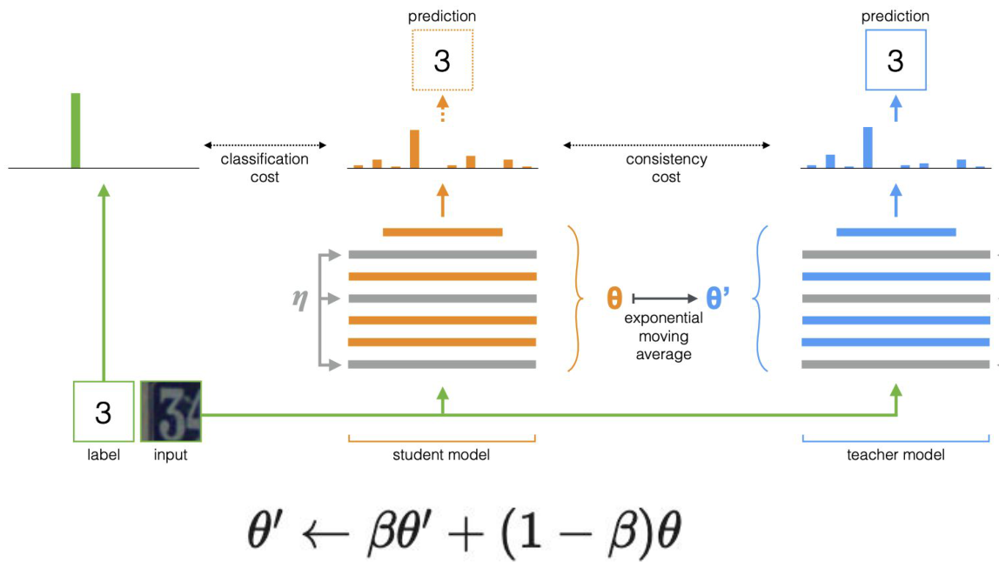

- **Student**: updated by gradient descent, optimized with **supervised + consistency** losses
- **Teacher**: receives the **same input with different perturbations** ($\eta'$ vs $\eta$), parameters updated **only by EMA**, **no backpropagation**
- **The consistency regularization loss is the distance between predictions by the student and teacher.**

$$\mathcal{L}(\theta) = \mathbb{E}_{(x,y)\in\mathcal D_l}\big[\mathrm{CE}(y, f(x,\eta;\theta))\big] + \lambda\,\mathbb{E}_{x\in\mathcal D_l\cup\mathcal D_u}\big\|f(x,\eta;\theta) - f(x,\eta';\theta')\big\|^2$$

(슬라이드엔 위 식 없음, 논문 기반 정리) → classification cost는 labeled만, consistency cost는 전체.
- 한 iteration: 다른 noise로 student/teacher forward → loss → **student만** backprop → teacher EMA 갱신.
- 선순환: student가 좋아지면 teacher도 좋아지고, teacher는 평균이라 student보다 안정적·정확 → 더 좋은 target.

**Advantages (p.25)**: Stable teacher predictions / No per-sample prediction memory / Teacher updated every iteration / Scales well to large datasets. — "Learn from a stable teacher whose parameters are the EMA of the student."

| | Π-model | Temporal Ensembling | Mean Teacher |
|---|---|---|---|
| Target | 같은 모델, 다른 noise의 출력 | sample별 prediction EMA | EMA weight teacher의 출력 |
| Target 갱신 | 매 step | **epoch당 1회** | 매 step |
| Forward / iter | 2 (둘 다 grad) | 1 | 2 (teacher는 no grad) |
| 추가 메모리 | 없음 | $N\times C$ prediction | weight 사본 1개 |
| Target 안정성 | 낮음 | 높음 | 높음 |
| Large dataset | O | **X** | O |

(슬라이드 내용 종합 정리)

**Experiments (p.26–27)**

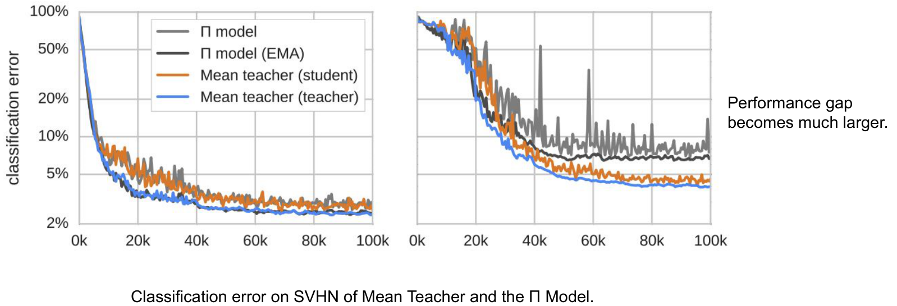

- "The mean teacher (in orange) has better performance than the student model." ← 의심: 범례상 **orange = Mean teacher (student), blue = Mean teacher (teacher)**. 그래프에선 파랑(teacher) error가 주황(student)보다 낮음 → "teacher(파랑)가 student보다 좋다"가 맞는 문장.
- "The benefit is especially significant in the **low-label regime**." 오른쪽 패널(적은 label)에서 "Performance gap becomes much larger" — Π model은 spike가 심하고 불안정.
- Π model (EMA)도 Π보다는 낫지만 Mean Teacher보다 나쁨 → EMA를 **평가에만** 쓰는 걸론 부족, **학습 target으로** 써야 함.

> 보충: 논문 Figure 기준 왼쪽 = SVHN 73257 labels(전체), 오른쪽 = 250 labels.

Table 1 (p.27): SVHN error rate (%), 10 runs (4 runs for all labels), 13-layer ConvNet, **모든 모델을 EMA weight로 평가**.

| Method | 250 labels | 500 labels | 1000 labels | 73257 labels |
|---|---|---|---|---|
| GAN | | 18.44 ± 4.8 | 8.11 ± 1.3 | |
| Π model [13] | | 6.65 ± 0.53 | 4.82 ± 0.17 | 2.54 ± 0.04 |
| Temporal Ensembling | | 5.12 ± 0.13 | 4.42 ± 0.16 | 2.74 ± 0.06 |
| VAT+EntMin | | | **3.86** | |
| Supervised-only | 27.77 ± 3.18 | 16.88 ± 1.30 | 12.32 ± 0.95 | 2.75 ± 0.10 |
| Π model | 9.69 ± 0.92 | 6.83 ± 0.66 | 4.95 ± 0.26 | 2.50 ± 0.07 |
| **Mean Teacher** | **4.35 ± 0.50** | **4.18 ± 0.27** | 3.95 ± 0.19 | **2.50 ± 0.05** |

- 250 labels: supervised 27.77 → Π 9.69 → **MT 4.35** (Π 대비 절반 이하).
- 1000 labels에선 **VAT+EntMin 3.86 < MT 3.95** → MT가 항상 1등은 아님.
- 전체 label: MT = Π = 2.50 → label이 충분하면 SSL 이득은 작아짐.
- 모두 EMA weight로 평가 → MT의 이득은 "EMA 평가" 효과가 아니라 **EMA target 학습** 효과.

**Effective Perturbations / EMA decay / Loss (p.28)**
- **Input augmentation is essential**: random flip, Gaussian noise.
- "Dropout is applied only to the **student** model. Dropout is **not necessary** for the teacher model."
  - p.24 그림엔 teacher에도 noise $\eta'$가 있지만 모순은 아님: 그림은 기본 구조(양쪽에 perturbation)이고, p.28은 "teacher 쪽 dropout은 없어도 된다"는 실험적 결론. 핵심은 **input aug 필수 + student/teacher가 서로 다른 perturbation**.

> 보충: 원 논문 ablation에서 teacher 쪽 dropout을 빼도 성능 차이가 거의 없다고 보고한 것으로 기억함 (논문 원문 미확인).
- **EMA Decay $\beta$**: performance is sensitive. **Early $\beta=0.99$ → Later $\beta=0.999$**. "Increase the teacher stability as the student converges."
  - 유효 평균 창 $\approx 1/(1-\beta)$: 0.99 → 약 100 step, 0.999 → 약 1000 step.
  - 초반엔 student가 빠르게 좋아지므로 teacher가 빨리 따라가야 함 (β 너무 크면 teacher가 형편없는 초기 weight에 머묾). 후반엔 안정성이 더 중요.
- **Consistency Loss**: **MSE performs better than KL divergence** → 이후 많은 방법의 default.

$$\text{MSE: } \|p_\theta(x)-p_{\theta'}(x)\|_2^2 \qquad \text{vs.}\qquad \mathrm{KL}(p_{\theta'}\,\|\,p_\theta)$$

> 보충: MSE는 gradient가 bounded라 teacher가 틀렸을 때 덜 끌려감 (noisy target에 robust). 이 성질이 나중에 PS-MT에선 "supervision이 약하다"는 단점으로 뒤집힘 (§3.1).

**Main Contributions (p.29)**: Replaced EMA of predictions with **EMA of model parameters** / More stable consistency targets / Eliminated per-sample prediction storage / Improved scalability.

> 보충: EMA teacher 구조는 이후 BYOL, DINO, MoCo, Noisy Student·FixMatch 변형 등에서 "momentum teacher" 설계 패턴의 원형이 됨.

### 2.5 Noisy Samples as Learning Targets (p.30–31)

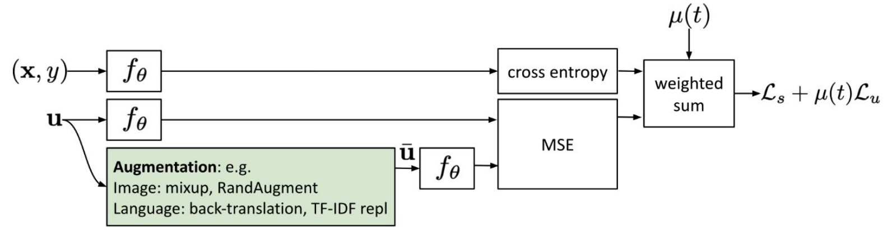

- **Core Idea**: Apply **strong augmentations** to an unlabeled sample. The prediction should remain consistent before and after augmentation.
- Augmentation 예: Image — mixup, RandAugment / Language — back-translation, TF-IDF word replacement.
- 구조: $(\mathbf x,y)\to f_\theta\to$ CE, $\mathbf u\to f_\theta$와 $\bar{\mathbf u}\to f_\theta$ → MSE, weighted sum → $\mathcal L_s+\mu(t)\mathcal L_u$.
- **Key Insight**: The model should make the same prediction for an unlabeled sample and its augmented version.
- "Noisy consistency training directly enforces **prediction invariance** between an input and its augmented version **using the same model**."
- strong aug를 쓰는 이유: 약한 noise는 모델이 이미 invariant해서 loss ≈ 0 → 학습 신호 없음.

**비교 (p.31)**

| | noise 위치 | consistency target |
|---|---|---|
| Π-model | **network 내부** stochastic perturbation (dropout 등) | 같은 모델의 다른 stochastic pass |
| Mean Teacher | 양쪽 pass에 noise | **EMA teacher** 예측 |
| Noisy samples (p.30) | **입력에 strong augmentation** | 원본 입력에 대한 **같은 모델** 예측 (self-consistency) |

- vs Π-model: "Uses **input augmentations** on unlabeled data instead of stochastic perturbations inside the network."
- vs Mean Teacher: "Uses **self-consistency** between original and augmented inputs instead of an EMA teacher."

> 보충: 이 구조의 대표 방법이 뒤에 나오는 **UDA**. stop-gradient를 어느 쪽에 거는지는 슬라이드에 명시 없음 (UDA는 원본 쪽 고정).

### 2.6 Adversarial Training → Virtual Adversarial Training (p.32–35)

**Adversarial Training (Goodfellow et al.) (p.32)**
- Add adversarial **perturbations** to the input during training. Train the model to **produce the correct prediction** even under worst-case perturbations. Improves robustness against adversarial attacks.
- 그림: panda (57.7%) $+\ 0.007\times\mathrm{sign}(\nabla_x J(\theta,x,y))$ ("nematode" 8.2%) $=$ "gibbon" **99.3%**. 사람 눈엔 안 보이는 작은 noise로 모델이 **자신 있게** 틀림.
- 일반 augmentation이 랜덤 noise라면, adversarial은 **모델이 가장 약한 방향**의 noise.
- 본문은 "Goodfellow et al., 2014", 하단 출처는 "ICLR 2015" ← arXiv 2014 / ICLR 2015 게재라 오타 아님.

> 보충: 취약성의 설명 = **linearity hypothesis**. 고차원에서 원소별 작은 변화 $\epsilon$이 선형 레이어에서 합쳐지면 출력이 $\epsilon\|w\|_1$만큼 크게 변함. $J(\theta,x,y)$는 학습 loss이고 FGSM은 이걸 **입력 $x$에 대해** 미분함.

**How it works / FGSM (p.33)**
1. Compute the adversarial perturbation that maximally changes the prediction.
2. Add the perturbation to the input.
3. Minimize the prediction difference between clean and perturbed inputs.

$$\mathcal{L}_{\text{adv}}(\mathbf{x}^l, \theta) = D\big[\underbrace{q(y \mid \mathbf{x}^l)}_{\text{GT (one-hot)}},\ \underbrace{p_\theta(y \mid \mathbf{x}^l + r_{\text{adv}})}_{\text{prediction for attacked image}}\big]$$

$$r_{\text{adv}} = \arg\max_{r;\ \|r\|\le\epsilon} D\big[q(y \mid \mathbf{x}^l),\ p_\theta(y \mid \mathbf{x}^l + r_{\text{adv}})\big] \quad\text{"Find the noise in the direction where the model is most confused."}$$

$$r_{\text{adv}} \approx \epsilon \frac{g}{\|g\|_2} \approx \epsilon\,\mathrm{sign}(g), \qquad g = \nabla_r D\big[y,\ p_\theta(y \mid \mathbf{x}^l + r)\big]$$

- ← 의심: 둘째 줄 argmax 안이 $\mathbf x^l+r_{\text{adv}}$로 자기 자신을 참조함. argmax 변수 $r$로 $\mathbf x^l+r$이어야 맞음 (VAT 식 p.34도 $\mathbf x+r$).
- ← 의심: $\epsilon\frac{g}{\|g\|_2}$와 $\epsilon\,\mathrm{sign}(g)$는 서로 **다른 norm 제약의 해**라 "≈"는 느슨한 표기 (아래 유도). 첫 줄은 $q(y|\mathbf x^l)$, 셋째 줄은 $y$로 표기도 섞여 있음 (둘 다 one-hot label).

**FGSM 유도** — 정확한 argmax는 어려우니 $r=0$ 근처에서 **1차 Taylor 전개**:

$$D(\mathbf x+r)\approx D(\mathbf x) + g^\top r,\qquad g=\nabla_r D\big|_{r=0}$$

- $\|r\|_2\le\epsilon$에서 $g^\top r$ 최대 → Cauchy–Schwarz로 $r=\epsilon\,g/\|g\|_2$
- $\|r\|_\infty\le\epsilon$에서 최대 → $r=\epsilon\,\mathrm{sign}(g)$ (각 좌표를 끝까지)
- $g$는 loss를 가장 가파르게 올리는 방향 = 정답 확률이 가장 빨리 떨어지는 방향. clean 입력에서 backprop 1회로 구함 → "Fast".
- 구조는 **min-max**: inner $\max_r$(가장 나쁜 noise) / outer $\min_\theta$(그래도 맞히기). one-hot $q$면 $D$ = KL = CE.

**VAT (p.34)** — VAT extends the idea to **semi-supervised learning**. The VAT loss applies to **both labeled and unlabeled** samples.

GT $q(y|\mathbf x^l)$ → "If GT is known," ⇒ **use current model prediction** $p_{\hat\theta}(y|\mathbf x)$:

$$\boxed{\mathcal{L}_u^{\text{VAT}}(\mathbf{x}, \theta) = D\big[p_{\hat\theta}(y\mid\mathbf{x}),\ p_\theta(y\mid\mathbf{x} + r_{\text{vadv}})\big],\quad r_{\text{vadv}} = \arg\max_{r;\ \|r\|\le\epsilon} D\big[p_{\hat\theta}(y\mid\mathbf{x}),\ p_\theta(y\mid\mathbf{x} + r)\big]}$$

| Adversarial Training | VAT |
|---|---|
| Uses ground-truth labels | Uses **model predictions** |
| Supervised learning | **Semi-supervised** learning |
| Improves **robustness** | Enforces **local smoothness** of predictions |

- "VAT replaces the ground-truth label with the model's own prediction, enabling **adversarial consistency training** on unlabeled data."
- **"Virtual"** = 진짜 label 대신 가상의 label(모델 자신의 예측)을 씀.
- $\hat\theta$ = 현재 파라미터를 **상수로 고정** (그쪽엔 gradient 안 흐름) ← 슬라이드엔 "current model prediction"만, stop-grad 명시는 없음.
- 의미: 각 $\mathbf x$ 주변 $\epsilon$-ball 안에서 **출력이 가장 민감한 방향**에서도 예측이 안 변하게 → H1 smoothness를 worst-case로 강제.

> 보충 — **왜 VAT는 FGSM을 그대로 못 쓰고 power iteration을 쓰나** (서술형 대비):
> 1. VAT에서 $D(r)=\mathrm{KL}[p(y|\mathbf x)\,\|\,p(y|\mathbf x+r)]$는 $r=0$에서 **최소값 0** → $\nabla_r D|_{r=0}=0$. 1차 항이 사라져 FGSM의 선형 근사가 무의미. (AT는 target이 one-hot이라 $r=0$에서도 gradient가 0이 아님.)
> 2. **2차 Taylor**: $D(r)\approx\frac12 r^\top H r$, $H=\nabla_r^2 D|_{r=0}$ (KL이면 Fisher information).
> 3. $\|r\|_2\le\epsilon$에서 최대화 → $H$의 **dominant eigenvector** $u_1$: $r_{\text{vadv}}\approx\epsilon\,\overline{u_1}$.
> 4. $H$는 $O(d^2)$라 직접 못 구함 → **power iteration** $d\leftarrow\overline{Hd}$ (랜덤 단위벡터 $d$에서 시작).
> 5. $Hd$는 **finite difference**로: $Hd\approx\nabla_r D|_{r=\xi d}/\xi$ (작은 $\xi$, $r=0$ gradient는 0이라 빠짐).
> 6. 따라서 $r_{\text{vadv}}\approx\epsilon\,g/\|g\|_2$, $g=\nabla_r D|_{r=\xi d}$ — FGSM과 같은 모양이지만 **gradient를 $r=0$이 아니라 $r=\xi d$에서 평가**. 논문은 **1 iteration**으로 충분하다고 보고.
> 7. $D$는 논문에서 KL. 전체 목적은 $\mathcal L_s+\alpha\,\mathbb E_{\mathbf x\in\mathcal D_l\cup\mathcal D_u}\mathcal L_u^{\text{VAT}}$.

**실험 (p.35)** — Miyato et al., TPAMI 2018

Table 3: MNIST, **permutation invariant** setting, test error (%). (PEA = Pseudo Ensembles Agreement, DGM = Deep Generative Models, FM = feature matching)

| Method | $N_l=100$ | $N_l=1000$ |
|---|---|---|
| TSVM | 16.81 | 5.38 |
| PEA | 5.21 | 2.87 |
| DGM (M1+M2) | 3.33 (±0.14) | 2.40 (±0.02) |
| CatGAN | 1.91 (±0.1) | 1.73 (±0.18) |
| Skip DGM | 1.32 (±0.07) | |
| Ladder networks | 1.06 (±0.37) | **0.84** (±0.08) |
| Auxiliary DGM | 0.96 (±0.02) | |
| GAN with FM | **0.93** (±0.07) | |
| RPT | 6.81 (±1.30) | 1.58 (±0.54) |
| VAT | 1.36 (±0.03) | 1.27 (±0.11) |

Table 4: SVHN / CIFAR-10 **without** image data augmentation (* = permutation invariant)

| Method | SVHN $N_l=1000$ | CIFAR-10 $N_l=4000$ |
|---|---|---|
| SWWAE | 23.56 | |
| *Skip DGM | 16.61 (±0.24) | |
| *Auxiliary DGM | 22.86 | |
| Ladder networks, Γ model | | 20.40 (±0.47) |
| CatGAN | | 19.58 (±0.58) |
| GAN with FM | 8.11 (±1.3) | 18.63 (±2.32) |
| Π model | 5.43 (±0.25) | 16.55 (±0.29) |
| *(Conv-Small)* RPT | 8.41 (±0.24) | 18.56 (±0.29) |
| *(Conv-Small)* VAT | **6.83** (±0.24) | **14.87** (±0.13) |
| *(Conv-Large)* VAT | 5.77 (±0.32) | 14.18 (±0.38) |
| *(Conv-Large)* VAT+EntMin | **4.28** (±0.10) | **13.15** (±0.21) |

- **"RPT smooths predictions in random directions, whereas VAT smooths only along the most adversarial direction, making the regularization significantly more effective."**
  - RPT (Random Perturbation Training) vs VAT, 같은 조건: MNIST-100 6.81 → **1.36**, SVHN 8.41 → **6.83**, CIFAR-10 18.56 → **14.87**. 분산도 작아짐.
  - 이유: 고차원에서 랜덤 방향은 대부분 모델이 **이미 둔감한** 방향이라 regularization 효과가 미미. adversarial 방향 하나만 눌러도 local Lipschitz가 크게 줄어듦.
- **VAT+EntMin**(entropy minimization, Grandvalet & Bengio 2005)이 최고 → 두 regularizer가 보완적 (EntMin은 H3를 구현).
- augmentation 없는 조건이라 VAT **자체의 regularization 효과**만 본 것.

### 2.7 Interpolation Consistency Training — ICT (p.36–38)

**MixUp 기반 consistency (p.36)**
- Following the idea of **MixUp** / Add more interpolations of data points / Expect the model prediction to be consistent with interpolations of the corresponding labels / Uses a **Mean Teacher** to generate stable targets.

$$\text{mixup}_\lambda(\mathbf{x}_i, \mathbf{x}_j) = \lambda \mathbf{x}_i + (1-\lambda)\mathbf{x}_j \qquad\text{(two unlabeled samples are linearly interpolated)}$$

$$p(\text{mixup}_\lambda(y \mid \mathbf{x}_i, \mathbf{x}_j)) \approx \lambda\, p(y \mid \mathbf{x}_i) + (1-\lambda)\, p(y \mid \mathbf{x}_j) \qquad\text{(consistency target)}$$

- ← 의심: 좌변은 $p(y\mid\text{mixup}_\lambda(\mathbf x_i,\mathbf x_j))$가 맞는 표기 (슬라이드는 mixup이 $y$ 앞에 붙어 있음). p.37의 $\mathcal L_u^{\text{ICT}}$에선 올바르게 쓰임.
- **"Mixing inputs should produce mixed predictions."** → 입력 사이에서 모델이 **linear behavior**를 갖도록.
- 일반 MixUp은 label을 섞어야 해서 labeled에만 가능. ICT는 unlabeled의 label 대신 **teacher 예측을 섞어** target으로 씀.

> 보충: MixUp 원형 (Zhang et al., 2018): $\tilde x=\lambda x_i+(1-\lambda)x_j$, $\tilde y=\lambda y_i+(1-\lambda)y_j$, $\lambda\sim\mathrm{Beta}(\alpha,\alpha)$.

**구조와 loss (p.37)**

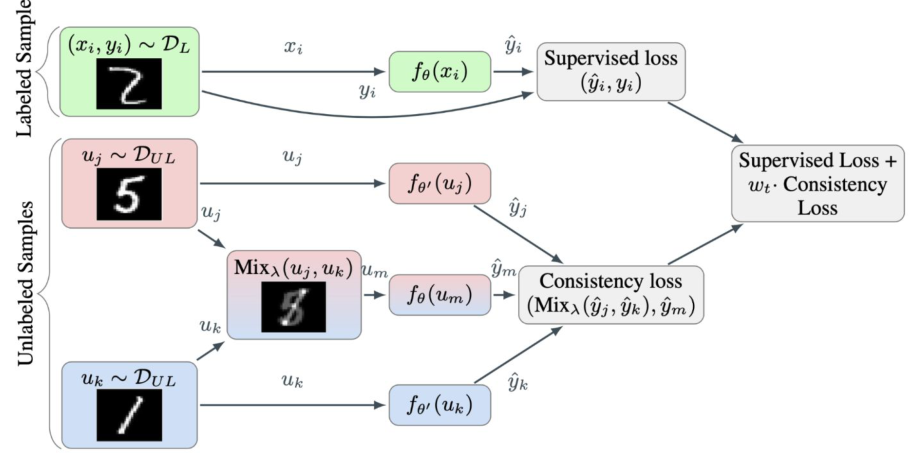

- Random MixUp samples are likely to lie **near the decision boundary**. Consistency on these interpolated samples encourages **smoother decision boundaries**. Aligns well with the **Low-Density Separation Assumption**.

$$\boxed{\mathcal{L}_u^{\text{ICT}} = \mathbb{E}_{\mathbf{u}_i,\mathbf{u}_j\sim\mathcal{U}}\ \mathbb{E}_{\lambda\sim\text{Beta}(\alpha,\alpha)}\ D\Big[p_\theta\big(y \mid \text{mixup}_\lambda(\mathbf{u}_i,\mathbf{u}_j)\big),\ \text{mixup}_\lambda\big(p_{\theta'}(y\mid\mathbf{u}_i),\, p_{\theta'}(y\mid\mathbf{u}_j)\big)\Big]}$$

- **teacher $\theta'$** (EMA) 는 섞기 **전** 원본 $u_j,u_k$를 보고 target $\hat y_j,\hat y_k$를 만들고, **student $\theta$** 는 섞은 $u_m$을 보고 $\hat y_m$을 냄 → consistency loss $(\mathrm{Mix}_\lambda(\hat y_j,\hat y_k),\hat y_m)$.
- 최종: Supervised Loss $+\ w_t\cdot$ Consistency Loss.
- **왜 H3와 맞나**: 다른 class 두 점을 섞으면 그 사이(low-density) 영역에 놓임 → 거기서 예측이 "섞인 확률"로 부드럽게 변하게 강제 → boundary가 cluster를 가르지 않고 사이로 지나감.
- Mean Teacher를 쓰는 이유: target이 요동치면 consistency가 불안정·confirmation bias.

> 보충: 원 논문은 $D$로 MSE 사용. 구현은 batch를 permute해서 짝을 만듦.

**실험 (p.38)** — Table 1: CIFAR-10, CNN-13, error rate (%), 50000 unlabeled, ICT 3 trials

| Model | 1000 labeled | 2000 labeled | 4000 labeled |
|---|---|---|---|
| Supervised | 39.95 ± 0.75 | 31.16 ± 0.66 | 21.75 ± 0.46 |
| Supervised (Mixup) | 36.48 ± 0.15 | 26.24 ± 0.46 | 19.67 ± 0.16 |
| Supervised (Manifold Mixup) | 34.58 ± 0.37 | 25.12 ± 0.52 | 18.59 ± 0.18 |
| Π model | 31.65 ± 1.20 | 17.57 ± 0.44 | 12.36 ± 0.31 |
| TempEns | 23.31 ± 1.01 | 15.64 ± 0.39 | 12.16 ± 0.24 |
| MT | 21.55 ± 1.48 | 15.73 ± 0.31 | 12.31 ± 0.28 |
| VAT | – | – | 11.36 ± NA |
| VAT+Ent | – | – | 10.55 ± NA |
| VAdD | – | – | 11.32 ± 0.11 |
| SNTG | 18.41 ± 0.52 | 13.64 ± 0.32 | 10.93 ± 0.14 |
| MT + Fast SWA | 15.58 ± NA | 11.02 ± NA | 9.05 ± NA |
| **ICT** | **15.48 ± 0.78** | **9.26 ± 0.09** | **7.29 ± 0.02** |

- 모든 label 수에서 ICT 최저. 4000 labels 7.29% (MT 12.31, VAT+Ent 10.55).
- supervised Mixup만으로도 개선되지만(21.75 → 19.67) unlabeled consistency 방법들의 이득이 훨씬 큼.
- 표의 Π/TempEns/MT 4000-label 수치는 p.21, p.27 계열 수치와 같음 (12.36 / 12.16 / 12.31).

### 2.8 Unsupervised Data Augmentation — UDA (p.39–42)

**개요 (p.39)**
- Applies **strong data augmentations** to unlabeled samples. Encourages consistent predictions between the original and augmented images. Emphasizes the importance of **augmentation quality** rather than adversarial perturbations.

$$p(y\mid x) \approx p(y\mid \text{Aug}(x))$$

> 보충 — 논문의 UDA loss:
> $$\mathcal L = \mathbb E_{x\in L}\big[-\log p_\theta(y^*|x)\big] + \lambda\,\mathbb E_{x\in U}\mathbb E_{\hat x\sim q(\hat x|x)}\Big[\mathrm{KL}\big(p_{\tilde\theta}(y|x)\,\|\,p_\theta(y|\hat x)\big)\Big]$$
> $\tilde\theta$ = gradient 없는 고정 복사본(원본 예측이 target). 추가 기법: **TSA**(Training Signal Annealing, labeled 과적합 방지), confidence-based masking, sharpening, 큰 unlabeled batch. 슬라이드 범위엔 없음.

**좋은 augmentation의 조건 (p.40)** — A good augmentation should be:
- **Label-preserving**: 변환 후에도 class 유지 → $p(y|x)\approx p(y|\text{Aug}(x))$가 성립하려면 필수
- **Diverse**: 넓은 입력 영역에서 smooth하게
- **Realistic**: 데이터 분포 밖으로 안 나감 (adversarial noise는 의미 없는 pixel 변화)
- **Task-relevant**: task에 의미 있는 invariance (예: 숫자 6/9엔 rotation 주의)
- → "**Crucial to use advanced data augmentation methods**"

**Key Observation & 결과 (p.41)**
- Simply replacing adversarial perturbations with **strong semantic augmentations** substantially improves performance.
- UDA outperforms previous consistency-based methods, including **VAT** and **ICT**.
- **Augmentation quality is a key factor** in semi-supervised learning.
- **RandAugment**: Rotate, Translate, Shear, Color, Brightness, Contrast, Posterize, Solarize, Equalize, …

| Method | Model | # Param | CIFAR-10 (4k) | SVHN (1k) |
|---|---|---|---|---|
| Π-Model | Conv-Large | 3.1M | 12.36 ± 0.31 | 4.82 ± 0.17 |
| Mean Teacher | Conv-Large | 3.1M | 12.31 ± 0.28 | 3.95 ± 0.19 |
| VAT + EntMin | Conv-Large | 3.1M | 10.55 ± 0.05 | 3.86 ± 0.11 |
| SNTG | Conv-Large | 3.1M | 10.93 ± 0.14 | 3.86 ± 0.27 |
| ICT | Conv-Large | 3.1M | 7.29 ± 0.02 | 3.89 ± 0.04 |
| Pseudo-Label | WRN-28-2 | 1.5M | 16.21 ± 0.11 | 7.62 ± 0.29 |
| LGA + VAT | WRN-28-2 | 1.5M | 12.06 ± 0.19 | 6.58 ± 0.36 |
| ICT | WRN-28-2 | 1.5M | 7.66 ± 0.17 | 3.53 ± 0.07 |
| MixMatch | WRN-28-2 | 1.5M | 6.24 ± 0.06 | 2.89 ± 0.06 |
| Mean Teacher | Shake-Shake | 26M | 6.28 ± 0.15 | - |
| Fast-SWA | Shake-Shake | 26M | 5.0 | - |
| MixMatch | WRN | 26M | 4.95 ± 0.08 | - |
| **UDA (RandAugment)** | WRN-28-2 | 1.5M | 4.32 ± 0.08 | **2.23 ± 0.07** |
| **UDA (RandAugment)** | Shake-Shake | 26M | 3.7 | - |
| **UDA (RandAugment)** | PyramidNet | 26M | **2.7** | - |

- 같은 WRN-28-2에서: ICT 7.66 → MixMatch 6.24 → **UDA 4.32** (CIFAR-10 4k), SVHN 1k도 UDA 2.23 최고.
- 모델을 키우면 UDA 2.7 (PyramidNet).
- **RandAugment**: 변환 pool에서 무작위로 $N$개를 골라 강도 $M$으로 적용. AutoAugment처럼 policy search가 필요 없음.

> 보충: UDA는 이미지에 RandAugment(+Cutout), 텍스트에 back-translation, TF-IDF word replacement 사용 — p.30 그림의 augmentation 예시와 같음.

**Why is UDA Better? (p.42)**
- Uses **strong, label-preserving** augmentations (RandAugment) / Produces **more diverse** training samples / Encourages consistency under **realistic semantic variations** instead of small adversarial perturbations.
- **"How we perturb the input matters more than simply adding perturbations. High-quality semantic augmentations lead to much stronger consistency regularization."**
- VAT의 norm-bounded noise는 입력 근방의 **아주 좁은** 영역만 규제. RandAugment는 semantic 수준의 큰 변화에도 label이 유지되므로 **훨씬 넓은 invariance**를 학습.

> 보충: contrastive learning에서 "augmentation이 representation 품질을 좌우"한다는 관찰(SimCLR)과 같은 메시지. 이후 FixMatch가 UDA의 strong aug + pseudo label thresholding을 단순 결합.

### 2.9 Consistency Regularization 방법 총정리

| 방법 | Perturbation | Target 생성 | $D$ | 핵심 기여 / 한계 |
|---|---|---|---|---|
| **Π-model** | stochastic aug + dropout (양쪽) | 같은 모델의 다른 pass | MSE | 가장 기본형 / forward 2회 |
| **Temporal Ensembling** | stochastic aug + dropout | sample별 **prediction EMA** + bias correction | MSE | forward 1회, 안정 target / $N\times C$ 저장, epoch당 갱신 |
| **Mean Teacher** | input aug (+dropout) | **weight EMA** teacher | MSE (> KL) | 매 step 갱신, 저장 불필요, scalable |
| **Noisy samples** | **strong input aug** | 원본에 대한 같은 모델 예측 | MSE | network 내부 noise → input aug |
| **VAT** | **adversarial** direction ($\|r\|\le\epsilon$) | 현재 모델 예측 ($\hat\theta$ 고정) | KL | worst-case local smoothness / power iteration |
| **ICT** | **MixUp** of two unlabeled | Mean Teacher 예측을 mix | MSE | boundary 근처 규제 = H3 |
| **UDA** | **RandAugment** (semantic strong aug) | 원본 예측 (고정) | KL | augmentation **quality**가 핵심 |

---

## 3. 최근 Teacher–Student 확장 (Case Studies, p.43–74)

> 세 논문 모두 **semi-supervised semantic segmentation** (pixel 단위 label이 비싸서 SSL 동기가 큼), 모두 **Mean Teacher를 뼈대로** 삼고 한 가지 약점을 고침. p.75 Summary의 질문 하나씩에 대응.

### 3.1 PS-MT — Perturbed and Strict Mean Teachers (Liu et al., CVPR 2022) (p.43–54)

**질문: Can a more accurate teacher support stronger perturbations? (p.43)**

**Strong Perturbations Need Reliable Targets (p.45)**
- Mean Teacher uses teacher predictions as training targets for unlabeled images.
- **Strong perturbations** provide more challenging examples → better **generalization**.
- However, teacher predictions are **not always correct**. If the teacher is wrong, the student learns to **reproduce the same error** under strong perturbations → **reinforce incorrect predictions**.
- **"Before applying stronger perturbations, we need more reliable teacher predictions."** ← PS-MT 설계 논리 전체가 이 한 줄.

> 보충: 이 현상을 일반적으로 **confirmation bias**라 부름 (슬라이드 용어는 아님).

**Overview (p.46)**

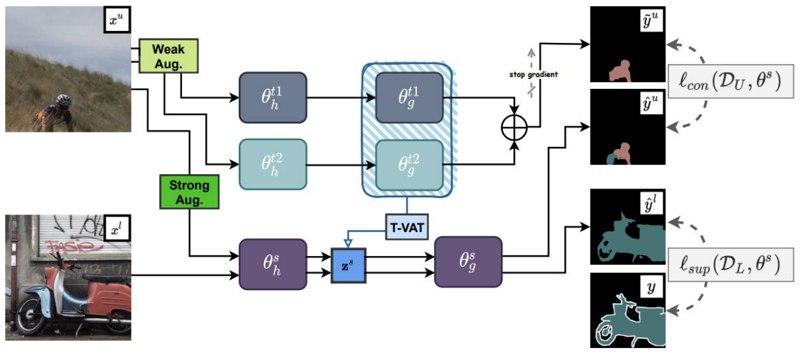

- **Labeled**: Train the student with ground-truth masks → $\ell_{sup}(\mathcal D_L,\theta^s)$.
- **Unlabeled**: **Two teachers** generate the target (weak aug) / The student receives **stronger perturbations** (strong aug + T-VAT) / The student matches the **teacher ensemble** → $\ell_{con}(\mathcal D_U,\theta^s)$. teacher 쪽 **stop gradient**.
- 4요소: **1. Two Mean Teachers  2. Teacher Ensemble  3. Strongly Perturbed Student  4. Strict Consistency Loss**
- 그림의 $\theta_h$ / $\theta_g$ = encoder(feature extractor) / decoder(classifier head) ($f=g\circ h$) ← 슬라이드엔 명시 없음.

**A More Reliable Teacher (p.47)**
- **Only one teacher is updated in each epoch.** The two teachers maintain **different temporal histories**. Their ensemble **reduces prediction variance**.
- "Each teacher averages the student over time. The method then averages the two teachers."

$$\hat{\mathbf y} = \sigma\big(0.5\times(f_{\theta^{t1}}(\mathbf x) + f_{\theta^{t2}}(\mathbf x))\big),\qquad \theta^{k} = \gamma\,\theta^{k} + (1-\gamma)\,\theta^{s}$$

- 각 teacher는 일반 Mean Teacher EMA ($\gamma$ = decay, $k\in\{t1,t2\}$).
- **epoch마다 한 teacher만 갱신** → 두 teacher가 student의 서로 다른 시점 평균 → **diversity**. 둘 다 매번 갱신하면 거의 같아져서 ensemble 이득이 없음.
- logit 평균 후 softmax $\sigma$ → **시간 방향 평균(EMA) + 모델 방향 평균(2 teachers)**.

**From MSE to Strict Consistency (p.48)**
- **MSE loss**: Robust to noisy teacher predictions / **Small gradients near convergence** / Relatively **weak supervision**
- **Conf-CE**:

$$\ell_{con}(\mathcal D_U,\theta^s)=\frac{1}{|\mathcal D_U||\Omega|}\sum_{\mathbf x\in\mathcal D_U}\sum_{\omega\in\Omega} c(\omega)\,\ell\big(\tilde{\mathbf y}(\omega),\,p_{\theta^s}(\mathbf x)(\omega)\big)$$

- $\Omega$ = pixel 집합, $\tilde{\mathbf y}(\omega)$ = ensemble teacher의 pseudo label, $p_{\theta^s}(\mathbf x)(\omega)$ = student 예측, $\ell$ = CE, **$c(\omega)$ = teacher confidence weight**.
- 그림: 같은 오차에서 Conf-CE(빨강) loss가 MSE(파랑)보다 큼 → "strict".
- **"More accurate teachers allow stronger cross-entropy supervision."** — CE는 target이 맞으면 강한 gradient, 틀리면 위험 → 그래서 (1) teacher를 먼저 ensemble로 개선하고 (2) confidence로 pixel별 가중.
- Mean Teacher(p.28)에선 MSE가 KL보다 좋다고 했는데 여기선 뒤집힘 → **target이 충분히 정확하면** robust함보다 supervision 강도가 중요해짐.

> 보충: $c(\omega)$, $\ell$의 정의는 슬라이드에 없음. 시험에선 "teacher confidence weighting"으로 설명하면 안전.

**Three Levels of Perturbation (p.49)**

| Level | 방법 |
|---|---|
| **1. Input** | Weak aug for teachers, **strong** aug for the student (**CutMix**, Zoom In/Out) |
| **2. Feature** | **Teacher-guided adversarial perturbation (T-VAT)** applied to the student feature |
| **3. Network** | Two temporal teachers vs one gradient-updated student → different model predictions |

- "Consistency is enforced across input, feature, and network variations."

**Teacher-Guided VAT (p.50)**
- **Standard VAT**: the student finds its **own** adversarial direction → early student predictions can be inaccurate (방향이 나쁨).
- **T-VAT**: student가 feature $\mathbf z^s$ 생성 → **두 teacher decoder가 평가** → teacher 예측 변화를 최대화하는 방향 탐색 → 그 perturbation을 student feature에 적용 → student는 teacher target을 유지하도록 학습.

$$\max_{\mathbf r_{adv}}\ d\Big(\sigma\big(0.5(g_{\theta_g^{t1}}(\mathbf z^s)+g_{\theta_g^{t2}}(\mathbf z^s))\big),\ \sigma\big(0.5(g_{\theta_g^{t1}}(\mathbf z^s+\mathbf r_{adv})+g_{\theta_g^{t2}}(\mathbf z^s+\mathbf r_{adv}))\big)\Big)\quad\text{s.t. } \|\mathbf r_{adv}\|_2 \le \epsilon$$

- mIoU 막대 (그래프 근사): original ≈ 0.771 < uniform ≈ 0.773 < vat ≈ 0.777 < **t-vat ≈ 0.782**.
- **"Teachers find the perturbation. The student learns from it."**

**CutMix After Prediction (p.51)**
- **Before prediction**: 섞은 이미지에 artificial boundaries → teacher 예측에 **mixing artifacts**.
- **After prediction**: First predict each image, then blend the results → **teacher sees natural images**.

$$\ell\big(\mu(\tilde{\mathbf y}_i,\tilde{\mathbf y}_j,\mathbf m),\ p_{\theta^s}(\mu(\mathbf x_i,\mathbf x_j,\mathbf m))\big),\qquad \mu(\mathbf x_i,\mathbf x_j,\mathbf m)=(1-\mathbf m)\odot\mathbf x_i+\mathbf m\odot\mathbf x_j$$

- teacher는 원본 $\mathbf x_i,\mathbf x_j$를 각각 예측 → 같은 mask $\mathbf m$으로 **예측을 섞어** target, student는 **섞인 이미지**를 입력.
- 그래프 (근사): after ≈ 0.766 → 0.782, before ≈ 0.728 → 0.752 — 모든 시점에서 after 우세.
- "Mixing clean predictions gives a cleaner target than predicting a mixed image."
- ICT(p.37)와 같은 구조: teacher는 섞기 전, student는 섞은 후.

**Ablation (p.52)** — mIoU (%), AT = auxiliary teacher

| MT | Conf-CE | T-VAT | AT | ResNet-50 | ResNet-101 |
|---|---|---|---|---|---|
| ✓ | | | | 71.49 | 73.50 |
| ✓ | ✓ | | | 73.79 | 76.39 |
| ✓ | ✓ | ✓ | | 74.87 | 77.36 |
| ✓ | ✓ | ✓ | ✓ | **75.70** | **78.20** |

- 증분 (R50 / R101): +Conf-CE **+2.30 / +2.89** (**largest single gain**), +T-VAT +1.08 / +0.97, +AT +0.83 / +0.84.
- "The components provide complementary improvements." / **"Better targets make stronger consistency learning possible."**

**SOTA 비교 (p.53)** — Pascal VOC 2012, DeepLabV3+, mIoU (%), 괄호 = labeled 이미지 수

| Method | R50 1/16 (662) | 1/8 (1323) | 1/4 (2646) | 1/2 (5291) | R101 1/16 | 1/8 | 1/4 | 1/2 |
|---|---|---|---|---|---|---|---|---|
| MT* | 66.77 | 70.78 | 73.22 | 75.41 | 70.59 | 73.20 | 76.62 | 77.61 |
| French et al.* | 68.90 | 70.70 | 72.46 | 74.49 | 72.56 | 72.69 | 74.25 | 75.89 |
| CCT* | 65.22 | 70.87 | 73.43 | 74.75 | 67.94 | 73.00 | 76.17 | 77.56 |
| GCT* | 64.05 | 70.47 | 73.45 | 75.20 | 69.77 | 73.30 | 75.25 | 77.14 |
| ECS | - | 67.38 | 70.70 | 72.89 | - | - | - | - |
| CPS | 71.98 | 73.67 | 74.90 | 76.15 | 74.48 | 76.44 | 77.68 | 78.64 |
| CAC | 70.10 | 72.40 | 74.00 | - | 72.40 | 74.60 | 76.30 | - |
| **PS-MT** | **72.83** | **75.70** | **76.43** | **77.88** | **75.50** | **78.20** | **78.72** | **79.76** |

- "The improvement is consistent across label ratios. The gain is larger when fewer labels are available."
- MT* 대비 R50: 1/16 **+6.06** vs 1/2 +2.47. (단, 가장 강한 baseline CPS 대비로는 1/16 +0.85, 1/2 +1.73이라 일정하지 않음 → 슬라이드 주장은 주로 MT 대비 해석)

> 보충: 1/8 setting ablation 값(75.70 / 78.20)이 p.52 최종 행과 일치. [9] = CPS (Chen et al., CVPR 2021)의 partition protocol.

**Qualitative (p.54)**: "The teacher ensemble produces better boundaries." — supervised baseline은 경계가 뭉개지고, student는 잡음이 남고, PS-MT 결과가 GT에 가장 가까움.

### 3.2 Dual Teacher — Switching Temporary Teachers (Na et al., NeurIPS 2023) (p.55–65)

**질문: What if the teacher becomes too similar to the student? (p.55, 57)**
- Mean Teacher updates the teacher with an EMA of the student → the teacher **gradually follows** the student.
- Their parameters and predictions become increasingly similar (**coupling**).
- A highly similar teacher provides **little new information** (target ≈ 자기 예측 → consistency loss ≈ 0).
- The teacher may also **inherit the student's errors** (오류 강화 루프).

**Teacher–Student Coupling: 세 구조 (p.58)**

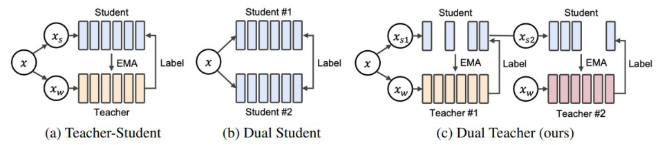

| 구조 | student | teacher | 특징 |
|---|---|---|---|
| **Single Teacher** (Mean Teacher) | 1 | 1 permanent EMA | The teacher **continuously follows the same student** → coupling |
| **Dual Student** | 2 (independently trained) | 없음 (서로 label 주고받음) | diversity 있지만 **higher training and memory cost** |
| **Dual Teacher** | 1 | 2 **temporary** | **Only one teacher guides the student at a time** |

- **"Dual Teacher introduces diversity without training a second student."** — teacher는 EMA라 gradient 학습이 필요 없으니 늘리는 비용이 거의 0.

**Switching Temporary Teachers (p.59)**
- Two EMA teachers **take turns** guiding one student.
- Only the **active** teacher generates the target for the current epoch, and is updated from the current student.
- The student receives a **different strong augmentation** when the teacher changes.

| Epoch | Active teacher | Student augmentation |
|---|---|---|
| 1 | Teacher 1 | ClassMix |
| 2 | Teacher 2 | CutMix |
| 3 | Teacher 1 | ClassMix or CutMix |
| 4 | Teacher 2 | The other augmentation |

- **"Each teacher preserves the student's characteristics from different training stages."**
- inactive teacher는 그 epoch 동안 멈춰 있음 → 쉬는 동안 student가 앞서 나가서 "teacher가 student를 바짝 쫓는" 관계가 끊김.

> 보충: **CutMix** = 사각형 영역을 다른 이미지로 교체, **ClassMix** = 한 이미지의 특정 class pixel(mask)을 다른 이미지에 붙여넣기. 둘 다 segmentation SSL의 strong aug.

**What Changes from Mean Teacher? (p.60)**

$$\text{Mean Teacher: }\ \theta_t \leftarrow \alpha\,\theta_t + (1-\alpha)\,\theta_s \quad\Longrightarrow\quad \text{Dual Teacher: }\ \theta_{t_{k_e}} \leftarrow \alpha\,\theta_{t_{k_e}} + (1-\alpha)\,\theta_s,\ \ k_e\in\{1,2\}$$

- $k_e$ = epoch $e$의 active teacher index.
- **"The EMA rule remains the same. The teacher schedule changes."** → 구현이 간단.

**Training the Student (p.61)**
- Active teacher ← **weakly** augmented image → **pixel-level target**. Student ← **strongly** augmented version → matches the teacher's target.

$$\mathcal{L} = \mathcal{L}_{\text{sup}} + \lambda_u \mathcal{L}_{\text{unsup}},\qquad \mathcal{L}_{\text{unsup}} = \frac{1}{B_u HW}\sum_{i=1}^{B_u}\sum_{j=1}^{HW} \mathcal{L}_{\text{CE}}\big(p^u_{ij},\, \hat{y}^u_{ij}\big)$$

- $B_u$: # unlabeled images, $H\times W$: # pixels, $p^u_{ij}$: student prediction for pixel $j$, $\hat y^u_{ij}$: target from the **active** teacher, $\lambda_u$: unlabeled loss weight.
- **"The objective resembles Mean Teacher. The supervision source changes over time."** — weak → teacher, strong → student는 FixMatch류 구도.

**Does Switching Actually Prevent Coupling? (p.62)**

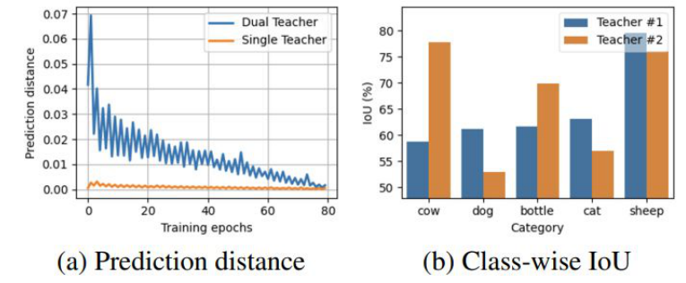

- **(a) Prediction distance**: Single Teacher는 student와 거의 0 (coupled). Dual Teacher는 더 큰 distance 유지 (zigzag = epoch마다 교대). "Switching prevents one teacher from continuously following the student." 후반엔 둘 다 0 근처로 수렴.
- **(b) Class-wise IoU**: 두 teacher의 overall mIoU는 비슷하지만 **class별 강점이 다름** (그래프 근사: T2는 cow ~78 vs T1 ~59, bottle ~70 vs ~62; T1은 dog ~61 vs ~53, cat ~63 vs ~57) → **complementary supervision**.
- **"Teacher diversity means different predictions, not simply different parameter values."**

**Why Switch Instead of Ensemble? (p.63)**
- **Teacher ensemble**: both teachers guide simultaneously, predictions combined every epoch → can **gradually lose their distinct characteristics**.
- **Teacher switching**: one teacher per epoch, each observes a **different student state**, temporal roles remain **separated**.

Table 7: PASCAL VOC 2012 (blender set), DeepLabv3+ ResNet-50

| Method | 1/16 (186) | 1/8 (372) | 1/4 (744) | 1/2 (1,488) |
|---|---|---|---|---|
| **Switching teachers** | **77.00** | **79.23** | **78.94** | **80.18** |
| Ensembling teachers | 73.25 | 75.99 | 76.41 | 77.34 |

- 모든 partition에서 switching 우세 (1/16에서 약 +3.8). **teacher 수가 같아도 쓰는 방식이 성능을 좌우**.
- 참고: switching은 1/8 (79.23) > 1/4 (78.94)로 label이 늘어도 단조 증가가 아님. 표 원문 수치 그대로 (실험값 변동이라 오타는 아님).
- **"Two teachers help only when they preserve different perspectives."**
- PS-MT(§3.1)는 2 teachers를 **ensemble**했는데 Dual Teacher는 ensemble이 coupling으로 회귀한다고 비판. 차이: PS-MT도 "한 epoch에 한 teacher만 갱신"으로 diversity를 확보하려 했지만 target은 둘을 합침, Dual Teacher는 target까지 교대.

**How Many Teachers Are Needed? (p.64)** — Table 5: 1/16 split, VOC blender

| | Single | Dual | Triple |
|---|---|---|---|
| Aug × 1 | 73.63 | 75.34 | 75.30 |
| Aug × 2 | 74.21 | **77.00** | 76.56 |
| Aug × 3 | 74.49 | 76.25 | 75.94 |

- Two teachers outperform one; **a third teacher provides no additional gain** (77.00 → 76.56).
- Two augmentation types > one; **more augmentation types do not guarantee better performance** (77.00 → 76.25).
- **Best = two teachers + two augmentation types (77.00)** — p.59의 ClassMix/CutMix 설정과 일치.

> 보충: 3번째 teacher가 손해인 건 teacher당 student를 관찰하는 빈도가 줄어 각 teacher의 역할이 희석되기 때문으로 해석 가능 (슬라이드엔 이유 없음).

**Takeaway: Preserve a Useful Gap (p.65)**
- Mean Teacher: stabilizes targets through temporal averaging, but may gradually **couple** teacher and student.
- Dual Teacher: alternates two temporary EMA teachers, preserves **different temporal perspectives**, provides **complementary supervision** to one student.
- **"A teacher should be stable, but it should not become identical to the student."** → stability vs diversity trade-off.

### 3.3 S⁴Former — Training ViTs for Semi-Supervised Semantic Segmentation (Hu et al., CVPR 2024) (p.66–74)

**질문: Are image-level perturbations enough for a Vision Transformer? (p.66, 68)**
- Most consistency methods perturb the **input image** (teacher ← weak, student ← strong).
- However, a ViT processes images as **patch tokens**. Its **self-attention** and **output distribution** provide additional places for regularization.
- 그림 (mIoU, 92 labeled, unlabeled 수별):

| # unlabeled | Weak | FD | CutMix | **Ours** |
|---|---|---|---|---|
| 656 | 72.6 | 73.0 | 73.7 | **76.5** |
| 2623 | 72.9 | 74.3 | 74.6 | **78.5** |
| 10490 | 73.1 | 75.7 | 75.8 | **80.1** |

- weak만 쓰면 unlabeled가 늘어도 거의 안 오름(72.6 → 73.1) → **좋은 perturbation이 있어야 unlabeled를 활용**할 수 있음. (FD = feature dropout)
- **"Can we regularize the input, feature, and output spaces together?"**

**Three Levels of Regularization (p.69)**

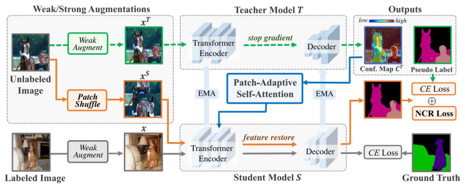

- **Teacher**: weakly augmented image → pixel-level targets (+ confidence map $C^T$), updated by **EMA**, stop gradient.
- **Student**: strongly augmented image, uses **PatchShuffle** and **PASA**, matches **both positive and negative class information** (CE ⊕ NCR).
- **"S⁴Former regularizes the Transformer at the input, feature, and output levels."**

| Level | 방법 |
|---|---|
| Input | **PatchShuffle** |
| Feature | **PASA** (Patch-Adaptive Self-Attention) |
| Output | **NCR** (Negative Class Ranking) |

**Input Regularization: PatchShuffle (p.70)**

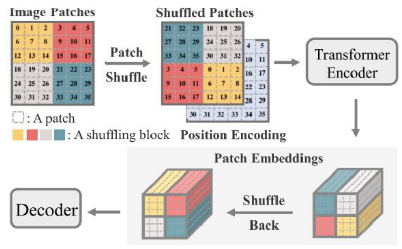

1. Divide the image into an $L\times L$ patch grid.
2. Group neighboring patches into $M\times M$ **blocks**.
3. **Shuffle the blocks** before Transformer encoding.
4. **Restore the feature order** before decoding.

- **"The student must preserve the same semantics even when the global patch layout changes."**
- **왜 block 단위**: patch 하나하나 섞으면 local context까지 다 깨져 segmentation이 망가짐 → block 내부 **local 구조는 유지**, **global layout만** 교란.
- **왜 restore**: dense prediction이라 decoder에선 원래 공간 순서가 있어야 pseudo label과 pixel 대응 가능.
- self-attention은 token 집합 위에서 작동하므로 배치를 바꿔도 같은 token set → 위치/context shortcut에 대한 regularization. CNN에선 의미 없고 **ViT 구조에 특화**된 perturbation.

> 보충: position encoding도 같이 섞는지는 슬라이드만으론 불확실 (그림상 shuffled patch와 함께 들어감).

**Feature Regularization: PASA (p.71)**

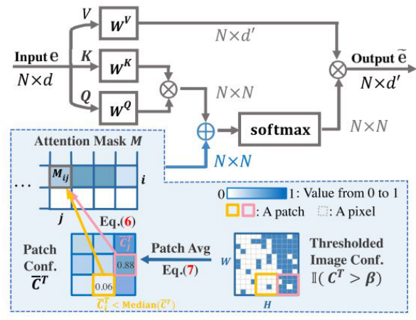

- The teacher estimates **confidence for each image patch**.
- **High-confidence** patches keep their original attention. **Low-confidence** patches receive additional **attention modulation**.
- **Uncertain regions interact more strongly with other uncertain regions.**
- 그림: $\mathrm{softmax}(QK^\top \oplus M)\,V$ — attention logit에 $N\times N$ **attention mask $M$**을 더함. $M$은 teacher confidence에서: $\mathbb I(C^T>\beta)$ (pixel 이진화) → Patch Avg (Eq.7) → patch conf $\bar C^T$ → Eq.(6) → $M_{ij}$. median 미만 patch(예: 0.06)가 modulation 대상.
- **"PASA perturbs attention where the teacher is uncertain."**
- vs feature dropout(FD): FD는 **모든 곳에 무작위**, PASA는 **confidence-guided** → teacher가 확신하는 곳은 건드리지 않고 어려운 곳에서만 feature perturbation.

> 보충: Eq.(6), (7)의 본문 수식은 슬라이드에 식 번호만 있음.

**Output Regularization: Negative Class Ranking (p.72)**
- CE matches the **most likely class**. NCR matches the **relative distribution over the remaining classes**.
- Similar classes receive similar relative probabilities → the student learns **more than a hard pseudo label**.
- **Recalculate the softmax excluding the pseudo-label class.**

$$\mathcal{L}_{CE} = -\log\frac{\exp(p^S_{\tilde y})}{\sum_{k=1}^{K}\exp(p^S_k)}\ \Longrightarrow\ \boxed{\mathcal{L}_{NCR} = \sum_{k\neq \tilde y}\big(\hat p^T_k - \hat p^S_k\big)^2,\quad \hat p^{T/S}_k = \frac{\exp(p^{T/S}_k)}{\sum_{k'\neq \tilde y}\exp(p^{T/S}_{k'})}}$$

- $p_k$ = class $k$의 logit (exp에 들어가니 logit으로 해석, 슬라이드엔 명시 없음), $\tilde y$ = teacher의 pseudo label, $\hat p$ = $\tilde y$를 뺀 $K-1$개 class에 대한 softmax.
- **왜 정답 class를 빼고 renormalize**: 안 빼면 $\tilde y$ 확률(예: 0.95)이 압도해서 나머지 class 간 미세한 차이가 loss에 거의 안 반영됨. 빼면 negative class 간 **상대 크기**가 증폭돼 보임.
- 직관: "고양이" 이미지라면 "개"가 "자동차"보다 그럴듯 → teacher의 negative 분포엔 **class 간 유사도 정보**("dark knowledge", Hinton distillation과 같은 맥락)가 있음.
- **"The teacher provides a class relationship, not only a single target class."**

**Ablation (p.73)** — mIoU, 괄호 = Base 대비

| Methods | 1/16 | 1/8 | 1/4 |
|---|---|---|---|
| SupOnly | 67.7 | 72.8 | 77.4 |
| Base | 75.8 | 77.4 | 80.0 |
| +PatchShuffle | 78.4 (+2.6) | 80.2 (+2.8) | 82.1 (+2.1) |
| +PASA | 77.9 (+2.1) | 79.4 (+2.0) | 81.3 (+1.3) |
| +NCR | 77.5 (+1.7) | 78.7 (+1.3) | 81.9 (+1.9) |
| **+All** | **80.1 (+4.3)** | **81.3 (+3.9)** | **82.4 (+2.4)** |

- Each component improves the baseline. **PatchShuffle provides the largest individual improvement.** PASA and NCR provide complementary gains. Combining all gives the best.
- +All (+4.3)은 개별 gain 단순합(6.4)보다 작음 → complementary하지만 일부 겹침.
- **"The largest gain is observed when labeled data are most limited."** (+4.3 > +3.9 > +2.4)

**What Does S⁴Former Add to Mean Teacher? (p.74)**

| Level | Standard Mean Teacher | S⁴Former |
|---|---|---|
| Input | Weak and strong image augmentation | **PatchShuffle** |
| Feature | Standard feature extraction | **PASA** |
| Output | Positive pseudo-label consistency | **Negative class ranking** |
| Teacher update | EMA | EMA |

- **Unchanged**: teacher–student framework, EMA teacher update, weak-to-strong consistency.
- **Changed**: patch-aware input perturbation, confidence-aware attention perturbation, class-distribution regularization.
- Input 행의 "PatchShuffle"은 weak/strong aug를 **대체**한 게 아니라 그 위에 **추가**한 것 (p.69 그림) ← 슬라이드 표는 단순화됨.
- **"Effective consistency regularization should reflect the structure of the model."**

---

## 4. Summary (p.75–76)

| 논문 | 던지는 질문 | 답 |
|---|---|---|
| **PS-MT** | How can the teacher target be made **more reliable**? | 2 teachers (epoch마다 하나만 갱신) ensemble + Conf-CE → 그 위에서 input/feature/network 3단 perturbation |
| **Dual Teacher** | How can we prevent the teacher from becoming **too similar to the student**? | 2 temporary EMA teachers를 epoch마다 **switching** (ensemble 아님) |
| **S⁴Former** | **To which part of the Transformer** should consistency be applied? | input (PatchShuffle) / feature (PASA) / output (NCR) |

- 세 질문 = Mean Teacher의 세 약점: **target quality**, **teacher diversity**, **perturbation location**.
- Next Week (p.76): **Pseudo Labeling**.

---

## 5. 시험 대비 핵심 정리

### 꼭 외울 수식

- SSL objective: $\mathcal L=\mathcal L_s+\mu(t)\mathcal L_u$, $\mu(t)$는 시간에 따라 증가
- Consistency: $\mathcal L_u=D(f(x), f(\mathcal A(x)))$
- Π-model: $-\frac{1}{|B|}\sum_{i\in B\cap L}\log z_i[y_i] + w(t)\frac{1}{C|B|}\sum_{i\in B}\|z_i-\tilde z_i\|^2$
- Temporal Ensembling: $Z\leftarrow\alpha Z+(1-\alpha)z$, $\tilde z\leftarrow Z/(1-\alpha^t)$ (+ bias correction 유도)
- Mean Teacher: $\theta'\leftarrow\beta\theta'+(1-\beta)\theta$, early 0.99 → later 0.999
- AT: $r_{\text{adv}}=\arg\max_{\|r\|\le\epsilon}D[q(y|\mathbf x^l),p_\theta(y|\mathbf x^l+r)]\approx\epsilon g/\|g\|_2\approx\epsilon\,\mathrm{sign}(g)$
- VAT: $\mathcal L_u^{\text{VAT}}=D[p_{\hat\theta}(y|\mathbf x),p_\theta(y|\mathbf x+r_{\text{vadv}})]$
- ICT: $\mathcal L_u^{\text{ICT}}=\mathbb E\,D[p_\theta(y|\text{mixup}_\lambda(\mathbf u_i,\mathbf u_j)),\ \text{mixup}_\lambda(p_{\theta'}(y|\mathbf u_i),p_{\theta'}(y|\mathbf u_j))]$, $\lambda\sim\mathrm{Beta}(\alpha,\alpha)$
- UDA: $p(y|x)\approx p(y|\text{Aug}(x))$
- PS-MT: $\hat{\mathbf y}=\sigma(0.5(f_{t1}+f_{t2}))$, Conf-CE $\frac{1}{|\mathcal D_U||\Omega|}\sum\sum c(\omega)\ell(\tilde{\mathbf y}(\omega),p_{\theta^s}(\mathbf x)(\omega))$
- Dual Teacher: $\theta_{t_{k_e}}\leftarrow\alpha\theta_{t_{k_e}}+(1-\alpha)\theta_s$, $k_e\in\{1,2\}$
- NCR: $\sum_{k\neq\tilde y}(\hat p^T_k-\hat p^S_k)^2$, $\tilde y$ 제외 softmax

### 꼭 외울 정의

- **H1–H4**: smoothness / cluster / low-density separation / manifold (§1.5 표)
- **Consistency regularization**: predictions should remain consistent under small perturbations (data aug or model stochasticity)
- **Temporal ensembling**: EMA of the model prediction in time **per training sample**
- **Mean Teacher**: teacher = EMA of the student's **weights**, no backprop to teacher
- **Adversarial perturbation**: worst-case perturbation within a small norm constraint
- **Virtual** adversarial: GT 대신 모델 자신의 예측을 target으로
- **RPT**: random direction smoothing (VAT의 비교군)
- **Good augmentation**: label-preserving, diverse, realistic, task-relevant
- **Teacher–student coupling**: EMA teacher가 student를 따라가 예측이 같아짐 → 정보 없음 + 오류 상속

### 비교 포인트

- **4가지 label 부족 해법**: joint vs sequential, human label 필요 여부
- **Consistency vs Pseudo label**: 예측 간 일치 vs 예측을 hard target으로
- **Π vs TE vs MT** (§2.4 표): target 출처, 갱신 주기, forward 수, 메모리
- **AT vs VAT**: GT vs model prediction, supervised vs semi-supervised, robustness vs local smoothness, FGSM(1차) vs power iteration(2차)
- **RPT vs VAT**: random vs most adversarial direction
- **VAT vs UDA**: small norm-bounded noise vs strong semantic augmentation ("how we perturb matters")
- **MSE vs KL vs Conf-CE**: MT에선 MSE > KL (noisy target에 robust), PS-MT에선 teacher가 정확하면 CE가 더 강한 supervision
- **Standard VAT vs T-VAT**: student 자신 vs teacher ensemble이 방향 탐색
- **CutMix before vs after prediction**: teacher가 mixed image vs natural images
- **Single Teacher vs Dual Student vs Dual Teacher**
- **Teacher ensemble (PS-MT) vs switching (Dual Teacher)**: Table 7에서 switching 77.00 vs ensemble 73.25
- **Mean Teacher vs S⁴Former** (§3.3 표): 유지되는 것 / 바뀌는 것

### 예상 서술형 질문 + 모범답안 방향

1. **Write the general objective of semi-supervised learning and explain why $\mu(t)$ is increased over time.**
   → $\mathcal L=\mathcal L_s+\mu(t)\mathcal L_u$. Early in training the model's predictions on unlabeled data are unreliable, so a large unsupervised weight would reinforce wrong targets (confirmation bias) or collapse to trivial solutions; $\mu(t)$ is ramped up from near zero as predictions become trustworthy.

2. **List the four SSL hypotheses and explain which one consistency regularization relies on.**
   → Smoothness, cluster, low-density separation, manifold. Consistency regularization directly implements the **smoothness assumption**: small perturbations of an input should not change its prediction, and this can be checked without labels. It also pushes decision boundaries away from dense regions (low-density separation).

3. **Explain the limitation of the Π-model and how Temporal Ensembling addresses it. Why is bias correction needed?**
   → Π-model needs two forward passes per input. TE uses the EMA of each sample's past predictions as the target, so only one forward pass is needed and the target is an ensemble (more stable). Since $Z$ starts at zero, the EMA is biased toward zero; if predictions were constant, $Z_t=(1-\alpha^t)z$, so dividing by $(1-\alpha^t)$ gives an unbiased target.

4. **Compare Temporal Ensembling and Mean Teacher.**
   → TE keeps an EMA of **predictions per sample** ($N\times C$ memory, updated once per epoch, hard to scale). MT keeps an EMA of **model weights**: one extra copy of parameters, teacher updated every iteration, scales to large datasets, and provides stable targets. The teacher receives no gradient.

5. **Why does Mean Teacher use $\beta=0.99$ early and $0.999$ later?**
   → Early on the student improves quickly, so the teacher must follow fast (short averaging window ≈100 steps). Later the student converges, and a longer window (≈1000 steps) gives a more stable teacher.

6. **Explain the difference between Adversarial Training and VAT, and why VAT cannot use FGSM directly.**
   → AT uses ground-truth labels to find the worst-case perturbation and improves robustness (supervised). VAT replaces the label with the model's own prediction, so it works on unlabeled data and enforces local smoothness. Because the KL between the prediction and itself is minimized at $r=0$, its gradient there is zero; VAT uses a second-order approximation and finds the dominant eigenvector of the Hessian via power iteration with finite differences (one iteration suffices).

7. **Why is VAT better than RPT?**
   → In high dimensions most random directions are ones the model is already insensitive to, so random smoothing barely regularizes. VAT smooths along the most sensitive (adversarial) direction, which is far more effective (e.g., CIFAR-10 18.56% → 14.87%).

8. **Explain ICT and how it relates to the low-density separation assumption.**
   → ICT mixes two unlabeled inputs and requires the student's prediction on the mixed input to match the same mixture of the Mean Teacher's predictions on the originals. Mixed samples tend to lie between clusters, near the decision boundary, so enforcing linear, smooth predictions there pushes the boundary into low-density regions.

9. **What is the key message of UDA? What makes a good augmentation?**
   → Replacing small adversarial perturbations with strong, label-preserving semantic augmentations (RandAugment) greatly improves consistency training; augmentation quality is a key factor. Good augmentations are label-preserving, diverse, realistic, and task-relevant.

10. **Describe PS-MT's motivation and its main components. Why does Conf-CE give the largest gain?**
    → Strong perturbations help generalization, but if the teacher is wrong the student reproduces the error; so first make the teacher reliable. Components: two mean teachers (only one updated per epoch), teacher ensemble, strongly perturbed student (input: strong aug + CutMix after prediction; feature: T-VAT; network: teachers vs student), and the strict Conf-CE loss. MSE gives small gradients near convergence (weak supervision); with an accurate ensemble teacher, confidence-weighted CE provides much stronger supervision (+2.30 mIoU on ResNet-50).

11. **What is teacher–student coupling and how does Dual Teacher solve it? Why switching instead of ensembling?**
    → With EMA, the teacher continuously follows the student, so their predictions become nearly identical: the teacher gives little new information and inherits the student's errors. Dual Teacher alternates two temporary EMA teachers each epoch; only the active one generates targets and is updated, and the student's strong augmentation also switches. Each teacher preserves a different temporal perspective (larger prediction distance, different class-wise strengths). Ensembling uses both every epoch, so they lose their distinct characteristics (77.00 vs 73.25).

12. **Describe the three regularizations of S⁴Former and why they suit ViTs.**
    → Input: PatchShuffle shuffles $M\times M$ blocks of patches before encoding and restores the order before decoding, so the student must keep semantics under a changed global layout. Feature: PASA adds an attention mask derived from teacher patch confidence so uncertain patches interact more strongly. Output: NCR matches the teacher's renormalized distribution over non-pseudo-label classes, transferring class relationships. ViTs process patch tokens with self-attention, so perturbations should reflect that structure ("effective consistency regularization should reflect the structure of the model").

> 다음 주 (p.76): **Pseudo Labeling**.
