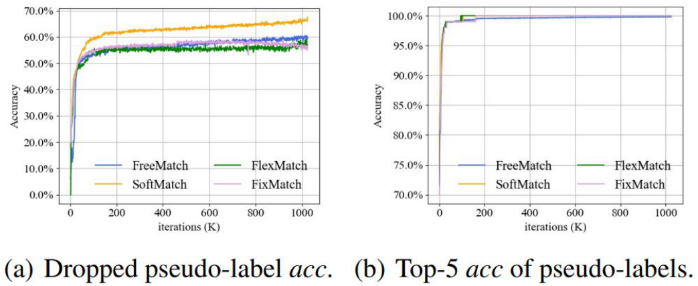
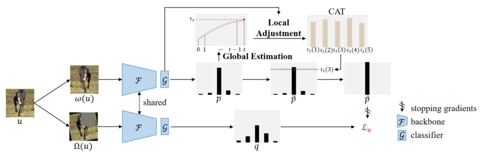
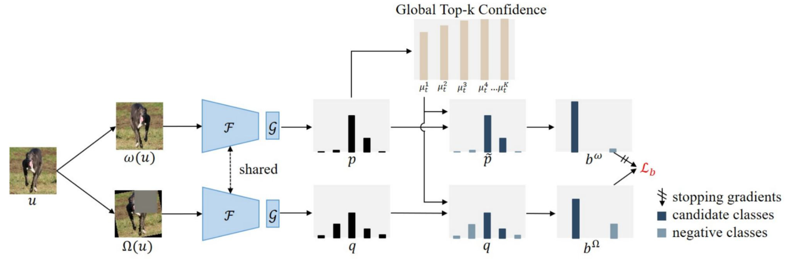

# 07. Semi-Supervised Learning II — Pseudo Labeling

> **한 줄 요약**: SSL의 unsupervised loss 설계 두 번째 축인 **Pseudo Labeling**을 다룬 강의. 기본 원리(entropy minimization의 hard-label approximation) → graph 기반 **Label Propagation** → **Self-Training / Noisy Student** → **confirmation bias** 대응(Arazo, Meta Pseudo Labels)을 보고, 이걸 consistency regularization과 합친 하이브리드(**MixMatch → ReMixMatch → FixMatch**, noisy label용 **DivideMix**)와 pre-training과의 결합(Zoph, SimCLRv2)까지 정리함. 마지막엔 FixMatch의 threshold·perturbation 설계를 다듬은 최근 방법 **FreeMatch(ICML 23) → AllMatch(IJCAI 24) → IFMatch(ECCV 24)** 를 다룸.

---

## 이 강의의 큰 그림

```
SSL objective:  L = L_s + μ(t) · L_u
                            └─ L_u 설계 두 축
                               ├─ Consistency Regularization  (06강: Π, TE, MT, VAT, ICT, UDA)
                               └─ Pseudo Labeling             ← 이번 강의

Part 1. Pseudo Labeling  (예측을 target으로 굳혀서 학습)
 │  Pseudo-Label (Lee 2013)      : confident 예측 → hard label → CE   (≈ entropy minimization)
 │  Label Propagation (CVPR 19)  : 샘플 독립 X, feature-space graph 위에서 label 확산
 │  Self-Training / Noisy Student: teacher→student 반복, student에만 noise, student ≥ teacher
 │  Confirmation bias 대응
 │     ├ Arazo (IJCNN 20)      : MixUp(soft) + labeled oversampling + strong aug + dropout
 │     └ Meta Pseudo Labels    : teacher를 student 성능 feedback으로 학습 (bi-level)
 │
Part 2. Pseudo Labeling + Consistency Regularization  (하이브리드)
 │  MixMatch (NeurIPS 19)  : K-aug 평균 label guess + sharpening + MixUp + L2  ("holistic")
 │  ReMixMatch (ICLR 20)   : + Distribution Alignment + Augmentation Anchoring + Rotation loss
 │  FixMatch (NeurIPS 20)  : weak → hard pseudo label (≥τ) → strong에 CE. 이것만으로 충분
 │  DivideMix (ICLR 20)    : noisy-label learning을 SSL로 재정의 (loss GMM으로 clean/noisy 분할)
 │  + Pre-training         : Zoph (pre-training vs self-training), SimCLRv2 (pretrain→finetune→distill)
 │
Part 3. FixMatch 이후 — "pseudo label을 어떻게 고르고, 어떻게 쓸까"
    FreeMatch (ICML 23) : fixed τ → self-adaptive threshold (global + class-wise) + fairness
    AllMatch  (IJCAI 24): low-confidence 샘플도 버리지 않고 top-k candidate binary consistency로 활용
    IFMatch   (ECCV 24) : image-level + feature-level weak-to-strong, 샘플별 perturbation 강도 조절
```

**핵심 질문**
1. label 없이 어떻게 target을 만드나? → 모델 자신의 **confident 예측을 label로** (pseudo label)
2. 왜 그게 되나? → **entropy minimization**의 hard-label 근사 → decision boundary를 **low-density region**으로 밀어냄 (H3)
3. 틀린 pseudo label은? → **confirmation bias**. regularization(MixUp 등), feedback(Meta PL), threshold(FixMatch), 두 네트워크(DivideMix)로 완화
4. pseudo label과 consistency를 어떻게 합치나? → **weak view로 label 만들고 strong view에 학습** (Augmentation Anchoring → FixMatch)
5. threshold는 고정이어야 하나? 버린 샘플은 쓸모없나? 모든 샘플에 같은 perturbation을 줘야 하나? → FreeMatch / AllMatch / IFMatch

> 보충: 원 논문 — Pseudo-Label = Lee, ICML 2013 Workshop / Entropy Minimization = Grandvalet & Bengio, NIPS 2004 (슬라이드엔 "Bengio et al., NeurIPS 2004") / Label Propagation for Deep SSL = Iscen et al., CVPR 2019 / Noisy Student = Xie et al., CVPR 2020 / Arazo et al., IJCNN 2020 / Meta Pseudo Labels = Pham et al., CVPR 2021 (슬라이드엔 "2000") / MixMatch = Berthelot et al., NeurIPS 2019 / ReMixMatch = Berthelot et al., ICLR 2020 / FixMatch = Sohn et al., NeurIPS 2020 (슬라이드엔 "NeurIPS 2021") / DivideMix = Li et al., ICLR 2020 (슬라이드엔 "ICML 2020") / Zoph et al., NeurIPS 2020 / SimCLRv2 = Chen et al., NeurIPS 2020 / FreeMatch = Wang et al., ICLR 2023 (슬라이드엔 "ICML 2023") / AllMatch = Wu et al., IJCAI 2024 / IFMatch = Wu et al., ECCV 2024.

**강의 목차 (p.2)**: 1. Pseudo Labeling (Label propagation, Self-Training, Reducing confirmation bias) / 2. Pseudo Labeling with Consistency Regularization (MixMatch, ReMixMatch, FixMatch, DivideMix). ← 목차엔 FreeMatch 이후(p.64–105)가 안 적혀 있음.

---

## 1. Pseudo Labeling 기본 (p.3–9)

### 1.1 Key Idea (p.4)

- **Key Idea**
  - Predict labels for unlabeled samples using the **current model**.
  - Treat **high-confidence** predictions as pseudo labels.
  - Train the model on both labeled and pseudo-labeled data.
- **Advantages**: Simple and easy to implement / Scales well to large unlabeled datasets / Foundation of many modern SSL methods.

- **모델이 자기 예측을 supervision으로 씀** — unlabeled data가 loss에 들어오는 통로가 "모델 예측 → hard label".
- **모든 예측이 아니라 high-confidence만** 씀 ← 함정 포인트.
- 단점(슬라이드 p.4엔 없음, p.20에서 다룸): 틀린 예측을 confident하게 label 삼으면 그 오류를 스스로 강화 = **confirmation bias**.

> 보충: consistency regularization(06)은 "두 view 예측이 같아야 함"이라는 **상대적** 제약, pseudo labeling은 "예측을 **hard label(one-hot)** 로 굳혀 CE로 학습"하는 **절대적** target. 이 둘을 합치는 게 Part 2.

### 1.2 왜 되나? — Entropy Regularization (p.5–7)

**p.5 슬라이드**
- Pseudo Labeling is approximately equivalent to **Entropy Regularization**. It encourages **low-density separation** between classes.
- High entropy → uncertain prediction / Low entropy → confident prediction → **Minimize the prediction entropy**.
- 그림: 같은 강아지 이미지에 대해 Cat/Dog/Car가 거의 균등한 예측 $H=1.09$ (high) → "Minimize Entropy" → Dog만 높은 예측 $H=0.09$ (low).


$$H(p) = -\sum_{c} p_c \log p_c$$

- 균등분포일수록 최대, one-hot일수록 0. 3-class 균등 $[\tfrac13,\tfrac13,\tfrac13]$ → $H=\ln 3\approx1.0986$ → 슬라이드 **1.09**와 일치 (natural log). confident 쪽 0.09는 Dog ≈ 0.98 정도.
- 그림 막대가 다 ~0.5로 그려져 합이 1이 안 됨, low-entropy 쪽 Dog 막대는 1.0을 넘게 그려짐 ← 그림 부정확.
- label $y$가 수식에 없음 → **unlabeled data에도 계산 가능**.

> 보충: Entropy minimization 목적식(Grandvalet & Bengio 2004) ≈ $\mathcal L=\mathcal L_s+\lambda\sum_u H(p_\theta(y|u))$. 슬라이드엔 없음.

**p.6 — Why does it help?**
- Minimizing entropy moves **decision boundaries toward low-density regions**, producing better-separated clusters.
- 그림: High Entropy Model은 boundary가 **high-density region**을 지남 → Entropy Minimization → Low Entropy Model은 boundary가 두 cluster 사이 **빈 공간(low-density)** 을 지남.


- **논리**: boundary 근처 점은 두 class 확률이 비슷 = high entropy. 모든 unlabeled 점의 entropy를 낮추려면 **boundary 근처에 점이 없어야** 함 → boundary가 데이터 밀집 지역을 피해 low-density로 이동.
- 즉 **entropy minimization = H3 (low-density separation) 구현**. 움직이는 건 **decision boundary** (데이터 점이나 cluster center가 아님).

**p.7 — Connection to Pseudo Labeling**
- (Once the prediction is sufficiently confident) Soft prediction can be converted into a hard label. ex) $p(y|x)=[0.96,0.03,0.01]\rightarrow y^*=\arg\max p(y|x)$
- **Pseudo Labeling can be viewed as the hard-label approximation of Entropy Regularization.**

- 유도 직관: $y^*$가 one-hot이면 $\mathrm{CE}(y^*,p)=-\log p_{y^*}$. 이걸 줄이면 $p_{y^*}\to1$ → **entropy도 같이 감소** → entropy minimization과 같은 방향의 gradient.
- 차이: entropy minimization은 **soft 분포 전체**에 거는 smooth penalty, pseudo labeling은 **argmax로 이산화한 hard target**. → "hard-label approximation". (**soft↔hard 뒤바꾸기 함정**: entropy reg = soft, pseudo labeling = hard)

> 보충: Lee(2013) 전체 loss는 $\frac1n\sum L(y,f)+\alpha(t)\frac1{n'}\sum L(y',f')$, $\alpha(t)$는 0에서 시작해 점점 증가 (06강의 $\mu(t)$ ramp-up과 같은 역할). Dropout 네트워크를 쓰고 pseudo label은 매 update마다 다시 계산. 슬라이드엔 없음.

### 1.3 실험 — Lee, ICML 2013 (p.8–9)

- **p.8**: Pseudo labeling leads to better **segregation** in the learned embedding space. MNIST, **600 labeled + 60000 unlabeled**. t-SNE: (a) dropNN(unlabeled 미사용)은 cluster 사이에 섞인 줄기가 있음, (b) +PL은 cluster가 더 조밀하고 분리됨.


- **p.9 Figure 2**: layer-1 filter — dropNN은 noisy, +PL은 더 구조적, +PL+DAE가 가장 깨끗.
- **p.9 Table 2** (MNIST test **error %**, 낮을수록 좋음):

| Method | 100 | 600 | 1000 | 3000 |
|---|---|---|---|---|
| NN | 25.81 | 11.44 | 10.7 | 6.04 |
| SVM | 23.44 | 8.85 | 7.77 | 4.21 |
| CNN | 22.98 | 7.68 | 6.45 | 3.35 |
| TSVM | 16.81 | 6.16 | 5.38 | 3.45 |
| DBN-rNCA | - | 8.7 | - | 3.3 |
| EmbedNN | 16.86 | 5.97 | 5.73 | 3.59 |
| CAE | 13.47 | 6.3 | 4.77 | 3.22 |
| MTC | 12.03 | 5.13 | 3.64 | **2.57** |
| dropNN | 21.89 | 8.57 | 6.59 | 3.72 |
| +PL | 16.15 | 5.03 | 4.30 | 2.80 |
| +PL+DAE | **10.49** | **4.01** | **3.46** | 2.69 |

- dropNN → +PL: 모든 열에서 개선, **label이 적을수록 개선 폭 큼**. +PL+DAE가 100/600/1000에서 best, 3000에선 **MTC(2.57)** 가 best.
- 캡션은 "600, 1000 and 3000"이라 쓰지만 표엔 100 열도 있음 ← 캡션 불일치.
- 메시지: 단순한 pseudo labeling이 복잡한 SSL(CAE, MTC 등)과 경쟁 → 제목의 "Simple and Efficient".

> 보충: DAE = Denoising Auto-Encoder, CAE = Contractive AE, MTC = Manifold Tangent Classifier, TSVM = Transductive SVM.

---

## 2. Label Propagation (Iscen et al., CVPR 2019) (p.10–14)

### 2.1 Key Idea & Pipeline (p.10)

- **Key Idea**: Construct a **similarity graph in the feature space** / **Propagate** labels from labeled samples to nearby unlabeled samples / Assign pseudo labels based on **neighborhood relationships**.
- **How**: Learn feature embeddings → Build a similarity graph → Propagate labels through graph connections → Use propagated labels for training.


- **Phase 1**: labeled만으로 $T$ epoch 학습 ($L_s(X_L,Y_L;\theta)$) → feature extractor $\phi_\theta$가 쓸 만한 embedding을 갖게 함.
- **Phase 2** ($T'$회 반복): descriptor $V$ 추출 → affinity $A$ → $W=A+A^\top$ → $\mathcal W=D^{-1/2}WD^{-1/2}$ → label propagation → pseudo label(크기 ∝ certainty $\omega_i$)로 **all examples** 1 epoch 학습 ($L_w$).
- embedding 좋아짐 → graph 좋아짐 → pseudo label 좋아짐의 선순환. graph는 **매 epoch 재구성**.
- **pseudo label을 네트워크 softmax가 아니라 graph diffusion 결과로 만든다**는 게 차별점. 06강의 H2(cluster)/H4(manifold) 가정을 그대로 구현 (graph ≈ manifold 근사).

### 2.2 Algorithm & 수식 (p.11)


**(9) kNN affinity**
$$a_{ij} := \begin{cases} [\mathbf v_i^\top \mathbf v_j]_+^\gamma, & i\neq j \ \wedge\ \mathbf v_i \in \mathrm{NN}_k(\mathbf v_j) \\ 0, & \text{otherwise}\end{cases}$$
- $\mathbf v_i=\phi_\theta(x_i)$. 내적(정규화된 descriptor면 cosine)을 $[\cdot]_+$로 자르고 $\gamma$제곱 → 가까운 이웃 강조. **k-NN만 nonzero → sparse**.
- $W=A+A^\top$로 대칭화(kNN은 비대칭), $\mathcal W=D^{-1/2}WD^{-1/2}$로 symmetric normalization (hub 노드 지배 방지).

**(10) Diffusion**
$$(I-\alpha\mathcal W)Z = Y$$
- $Y$: labeled 행만 one-hot, unlabeled 행은 0. $Z=(I-\alpha\mathcal W)^{-1}Y=\sum_{t\ge0}\alpha^t\mathcal W^tY$ → **label이 graph를 $t$ hop 걸어 퍼진 양을 $\alpha^t$로 감쇠해 합친 것**.
- 역행렬은 **sparse하지 않아서** 큰 $n$에서 비현실적 → **conjugate gradient(CG)** 로 linear system을 풂.
- 이후: $\hat z_{ij}=z_{ij}/\sum_k z_{ik}$ → $\hat y_i=\arg\max_j\hat z_{ij}$ (**hard** pseudo label), $\omega_i$ = certainty weight (식 (11), 슬라이드엔 참조만), $\zeta_j=(|L_j|+|U_j|)^{-1}$ = **class balancing weight**.

> 보충: Iscen 논문의 (11)은 entropy 기반 $\omega_i=1-H(\hat z_i)/\log c$ ($c$=class 수). 확신 높을수록 weight 큼. 슬라이드 밖 내용.

### 2.3 결과 (p.12) — CIFAR-10 error %, 13-layer

| Nb. labeled | 500 | 1000 | 2000 | 4000 |
|---|---|---|---|---|
| Fully supervised | 49.08 | 40.03 | 29.58 | 21.63 |
| Network prediction (1) + weights | 35.17 | 23.79 | 16.64 | 13.21 |
| **Ours**: Diffusion prediction (7) + weights | 32.40 | 22.02 | 15.66 | 12.69 |
| MT | 27.45 | 19.04 | 14.35 | 11.41 |
| **MT + Ours** | **24.02** | **16.93** | **13.22** | **10.61** |

(표 일부. 그 외 TDCNN, VAT 11.36, Π 12.36, TE 12.16 등 prior work 값 포함)

- **같은 weighting에서 pseudo label 생성법만 바꿨을 때** diffusion이 network prediction보다 모두 좋음 → LP의 효과.
- **MT + Ours가 best** → pseudo label(LP)과 consistency regularization(MT)은 **complementary**.

### 2.4 Pseudo Labeling vs Label Propagation (p.13–14)

| Pseudo Labeling | Label Propagation |
|---|---|
| Predict each sample **independently** | Exploit **neighborhood relationships** |
| **Confidence**-based | **Similarity**-based |
| Ignores data manifold | Leverages manifold structure |

- **Advantages**: Produces **smoother** pseudo labels / Better utilizes unlabeled data / Exploits the **cluster assumption**.
- **Limitations**: Requires constructing a similarity graph → **expensive for large datasets** / Performance **depends on feature quality** (embedding이 나쁘면 틀린 label이 graph 타고 퍼짐).
- 요약: *Label Propagation improves pseudo labels by leveraging the geometric structure of the feature space rather than treating each sample independently.*
- 함정: "LP is confidence-based" → **False** (similarity-based).

---

## 3. Self-Training & Noisy Student (p.15–19)

### 3.1 Teacher–Student 관점 (p.15–16)

- Pseudo Labeling is naturally performed as an **iterative teacher–student process**.
  - **Teacher**: Predicts pseudo labels / Provides supervision / Often the **previous model or an EMA model**.
  - **Student**: Learns from labeled data and pseudo labels / Produces a better model / **Becomes the teacher in the next iteration**.
  - As the model improves, the pseudo labels become more accurate, leading to further improvements.
- **Self-Training (p.16)**: Train on labeled → Predict pseudo labels → Add **high-confidence** predictions to the labeled set → Repeat. 특징: iterative / **gradually expands the labeled dataset** / teacher improves over iterations.

> 보충: p.16의 인용(Nigam & Ghani, CIKM 2000)은 제목 그대로 co-training 분석 논문.

### 3.2 Noisy Student (Xie et al., CVPR 2020) (p.17–19)

- Use the teacher to generate pseudo labels / Train the student with **additional noise** / The student becomes **more robust than the teacher**.
- **Why Add Noise?** Noise prevents the student from **simply copying the teacher** → learns a more robust decision boundary. Noise = **RandAugment** (input), **Dropout**, **Stochastic Depth** (model).
- **비대칭**: pseudo label 만드는 **teacher는 noise 없이(clean)**, **student만 noise**.


- **Figure 1 흐름**: Train teacher on labeled → Infer pseudo-labels on unlabeled → Train **equal-or-larger** student with combined data + noise → Make the student a new teacher → 반복.
  - **equal-or-larger** student ← knowledge distillation(큰 teacher → 작은 student)과 **반대 방향**.
- **Table 1**: ImageNet top-1 86.4 → **88.4%**, ImageNet-A 61.0 → **83.7%**, ImageNet-C mCE 45.7 → **28.3**, ImageNet-P mFR 27.8 → **12.2** (**mCE, mFR은 lower is better**). robustness 쪽 향상이 특히 큼.
- **Figure 2**: EfficientNet B0–B7 모든 크기에서 향상 (B7 85.0 → 85.9). 이건 teacher/student 같은 구조, **iterative training 없이** 한 결과.
- **Key Findings (p.19)**: **Larger student > teacher** / **Soft pseudo labels > hard labels** / **Strong augmentation improves generalization** / ImageNet SOTA.
- 요약: *Noisy Student extends self-training by making the student learn under **stronger perturbations than the teacher**, leading to progressively better models.*
- p.19 출처 "CVPR 2000" ← 오타 (2020).

---

## 4. Reducing Confirmation Bias (Arazo et al., IJCNN 2020) (p.20–23)

### 4.1 문제 (p.20)

- Pseudo labels generated by an **imperfect teacher** can be incorrect. The student is then trained to **imitate** these incorrect labels.
- Why harmful? Incorrect pseudo labels **accumulate** / The student **reinforces the teacher's mistakes** / Performance gradually degrades.

- **Confirmation bias** = 자기가 만든 틀린 label을 정답처럼 믿고 학습해 실수를 강화. label이 극소수면 초기 모델 예측 대부분이 오답 → self-reinforcing loop.

### 4.2 해법 4가지 (p.21)

1. **MixUp with soft labels** — two samples and their **true or pseudo labels**:
$$\bar{\mathbf x}=\lambda\mathbf x_i+(1-\lambda)\mathbf x_j,\qquad \bar y=\lambda y_i+(1-\lambda)y_j$$
$$\Leftrightarrow\ \mathcal L=\lambda[y_i^\top\log f_\theta(\bar{\mathbf x})]+(1-\lambda)[y_j^\top\log f_\theta(\bar{\mathbf x})]$$
   ← 슬라이드 식은 앞의 마이너스가 빠져 있음 (그대로면 log-likelihood). 실제 loss는 $-$를 붙인 CE.
2. **Oversampling labeled data** (mini-batch마다 labeled 최소 개수 보장)
3. **Strong data augmentation**
4. **Dropout regularization**


- $\Leftrightarrow$의 의미: CE는 target에 **선형** → 섞은 target에 대한 CE = 각 label CE의 convex combination. 출력은 **섞은 입력 하나 $f_\theta(\bar{\mathbf x})$**.
- 왜 도움? soft label이라 틀린 pseudo label의 **overconfidence**가 줄고, 섞인 입력이 boundary 근처를 정규화해 틀린 label을 **memorize하기 어렵게** 함. oversampling은 labeled 정답 신호가 pseudo-labeled에 묻히지 않게 함.

> 보충: MixUp 원논문(Zhang et al., ICLR 2018)은 $\lambda\sim\mathrm{Beta}(\alpha,\alpha)$ (06강 p.10 notation과 동일).

### 4.3 Two moons & 결과 (p.22–23)


- **p.22**: two moons, 1000 samples, **4 labels/class**, 1-hidden-layer(50 units) NN. 왼→오: **no mixup** (boundary가 moon을 가로질러 잘못 굳음) → **mixup** (나아짐) → **mixup + minimum number of labeled samples per mini-batch** (boundary가 두 moon 사이 low-density로) → **둘 다 필요**.
- **p.23 Table V** (CIFAR test **error**, 13-CNN, 3 runs): Ours가 **5개 열 모두 best** — C10 500/1000/4000: **8.80 / 6.85 / 5.97**, C100 4000/10000: **37.55 / 32.15**. (MT 27.45/19.04/11.41, ICT 4000에서 7.29, LP 32.40/22.02/12.69)
- 메시지: **"pseudo labeling은 consistency보다 약하다"는 통념은 confirmation bias만 잘 다루면 틀림**. label이 적을수록 격차 큼 (500 labels: 8.80 vs MT 27.45).

---

## 5. Meta Pseudo Labels (Pham et al., CVPR 2021) (p.24–27)

### 5.1 Motivation & Key Idea (p.24)

- Conventional self-training **assumes the teacher generates good pseudo labels**. However, an imperfect teacher can produce incorrect supervision.
- **Key Idea**: Instead of fixing the teacher, **learn the teacher** to generate better pseudo labels. The teacher is optimized based on **how much the student improves**.
- 출처 "Pham, et. al., 2000" ← 오타 (CVPR 2021).

### 5.2 Bi-level Optimization (p.25)

- Instead of directly evaluating the Teacher, the Teacher is updated based on **how well the Student performs** after learning with the pseudo-labels created by the Teacher.

**Step 1. Student Update (Inner)** — teacher의 pseudo label로 student 학습:
$$\theta_S^{\mathrm{PL}}(\theta_T)=\arg\min_{\theta_S}\mathcal L_u(\theta_T,\theta_S)=\arg\min_{\theta_S}\ \mathbb E_{\mathbf u\sim\mathcal U}\ \mathrm{CE}\big[f_{\theta_T}(\mathbf u),\, f_{\theta_S}(\mathbf u)\big]$$

**Step 2. Teacher Update (Outer)** — 그 student가 **labeled data에서** loss가 낮아지도록 teacher 업데이트. *Evaluation is performed using correct answers (labels)*:
$$\min_{\theta_T}\ \mathcal L_s\big(\theta_S^{\mathrm{PL}}(\theta_T)\big)=\min_{\theta_T}\ \mathbb E_{(\mathbf x^l,y)\in\mathcal X}\ \mathrm{CE}\big[y,\, f_{\theta_S}(\mathbf x^l)\big]$$

- 핵심: $\theta_S^{\mathrm{PL}}$가 **$\theta_T$의 함수** → student의 labeled loss에서 teacher로 gradient가 흐를 통로가 생김.
- teacher를 평가하는 기준이 자기 pseudo label이 아니라 **ground truth** → 자기가 만든 label로 자기 평가하는 순환(confirmation bias)을 끊음.
- Arazo와 비교: Arazo = **regularization으로 증상 완화**, Meta PL = **teacher 자체를 feedback으로 학습**.
- 슬라이드 CE 식에 괄호가 중복돼 있음 ← 표기 오타 수준.

> 보충: 정확한 bi-level은 비싸서 논문은 student의 **1-step gradient update**로 근사하고 teacher/student를 번갈아 업데이트. teacher엔 UDA loss와 supervised loss도 같이 씀. 마지막에 student를 labeled로 fine-tune.

### 5.3 결과 (p.26–27)


- **p.26**: TwoMoon에서 Supervised / Pseudo Labels / **Meta Pseudo Labels** 중 Meta PL만 두 moon을 제대로 분리. 캡션 키워드: **"importance of feedback"**.
- **p.27 Table 2** (**accuracy**, higher is better; WRN-28-2 / ResNet-50): **CIFAR-10-4K 96.11**, **SVHN-1K 98.01**, **ImageNet-10% 73.89 / 91.38** (Top-1/Top-5) — 모두 best (직전 FixMatch 95.74 / 97.72 / 71.5·89.1).
  - CIFAR-10-4K·SVHN-1K에선 **full-dataset supervised(94.92 / 97.41)보다도 높음**. ImageNet-10%는 full supervised(76.89 / 93.27)에 못 미침.
  - CIFAR/SVHN은 10 runs mean±std, ImageNet은 single run. ICT의 SVHN-1K 값(96.11)이 Meta PL CIFAR-10 값과 같음 ← 매칭 함정.
- **p.23은 error 표, p.27은 accuracy 표**라 방향 반대.

---

## 6. Pseudo Labeling with Consistency Regularization (p.28–29)

- *It is possible to combine the above two approaches together, running semi-supervised learning with both pseudo labeling and consistency training.*
- 직관: consistency = perturbation에 대한 **smoothness (H1)**, pseudo labeling = **entropy minimization / low-density separation (H3)** → 서로 보완. 한 view에서 label을 만들고 다른 view가 그걸 맞히게 하면 한 loss에 합쳐짐.

---

## 7. MixMatch (Berthelot et al., NeurIPS 2019) (p.30–35)

### 7.1 Key Idea (p.30)

- Rather than proposing a new component, MixMatch **unifies several successful SSL techniques** into a single framework.
- Main Components: 1. **Consistency Regularization** (consistent predictions under perturbations) / 2. **Entropy Minimization** (confident predictions on unlabeled) / ~~4~~3. **Pseudo Labeling** (targets for unlabeled) / 4. **Label Sharpening** (soft → confident targets) / 5. **MixUp** (interpolate labeled and unlabeled). ← 슬라이드 번호 "1, 2, 4, 4, 5" 오타.
- **MixMatch is the first holistic framework** that combines multiple SSL ideas into a unified training pipeline.
- 함정: "MixMatch proposes a novel component" → **False** (통합이 핵심).

### 7.2 MixMatch 연산 (p.31)

$$\bar{\mathcal X},\bar{\mathcal U}=\mathrm{MixMatch}(\mathcal X,\mathcal U,T,K,\alpha)$$
- $T$ = sharpening temperature, $K$ = unlabeled 샘플당 augmentation 수, $\alpha$ = MixUp Beta 파라미터.


**MixUp (MixMatch 버전)**
$$\lambda\sim\mathrm{Beta}(\alpha,\alpha),\quad \lambda'=\max(\lambda,1-\lambda),\quad x'=\lambda'x_1+(1-\lambda')x_2,\quad p'=\lambda'p_1+(1-\lambda')p_2$$
- **$\lambda'=\max(\lambda,1-\lambda)\ge0.5$** → 섞은 결과가 **첫 번째 샘플 $x_1$에 더 가까움**. 그래서 labeled에서 출발한 mix는 labeled 쪽에, unlabeled에서 출발한 mix는 unlabeled 쪽에 가깝게 남아 $\mathcal L_s$(CE)와 $\mathcal L_u$(L2)를 따로 적용해도 의미가 유지됨 (논문 설명).
- 중간 산물: $\hat{\mathcal X}=((\hat x_b,p_b))$ (labeled를 1번 augment, 크기 $B$), $\hat{\mathcal U}=((\hat u_{b,k},q_b))$ (unlabeled를 $K$번 augment, 크기 $BK$, **$K$개가 같은 guessed label $q_b$ 공유**).

> 보충: 논문 Algorithm 1에선 $\hat{\mathcal X}$와 $\hat{\mathcal U}$를 concat·shuffle한 $\mathcal W$와 MixUp → **labeled와 unlabeled가 서로 섞임**. 기본값 $T=0.5$, $K=2$, $\alpha=0.75$.

### 7.3 Label Guessing & Sharpening (p.32)


$$\bar q_b=\frac1K\sum_{k=1}^{K}p_{\text{model}}(y\mid\hat u_{b,k};\theta)\qquad\text{(label guessing: K-aug 예측 평균)}$$
$$\mathrm{Sharpen}(p,T)_i:=p_i^{1/T}\Big/\sum_{j=1}^{L}p_j^{1/T}\qquad\text{(adjusting the "temperature")}$$

- **순서: 평균 → sharpen**. 평균 = consistency의 구현 (여러 perturbation 예측을 하나로 묶고 variance 감소).
- **Sharpening**: $T=1$이면 그대로, $T\to0$이면 one-hot(argmax), $0<T<1$이면 entropy 감소. 예: $(0.6,0.4)$, $T=0.5$ → $(0.36,0.16)$ 정규화 → $(0.69,0.31)$. $\mathrm{softmax}(z/T)$와 같은 꼴.
- 왜? 평균하면 분포가 평평해지기 쉬움 → sharpen으로 confident target → **entropy minimization** 효과.
- MixMatch target은 hard one-hot이 아니라 **sharpened soft label**. guessed label엔 gradient 안 흘림 (논문).

### 7.4 Loss (p.33)

$$\mathcal L_s^{\mathrm{MM}}=\frac1{|\bar{\mathcal X}|}\sum_{(\bar{\mathbf x}^l,y)\in\bar{\mathcal X}}D\big[y,\ p_\theta(y\mid\bar{\mathbf x}^l)\big]$$
$$\mathcal L_u^{\mathrm{MM}}=\frac1{L\,|\bar{\mathcal U}|}\sum_{(\bar{\mathbf u},\hat y)\in\bar{\mathcal U}}\big\|\hat y-p_\theta(y\mid\bar{\mathbf u})\big\|_2^2$$

- labeled: $D$ = **cross entropy** (논문). unlabeled: **squared L2 (MSE)**, $L$ = class 수.
- **왜 unlabeled에 L2?** CE는 unbounded라 틀린 guess에 loss가 폭발할 수 있음. L2는 **bounded** → noisy guessed label에 덜 민감 (논문 근거).
- 슬라이드: "$T$ is the sharpening temperature to reduce the guessed label overlap".

> 보충: 전체 $\mathcal L=\mathcal L_s+\lambda_{\mathcal U}\mathcal L_u$ (CIFAR-10에서 $\lambda_{\mathcal U}=100$, ramp-up). 슬라이드엔 합친 식 없음.

### 7.5 결과 & Ablation (p.34–35)

- **p.34 Table 1** (error, 26M-param 모델): CIFAR-10 (4,000 labels) **4.95±0.08** vs Mean Teacher 6.28, SWA 5.00 / CIFAR-100 (10,000 labels) **25.88±0.30** vs SWA 28.80.
- **p.35 Table 4** (CIFAR-10 error, 250 / 4000 labels):

| Ablation | 250 | 4000 |
|---|---|---|
| MixMatch | 11.80 | 6.00 |
| w/o distribution averaging ($K=1$) | 17.09 | 8.06 |
| $K=3$ | 11.55 | 6.23 |
| $K=4$ | 12.45 | 5.88 |
| w/o temperature sharpening ($T=1$) | 27.83 | 10.59 |
| with parameter EMA | 11.86 | 6.47 |
| **w/o MixUp** | **39.11** | **10.97** |
| MixUp on labeled only | 32.16 | 9.22 |
| MixUp on unlabeled only | 12.35 | 6.83 |
| MixUp on separate labeled and unlabeled | 12.26 | 6.50 |
| ICT | 38.60 | 6.81 |


- **가장 큰 하락 = MixUp 제거** (11.80 → 39.11), 그 다음 **sharpening 제거** (27.83), averaging 제거 (17.09).
- **EMA 추가는 이득 없음** (11.86). $K$를 늘려도 큰 차이 없음 ($K=4$는 250에서 오히려 12.45).
- MixUp은 **unlabeled 쪽이 핵심** (labeled only 32.16), **labeled+unlabeled 같이 섞기**가 최선.
- ICT는 250 labels에서 38.60 → label이 적을수록 MixMatch가 훨씬 우세.

---

## 8. ReMixMatch (Berthelot et al., 2020) (p.36–41)

### 8.1 Motivation (p.36)

MixMatch의 한계 → 해결책 (슬라이드는 "two limitations"라면서 3개 나열 ← 3번은 한계가 아니라 추가 regularization):

| 한계 | 해결책 |
|---|---|
| 1. **Class imbalance in pseudo labels** | **Distribution Alignment** — align pseudo-label distribution with the expected class distribution |
| 2. **Unstable pseudo labels under strong augmentations** | **Augmentation Anchoring** — pseudo labels from **weak** aug, consistency on **strong** aug |
| 3. Additional Regularization | **Rotation prediction** (self-supervised) |

### 8.2 Distribution Alignment (p.37)

- *Pseudo labels may not follow the true class distribution.*

$$\tilde q=\mathrm{Normalize}\!\left(\frac{p_\theta(y|\mathbf u)\;p(y)}{\tilde p(\hat y)}\right)$$


- **Blue** $p_\theta(y|\mathbf u)$ = 한 unlabeled 샘플의 prediction (label guess)
- **Yellow** $p(y)$ = **labeled dataset의 class 분포 (target prior)** — 분자
- **Green** $\tilde p(\hat y)$ = **모든 pseudo label의 추정 class 분포** (모델 예측 평균) — 분모
- 비율 $p(y)/\tilde p(\hat y)$: 너무 자주 예측되는 class는 $<1$로 **억제**, 너무 드문 class는 $>1$로 **증폭** → *Decrease the frequency of classes that appear too often, and increase the frequency of classes that appear too rarely.*
- *Distribution Alignment rescales the blue prediction using the ratio between the yellow and green distributions.*

> 보충: 논문에선 $\tilde p(\hat y)$를 최근 batch 예측들의 moving average로 추정하고, DA 후 sharpening 적용.

### 8.3 Augmentation Anchoring (p.38–39)

- **Motivation**: Strong augmentations improve robustness, but they often produce **unreliable pseudo labels**.
- **Key Idea**: Generate pseudo labels from a **weakly augmented image (anchor)**, and enforce consistency on **strongly augmented versions**.
- Green = weak anchor 예측 = **target**, Blue = 여러 strong view 예측 = anchor에 맞추도록 학습. *The pseudo label is generated **once** from the anchor image and **shared** across all strong augmentations.*


- **Why does it help? (p.39)**: Weak → **stable pseudo labels** / Strong → **augmentation invariance** / **Decouples target generation from consistency training**.
- *Use a reliable weakly augmented image as an anchor to supervise multiple strongly augmented views.*
- MixMatch는 같은 수준 aug K개를 평균, ReMixMatch는 **weak 1개 → strong 여러 개**의 비대칭. → **FixMatch의 직접적 원형**.

> 보충: strong aug로 논문은 **CTAugment**(labeled 예측 정확도로 aug magnitude 분포를 online 학습)를 제안. 슬라이드엔 이름만 p.47 각주에 나옴.

### 8.4 MixMatch vs ReMixMatch (p.40) & 결과 (p.41)

| 구성요소 | MixMatch | ReMixMatch |
|---|---|---|
| Label Guessing | ✓ | ✓ |
| Sharpening | ✓ | ✓ |
| MixUp | ✓ | ✓ |
| Consistency Loss | ✓ | ✓ |
| **Distribution Alignment** | | ✓ (New) |
| **Augmentation Anchoring** | | ✓ (New) |
| **Self-Supervised Rotation Loss** | | ✓ (New) |

(슬라이드 표는 왼쪽 칸에 구성요소 이름, 오른쪽 ReMixMatch 칸에만 ✓가 있는 형식 ← 위처럼 해석)

- **p.41 Table 1** (error %): CIFAR-10 250 labels **6.27** (MixMatch 11.08, MT 47.32, VAT 36.03), 4000 labels 5.14 / SVHN 4000 **2.42**.
  - VAT/MT/MixMatch는 **직접 재구현**이라 비교 가능, **UDA는 Xie et al. 보고치**라 직접 비교 불가 (CIFAR-10은 ReMixMatch가 우세, SVHN 250/1000은 UDA 2.76/2.55가 더 낮음).
  - label이 적을수록 MixMatch 대비 격차 큼 (250: 11.08 → 6.27).

> 보충: Rotation loss = 이미지를 0/90/180/270° 회전시키고 각도를 맞히는 4-way 분류 (Gidaris et al.).

---

## 9. FixMatch (Sohn et al., NeurIPS 2020) (p.42–48)

### 9.1 Motivation & 3 Ideas (p.42–44)

- MixMatch/ReMixMatch combine multiple components: **Label Guessing, Sharpening, MixUp, Distribution Alignment, Multiple Augmentations** → pipeline becomes increasingly complicated.
- ***Can we achieve similar or even better performance with a much simpler framework?***
- FixMatch relies on only **three simple ideas**:
  - ① **Weak Augmentation** — generate a reliable pseudo label
  - ② **Confidence Threshold** — discard uncertain predictions
  - ③ **Strong Augmentation** — train the model to predict the same label
- **p.44**: Weak = stable prediction, easier classification / Strong = much harder input, improves robustness. ***Predict on an easy example, learn from a difficult one.***
- 출처 "NeurIPS 2021" ← 오타 (2020).

### 9.2 Framework & Loss (p.45–46)


- *A simpler framework using weak→strong consistency and confidence filtering. High confidence leads to high-quality pseudo labels.*
- 위 branch: weak view → prediction → **threshold 넘는 것만** ("Only keep predictions with high confidence") → **one-hot pseudo-label**. 아래 branch: strong view → prediction. 둘을 **$H(p,q)$ (cross entropy)** 로 연결.
- $\mathcal A_{weak}$: standard **flip-and-shift** / $\mathcal A_{strong}$: **AutoAugment, Cutout, RandAugment, CTAugment**.

$$\mathcal L_s=\frac1B\sum_{b=1}^{B}\mathrm{CE}\big[y_b,\ p_\theta(y\mid\mathcal A_{weak}(\mathbf x_b))\big]$$
$$\mathcal L_u=\frac1{\mu B}\sum_{b=1}^{\mu B}\mathbb 1\big[\max(\hat y_b)\ge\tau\big]\ \mathrm{CE}\big(\hat y_b,\ p_\theta(y\mid\mathcal A_{strong}(\mathbf u_b))\big)$$

- $\mathcal L_s$: labeled에 **weak aug**만 + GT CE.
- $\hat y_b$: weak view 예측 $q_b=p_\theta(y|\mathcal A_{weak}(\mathbf u_b))$의 argmax **hard label**. ← threshold 비교는 엄밀히 soft $q_b$의 max에 대해 하는 것 (one-hot의 max는 항상 1). 슬라이드 표기 $\max(\hat y_b)$는 느슨한 표현.
- $\mathbb 1[\cdot\ge\tau]$: **confidence mask**. 불확실한 샘플은 loss에서 빠짐.
- $\mu$ = unlabeled batch가 labeled batch의 몇 배인지. **분모 $\mu B$는 mask된 것 포함 전체 개수** → 초기엔 통과 샘플이 적어 $\mathcal L_u$가 자연히 작음 = 암묵적 ramp-up.
- **gradient는 strong view 쪽에만**. 별도 teacher/EMA **없음** — 같은 모델이 weak에서 label을 만들고 strong에서 학습.

> 보충: 논문 $\mathcal L=\mathcal L_s+\lambda_u\mathcal L_u$, $\lambda_u=1$, $\tau=0.95$, $\mu=7$, $B=64$.

**하이브리드 방법 비교**

| | Pseudo-Label (Lee) | MixMatch | UDA | FixMatch |
|---|---|---|---|---|
| target | hard, 같은 view | K-aug 평균 + **sharpen (soft)** | soft (+ sharpening/mask) | **hard (argmax) + threshold** |
| unlabeled loss | CE | **L2** | KL | **CE** |
| view 구조 | 같은 view | 같은 수준 aug K개 | weak → strong | **weak → strong** |
| MixUp | ✗ | ✓ | ✗ | ✗ |

### 9.3 결과 (p.47)


- error %, 낮을수록 좋음. FixMatch가 **CIFAR-10 모든 label 수에서 best**: 40 labels **13.81 (RA) / 11.39 (CTA)** vs ReMixMatch 19.10, UDA 29.05, MixMatch 47.54 / 250 labels 5.07 / 4000 labels 4.26.
- **항상 1등은 아님**: CIFAR-100 400/2500 (ReMixMatch 44.28/27.43이 더 낮음), SVHN 40, STL-10 RA 등. 그래도 **훨씬 단순한데 비슷하거나 더 좋음**이 주장.
- 표의 bold가 열 최저값과 정확히 일치하지 않음 ← 숫자로 비교할 것. RA vs CTA는 비슷.

### 9.4 Why does FixMatch work? (p.48, ablation 결론)

- **Confidence thresholding is more effective than temperature sharpening.** Once low-confidence predictions are filtered out, sharpening provides **little additional benefit**.
- **Weak augmentation should be used for pseudo-label generation.** Strong introduces excessive perturbations → unreliable pseudo labels.
- **Strong augmentation is essential for consistency learning.** → robustness & generalization.
- **The combination of weak→strong augmentation and confidence filtering is the key to FixMatch.**

| 단계 | view | 이유 |
|---|---|---|
| pseudo-label 생성 | **Weak** | 안정적·정확한 예측 |
| loss 거는 입력 | **Strong** | 어려운 입력 → robustness |
| 저신뢰 샘플 | **$\tau$로 제거** | 틀린 label 방지 |
| sharpening | **불필요** | threshold 있으면 추가 이득 거의 없음 |

---

## 10. DivideMix (Li et al., ICLR 2020) (p.49–55)

### 10.1 Motivation & Key Idea (p.49–50)

- Existing SSL assumes **labeled samples are clean** and only unlabeled data are unreliable. But labeled datasets may also contain **incorrect labels** (= Learning with Noisy Labels).
- ***Can semi-supervised learning be used to handle noisy labels?*** → Instead of trusting all labeled samples, **identify unreliable labels and treat them as unlabeled data**.
- **Key Idea**: Divide the labeled dataset into **clean / noisy** samples **using the training loss** → discard unreliable labels (→ unlabeled) → optimize with **MixMatch**.
- *DivideMix reformulates noisy-label learning as a semi-supervised learning problem.*
- 출처 "ICML 2020" ← 오타 (ICLR 2020).

### 10.2 Two Networks & Co-Divide (p.51)

- **(1) Train Two Networks** A, B — to **reduce confirmation bias** by judging clean/noisy **from different perspectives**.
- **(2) Co-Divide**: 각 network가 현재 epoch의 **per-sample loss** 계산 → **2-component GMM** fit → **low-loss → clean, high-loss → noisy**.
  - *Instead of using its own judgment, it relies on the "clean" or "noisy" classification determined by **the other party**.*


- 왜 교차? 자기 판단으로 자기를 학습하면 초기 오판이 강화됨. A의 실수는 B가, B의 실수는 A가 걸러줌 (두 네트워크는 다른 init이라 오류가 다름).
- clean probability $w_i$ = 평균 작은 GMM component의 posterior. $w_i\ge\tau$ → labeled set, $w_i<\tau$ → unlabeled set.
- A, B는 **대등한 두 네트워크**이고 EMA teacher–student 관계가 아님 ← Mean Teacher와 혼동 금지.

### 10.3 Training Sets, MixMatch, Q&A (p.52–53)

- **(3) Construct Training Sets**: MixMatch에 필요한 labeled/unlabeled set을 자동 생성. **(4) MixMatch Training**: *DivideMix does not create a new learning algorithm; rather, it is a method for generating the labeled and unlabeled sets used by MixMatch.* **(5) Repeat** (매 epoch divide 재계산).
- **Q1. Why GMM?** 학습 초기에 **clean 샘플은 loss가 빠르게 감소**, **noisy 샘플은 high loss 유지** → loss histogram이 대략 **두 cluster** → 2-GMM이 자연스러움. ← DNN이 clean을 먼저 배우고 noisy는 나중에 memorize하는 성질.
  - 슬라이드 문장 "This is because the loss histogram roughly appears as two clusters:"는 인과가 어색하고 뒤 내용이 비어 있음 ←
- **Q2. Are noisy samples discarded?** **No. Only the ground-truth labels are discarded** → unlabeled data로 계속 사용.

> 보충: GMM은 threshold를 hand-tune할 필요 없이 soft한 $w_i$를 주고, 그 $w_i$를 co-refinement 가중치로 재사용. warm-up 땐 asymmetric noise에서 loss가 bimodal하도록 confidence penalty(negative entropy)를 줌.

### 10.4 Label Co-Refinement & Co-Guessing (p.54)


- Algorithm 1: Line 4–8 **co-divide**, Line 17–18 **label co-refinement**, Line 20 **label co-guessing**.
- Co-divide 방향: $\mathcal W^{(2)}=\mathrm{GMM}(\mathcal X,\mathcal Y,\theta^{(1)})$ — **$\theta^{(1)}$의 loss로 만든 clean prob는 $\theta^{(2)}$용** (위첨자 엇갈림).

**Label Co-Refinement** (clean / labeled 샘플용) — *Refines labels by combining the GT label with the model's prediction*:
$$p_b=\frac1M\sum_m p_{\text{model}}(\hat x_{b,m};\theta^{(k)}),\qquad \bar y_b=w_b\,y_b+(1-w_b)\,p_b,\qquad \hat y_b=\mathrm{Sharpen}(\bar y_b,T)$$
- $w_b$ = **상대 네트워크가 낸 clean probability**. clean일 확률 높으면 GT 신뢰, 낮으면 모델 예측 신뢰 → clean set 안의 잔여 noise를 부드럽게 정정.

**Label Co-Guessing** (noisy / unlabeled 샘플용) — *averaging the predictions from the two networks*:
$$\bar q_b=\frac1{2M}\sum_{m=1}^{M}\Big(p_{\text{model}}(\hat u_{b,m};\theta^{(1)})+p_{\text{model}}(\hat u_{b,m};\theta^{(2)})\Big),\qquad q_b=\mathrm{Sharpen}(\bar q_b,T)$$
- MixMatch의 label guessing(한 네트워크, K aug)을 **두 네트워크 ensemble**로 확장.

| | Co-Refinement | Co-Guessing |
|---|---|---|
| 대상 | **clean** ($w\ge\tau$) | **noisy** ($w<\tau$) |
| 입력 | GT $y_b$ + 자기 예측 $p_b$ | **두 네트워크** 예측 평균 |
| 가중치 | 상대 net의 $w_b$ | 균등 평균 |
| 후처리 | Sharpen | Sharpen |

- Total loss: $\mathcal L=\mathcal L_{\mathcal X}+\lambda_u\mathcal L_{\mathcal U}+\lambda_r\mathcal L_{\text{reg}}$. 입력 hyperparameter: $\tau$ (clean prob threshold), $M$ (#aug), $T$, $\lambda_u$, $\alpha$ (Beta). WarmUp = standard training (with confidence penalty). 슬라이드 line 4–5 "proabability" ← 오타.

> 보충: $\mathcal L_{\text{reg}}$ = uniform prior와의 KL ($\sum_c\pi_c\log(\pi_c/\bar p_c)$, $\pi_c=1/C$) → 모든 샘플을 한 class로 몰아 예측하는 trivial solution 방지. 테스트 땐 두 네트워크 출력 평균.

### 10.5 Ablation (p.55) — test **accuracy** %

| Method (Best) | C10 Sym 20% | 50% | 80% | 90% | C10 Asym 40% | C100 Sym 20% | 50% | 80% | 90% |
|---|---|---|---|---|---|---|---|---|---|
| **DivideMix** | **96.1** | **94.6** | **93.2** | **76.0** | **93.4** | **77.3** | **74.6** | **60.2** | **31.5** |
| with $\theta^{(1)}$ test | 95.2 | 94.2 | 93.0 | 75.5 | 92.7 | 75.2 | 72.8 | 58.3 | 29.9 |
| w/o co-training | 95.0 | 94.0 | 92.6 | 74.3 | 91.9 | 74.8 | 72.3 | 56.7 | 27.7 |
| w/o label refinement | 96.0 | 94.6 | 93.0 | 73.7 | 87.7 | 76.9 | 74.2 | 58.7 | 26.9 |
| w/o augmentation | 95.3 | 94.1 | 92.2 | 73.9 | 89.5 | 76.5 | 73.1 | 58.2 | 26.9 |
| Divide and MixMatch | 94.1 | 92.8 | 89.7 | 70.1 | 86.5 | 73.7 | 70.5 | 55.3 | 25.0 |

(Last 행 생략. Last ≤ Best)

- **full DivideMix가 모든 설정 best**, **Divide and MixMatch**(co-X 요소 다 뺀 baseline)가 최저.
- $\theta^{(1)}$ test = 테스트 때 한 네트워크만 → ensemble보다 소폭 하락. w/o co-training = 단일 네트워크 → 고 noise에서 하락 (C100 90%: 31.5 → 27.7).
- **w/o label refinement는 asym 40%에서 크게 하락** (93.4 → 87.7), sym 저·중 noise에선 거의 손실 없음.
- 효과가 크게 드러나는 곳 = **high noise (80–90%)** 와 **asymmetric noise**. Asym 40%는 CIFAR-10에만 있음.

> 보충: symmetric noise = label을 uniform하게 아무 class로 교체, asymmetric = 비슷한 class끼리 교체 (truck→automobile 등, 더 현실적).

---

## 11. Combined with Powerful Pre-Training (p.56–63)

### 11.1 Pre-training과 SSL은 complementary (p.56)

- Self-supervised pre-training and semi-supervised learning are **highly complementary**.
  - Pre-training provides a strong feature representation. / SSL further adapts the model using limited labeled data. / Combining both often beats either alone.
- **SSL is not a replacement for pre-training.** Modern vision systems use **self-supervised pre-training + semi-supervised fine-tuning**.
- *Pre-training learns general representations, while semi-supervised learning adapts them to downstream tasks with limited annotations.*

### 11.2 Zoph et al., NeurIPS 2020 — Rethinking Pre-training and Self-training (p.57–58)


- COCO detection AP, 곡선 = ImageNet / ImageNet++ / **Rand Init**(pre-training 없음).
- **(Left) Strong augmentation**: As augmentation becomes stronger, **the benefit of pre-training decreases**. Strong augmentation can partially compensate for the lack of pre-training. ← 그림상 S3–S4에선 Rand Init가 오히려 최고 (≈44 AP).
- **(Right) Labeled data size**: Pre-training is most beneficial when **labeled data are scarce**. 데이터가 늘수록 격차가 좁아짐 (20%: Rand Init ≈30.7 vs 33~36 / 100%: 역전).
- **Key Findings (p.58)**:
  - **Pre-training**: most beneficial when labeled data are **scarce**; benefit diminishes with more labels.
  - **Self-training**: remains **effective even with strong augmentation and abundant labeled data** → can improve beyond pre-training alone.
  - Pre-training and self-training are **complementary**.
  - **Task mismatch limits** the effectiveness of pre-training. Joint supervised + self-supervised training helps reduce this mismatch.
  - Self-training is computationally **more expensive** than conventional fine-tuning.
- 함정: pre-training ↔ self-training 주어 바꾸기, scarce ↔ abundant 바꾸기.

> 보충: ImageNet++는 슬라이드에 정의 없음 (논문의 더 강한 ImageNet checkpoint). 시험은 ImageNet vs Rand Init 경향 위주로.

### 11.3 SimCLRv2 — Big Self-Supervised Models are Strong Semi-Supervised Learners (Chen et al., NeurIPS 2020) (p.59–61)

- Recent vision systems combine pre-training, fine-tuning, and self-training into a unified pipeline. **Three-Step Procedure** (p.59 = p.60 동일 슬라이드):
  1. **Self-Supervised Pre-training** — general visual representations from large-scale unlabeled data, **task-agnostic** backbone.
  2. **Supervised Fine-tuning** — small labeled dataset. **Larger models typically benefit more from pre-training.**
  3. **Self-Training** — pseudo labels for additional unlabeled data, **knowledge distillation**.
- **Key Insight**: *Pre-training learns general representations, fine-tuning adapts them to the target task, and self-training further exploits unlabeled data for additional gains.*


$$\mathcal L_{\text{distill}}=\underbrace{-(1-\alpha)\sum_{(\mathbf x_i^l,y_i)\in\mathcal X}\log p_{\theta_S}(y_i\mid\mathbf x_i^l)}_{\text{Supervised loss}}\ \underbrace{-\ \alpha\sum_{\mathbf u_i\in\mathcal U}\sum_{c=1}^{L}p_{\hat\theta_T}(y^{(c)}\mid\mathbf u_i;T)\log p_{\theta_S}(y^{(c)}\mid\mathbf u_i;T)}_{\text{Distillation loss using unlabeled data}}$$

- $\theta_S$ = student, $\hat\theta_T$ = teacher(fine-tuned, 고정), $T$ = temperature, $\alpha$ = 두 항 가중치. ← 슬라이드 inner sum 인덱스가 바깥 $i$와 겹침 (표기 중복, 위 식은 class 인덱스 $c$로 바꿔 씀). $L$ = class 수 (06강 notation).
- distillation 항 = **teacher soft prediction을 target으로 한 soft CE** (KL과 상수 차이). **hard label + threshold(FixMatch)가 아니라 soft label + temperature, threshold 없음**.
- 그림: Unlabeled data → **Task-agnostic Big CNN** + projection head(3층)로 unsupervised pretraining → projection head 중간층부터 small labeled data로 fine-tuning → **Task-specific CNN**으로 distillation (작은 student 가능).

### 11.4 Common Design Principles (p.62) & 결론 (p.63)

| Design principle | 대표 방법 |
|---|---|
| **Strong and diverse data augmentation** | UDA, ReMixMatch, FixMatch |
| **Confidence-based pseudo-label filtering** | FixMatch |
| **MixUp for regularization** | MixMatch, Arazo et al. |
| **A minimum number of labeled samples per mini-batch** | Arazo et al. |
| **Sharpening the pseudo-label distribution** | MixMatch, ReMixMatch |

- 매칭 함정: confidence filtering = **FixMatch** (MixMatch 아님), sharpening = **MixMatch·ReMixMatch** (FixMatch는 sharpening 안 씀).
- **p.63**: *Today's state-of-the-art models rarely rely on a single learning paradigm.* Instead, they integrate **self-supervised pre-training, supervised fine-tuning, and semi-supervised self-training** into a unified training pipeline.

---

## 12. FreeMatch — Self-adaptive Thresholding (Wang et al., ICLR 2023) (p.64–75)

> 질문: ***Should the confidence threshold remain fixed throughout training?*** (p.64)
> 출처 표기: 논문 캡처는 "ICLR 2023", 슬라이드 하단 인용은 "ICML 2023" ← 불일치, 원본은 ICLR 2023 (p.65)

### 12.1 고정 threshold의 문제 (p.66–67)

- FixMatch uses a **fixed** confidence threshold: The same threshold is used **throughout training** / **for every class** / Low-confidence samples are excluded. (p.66에 FixMatch $\mathcal L_s,\mathcal L_u$ 재등장)
- ***Should the confidence threshold remain fixed as the model improves?***

| Early training | Later training |
|---|---|
| Model confidence is still **low** | Model confidence becomes higher |
| A high threshold **rejects most** unlabeled samples | A higher threshold helps **filter incorrect** pseudo-labels |
| The model receives little unsupervised supervision | Different classes may require different thresholds |


- 그림: FixMatch "Fixed at 0.95 throughout training" (그림상 점선은 ~0.9로 보임 ←), **FreeMatch "Starts with a low threshold — increases as the model's confidence rises"**. sampling rate도 FreeMatch가 처음부터 ~1.0.
- ***The desirable threshold depends on the model's learning status.*** → 초반엔 낮게 (**quantity**), 후반엔 높게 (**quality**), 그리고 class별로 다르게.

### 12.2 두 구성요소 (p.68)

- **Self-Adaptive Thresholding (SAT)**: Estimates the model's learning status / Adjusts the **global** threshold over time / Assigns a **different threshold to each class**.
- **Self-Adaptive Fairness (SAF)**: Prevents predictions from **concentrating on a few classes** / Encourages diverse class predictions.


- 같은 sample도 **예측 class에 따라 다른 threshold** 적용 (그림에서 class 3은 reject). global threshold는 낮게 시작해 상승, local threshold도 $t_1\to t_2$로 전반 상승.
- *The model determines its thresholds from predictions on unlabeled data.* → 사람이 정하지 않아서 "Free".

### 12.3 Self-Adaptive Global Threshold (p.69)

- Compute the **average confidence** of unlabeled samples → accumulate with an **EMA** → use as the global threshold. The threshold **increases** as the model becomes more confident.

$$\tau_t=\begin{cases}\dfrac1C, & t=0\\[2mm] \lambda\,\tau_{t-1}+(1-\lambda)\dfrac1{\mu B}\displaystyle\sum_{b=1}^{\mu B}\max(q_b), & \text{otherwise}\end{cases}$$

- $C$ = class 수, $q_b$ = **weakly augmented** unlabeled image의 예측, $\max(q_b)$ = confidence, $\mu B$ = minibatch 내 unlabeled 수, $\lambda$ = EMA momentum.
- **$\tau_0=1/C$** = uniform 예측의 confidence (완전 무지 상태) → 처음엔 거의 다 통과 (CIFAR-10이면 0.1).
- EMA 이유: batch 평균 confidence는 noisy → 부드럽게 해서 threshold 요동 방지.
- ← 이건 **threshold(통계량)의 EMA**지 Mean Teacher의 **weight EMA**가 아님.
- *The global threshold follows the model's overall confidence.*

### 12.4 Self-Adaptive Class-Specific Threshold (p.70)

- **Easy classes receive relatively high thresholds. Difficult classes receive relatively low thresholds.** Every class shares the same global learning trend; local scaling accounts for different learning speeds.

$$\tilde p_t(c)=\begin{cases}\dfrac1C, & t=0\\[2mm] \lambda\,\tilde p_{t-1}(c)+(1-\lambda)\dfrac1{\mu B}\displaystyle\sum_{b=1}^{\mu B}q_b(c), & \text{otherwise}\end{cases}$$
$$\tau_t(c)=\mathrm{MaxNorm}\big(\tilde p_t(c)\big)\cdot\tau_t=\frac{\tilde p_t(c)}{\max\{\tilde p_t(c):c\in[C]\}}\cdot\tau_t$$

- $\tilde p_t(c)$ = class $c$ **예측 확률의 EMA** = class별 learning status. (global은 $\max(q_b)$의 평균, local은 $q_b(c)$ 자체의 평균)
- MaxNorm으로 가장 잘 배운 class = 1 → $\tau_t(c)=\tau_t$ (최고). 나머지는 $<1$ → 낮은 threshold → 어려운 class도 pseudo-label 받을 기회. **모든 $\tau_t(c)\le\tau_t$**.
- *One global threshold is modulated by class-specific learning progress.*

> 보충: 같은 동기의 선행 연구 FlexMatch(NeurIPS 2021)는 고정 $\tau$에 class별 학습효과 $\mathcal M(\beta(c))$를 곱함. FreeMatch는 예측 확률 EMA만으로 global·local 둘 다 추정.

### 12.5 Pseudo-Label Selection (p.71)

$$\mathcal L_u=\frac1{\mu B}\sum_{b=1}^{\mu B}\mathbb 1\big(\max(q_b)>\tau_t(\arg\max(q_b))\big)\cdot\mathcal H(\hat q_b,\ Q_b)$$

- ***Each sample is evaluated using the threshold of its predicted class.*** $\hat q_b$ = weak 예측의 hard pseudo-label, $Q_b$ = strong view 예측 (슬라이드엔 정의 없음, FixMatch와 같은 구조).

| FixMatch | FreeMatch |
|---|---|
| Fixed $\tau$ | Adaptive $\tau_t(c)$ |
| Same for all iterations | Changes during training |
| Same for all classes | Different for each class |
| Manually selected | Estimated from unlabeled predictions |

### 12.6 Self-Adaptive Fairness (p.72–73)

- **Why class fairness? (p.72)** With very few labeled samples: early predictions can favor a small number of classes → dominant classes receive more pseudo-labels → further strengthen these classes → **the initial bias can reinforce itself**.
- *Adaptive thresholds require meaningful prediction statistics for every class.* ← SAT의 $\tilde p_t(c)$가 의미 있으려면 모든 class에 예측이 쌓여야 함.


(two-moons: FreeMatch w/o SAF vs FreeMatch. SAF 있는 쪽이 moon 사이를 더 잘 가름, 차이는 미세)

$$\mathcal L_f=-\mathcal H\!\left(\mathrm{SumNorm}\!\left(\frac{\tilde p_t}{\tilde h_t}\right),\ \mathrm{SumNorm}\!\left(\frac{\bar p}{\bar h}\right)\right),\qquad \mathcal L=\mathcal L_s+w_u\mathcal L_u+w_f\mathcal L_f$$

- $\tilde p_t$ = 예측 class 확률의 EMA, $\tilde h_t$ = **pseudo-label histogram의 EMA**, $\bar p,\bar h$ = 현재 minibatch의 (선택된) 예측과 histogram, SumNorm = 합 1로 정규화.
- $\tilde p/\tilde h$: pseudo-label을 많이 받은 class 비중은 깎고 적게 받은 class는 키우는 **histogram 정규화**.
- ***SAT selects samples. SAF prevents the selection process from collapsing toward a few classes.***

> 보충: 마이너스 부호 붙은 CE의 정확한 최적화 방향 해석은 논문 확인 필요. 시험엔 "SAF = 예측이 소수 class로 쏠리는 것 방지"면 충분.

### 12.7 Threshold dynamics & 결과 (p.74–75)


- **Early**: FreeMatch uses a **lower** threshold → more unlabeled samples → accuracy improves faster. **Later**: threshold **increases** with confidence → incorrect pseudo-labels filtered → **sampling rate remains relatively high**.
- *FreeMatch changes both the **quality and quantity** of pseudo-labels during training.*


**Table 3** — thresholding schemes, CIFAR-10 (40 labels) **error**:

| Threshold | Error |
|---|---|
| $\tau$ (FixMatch) | 7.47 |
| $\tau*\mathcal M(\beta(c))$ (FlexMatch) | 4.97 |
| $\tau*\mathrm{MaxNorm}(\tilde p_t(c))$ (local만) | 5.13 |
| $\tau_t$ (global만) | 6.06 |
| $\tau_t*\mathcal M(\beta(c))$ | 8.40 |
| CBST | 16.65 |
| RT (AdaMatch) | 6.09 |
| **SAT (Global and Local)** | **4.92±0.04** |

**Table 2** — ImageNet 100 labels/class, error: FixMatch 43.66 / 21.80 (0.4 s/iter), FlexMatch 41.85 / 19.48 (0.6), **FreeMatch 40.57 / 18.77 (0.4)**.

- **Global and local adaptation work better together.** / **without additional model inference** (runtime FixMatch와 동일) / gain is especially large when labeled data are **extremely limited**.
- ***The threshold becomes part of the learning process, rather than a fixed hyperparameter.***

---

## 13. AllMatch — Exploiting All Unlabeled Data (Wu et al., IJCAI 2024) (p.76–91)

> 질문: ***Are low-confidence unlabeled samples useless?*** (p.76)

### 13.1 Motivation (p.78)

- Threshold-based methods divide unlabeled samples into two groups: **High confidence** → top-1 prediction as pseudo-label / **Low confidence** → discard, **no training signal**.



- 버려진(threshold 미달) pseudo-label만 모아 보면: (a) **top-1 accuracy ≈ 55~67%** (FreeMatch/SoftMatch/FlexMatch/FixMatch), (b) **top-5 accuracy ≈ 99~100%**.
- ***Low confidence does not mean no semantic information.*** → top-1은 못 찍어도 **정답이 상위 후보 안에 있다**는 정보는 거의 확실.

### 13.2 구성 & FreeMatch와 비교 (p.79–80)

- **Class-Specific Adaptive Threshold (CAT)**: global + class-specific learning progress 추정 → reliable **top-1** pseudo-label 선택.
- **Binary Classification Consistency (BCC)**: classes를 **candidate / negative** 두 그룹으로 나눔 → **low-confidence 샘플 사용** → **same division across augmentations**.
- ***CAT improves pseudo-label selection. BCC learns from the remaining samples.***

| FreeMatch | AllMatch |
|---|---|
| Adaptive global threshold | Adaptive global threshold (**동일**) |
| **Prediction-based** local threshold | **Classifier-weight-based** local threshold |
| Discards low-confidence samples | **Uses every unlabeled sample** |
| Top-1 pseudo-label | **Candidate versus negative classes** |

### 13.3 CAT — Global estimation (p.81) + Classifier weight norm (p.82)

$$\tau_t=\begin{cases}\dfrac1C, & t=0\\[2mm] m\,\tau_{t-1}+(1-m)\dfrac1{B_U}\displaystyle\sum_{i=1}^{B_U}\max(p_i), & \text{otherwise}\end{cases}$$



- *The global threshold is the EMA of the average confidence on unlabeled data.* ← **FreeMatch와 동일**. *The main difference from FreeMatch lies in the **local adjustment**.*

**Classifier weights as learning-status indicators (p.82)**
$$z_c=fW_c^\top=\|f\|\,\|W_c\|\cos\theta_c,\qquad \tau_t(c)=\tau_t\cdot\frac{\|W_c\|}{\max\{\|W_c\|:c\in[1,\dots,C]\}}$$

- A **larger classifier-weight norm** tends to produce **larger logits**. Classes with more confident samples tend to have larger weight norms → **the weight norm reflects the learning status of each class**.
- 가장 큰 norm의 class는 factor 1 → $\tau_t$ 그대로, 나머지는 더 낮음 → ***Difficult classes receive lower thresholds.***
- *The classifier itself provides evidence about class-specific learning progress.* (FreeMatch는 예측 확률 EMA, AllMatch는 classifier weight norm)

### 13.4 BCC — Binary Classification Consistency (p.83–86)

- When top-1 confidence is insufficient: select several high-ranked classes as **candidates**, treat the rest as **negative** → convert the multi-class prediction into a **binary prediction** → match it across **weak and strong** views.



**몇 개를 candidate로? (p.84–85)** — sample마다 다르게:
$$p_i^k=\sum_{j=1}^{k}p_{i,c_j}\ \ (p_{i,c_1}\ge p_{i,c_2}\ge\cdots),\qquad \mu_t^k=\begin{cases}\dfrac kC, & t=0\\[2mm] m\,\mu_{t-1}^k+(1-m)\dfrac1{B_U}\displaystyle\sum_i p_i^k, & \text{otherwise}\end{cases}$$
$$k_i=\begin{cases}1, & \lambda(\tilde p_i)=1\\ \min\big(\min\{k:\tilde p_i^k\ge\mu_t^k\},\ K\big), & \text{otherwise}\end{cases}$$

- $p_i^k$ = sample $i$의 **상위 $k$개 누적 확률**, $\mu_t^k$ = 그 batch 평균의 EMA (**global top-k confidence**, "모델이 평소 상위 $k$개에 주는 확률"). $\mu_t^1$은 $\tau_t$와 같은 꼴.
- **Confident samples use one candidate class. Ambiguous samples use multiple.** 애매할수록 누적확률이 천천히 올라 $k$가 커짐 → *More ambiguous samples receive larger candidate sets.*
- **$K$ prevents the candidate set from becoming trivial** (상한. $k=C$면 candidate 합 = 1로 정보 0). ← $\lambda(\cdot)$ 정의는 슬라이드에 없음 (CAT 통과 indicator로 추정).

**BCC loss (p.86)**
$$b_i^{\omega}=\Big[\sum_{j=1}^{k_i}\tilde p_{i,c_j},\ \sum_{j=k_i+1}^{C}\tilde p_{i,c_j}\Big],\qquad b_i^{\Omega}=\Big[\sum_{j=1}^{k_i}q_{i,c_j},\ \sum_{j=k_i+1}^{C}q_{i,c_j}\Big],\qquad \mathcal L_b=\frac1{B_U}\sum_{i=1}^{B_U}\mathcal H(b_i^\omega,b_i^\Omega)$$

- **Candidate classes are determined from the weak view**; the **same** candidate–negative division is applied to the strong view (strong에서 다시 정렬 X). $b$는 **2차원** [candidate mass, negative mass].
- **indicator 없음 → BCC is applied to every unlabeled sample.**
- *weak candidate membership = strong candidate membership* / *Uncertain samples receive **coarse but reliable** supervision.*

### 13.5 Two Levels of Supervision (p.87)

| | High-confidence | Low-confidence |
|---|---|---|
| 조건 | $\max(\tilde p_i)\ge\tau_t(c_i)$ | $\max(\tilde p_i)<\tau_t(c_i)$ |
| candidate size | $k_i=1$ | $k_i>1$ |
| loss | standard pseudo-label consistency | binary classification consistency |
| supervision | **fine** class-level | **coarser** semantic |

- ***AllMatch changes the strength of supervision rather than discarding uncertain samples.***

### 13.6 결과 (p.88–91)


- **CAT**: selected pseudo-label **accuracy ↑** + **utilization ratio 높게 유지** (보통은 trade-off).
- **BCC**: rejected 샘플에도 supervision → **100% unlabeled-data utilization** (AllMatch w/ BCC만 100% 직선) / **candidate–negative (binary) accuracy > top-1 accuracy**.

**Ablation (p.89, Table 4, Top-1 acc)** — 누적:

| GE | LA | BCC | CIFAR-10-10 | CIFAR-100-400 | STL-10-40 | CIFAR-10-LT-150 |
|---|---|---|---|---|---|---|
| | | | 82.09 | 53.58 | 64.03 | 70.38 |
| ✓ | | | 89.44 | 61.58 | 80.48 | 71.58 |
| ✓ | ✓ | | 92.66 | 63.04 | 87.43 | 73.48 |
| ✓ | ✓ | ✓ | **94.91** | **63.56** | **88.14** | **74.25** |

- **Global adaptive thresholding (GE) provides the largest initial gain.** / Class-specific adjustment (LA) further improves difficult classes. / BCC consistently improves the complete CAT model. / Gains are largest in extremely low-label settings.
- ← 예외: CIFAR-10-LT-150에선 LA(+1.90) > GE(+1.20).

**Comparison (p.90, Table 1, Top-1 acc)**: AllMatch vs FreeMatch — CIFAR-10-10 **94.91** vs 92.09, CIFAR-100-400 **63.56** vs 62.02, STL-10-40 **88.14** vs 84.68, CIFAR-10-4000 96.14 vs 95.90 (gain 작음).


- *AllMatch consistently improves over FreeMatch. The largest gain appears when labels are extremely scarce.* ← 단 SVHN-40은 FreeMatch 98.03 > AllMatch 97.56, CIFAR-10 250/4000은 FullMatch, CIFAR-100-10000은 ReMixMatch가 1등 → 슬라이드 문구는 약간 과장.
- ***A low-confidence sample may not provide a class label, but it can still provide class-exclusion information.***

**Recap (p.91)**: **FreeMatch** — *How should we select reliable pseudo-labels?* → adaptive threshold. **AllMatch** — *What should we do with the samples that are not selected?* → candidate–negative consistency.

---

## 14. IFMatch — Image-Feature Weak-to-Strong Consistency (Wu & Cui, ECCV 2024) (p.92–104)

> 질문: ***Should every pseudo-label face the same level of perturbation?*** (p.92)

### 14.1 Motivation (p.94–96)


- FixMatch: weak view → pseudo-label, strong view → match. **The same consistency task is applied to every selected sample.** The same strong augmentation is applied to all samples above the threshold. However, **surpassing the threshold does not mean the same level of difficulty**.

$$\mathcal L_u=\frac1{B_U}\sum_{i=1}^{B_U}\mathbb 1\big(\max(p_i^{\mathcal I_w})\ge\tau_t\big)\,\mathcal H\big(\hat p_i^{\mathcal I_w},\ p_i^{\mathcal I_s}\big)\qquad\text{(image-level weak-to-strong, p.95)}$$

- ***The threshold decides whether to use a pseudo-label, but not how much perturbation the sample needs.*** ($\mathcal I$ = image level)

| **Naive sample** | **Challenging sample** |
|---|---|
| strong aug 후에도 pseudo-label을 맞힘, confidence 높게 유지 | strong aug만으로 이미 예측이 어려움 |
| consistency loss ≈ 0: $\mathcal H(\hat p_i^{\mathcal I_w},p_i^{\mathcal I_s})\approx0$ → 배울 게 없음 | 추가 perturbation은 유용한 정보를 파괴할 수 있음 |
| | loss가 이미 충분히 큼 |

- ***Naive samples need a stronger task, while challenging samples do not.*** 문제는 **too many naive samples** (gradient ≈ 0인 낭비 샘플이 많음).

### 14.2 구조 (p.97)


- **Teacher branch**: generates the pseudo-label (weak image, stop-gradient, 같은 모델 shared parameters).
- **Student Branch I**: **weak image + strong feature** perturbation.
- **Student Branch II**: **strong image + optional (adaptive) weak feature** perturbation — weak feature는 CBI가 **naive로 판단한 샘플에만**.
- ***IFMatch expands consistency regularization from the image space to the feature space. Not to replace image perturbation with feature perturbation, but rather to incorporate both.***

### 14.3 Feature perturbation — 위치가 강도를 정함 (p.98–99)


| | Position A — **Strong** $\mathcal A^{\mathcal F_s}$ | Position B — **Weak** $\mathcal A^{\mathcal F_w}$ |
|---|---|---|
| 위치 | **after the residual block** (⊕ 이후) | **inside the residual branch** |
| 효과 | block 출력을 직접 교란, **every subsequent layer receives the perturbed feature** | **identity connection unchanged** → residual connection이 효과를 **partially moderate** |
| 강도 | relatively strong | relatively weak |

- ***Perturbation strength is controlled by where the feature is modified.*** 연산 종류 (p.99):

| Type | Feature-level operation |
|---|---|
| Movement | Translation, shearing |
| Dropout | Channel-wise, spatial-wise dropout |
| Value | Local smoothing using random convolution |

### 14.4 두 branch의 loss & threshold (p.100, 103)

$$\mathcal L_{u_1}=\frac1{B_U}\sum_{i}\mathbb 1\big(\max(p_i^{\mathcal I_w})\ge\tau\big)\,\mathcal H\big(\hat p_i^{\mathcal I_w},\ p_i^{\mathcal I_w,\mathcal F_s}\big)\qquad\text{(Branch I: feature-level)}$$
$$\mathcal L_{u_2}=\frac1{B_U}\sum_{i}\mathbb 1\big(\max(p_i^{\mathcal I_w})\ge\tau_t\big)\,\mathcal H\big(\hat p_i^{\mathcal I_w},\ p_i^{\mathcal I_s,\mathcal F_w}\big)\qquad\text{(Branch II: image-level)}$$

- ***Both branches use the same pseudo-label, but impose different consistency tasks.***

| | Branch I | Branch II |
|---|---|---|
| perturbation | weak image + **strong feature** | **strong image** + conditional weak feature |
| 역할 | feature-level consistency | 기존 image-level consistency 유지 |
| threshold | **high fixed** $\tau$ (=0.95, conservative) | base method의 **dynamic** $\tau_t$ (FlexMatch/SoftMatch/FreeMatch) |
| 이유 | strong feature는 representation을 크게 바꿔서 **incorrect pseudo-labels are especially harmful** | pseudo-label **quality와 utilization 균형** |

- **Table 5 (p.103)**: Branch I을 base의 dynamic threshold → $\tau=0.95$ 고정으로 바꾸면 모두 향상 (CIFAR-100-400: FlexMatch 63.38→66.28, SoftMatch 63.80→67.02, FreeMatch 64.45→66.65).
- ***The appropriate threshold depends on the consistency task, not only on the dataset.***

### 14.5 Why not simply combine strong perturbations? (p.101)

- **More perturbation is not always better.** Strong image + strong feature can **destroy the semantic signal**. Even weak feature perturbation is harmful when applied to every challenging sample → **confidence-based identification is required**.


| 설정 | CIFAR-10-40 | CIFAR-100-400 |
|---|---|---|
| FixMatch (baseline) | 92.53 | 53.58 |
| $\mathcal A^{\mathcal F_s}+\mathcal A^{\mathcal I_s}$ 한 branch에 | **88.26** (하락) | 51.47 |
| Branch I $\mathcal A^{\mathcal F_s}$ / Branch II $\mathcal A^{\mathcal I_s}$ (분리) | 95.53 | 64.54 |
| + 모든 샘플에 weak feature | 95.47 | 63.56 |
| + **CBI** (선택적) | **95.82** | **66.26** |

- *Improved performance is not simply applying a large amount of perturbation, but rather **adjusting the intensity and tailoring it to each individual sample**.*

### 14.6 Confidence-Based Identification (CBI) (p.102)


1. **Measure Target Confidence**: $h_i=p_{i,j}^{\mathcal I_s,\mathcal F_w}\ \ (j=\hat p_i^{\mathcal I_w})$ — strong view에서 **pseudo-label class의 확률**.
2. **Identify the Sample**: $\mathcal M_i=\mathbb 1(h_i\ge\tau_t)$
3. **Assign Perturbations**: $\mathcal M_i=1$ → $\{\mathcal A^{\mathcal I_s},\mathcal A^{\mathcal F_w}\}$ / $\mathcal M_i=0$ → $\{\mathcal A^{\mathcal I_s}\}$

- strong aug 후에도 confidence 높음 → still **"easy"** → weak feature perturbation **추가**. confidence 낮아짐 → already **"difficult"** → feature perturbation **안 줌**.
- $\mathcal M_i$는 sample별 flag로 다음 forward에 피드백 (갱신 시점은 슬라이드에 없음).

### 14.7 결과 (p.104)


- **IFMatch is not a new pseudo-label generation method.** It can be applied to different thresholding methods (**plug-in**) and improves **how selected pseudo-labels are used** for consistency learning. Benefit is especially large under **scarce-label** settings.
- 12개 열 전부 base보다 향상. CIFAR-100-400: FixMatch 53.58 → **66.26**, STL-10-40: 64.03 → 78.54, CIFAR-10-40: 92.53 → 95.82. 라벨 많은 CIFAR-10-4000은 95.79 → 96.49로 작음.
- ***Pseudo-label confidence determines whether a target is reliable. Target confidence determines how strongly the sample should be perturbed.***

| | Pseudo-label confidence | Target confidence |
|---|---|---|
| 식 | $\max(p_i^{\mathcal I_w})$ | $h_i=p^{\mathcal I_s,\mathcal F_w}_{i,\hat y}$ |
| 결정하는 것 | target을 **쓸지** (selection) | **얼마나 세게** perturb할지 |

---

## 15. Summary (p.105–106)


| | FreeMatch | AllMatch | IFMatch |
|---|---|---|---|
| **Question** | Which pseudo-labels should be selected? | Can low-confidence predictions still be useful? | Should every pseudo-label face the same perturbation? |
| **Problem** | A fixed threshold ignores the learning status. | Low-confidence samples are discarded. | Selected samples have different learning difficulties. |
| **Key idea** | Self-adaptive global and class-specific thresholds | Candidate-negative consistency for low-confidence samples | Confidence-aware image-feature perturbation |
| **Supervision** | Hard pseudo-label | Fine or coarse pseudo-label | Pseudo-label with adaptive consistency difficulty |

- *Modern pseudo-labeling is not only about generating labels. It decides **which information to trust** (FreeMatch), **how much information to use** (AllMatch), and **how strongly each sample should be perturbed** (IFMatch).*
- ***The key question has shifted from "What is the pseudo-label?" to "How should its information be used?"***
- **Next week (p.106)**: Weakly supervised learning.

---

## 16. 시험 대비 핵심 정리

### 꼭 외울 수식

| 이름 | 수식 | 페이지 |
|---|---|---|
| Entropy | $H(p)=-\sum_c p_c\log p_c$ | p.5 |
| LP diffusion | $(I-\alpha\mathcal W)Z=Y$, CG로 풂 | p.11 |
| MixUp (Arazo) | $\bar x=\lambda x_i+(1-\lambda)x_j$, $\bar y=\lambda y_i+(1-\lambda)y_j$ | p.21 |
| Meta PL | inner: $\theta_S^{PL}(\theta_T)=\arg\min_{\theta_S}\mathrm{CE}[f_{\theta_T}(u),f_{\theta_S}(u)]$ / outer: $\min_{\theta_T}\mathcal L_s(\theta_S^{PL}(\theta_T))$ | p.25 |
| MixMatch MixUp | $\lambda'=\max(\lambda,1-\lambda)$ | p.31 |
| Label guess / Sharpen | $\bar q_b=\frac1K\sum_k p(y\mid\hat u_{b,k})$, $\mathrm{Sharpen}(p,T)_i=p_i^{1/T}/\sum_j p_j^{1/T}$ | p.32 |
| MixMatch loss | labeled CE, unlabeled $\frac1{L\lvert\bar{\mathcal U}\rvert}\sum\lVert\hat y-p\rVert_2^2$ | p.33 |
| Distribution Alignment | $\mathrm{Normalize}(p_\theta(y\mid u)\,p(y)/\tilde p(\hat y))$ | p.37 |
| FixMatch $\mathcal L_u$ | $\frac1{\mu B}\sum\mathbb 1[\max\ge\tau]\,\mathrm{CE}(\hat y_b,p(y\mid\mathcal A_{strong}(u_b)))$ | p.46 |
| DivideMix | refine $\bar y_b=w_by_b+(1-w_b)p_b$ / co-guess $\frac1{2M}\sum(p^{(1)}+p^{(2)})$ | p.54 |
| SimCLRv2 distill | $-(1-\alpha)\sum\log p_S(y\mid x)-\alpha\sum\sum_c p_T(c\mid u;T)\log p_S(c\mid u;T)$ | p.61 |
| FreeMatch global | $\tau_0=1/C$, $\tau_t=\lambda\tau_{t-1}+(1-\lambda)\overline{\max q_b}$ | p.69 |
| FreeMatch local | $\tau_t(c)=\frac{\tilde p_t(c)}{\max_c\tilde p_t(c)}\tau_t$ | p.70 |
| AllMatch local | $\tau_t(c)=\tau_t\frac{\lVert W_c\rVert}{\max\lVert W_c\rVert}$ | p.82 |
| BCC | $b_i=[\sum_{\mathcal C_i}p,\sum_{\mathcal N_i}p]$, $\mathcal L_b=\frac1{B_U}\sum\mathcal H(b^\omega,b^\Omega)$ | p.83, 86 |
| IFMatch CBI | $h_i=p^{\mathcal I_s,\mathcal F_w}_{i,\hat y}$, $\mathcal M_i=\mathbb 1(h_i\ge\tau_t)$ | p.102 |

### 방법별 한 줄 정의 (영어)

- **Pseudo-Label**: the hard-label approximation of entropy regularization; confident predictions become one-hot targets.
- **Label Propagation**: builds a kNN similarity graph in feature space and diffuses labels from labeled to unlabeled samples (similarity-based, not confidence-based).
- **Self-Training**: train on labeled data, add high-confidence pseudo-labels, repeat; the student becomes the next teacher.
- **Noisy Student**: self-training where an equal-or-larger student learns under noise (RandAugment, Dropout, Stochastic Depth) that the teacher does not see.
- **Arazo et al.**: reduces confirmation bias with MixUp on soft labels, oversampling labeled data, strong augmentation, and dropout.
- **Meta Pseudo Labels**: the teacher is trained with feedback from the student's supervised loss on labeled data.
- **MixMatch**: holistic framework — K-augmentation label guessing, sharpening, MixUp, L2 unlabeled loss.
- **ReMixMatch**: MixMatch + distribution alignment + augmentation anchoring + rotation loss.
- **FixMatch**: weak-view hard pseudo-label above a confidence threshold supervises the strong view with cross-entropy.
- **DivideMix**: splits noisy labeled data into clean/noisy with a 2-component GMM on per-sample loss, using two networks that divide data for each other, then trains with MixMatch.
- **FreeMatch**: self-adaptive global + class-specific thresholds from EMA of unlabeled confidence, plus self-adaptive fairness.
- **AllMatch**: classifier-weight-based class thresholds (CAT) + binary candidate-vs-negative consistency (BCC) for every unlabeled sample.
- **IFMatch**: adds feature-level perturbation in a separate branch and applies weak feature perturbation only to samples that stay confident under strong image augmentation.

### 자주 나올 T/F 함정 (False 지문 → 바른 내용)

| False 지문 | 바른 내용 | p. |
|---|---|---|
| Pseudo labeling is a soft-label approximation of entropy regularization. | **hard**-label approximation | 7 |
| Entropy minimization moves decision boundaries toward high-density regions. | **low**-density | 6 |
| Label Propagation is confidence-based. | **similarity**-based | 13 |
| In Noisy Student, noise is added to the teacher. | noise는 **student**에만 | 17 |
| Noisy Student uses a smaller student than the teacher. | **equal-or-larger** student | 18 |
| Noisy Student found hard pseudo labels better than soft. | **soft > hard** | 19 |
| In Meta PL, the teacher is evaluated by its own pseudo labels. | student의 **labeled loss**로 평가 | 25 |
| MixMatch sharpens first and then averages. | **average → sharpen** | 32 |
| MixMatch uses cross-entropy on unlabeled data. | unlabeled는 **L2** | 33 |
| Removing sharpening causes the largest drop in MixMatch ablation. | 최대 하락은 **MixUp 제거** (39.11) | 35 |
| Distribution alignment multiplies by $\tilde p(\hat y)/p(y)$. | **$p(y)/\tilde p(\hat y)$** (labeled prior가 분자) | 37 |
| Augmentation anchoring makes pseudo labels from strong views. | **weak** anchor에서 한 번 | 38 |
| MixUp is a new component of ReMixMatch. | MixMatch에도 있음. 새것은 DA·AA·Rotation | 40 |
| FixMatch uses sharpening and MixUp. | 둘 다 안 씀. hard label + threshold | 42, 48 |
| FixMatch generates pseudo labels from strong augmentation. | **weak** | 48 |
| FixMatch uses an EMA teacher. | 같은 모델, 별도 teacher 없음 | 44 |
| DivideMix discards noisy samples. | **label만** 버리고 unlabeled로 사용 | 53 |
| In DivideMix, each network divides its own data. | **상대 네트워크**의 GMM 결과 사용 | 51 |
| Low-loss samples are treated as noisy. | low-loss → **clean** | 51 |
| SSL makes pre-training unnecessary. | complementary, not a replacement | 56 |
| The benefit of pre-training grows with more labeled data / stronger augmentation. | 둘 다 **감소** | 57 |
| Self-training stops helping with strong augmentation. | 그래도 **effective** | 58 |
| Confidence-based filtering is a design principle of MixMatch. | **FixMatch** | 62 |
| FreeMatch starts with a high threshold. | **$1/C$에서 시작해 상승** | 69 |
| In FreeMatch, difficult classes get higher thresholds. | **lower** | 70 |
| AllMatch uses a prediction-based local threshold. | **classifier-weight-based** (FreeMatch가 prediction-based) | 80 |
| BCC is applied only to high-confidence samples. | **every** unlabeled sample | 86 |
| In BCC, candidates are chosen from the strong view. | **weak** view | 86 |
| $K$ in AllMatch is a lower bound on the candidate set. | **상한**, trivial 방지 | 85 |
| IFMatch replaces image perturbation with feature perturbation. | **둘 다 사용** | 97 |
| Position B (inside the residual branch) gives a strong perturbation. | **weak** (identity가 완화) | 98 |
| Combining strong image and strong feature in one branch always helps. | 오히려 **하락** (88.26) | 101 |
| CBI adds feature perturbation to difficult samples. | **easy** 샘플에만 | 102 |
| IFMatch is a new pseudo-label generation method. | **plug-in**, 사용 방식 개선 | 104 |

### 비교 포인트

- **Consistency vs Pseudo labeling**: 두 예측 간 일치 (H1 smoothness) vs 예측을 hard target으로 (H3, entropy minimization).
- **Pseudo Labeling vs Label Propagation**: independent/confidence/manifold 무시 vs neighborhood/similarity/manifold 활용.
- **Arazo vs Meta PL**: regularization으로 증상 완화 vs teacher를 feedback으로 학습.
- **MixMatch → ReMixMatch → FixMatch**: soft sharpen + K-avg + MixUp + L2 → + DA + weak→strong anchoring + rotation → hard label + threshold + weak→strong CE만.
- **FixMatch vs SimCLRv2 self-training**: hard + threshold vs soft teacher distribution + temperature.
- **FreeMatch vs AllMatch local threshold**: 예측 확률 EMA (prediction-based) vs classifier weight norm.
- **Pseudo-label confidence vs Target confidence (IFMatch)**: 쓸지 vs 얼마나 세게 perturb할지.
- **FreeMatch / AllMatch / IFMatch**: which to trust / how much to use / how strongly to perturb.

### 예상 서술형 질문 + 모범답안 방향

1. **Why can pseudo labeling be viewed as entropy minimization?**
   → Training with the argmax of a confident prediction as a one-hot CE target pushes that class probability toward 1, which lowers the prediction entropy. So pseudo labeling is a hard-label approximation of entropy regularization, and it moves decision boundaries into low-density regions.

2. **What is confirmation bias and how do Arazo et al. and Meta Pseudo Labels address it?**
   → An imperfect teacher produces wrong pseudo labels, the student imitates them, and the errors accumulate. Arazo et al. regularize the student (MixUp with soft labels, a minimum number of labeled samples per mini-batch, strong augmentation, dropout). Meta Pseudo Labels instead trains the teacher using feedback from the student's loss on labeled data.

3. **Explain the role of sharpening and of $\lambda'=\max(\lambda,1-\lambda)$ in MixMatch.**
   → Sharpening lowers the temperature of the averaged guess so the target is confident, which implements entropy minimization. Taking the max keeps the mixed sample closer to its first input, so mixed labeled samples stay labeled-like and mixed unlabeled samples stay unlabeled-like, and the separate losses still make sense.

4. **Why does FixMatch make pseudo labels from weak augmentation and train on strong augmentation?**
   → Weak views give stable, accurate predictions, so they make reliable targets. Strong views are hard inputs, so matching them improves robustness and generalization. With confidence thresholding, sharpening adds little extra benefit.

5. **How does DivideMix turn noisy-label learning into semi-supervised learning?**
   → Clean samples are learned first and have low loss, so a 2-component GMM on the per-sample loss separates clean from noisy samples. Noisy samples keep their images but lose their labels and become unlabeled data. Two networks divide the data for each other to reduce confirmation bias, then MixMatch is trained with label co-refinement and co-guessing.

6. **What problem does FreeMatch solve and how?**
   → A fixed threshold ignores the learning status. Early on it rejects almost everything, and it is the same for every class. FreeMatch sets a global threshold as the EMA of the average unlabeled confidence, starting from $1/C$, and scales it per class by the max-normalized EMA of class probabilities. Self-adaptive fairness keeps predictions from collapsing onto a few classes.

7. **How does AllMatch use low-confidence samples?**
   → Discarded samples often have the correct class in their top-k predictions. BCC splits classes into a candidate set taken from the weak view (an adaptive $k_i$, capped by $K$) and the remaining negative classes. It then makes the strong view's binary candidate-vs-negative mass match the weak view's, which gives every sample coarse but reliable supervision.

8. **Why does IFMatch use two branches and confidence-based identification?**
   → Putting strong image and strong feature perturbations together destroys the semantic signal, so they go in separate branches that share one pseudo-label. Branch I uses a high fixed threshold because feature perturbation amplifies wrong labels. Weak feature perturbation is added only to samples that stay confident under strong image augmentation (naive samples), because hard samples are already difficult enough.
