# 08. Weakly-Supervised Learning I — Weakly-Supervised Object Detection (WSOD)

> **한 줄 요약**: test 때는 box를 내야 하는데 train 때는 "이 사진에 motorbike가 있다"는 image label만 있을 때, **box 없이 detector를 학습하는 법**을 다룬 강의. 문제를 **Multiple-Instance Learning(MIL)** 으로 바꾸고(사진 = bag, window = instance), **Re-train ↔ Re-localize**를 번갈아 돌리는 고전 pipeline과 그 약점(initialization 민감, locking)을 고치는 방법들을 본 뒤, 같은 일을 network 하나로 끝까지 학습하는 **WSDDN → OICR → PCL → Ren et al.** 까지 이어짐.

> 출처: Donghyeon Cho 교수, 고급표현학습 강의자료 `lectures/08_Weakly_Supervised_Learning_I.pdf` (41p). PDF 메타데이터 제목은 `[W8]`인데 일정표(`exam/PLAYBOOK.md` 0.2)엔 W10 11/5로 적혀 있음 ← 슬라이드 본문엔 주차 표기가 없어서 시험과는 무관.

---

## 이 강의의 큰 그림

```
문제: test 땐 box를 내야 하는데 train 땐 image label뿐
      → box label이 없는데 instance-level target은 어디서 오나?

Part 1. Weakly-Supervised Learning (p.3–8)
 │  정의: train annotation < test 때 필요한 출력
 │  비슷한 설정과 구분: Semi / Weakly semi / Transfer / Self-supervised
 │
Part 2. Challenge (p.9–13)
 │  일반 인식의 어려움 (intra-class variation, clutter, occlusion)
 │  + image label만으론 못 가리는 co-occurrence 3종
 │     Parts vs object / Context vs object / Multiple vs single instance
 │
Part 3. 고전 WSOD = MIL pipeline (p.14–32)
 │  사진 = bag, window = instance, 아는 건 bag label뿐
 │  Initialize → [ Re-train ↔ Re-localize ] 반복
 │  약점 두 개: Sensitive to initialization / Overfitting (locking)
 │     ├ 더 robust한 최적화 : log-sum-exp (max 완화), Self-paced (easy → hard)
 │     ├ 더 robust한 re-localize : Multifold (자기가 학습한 사진은 자기가 안 고름)
 │     ├ 사진끼리 묶기 : Pairwise similarity → Sub-categories / Exemplars
 │     ├ 추가 cue : Context (additive / contrastive), Objectness
 │     └ prior : Equivariance, Scale (big → small), Motion (video tube)
 │
Part 4. Deep & End-to-End WSOD (p.33–39)
    WSDDN : 두 stream 곱해서 region 점수 → 합쳐서 image 점수 (implicit instance scoring)
    OICR  : WSDDN 점수로 pseudo label → instance classifier를 단계적으로 refine
    PCL   : pseudo object를 사진당 하나가 아니라 cluster 여러 개로
    Ren   : top p% + Concrete DropBlock 적대적 학습 → discriminative part 문제를 직접 공격
```

**핵심 질문**
1. weak supervision이 정확히 뭐야? → train annotation이 test 때 필요한 출력보다 **낮은 수준(또는 싼 것)** (p.4)
2. semi-supervised랑 뭐가 달라? → weakly supervised는 **모든** 사진에 image label만 있고 box가 없어. semi는 일부 사진에 box, 나머지는 label 없음. 일부 box + 나머지 image label이면 **weakly semi-supervised**야 (p.5)
3. box 없이 왜 어려워? → image label로는 얼굴과 사람 전체, 철로와 기차, 양 한 마리와 양 떼를 못 가림 (p.11–13)
4. box 없이 어떻게 학습해? → **MIL**: 후보 window 중 positive를 고르고, 그걸로 detector를 학습하고, 다시 고름 (p.15–16)
5. 그 반복이 왜 망가져? → 시작이 나쁘면 갇히고(local minimum), 자기가 고른 box에 잠겨(locking) (p.16, 23)
6. box 없는 network를 어떻게 끝까지 학습해? → region 점수를 합쳐 image 점수를 만들면 image label로 학습됨 (WSDDN, p.34)
7. 그다음은? → instance-level pseudo label로 직접 학습 (OICR, PCL), discriminative part 억제 (Ren) (p.36–38)

> 보충: 원 논문 — What's the Point = Bearman et al., ECCV 2016 (슬라이드엔 "Berman") / Consistency-based Semi-supervised Learning for Object Detection = Jeong et al., NeurIPS 2019 / On Learning to Localize Objects with Minimal Supervision = Song et al., ICML 2014 / Multi-Fold MIL Training = Cinbis et al., CVPR 2014, 확장판 = Cinbis, Verbeek, Schmid, TPAMI 2017 / Weakly Supervised Detection with Posterior Regularization = Bilen, Pedersoli, Tuytelaars, BMVC 2014 / Self Paced Deep Learning for WSOD = Sangineto et al., TPAMI 2019 (슬라이드엔 "PAMI 17") / Convex Clustering = Bilen et al., CVPR 2015 / Latent Category Learning = Wang et al., ECCV 2014 / ContextLocNet = Kantorov et al., ECCV 2016 / Size Estimates = Shi & Ferrari, ECCV 2016 / Weakly Annotated Video = Prest et al., CVPR 2012 / WSDDN = Bilen & Vedaldi, CVPR 2016 / OICR = Tang et al., CVPR 2017 / PCL = Tang et al., TPAMI 2020 (슬라이드엔 "PAMI 18", arXiv·online 2018) / Instance-aware … WSOD = Ren et al., CVPR 2020 / Detector Discovery in the Wild = Hoffman et al., CVPR 2015 (슬라이드 p.6엔 "NIPS 14", 그림 캡션으로 대조함) / Object and Action Classification with Latent Window Parameters = Bilen et al., IJCV 2014 (p.23 credit). 나머지 cite(Nguyen ICCV 09, Bilen CVPR 14, Papadopoulos CVPR 16, Chum CVPR 07, Deselaers ECCV 10, Siva ICCV 11, Russakovsky ECCV 12)는 슬라이드 표기 그대로 둠 (확인 안 함).

**강의 목차 (p.2)**: 1. Weakly-Supervised Learning / 2. Challenge / 3. Weakly-Supervised Object Detection / 4. Deep and End-to-End WSOD. ← 슬라이드 제목은 "Contents of Table" (원문 유지).

---

## 1. Weakly-Supervised Learning (p.3–8)

### 1.0 먼저 깔 용어

detection은 처음 보는 분야니까 여기부터 풀고 갈게.

- **object detection**: 사진 속 물체마다 **어디에 있는지(box)** 와 **무엇인지(class)** 를 내는 task. classification은 사진 한 장에 답 하나를 내고, detection은 물체마다 답을 내.
- **bounding box (b-box)**: 물체를 감싸는 직사각형. 좌표 네 개로 표현해.
- **instance**: 사진 속 물체 하나하나. 양이 세 마리면 instance가 3개야.
- **annotation**: 사람이 data에 직접 붙이는 정답 표시.
- **image label (image-level label)**: 사진 전체에 붙은 class 이름 목록. "이 사진에 motorbike와 person이 있다"까지만 알려 주고 **위치는 안 알려 줘**.
- **window / proposal**: 사진 안의 후보 직사각형 영역. 슬라이드는 window, proposal, region을 거의 같은 뜻으로 번갈아 써.

### 1.1 Manual Supervision for Object Recognition: weak supervision의 정의 (p.4)

**슬라이드 정의**: "Weak supervision: Lower degree (or cheaper) annotation at train time than the required output at test time"

- **핵심은 상대 비교**야. train 때 받는 annotation이 test 때 내야 할 출력보다 **낮은 수준**이면 weak야.
  - test 때 box를 내야 하는데 train 때 image label만 받으면 weak.
  - test 때 pixel mask를 내야 하는데 train 때 box만 받으면 이것도 weak.
  - 그래서 같은 image label이 classification에선 full supervision이고, detection에선 weak supervision이야.
- **왜 하나?** annotation 시간 차이가 커.

| annotation | 표기 | 시간 (p.4) |
|---|---|---|
| image label | {motorbike, person} | 1 sec **per class** |
| point | {motorbike (point), person (point)} | 2.4 sec per instance |
| bounding box | {motorbike (b-box), person (b-box)} | 10 sec per instance |
| pixel labels | {motorbike (pixel labels), person (pixel labels)} | 78 sec per instance |

- **단위를 봐.** image label만 per class고 나머지는 per instance야. 같은 class 물체가 많을수록 image label이 더 유리해져.
- 슬라이드 하단 cite는 "Berman et al., ECCV 2016" ← 실제 저자는 **Bearman** et al. (슬라이드 오타).

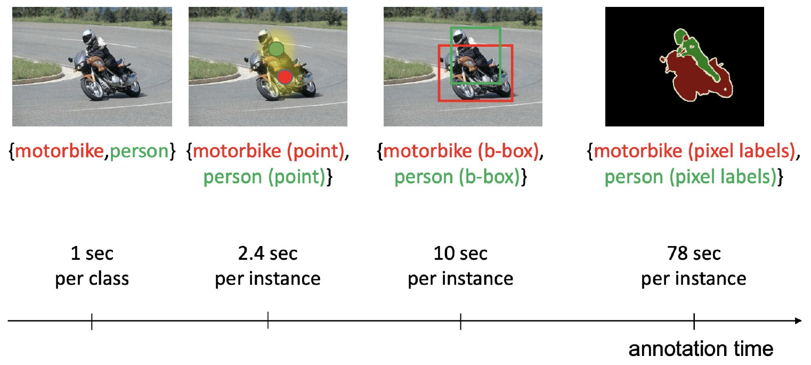

*왼쪽에서 오른쪽으로 갈수록 정보가 많아지고 annotation 시간도 늘어. 빨강이 motorbike, 초록이 person이야. (p.4)*

### 1.2 비슷한 설정과 뭐가 다른가 (p.5–7)

**Semi-supervised 쪽 (p.5)** — (c)와 (d)를 나누는 기준은 **"box 없는 사진에 뭐가 남아 있나"** 야.

- "**Semi-supervised:** learns from a set of labeled (bounding box) and unlabeled images."
- "**Weakly semi-supervised:** learns from a set of labeled (bounding box) and weakly labeled (image label) images."

| 설정 (그림) | 사진 A | 사진 B |
|---|---|---|
| (a) Supervised | box | box |
| (b) Weakly supervised | image label | image label |
| (c) Weakly semi-supervised | box | image label |
| (d) Semi-supervised | box | 아무것도 없음 |

- L06–L07의 Semi-Supervised Learning이 (d)야. 나머지 data엔 label이 전혀 없어.
- (c)와 (d)의 차이가 시험 함정이야. **weakly labeled**가 들어가면 weakly semi, **unlabeled**면 semi.

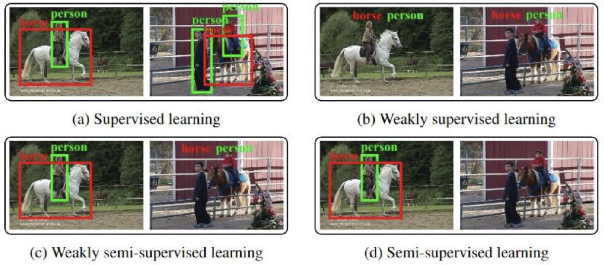

*네 칸 모두 같은 사진 두 장이야. 칸마다 사진에 무엇이 붙어 있는지만 봐. (p.5)*

**Transfer Learning 쪽 (p.6)**

- "Learns detectors for auxiliary categories with regular supervision (bounding box)"
- "Transfers the knowledge from auxiliary categories to weakly supervised categories"
- **auxiliary category**: 보조로 쓰는 class. 이 class엔 box가 있어.
- 축이 달라. semi 계열은 **일부 사진**에만 box가 있고, transfer는 **일부 class**에만 box가 있어.

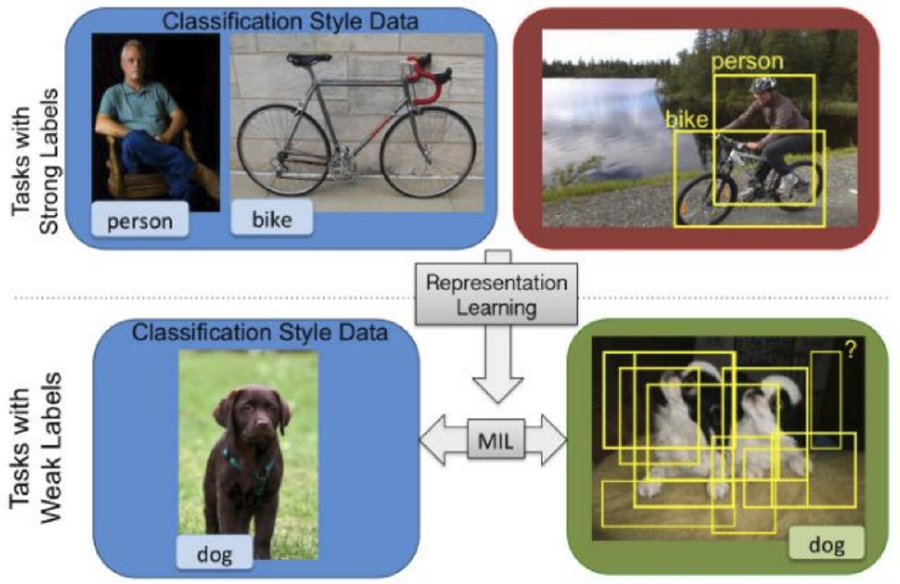

*위 줄은 box가 있는 task, 아래 줄은 weak label만 있는 task야. 위에서 배운 representation을 아래로 내려 주고, 아래 줄 안에서 MIL이 후보 box 중 dog를 찾아. MIL은 3.1에서 풀게. (p.6)*

**Self-Supervised Learning 쪽 (p.7)**

- "Defines a pretext task and learns representations in an unsupervised way"
- "Transfers pre-trained weights to a downstream task"
- "Transfer-learning requires regular annotations"
- **pretext task**는 label 없이 data에서 정답을 자동으로 만드는 가짜 과제야. **downstream task**는 진짜 풀고 싶은 과제고. 그림은 L02에서 본 patch 위치 맞히기(L02 p.21–23)와 rotation 예측(L02 p.40–43)이야.
- 세 번째 줄이 차이야. pretext 자체엔 annotation이 필요 없지만, downstream으로 옮겨 학습할 땐 **보통의 annotation이 필요해**.

**네 설정을 한 표로**

| 설정 | 뭘 쓰나 | weak supervision과 차이 |
|---|---|---|
| Semi-supervised | 일부 사진 box + 나머지 사진 무라벨 | 나머지 사진에 정보가 전혀 없음 |
| Weakly semi-supervised | 일부 사진 box + 나머지 사진 image label | 일부 사진엔 box가 있음 |
| Transfer | 일부 **class** box + 나머지 class weak | 다른 class의 box 지식을 빌려 옴 |
| Self-supervised | pretext (annotation 없음) → downstream (보통 annotation) | 옮길 때 regular annotation이 필요 |

### 1.3 보통은 pretrained network에서 시작 (p.8)

- "Typically uses pretrained networks and fine-tunes them by using weak supervision"
- **pretrained network**: 다른 data로 미리 학습해 둔 network.
- **fine-tuning**: 그 weight에서 출발해서 새 task로 조금 더 학습하는 것.
- 맨바닥에서 시작하지 않는다는 뜻이야. p.34 WSDDN도 "finetunes a pre-trained deep network"라고 적혀 있어.

---

## 2. Challenge (p.9–13)

### 2.1 Challenges in Generic Object Recognition (p.10)

box가 있어도 어려운 문제들이야.

- **Intra-class variations**: 같은 class 안에서 생김새가 달라지는 것. Appearance, Viewpoint, Scale, Aspect ratio.
- **Background clutter**: 배경이 복잡해서 물체가 묻히는 것.
- **Occlusions**: 다른 물체에 가려 일부만 보이는 것.

### 2.2 Co-occurrence: image label로 못 가리는 것 (p.11–13)

**co-occurrence**는 두 가지가 늘 같이 나타나는 거야. image label만 받으면 model은 무엇이 물체인지 정할 근거가 없어. 세 가지 유형이 있고, 슬라이드는 문제 형식으로 보여 줘.

| 유형 | 슬라이드 질문 | 정답 | 착각 | 다시 나오는 곳 |
|---|---|---|---|---|
| **Parts vs object** (p.11) | What is a person? a) Face / b) Face + upper body / c) Face + whole body | c) Face + whole body | 일부를 전체로 | p.28, p.35, p.38 |
| **Context vs object** (p.12) | What is a train? a) Rail / b) Train + Rail / c) Train | c) Train | 배경을 물체로 (철로) | p.27, p.28 |
| **Multiple vs single instance** (p.13) | What is a sheep? a) 2 sheeps / b) 3 sheeps + grass / c) 1 sheep ← "sheeps"는 슬라이드 표기 | c) 1 sheep | 여러 개를 하나로 | p.35, p.37 |

- **왜 못 가리나?** 얼굴은 person 사진 대부분에 나와. 얼굴만 찾아도 "사진에 person이 있나"는 잘 맞혀. 그러니까 image label은 a와 c를 구별할 신호를 안 줘.
- 철로도 같아. train 사진엔 거의 늘 철로가 있어서, 철로를 찾아도 정답 처리가 돼.
- 양도 같아. 늘 무리로 나오면 "두 마리를 묶은 덩어리"도 label을 잘 설명해. image label은 **몇 마리인지** 말해 주지 않아.
- 이 세 가지가 이 강의의 **기준표**야. 뒤의 방법마다 어떤 착각을 고치는지 물어보면 정리가 돼.
- p.40의 요약: "WSOD is an ill-posed problem and ambiguous due to part/whole and co-occurence issues." ← "co-occurence"는 슬라이드 철자. **ill-posed**는 주어진 정보만으로 답이 하나로 안 정해진다는 뜻이야.

---

## 3. Weakly-Supervised Object Detection (p.14–32)

### 3.1 Principles for WSOD: Multiple-Instance Learning (p.15)

**슬라이드 정의**: "MIL reformulates weakly supervised object detection as a bag classification problem, where each image is a bag of candidate windows, and only the bag label (not the instance labels) is known."

- **bags = images, instances = windows**
- **Goals**: find true positive instances / train window classifier
- **bag**: instance를 담은 묶음.
- **positive bag (positive image)**: 찾는 class가 들어 있는 사진. **negative bag (negative image)**: 그 class가 없는 사진.
- **아는 건 bag label뿐이야.** "이 사진에 motorbike가 있다"는 알아도, 어느 window가 그건지는 몰라.
- 두 목표는 서로 물려 있어. classifier가 있어야 window를 고르고, 고른 window가 있어야 classifier를 학습해. 닭과 달걀 문제라서 3.2의 번갈아 풀기가 나와.

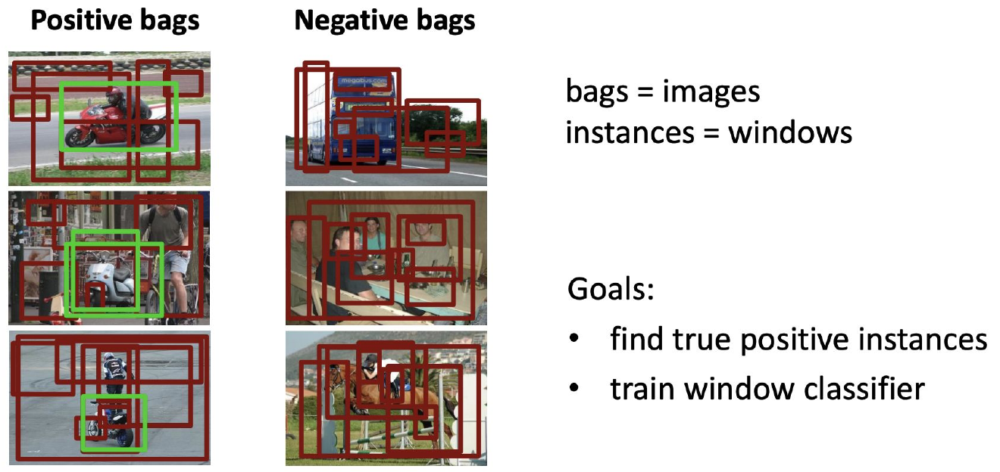

*왼쪽 positive bag엔 motorbike가 있고 초록 window가 진짜 물체야. 빨간 window는 전부 후보야. 오른쪽 negative bag엔 motorbike가 없어서 모든 window가 negative야. 학습 땐 초록 표시가 없어. (p.15)*

> 보충: MIL의 표준 가정은 "positive bag엔 positive instance가 **적어도 하나** 있고, negative bag의 instance는 **전부** negative"야. 슬라이드엔 앞부분이 문장으로 안 적혀 있고, 뒷부분은 p.21의 "all proposals in negative images are treated as negatives"에 해당해.

> RL 비유 (슬라이드 밖, 시험 범위 아님): bag label ↔ 에피소드 끝에 받는 sparse reward. 어느 window가 공인지 찾는 건 어느 action이 공인지 찾는 **credit assignment**와 같은 모양이야. 단, MIL은 "적어도 하나"라는 논리 조건이고 return은 reward의 **합**이야.

> Physical AI 연결 (**시험 범위 아님**): robot demonstration도 에피소드 단위 success 표시만 있고 구간별 label은 없는 경우가 많아. "묶음에 대한 label로 안쪽 조각을 추정한다"는 틀이 같아.

### 3.2 Standard MIL Pipeline (p.16, 19, 32)

**슬라이드**: "Two step alternating optimization": Re-train / Re-localize. "Challenges": Sensitive to initialization (local minimum) / Overfitting (locking) to predicted windows.

**어떻게**
1. **Initialize**: positive image마다 시작 box를 정해 (3.4).
2. **Re-train**: 지금 고른 box를 정답처럼 써서 detector를 학습해 (3.6).
3. **Re-localize**: 학습한 detector로 box를 다시 골라 (3.5).
4. 2–3을 반복해.

- **alternating optimization**: 두 변수를 한꺼번에 못 푸니까 하나를 고정하고 다른 하나를 푸는 걸 번갈아 하는 것.
  - Re-train: **box 고정, detector 갱신**
  - Re-localize: **detector 고정, box 갱신**
- **Challenge 1, Sensitive to initialization (local minimum)**: 시작 box가 나쁘면 나쁜 답에 갇혀.
- **Challenge 2, Overfitting (locking) to predicted windows**: detector가 자기가 학습한 box를 다시 고르면서 그 box에 잠겨.
- p.19와 p.32는 같은 그림의 반복이야. p.19는 Initialize를 흐리게 해서 "이제 고리 안을 본다"는 표시고, p.32는 이 파트를 닫는 표시야.

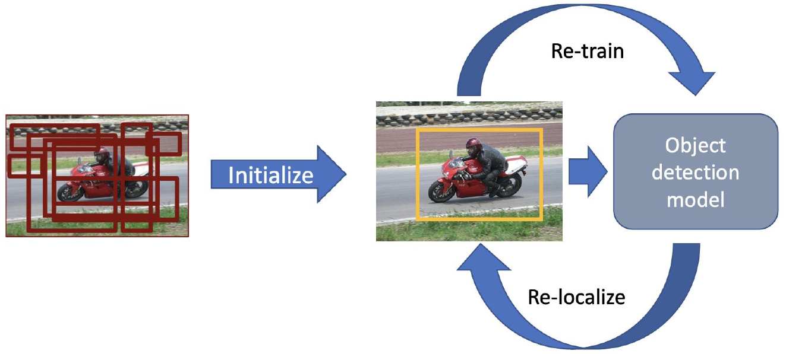

*왼쪽에서 후보 window 중 시작 box 하나를 정하면, 오른쪽 고리가 돌기 시작해. 위 화살표가 사진 → model(Re-train), 아래 화살표가 model → 사진(Re-localize)이야. (p.16)*

> 보충 (슬라이드 밖): 구조는 K-means나 hard EM과 같아. "어느 window가 물체인가"가 숨은 변수고 detector가 parameter야.

> RL 비유 (슬라이드 밖, 시험 범위 아님): Re-train ↔ Re-localize는 **generalized policy iteration**과 닮았어. 지금 고른 box로 모델을 맞추는 게 evaluation이고, 모델로 box를 greedy하게 다시 고르는 게 improvement야. **locking**은 exploration 없는 greedy policy에 bootstrapping error가 겹친 모양이고, L07의 confirmation bias와 같은 병이야. 단, tabular GPI는 실제 reward로 평가해서 개선이 보장돼. 여기 target은 자기가 고른 box라 그런 보장이 없고 local minimum에 갇혀 (p.16).

### 3.3 Bag 만들기 (p.17)

bag을 만든다는 건 사진 한 장에서 후보 window를 뽑는다는 뜻이야.

- **Sliding windows**: ">100" ← "dense"와 proposals "~2k"에 비해 숫자가 작아 보여. 지수가 빠졌을 수 있는데 슬라이드만으론 실제 값을 알 수 없음 (원문 유지) / dense / translations, scales and aspect-ratios (4D space)
  - 여러 크기·가로세로 비율의 창을 사진 위로 빽빽하게 옮기는 방식이야. 위치뿐 아니라 scale과 aspect ratio도 바뀌어.
  - **4D space**: 가로 위치, 세로 위치, 크기, 가로세로 비율 네 축.
- **Object proposals**: Selective Search and Edge Boxes / ~2k per image / **Commonly used in WSOD**
  - 물체가 있을 법한 영역을 class 구분 없이 미리 뽑아 주는 방식이야.

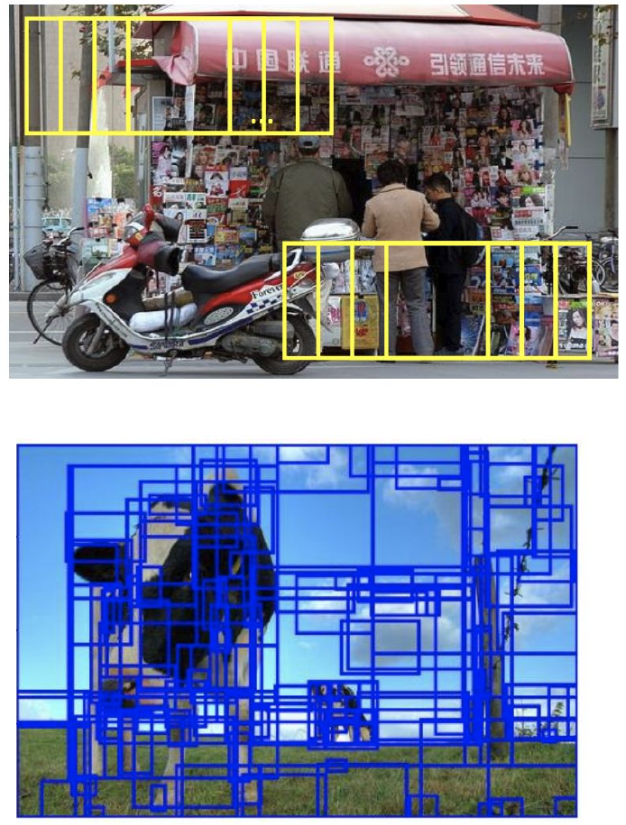

*위는 노란 창이 일정 간격으로 훑는 sliding window, 아래는 파란 proposal이 겹쳐 있는 모습이야. (p.17)*

### 3.4 Initialization (p.18)

Challenge 1 때문에 시작 box가 중요해.

- **Simple strategies**: Whole image / Whole image minus a margin. 물체가 어디 있든 일단 포함되는 쪽이야.
- **[Song ICML 14] constructs a graph to find initial boxes**. 조건이 세 개야.
  1. **relevant** (occur in many positive images): 물체라면 positive 사진 여러 장에 반복해서 나와.
  2. **discriminative** (dissimilar to the boxes in the negative images): negative 사진의 box와 달라야 해. 배경처럼 어디에나 있는 건 여기서 걸러져.
  3. **complementary** (capture multiple modes): 물체의 여러 모습을 담아야 해. **mode**는 분포의 봉우리, 여기선 "서로 다른 모습 묶음"이야.
- 슬라이드 요약: "Instead of initializing MIL with the entire image, Song et al. construct a proposal graph across positive images and select object proposals that are (1) common across positives, (2) discriminative from negatives, and (3) representative of diverse object appearances."

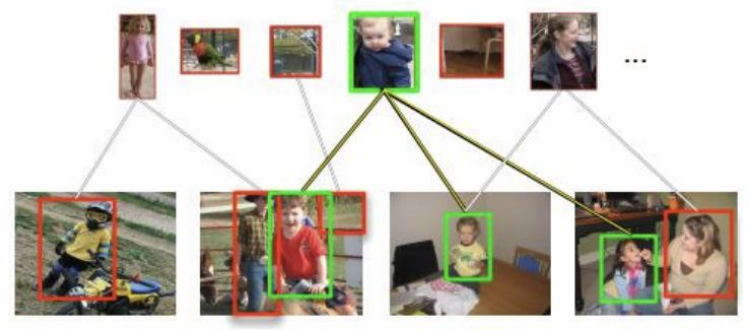

*위 줄의 box들을 아래 줄 사진들과 이어서 어떤 box가 여러 positive 사진에 공통으로 나오는지 봐. 초록이 뽑힌 쪽, 빨강이 안 뽑힌 쪽으로 읽혀. (p.18)*

### 3.5 Re-localize: Standard max formulation (p.20)

"Pick the highest scoring window as positive" / "Only one positive instance per image"

$$\arg\max_b A(x_b)$$

- $b$: proposal 번호.
- $x_b$: proposal $b$의 feature.
- $A(\cdot)$: **appearance model**. feature를 받아서 "찾는 물체 같은 정도"를 점수로 내. 점수가 클수록 그 물체 같아.
- $\arg\max_b$: 점수 자체가 아니라 **점수가 제일 큰 proposal의 번호**를 돌려줘.
- 사진마다 **하나**만 positive로 골라. 사진에 물체가 여럿 있어도 하나뿐이야. 이 한계는 3.7에서 풀어.

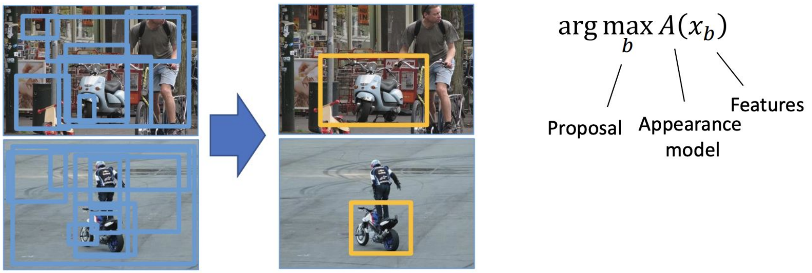

*왼쪽 후보 window 중 $A(x_b)$가 제일 큰 것 하나만 오른쪽 노란 box로 남아. (p.20)*

### 3.6 Re-train: Hinge and cross-entropy loss (p.21)

슬라이드는 같은 요구를 두 방식(hinge 쪽, cross-entropy 쪽)으로 적었어.

**For positive images**:

$$\max_b A(x_b) > \Delta \ \ (\Delta\text{: margin}) \quad \text{or} \quad \log\big(\text{Softmax}(\max_b A(x_b))\big)$$

**For negative images**:

$$\max_b A(x_b) < -\Delta \quad \text{or} \quad \log\big(1-\text{Softmax}(\max_b A(x_b))\big)$$

← log 항은 부호를 뒤집은 loss가 아니라 **키워야 할 objective** 꼴로 적혀 있고, Softmax 입력이 값 하나로 적혀 있어서 무엇에 대해 normalize하는지 슬라이드만으론 알 수 없음 (원문 유지).

- $\Delta$: **margin**. 점수가 넘어야 하는 여유 폭이야. 크게 잡을수록 더 자신 있게 맞혀야 통과해.
- $\max_b A(x_b)$: 사진 안에서 제일 높은 window 점수.
- **왜 두 줄 다 max인가?** 이게 MIL 논리 그 자체야.
  - positive 사진: "물체인 window가 **적어도 하나** 있다" ⇔ 제일 높은 점수가 $\Delta$를 넘는다.
  - negative 사진: "**모든** window가 물체가 아니다" ⇔ 제일 높은 점수조차 $-\Delta$ 아래다. 최고가 낮으면 나머지는 더 낮으니까 이 식 하나로 전부 묶여.
- log 쪽도 같은 뜻이야. positive는 $\log(\text{Softmax})$를 키워서 확률을 올리고, negative는 $\log(1-\text{Softmax})$를 키워서 확률을 내려.

> 보충 (슬라이드엔 식 없음): 부등식을 hinge loss로 쓰면 positive는 $\max(0,\ \Delta-\max_b A(x_b))$, negative는 $\max(0,\ \Delta+\max_b A(x_b))$ 꼴이야. 조건을 만족하면 loss가 0이고, 못 넘은 만큼 벌을 받아.

**Difference to supervised object detection (eg Faster-RCNN)** — 시험 포인트야.

- "Only 1 positive instance is used in each positive image"
- "No negative instances from positive image"
- 슬라이드 설명: "During the re-training stage, MIL selects the highest-scoring proposal as the positive instance for each positive image, while all proposals in negative images are treated as negatives. Unlike fully supervised detection, only one positive proposal is used and no negative proposals are sampled from positive images."

> 보충 (슬라이드엔 이유 없음): positive 사진의 나머지 window는 배경일 수도, 같은 class의 다른 물체일 수도 있어. 어느 쪽인지 모르니까 negative로 쓰면 진짜 물체를 negative로 가르칠 위험이 있어.

- **Faster R-CNN**은 box label로 학습하는 대표적인 supervised detector야. 이 차이 목록은 p.35 WSDDN 한계에 거의 그대로 다시 나와 (4.1).

### 3.7 Relaxing max: log-sum-exp (p.22) — Bilen et al., BMVC 2014

**문제**: hard max는 window 하나에 전부 걸어. 그 하나가 틀리면 학습 전체가 틀린 쪽으로 가.

**핵심**: "Hedge your bets on multiple proposals". max를 **log-sum-exp**로 바꿔서 점수 높은 window 여러 개에 나눠 걸어.

**Re-train**, for positive images:

$$\log \sum_b \exp A(x_b^+) > \Delta$$

for negative images:

$$\log \sum_b \exp A(x_b^-) < -\Delta$$

- $x_b^+$: positive image의 proposal $b$ feature. $x_b^-$: negative image의 것.
- p.21과 비교하면 $\max_b A(x_b)$ 자리에 $\log\sum_b\exp A(x_b)$가 들어간 게 전부야. margin 구조는 그대로야.
- 슬라이드 요약: "Relax hard max into soft-max (log-sum-exp) to learn from multiple high-scoring proposals instead of a single proposal."
- **좋아지는 점**: "Less sensitive to initialization" / "Leverages multiple positive samples during training"
- 여기서 "soft-max"는 log-sum-exp(부드러운 max)를 뜻해. 확률 벡터를 내는 softmax 함수와 이름이 겹쳐. 다만 아래 유도처럼 둘은 미분으로 이어져.

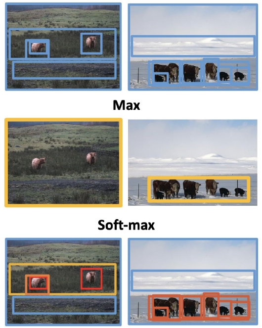

*맨 위가 후보 box, 가운데가 Max 결과, 맨 아래가 Soft-max 결과야. Max는 큰 box 하나로 뭉뚱그리고, Soft-max는 동물마다 강조된 box가 여러 개 남아. (p.22)*

**왜 돼?** (notes 보충, 슬라이드엔 결과 식만)

window가 $B$개고 점수가 $a_b = A(x_b)$일 때, log-sum-exp는 max를 위아래로 끼고 있어.

$$\max_b a_b \ \le\ \log\sum_b e^{a_b} \ \le\ \max_b a_b + \log B$$

- 왼쪽: 합은 제일 큰 항 하나보다 작을 수 없어.
- 오른쪽: 합은 제일 큰 항의 $B$배를 넘을 수 없어. log를 씌우면 $+\log B$야.

미분하면 softmax가 나와.

$$\frac{\partial}{\partial a_b}\log\sum_{b'} e^{a_{b'}} = \frac{e^{a_b}}{\sum_{b'} e^{a_{b'}}} = \text{softmax}(a)_b$$

- hard max의 gradient는 최고 window 하나로만 가.
- log-sum-exp의 gradient는 $e^{a_b}$ 비율(= softmax 비중)대로 window들이 나눠 가져. 점수 자체의 비율이 아니야. 이게 "여러 proposal에서 배운다"의 수학적 뜻이야.

**예시로 보면** (설명용 숫자, 슬라이드 수치 아님): 점수가 $a = [3,\ 2.9,\ -1]$이면

| | 값 | gradient 비중 |
|---|---|---|
| hard max | 3 | $[1,\ 0,\ 0]$ |
| log-sum-exp | 3.65 (상한 $3+\log 3 = 4.10$) | $[0.52,\ 0.47,\ 0.01]$ |

- 3과 2.9는 거의 동점인데 hard max는 2.9를 완전히 버려. log-sum-exp는 둘 다 학습하고, $-1$은 거의 무시해.

> 보충 (슬라이드 밖): 항상 log-sum-exp ≥ max라서, negative 쪽 조건 $\log\sum_b\exp A(x_b^-) < -\Delta$는 "모든 window가 $-\Delta$ 아래"를 그대로 보장해. 반대로 positive 쪽은 어떤 window도 $\Delta$를 못 넘어도 만족될 수 있어 (log-sum-exp는 max보다 최대 $\log B$ 커). 그래서 "적어도 하나"와 정확히 같은 말은 아니야.

> RL 비유 (슬라이드 밖, 시험 범위 아님): hard Bellman max → soft value $V = \alpha\log\sum_a \exp(Q/\alpha)$ (soft Q-learning, SAC)와 **같은 연산**이야. 여기는 $\alpha = 1$이고, $\alpha \to 0$이면 hard max로 돌아가. greedy 하나에 다 걸지 않는다는 동기도 같아. 단, 이건 discrete action 식이야. continuous SAC는 이 합을 직접 구하지 않아. 또 RL에선 target 계산에, 여기선 bag 점수 pooling에 써.

### 3.8 Self-paced learning (p.23) — Sangineto et al., TPAMI 2019 ← slide엔 "PAMI 17"

**문제**: "In conventional WSOD, the initial localization results are crucial." locking의 고리는 이래.

1. "If an incorrect bounding box is selected initially,"
2. "→ the detector is trained using that box,"
3. "→ leading to a vicious cycle (locking) where that same box is repeatedly selected."

**핵심**: "Inspired from Curriculum Learning, Instead of training on all samples—including difficult ones—from the start, let's train progressively, beginning with easy samples."

- **curriculum learning**: 쉬운 샘플부터 어려운 샘플 순으로 학습하는 방식.

> 보충 (Sangineto et al.): **self-paced**는 샘플 순서를 사람이 미리 정하지 않고 학습 중인 model이 고르는 방식이야. curriculum은 순서가 미리 주어져.

- 슬라이드 요약: "Learn from easy images first, then progressively incorporate harder samples as localization becomes more reliable."

**Easiness measures for WSOD**
1. "Selection of samples via confidence of max scoring window": 최고 점수 window가 자신 있는 샘플부터.
2. "Selection of window space by allowing smaller windows": 작은 window를 점점 허용. 슬라이드 가운데 그림의 iter 0 → 1 → 5에서 box가 좁혀지는 모습이 이걸로 읽혀.
3. "Selection of samples via intercategory competition" ← 슬라이드엔 방법 설명이 없음.

> 보충 (논문 Fig. 2): 사진의 label class가 다른 모든 class보다 점수가 높을 때만 그 iteration 샘플에 넣어. 슬라이드 아래 Car/TV 그림이 이 예시야. 왼쪽은 TV가 car를 이겨서 제외, 오른쪽은 car가 이겨서 포함이야.

> 보충: 가운데 iter 그림의 credit은 [Bilen IJCV 14]야 (Object and Action Classification with Latent Window Parameters, IJCV 2014). 슬라이드 하단 credit은 [Sangineto PAMI 17]이고.

> 연결: L07 FreeMatch의 threshold도 "처음엔 쉽게, 나중엔 엄격하게"라는 감각이 닮았어 (L07 p.64–75). 메커니즘은 달라.

> RL 비유 (슬라이드 밖, 시험 범위 아님): 쉬운 task부터 푸는 **curriculum RL**. 단, 여기서 고르는 건 task가 아니라 학습 샘플과 window 공간이야.

### 3.9 Multifold MIL (p.24) — Cinbis et al., TPAMI 2017 ← slide credit엔 "Sangineto PAMI 17"

**문제**: "Detector overfits into the given proposal". detector가 자기가 학습한 window를 외워서 다음 re-localize 때 같은 window가 또 최고 점수를 받아. 이게 locking이야.

**핵심**: "the detector performing localization for an image must be one that has not been trained on that image." → "Use cross-validation style training: localize each image with a detector that has never seen that image during training."

**어떻게** (슬라이드 Solution: "Train using positive examples in all folds but k, and all negative examples")
1. positive 사진을 fold(조각) 여러 개로 나눠.
2. fold $k$를 뺀 **나머지 positive** + **모든 negative**로 detector를 학습해.
3. 그 detector로 **fold $k$** 사진을 re-localize해.
4. 모든 $k$에 대해 반복해.

- **빠지는 건 positive fold $k$뿐**이야. negative는 전부 써.
- **cross-validation**: 조각 하나를 빼고 학습한 뒤, 뺀 조각으로 평가하는 방식.
- **왜 돼?** 외운 사진엔 외운 box가 높게 나와. 안 본 사진에 대한 점수는 외운 게 아니라 일반화된 판단이야.

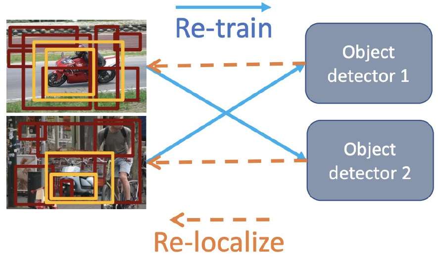

*파란 실선이 Re-train, 주황 점선이 Re-localize야. 위 사진은 detector 2를 학습시키고 box는 detector 1한테 받아. 자기로 학습한 detector한테는 box를 안 받아. (p.24)*

> 연결: L07 DivideMix의 co-divide(상대 network가 내 data를 나눠 줌)와 동기가 같아. "내가 외운 걸 내가 판정하지 않는다"는 거야. 메커니즘은 달라 (fold 분할 vs 두 network).

> RL 비유 (슬라이드 밖, 시험 범위 아님): **Double Q-learning**이 "고르는 쪽(argmax)"과 "평가하는 쪽"을 떼어 놓는 것, 통계의 cross-fitting과 닮았어. 단, Double Q의 목표는 overestimation 억제고 multifold는 held-out split이야.

### 3.10 Pairwise similarity → Sub-categories / Exemplars (p.25–26)

**Pairwise similarity (p.25)**: "Similarity between selected windows across positive images"

- **핵심**: 사진마다 따로 box를 고르지 말고, positive 사진들에서 **서로 닮은 box를 같이** 골라. 진짜 물체라면 여러 사진에서 비슷하게 생겼을 거라는 가정이야.
- **장점**: Less overfitting. 자기 점수만 보지 않고 다른 사진과의 일치를 보니까.
- **단점 1**: Expensive to optimize. All positive images must be connected (N² similarities).
- **단점 2**: Ignores intra-class variation. "The assumption that all objects must be similar is unrealistic." / "since this method assumes that similar = good, it does not sufficiently reflect diversity."
- 슬라이드 요약: "Enforce consistency across positive images by jointly selecting similar object proposals, reducing localization ambiguity but increasing computational cost and limiting intra-class diversity."

**CRF(Conditional Random Field)**: 변수들을 graph로 잇고, 각 변수의 점수와 이웃 사이 점수의 합으로 답을 고르는 model. 슬라이드 그림의 대응은 이래.

- nodes = images, states = windows (사진마다 window 하나를 고름)
- **unary** = objectness scores (변수 하나의 점수)
- **pairwise** = similarity between windows (두 변수 사이의 점수)
- **fully connected** = 모든 사진 쌍이 이어짐. 그래서 $N^2$이야.

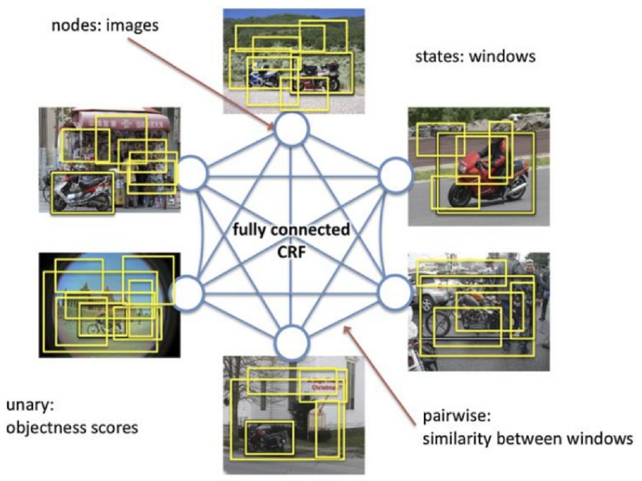

*동그라미 하나가 사진 하나고, 그 사진의 노란 window 중 하나를 고르는 게 그 node의 상태야. 선마다 "두 사진에서 고른 window가 닮았나"를 점수로 매겨. (p.25)*

**Sub-categories / Exemplars (p.26)**: p.25의 단점 2를 고쳐. "모든 물체가 닮아야 한다"에서 "**비슷한 것끼리만** 닮으면 된다"로 바꾼 거야. 슬라이드 요약: "Instead of enforcing similarity across all positive images, model intra-class variation using either sub-category clustering or representative exemplars."

| | 방법 | (+) | (−) |
|---|---|---|---|
| **Sub-categories** | Clustering via probabilistic latent Semantic Analysis (pLSA) | Modeling intra-class variations | **Sensitive to number of clusters** |
| **Exemplars** | Pick representative samples | **No need to set number of clusters** | (슬라이드에 없음) |

- **pLSA**: 원래 문서의 숨은 주제를 찾는 확률 model. 여기선 clustering에 썼어.

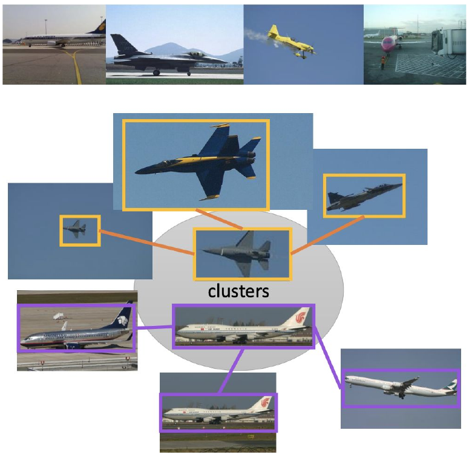

*airplane class 안에 전투기 무리(주황)와 여객기 무리(보라)가 따로 묶여. 가운데가 대표고, 묶음끼리는 안 닮아도 돼. (p.26)*

### 3.11 Additional cues: Context, Objectness (p.27–28)

**Context (p.27)** — Russakovsky ECCV 12, Kantorov et al., ECCV 2016

- "Background provides contextual cues for recognition" / "Better separation of foreground and background"
- **ROI(Region of Interest)**: 지금 보는 후보 영역. **context**: 그 영역 바깥 주변. **foreground**: 물체. **background**: 배경.
- 물체 생김새(appearance) 말고 주변도 쓰자는 거야. 방식이 두 가지야.
  - **Additive**: "select a ROI that is semantically compatible with its context". 주변과 **어울리는** ROI를 골라. ROI 점수에 context 점수를 **더해** ("person in ROI?" ⊕ "person in context?").
  - **Contrastive**: "select a ROI that is outstanding from its context". 주변에서 **튀는** ROI를 골라. ROI 점수에서 context 점수를 **빼** ("person in ROI but not in context?").
- 슬라이드 요약: "Context provides valuable cues beyond the object appearance. It can either reinforce semantically compatible objects (additive) or help distinguish foreground from background (contrastive)."
- 여기 contrastive는 L03–L05의 contrastive learning(InfoNCE)과 **다른 말**이야. ROI와 context의 **차이**를 본다는 뜻이야.

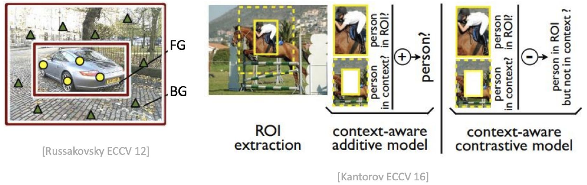

*왼쪽은 FG와 BG를 나누는 그림이야. 오른쪽은 ROI 주변을 잘라서 ROI 점수와 합치는 두 model이고, ⊕가 additive, ⊖가 contrastive야. (p.27)*

**Objectness (p.28)**

"Quantify how likely a window is to contain an object of **any class**"

$$\arg\max_b\ \lambda A(x_b) + (1-\lambda)\,\text{Obj}(b)$$

- p.20의 re-localize에 항 하나를 더한 거야.
- $A(x_b)$: 찾는 class처럼 생긴 정도.
- $\text{Obj}(b)$: proposal $b$의 **objectness**. class와 상관없이 "물체가 들어 있는 정도". EdgeBoxes, Selective Search, BING으로 구해. ← 슬라이드 표기는 "Obj(b): proposal의 objectness" (한국어 조사가 섞인 원문)
- $\lambda$: 두 점수를 섞는 비율. $\lambda = 1$이면 p.20과 같고, 작을수록 objectness를 더 믿어.
- 효과 세 개: "Generates a small set of accurate object proposals" / "Steers re-localization towards objects and away from background" / "**Pushes towards whole objects instead of sub-regions**"
- 슬라이드 요약: "Objectness provides a class-independent prior that guides WSOD toward complete objects rather than discriminative object parts or background regions."
- **prior**: 학습 data를 보기 전에 넣어 주는 사전 지식.
- **왜 돼?** class 점수는 "가장 class다운 부위"를 좋아하고, objectness는 물체 전체를 감싼 box를 좋아해. 그래서 Parts vs object와 Context vs object를 같이 완화해.

**예시로 보면** (설명용 숫자): $\lambda = 0.5$일 때 얼굴 box가 $A = 0.9,\ \text{Obj} = 0.2$면 0.55, 사람 전체 box가 $A = 0.7,\ \text{Obj} = 0.8$이면 0.75야. class 점수는 얼굴이 높아도 전체 box가 뽑혀.

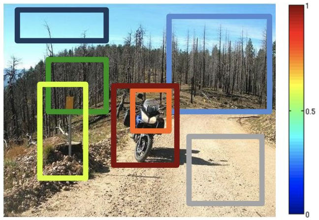

*box 색이 objectness 값이야 (오른쪽 color bar, 빨강이 1에 가까움). 오토바이 전체를 감싼 box가 진한 빨강이고, 일부만 감싼 box는 주황, 하늘 box는 남색이야. (p.28)*

> RL 비유 (슬라이드 밖, 시험 범위 아님): 고를 때 task와 무관한 prior 점수를 섞는 것과 닮았어. 단, potential-based reward shaping처럼 최적해를 보존하는 보장은 없어. $\lambda$에 따라 뽑히는 box가 실제로 바뀌어.

### 3.12 Priors: Equivariance, Scale, Motion (p.29–31)

**Equivariance (p.29)** — Bilen et al., BMVC 2014

- "The predicted output should be equivariant to image transformations"
- **equivariance**: 입력을 변환하면 출력도 **같이** 변환돼야 한다는 성질 (L02 p.71–79).
  - invariance: $f(t(x)) = f(x)$. 출력이 그대로.
  - equivariance: $f(t(x)) = \phi(t, f(x))$. 출력이 변환을 따라가.
- box는 위치를 내는 출력이라서 equivariance가 맞아. 사진을 뒤집으면 예측 위치도 뒤집혀야 해.

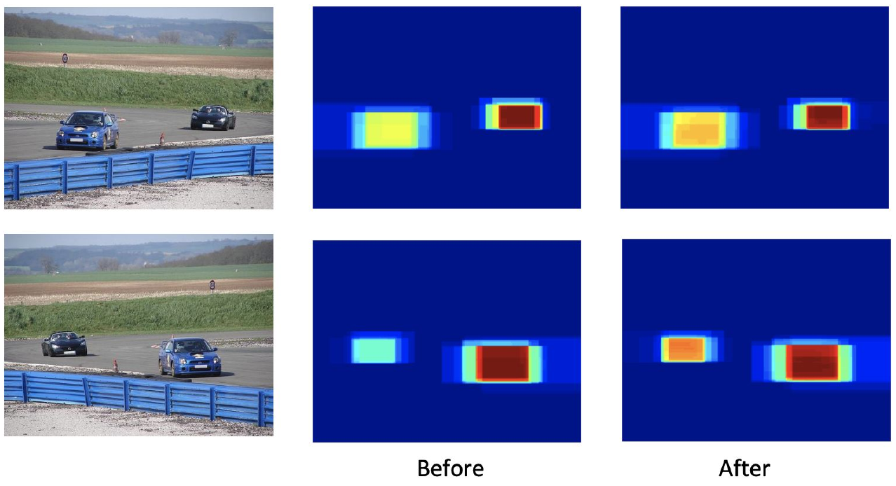

*아래 줄은 위 줄 사진을 좌우로 뒤집은 거야. 가운데 Before에선 같은 차의 강도가 두 줄에서 꽤 달라. 오른쪽 After에선 차이가 줄어. (p.29)*

**Scale (p.30)** — Shi & Ferrari, ECCV 2016

- "Curriculum learning (**bigger objects down to smaller ones**)"
- "Weight object proposals according to estimated size"
- "Requires training a size estimator from a small set"
- 슬라이드 요약: "introduces an object-size prior, encouraging the detector to localize large objects first and progressively learn smaller ones, thereby reducing localization errors caused by object parts."

**어떻게**
1. **Re-training**: 사진을 물체 크기 순서로 정렬해서 **큰 물체부터** 학습 (Size Order).
2. **Re-localization**: 추정 크기에 가까운 proposal에 weight를 더 줌 (Size Weighting).

- **왜 돼?** 크기를 알면 물체 일부만 감싼 작은 box가 밀려나.
- **비용**: size estimator를 학습할 작은 set이 따로 필요해.

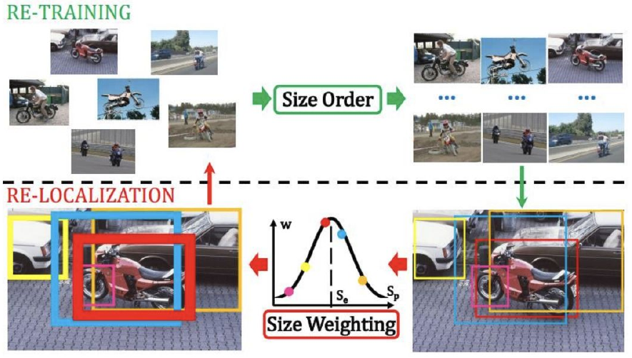

*위 칸이 Re-training(크기 순 정렬), 아래 칸이 Re-localization(크기 가중치)이야. 곡선의 가로축 $S_p$는 proposal 크기, 봉우리 $S_e$는 추정 크기로 읽혀 ← 슬라이드에 기호 정의는 없음. (p.30)*

**Motion (p.31)** — Prest et al., CVPR 2012

**어떻게**
1. "extracts candidate spatio-temporal tubes based on motion segmentation"
2. "selects **one tube per video** jointly over all videos"
3. "uses objectness to reduce object candidates"
4. "applies a domain adaptation method to address the video/image gap"

- **(+)** Motion cues for object boundaries. **(−)** Noisy data.
- **spatio-temporal tube**: 동영상에서 시간을 따라 이어지는 box 묶음. **motion segmentation**: 움직임을 기준으로 영역을 나누는 것. **domain adaptation**: 분포가 다른 data 사이의 차이를 메우는 방법.
- 슬라이드 요약: "Motion provides strong temporal cues for object localization. By extracting motion-based object tubes from videos and transferring them to image detectors, WSOD can obtain much more reliable pseudo bounding boxes than using images alone."
- 왜 돼? 움직이는 물체는 배경과 따로 움직여서, 사진 한 장으론 안 보이는 경계가 보여.
- 고른 tube가 frame마다 주는 box가 **pseudo bounding box**야. L07의 pseudo label과 같은 생각이야.

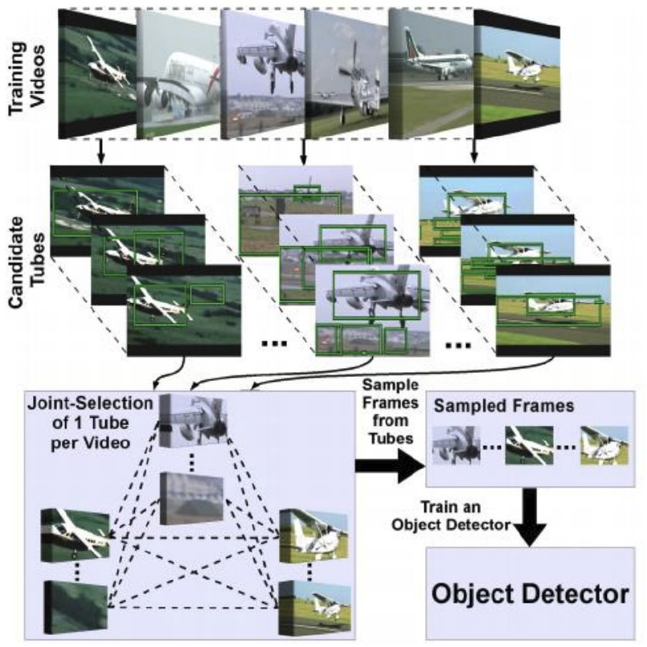

*위에서 아래로 읽어. 영상 → 후보 tube → 영상마다 tube 하나 고르기 → frame 뽑기 → detector 학습이야. (p.31)*

### 3.13 MIL 개선 한눈에 (p.18–31)

"어디를 고치나"는 슬라이드 설명에서 읽어 낸 분류야. 슬라이드 제목은 p.22–31이 전부 "Re-Localization and Re-Training"이야.

| 개선 | p. | 어디를 고치나 | 무엇을 고치나 | 한 줄 | 비용·단점 |
|---|---|---|---|---|---|
| Song graph | 18 | Initialize | 나쁜 시작 box | relevant·discriminative·complementary box로 시작 | |
| log-sum-exp | 22 | Re-train | 시작 민감성, positive 1개 제한 | hard max → 부드러운 max | |
| Self-paced | 23 | 샘플·window 순서 | locking, 시작 민감성 | easy → hard | |
| Multifold | 24 | Re-localize | overfitting (locking) | 안 본 detector가 box를 고름 | |
| Pairwise similarity | 25 | Re-localize | overfitting | 사진끼리 닮은 box를 같이 고름 | $N^2$, 다양성 무시 |
| Sub-categories | 26 | Re-localize | 다양성 | pLSA로 class 안을 cluster로 | cluster 수에 민감 |
| Exemplars | 26 | Re-localize | 다양성 | 대표 샘플로 묶음 | |
| Context | 27 | 추가 cue | 전경/배경 구분 | additive / contrastive | |
| Objectness | 28 | 추가 cue | part, background | class-independent 점수 섞기 | |
| Equivariance | 29 | prior | 변환에 흔들리는 예측 | 변환하면 출력도 따라가게 | |
| Scale | 30 | prior | part 때문의 위치 오류 | big → small + size weighting | size estimator 필요 |
| Motion | 31 | prior | 물체 경계 | video tube를 pseudo box로 | noisy data |

---

## 4. Deep and End-to-End WSOD (p.33–39)

**end-to-end**: 입력부터 출력까지 network 전체를 loss 하나의 gradient로 같이 학습하는 방식. 3장은 feature를 뽑아 놓고 고르기와 학습을 번갈아 했어. 4장은 그 과정을 network 안으로 넣어.

### 4.1 WSDDN: Weakly Supervised Deep Detection Network (p.34–35) — Bilen & Vedaldi, CVPR 2016

**한 줄**: image label만으로 region 점수까지 같이 학습하는 첫 end-to-end WSOD.

**문제**: "Previous work uses CNN as black-box feature extractor". network 자체는 detection에 맞게 학습되지 않았어.

**핵심**: region 점수를 **합쳐서 image 점수를 만들면**, image label로 곧장 gradient를 흘릴 수 있어. box가 필요 없어져.

**슬라이드**: "First end-to-end WSOD method, finetunes a pre-trained deep network" / "Uses RoI-Pooling" / "Two stream architecture"

- **RoI pooling**: 크기가 제각각인 region을 feature map에서 잘라 같은 크기의 feature로 맞추는 연산.
- **stream**: network 안의 갈래.
- **Classification**: "Associates each region with a class score". region 하나 안에서 **class끼리** 비교해. "이 region은 어느 class인가?"
- **Localization**: "Compares regions for each class". class 하나 안에서 **region끼리** 비교해. "이 class는 어느 region에 있나?"

**어떻게**
1. 사진을 Conv layers에 넣어 feature map을 얻어.
2. region proposal마다 RoIPooling으로 feature를 뽑아.
3. 두 stream이 각각 class × region 표를 내.
4. 두 표를 원소별로 곱해서 region 점수를 만들어.
5. region 방향으로 합쳐서 class별 image 점수를 내고, 이걸 image label로 학습해.

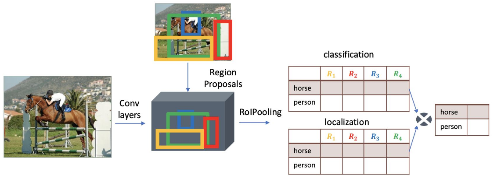

*왼쪽에서 오른쪽으로 읽어. 오른쪽 두 표의 행이 class, 열이 region($R_1$–$R_4$)이야. ⊗가 두 표를 합치는 자리고, 맨 오른쪽이 class별 image 점수야. (p.34)*

> 보충 (슬라이드엔 식 없음, 구조는 p.36 그림에 있음. 식은 논문): 두 stream의 출력 $x^c, x^d$는 둘 다 $C \times |R|$ 표야.
> $$[\sigma_{\text{class}}(x^c)]_{cr} = \frac{e^{x^c_{cr}}}{\sum_{k=1}^{C} e^{x^c_{kr}}}, \qquad [\sigma_{\text{det}}(x^d)]_{cr} = \frac{e^{x^d_{cr}}}{\sum_{k=1}^{|R|} e^{x^d_{ck}}}$$
> $$x^R = \sigma_{\text{class}}(x^c) \odot \sigma_{\text{det}}(x^d), \qquad y_c = \sum_{r=1}^{|R|} x^R_{cr}$$
> - $\sigma_{\text{class}}$: softmax over **classes**. region마다 class 합이 1.
> - $\sigma_{\text{det}}$: softmax over **regions**. class마다 region 합이 1.
> - $\odot$: 원소별 곱. $x^R_{cr}$는 "region $r$이 class $c$일 점수".
> - $y_c$: class $c$의 image 점수. $\sigma_{\text{det}}$의 합이 1이라서 $y_c$는 class 확률의 **가중 평균**이고 $(0,1)$ 안에 들어와.
> - image 단계엔 softmax를 안 해. 한 사진에 class가 여럿일 수 있으니까.
> - 학습은 class마다 binary log-loss $C$개의 합이야.

**예시로 보면** (설명용 숫자): class 2개, region 3개.

| | $R_1$ | $R_2$ | $R_3$ |
|---|---|---|---|
| $\sigma_{\text{class}}$ horse | 0.9 | 0.5 | 0.2 |
| $\sigma_{\text{class}}$ person | 0.1 | 0.5 | 0.8 |
| $\sigma_{\text{det}}$ horse | 0.7 | 0.2 | 0.1 |
| $\sigma_{\text{det}}$ person | 0.2 | 0.2 | 0.6 |
| 곱 horse | 0.63 | 0.10 | 0.02 |
| 곱 person | 0.02 | 0.10 | 0.48 |

- 위 두 줄은 **열** 합이 1, 가운데 두 줄은 **행** 합이 1이야.
- $y_{\text{horse}} = 0.75$, $y_{\text{person}} = 0.60$. 곱 표가 곧 region별 점수라서, 제일 높은 region이 horse는 $R_1$, person은 $R_3$이야.

**결과와 한계 (p.35)**

- (+) "State-of-the-art results with VGG-F (~AlexNet) (62% of supervised)"
- (+) "End-to-end learning + No custom deep learning layers"
- (−) "**Detects discriminative parts rather than whole object extent**"
- (−) "**Groups multiple instances together**"
- **discriminative part**: class를 구분하는 데 제일 도움 되는 부위. 사람이면 얼굴이야.
- 두 단점은 p.11, p.13의 ambiguity가 그대로 나타난 거야.
  - 얼굴만 잡기 ↔ Parts vs object
  - 여러 물체를 한 box로 ↔ Multiple vs single instance
- **왜 이렇게 돼?** loss가 image 단위에만 걸려. 가장 class다운 부위만 맞혀도 image 점수가 잘 나와. ← 슬라이드엔 이유 문장이 없고 설명으로 덧붙인 것.

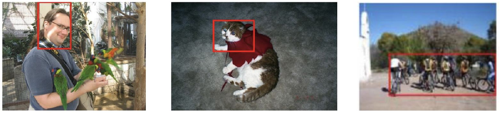

*왼쪽 box는 사람 얼굴만, 가운데는 고양이 머리 쪽만 잡았어 (discriminative part). 오른쪽은 여러 사람을 box 하나로 묶었어 (multiple instances). (p.35)*

**Limitations (compared to the supervised case, eg Faster RCNN)**
1. "It does not leverage multiple positive instances in positive images"
2. "It does not exploit negative instances in positive images"
3. "It does not learn bounding box regression"

- **bounding box regression**: box의 위치·크기를 조금씩 고쳐서 물체에 맞추는 학습.
- **1, 2는 p.21의 "Difference to supervised object detection"과 같은 말**이야. 고전 MIL의 약점이 end-to-end로 와도 남았고, 3번은 p.21 목록엔 없던 항목이야.

**차이**: 고전 MIL은 CNN을 feature 추출기로 두고 box 고르기와 학습을 번갈아 해. WSDDN은 proposal 고르기를 softmax로 부드럽게 network 안에 넣어서 한 번에 학습해.

> RL 비유·연결 (슬라이드 밖, 시험 범위 아님): softmax over regions는 region에 대한 **attention weight**야. hard argmax 대신 attention으로 고르니까 미분이 돼. "하나에 다 걸지 않는다"는 면은 3.7과 같아. 단, p.35대로 WSDDN은 여러 positive instance를 활용하지 못해. $\sigma_{\text{det}}$는 class마다 region 합이 1이라서, 같은 class 물체가 둘이어도 둘 다 높이라는 신호가 없어 (해석, 슬라이드엔 이유 없음).

### 4.2 Incorporating Instance Classification: OICR, Online Instance Classifier Refinement (p.36) — Tang et al., CVPR 2017

**한 줄**: WSDDN 점수로 pseudo label을 만들고, instance classifier를 단계적으로 고쳐 가는 방법.

**문제**: "WSDDN learns to classify images based on **implicit** instance scoring". WSDDN은 **image**를 분류하도록 학습돼. instance 점수는 그 과정의 부산물이야.

**핵심**: "OICR learns to classify **instances**". instance를 **직접** 분류하는 classifier를 붙이고, 앞 단계 점수로 만든 pseudo label로 학습해.

**슬라이드**: "Initially uses WSDDN to set instance labels" / "Iteratively refines them by using an instance classifier"

> WSDDN -> Pseudo labels -> Instance classifier -> Better pseudo labels -> Better instance classifier --> .. (슬라이드 문장)

**어떻게**
1. WSDDN 쪽(그림의 Multiple instance detection network)으로 proposal 점수를 내.
2. 그 점수로 instance label을 정해서 **1번째** instance classifier를 학습해.
3. 1번째 classifier의 점수로 **2번째**의 target을 만들어.
4. $K$번째까지 이어 가.

- **pseudo label**: model이 만들어서 정답처럼 쓰는 label (L07).
- **target은 어디서 오나?** 1번째 refinement는 WSDDN 쪽 proposal scores, 그 뒤는 **바로 앞 refinement**야.
- p.37은 OICR을 "considers only the highest scoring proposal + surrounding ones as positives"라고 적었어.

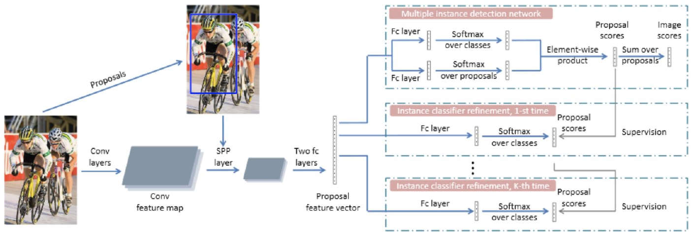

*왼쪽 사진과 proposal이 feature vector가 되고, 오른쪽 세 칸이 모두 같은 feature에서 갈라져. 맨 위 칸이 WSDDN 구조고(softmax 두 개 → 곱 → proposal 방향 합), 아래 칸들이 refinement야. 오른쪽 세로 화살표가 앞 칸 점수가 뒤 칸의 Supervision으로 내려가는 길이야. 그림의 SPP layer는 p.34 RoI-Pooling과 같은 자리의 pooling이야. (p.36)*

- 그림에서 refinement 갈래가 전부 같은 proposal feature vector에서 나와. 한 network 안에서 같이 학습되는 구조로 읽혀. 이름의 Online이 이 뜻으로 보여 ← 슬라이드엔 Online의 정의가 없음.
- 슬라이드 맨 아래 citation 옆의 "ç"는 깨진 글자로 보임 ← 원문 유지, 내용 없음.

> 보충 (논문, 슬라이드엔 없음): 이미지에 있는 class $c$마다 앞 단계 점수가 제일 높은 proposal $j_c$를 뽑아. $j_c$와 IoU가 threshold(논문은 0.5)보다 크면 class $c$, 아니면 background로 label해. background는 $(C+1)$번째 class야. **IoU(Intersection over Union)** 는 두 box의 겹친 넓이 ÷ 합친 넓이고, 1이면 완전히 겹쳐. 논문은 refinement를 $K = 3$번 하고, test 땐 refined classifier들의 평균을 써.

**차이**
- WSDDN = image classification + implicit instance scoring. OICR = **explicit** instance classification.
- L07과 비교하면 OICR은 **instance 단위 pseudo labeling**이야. Noisy Student(L07 p.17–19)는 teacher → student를 다시 학습해 반복하지만, OICR은 그림대로 한 network의 여러 갈래 안에서 돌아.

> RL 비유 (슬라이드 밖, 시험 범위 아님): 각 head의 target이 앞 head에서 오는 **bootstrapped target chain**이야. 단, 여기엔 target을 천천히 움직이는 EMA가 없어. 앞 갈래도 같이 학습 중이야.

### 4.3 Incorporating Instance Classification: PCL, Proposal Cluster Learning (p.37) — Tang et al., TPAMI 2020 ← slide엔 "PAMI 18"

**한 줄**: pseudo object를 사진당 하나가 아니라 cluster 여러 개로 만드는 방법.

**문제**: "**Observation**: There can be multiple positive instances in an image". 그런데 "OICR considers only the highest scoring proposal + surrounding ones as positives".

**핵심**: 점수 높은 proposal을 **cluster**로 묶고, cluster 하나를 **독립된 pseudo object**로 써.

**어떻게**
1. "builds an undirected graph of top- ranking proposals" ← edge 기준은 슬라이드에 없음.
2. "iteratively selects vertices which have **most connections** to be the cluster centres"
3. cluster 단위로 supervision을 줘.

- 슬라이드 요약: "OICR uses a single pseudo object per image, whereas PCL recognizes that an image may contain multiple object instances. It groups high-scoring proposals into clusters and uses each cluster as an independent pseudo object, leading to more accurate instance-level supervision."
- **undirected graph**: 방향 없는 선으로 점을 이은 graph. **vertex**: 그 점.
- cluster 중심은 **연결이 제일 많은** vertex야. "점수가 제일 높은" vertex가 아니야.

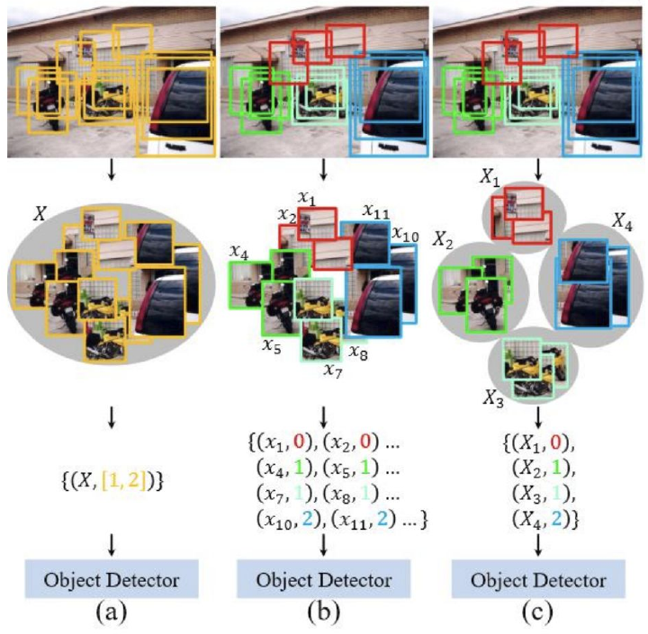

*세 칸이 같은 사진을 다르게 묶은 거야. (a)는 사진 전체 $X$ 하나에 label $[1,2]$, (b)는 proposal 하나하나에 label, (c)는 cluster $X_1$–$X_4$마다 label이야. 0은 배경, 1·2는 class로 읽혀 ← (a)(b)(c)의 이름과 0의 뜻은 슬라이드에 없고 그림에서 읽은 것. (c)에서 class 1 cluster가 $X_2, X_3$ 둘이야. 같은 class 물체가 둘이어도 따로 잡는다는 뜻이야. (p.37)*

**차이**: OICR = single pseudo object per image. PCL = multiple pseudo objects (clusters). ← 정확히는 같은 class 물체가 둘이어도 하나만 잡는다는 뜻 (논문은 class마다 하나).

### 4.4 Regularizing Discriminative Parts: Instance-Aware, Context-Focused, and Memory-Efficient WSOD (p.38–39) — Ren et al., CVPR 2020

**한 줄**: 제일 눈에 띄는 부위를 일부러 가려서, detector가 물체 전체를 보게 만드는 방법.

**문제**: 앞 방법들은 pseudo label의 **질**을 올렸어. p.35의 discriminative part 문제는 정면으로 안 다뤘어.

**핵심**: 슬라이드 문장 그대로 "Unlike OICR and PCL that mainly improve pseudo-label quality, this work explicitly addresses the discriminative-part problem. By suppressing the most discriminative regions using Concrete DropBlock, the detector is forced to attend to the entire object rather than only its most salient parts, leading to better localization."

**슬라이드**: "Builds on WSDDN and OICR"
- "Picks top p % of the highest scoring proposals and surrounding ones as positives"
- "Introduces ConcreteDropBlock: a data-driven and parametric drop-out to drop the most relevant regions" ← 슬라이드 표기 "drop-out"
- "Adversarial optimization"

$$w^*, \theta^* = \arg\min_{w}\max_{\theta}\ \sum_{I}\ \mathcal{L}_{\text{img}}(w,\theta) + \mathcal{L}_{\text{roi}}(w,\theta)$$

← $\sum$ 아래 첨자는 슬라이드에서 잘려 있어서 $I$로 읽은 것. 슬라이드엔 기호 정의가 없어서 아래는 논문으로 보충한 거야.

- $w$: 기본 **detector** parameter. loss를 **줄여**.
- $\theta$: **Concrete DropBlock** parameter. loss를 **키워**.
- $I$: 학습 사진. $\sum_I$는 사진 전체에 대한 합.
- $\mathcal{L}_{\text{img}}$: image label로 거는 image 단위 loss.
- $\mathcal{L}_{\text{roi}}$: pseudo label로 거는 region(ROI) 단위 loss.
- 결과: $\theta$가 loss를 키우려면 detector가 제일 의지하는 곳을 가려야 해. 논문 표현으로 "learn to drop the most discriminative parts of the objects". 그러면 $w$는 가려진 뒤 남은 부위로도 맞히도록 학습돼.

**dropout과 뭐가 다른가**

- **dropout**: 학습 중 일부 값을 **무작위로** 꺼서 특정 값에 의존하지 못하게 하는 regularization.
- **ConcreteDropBlock**은 "data-driven and parametric"이라서 **어디를 끌지 학습해**. 그리고 **가장 relevant한** region을 꺼. 균등 무작위가 아니고 덜 중요한 곳도 아니야. 학습된 확률 map에서 샘플링해서 relevant한 곳을 더 자주 꺼.

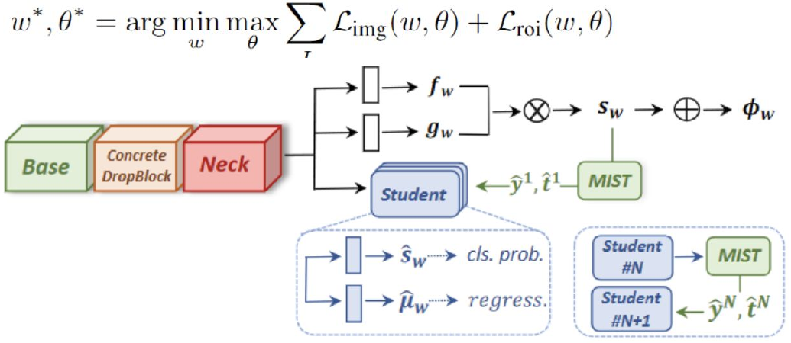

*위가 목적식, 아래가 구조야. Base → Concrete DropBlock → Neck 뒤에서 세 갈래로 나뉘어. 위 두 갈래 $f_w, g_w$를 곱해($\otimes$) $s_w$를 만들고 더해서($\oplus$) $\phi_w$를 내는 부분이 WSDDN 구조야. MIST가 $s_w$에서 pseudo label $\hat{y}^1, \hat{t}^1$을 만들어 Student로 내려 주고, Student #N의 출력도 MIST를 거쳐 Student #N+1의 target이 돼 (OICR식 단계 refinement). Student 안에 cls. prob. 칸과 regress. 칸이 있어. Base = conv layers, Neck = RoI pooling 뒤 layers야 (논문 보충). (p.38)*

> 보충 (논문, 슬라이드엔 없음):
> - **MIST** = Multiple Instance Self-Training. class마다 ROI 점수를 정렬해서 top p percent를 뽑고, 많이 겹치는 건 빼면서 서로 다른 고득점 region을 pseudo box로 남겨.
> - **Student block** = classification layer + regression layer. regression target은 **pseudo box**에서 와 (ground truth가 아님). 즉 p.35의 "does not learn bounding box regression"을 pseudo box로 푼 거야.
> - $f_w$ = classification logits, $g_w$ = detection logits, $s_w$ = 두 softmax의 곱, $\phi_w(c) = \sum_r s_w(c, r)$ = image evidence. WSDDN과 같은 구조야.
> - **Concrete DropBlock**: feature에서 확률 map을 만들고, Gumbel-Softmax로 hard mask를 뽑아. **Gumbel-Softmax**는 이산 샘플링을 미분 가능하게 근사하는 기법이라서, "어디를 끌지"를 gradient로 학습할 수 있어.

> RL 비유 (슬라이드 밖, 시험 범위 아님): $\min_w\max_\theta$는 **robust adversarial RL**과 닮았어. adversary가 일부러 어렵게 만들고 agent가 버티도록 학습해. Gumbel-Softmax는 이산 action을 relax하는 트릭과 같아. 단, 여기서 adversary가 건드리는 건 환경이 아니라 feature야.

**결과 예시 (p.39)**: Successful cases / Failure cases 사진이야. 물체가 여럿이어도 따로 잡는 사례가 Successful에 많아. Failure를 보면 사람처럼 부위가 뚜렷한 물체에서 part 문제가 남아 있어 ← 슬라이드엔 설명이 없고 그림에서 읽은 해석. box에 붙은 숫자는 표 수치가 아니라 box 점수라서 외울 필요 없어.

### 4.5 네 방법 비교

표의 일부 칸은 슬라이드 문장과 그림에서 읽어 낸 정리야.

| | WSDDN (p.34–35) | OICR (p.36) | PCL (p.37) | Ren (p.38–39) |
|---|---|---|---|---|
| **이전 대비 한 줄** | 첫 end-to-end | instance를 직접 분류 | pseudo object 여러 개 | discriminative part 직접 억제 |
| **학습 신호** | image label | image label + 앞 단계 pseudo label | image label + cluster pseudo label | image loss + ROI loss, 적대적 |
| **instance 점수** | implicit | explicit | explicit | explicit |
| **positive 고르는 법** | (명시적으로 안 고름, 두 softmax의 곱) | 최고 점수 + 주변 | graph cluster 중심 (most connections) | top p% + 주변 |
| **사진당 pseudo object** | 없음 | 하나 ("single pseudo object") ← 슬라이드 표현. 논문은 사진에 있는 class마다 하나 | 여러 개 (cluster) | 여러 개 (top p%) |
| **주 목표** | end-to-end화 | pseudo label 질 | pseudo label 질 | discriminative part |
| **box regression** | 없음 | 슬라이드에 언급 없음 | 슬라이드에 언급 없음 | 있음 (그림의 regress.) |

### 4.6 WSDDN 한계는 어떻게 고쳐졌나

**주의**: 슬라이드 bullet이 이 대응을 직접 적은 건 아니야. 슬라이드 문장과 그림에서 읽어 낸 거야.

| p.35 한계 | 뒤에서 고친 곳 | 근거 |
|---|---|---|
| multiple positive instances를 안 씀 | PCL (cluster) → Ren (top p%). OICR은 아직 아니야: 최고 + 주변이라 positive **proposal**은 늘어도 pseudo object는 하나야 (p.37) | p.37–38 bullet·캡션 |
| positive 사진의 negative instance를 안 씀 | PCL 그림의 $(X_1, 0)$: positive 사진 안의 label 0. OICR도 background로 label (논문) | p.37 그림 |
| box regression을 안 배움 | Ren의 regress. head | p.38 그림 |
| discriminative parts | Ren의 Concrete DropBlock | p.38 캡션: OICR/PCL은 "mainly improve pseudo-label quality" |
| 여러 instance를 묶음 | PCL의 cluster = 독립된 pseudo object | p.37 캡션 |

---

## 5. Summary (p.40)

슬라이드 네 문장을 강의 구조에 맞추면 이래.

1. **왜 어렵나**: "WSOD is an ill-posed problem and ambiguous due to part/whole and co-occurence issues." (2장)
2. **학습이 왜 불안한가**: "WSOD training is sensitive to initialization and prone to overfitting." (3.2)
3. **뭐가 도왔나**: "Remarkable progress due to objectness and region proposals, incorporating prior knowledge and additional cues, end-to-end learning." (3.3, 3.11, 3.12, 4장)
4. **앞으로**: "Addressing the inherent ambiguity requires better objectness measures and stronger additional cues."

## 6. Next (p.41)

"Next Week.. Weakly supervised .." ← 일정표로는 W11 11/12 Weakly-Supervised II.

- `exam/midterm_recall.md` 5.2가 weakly-supervised 코드 후보로 적은 **CAM은 L08에 없어**. W11에서 나오는지 확인해야 해.

---

## 시험 대비 핵심 정리

### 꼭 외울 수식

| 이름 | 식 | 기억할 것 |
|---|---|---|
| Re-localize (p.20) | $\arg\max_b A(x_b)$ | 하나만 고름 |
| Re-train, hinge (p.21) | positive: $\max_b A(x_b) > \Delta$ / negative: $\max_b A(x_b) < -\Delta$ | 둘 다 max. negative는 최고 점수가 낮으면 전부 낮음 |
| Re-train, CE (p.21) | $\log(\text{Softmax}(\max_b A(x_b)))$ / $\log(1-\text{Softmax}(\max_b A(x_b)))$ | negative 쪽이 $1-$ |
| Relaxed max (p.22) | $\log\sum_b\exp A(x_b^+) > \Delta$ / $\log\sum_b\exp A(x_b^-) < -\Delta$ | max 자리에 log-sum-exp |
| Objectness (p.28) | $\arg\max_b \lambda A(x_b) + (1-\lambda)\text{Obj}(b)$ | $\lambda$는 $A$, $1-\lambda$는 Obj |
| Ren (p.38) | $\arg\min_w\max_\theta \sum_I \mathcal{L}_{\text{img}} + \mathcal{L}_{\text{roi}}$ | $w$ 최소화, $\theta$ 최대화 |
| WSDDN 구조 (p.36 그림) | softmax over classes ⊙ softmax over proposals → sum over proposals | 식은 슬라이드에 없음. 구조만 슬라이드에 있음 |

### 꼭 외울 정의 (슬라이드 원문)

- **Weak supervision**: "Lower degree (or cheaper) annotation at train time than the required output at test time" (p.4)
- **Semi-supervised**: "learns from a set of labeled (bounding box) and unlabeled images." / **Weakly semi-supervised**: "learns from a set of labeled (bounding box) and weakly labeled (image label) images." (p.5)
- **MIL**: "reformulates weakly supervised object detection as a bag classification problem, where each image is a bag of candidate windows, and only the bag label (not the instance labels) is known." (p.15)
- **Standard MIL Pipeline**: "Two step alternating optimization" (Re-train, Re-localize). Challenges: "Sensitive to initialization (local minimum)", "Overfitting (locking) to predicted windows" (p.16)
- **Multifold**: "the detector performing localization for an image must be one that has not been trained on that image." (p.24)
- **Objectness**: "Quantify how likely a window is to contain an object of any class" / "a class-independent prior" (p.28)
- **WSDDN streams**: Classification "Associates each region with a class score", Localization "Compares regions for each class" (p.34)
- **OICR**: "learns to classify instances" / "Iteratively refines them by using an instance classifier" (p.36)
- **PCL**: "builds an undirected graph of top- ranking proposals", "iteratively selects vertices which have most connections to be the cluster centres" (p.37)
- **ConcreteDropBlock**: "a data-driven and parametric drop-out to drop the most relevant regions" (p.38)

### 비교 포인트 (뒤집기 쉬운 짝)

| 짝 | 맞는 쪽 |
|---|---|
| train time ↔ test time | annotation이 낮은 쪽이 **train** (p.4) |
| bags ↔ instances | bags = **images**, instances = **windows** (p.15) |
| bag label ↔ instance labels | 아는 건 **bag label** (p.15) |
| semi ↔ weakly semi | semi = unlabeled, weakly semi = **weakly labeled (image label)** (p.5) |
| Re-train ↔ Re-localize | Re-train = box 고정·detector 갱신, Re-localize = detector 고정·box 갱신 |
| discriminative (p.18) | **negative** 이미지의 box와 달라야 |
| hard max ↔ log-sum-exp | hard = 하나만, log-sum-exp = 여럿 (p.20, 22) |
| 빠지는 fold | **positive** fold $k$만, negative는 전부 사용 (p.24) |
| Sub-categories ↔ Exemplars | Sub-categories = cluster 수에 **민감**, Exemplars = cluster 수 **불필요** (p.26) |
| Additive ↔ Contrastive | Additive = **compatible**, Contrastive = **outstanding** (p.27) |
| Objectness | **class-independent** (p.28) |
| Equivariance ↔ Invariance | 슬라이드는 **equivariant** (p.29) |
| Scale 순서 | **bigger → smaller** (p.30). Self-paced는 easy → hard (p.23) |
| Motion | **one tube per video** (p.31) |
| WSDDN 두 stream | Classification = class끼리 비교, Localization = **region끼리** 비교 (p.34) |
| WSDDN ↔ OICR | **implicit** instance scoring ↔ learns to classify **instances** (p.36) |
| OICR ↔ PCL | **single** pseudo object ↔ **multiple** clusters (p.37) |
| PCL cluster 중심 | **most connections** (점수 최고 아님) (p.37) |
| OICR/PCL ↔ Ren | pseudo-label quality ↔ **discriminative-part problem** (p.38) |
| ConcreteDropBlock | **most relevant** 부위를, **학습해서** 끔 (p.38) |
| $\min_w\max_\theta$ | $w$가 줄이고 $\theta$가 키움 (p.38) |
| contrastive | p.27은 ROI vs context, InfoNCE와 다른 말 |

### 예상 질문 + 모범답안 방향

**Q1. What is weak supervision? Give one example.**
Weak supervision uses a lower degree of (or cheaper) annotation at train time than the output required at test time. For example, a detector must output bounding boxes at test time but is trained only with image-level labels.

**Q2. What is the difference between semi-supervised and weakly semi-supervised learning?**
Both have some images with bounding boxes. In semi-supervised learning the remaining images are unlabeled, while in weakly semi-supervised learning the remaining images have image-level labels.

**Q3. How does MIL formulate WSOD?**
It treats each image as a bag of candidate windows and each window as an instance. Only the bag label is known, so the goals are to find the true positive instances and to train a window classifier.

**Q4. Describe the standard MIL pipeline and its two challenges.**
After initialization, it alternates between re-training the detector on the selected windows and re-localizing the windows with the detector. It is sensitive to initialization because it can fall into a local minimum, and it can overfit (lock) to its own predicted windows.

**Q5. Why does the negative-image constraint use a max?**
All windows in a negative image must be negative. If even the highest-scoring window is below $-\Delta$, every other window is below it too, so one constraint on the max covers all of them.

**Q6. Why relax the max into log-sum-exp?**
Hard max trains on a single window, so a wrong choice misleads learning. Log-sum-exp spreads the gradient over several high-scoring proposals, which makes training less sensitive to initialization and uses multiple positive samples.

**Q7. What does multifold MIL do, and why?**
It re-localizes each image with a detector that was not trained on that image, in a cross-validation style: train on positives in all folds but k and on all negatives, then localize fold k. This stops the detector from locking onto windows it has memorized.

**Q8. What is objectness for?**
It measures how likely a window is to contain an object of any class. As a class-independent prior, it steers re-localization toward whole objects and away from background and object parts.

**Q9. What do the two streams of WSDDN do?**
The classification stream associates each region with a class score, comparing classes within a region. The localization stream compares regions for each class. Their element-wise product gives region scores, which are summed over regions into image-level scores trained with image labels.

**Q10. What are the main weaknesses of WSDDN?**
It detects discriminative parts rather than whole objects and groups multiple instances together. Compared with supervised detectors, it does not use multiple positive instances, does not use negative instances in positive images, and does not learn box regression.

**Q11. How does OICR improve on WSDDN?**
WSDDN only scores instances implicitly while classifying images. OICR adds instance classifiers: WSDDN scores set the first pseudo labels, and each refinement stage is supervised by the previous stage, so pseudo labels and classifiers improve together.

**Q12. How does PCL differ from OICR?**
OICR uses a single pseudo object per image (in the paper, one per class present): the top proposal and its surrounding ones. PCL builds a graph of top-ranking proposals, picks the vertices with the most connections as cluster centres, and uses each cluster as an independent pseudo object, so several instances can be handled.

**Q13. What is ConcreteDropBlock for?**
It is a learned, parametric dropout that drops the most relevant regions. Trained adversarially, with the detector minimizing the loss and the DropBlock maximizing it, it forces the detector to attend to the whole object rather than only its most discriminative part.

### 숫자 체크리스트 (비중 낮음, 중간고사엔 표 수치가 안 나왔음)

- annotation 시간: 1 sec per class < 2.4 < 10 < 78 sec per instance (p.4)
- object proposals: ~2k per image (p.17)
- Pairwise: $N^2$ similarities (p.25)
- WSDDN: 62% of supervised (p.35)

### 모르는 용어 목록

| 용어 | 뜻 | 처음 나온 곳 |
|---|---|---|
| object detection | 물체마다 box와 class를 내는 task | 1.0 |
| bounding box | 물체를 감싸는 직사각형 | p.4 |
| instance | 사진 속 물체 하나 / MIL에선 window 하나 | p.4, p.15 |
| image label | 사진 전체에 붙은 class 목록 | p.4 |
| auxiliary category | box가 있어서 지식을 빌려 주는 보조 class | p.6 |
| fine-tuning | pretrained weight에서 이어서 학습 | p.8 |
| co-occurrence | 늘 같이 나타나는 것 | p.11 |
| ill-posed | 주어진 정보로 답이 하나로 안 정해짐 | p.40 |
| bag | instance 묶음. 여기선 사진 | p.15 |
| proposal / window | 후보 직사각형 | p.15, p.17 |
| locking | 자기가 고른 box에 잠기는 것 | p.16 |
| appearance model | window 점수 $A$를 내는 model | p.20 |
| margin $\Delta$ | 넘어야 하는 여유 폭 | p.21 |
| Faster R-CNN | box로 학습하는 supervised detector | p.21 |
| log-sum-exp | max의 부드러운 근사 | p.22 |
| curriculum | 미리 정한 easy → hard 순서로 학습 | p.23 |
| self-paced | 학습 중인 model이 쉬운 샘플을 골라 가며 학습 (논문 보충) | p.23 |
| fold / cross-validation | data 조각 / 조각을 빼고 학습해 평가 | p.24 |
| CRF, unary, pairwise | graph 위 점수 model, 변수 하나 점수, 두 변수 사이 점수 | p.25 |
| pLSA | 숨은 주제를 찾는 확률 model | p.26 |
| ROI, context | 후보 영역, 그 바깥 주변 | p.27 |
| objectness | class 무관한 물체다움 | p.28 |
| equivariance | 입력 변환을 출력이 따라감 | p.29 |
| spatio-temporal tube | 시간을 따라 이어진 box 묶음 | p.31 |
| domain adaptation | 분포 차이를 메우는 방법 | p.31 |
| end-to-end | 전체를 loss 하나로 같이 학습 | p.33 |
| RoI pooling | region을 같은 크기 feature로 맞추는 연산 | p.34 |
| discriminative part | class를 가르는 데 제일 도움 되는 부위 | p.35 |
| bounding box regression | box 위치·크기를 고치는 학습 | p.35 |
| IoU | 겹친 넓이 ÷ 합친 넓이 | 4.2 보충 |
| dropout / DropBlock | 일부 값을 꺼서 regularize. DropBlock은 ROI feature map에서 점을 뽑아 그 주변 정사각형을 모든 channel에서 통째로 꺼 (논문 보충) | p.38 |
| Gumbel-Softmax | 이산 샘플링의 미분 가능 근사 | 4.4 보충 |
