# 09. Weakly-Supervised Learning II — Weakly-Supervised Semantic Segmentation (WSSS)

> **한 줄 요약**: test 때는 pixel마다 class를 내야 하는데, train 때는 "이 사진에 사람과 자전거가 있다"는 image label(또는 box)만 있어. 이 강의는 **pixel label 없이 segmentation을 학습하는 법**을 다뤄.
> - 모자란 정보는 **prior**(사진과 무관한 믿음)와 **hint**(사진마다 받는 약한 label)로 채워 (p.5).
> - 중심 도구는 classifier 안에서 위치를 꺼내는 **CAM**이야 (p.24–27).
> - CAM의 두 약점(경계가 뭉개짐, discriminative 부분만 잡음)을 SEC · saliency · SEAM · Hide-and-Seek · Adversarial Erasing으로 보강해 (p.28–42).
> - 그다음 정보원을 **web 사진**(p.43–52)과 **box**(p.53–60)로 넓혀.
> - 마지막은 CLIP · DINO · SAM 같은 큰 모델을 빌리는 최신 논문 세 편이야 (p.62–95).

> 출처: Donghyeon Cho 교수, 고급표현학습 강의자료 `lectures/09_Weakly_Supervised_Learning_II.pdf` (96p).
> - PDF 메타데이터 제목은 `[2026][W9] Weakly-Supervised Learning II`인데, 일정표(`exam/PLAYBOOK.md` 0.2)엔 W11 11/12로 적혀 있어. 슬라이드 본문엔 주차 표기가 없어서 시험과는 무관해.
> - p.4–10은 "Slide credit: Rodrigo Benenson"이야. p.11–17엔 cite 목록 "[Verbeek CVPR 07, …]"이 붙어 있어.

**기말 흐름에서 이 강의의 자리**: L08은 "box label 없이 instance target은 어디서 오나?"를 물었어. L09는 같은 질문을 pixel로 내려서 **"pixel label 없이 pixel target은 어디서 오나?"**를 물어. 답은 점점 넓어져.
1. classifier 내부 (CAM)
2. 외부 단서 (CRF 경계, saliency, 변환 일관성)
3. 바깥 data (web 사진, box)
4. 큰 pretrained model (CLIP, DINO, SAM)

---

## 이 강의의 큰 그림

```
문제: test 땐 pixel마다 class를 내야 하는데 train 땐 image label(또는 box)뿐
      → pixel label 없이 pixel target은 어디서 오나?

Part 1. Weakly-Supervised Semantic Segmentation (p.3–17)
 │  Fully = directly supervised ↔ Weakly = indirectly supervised (p.4)
 │  정보원은 딱 두 개 (p.5)
 │     Prior : 사진과 무관한 믿음
 │             size/location/shape · #instances/contrast · boundaries/saliency
 │             · class distribution · similarity across / with external images (p.6–10)
 │     Hint  : 사진마다 받는 간접 supervision
 │             image label · caption · click · box · extreme points · scribble · eye gaze (p.11–17)
 │
Part 2. From Image-Level Labels to Pixel-Level Labels (p.18–42)
 │  image label로 학습한 classifier 안에서 "어디를 보고 분류했나"를 꺼내기
 │     Gray box  : 구조 그대로, gradient를 들여다봄
 │                 → Simonyan saliency (noisy, salt-and-pepper) → SmoothGrad (50번 평균)
 │     White box : FC 제거 + GAP + 1×1 conv
 │                 → CAM = Σ_k w_k^c f_k (별도 gradient 계산 불필요)
 │  CAM threshold → seeds (high = foreground, low = background) (p.27)
 │  두 약점 (p.28): 1. masks are not sharp   2. focused on discriminative area only
 │     ├ 1번 처방 (슬라이드 배정): resolution ↑ · SEC (Seed·Expand·Constrain)
 │     │                          · saliency/transfer (Oh) · SEAM (equivariance)
 │     └ 2번 처방 (슬라이드 배정): Hide-and-Seek (random hiding)
 │                                · Adversarial Erasing (가장 센 곳을 지움)
 │  Takeaways (p.42): classifier만 학습하고 segmentation 바라기 ✗
 │                    / 학습을 바꿔 물체 전체 덮기 ✔
 │
Part 3. Webly Supervised Learning (p.43–52)
 │  web 사진 = 공짜 label, 대가는 noise ("trading annotation cost for label noise")
 │  Shen: Model-T(clean image label) → web filter → Web-SEC(pixel labeler)
 │        → target에 Web-SEC mask + Model-T CAM → fuse → 최종 segmentation model
 │
Part 4. Boxly Supervised Learning (p.53–60) + Summary (p.61)
 │  box → 거친 mask → "Convnets are robust to noise" → 예측을 pseudo-label로 recursive training
 │  입력 mask가 좋을수록 ↑ (Rectangles < 20% Bbox < GrabCut+ · MCG < M ∩ G+)
 │  → "~95% of full supervision" (p.60)
 │
넓히기. Beyond CAM: 최신 논문 세 편 (p.62–95)
 │  목차 밖이지만 슬라이드에 있으니 시험 범위
 │     CD-CLIP    : CLIP patch의 class 분포 + JS → affinity 교정 (CDA, 넓히기)
 │                  + DINO super-class prototype (SBE, 멈추기)
 │     Liu (Web)  : 옛 사진 대신 caption 저장 → web을 external memory로
 │                  (새 class 학습 + 옛 class 복습)
 │     WISH       : tag·point·box를 섞어 한 model로. SAM prompt space가 공용어,
 │                  tag는 CAM peak → point prompt
 │
Next. Active learning (p.96)
```

**핵심 질문**
1. WSSS에서 쓸 수 있는 정보는 뭐야?
   - **prior**(사진과 무관하게 참이라고 믿는 것)와 **hint**(사진마다 받는 간접 supervision), 딱 두 개야 (p.5).
2. image label만으로 pixel 위치를 어떻게 꺼내?
   - image label로 학습한 classifier 안을 들여다봐.
   - **gray box**는 구조를 그대로 두고 activation·gradient를 써 (p.20–22).
   - **white box**는 구조를 바꿔서 map을 바로 읽어 (p.24–25).
3. CAM은 어떻게 만들고, 왜 gradient가 필요 없어?
   - FC를 없애고 GAP + 1×1 conv를 둬. 분류에 쓴 class weight를 마지막 feature map에 곱해서 더하면 끝이야.
   - "without the need for separate gradient calculations" (p.24–25)
4. CAM에서 학습용 pixel label은 어떻게 만들어?
   - threshold해. 점수가 높은 곳은 foreground, 낮은 곳은 background고, 이 확실한 영역이 **seeds**야 (p.27).
5. CAM의 약점 두 개와 처방은?
   - 1번 **not sharp**: resolution, SEC, saliency, SEAM
   - 2번 **discriminative area only**: Hide-and-Seek, Adversarial Erasing
   - 슬라이드 헤더 기준이야 (p.28–41). 단 SEC의 expansion loss와 saliency는 본문에서 2번도 다뤄.
6. image label 말고 어떤 정보원을 더 쓸 수 있어?
   - web 사진: "trading annotation cost for label noise" (p.44)
   - box: p.54
   - frozen 큰 pretrained model: CLIP, DINO, SAM (p.62–95)
7. box만으로 mask를 어떻게 배워?
   - 거친 mask로 학습하고, network 예측을 pseudo-label로 써서 다시 학습해 (recursive training).
   - "Convnets are robust to noise" (p.56). 좋은 입력 mask를 쓰면 ~95%까지 가 (p.60).
8. CAM을 넘어선 최신 방법들은 무엇을 빌려 와?
   - CD-CLIP: CLIP class 분포 + DINO feature (p.65–71)
   - Liu: web 사진 + caption (p.79–83)
   - WISH: SAM prompt space (p.88)
9. 싼 label과 비싼 label은 어떻게 섞어?
   - WISH: 같은 예산이면 섞은 쪽이 한 종류만 쓴 쪽보다 나아 (p.92).
   - "a portfolio of weak labels, not a single annotation type" (p.95)

> 보충: 원 논문 (슬라이드 표기와 다르면 `← slide엔 …`)
> - **Gradient saliency** = Simonyan, Vedaldi, Zisserman, "Deep Inside Convolutional Networks: Visualising Image Classification Models and Saliency Maps", ICLR 2014 workshop. ← slide엔 "Simonyan et. al 2014"
> - **SmoothGrad** = Smilkov et al., "SmoothGrad: removing noise by adding noise", arXiv 2017.
> - **CAM** = Zhou et al., "Learning Deep Features for Discriminative Localization", CVPR 2016. ← slide엔 "Zhou et al. 2016"
> - **SEC** = Kolesnikov & Lampert, "Seed, Expand and Constrain: Three Principles for Weakly-Supervised Image Segmentation", ECCV 2016.
> - **Saliency-guided** = Oh et al., "Exploiting Saliency for Object Segmentation from Image Level Labels", CVPR 2017.
> - **SEAM** = Wang et al., "Self-supervised Equivariant Attention Mechanism for Weakly Supervised Semantic Segmentation", CVPR 2020.
>   - p.36 "Cross-view Consistency (ECR) Loss" ← 논문 이름은 **E**quivariant **C**ross **R**egularization이야.
> - **Hide-and-Seek** = Singh & Lee, "Hide-and-Seek: Forcing a Network to be Meticulous for Weakly-supervised Object and Action Localization", ICCV 2017. ← slide엔 "Wang et al. CVPR 2020"
>   - p.37–38 Hide-and-Seek 슬라이드의 cite는 바로 앞 SEAM 슬라이드(p.35–36)의 것이 그대로 남은 걸로 보여.
>   - p.11–17 하단 cite 끝의 "Singh ICCV 17"이 맞는 표기야.
> - **Adversarial Erasing** = Wei et al., "Object Region Mining with Adversarial Erasing: A Simple Classification to Semantic Segmentation Approach", CVPR 2017. ← slide엔 "Wei et al. 2017"
> - **Webly** = Shen et al., "Bootstrapping the Performance of Webly Supervised Semantic Segmentation", CVPR 2018.
>   - p.44의 나머지 cite: Jin et al., "Webly Supervised Semantic Segmentation", CVPR 2017 / Chen & Gupta, "Webly Supervised Learning of Convolutional Networks", ICCV 2015.
> - **Boxly** = Khoreva et al., "Simple Does It: Weakly Supervised Instance and Semantic Segmentation", CVPR 2017.
>   - p.60 제목은 "GrabCut++"인데, p.59 그래프 범례는 "Grabcut+", p.60 그림 열은 "M ∩ G+"야.
>   - 논문 기준으로 ~95%를 낸 입력은 MCG ∩ GrabCut+야.
> - **CD-CLIP** = Yang et al., "Leveraging Class Distributions in CLIP for Weakly Supervised Semantic Segmentation", CVPR 2026 (p.63, 학회 일치).
> - **Learning from the Web** = Liu et al., "Learning from the Web: Language Drives Weakly-Supervised Incremental Learning for Semantic Segmentation", ECCV 2024 (p.76, 일치).
> - **WISH** = Kweon & Yoon, "WISH: Weakly Supervised Instance Segmentation using Heterogeneous Labels", CVPR 2025. ← 슬라이드엔 cite가 없어서 웹으로 확인했어.
> - 나머지 p.11–17 하단 cite(Verbeek CVPR 07, Vezhnevets ICCV 11, Xu CVPR 14, Pinheiro CVPR 15, Pathak ICLR 15, Papandreou ICCV 15)는 슬라이드 표기 그대로 뒀어 (확인 안 함).

**강의 목차 (p.2)**: 1. Weakly-Supervised Semantic Segmentation / 2. From Image-Level Labels to Pixel-Level Labels / 3. Webly Supervised Learning / 4. Boxly Supervised Learning.
- ← 슬라이드 제목은 "Contents of Table"이야 (원문 유지).
- p.62–95의 세 논문은 목차 밖이라 이 노트에선 §6 "넓히기"로 묶었어.


---

## 1. Weakly-Supervised Semantic Segmentation (p.3–17)

이 섹션은 방법이 아니라 **문제 설정**과 **쓸 수 있는 정보의 종류**를 정리해. 방법은 2장부터 나와.

### 1.0 먼저 깔 용어

L08은 box(detection)였고 L09는 pixel(segmentation)이야. segmentation 용어부터 깔고 갈게.

- **semantic segmentation**: 사진의 **모든 pixel**에 class 이름을 붙이는 task야. 출력은 사진과 같은 크기의 "class 지도"야.
  - 같은 class면 개체가 여러 개여도 **같은 색 하나**로 칠해. 고양이 두 마리는 둘 다 "cat"이야.
- **instance segmentation**: semantic segmentation에 더해 **개체끼리도 나눠**. 고양이 1번과 2번을 다른 mask로 내. p.54(box → instance label)와 p.86–95(WISH)에서 나와.
- **mask**: pixel마다 "물체냐 아니냐"(또는 어느 class냐)를 적은 지도야. **pixel-level label = 정답 mask**야.
- **foreground / background**: 물체 pixel / 나머지 배경 pixel.
- **image-level label (tag)**: 사진 전체에 붙은 class 이름 목록이야. "person, cat, door". **위치는 하나도 안 알려 줘.**
- **WSSS (Weakly-Supervised Semantic Segmentation)**: test 땐 pixel마다 class를 내야 하는데 train 땐 그보다 약한 label만 받는 설정이야.
- **prior / hint**: 약한 label만으론 pixel 정답이 안 정해져서 모자란 정보를 채우는 두 출처야 (1.2).
- **saliency**: "눈에 띄는 정도"야. ⚠️ 이 강의에서 **두 뜻**으로 나와 (1.3에서 자세히).
  1. p.8, p.33–34: 눈에 띄는 **물체 영역** (class와 무관)
  2. p.21–22: **classifier 점수의 gradient**로 만든 지도 (class마다 다름)

### 1.1 Fully Supervised vs Weakly Supervised (p.3–4)

**슬라이드 (그림 안 글자, p.4)**: "Fully supervised → **Directly** supervised" / "Weakly supervised → **Indirectly** supervised"

- **Fully supervised = directly supervised**: 정답이 **출력과 같은 모양**이야. pixel mask를 내야 하니까 pixel mask를 그대로 줘.
- **Weakly supervised = indirectly supervised**: 정답이 **출력과 다른 모양**이야. p.4 그림에선 고양이마다 **점 하나**만 줘. 나머지 pixel이 고양이인지는 모델이 간접적으로 알아내야 해.
- L08 p.4의 정의를 segmentation에 그대로 쓰면 돼: "Lower degree (or cheaper) annotation at train time than the required output at test time". 기준은 **test 때 내야 할 출력(pixel)** 이야.
- **왜 segmentation에서 weak supervision이 특히 중요해?** L08 p.4 annotation 시간표에서 pixel labels가 제일 비싸: image label 1 sec per class → point 2.4 → b-box 10 → **pixel labels 78 sec per instance**.

| | train 때 주는 것 | test 때 내야 하는 것 | p.4 표현 |
|---|---|---|---|
| Fully supervised | pixel mask | pixel mask | **Directly** supervised |
| Weakly supervised | 점, image label, box … | pixel mask | **Indirectly** supervised |

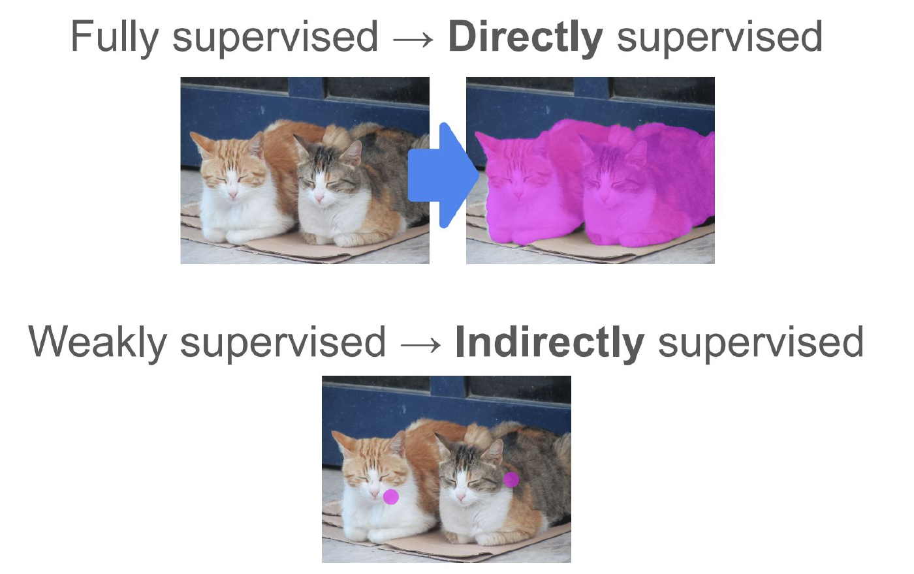

*위 줄이 fully, 아래 줄이 weakly야. 위에선 고양이 두 마리가 **같은 색 mask 하나**로 칠해져 있어. semantic segmentation은 class만 나누고 개체는 안 나누니까. 아래는 고양이마다 점 하나뿐이야. (p.4, slide credit: Rodrigo Benenson)*

### 1.2 There are only two sources of information: Priors & Hints (p.5)

**슬라이드 정의 (p.5)**:
- "**Priors**: what do I believe to be true **independent of any particular image sample**"
- "**Hints**: **indirect supervision** received **for each image**"

- weak label만으론 pixel 정답이 하나로 안 정해져. 모자란 정보를 채울 곳이 **딱 두 군데**라는 주장이야.
- **Prior** = 사진과 **상관없이** 참이라고 믿는 것. 데이터 전체, 세상 전체에 대한 믿음이야.
  - 예: "물체 경계는 사진의 edge와 겹친다", "고양이는 나무만큼 크지 않다".
- **Hint** = **사진마다** 따로 받는 간접 supervision. 사람이 그 사진을 보고 달아 준 약한 label이야.
  - 예: 이 사진의 image label "person, cat, door", 고양이 위에 찍은 점 하나.
- **구분 기준 하나만 외워**: 사진마다 다르면 **hint**, 사진과 무관하면 **prior**.
- p.4와 연결: hint의 정의에 "**indirect** supervision"이 들어가. weakly supervised = indirectly supervised였지.

| | 언제 정해지나 | 누가 주나 | 예 |
|---|---|---|---|
| **Prior** | 사진과 **무관** (미리 믿음) | 설계자의 가정, 다른 data | size, boundaries, saliency, class distribution |
| **Hint** | **사진마다** | annotator가 그 사진에 | image label, caption, click, box, scribble, eye gaze |

> 보충 (RL 비유, 시험 범위 아님): prior ↔ agent 설계에 박아 넣는 **inductive bias**(연속성, 물리 법칙 가정), hint ↔ episode마다 받는 **feedback**(sparse reward, 언어 지시, demonstration). 학습 신호가 약할수록 inductive bias에 더 기대게 되는 것도 같아.

### 1.3 Priors (p.6–10)

슬라이드는 단어 몇 개와 **일부러 이상하게 합성한 사진**만 보여 줘. 사진을 보고 "이상하다"고 느끼는 그 감각이 우리가 원래 갖고 있는 prior라는 뜻으로 읽으면 돼. (사진과 prior의 짝은 해석이야. 슬라이드엔 설명 문장이 없어.)

| prior (슬라이드 원문) | 뜻 | 슬라이드 그림 | 뒤에서 쓰이는 곳 |
|---|---|---|---|
| **Size, Location, Shape** (p.6) | 물체마다 그럴듯한 크기·위치·모양이 있어 | 나무만 한 고양이, 공중에 뜬 동그란 고양이 얼굴 | |
| **Number of instances, Contrast** (p.7) | 한 사진에 그 class 물체가 보통 몇 개 나오는지에 대한 믿음 (슬라이드엔 단어만 있어), 물체는 배경과 색·밝기가 달라 | 숲에 녹아든 고양이 한 마리, 무늬 배경 위 고양이 둘 | |
| **Boundaries, saliency** (p.8) | 물체 경계는 사진 edge와 겹치고, 눈에 띄는 영역이 물체일 가능성이 높아 | 사진 → edge 지도, 오토바이 → saliency heat map | SEC constrain-to-boundary (p.30–32) ← 연결은 해석, Oh et al. saliency (p.33–34) |
| **Class Distribution** (p.9) | data 전체에서 class가 어떤 비율로 나오나 | 고양이 여러 마리 + 차 1대 합성 사진 세 장, "⅔ Cats, ⅓ Cars" | |
| **Similarity across images** (p.10) | 같은 class는 여러 사진에 걸쳐 비슷하게 생겼어 | 비슷한 고양이들 "versus" 제각각인 의자들 | |
| **Similarity with external images** (p.10) | 학습 data 밖의 사진과도 닮은 점을 쓸 수 있어 | (해석) "(a) Input database + sparse annotations → (b) Annotation propagation" | Webly (p.43–52) ← 연결은 해석 |

**Size, Location, Shape (p.6)**
- (해석) 왼쪽 사진엔 나무만큼 큰 고양이가 있어 → **size** prior 위반.
- (해석) 오른쪽 사진엔 몸 없는 동그란 고양이 얼굴이 있고, 큰 얼굴은 나무 사이 공중에 떠 있어 → **location**, **shape** prior 위반.
- WSSS에선 이런 믿음을 mask 후보 중 "그럴듯한 것"을 고르는 기준으로 써.

**Number of instances, Contrast (p.7)**
- **Number of instances**: 한 사진에 그 class 물체가 보통 몇 개 나오는지에 대한 믿음이야. 몇 개가 "보통"인지는 슬라이드에 없어.
- **Contrast**: 물체는 대개 배경과 달라서 눈에 띄어. 왼쪽 사진처럼 배경에 녹아든 물체는 이 prior가 안 통하는 경우야.

**Boundaries, saliency (p.8)**
- **Boundaries**: 물체의 경계는 사진의 **edge(색이 급하게 바뀌는 선)** 와 겹친다는 믿음이야. 그림 왼쪽은 사진과 그 사진의 edge 지도야.
  - mask를 edge에 맞춰 다듬을 수 있어. (연결, 해석) 2.6의 SEC가 CRF로 "Encourage masks to align with image boundaries"(p.31) 하는 게 이 prior를 쓰는 예로 읽혀.
- **Saliency**: 사진에서 **눈에 띄는 영역**이 물체일 가능성이 높다는 믿음이야. 그림 오른쪽은 오토바이와 탄 사람 pixel만 빨갛고 배경은 파란 heat map이야 (class 구분 없이 눈에 띄는 영역 전체).
  - 이 saliency는 class를 몰라 (**class-agnostic**). 2.7의 Oh et al.이 "Saliency: Provides complete object extent, Class-agnostic foreground estimation"(p.34)으로 이걸 써.

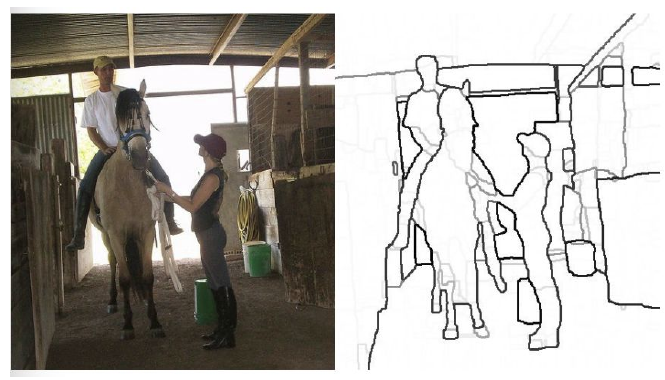

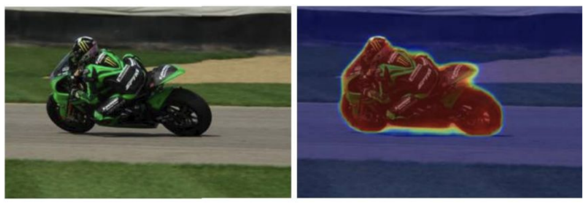

**⚠️ saliency 두 뜻 (시험 함정)**

| | p.8 · p.33–34의 saliency | p.21–22의 saliency map |
|---|---|---|
| 무엇 | 눈에 띄는 **물체 영역** | classifier 점수가 pixel마다 얼마나 **민감한가** |
| 어떻게 | 별도 saliency 추정 | class 점수의 **gradient** (Simonyan 2014, SmoothGrad) |
| class | **class-agnostic** (class 모름) | **class-specific** (한 class 점수에 대한 gradient라서; 슬라이드엔 "score"로만 적혀 있음) |
| 역할 | prior: 물체 전체 범위 | gray box 방법: localization 시도 |

**Class Distribution (p.9)**
- data 전체에서 class가 **어떤 비율**로 나오나에 대한 믿음이야. 그림 세 장엔 모두 고양이가 여러 마리(2–3)와 차 한 대가 있고, 글자는 "⅔ Cats, ⅓ Cars"야. 개수가 사진마다 달라서 정확한 ⅔는 그림에서 안 나와. 글자가 말하는 건 "고양이가 차보다 두 배 많다"는 믿음이야.
- 예측이 한 class로 쏠리는 걸 막는 기준이 될 수 있어.
- ⚠️ 6.1의 CD-CLIP도 "class distribution"이란 말을 써. 거기선 **patch 하나가 모든 class에 대해 갖는 점수 분포**라는 뜻이야 (p.65). 여기 p.9의 data 전체 class 비율과는 **다른 개념**이야.

**Similarity across images / with external images (p.10)**
- **Similarity across images**: 같은 class 물체는 **여러 학습 사진에 걸쳐 비슷하게** 생겼어. 여러 사진에 공통으로 나오는 모양이 물체일 가능성이 높아.
  - 왼쪽 그림의 "versus": 고양이는 사진마다 비슷하게 생겼는데 의자는 모양이 제각각이야. 이 prior가 class마다 잘 통하는 정도가 다르다는 뜻으로 읽혀 (해석).
- **Similarity with external images**: 학습 data **밖의** 사진(큰 database, web)과 닮은 점도 쓸 수 있어.
  - 오른쪽 그림: 일부 사진에만 태그("tree, sky, river, mountain" 등)나 pixel label이 있는 database에서, 닮은 사진끼리 "dense pixel correspondence"(pixel 단위 짝)를 찾아 label을 퍼뜨려 (annotation propagation).
  - (연결, 해석) 3장 Webly Supervised Learning이 external images를 **web 검색**으로 가져오는 방향으로 읽혀.

> 보충: 두 그림이 두 bullet 중 어느 쪽 예인지는 슬라이드에 안 적혀 있어. 왼쪽 = across images, 오른쪽 = external images로 짝지은 건 해석이야 (오른쪽은 한 database 안에서 퍼뜨리는 그림이라 across images 예로도 읽혀).

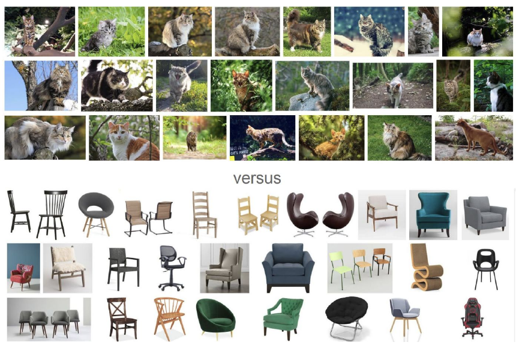

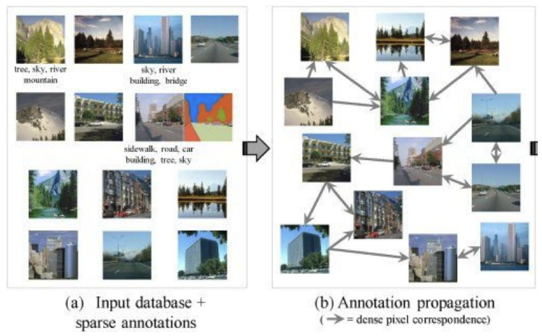

> 보충: L08 p.29–31에도 WSOD의 "Priors"로 Equivariance, Scale, Motion이 나왔어. 같은 발상이 detection과 segmentation에 다 쓰여. equivariance는 L09 p.35–36(SEAM)에서 다시 나와.

### 1.4 Hints (p.11–17)

hint는 **사진마다** 사람이 달아 주는 약한 label이야. 슬라이드는 같은 사진(여성과 고양이, p.11 · p.14)에 다른 hint를 달아서 비교하게 해.

| hint (슬라이드 원문) | 주는 정보 | 아직 모르는 것 | 뒤에서 쓰이는 곳 |
|---|---|---|---|
| **Image (video) label** (p.11–12) | 무엇이 있나: "Person, cat, door" | 위치, 개수, 모양 | 2장 전체 (p.18–42) |
| **Image caption** (p.11–12) | 무엇이 있나 + 관계: "Kattie holds the cat next to the door" | 위치, 모양. 문장에서 class를 뽑아야 함 | caption → multi-label (p.79–81) |
| **Click inside object** (p.13) | 물체 안쪽 점 하나: 대략 위치, 개수 | 범위(경계) | WISH의 point (p.87, 91) |
| **Object bound boxes** (p.14) | 위치 + 대략의 범위 | box 안 어느 pixel이 물체인지 | 4장 Boxly (p.53–60), WISH (p.87) |
| **Object extreme points** (p.15) | 가장 왼쪽·위·오른쪽·아래 점 4개 → box + 윤곽 위의 점 (그림 기준) | 나머지 윤곽 | |
| **Scribbles** (p.16) | 물체 위에 그은 선: 선 위의 pixel은 확실 | 경계 | |
| **Eye gaze** (p.17) | annotator가 쳐다본 곳 | (해석) 범위. 그림에선 말(language)이 class 정보를 같이 줘 | |

- 슬라이드는 이 목록을 **비용 순서로 정렬하지 않았어.** 비용 숫자는 L08 p.4에만 있어 (image label 1 sec per class, point 2.4, box 10, pixel 78 sec per instance).
- p.14의 "Object bound boxes"는 "bounding boxes"의 줄임 표기야 ← 원문 유지.

**Image (video) label, Image caption (p.11–12)**
- p.11과 p.12는 같은 슬라이드야.
- **image label**은 class 이름 목록만 줘. 이 강의 2장의 주인공이고, "image-level label → pixel-level label"이 그 제목이야.
- **caption**은 문장이야. class 말고도 관계(holds, next to)와 이름(Kattie)까지 담겨. 6.2의 web incremental learning 논문이 "A caption describes all visible objects", "Caption words are converted into image-level labels"(p.81)로 이걸 써.

**Click inside object (p.13)**
- 물체 **안쪽 아무 데나 점 하나**를 찍어. 점 색은 class를 나타내는 것으로 보여 (말 타는 사진: 사람 = 하늘색, 말 = 주황). 색-class 대응은 슬라이드에 설명이 없어.
- image label보다 정보가 많아: 위치를 대략 알려 주고, 물체마다 점을 찍으면 점 개수로 instance 수도 알 수 있어 (해석: 사람 둘 = 점 둘).
- 그래도 **어디까지가 물체인지(경계)** 는 몰라.

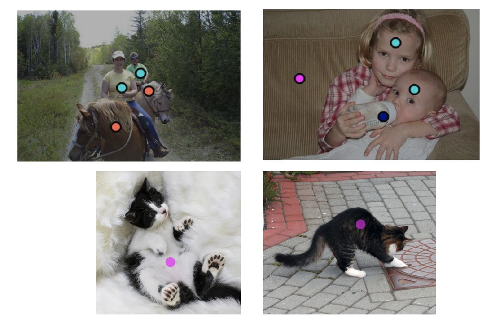

*사진 네 장 모두 물체 안쪽에 점만 찍혀 있어. 같은 색 점은 같은 class로 보여 (해석, 말 타는 사진: 사람 둘 = 하늘색 점 둘, 말 = 주황 점). 경계는 없고 위치만 있어. (p.13)*

**Object bound boxes (p.14)**
- box는 위치와 **대략의 범위**를 줘. p.14엔 "Person", "Human face", "Cat" box 세 개가 있어.
- 그래도 box 안엔 배경이 섞여 있고, box끼리 겹치기도 해 (Cat box가 Person box와 겹침). **box 안의 어느 pixel이 물체인지**는 몰라. 이게 4장 Boxly의 문제야.
- Person box와 Human face box처럼 **부분과 전체**에 box가 따로 달릴 수 있어. L08 p.11의 "Parts vs object"와 같은 구도야.

**Object extreme points (p.15)**
- 물체의 **가장 왼쪽, 가장 위, 가장 오른쪽, 가장 아래** 점 네 개를 찍어. (슬라이드엔 정의 문장이 없어. 그림의 점 4개와 표준 정의에 근거한 설명이야.)
- 네 점이면 box가 바로 나오고, 점들이 **물체 윤곽 위**에 있어서 box보다 모양 정보가 조금 더 있어.
- 그림 오른쪽은 네 점만 찍었는데 사람 모양 mask가 칠해진 결과야.

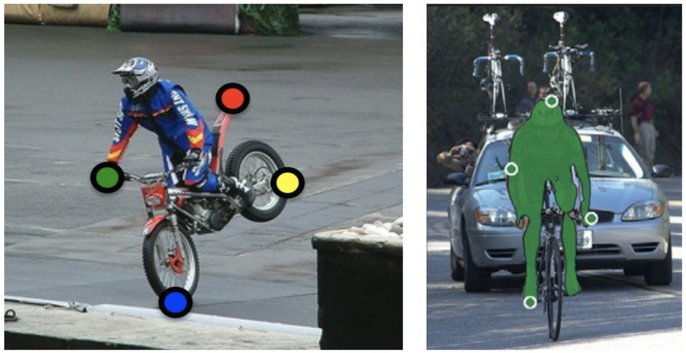

**Scribbles (p.16)**
- 물체 위에 붓으로 **대충 선을 그어**. 선이 지나간 pixel은 그 class라고 확실히 알 수 있어.
- point보다 label 붙은 pixel이 많지만, 여전히 **경계**는 안 그어. 선 밖은 모델이 퍼뜨려서 채워야 해.

**Eye gaze (p.17)**
- annotator가 물체를 **쳐다본 시선**을 hint로 써. 클릭조차 안 하고 보기만 해도 "어디 있나"의 단서가 생겨.
- 그림 왼쪽: 사람이 "A woman crossing the road from right to left along with a man"이라고 말하면서 화면을 봐. 말은 **Language Understanding**, 시선은 **Gaze Estimation**, 화면은 **Scene Understanding**으로 들어가서 그 사람의 box가 나와.
- 그림 오른쪽 네 줄: Descriptions → Video and Gaze → Intermediate Results(시선이 머문 곳 heat map) → Final Results(box).
- 그림의 결과는 segmentation mask가 아니라 **box**야. 시선이 hint로 쓰일 수 있다는 예시로 보면 돼.

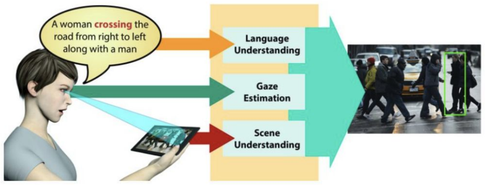

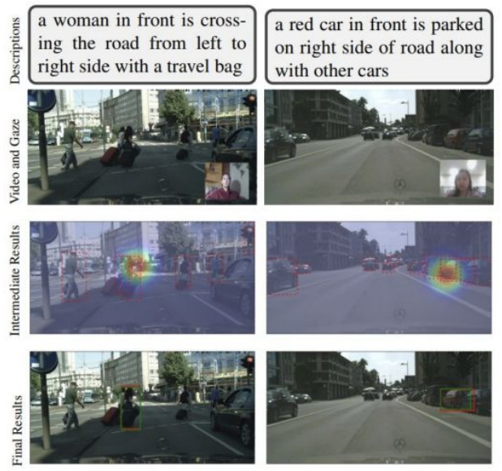

**하단 cite (p.11–17 공통)**: "[Verbeek CVPR 07, Vezhnevets ICCV 11, Xu CVPR 14, Pinheiro CVPR 15, Pathak ICLR 15, Papandreou ICCV 15, Kolesnikov ECCV 16, Wei CVPR 17, Singh ICCV 17]" ← 마지막 "Singh ICCV 17]"은 페이지 아래로 잘려 있어.
- 이 중 Kolesnikov ECCV 16 = SEC (2.6), Wei CVPR 17 = adversarial erasing (2.10)이야.
- Singh ICCV 17은 Hide-and-Seek 원 논문 표기와 맞아. p.37–38의 Hide-and-Seek 슬라이드 cite는 "Wang et al. CVPR 2020"으로 적혀 있어서 2.9에서 따로 짚어.

**1장 한 줄 정리**: weak label로 pixel mask를 만들려면 모자란 정보를 **prior**(사진과 무관한 믿음)와 **hint**(사진마다 받는 간접 supervision)로 채워. 2장부터는 hint 중 가장 싼 **image label**에서 출발해. (p.61 Summary: "Many priors and hints have been explored", "Exploit all available priors, explore new information sources")

> 보충 (RL 비유, 시험 범위 아님): hint 목록은 RL의 feedback 종류와 닮았어. image label ↔ episode 성공/실패, click·box ↔ 중요한 순간 표시(keyframe), scribble ↔ 일부 구간 demonstration, caption ↔ 언어 지시, eye gaze ↔ 사람 시선 data. 시선 data를 imitation learning 보조 신호로 쓰는 연구도 있어.
>
> 보충 (Physical AI 연결, 시험 범위 아님): 로봇에서 "컵을 집어"라는 언어 지시는 image label·caption 같은 hint야. 무엇인지는 말해 주지만 어느 pixel이 컵인지는 안 알려 줘. 그래서 weak label에서 pixel 위치를 찾는 이 강의의 질문이 grasping용 perception으로 이어져.

---

## 2. From Image-Level Labels to Pixel-Level Labels (p.18–42)

이 섹션이 강의의 중심이야. 질문은 하나야: **"이 사진에 사람과 자전거가 있다"는 image-level label만으로, 어느 pixel이 사람인지(pixel-level label)를 어떻게 얻나?**

흐름은 이렇게 가.

1. image label로 학습한 **classifier** 안을 들여다봐서 "어디를 보고 분류했나"를 꺼내. 방법이 두 갈래야: **gray box**(2.1–2.2)와 **white box**(2.3).
2. white box의 대표가 **CAM**이야. CAM을 threshold하면 확실한 영역인 **seed**가 나와 (2.4). 이게 segmentation 학습용 pixel label의 출발점이야.
3. 그런데 CAM은 **경계가 뭉개지고(not sharp)**, **분류에 결정적인 부분만(discriminative area only)** 잡아 (2.5).
4. 2.6–2.10이 두 문제를 하나씩 고치는 처방이고, 2.11이 정리야.

---

### 2.1 Two Main Approaches: Gray box vs White box (p.19–20)

**목표 (p.19)**: "**Image-level labels at training time**" → "**Pixel-level labels at test time**"

- **image-level label** = 사진 한 장에 붙은 class 이름 목록이야. 위치 정보가 없어. p.19 그림에선 "person, bicycle"이야.
- **pixel-level label** = pixel 하나하나에 class를 매긴 거야. semantic segmentation의 정답 형식이야.
- **semantic segmentation** = 모든 pixel을 class로 분류하는 task야. 같은 class 물체 두 개(사람 두 명)는 구분하지 않고 둘 다 "person"으로 칠해.
- L08의 weak supervision 정의를 segmentation에 적용한 거야: "Lower degree (or cheaper) annotation at train time than the required output at test time" (L08 p.4). train엔 class 이름, test엔 pixel mask야.

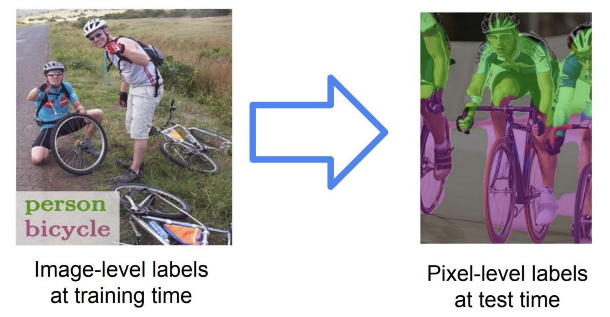

*왼쪽에서 오른쪽으로 읽어. 왼쪽 글자색(person = 초록, bicycle = 보라)이 오른쪽에서 칠한 색과 같아. 글자로만 준 class를 test 땐 pixel 영역으로 내야 해. 두 사진은 서로 다른 사진이야 (train 예시 하나, test 예시 하나). (p.19)*

**두 갈래 (p.20)**: image label로 학습한 classifier에서 위치 정보를 꺼내는 방법이 둘이야.

- **Gray box**: "Utilize the internal information in the network." / "In other words, it identifies which areas the model focused on for classification by leveraging the **activations or gradients** within the CNN."
  - 이미 학습한 classifier의 **구조는 그대로 두고**, 안쪽 정보를 들여다봐.
  - 정의엔 "activations **or** gradients"라고 둘 다 있어. 이 강의의 예시 두 개(2.2)가 gradient 기반일 뿐이야.
- **White box**: p.20엔 이름만 있고 설명이 비어 있어. 내용은 p.24–25에 나와 (2.3).
  - network **구조를 바꿔서** 처음부터 위치 정보가 남게 설계하고, class map을 forward 계산으로 바로 읽어.
- 이름 직관 (설명용): 안이 전혀 안 보이는 black box가 아니라 조금 엿보는 게 gray box, 구조 자체를 투명하게 만드는 게 white box야.

| | Gray box | White box |
|---|---|---|
| classifier 구조 | 그대로 둠 | 바꿈 (FC 제거, GAP + 1×1 conv) |
| 위치 정보를 꺼내는 법 | 안쪽 activation·gradient를 들여다봄 (예시는 gradient) | class map이 구조에서 바로 나옴 |
| map을 얻을 때 backward 계산 | 필요 (gradient 예시) | **별도 gradient 계산 불필요** ("without the need for separate gradient calculations", p.25). 학습엔 당연히 backprop을 써 |
| 슬라이드 예시 | Simonyan 2014, SmoothGrad 2017 | CAM (Zhou 2016) |

---

### 2.2 Gray box: gradient saliency와 SmoothGrad (p.21–23)

#### (a) Gradient saliency (p.21) — Simonyan et al., ICLR 2014 (workshop)

**한 줄**: class 점수를 입력 사진으로 미분해서, 점수에 영향이 큰 pixel을 찾는 방법.

**어떻게**
1. "Step 1) Train an ImageNet classifier."
2. "Step 2) Calculate how much the score changes when the input is slightly modified."
   - 그림 속 식: given an image with known label, compute $\left.\dfrac{\partial S_c}{\partial I}\right|_{I_0}$ ("how much does changes in the input image affect the score?") ← 원문 문법 그대로

**기호 풀이**
- $S_c$: class $c$의 점수 (softmax 전 값).
- $I$: 입력 사진. $|_{I_0}$는 "지금 보는 사진 $I_0$에서 계산한 값"이라는 뜻이야.
- $\partial S_c / \partial I$: 입력과 같은 크기의 지도야. pixel 하나를 살짝 바꾸면 점수가 얼마나 바뀌나(**sensitivity**)를 pixel마다 적은 거야. 값이 큰 pixel = 분류에 영향이 큰 pixel이라서 물체 쪽일 거라고 봐.
- 이렇게 만든 지도가 **saliency map**(눈에 띄는 곳 지도)이야.

**문제**: "The problem is that it is **extremely noisy**." / "This is because the gradient measures sensitivity at the level of **individual pixels**, resulting in a **"salt-and-pepper"** appearance."
- gradient는 pixel 하나 단위의 local 미분이라 이웃 pixel끼리 값이 들쭉날쭉해. 소금·후추를 뿌린 것처럼 점이 흩어져.

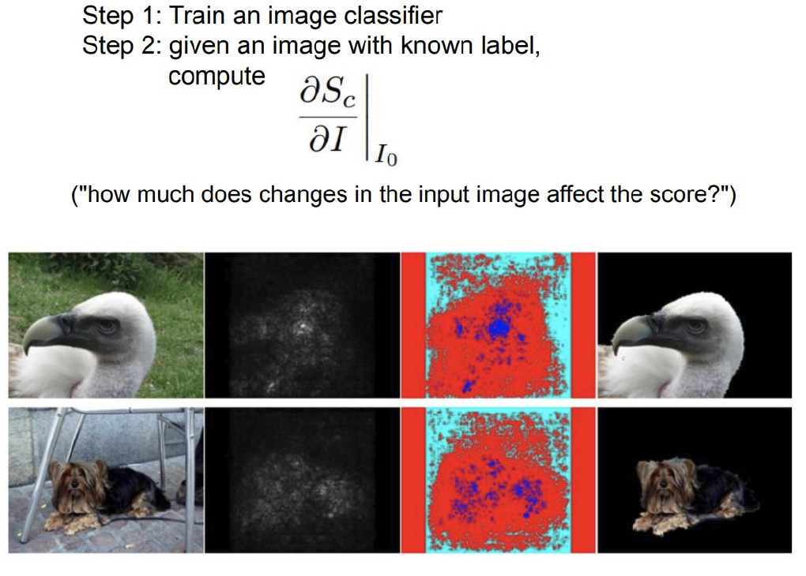

*왼쪽에서 오른쪽으로 읽어. 둘째 칸이 gradient saliency map이야. 아주 어두운 바탕에 희미한 점이 사진 전체에 흩어져 있어서 물체 윤곽이 또렷하지 않아 (salt-and-pepper). 셋째·넷째 칸은 이 지도로 segmentation까지 한 결과야. (p.21)*

> 보충 (논문, 슬라이드엔 그림만): 원 논문은 Simonyan, Vedaldi, Zisserman, "Deep Inside Convolutional Networks: Visualising Image Classification Models and Saliency Maps" (ICLR 2014 workshop)야. color channel 3개 중 gradient 절댓값이 가장 큰 값을 그 pixel의 saliency로 써. 그림 셋째 칸은 saliency가 높은 곳(파랑)으로 foreground 색 모델을, 낮은 곳(하늘색)으로 background 색 모델을 만들고, 빨강은 안 쓰는 영역이야. 그 색 모델로 GraphCut segmentation을 돌려서 넷째 칸을 얻어. "확실히 높은 곳 = 물체, 확실히 낮은 곳 = 배경, 중간은 안 씀"이라는 점에서 2.4의 seed와 같은 생각이야.

#### (b) SmoothGrad (p.22) — Smilkov et al., arXiv 2017

**한 줄**: noise를 섞어 gradient를 여러 번 재고 평균해서, salt-and-pepper를 지우는 방법.

**어떻게** (슬라이드 순서)
1. "Step 1) Training an Image Classifier" — "Train a standard CNN classifier."
2. "Step 2) Add small random noise to the images"
3. "Step 3) Calculate the gradient for each"
4. "Step 4) Average" — 그림 속 글: "**Repeat 50 times** step 2&3, **average result**"

슬라이드 설명: "This slide explains SmoothGrad. The key point is that calculating the gradient multiple times and averaging it removes noise and yields a more meaningful saliency map."

**식** (notes 보충, 슬라이드엔 단계만):
$$\hat M_c(I) = \frac{1}{n}\sum_{i=1}^{n} M_c\big(I + \epsilon_i\big),\qquad \epsilon_i \sim \mathcal N(0,\sigma^2)$$
- $M_c(\cdot)$: (a)의 gradient saliency map.
- $n$: 반복 횟수. 슬라이드 그림에선 **50**.
- $\epsilon_i$: 매번 새로 뽑는 작은 random noise. $\sigma$가 noise 크기야.

**왜 돼?** pixel 단위의 들쭉날쭉한 값은 noise마다 방향이 달라서 평균하면 서로 상쇄돼. 물체 쪽에서 일관되게 큰 값만 남아. 논문 제목 그대로 "removing noise by adding noise"야.

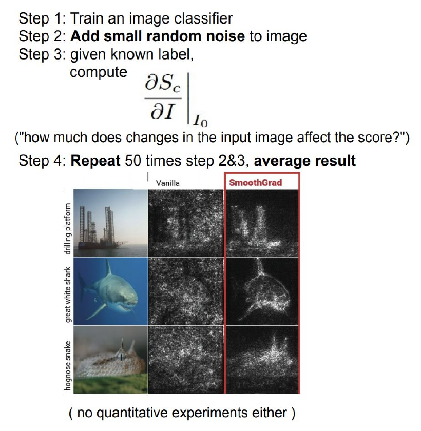

*가운데 Vanilla는 (a) 방식이라 사진 전체에 점이 흩어져 있어. 오른쪽 빨간 테두리 SmoothGrad에선 시추선·상어·뱀의 윤곽이 보여. (p.22)*

- 그림 아래 "( **no quantitative experiments either** )": 결과가 눈으로 본 그림뿐이고 수치 비교 실험은 없다는 꼬집음이야. 보기 좋아진 map이 segmentation을 실제로 얼마나 돕는지는 안 쟀다는 뜻이야. ← "either" = p.21 gradient saliency처럼 이것도 정성 그림뿐이라는 뜻으로 보여 (해석).

**차이**: Simonyan은 gradient를 **한 번** 재고, SmoothGrad는 noise를 섞어 **여러 번(50)** 재서 **평균**해. 둘 다 classifier 구조를 안 바꾸는 gray box야.

> RL 비유 (슬라이드 밖, 시험 범위 아님): $\partial S_c/\partial I$는 critic의 $\partial Q/\partial s$나 DDPG의 $\nabla_a Q$처럼 "입력을 살짝 바꾸면 출력이 얼마나 바뀌나"를 한 점에서 잰 local 미분이야. 한 점 미분이라 noisy해. SmoothGrad처럼 여러 sample의 gradient를 평균해 분산을 줄이는 건 REINFORCE에서 sample을 많이 모을수록 gradient 추정이 덜 흔들리는 것과 같은 동기야. 단 SmoothGrad의 noise는 입력에 일부러 넣는 거고, REINFORCE의 noise는 policy sampling에서 와.

#### (c) Key issue: "Asking apples from the oranges tree" (p.23)

- "Key issue: Asking apples from the oranges tree **Classifier was not built nor trained to segment objects.**"
- "Gradient-based saliency involves forcing localization using a classifier. Since the classifier was not originally trained for localization, it suffers from a **fundamental limitation**: it highlights **only the specific regions necessary for classification** rather than **the entire object**."

**풀이**
- 오렌지 나무한테 사과를 달라는 격이야. classifier는 분류하라고 만든 거지 segmentation하라고 만든 게 아니야.
- 분류엔 **결정적인 부분만** 봐도 충분해. 새라면 부리와 머리만 봐도 맞혀. 그래서 map도 거기만 밝히고 몸통은 빠져.
- **noise 문제와는 다른 문제야.** SmoothGrad가 noise를 지워도 이 한계는 그대로야.
- 이 한계는 white box(CAM)에도 그대로 이어져. 2.5의 "Focused on discriminative area only"가 같은 얘기고, L08의 discriminative part 문제(L08 p.35, 38)와도 뿌리가 같아.

---

### 2.3 White box: CAM, Class Activation Mapping (p.24–26) — Zhou et al., CVPR 2016

> 원 논문: Zhou, Khosla, Lapedriza, Oliva, Torralba, "Learning Deep Features for Discriminative Localization", CVPR 2016. 슬라이드 cite는 "[Zhou et al. 2016]".

**한 줄**: classifier 끝을 GAP + 선형 layer로 바꿔서, class 점수를 위치별 기여의 지도로 바로 펼쳐 보는 방법.

**문제**: gray box는 classifier가 위치 정보를 버리는 구조(FC layer)인 채로 gradient를 따로 계산해야 했고, 결과도 noisy했어.

**핵심**: 위치 정보가 끝까지 남는 구조로 classifier를 만들면, 분류에 쓴 weight를 feature map에 그대로 곱하기만 해도 class map이 나와.

#### (a) 구조 바꾸기 (p.24)

1. "Step 1) **eliminate the FC layer**"
2. "Step 2) add **GAP (Global Average Pooling)**"
3. "Step 3) add a **1×1 convolution** that performs a **linear combination** of the features"

- **FC(fully-connected) layer**: feature map을 한 줄로 펴서 모든 값을 섞는 layer야. 섞는 순간 "어느 위치에서 온 값인지"가 사라져. 그래서 없애.
- **GAP**: channel마다 feature map 한 장($H \times W$)의 **평균값 하나**를 내는 연산이야. channel이 $K$개면 길이 $K$ 벡터가 나와.
- **1×1 convolution**: 위치마다 같은 weight로 **channel끼리만** 섞는 conv야. 위치끼리는 안 섞어. class마다 weight 한 벌이 있어.
- 그림의 "N+1": 왼쪽에선 FC가 N+1번째 layer, 오른쪽에선 "1x1 Conv layer N+1"이 그 자리를 대신해. 출력 원 두 개(노랑, 보라)는 class 두 개의 점수야.

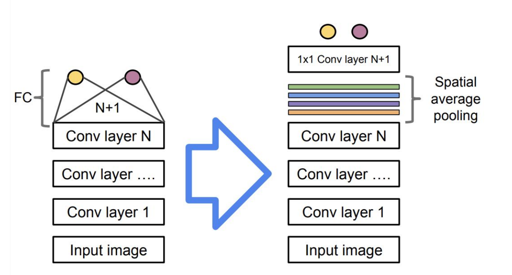

*아래에서 위로 읽어. 왼쪽 원래 classifier는 Conv layer N 위에 FC가 있어. 오른쪽은 FC를 빼고 "Spatial average pooling"(= GAP, 색 띠 하나가 channel 하나의 평균) 위에 1×1 conv를 얹었어. 위치를 섞는 layer가 사라진 게 핵심이야. (p.24)*

> 보충: 원 논문은 GAP 뒤에 "fully-connected layer"(softmax 출력)라고 적어. GAP로 공간이 1×1이 된 뒤엔 1×1 conv와 FC가 같은 연산이야. 그래서 슬라이드가 1×1 conv라고 불러도 같은 구조야.

#### (b) CAM 만들기 (p.25)

- 그림 위 줄 = 분류: 사진 → CONV들 → 마지막 conv의 feature map 여러 장 → **GAP** → weight $w_1, \dots, w_n$ → "Australian terrier".
- 그림 아래 줄 "Class Activation Mapping" = 같은 weight를 **feature map에 바로** 곱해서 더해: $w_1 * (\text{map}_1) + w_2 * (\text{map}_2) + \dots + w_n * (\text{map}_n) =$ **Class Activation Map**.
- 슬라이드 문장: "since the network itself is designed to **preserve spatial information**, activation maps can be obtained **directly without the need for separate gradient calculations**."

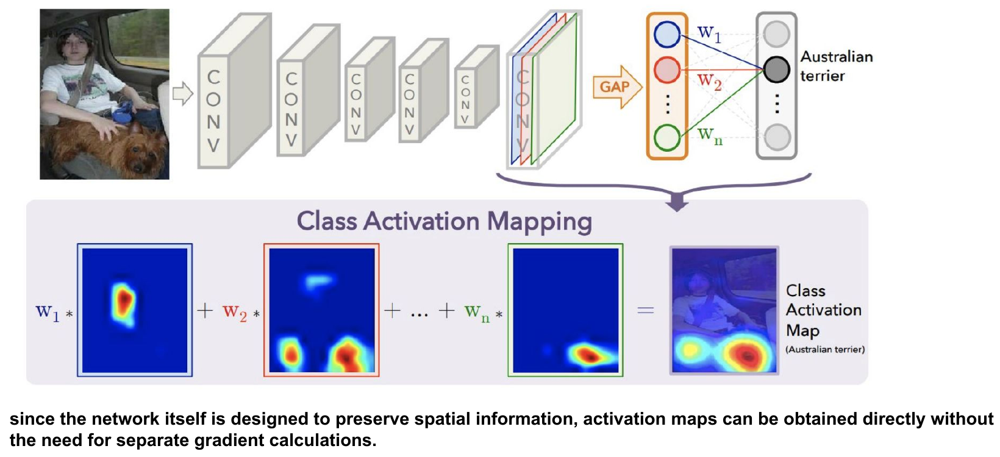

*위 줄이 분류, 아래 줄이 지도 만들기야. 위에서 class 점수에 쓴 weight $w_1, \dots, w_n$(색으로 짝지어 있어)을 가져다 아래에서 feature map에 곱하고 더해. 결과 지도에서 빨간 곳이 Australian terrier 점수에 가장 많이 기여한 곳이야. backward 계산은 없어. (p.25)*

**식** (notes 보충, 슬라이드엔 그림 속 $w_1 * \cdot + w_2 * \cdot + \dots =$ CAM만):
$$M_c(x,y) = \sum_{k=1}^{K} w_k^c\, f_k(x,y)$$
- $f_k(x,y)$: 마지막 conv의 $k$번째 feature map에서 위치 $(x,y)$의 값. $k$ = channel 번호, $K$ = channel 수.
- $w_k^c$: "$k$번째 feature가 class $c$에 얼마나 중요하냐"를 나타내는 weight. 그림의 $w_1, \dots, w_n$이야.
- $M_c(x,y)$: 위치 $(x,y)$가 class $c$ 점수에 기여한 양. 이 지도가 **CAM**이야.

**유도** (notes 보충, 한 줄씩):
1. GAP: $F_k = \dfrac{1}{Z}\sum_{x,y} f_k(x,y)$  ($Z$ = 위치 개수)
2. class 점수: $S_c = \sum_k w_k^c F_k$  (bias 생략, 아래 보충)
3. 대입: $S_c = \sum_k w_k^c \dfrac{1}{Z}\sum_{x,y} f_k(x,y)$
4. 합의 순서 바꾸기: $S_c = \dfrac{1}{Z}\sum_{x,y} \underbrace{\sum_k w_k^c f_k(x,y)}_{M_c(x,y)}$
5. 결론: **$S_c$ = CAM의 평균**이야. class 점수가 위치별 기여로 **정확히** 쪼개져.

- 4번이 가능한 이유: 평균(GAP)과 선형 결합($w$)이 **둘 다 선형**이라 순서를 바꿔도 결과가 같아. 그래서 "선형 결합 → 평균"으로 계산하면 중간에 $M_c$ 지도가 생겨. (보충) p.24 오른쪽 그림처럼 pooling과 1×1 conv가 붙어 있으면 4번의 순서 바꾸기가 가능해져.
- 원 논문은 GAP을 평균 대신 합 $\sum_{x,y}$로 적어. 상수배 차이라 결론은 같아.
- 원 논문은 softmax의 bias를 무시해(0으로 둬). 슬라이드엔 없는 내용이야. bias $b_c$가 있으면 $S_c$ = CAM 평균 + $b_c$라서, "점수 = CAM 평균"은 bias 없는 head에서만 정확해.
- 마지막 conv map은 입력보다 작아서(예: 14×14, p.29) 입력 크기로 **upsample**해서 사진 위에 겹쳐 봐.

**왜 gradient가 필요 없어?**
- 필요한 건 forward 때 이미 계산한 feature map $f_k$와 학습된 weight $w_k^c$뿐이야. 곱하고 더하면 끝이야. classifier를 **학습**할 땐 당연히 backprop을 써. "gradient 불필요"는 **map을 얻는 단계** 얘기야.
- gray box(2.2)는 $\partial S_c/\partial I$를 구하려고 backward를 한 번 더 돌려야 했어. SmoothGrad는 50번이야.
- 이게 "network itself is designed to preserve spatial information"의 뜻이야. 구조 덕분에 지도가 계산 과정 안에 이미 들어 있어.

**예시로 보면** (설명용 숫자, 슬라이드 수치 아님)
- feature map 2장($K = 2$), 크기 2×2:
  $f_1 = \begin{bmatrix}4&0\\0&0\end{bmatrix}$ (머리에 반응), $f_2 = \begin{bmatrix}0&0\\2&2\end{bmatrix}$ (털·다리에 반응)
- dog weight $w^{dog} = (1.0,\ 0.5)$, cat weight $w^{cat} = (-0.5,\ 1.0)$
- $M_{dog} = 1.0 f_1 + 0.5 f_2 = \begin{bmatrix}4&0\\1&1\end{bmatrix}$, $M_{cat} = -0.5 f_1 + 1.0 f_2 = \begin{bmatrix}-2&0\\2&2\end{bmatrix}$
- 확인: GAP $F = (1, 1)$ → $S_{dog} = 1.5$, $S_{cat} = 0.5$. $M_{dog}$ 평균 $= 6/4 = 1.5$, $M_{cat}$ 평균 $= 2/4 = 0.5$. 같아.
- 관찰 1: feature map은 같은데 weight만 바꾸면 지도가 달라져 → class마다 CAM이 하나씩 (c)
- 관찰 2: $M_{dog}$는 왼쪽 위(머리) 4가 압도적이야. threshold하면 머리만 남아 → 2.5의 "discriminative area only"

#### (c) Designed to Generate Per-Class Maps (p.26)

- 그림: 정답이 dome인 사진의 **top 5 예측 class**마다 CAM — palace 0.459, dome 0.195, church 0.146, altar 0.091, monastery 0.051.
- 캡션 원문: "Figure 4. Examples of the CAMs generated from the top 5 predicted categories for the given image with ground-truth as dome."

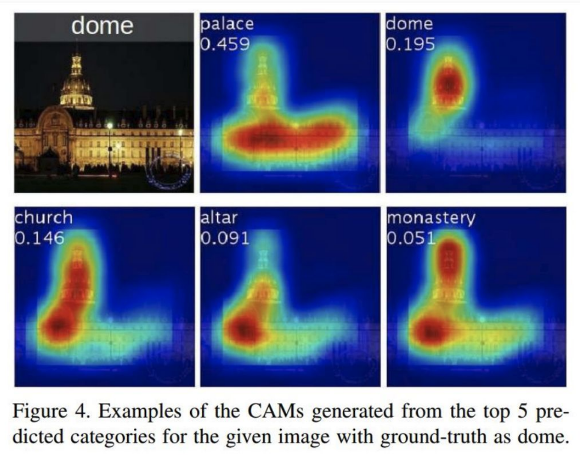

*칸 위 숫자는 그 class의 예측 확률이야. 같은 사진인데 palace CAM은 건물 아래 가로로 긴 부분, dome CAM은 위쪽 둥근 지붕이 빨개. class를 바꾸면 보는 곳도 바뀌어. (p.26)*

- 같은 feature map에 class별 weight $w^c$만 바꿔 곱하니까 **class마다 지도가 하나씩** 나와. 슬라이드 제목 "Designed to Generate Per-Class Maps"가 이 뜻이야.
- WSSS에선 image label에 있는 class마다 CAM을 하나씩 뽑으면 class별 위치 후보가 생겨.

**차이 (gray box와)**

| | Gradient saliency / SmoothGrad | CAM |
|---|---|---|
| 무엇을 보나 | $\partial S_c / \partial I$ (입력에 대한 gradient) | 마지막 conv **activation** × class weight |
| 구조 변경 | 없음 | FC 제거, GAP + 1×1 conv |
| map 계산 | backward 1번 (SmoothGrad는 50번 + 평균) | forward만 (classifier 학습엔 backprop 사용) |
| 해상도 | 입력 pixel 단위 (그래서 salt-and-pepper) | 마지막 conv 크기 (예: 14×14, 그래서 뭉개짐) |
| 공통 한계 | 분류에 필요한 부분만 밝힘 (p.23) | 같음: discriminative area only (p.28) |

> RL 비유 (슬라이드 밖, 시험 범위 아님): CAM은 class 점수를 위치별 기여의 합으로 쪼개. multi-agent RL의 VDN이 팀 value를 $Q_{tot} = \sum_i Q_i$처럼 agent별 value의 합으로 쪼개는 것과 같은 구조야. head가 선형이라 쪼개기가 정확한 것도 같아. "어느 위치가 점수를 벌었나"는 결국 credit assignment 질문이야.

---

### 2.4 Seeds: class map을 threshold해서 학습 data 만들기 (p.27)

슬라이드 제목: "**The Class Maps are Thresholded, to Generate Training Data**"

**한 줄**: CAM에서 확실히 높은 곳은 foreground, 확실히 낮은 곳은 background로 정해서 pixel label의 씨앗(seed)을 만들어.

**어떻게** (그림의 M1 → M2 → M3)
1. **M1: Global Average Pooling** — 사진 → CNN → feature map $\mathbf F$ → GAP → $\mathbf p^{gap}$ → weight $w_{1,k}, \dots, w_{C,k}$로 class "k: monkey" 점수.
2. **M2: Weighted Averaging** — $w_{1,k}\mathbf F_1 + w_{2,k}\mathbf F_2 + \dots + w_{C,k}\mathbf F_C = \mathbf M_k$ (= CAM).
3. **M3: Thresholding** — $\mathbf M_k$를 입력 크기로 resize해서 $\mathbf M'_k$ → $> \tau_{loc}$인 곳을 1로 둔 binary mask $\mathbf B_k$.

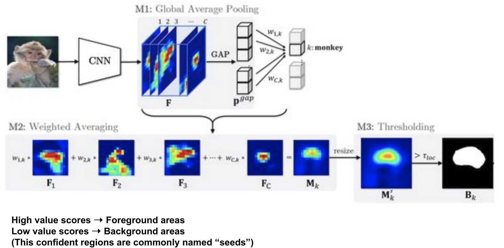

*위 줄 M1이 분류, 아래 줄 M2가 CAM 만들기, 오른쪽 M3이 threshold야. 이 그림에선 $C$가 feature **channel** 수고 $k$가 **class**(monkey)라서 2.3 식의 글자와 뒤바뀌어 있어. $\tau_{loc}$은 threshold야. (p.27)*

**슬라이드 문장**
- "**High value scores → Foreground areas**"
- "**Low value scores → Background areas**"
- "(This **confident regions** are commonly named **"seeds"**)" ← 원문 문법 그대로

**풀이**
- **seed** = 씨앗이야. 물체 전체가 아니라 "여기는 **확실히** 물체 / 확실히 배경"인 작은 영역이야.
- 이 seed가 image label에서 pixel label로 가는 **첫 다리**야. 뒤 방법들(2.6 SEC 등)은 seed를 경계 안에서 키워서 물체 전체를 덮으려고 해.
- **기호 함정**:
  - $\tau_{loc}$의 τ는 **threshold**야. temperature나 EMA 계수가 아니야 (중간고사 범위의 τ 세 의미에 하나 추가).
  - 이 그림의 $C$는 class 수가 아니라 channel 수야.

> 보충: 그림 M3은 threshold 하나로 binary mask를 만드는 localization 버전이야. WSSS에서 seed를 만들 땐 보통 높은 곳만 foreground, 낮은 곳만 background로 두고 **애매한 중간은 label을 비워 둬(ignore)**. 확신하는 pixel만 학습 target이 되게 하려는 거야. SEC의 seeding loss가 seed pixel에만 걸리는 이유야 (p.31).

> 보충: 그림의 M1/M2/M3(GAP · Weighted Averaging · Thresholding) 구성은 Bae et al., "Rethinking Class Activation Mapping for Weakly Supervised Object Localization" (ECCV 2020)이 CAM을 세 module로 나눈 방식과 같아. 다만 그림 출처는 확인 못 했어. 슬라이드 cite는 Zhou et al. 2016뿐이니까 시험엔 그걸 따라.

**예시로 보면** (설명용 숫자): normalize한 CAM 값이 0.9, 0.6, 0.3, 0.05인 pixel 네 개. foreground 기준 0.7, background 기준 0.1로 두면 → 0.9는 foreground seed, 0.05는 background seed, 0.6과 0.3은 label 없음. 학습 target은 두 pixel에만 생겨.

---

### 2.5 Good, but not good enough: 두 문제와 처방 지도 (p.28–29)

**두 문제 (p.28)**
1. "**Resulting masks are not sharp**"
2. "**Focused on discriminative area only**"

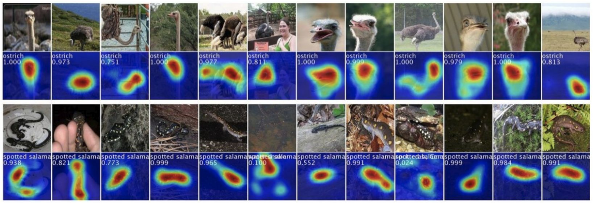

*위 두 줄은 타조 사진과 그 CAM, 아래 두 줄은 도롱뇽이야. 타조 CAM은 사진마다 한두 덩어리만 빨개. 머리·목에 뜨는 경우가 많고 몸통 한 곳에 뜨는 것도 있지만, 어느 쪽이든 새 전체 윤곽을 따라가지 않아. 도롱뇽도 몸의 한 덩어리만 빨개. 덩어리 모양도 둥글게 뭉개져 있어. (p.28)*

- **not sharp** = CAM이 둥근 blob 모양이라 물체 경계를 못 따라가.
- **discriminative area only** = 그 class를 다른 class와 구별하는 데 결정적인 부분만 빨개. 예를 들면 타조의 긴 목과 머리 같은 곳이야 (설명용 예시). classifier는 거기만 봐도 맞히니까 나머지에 반응할 이유가 없어 (2.2 (c)의 "fundamental limitation"과 같은 뿌리).
- 두 문제는 원인이 달라.
  - not sharp는 **해상도와 경계 정보**가 모자라서야.
  - discriminative only는 **분류 loss가 그걸로 충분해서**야.

**처방 1-a: Increase top layers resolution (p.29)**
- "1. Resulting masks are not sharp → **Increase top layers resolution**"
- 그림: CAM network에서 마지막 쪽 작은 conv를 동그라미 치고 "**14x14 pixels**". ← 파란 원은 색칠된 마지막 feature map 바로 앞의 작은 CONV block을 가리켜. 의도는 "top layers의 map이 14×14로 거칠다"야.
- CAM은 마지막 conv의 feature map에서 나오는데, 그게 14×14밖에 안 돼. 입력(예: 224×224)보다 훨씬 거칠어서 upsample해도 경계가 뭉개져. 그래서 위쪽 layer의 해상도를 키우면(feature map을 덜 줄이면) CAM이 촘촘해져.
- 슬라이드엔 cite도, 구체적인 방법도 없어.

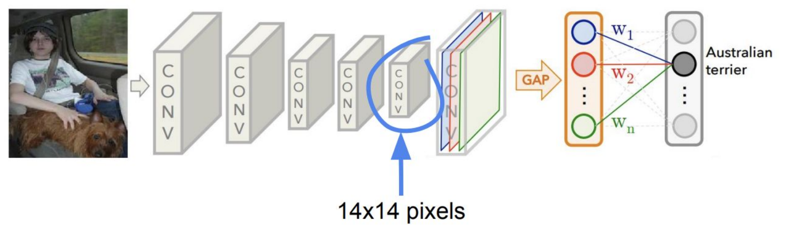

*p.25와 같은 network 그림이야. top layer의 map이 14×14라서(파란 동그라미), CAM도 14×14 해상도밖에 안 돼. (p.29)*

> 보충 (시험 범위 아님): 해상도를 키우는 흔한 방법은 마지막 몇 layer의 stride를 줄이거나 dilated(atrous) convolution을 쓰는 거야. 슬라이드엔 없는 내용이야.

**처방 지도 (p.29–41)**: 이후 슬라이드는 두 문제 줄을 반복하면서 "⇢ 처방"을 하나씩 붙여.

| 문제 | 처방 (슬라이드 문구) | 방법 | 페이지 | 이 노트 |
|---|---|---|---|---|
| 1. not sharp | Increase top layers resolution | (cite 없음) | p.29 | 2.5 |
| 1. not sharp | Use boundary-aware propagation | SEC (Kolesnikov & Lampert, ECCV 2016) | p.30–32 | 2.6 |
| 1. not sharp | Use transfer learning / "We could also use saliency cues" | Saliency-guided (Oh et al., CVPR 2017) | p.33–34 | 2.7 |
| 1. not sharp | Enforce equivariance / "Activation maps should be equivariant to the input" | SEAM (Wang et al., CVPR 2020) | p.35–36 | 2.8 |
| 2. discriminative only | Randomly hide image patches / "Let us play peek-a-boo!" | Hide-and-Seek (슬라이드 cite 확인은 2.9) | p.37–38 | 2.9 |
| 2. discriminative only | "Let us play adversarial peek-a-boo!" | Adversarial Erasing (Wei et al. 2017) | p.39–41 | 2.10 |

- 슬라이드가 SEC를 1번 처방 자리에 놓았지만, SEC의 Expansion Loss는 seed를 넓히니까 2번 문제에도 손을 대 (p.31 CAM limitations에 "Focus only on discriminative regions"가 같이 적혀 있어). 표의 분류는 슬라이드 화살표 위치 기준이야.
- 같은 이유로 Saliency-guided(p.34)도 saliency가 "complete object extent"를 준다고 해서 2번 문제와도 이어져. 세부는 2.6–2.10에서 봐.

### 2.6 SEC: Seed, Expand, Constrain (p.30–32) — Kolesnikov & Lampert, ECCV 2016

> 원 논문: "Seed, Expand and Constrain: Three Principles for Weakly-Supervised Image Segmentation" (ECCV 2016). slide cite와 일치해.

**한 줄**: CAM에서 확실한 곳만 seed로 쓰고(**Seed**), image label로 그 seed를 물체 전체로 키우고(**Expand**), CRF로 이미지 경계에 맞추는(**Constrain**) segmentation network 학습법이야.

**문제**: CAM을 threshold로 잘라 만든 seed(p.27)를 그냥 pixel label처럼 쓰면 세 가지가 걸려. 슬라이드는 이걸 "CAM limitations"로 정리했어 (p.31).
- "Activation maps are small and coarse" ← p.28의 1번 "not sharp"
- "Focus only on discriminative regions" ← p.28의 2번
- "Poor object boundaries" ← 1번

**핵심**: 문제마다 loss를 하나씩 둬. "Three complementary losses" (p.31)야.

| loss | 슬라이드 원문 (p.31) | 맡는 문제 | 쉽게 말하면 |
|---|---|---|---|
| **Seeding loss** | "Use CAM as reliable foreground seeds", "Preserve highly confident object regions" | 어디서 시작하나 | seed가 찍힌 pixel에서만 "이 pixel은 이 class야"라고 학습해 |
| **Expansion loss** | "Encourage predictions to expand beyond the seeds", "Use image-level labels via Global Weighted Rank Pooling (GWRP)" | discriminative only | seed 바깥으로 넓히는 힘이야. pixel label 대신 image label을 써 |
| **Constrain-to-boundary loss** | "Refine predictions using CRF", "Encourage masks to align with image boundaries" | not sharp, poor boundaries | 출력을 CRF로 다듬은 버전을 target으로 두고 따라가게 해 |

슬라이드 박스 요약도 그대로 외워 둬 (p.31):
- "Seed: Preserve reliable CAM activations."
- "Expand: Grow seeds to cover the entire object using image-level supervision."
- "Constrain: Refine object boundaries with CRF-based regularization."

**어떻게** (p.30 그림 순서):
1. 사진이 **Segmentation CNN**에 들어가서 pixel마다 class 확률 지도가 나와. 학습되는 건 이 network 하나야.
2. 위쪽 갈래: **Weak Localization**이 seed 지도를 만들어. 그림에서 분홍 = Person, 초록 = Cow, 남색 = Background고, 회색 체크무늬는 label이 없는 pixel이야. → **Seeding loss**
   > 보충 (논문 보충): foreground seed는 CAM을 max의 20%에서 threshold해서 만들고, background seed는 별도의 gradient-based saliency(Simonyan et al.)에서 가장 덜 눈에 띄는 10%를 골라 만들어. 슬라이드는 "Use CAM as reliable foreground seeds"까지만 말해.
3. 가운데 갈래: 예측 지도를 **GWRP**로 class별 image 점수로 모아. 그 점수를 image label(Person, Cow 태그)과 비교해. → **Expansion loss**
4. 아래 갈래: 사진을 줄인 것(Downscale)과 예측 지도를 **CRF**에 넣어 경계에 맞춘 mask를 얻어. 예측이 그 mask를 닮게 해. → **Constrain-to-boundary loss**
5. 세 loss를 더해(⊕) gradient를 Segmentation CNN으로 보내.

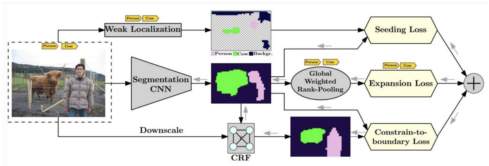

**GWRP(Global Weighted Rank Pooling)는 뭐야?**
- pixel 점수를 큰 순서로 줄 세운 다음, 순위가 내려갈수록 작은 weight를 줘서 평균 내는 pooling이야.
- 양 끝과 비교하면 왜 필요한지 보여.
  - **max pooling**: 1등 pixel만 봐. discriminative part 하나만 세게 켜도 image 점수가 높아. 넓힐 이유가 없어.
  - **average pooling(GAP)**: 모든 pixel을 똑같이 봐. 작은 물체도 사진 전체를 덮어야 점수가 높아져. 너무 넓히게 돼.
  - **GWRP**: 그 중간이야. 상위 1–2개가 아니라 꽤 많은 pixel이 높아야 점수가 높아. 그래서 seed 바깥으로 적당히 넓혀.
- L08 p.22의 max → log-sum-exp 완화와 같은 계열의 생각이야. "1등 하나만 보지 말고 여러 개를 살려"야.

> 보충 (논문 보충, 슬라이드엔 식이 없음): $f_{u,c}(X)$ = 위치 $u$가 class $c$일 확률, $T$ = 사진에 있는 class 집합, $S_c$ = class $c$의 seed 위치 집합.
> $$L_{seed} = -\frac{1}{\sum_{c\in T}|S_c|}\sum_{c\in T}\sum_{u\in S_c}\log f_{u,c}(X)$$
> ← seed 위치에서만 cross-entropy. seed가 없는 pixel은 아무 신호도 안 받아.
> $$G_c(f(X); d_c) = \frac{1}{Z(d_c)}\sum_{j=1}^{n}(d_c)^{j-1} f_{i_j,c}(X),\qquad Z(d_c)=\sum_{j=1}^{n}(d_c)^{j-1}$$
> ← $f_{i_1,c}\ge f_{i_2,c}\ge\dots$로 내림차순 정렬. $d_c=0$이면 max pooling, $d_c=1$이면 average pooling이야. $0<d_c<1$이면 그 사이.
> 논문 값: $d_-=0$(없는 class, max), $d_+=0.996$(있는 foreground class), $d_{bg}=0.999$. 논문은 max는 물체 크기를 작게(underestimate), average는 크게(overestimate) 잡는다고 설명해.
> - Expansion: 사진에 있는 class(background 포함)는 $-\log G_c$로 점수를 키우고, 없는 class는 $-\log(1-G_c)$로 낮춰. class 종류마다 pooling 계수 $d$를 다르게 써 (없는 class는 $d=0$ = max pooling, background는 foreground보다 **큰** $d$ = average 쪽에 더 가까워 ($d_{bg}=0.999 > d_+=0.996$)).
> $$L_{constrain} = \frac{1}{n}\sum_{u=1}^{n}\sum_{c} Q_{u,c}(X, f(X))\log\frac{Q_{u,c}(X, f(X))}{f_{u,c}(X)}$$
> ← CRF 출력 $Q$를 target으로 둔 KL divergence. $Q$는 network 출력 $f$에 CRF를 돌려 만든 거야. CRF엔 학습되는 weight가 없지만, 논문은 CRF를 거쳐서도 gradient를 흘려 ("For computing gradients of the fully-connected CRF we employ the procedure from [34]", 논문 Sec. 3.2). p.30 그림의 회색(gradient) 화살표도 CRF를 지나가. 그래서 stop-gradient target과는 달라.
> - 전체: $L = L_{seed} + L_{expand} + L_{constrain}$

**예시로 보면** (설명용 숫자, 슬라이드 수치 아님): pixel 5개, $d = 0.5$라 weight는 $[1, 0.5, 0.25, 0.125, 0.0625]$, 합 $Z = 1.9375$야.
- 물체가 2 pixel만 켜진 경우 $[0.9, 0.9, 0, 0, 0]$: max = 0.9, GWRP = $0.9 \times 1.5 / 1.9375 \approx 0.70$
- 물체가 4 pixel로 넓어진 경우 $[0.9, 0.9, 0.9, 0.9, 0]$: max = 0.9, GWRP = $0.9 \times 1.875 / 1.9375 \approx 0.87$
- max는 두 경우가 같아서 넓힐 이유가 없어. GWRP는 넓어질수록 점수가 올라서, expansion loss가 넓히는 쪽으로 밀어.

**왜 돼?**
- seed는 좁지만 거의 맞아. 그래서 seed에선 강하게 학습해도 안전해.
- seed 밖은 정답을 모르니까 pixel 단위로 강요하지 않아. 대신 "image 점수가 높으려면 꽤 넓어야 한다"는 약한 압력만 줘.
- 넓히다 보면 경계를 넘어가기 쉬워. CRF가 색 경계를 기준으로 거기서 멈추게 해.

**차이**
- p.27의 seed를 그대로 pixel label로 쓰면 seed 밖은 정보가 없어. SEC는 seed 밖까지 image label로 학습 신호를 줘.
- p.30은 SEC를 "1. not sharp"의 처방("Use boundary-aware propagation")으로 소개해. 하지만 expansion loss는 2번(discriminative only)도 겨냥해. p.31이 세 limitation을 다 적은 이유야.
- CRF는 L08 p.25 pairwise CRF와 이름만 같고 쓰임이 달라. L08에선 node = image라서 사진끼리 닮은 window를 같이 고를 때 썼고, 여기선 node = pixel이라서 색과 위치가 가까운 pixel끼리 label을 맞출 때 써.

> 보충 (RL 비유, 슬라이드 밖 = 시험 범위 아님): GWRP weight $d^{j-1}$은 discount $\gamma^{t}$와 모양이 같아. $d=0$이면 1등만 보는 myopic($\gamma=0$), $d=1$이면 전부 똑같이 보는 $\gamma=1$이야. Constrain loss는 "CRF로 개선한 출력을 target으로 두고 KL로 distill"하는 구조야. AlphaZero가 MCTS로 개선한 policy를 network가 따라가게 하는 것과 닮았어.

---

### 2.7 Saliency-guided Weak Supervision (p.33–34) — Oh et al., CVPR 2017

> 원 논문: "Exploiting Saliency for Object Segmentation from Image Level Labels" (Oh, Benenson, Khoreva, Akata, Fritz, Schiele, CVPR 2017). slide cite와 일치해.

**한 줄**: 다른 data로 미리 학습한 **saliency** 모델에서 "물체가 어디까지인가"를 빌려 오고, CAM에서 "그게 무슨 class인가"를 빌려 와서 둘을 합쳐 pseudo mask를 만들어.

먼저 용어:
- **saliency(map)** = 사진에서 눈에 띄는 물체(foreground)가 어디인지 나타내는 지도야. class 이름은 몰라.
- **pseudo mask** = 사람이 그린 게 아니라 다른 단서로 만든 pixel label이야. segmentation network의 학습 target으로 써.

**문제**: CAM은 discriminative part만 켜고 경계도 흐려 (p.28). image label엔 범위 정보가 전혀 없어.

**핵심**: 두 단서의 장단점이 정확히 반대야 (p.34 "Observation").

| | CAM | Saliency |
|---|---|---|
| class를 아나 | "Provides **class-specific** localization" | "**Class-agnostic** foreground estimation" |
| 범위 | "Covers only discriminative regions" | "Provides **complete object extent**" |

그래서 "Combine CAM and saliency to generate class-specific pseudo masks" (p.34).

**어떻게** (p.34 박스 "Saliency-guided Weak Supervision"):
1. **Seeder**: "Generate class-specific seeds from CAM." classifier의 CAM에서 class별 seed를 뽑아.
2. **Saliency**: "Estimate foreground regions." saliency 모델로 foreground를 추정해.
3. **Guide Labeller**: "Fuse both cues into pseudo masks." seed가 class를 정하고, saliency가 그 덩어리의 범위를 정해.
4. **Segmentation CNN**: "Learn dense pixel-wise predictions." pseudo mask를 target으로 학습해 (그림의 Dense classifier loss).

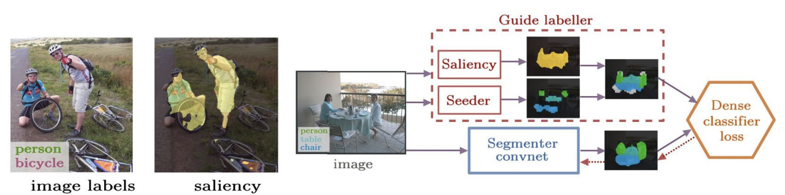

**왜 "transfer learning"이야?** p.33은 이 방법을 "1. not sharp → Use transfer learning"으로 소개해. saliency 모델은 이 task data가 아니라 다른 data로 미리 학습된 거야. 그 모델이 배운 "물체의 모양과 경계"를 가져다 쓰니까 transfer야. 슬라이드 인용구는 "We could also use saliency cues" (p.33)야.

**예시로 보면** (p.33 그림): image label은 "person, bicycle"뿐이야. saliency는 사람과 자전거 전체를 노랗게 칠해 주지만, 어느 쪽이 person인지는 안 말해 줘. CAM seed가 사람 위에 person 점을, 자전거 위에 bicycle 점을 찍어 주면 둘을 나눌 수 있어.

**차이**
- SEC(2.6)는 seed를 **loss로** 넓혀. 이 방법은 넓힌 pseudo mask를 **학습 전에** 만들어 놓고 평범하게 학습해.
- SEC가 쓰는 외부 단서는 CRF(색 경계)야. 여기선 학습된 saliency 모델이야.
- 한계 (해석): saliency는 눈에 띄는 물체만 잡아. 배경 쪽 class나 눈에 안 띄는 물체엔 약해.

> 보충 (논문 보충): 논문은 이 조합으로 fully supervised 성능의 약 80%를 얻었다고 보고해. 슬라이드엔 수치가 없어.

---

### 2.8 SEAM: Self-supervised Equivariant Attention Mechanism (p.35–36) — Wang et al., CVPR 2020

> 원 논문: "Self-supervised Equivariant Attention Mechanism for Weakly Supervised Semantic Segmentation" (CVPR 2020). slide cite와 일치해. 이름의 약자는 **S**elf-supervised **E**quivariant **A**ttention **M**echanism이야.

먼저 용어:
- **equivariance(등변성)** = 입력을 변환하면 출력도 **같은 방식으로** 변환된다는 성질이야. $A$를 affine 변환(크기 조절, 뒤집기, 회전 등), $F$를 network라고 하면
$$F(A(I)) = A(F(I))$$
- **invariance(불변성)** 와 구분해. invariance는 $F(A(I)) = F(I)$, 즉 입력을 변환해도 출력이 **안 변해**.
  - 분류는 invariant해야 해. 비행기를 줄여도 답은 "airplane"이야.
  - segmentation과 CAM은 equivariant해야 해. 비행기를 줄이면 mask도 같이 줄어야 해.
- **affine 변환** = 크기 조절, 회전, 뒤집기, 이동처럼 직선을 직선으로 보내는 기하 변환이야.

**한 줄**: 원본 사진과 변환한 사진의 CAM이 "변환만큼만 다르게" 나오도록 classifier를 학습시켜서, CAM을 더 일관되고 완전하게 만들어. "Activation maps should be equivariant to the input" (p.35).

**문제** (p.36 "CAM Limitation"):
- "CAMs are often coarse and inconsistent"
- "Small input transformations can produce different activation maps"
- p.35 왼쪽 그림이 이걸 보여 줘. 같은 비행기를 크기만 바꿔 넣었는데 CAM 모양이 크기마다 달라. SEAM 지도는 세 크기 모두 비행기 모양을 비슷하게 따라가.

**핵심** (p.36 "Key idea: Enforce Equivariance"):
- "Apply geometric transformations (e.g., affine transform)"
- "Predict CAMs for both original and transformed images"
- "Enforce consistency after compensating for the transformation"
- 마지막 줄의 **compensating**이 중요해. 원본 CAM과 변환본 CAM은 크기가 달라서 그냥 비교하면 안 맞아. 원본 CAM에 같은 변환 $A$를 걸어 준 다음 비교해.

**어떻게** (p.35 오른쪽 그림):
1. 사진 $I$와 변환한 사진 $A(I)$를 **weight를 공유하는** CNN 두 갈래에 넣어. 이게 **Siamese network**야 (위 = 원본, 아래 = 변환본).
2. 각 갈래에서 CAM $\hat y$를 만들어. 원본 쪽 $\hat y^o$, 변환본 쪽 $\hat y^t$야.
3. 각 CAM을 **PCM**에 넣어 다듬은 CAM $y$를 만들어 ($y^o$, $y^t$).
4. 세 loss로 학습해.

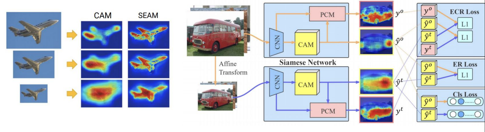

**PCM(Pixel Correlation Module)** (p.36 원문): "a module that propagates CAM activations to other pixels within the same object by utilizing pixel-wise affinity among CNN features."
- **affinity** = 두 pixel이 같은 물체에 속할 것 같은 정도야. 여기선 CNN feature가 비슷할수록 높아.
- PCM은 강하게 켜진 pixel(예: 비행기 앞부분)의 값을 feature가 비슷한 pixel(날개, 꼬리)로 퍼뜨려. 그래서 CAM이 물체 전체 쪽으로 넓어져.

**Training objective** (p.36):

| loss | 슬라이드 원문 | 비교하는 것 (p.35 그림) |
|---|---|---|
| **Classification loss** | "Preserve image-level classification performance" | $\hat y^o$, $\hat y^t$ → class 점수 vs image label |
| **ER loss** (Equivariant Regularization) | "Encourage transformation-consistent CAMs" | $\hat y^o$ ↔ $\hat y^t$ (L1) |
| **ECR loss** | "Cross-view Consistency (ECR) Loss: Align CAMs across different views" ← 약자와 풀네임이 안 맞아. 논문 표기는 **E**quivariant **C**ross **R**egularization | $y^o$ ↔ $\hat y^t$, $\hat y^o$ ↔ $y^t$ (L1 두 개) |

> 보충 (논문 보충, 슬라이드엔 식이 없음):
> $$L_{ER} = \|A(\hat y^o) - \hat y^t\|_1,\qquad L_{ECR} = \|A(y^o) - \hat y^t\|_1 + \|A(\hat y^o) - y^t\|_1$$
> $$L = L_{cls} + L_{ER} + L_{ECR}$$
> - ER은 원본 CAM끼리, ECR은 PCM 출력과 **반대 갈래의** 원본 CAM을 엇갈려 비교해. 논문은 PCM 출력끼리만 맞추면 모든 pixel이 한 class로 쏠리는 local minimum에 빠져서 ECR을 넣었다고 설명해.
> - 논문의 출발점: fully supervised segmentation에선 data augmentation 때 pixel label도 같이 변환되니까 equivariance가 저절로 걸려. image-level label은 사진을 변환해도 안 바뀌어서 그 제약이 없어.

**왜 self-supervised야?** 변환 $A$는 우리가 직접 걸었어. 그래서 "$A(I)$의 CAM은 $I$의 CAM에 $A$를 건 것과 같아야 한다"는 정답 관계를 사람 label 없이 알아. 그 관계가 supervision이야.

**차이**
- L08 p.29의 Equivariance prior와 같은 원리야 ("The predicted output should be equivariant to image transformations"). L08은 detection 출력에, SEAM은 CAM에 걸어.
- SEC는 출력 지도를 바깥 연산(GWRP, CRF)으로 고치고, SEAM은 **classifier 자체**를 consistency loss로 학습시켜서 CAM을 고쳐.
- p.35는 SEAM을 "1. not sharp"의 처방("Enforce equivariance")으로 소개해. PCM이 값을 퍼뜨리는 효과는 2번에도 도움이 돼.

> 보충 (RL 비유, 슬라이드 밖 = 시험 범위 아님): DrQ · RAD 같은 image augmentation RL은 Q 값이 augmentation에 **invariant**하게 만들어. SEAM은 지도가 변환을 **따라가게**(equivariant) 만들어. pick-and-place처럼 출력이 이미지 위 heatmap인 policy라면 필요한 건 equivariance야.

---

### 2.9 Hide-and-Seek: random hiding (p.37–38) — Singh & Lee, ICCV 2017 ← slide엔 "Wang et al. CVPR 2020"

> 원 논문: "Hide-and-Seek: Forcing a Network to be Meticulous for Weakly-supervised Object and Action Localization" (Singh & Lee, ICCV 2017, 웹 확인). p.37–38 슬라이드 cite는 "[Wang et al. CVPR 2020]"인데, p.35–36 SEAM의 cite가 그대로 남은 걸로 보여. 시험 지문은 슬라이드 표기를 따를 수 있어.

**한 줄**: 학습할 때마다 사진의 칸 몇 개를 **무작위로** 가려서, classifier가 가장 쉬운 부분 하나에만 기대지 못하게 해.

**문제**: "CAM activates only the most discriminative regions." (p.37) classifier는 개 얼굴만 봐도 "dog"를 맞혀. 그러니 CAM도 얼굴만 켜져.

**핵심** (p.37 "Solution (Hide-and-Seek)"):
- "Randomly hide image patches during training."
- "Encourage learning from the remaining visible parts."
- "Generate more complete localization maps."

**어떻게** (p.37 그림):
1. 학습 사진(가로 W, 세로 H)을 한 변이 S인 칸들의 격자로 나눠.
2. 매 epoch마다 칸을 무작위로 골라 가려. Epoch 1, Epoch 2, …, Epoch N마다 가려지는 칸이 달라.
3. 가려진 사진으로 평범하게 classification을 학습해.

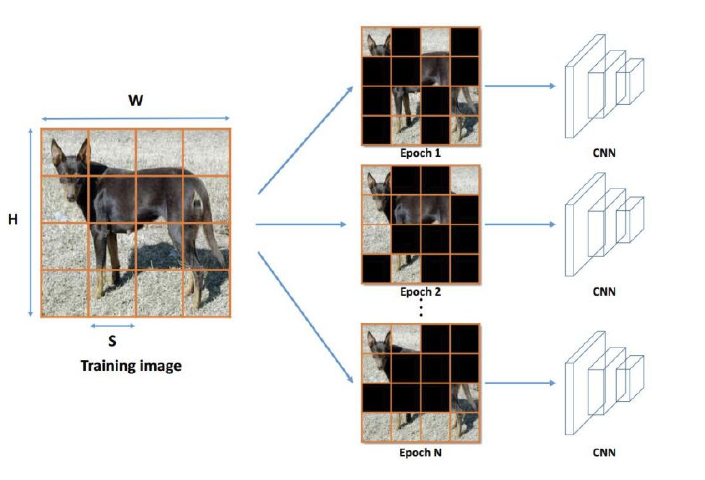

**왜 돼?** (p.37 "Effect")
- "The classifier is forced to discover other visible object parts."
- "CAM gradually covers a larger portion of the object."
- 얼굴 칸이 가려진 epoch엔 얼굴 없이 맞혀야 해. 그래서 다리, 몸통도 쓰게 돼. 가려지는 칸이 매번 달라서 결국 여러 부분을 골고루 배워.
- 슬라이드 요약 문장: "Random hiding encourages the network to discover complementary object parts instead of relying on a single discriminative region."

**결과** (p.38 "Let us play peek-a-boo!"): peek-a-boo(까꿍 놀이)는 HaS의 별명이야. 같은 AlexNet-GAP를 그냥 학습한 것과 HaS로 학습한 것을 비교한 그림이야.
- 보통 학습: heatmap이 원숭이 얼굴, 개 머리처럼 한 점에 몰려.
- HaS: heatmap이 몸통까지 넓게 퍼지고, 거기서 뽑은 box도 물체 전체에 더 가까워.
- 그림의 빨간 box가 정답, 초록 box가 예측이야 (원 논문 그림 기준).

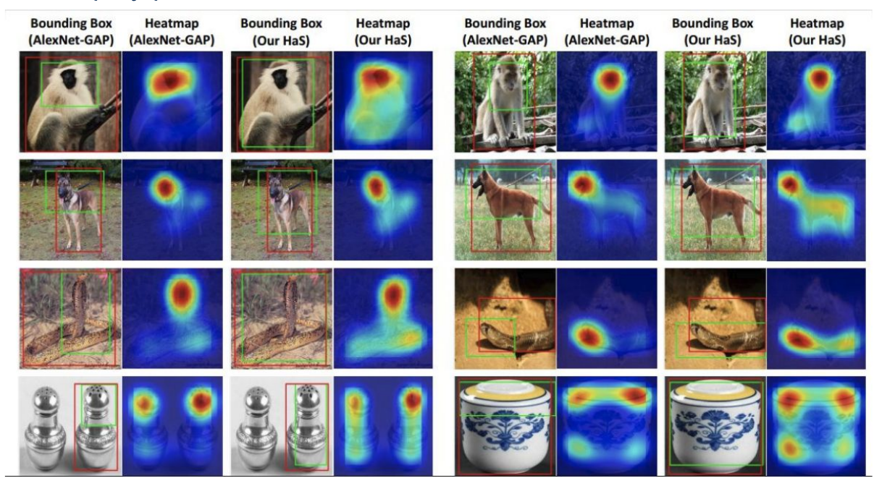

**차이**
- 바뀌는 건 **학습 data뿐**이야. network 구조와 loss는 그대로라서 어떤 classifier에도 붙일 수 있어.
- 어디를 가릴지 모델을 보고 정하지 **않아**. 이 점이 2.10 adversarial erasing과 갈리는 지점이야.

> 보충 (논문 보충): 가린 칸은 검정이 아니라 dataset 평균 pixel 값으로 채워. 그래야 test 때 가리지 않은 사진과 분포가 크게 안 달라. test 때는 아무것도 안 가려. 원 논문의 task는 segmentation이 아니라 weakly-supervised **object localization**(box)과 action localization이야.

---

### 2.10 Adversarial Erasing (p.39–41) — Wei et al., CVPR 2017

> 원 논문: "Object Region Mining with Adversarial Erasing: A Simple Classification to Semantic Segmentation Approach" (Wei et al., CVPR 2017). 슬라이드 cite는 "[Wei et al. 2017]"로 학회가 없어.

**한 줄**: classifier가 가장 의존하는 곳(CAM이 제일 센 곳)을 일부러 지우고 다시 학습하는 걸 반복해서, 지운 영역들을 모아 물체 전체를 찾아. 슬라이드 표현은 "Let us play **adversarial** peek-a-boo!" (p.39)야.

**문제**: HaS(2.9)와 같아. CAM이 discriminative part만 켜.

**핵심**: "(adversarial instead of random erasures)" (p.39). random으로 가리지 말고, **지금 classifier가 제일 믿는 곳**을 골라 지워.

**어떻게** (p.39 그림, $t$ = step 번호):
1. 사진 $I_t$로 classification network를 image label(그림에선 "dog")로 학습해.
2. 그 network의 heatmap(CAM) $H_t$를 구해.
3. $H_t$를 threshold로 잘라서 제일 센 영역 $F_t$를 얻어. 그림의 계단 함수 기호가 threshold야.
4. $I_t$에서 $F_t$를 지워 $I_{t+1}$을 만들어:
$$I_{t+1} = I_t \ominus F_t$$
5. $I_{t+1}$로 1번부터 다시 해. 그림은 $t = 1, 2, 3$이야 (그림의 Recurrent 화살표).
6. 지운 영역 $F_1, F_2, F_3$를 합친 게 **mined object region**(foreground)이야. 이걸 segmentation network의 pseudo label로 써. (논문 보충: background는 saliency map에서 따로 얻어 합치고, 둘이 충돌하는 pixel은 무시해.)

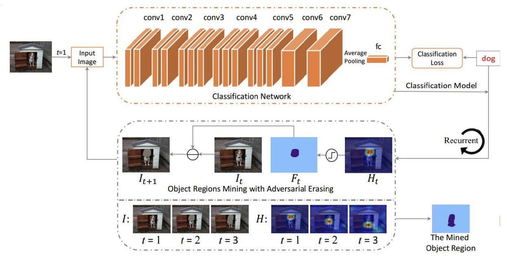

**왜 "adversarial"이야?** 지우는 쪽이 classifier가 제일 믿는 단서를 골라서 빼앗아. classifier 입장에선 방해꾼(adversary)이야. classifier는 남은 부분에서 **다음으로** discriminative한 부분을 찾아야 해.

**결과** (p.40, 논문 Figure 6): 위에서 아래로 읽어.
- AE-Step1 → 2 → 3으로 갈수록 heatmap의 빨간 곳이 **다른 부분**으로 옮겨 가. 예: 개는 Step1에서 머리가 제일 세고, Step2엔 머리 아래·가슴 쪽, Step3엔 몸통과 발 쪽이 켜져. 의자는 다리 → 앉는 판·등받이 쪽으로 옮겨 가.
- 맨 아래 "Erased Regions"(회색)는 단계별로 지운 영역을 합친 거야. 물체의 꽤 넓은 부분을 덮지만 (개의 다리, 의자처럼) **전부는 아니야**.
- 원문 캡션: "The second to fourth rows show the produced heatmaps, where the discriminative regions are highlighted. The images with erased regions are shown in the last row in gray."

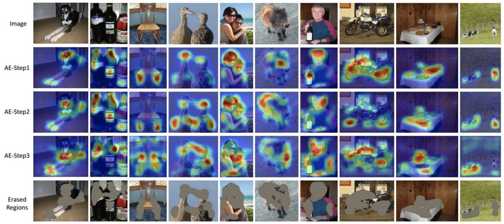

**수치** (p.41, 논문 Table 2, VOC 2012 test, mIoU, 비중 낮음):
- **mIoU(mean Intersection over Union)** = class마다 예측 mask와 정답 mask의 IoU(겹친 넓이 ÷ 합친 넓이)를 구해 평균 낸 값이야. segmentation의 기본 점수야.
- image-level label만 쓴 방법 중 **AE-PSL 55.7**이 제일 높아. SEC(ECCV 2016)는 51.7이야. (표의 * 표시 방법은 "implicitly use pixel-level supervision"이라 별도 묶음이야. 예: AF-MCG* 55.5. 또 AF-SS 52.7 > SEC 51.7이라 SEC가 2등인 것도 아니야.)
- box supervision(WSSL 62.2, BoxSup 64.2)보다는 아직 낮아. image label → pixel label 사이 간격이 커. 이게 p.42 마지막 질문으로 이어져.
- 왼쪽 그림(VOC 2012 val)의 마지막 줄은 실패 사례야 ("One failure case is shown in the last row").

**차이**
- **HaS vs AE**: HaS는 **random** hiding, AE는 **CAM이 가장 센 곳**을 지워 (p.39 "adversarial instead of random erasures"). HaS는 network 하나를 한 번 학습하고, AE는 지우고 다시 학습하는 걸 여러 step 반복해.
- **L08 Ren et al.(p.38)과 비교**: Concrete DropBlock도 "most relevant" region을 지워서 물체 전체를 보게 했어. 단 Ren은 지울 곳을 network(θ)가 min-max로 **같이 학습**하고, AE는 CAM을 threshold로 잘라 **단계마다** 지우고 다시 학습해.
- 지울수록 남은 물체가 줄어. 너무 많이 지우면 배경까지 물체로 잡을 수 있어 (해석).

> 보충 (논문 보충): 지운 pixel은 평균 pixel 값으로 채우고, 너무 많이 지워서 분류가 잘 안 될 때쯤 멈춰. 최종 방법 이름 AE-PSL의 PSL(online Prohibitive Segmentation Learning)은 image-level class 점수가 낮은 class의 segmentation 점수를 "금지(prohibit)"해서 잘못된 class를 막고, segmentation network 자신의 예측으로 mask를 online으로 갱신하는 단계야. 슬라이드엔 없어.

> 보충 (RL 비유, 슬라이드 밖 = 시험 범위 아님): imitation learning의 shortcut 문제(정답과 같이 나오는 쉬운 단서 하나에 기대는 것)와 같은 모양이야. AE는 robust adversarial RL처럼 adversary가 agent가 기대는 걸 빼앗아. HaS는 그 방해를 random으로 하는 domain randomization 쪽이야.

---

### 2.11 Takeaways (p.42) + CAM 보강 방법 비교

**슬라이드 원문** (p.42). 표시(✗, ~, ✔)까지 외워 둬. T/F로 뒤집기 좋아.

| 원문 | 표시 | 뜻 |
|---|---|---|
| "Training a classifier, and hoping to get segmentations out of it" | **✗** | classifier만 학습해 놓고 segmentation이 저절로 나오길 바라면 안 돼. p.23의 "Asking apples from the oranges tree"와 같은 얘기야 |
| "Using spatial continuity priors will help, but to a limit" | **~** | 가까운 pixel은 같은 label이라는 가정(CRF, boundary-aware propagation)은 도움이 되지만 한계가 있어 |
| "The training can be modified to promote covering the object extent" | **✔** | **학습 방식을 바꿔서** 물체 전체를 덮게 하는 게 효과가 있어. HaS, adversarial erasing, SEC의 expansion loss가 여기 속해 |
| "With careful changes it is possible to obtain significant improvements" | **~** | 신중하게 바꾸면 크게 좋아질 수 있지만 쉽진 않아 |
| "⇒ How far can we go from image-level to pixel-level labels ?" | | 다음 파트로 가는 질문이야. image label 말고 다른 정보(web 이미지 §3, box §4)를 쓰면 어디까지 갈 수 있나 |

**CAM 보강 방법 한눈에** (p.28의 두 문제 기준)

| 방법 (p.N) | 슬라이드가 붙인 문제 | 처방 (슬라이드 표현) | 더 쓰는 것 | 어디를 바꾸나 |
|---|---|---|---|---|
| Increase resolution (p.29) | 1. not sharp | "Increase top layers resolution" | 없음 | network 구조 (마지막 conv 지도가 14×14라 거침) |
| SEC (p.30–32) | 1. not sharp (p.31은 세 limitation 다) | "Use boundary-aware propagation" | CRF, GWRP, CAM seed | segmentation network의 **loss** |
| Saliency-guided, Oh (p.33–34) | 1. not sharp (본문 p.34는 2번도 겨냥) | "Use transfer learning" | 미리 학습한 saliency 모델 (class-agnostic) | **pseudo mask**를 만드는 단계 |
| SEAM (p.35–36) | 1. not sharp | "Enforce equivariance" | affine 변환한 두 번째 view, PCM | classifier의 **loss** (ER, ECR) |
| Hide-and-Seek (p.37–38) | 2. discriminative only | "Let us play peek-a-boo!" | random patch hiding | 학습 **data** (입력을 가림) |
| Adversarial Erasing (p.39–41) | 2. discriminative only | "Let us play adversarial peek-a-boo!" | CAM 기반 erase + 재학습 반복 | 학습 **data** (가장 센 곳을 지움, 여러 step) |

- 슬라이드가 **헤더에 붙인 번호**는 1번(not sharp): resolution · SEC · saliency(transfer) · SEAM, 2번(discriminative only): HaS · AE야.
- 단 **본문**을 보면 SEC(p.31 expansion loss)와 Oh(p.34 "Provides complete object extent")는 2번도 직접 다뤄. 헤더 번호만 보고 "X는 2번을 안 푼다"고 단정하면 T/F가 뒤집혀.
- 처방 성격으로 보면 1번 쪽은 경계 · 일관성 · 외부 단서, 2번 쪽은 classifier가 한 부분에만 기대지 못하게 하는 **학습 방식 변경**이야.
- 가리는 두 방법의 차이는 한 단어야: **random** (HaS) vs **adversarial** (AE).
- 외부 지식을 빌리는 방법: Oh(saliency 모델), SEC(CRF의 색 경계). 자기 자신과의 일관성을 쓰는 방법: SEAM.

> 보충 (RL 비유, 슬라이드 밖 = 시험 범위 아님): "classifier만 학습하고 segmentation을 바라기 ✗"는 reward만 최적화하고 원하는 행동 방식이 저절로 나오길 바라는 것과 비슷해. 원하는 성질(물체 전체 덮기)이 있으면 학습 신호에 직접 넣어야 해.

---

## 3. Webly Supervised Learning (p.43–52)

> 이 파트의 질문: **사람이 추가 annotation을 안 줄 때, web에서 공짜로 모은 사진으로 pixel label을 더 좋게 만들 수 있나?**
> §2는 사람이 단 **image label**만 갖고 classifier 안을 들여다봤어(CAM). §3은 정보원을 하나 더 끌어와: **web 검색 사진**이야.

### 3.1 Webly supervised learning: 정의와 거래 (p.44)

**정의 (슬라이드 원문)**: "A learning method that uses data collected from the web as supervision."

- **webly supervised** = web + weakly supervised를 합친 말이야.
- **어떻게 label이 생기나**: "Collect training images directly from web search engines." 검색어가 곧 label이야. "saxophone"으로 검색해서 나온 사진엔 "saxophone" label이 붙어.
- **장점**: "Enables large-scale learning without manual annotation." 사람이 label을 안 다니까 아주 많이 모을 수 있어.
- **단점**: "Labels are noisy, ambiguous, and incomplete."
  - **noisy** = 검색어와 안 맞는 사진이 섞여.
  - **ambiguous** = 한 단어가 여러 뜻이야. 슬라이드 그림의 "jasmine" 검색 결과엔 디즈니 공주, 공주 분장을 한 사람, **jasmine 꽃**이 같이 나와.
  - **incomplete** = 사진 속 다른 물체는 label에 안 들어가. 검색어 하나만 붙어.
- **결론**: "Learning must be robust to noisy supervision."

**한 문장으로 외워**: "Webly supervised learning leverages freely available web images as supervision, **trading annotation cost for label noise**." (p.44, 굵은 글씨)
- annotation 비용을 아끼는 대신 label noise를 떠안는 **거래**야.
- T/F 함정: "trading label noise for annotation cost"처럼 앞뒤를 뒤집으면 틀린 문장이야. 아끼는 건 annotation cost고, 받아들이는 건 label noise야.

슬라이드 그림은 검색어 세 개(saxophone, jasmine, chihuahua)의 결과를 두 칸으로 보여 줘. 왼쪽은 흰 배경에 물체 하나가 가운데 있는 깔끔한 사진이고, 오른쪽은 현실 장면이거나 뜻이 다른 사진이야 (그림 해석, 슬라이드엔 캡션 없음). 왼쪽 같은 사진이 §3.3의 핵심 관찰("a single centered object")로 이어져.

> 보충: p.44 cite는 세 편이야 — Shen et al., "Bootstrapping the Performance of Webly Supervised Semantic Segmentation", CVPR 2018 / Jin et al., "Webly Supervised Semantic Segmentation", CVPR 2017 / Chen & Gupta, "Webly Supervised Learning of Convolutional Networks", ICCV 2015. 이 파트의 pipeline(p.45–52)은 **Shen CVPR 2018** 하나야.

### 3.2 Webly WSSS pipeline: Model-T와 Web-SEC (p.45–50) — Shen et al., CVPR 2018

- **한 줄**: target dataset의 image label로 학습한 classifier(Model-T)가 web 사진을 거르고, 거른 web 사진으로 pixel labeler(Web-SEC)를 학습해서, 두 모델이 만든 mask를 합쳐 최종 segmentation model을 학습해.
- **문제**: image label만으로 만든 CAM mask는 거칠고 물체 일부만 잡아 (§2.5의 두 문제). 그런데 사람이 pixel label을 더 달긴 싫어.
- **핵심**: target 쪽과 web 쪽이 **서로를 도와**. target의 clean label이 web의 noise를 걸러 주고(**Filter**), web에서 배운 물체 모양이 target의 mask를 좋게 해(**Enhance**).

**먼저 용어**
- **domain** = data가 나온 곳(분포)이야.
  - **target domain** = 실제로 segmentation을 하고 싶은 dataset이야. 슬라이드 그림에선 PASCAL VOC 사진(p.49 "VOC training images (image-level labels)")이야.
  - **web domain** = 검색으로 모은 사진이야.
- **Model-T** = target domain의 **clean image-level labels**로 학습한 **image classifier**야 (T = Target).
- **Web-SEC** = web 사진으로 학습한 **pixel labeler**(pixel마다 class를 매기는 segmentation network)야. 그림(p.45, 48)의 **Model-W**가 이 자리로 보여 ← 슬라이드는 둘을 직접 연결하진 않아. 그림상 web 쪽 모델이 pixel labeler라서 같은 것으로 읽은 거야 (추정).

**어떻게** (p.45–50, 슬라이드 원문 순서 그대로)
1. "Train an image classifier (Model-T) on clean image-level labels."
2. "Use Model-T to filter noisy web images." ← 거르는 건 **Model-T**야.
3. "Train Web-SEC (pixel labeler) using the filtered web images." (p.50에선 "Learn a pixel-level object labeler (Web-SEC) from the filtered web images."로 바뀌고 번호 "3."이 빠져 있어 ← 원문 유지)
4. "Apply Web-SEC to generate pixel labels for the target images." ← web에서 배운 모델을 **target 사진**에 적용해.
5. "Use Model-T to produce class activation maps (CAMs) on the target images." ← CAM은 **Model-T**가 만들어.
6. "Fuse the two label sources and train the final segmentation model."

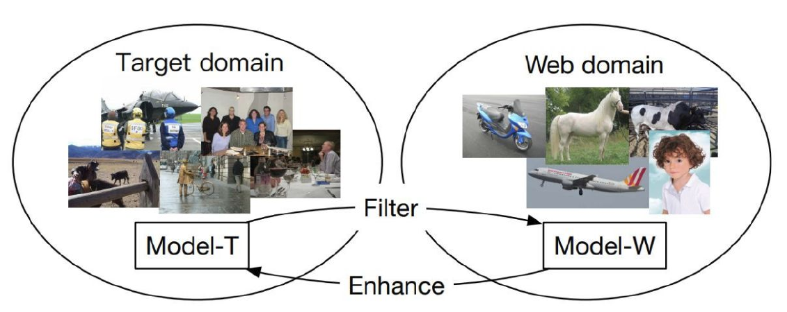

> 그림 읽는 법: 왼쪽 타원이 target domain, 오른쪽이 web domain이야. 위 화살표 **Filter**(Model-T → Model-W)가 2단계, 아래 화살표 **Enhance**(Model-W → Model-T)가 4·6단계야. p.48은 같은 그림에서 Enhance 화살표만 주황 박스로 강조해. (L09 p.45, 48)

**누가 어떤 label을 만드나** (시험에서 역할을 뒤바꾼 함정이 나오기 좋아)

| 모델 | 무엇으로 학습하나 | 하는 일 | 단계 |
|---|---|---|---|
| **Model-T** | target의 **clean image-level labels** | web 사진 filter / target 사진의 **CAM** → initial masks | 1, 2, 5 |
| **Web-SEC** (그림의 Model-W로 추정) | filter된 **web 사진** + 자동으로 만든 mask | target 사진의 **pixel labels** → masks with web knowledge | 3, 4 |
| **final segmentation model** | 두 label을 합친 **enhanced masks** | test 때 실제로 쓰는 모델 | 6 |

- Model-T는 web 사진으로 학습하지 **않아**. web 사진을 **판정**만 해.
- Web-SEC는 target 사진으로 학습하지 **않아**. target 사진에 **적용**만 해.
- 결국 target 사진마다 label이 **두 개** 생겨: Web-SEC의 mask(4단계)와 Model-T CAM의 mask(5단계).

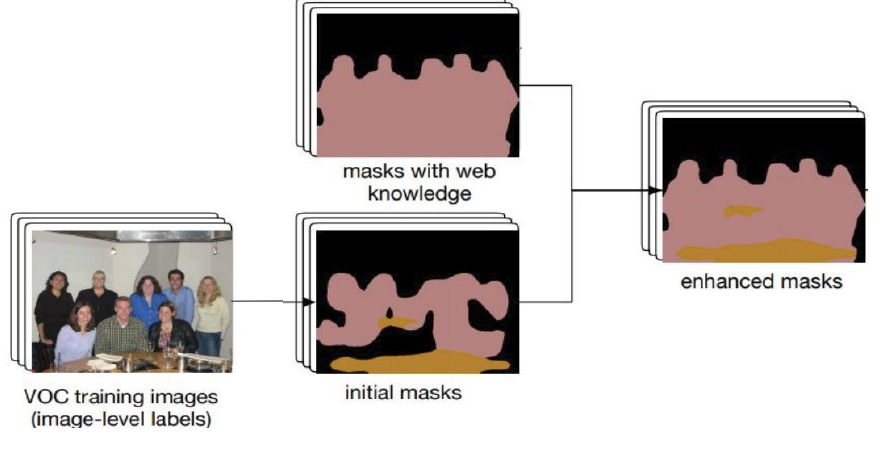

> 그림 읽는 법: 아래 줄이 5단계야. VOC 사진(image label만 있음)에서 Model-T의 CAM으로 **initial masks**를 얻어. 사람들이 한 덩어리로 뭉치고 경계가 뭉툭해. 위 줄이 4단계의 **masks with web knowledge**야. 두 mask를 합친 게 오른쪽 **enhanced masks**고, 이걸로 최종 모델을 학습해 (6단계). (L09 p.49–50)

- **왜 두 label을 합치나** (그림 해석): web knowledge mask는 사람 영역이 더 매끈하고 연결돼 있고, initial mask엔 식탁(주황) 같은 다른 class가 있어. 합친 enhanced mask는 둘을 다 가져. 구체적인 합치는 규칙은 슬라이드에 없어.
- **차이**: §2의 CAM 계열은 image label만 쓰고 classifier 하나에서 위치를 읽어. 이 방법은 **web이라는 새 정보원**을 더하고, 위치를 **pixel classifier**(Web-SEC)가 직접 배워.

> 보충: 논문은 이 구조를 bi-directional transfer라고 불러. 제목의 **bootstrapping**은 "작은 것(image label)에서 시작해 스스로 끌어올린다"는 뜻이야.

### 3.3 Web-SEC: 왜 web 사진에선 pixel classifier를 학습할 수 있나 (p.47)

슬라이드 원문 세 줄이 이 방법의 core idea야.
- "Unlike CAM-based methods, Web-SEC actually learns a pixel classifier."
- "The key observation is that web images are much cleaner—typically containing **a single centered object**—so approximate segmentation masks can be generated automatically."
- "These masks are then used to train a pixel-level segmentation network, which learns **generic object shapes** and can later be **transferred** to the target dataset."

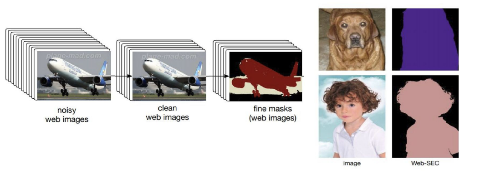

> 그림 읽는 법: 왼쪽에서 오른쪽으로 읽어. noisy web images → (Model-T로 filter) → clean web images → fine masks (web images). 오른쪽 두 쌍은 사진(image)과 Web-SEC가 낸 mask야. 개와 아이가 모양대로 칠해져. (L09 p.47)

- **왜 web 사진은 쉬운가**: "much cleaner"하고, 물체가 하나뿐이고 가운데 있어 ("a single centered object"). 그래서 "어디가 물체인가"를 사람 없이도 대략 정할 수 있어. VOC 사진(p.49)은 사람 여럿, 식탁, 그릇이 뒤섞여서 이게 어려워.
- **CAM과 차이** (MCQ "What is Web-SEC for?"에 바로 쓰는 문장):
  - CAM은 **분류용으로 학습한** classifier의 activation을 읽어서 위치를 **빌려 와**. 그래서 discriminative part만 잡는 한계가 있어 (p.23 "Asking apples from the oranges tree").
  - Web-SEC는 처음부터 **pixel을 분류하도록** 학습해. 쉬운 web 사진에서 물체 **모양 일반**(generic object shapes)을 배우고, 그 지식을 target으로 옮겨(transfer).
- 쉬운 data에서 배우고 어려운 data로 옮기는 건 p.61의 "Do not underestimate the power of **transfer learning** (and webly supervision)"과 이어져.

> 보충: 이름의 SEC는 §2.6의 SEC(Seed, Expand, Constrain, p.31–32)와 같은 이름이야. 둘의 관계는 슬라이드가 설명하지 않아.

### 3.4 결과 (p.51–52) — 수치는 비중 낮음

p.51과 p.52는 같은 슬라이드야. 표 제목은 "Table 1: Comparison with methods using other supervisions."

| Method | val | test | Extra Supervision |
|---|---|---|---|
| Chen et al. (강조) | 63.7 | 66.4 | Fully supervised |
| Dai et al. | 62.0 | 64.6 | Bounding box+MCG |
| SEC | 50.7 | 51.7 | - (image label만) |
| Hong et al. | 58.1 | 58.7 | - |
| Ours-VGG16 | 58.8 | 60.2 | Web |
| **Ours-Res50** (강조) | **63.0** | **63.9** | Web |

(표의 일부만 옮겼어. 나머지는 Lin et al. 63.1 Scribble, Oh et al. 55.7 / 56.7 Bounding box, Bearman et al. 46.1 Point, Wei et al. 55.0 / 55.7 · STC 49.8 / 51.2 Supervised saliency, EM-Adapt 33.8 / 39.6 · CCNN 35.3 / 35.6 "-".)

- 숫자는 PASCAL VOC 2012 segmentation의 mIoU(%)야 (논문 기준, 표엔 dataset 이름이 없어). mIoU 뜻은 §2.10에 처음 나와.
- 읽는 법: 위 칸은 scribble, box, point, saliency 같은 **추가 annotation**을 쓴 방법이고, "-"는 image label만 쓴 방법이야. Ours는 추가 annotation 대신 **Web**을 써.
- **메시지**: 사람 annotation을 더 안 하고 web만 더해서 Ours-Res50이 강조된 fully supervised 줄(63.7 val)에 가까운 63.0(val)을 내. image label만 쓰는 SEC(50.7)보다 훨씬 높아.
- 시험엔 "web이 추가 annotation 없이 성능을 크게 올린다" 정도만 기억해.

> 보충: Ours-VGG16 → Ours-Res50은 방법은 같고 backbone만 바꾼 거야 (58.8 → 63.0). p.61의 "ride the wave of better network architectures"의 예로 볼 수 있어. fully supervised 줄의 backbone은 슬라이드에 없으니 1:1 비교는 하지 마.

> 보충 (RL 비유, 시험 범위 아님): clean data로 학습한 classifier(Model-T)로 큰 noisy data(web)를 걸러서 쓰는 건 **filtered behavior cloning**과 닮았어. 성공 판정기나 reward model로 demo를 거르고 남은 것만 imitate하는 거야. Enhance 쪽은 쉬운 환경에서 배운 걸 어려운 환경으로 옮기는 **transfer/curriculum**과 동기가 같아.

> 보충 (Physical AI 연결, 시험 범위 아님): VLA의 vision-language backbone도 web 규모의 image–text data로 pretraining해. "사람 annotation 대신 web data, 대가는 noise"라는 거래가 p.44의 "trading annotation cost for label noise"와 같아.

---

## 4. Boxly Supervised Learning (p.53–60)

> 이 파트의 질문: **box만 주면 pixel mask를 학습할 수 있나?** image label보다 정보가 많은 weak label(bounding box)을 써.

### 4.1 문제 설정: box에서 pixel-level instance label로 (p.54–55)

**먼저 용어**
- **bounding box** = 물체를 감싸는 직사각형이야. 위치와 대략적인 크기는 알려 주지만, box 안의 **어느 pixel이 물체인지**는 안 알려 줘.
- **instance** = 물체 하나하나야. **per instance labels** = 같은 class라도 물체마다 따로 mask를 낸다는 뜻이야 (instance segmentation).

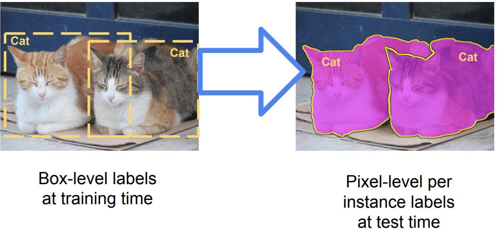

> 그림 읽는 법: 왼쪽이 학습 때 받는 label이야. 고양이 두 마리에 점선 box와 "Cat"만 있어. 오른쪽이 test 때 내야 하는 결과로, 고양이마다 따로 칠한 pixel mask야. 아래 글이 핵심이야: "Box-level labels at training time" → "Pixel-level per instance labels at test time". (L09 p.54)

- **weak supervision 정의와 연결**: L08 p.4의 정의는 "Lower degree (or cheaper) annotation at train time than the required output at test time"이었어. 여기선 train = **box**, test = **pixel-level instance mask**야.
- box가 싼 이유: L08 p.4 표에서 b-box는 10 sec per instance, pixel labels는 78 sec per instance였어.

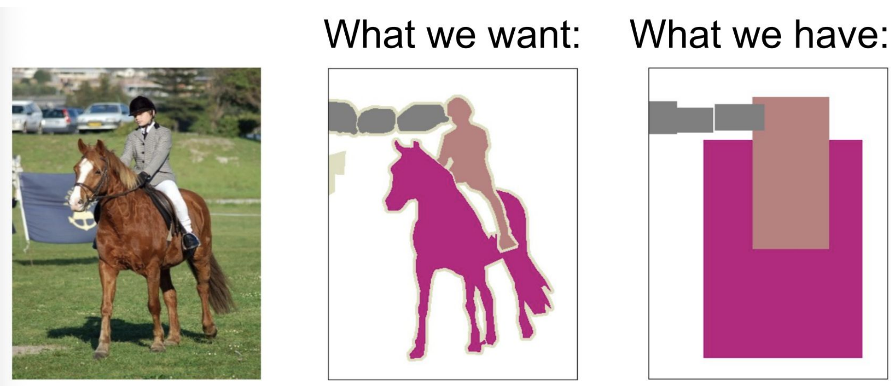

> 그림 읽는 법: 왼쪽 사진(말 탄 사람)에 대해 가운데가 원하는 것(**What we want**: 말, 사람, 뒤 차들이 모양대로 칠해진 mask), 오른쪽이 가진 것(**What we have**: 같은 색의 직사각형)이야. 겹친 곳은 작은 box(사람)가 위에 칠해져 있어. (L09 p.55)

- 가장 단순한 출발점은 **box 안을 통째로 그 class로 칠하는 것**이야. p.57 그래프는 이걸 **Rectangles**라고 불러.
- 이 label은 **noisy**해. 말 다리 사이 배경, 사람 주변 공간까지 다 물체로 칠해져.

### 4.2 Simple Does It: "Convnets are robust to noise. Let us use that!" (p.56–58) — Khoreva et al., CVPR 2017

- **한 줄**: 직사각형 같은 거친 mask로 segmentation network를 학습하고, 그 network의 예측을 다음 round의 label로 쓰면서 mask를 점점 다듬어.
- **문제**: box를 칠한 mask는 물체 밖 pixel이 많이 섞인 noisy label이야.
- **핵심**: network는 noisy label에도 **robust**해. 그래서 거친 mask로 학습해도 예측은 입력 mask보다 물체에 더 가까워. 그 예측을 다시 label로 쓰면 돼.

슬라이드 원문:
- "Initially, training is performed using a noisy mask, but the CNN's predictions are then used as pseudo-labels for retraining."
- "Segmentation networks are robust to noisy supervision."
- "Approximate masks are sufficient for training."
- "Iteratively refine pseudo masks during training."
- "Better masks lead to better segmentation."

**어떻게** (recursive training)
1. box를 칠한 직사각형 mask로 segmentation network를 학습해.
2. 학습한 network로 training 사진의 mask를 다시 예측해.
3. 그 예측을 **pseudo-label**(모델이 만든 가짜 정답)로 써서 다시 학습해.
4. 2–3을 반복해. 반복 한 번이 **training round** 하나야.

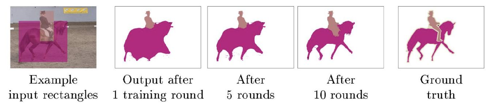

> 그림 읽는 법: 왼쪽에서 오른쪽으로 읽어. 입력 직사각형 → 1 round 뒤 → 5 rounds 뒤 → 10 rounds 뒤 → Ground truth야. 1 round엔 말이 뭉툭한 덩어리지만, round가 갈수록 다리와 사람 윤곽이 살아나. (L09 p.56)

- **왜 돼?** (직관, 슬라이드엔 이유 설명이 없어)
  - label이 틀린 pixel(box 안 배경)은 사진마다 위치와 모양이 제각각이야.
  - 반면 물체 모양은 사진끼리 공통이야.
  - 그래서 network는 공통 패턴(물체 모양)을 먼저 배우고, 사진마다 다른 오류까지 다 따라 하진 않아. L07 DivideMix(L07 p.53)의 "During the early stages of training: Clean samples show a rapid decrease in loss. Noisy samples retain a high loss."와 같은 맥락이야. ("noisy는 나중에 외운다"는 건 슬라이드 밖 일반 지식이야.)
- **차이** (이전 강의와)
  - **L07 self-training / pseudo labeling**과 같은 구조야. 다른 점은 단위가 **pixel**이고, box라는 약한 label이 처음부터 있다는 거야.
  - **L08 Standard MIL**의 Re-train ↔ Re-localize 반복과도 닮았어. 거기선 detector가 box를 **다시 골랐고**, 여기선 network가 mask를 **다시 그려**.
  - 위험도 같아. 틀린 예측을 label로 쓰면 **confirmation bias**(L07)로 오류가 굳을 수 있어.

> 보충 (논문, 슬라이드엔 없음): 논문은 예측을 그대로 다음 label로 쓰는 naive recursive training은 잘 안 된다고 해. 그래서 round마다 예측을 손봐. box 밖으로 나간 예측은 background로 되돌리고(box enforcing), 너무 작아진 예측은 원래 box로 되돌리고(outlier reset), CRF로 경계를 다듬어. box가 "물체는 이 안에 있다"는 **제약**으로 계속 쓰이는 거야. confirmation bias를 막는 장치로 볼 수 있어.

**그래프 읽기: Rectangles와 20% Bbox (p.57–58)**

- **mIoU**(mean Intersection over Union) = segmentation 성능 지표야. class마다 "예측 pixel 집합과 정답 pixel 집합의 IoU(겹친 넓이 ÷ 합친 넓이)"를 구해서 평균 내. 클수록 좋아.
- 그래프: x축 = Training rounds(0–15), y축 = mIoU(50–70). 맨 위 실선이 **Fully supervised**(~70), 점선이 **Previous best (any input)**(~62), 아래 파선이 **Previous best (rectangles input)**(~52.3)야. (값은 그래프 눈대중, 비중 낮음)
- **Rectangles**(p.57): round 1엔 ~50으로 이전 best(rectangles input, ~52.3)보다 살짝 낮지만, round 2에 ~57로 넘어서. round 4–5에 ~60까지 오르고, ~61에서 평평해져. 반복만으로 이전 best(rectangles input)를 크게 넘어.
- **20% Bbox**(p.58): box 가운데 일부만 class로 칠한 입력이야. 시작점(~56.5)부터 높고 끝(~63)도 Rectangles보다 높아서 이전 best(any input)를 넘어.
  - 직관: box 가장자리는 배경일 확률이 높고, 가운데는 물체일 확률이 높아. 확실한 곳만 칠하면 틀린 label이 줄어.

> 보충 (논문, 슬라이드엔 설명 없음): 20% Bbox는 box 넓이의 **안쪽 20%** 만 class로 칠하고, 나머지 box 영역은 **ignore**(loss를 안 거는 영역)로 둬. p.58 왼쪽 아래 그림의 베이지색이 ignore 영역이야. §2.4의 CAM seeds처럼 "확실한 곳에만 label을 단다"는 생각과 같아.

### 4.3 입력 mask를 더 좋게: GrabCut+, MCG, M ∩ G+ → ~95% (p.59–60)

- **한 줄**: box를 고전 segmentation 알고리즘에 넣어 처음부터 좋은 mask를 만들면, round 1부터 높은 성능이 나와.
- **용어** (기초 정의만, 세부는 논문)
  - **GrabCut** = box를 주면 box 안에서 전경과 배경을 색 분포로 나눠 주는 고전(딥러닝 아닌) segmentation 방법이야. 그래프의 **Grabcut+** 는 그 개량판이야.
  - **MCG**(Multiscale Combinatorial Grouping) = 사진에서 "물체일 것 같은 segment 후보"를 뽑는 고전 방법이야.
  - **MCG ∩ Grabcut+** (그림 표기 **M ∩ G+**) = 두 방법이 **둘 다** 물체라고 한 pixel만 쓰는 거야. ∩는 교집합이야.

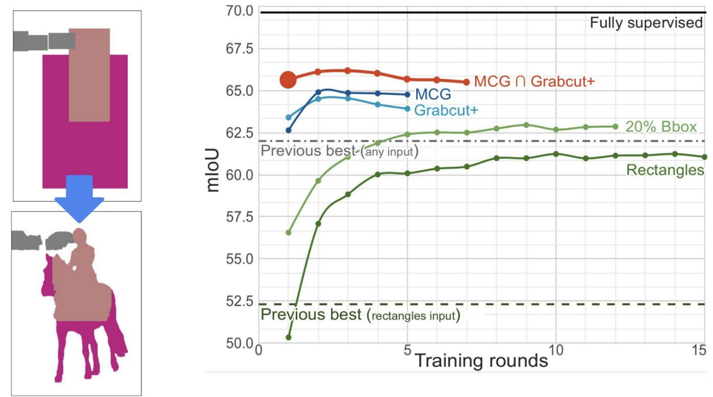

> 그림 읽는 법: 왼쪽은 직사각형 mask가 말·사람 모양 mask로 바뀌는 예시야. 오른쪽 그래프는 x축 training round, y축 mIoU고 맨 위 검은 선이 fully supervised야. 아래부터 Rectangles(진초록) < 20% Bbox(연초록) < Grabcut+(하늘색) · MCG(파랑) < MCG ∩ Grabcut+(주황) 순서야. 위쪽 세 곡선은 짧고 거의 평평하고, 주황 곡선의 큰 점(round 1)이 거의 최고점이야. (L09 p.57–59)

- **그래프의 메시지**: 성능을 올리는 손잡이가 **두 개**야.
  1. **입력 mask 설계**: Rectangles < 20% Bbox < Grabcut+ · MCG < MCG ∩ Grabcut+. 입력이 좋을수록 시작점도 끝점도 높아. "Better masks lead to better segmentation." (p.56)
  2. **recursive training**: 거친 입력(Rectangles)일수록 반복의 효과가 커. 좋은 입력(M ∩ G+)은 반복할 게 별로 없어 (그래프 해석, 슬라이드에 설명 없음: M ∩ G+는 round 1이 이미 ~65.7이고, 이후 ~66까지 올랐다가 다시 조금 내려가).
- **p.60 제목**: "We reach ~95% of full supervision by using GrabCut++"
  - box만으로 fully supervised 성능의 **약 95%** 에 도달한다는 뜻이야.
  - p.60 그림은 다섯 사진(자전거 선수들, 당나귀, 회의 테이블, 사람과 소, 말과 사람)에 대해 Image / Ground truth / Rectangles / 20% Bbox / M ∩ G+ / Fully supervised를 나란히 보여 줘. 오른쪽 열로 갈수록 자전거 바퀴나 당나귀 다리 같은 얇은 부분이 살아나고, M ∩ G+는 Fully supervised와 거의 비슷해.
  - 제목은 "GrabCut++"인데 그래프 범례(p.59)는 "Grabcut+", 그림 열 이름(p.60)은 "M ∩ G+"야 ← 슬라이드 표기 불일치 (원문 유지). 논문 기준으로 ~95%를 낸 입력은 **M ∩ G+**(MCG ∩ GrabCut+)야.

> 보충 (논문, 슬라이드엔 없음): GrabCut+ 는 GrabCut에서 이웃 pixel끼리 같은 label이 되게 하는 항(pairwise term)에 색 차이 대신 HED라는 경계 검출기의 결과를 쓴 버전이야. M ∩ G+ 에서 두 방법이 의견이 다른 pixel은 ignore로 둬. 논문 abstract: "reach 95% of the quality of the fully supervised model, for both semantic labelling and instance segmentation."

> 보충 (RL 비유, 시험 범위 아님): round마다 직전 모델의 예측을 다음 target으로 쓰는 건 **fitted Q iteration**에서 target을 갱신하는 구조와 같아. 오류가 쌓이는 위험(bootstrapping error)도 같아. box enforcing은 target을 data가 허락하는 범위 안에 묶어 두는 장치라서, offline RL의 support constraint와 동기가 닮았어. 좋은 초기 mask가 반복 횟수를 줄이는 건 좋은 초기 value estimate가 수렴을 빠르게 하는 것과 같은 감각이야.

### 4.4 세 길 비교: image label(CAM) vs web vs box

§2–§4는 "pixel label이 없을 때 pixel target을 어디서 얻나"에 대한 세 가지 답이야.

| | CAM 계열 (§2.3–2.4) | Webly (§3, Shen 2018) | Boxly (§4, Khoreva 2017) |
|---|---|---|---|
| 사람이 준 label | image label | image label (target) | **bounding box** |
| 더 끌어온 정보 | 없음 (network 내부 activation) | **web 검색 사진** | 고전 segmentation (GrabCut+, MCG) |
| pixel target을 만드는 쪽 | classifier의 CAM을 threshold (seeds) | Web-SEC mask + Model-T CAM을 **fuse** | 직사각형 · GrabCut+ 등 → 이후엔 **network 자신의 예측** |
| 반복 | (방법에 따라) | 없음 (단계형 pipeline) | **recursive training** (round 반복) |
| noise 대응 | seed는 확실한 곳만 | Model-T가 web 사진 **filter** | "Convnets are robust to noise" + 좋은 입력 mask |
| 핵심 문장 | "Classifier was not built nor trained to segment objects" (p.23) | "trading annotation cost for label noise" (p.44) | "Better masks lead to better segmentation" (p.56) |

- 공통점: 셋 다 결국 **pseudo mask**(모델이나 알고리즘이 만든 pixel label)를 만들고, 그걸 정답처럼 써서 segmentation network를 학습해.
- 차이점: 위치 정보가 **어디서** 오나야. CAM은 classifier 내부, Webly는 쉬운 web 사진에서 배운 물체 모양, Boxly는 사람이 그린 box야.

---

## 5. Summary (p.61)

슬라이드 원문 네 줄이 p.3–60 전체를 묶어.

1. "Many priors and hints have been explored"
   - p.5–17의 두 정보원이야. **prior** = 사진과 상관없이 믿는 것(크기, 위치, 모양, 경계, class 분포 …), **hint** = 사진마다 받는 간접 supervision(image label, caption, click, box, scribble …).
2. "Exploit all available priors, explore new information sources"
   - 새 정보원의 예가 saliency(p.33–34), web 사진(§3), box(§4)야.
3. "Do not underestimate the power of transfer learning (and webly supervision)"
   - Web-SEC는 쉬운 web 사진에서 배운 물체 모양을 target으로 옮겨(p.47). p.33의 "Use transfer learning"도 같은 얘기야.
4. "Current techniques are quite effective, and ride the wave of better network architectures"
   - 방법이 같아도 backbone이 좋아지면 성능이 올라. 예: p.51 Ours-VGG16 58.8 → Ours-Res50 63.0.

- 이 뒤(p.62–95)는 목차(p.2) 밖의 최근 논문 세 편이야 (§6 Beyond CAM).

---

## 6. 넓히기: Beyond CAM — 최신 논문 세 편 (p.62–95)

> 이 파트는 p.2 목차(1–4)에 **없는** 세미나 논문 세 편이야. 그래도 **슬라이드에 있으니까 시험 범위**로 봐.

| # | 논문 | 페이지 | 무엇을 빌려 와서 CAM을 넘어서나 |
|---|---|---|---|
| 6.1 | CD-CLIP (Yang et al., CVPR 2026) | p.62–74 | **CLIP의 class 분포** + **DINO feature** |
| 6.2 | Learning from the Web (Liu et al., ECCV 2024) | p.75–85 | **web 이미지 + caption** |
| 6.3 | WISH (Kweon & Yoon, CVPR 2025 ← slide엔 cite 없음) | p.86–95 | **SAM의 prompt 공간** |

세 편 모두 출발점은 여전히 CAM이야. 다른 점은 CAM 하나로 못 메우는 정보를 **바깥의 큰 모델이나 data**에서 빌려 온다는 거야.

### 6.0 Beyond CAM: CAM의 두 약점 다시 보기 (p.62)

p.62는 섹션 구분 슬라이드인데, 두 문장으로 §2의 문제를 다시 적어.

- "CAM activates only the most discriminative regions" ← p.28의 "Focused on discriminative area only"
- "CAM boundaries are coarse and inaccurate" ← p.28의 "Resulting masks are not sharp"

§2의 방법들(SEC, SEAM, Hide-and-Seek, Adversarial Erasing …)도 이 두 문제를 풀려고 했어. 6.1 CD-CLIP은 **두 문제를 모듈 두 개로 하나씩** 맡겨서 같이 푸는 방법이야.

---

### 6.1 CD-CLIP: Leveraging Class Distributions in CLIP (p.62–74) — Yang et al., CVPR 2026

> 출처: "Yang et.al., Leveraging Class Distributions in CLIP for Weakly Supervised Semantic Segmentation, CVPR 2026" (p.63). 학회 확인함 (CVF open access, CVPR 2026). 저자: Ziqian Yang, Xinqiao Zhao, Xiaolei Wang, Quan Zhang, Jimin Xiao.
> 이름 풀이: 슬라이드엔 없고, 논문 abstract에 "CD-CLIP (**C**lass **D**istribution based **CLIP**)"으로 적혀 있어. 모듈 두 개는 p.66 그림에 풀려 있어: **CDA = Class Distribution Aware**, **SBE = Super-class Boundary Exploration**.

**한 줄**: CLIP이 patch마다 내는 **class 점수 분포 전체**로 "어떤 patch끼리 같은 물체인가"를 다시 매겨서 CAM을 채우고(CDA), DINO feature로 **어디서 멈출지** 경계를 가르쳐 주는(SBE) 방법이야.

#### 6.1.0 먼저 깔 용어

- **patch**: ViT는 사진을 작은 정사각형 조각(예: 16×16 pixel)으로 잘라서 다뤄. 그 조각 하나가 patch야. 여기선 CAM도 affinity도 전부 patch 단위야.
- **CLIP**: 사진과 글을 같은 embedding 공간에 놓도록 학습한 image–text 모델이야 (L05). patch feature와 class 이름 text feature(예: "a photo of a dog")의 cosine similarity가 크면 "이 patch는 dog 같아"라고 읽을 수 있어. 그래서 class 이름만 있으면 patch마다 **모든 class에 대한 점수**를 바로 낼 수 있어.
- **DINO feature**: DINO는 label 없이 self-distillation으로 학습한 ViT야 (L04). L04에서 본 것처럼 DINO feature는 물체 모양(구조)을 잘 따라가. 대신 class 이름은 몰라.
- **affinity**: 두 patch가 "같은 물체에 속할 것 같은 정도"를 적은 표야. patch가 N개면 N×N 행렬이야. affinity로 CAM을 퍼뜨리는 걸 **affinity propagation**이라고 해 (§2에서 본 SEAM의 PCM도 같은 아이디어야, p.36).
- **MHSA(Multi-Head Self-Attention)**: ViT 안에서 patch끼리 서로 얼마나 참고하는지 계산하는 부품이야. 이 attention 값을 affinity로 그대로 쓸 수 있어. CD-CLIP은 이걸 **initial affinity**로 써 (p.66).
- **super-class**: target class 여러 개를 묶은 상위 class야. 논문 예시는 'vehicle', 'animal'이고 'cat'은 'animal'에 속해 (논문 보충, 슬라이드엔 예시 없음).
- **prototype**: 한 그룹을 대표하는 feature 벡터 하나야. 보통 그 그룹 feature들의 평균이야.
- **mIoU(mean Intersection over Union)**: class마다 예측 영역과 정답 영역의 IoU(겹친 넓이 ÷ 합친 넓이)를 구해 평균 낸 값이야. segmentation의 기본 점수야.

#### 6.1.1 문제: 덜 켜짐과 번짐 (p.64)

슬라이드 제목은 "Can CLIP Recover the Whole Object from Image-Level Labels?"야. 문제가 두 개이고 **방향이 반대**라는 게 핵심이야.

1. **Problem 1. Incomplete activation** (덜 켜짐)
   - "CAM focuses on the most discriminative part."
   - "Other object regions remain inactive."
   - 개 사진이면 얼굴만 빨갛고 몸통은 꺼져 있어.
2. **Problem 2. Inaccurate boundaries** (번짐)
   - "Affinity propagation may spread activation."
   - "Foreground activation can cross class boundaries."
   - 덜 켜진 걸 고치려고 affinity로 퍼뜨리면, 이번엔 활성이 경계를 넘어 배경까지 번져. 이걸 그림에선 **Boundary Leakage**라고 불러.

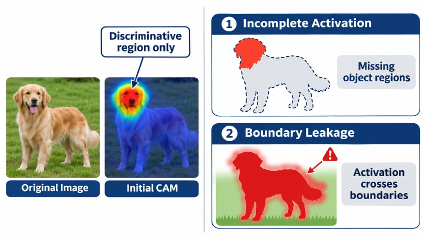

질문은 하나로 모여: **"How can we expand CAMs without losing object boundaries?"** (p.64) 넓히되 경계는 지켜야 해.

#### 6.1.2 핵심 관찰: Target Score Is Not Enough (p.65)

**기존 affinity가 왜 틀리나**

- "Conventional affinity — Uses feature or attention similarity between patches."
- "Similar appearance does not always imply the same class."
- "Incorrect affinity causes under-activation or boundary leakage."

겉모습(feature)이 비슷하다고 같은 class는 아니야. 이 affinity가 틀리면 두 문제가 **둘 다** 생겨.
- 이어야 할 patch를 못 이으면 → under-activation (Problem 1)
- 끊어야 할 patch를 이으면 → boundary leakage (Problem 2)

**CD-CLIP observation**

- "Every **patch** has scores **over multiple classes**."
- "Patches of the same semantic class show **similar class distributions**."
- "The full distribution can be more informative than one target-class score."

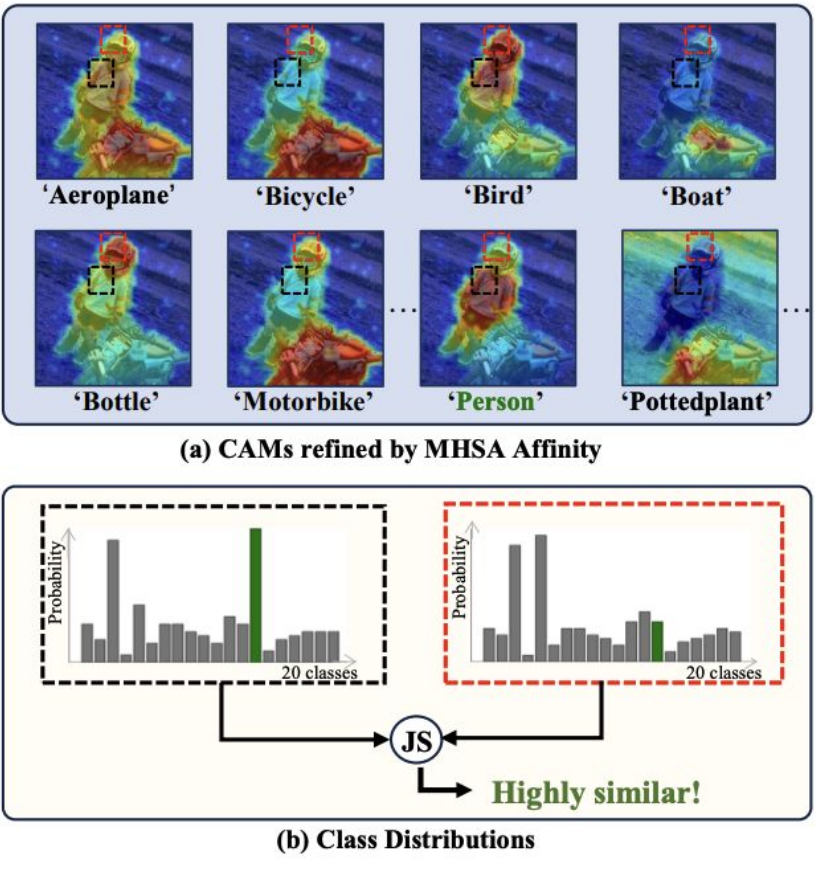

그림 읽는 법:
- (a) "CAMs refined by MHSA Affinity": 같은 사진(오토바이 탄 사람)에 대해 class마다 CAM을 그린 거야. 빨간 상자(그림상 머리·헬멧 쪽)와 검은 상자(몸통 쪽)는 **둘 다 사람**이야 (논문 그림 설명: "The selected patches in the same target class are marked in 'red box' and 'black box'"; 슬라이드 캡션엔 설명 없음). 'Person' CAM에서 두 상자의 활성 정도가 다르게 보여 (그림 해석).
- (b) "Class Distributions": 두 patch의 20개 class 점수 막대야. 초록 막대(Person)는 검은 쪽이 높고 빨간 쪽이 낮아. **target 점수 하나만 보면 다른 물체 같아.** 그런데 막대 전체 모양은 거의 같아서 JS로 재면 "Highly similar!"야.

> **핵심 문장 (p.65)**: "A patch is characterized not only by its target-class score, but by its distribution over all classes."

**차이**: 기존 affinity는 **겉모습 유사도**(feature·attention)로 patch를 이어. CD-CLIP은 **class 점수 분포의 유사도**로 이어. "생김새가 비슷한가?"에서 "모든 class에 대해 비슷하게 반응하나?"로 질문을 바꾼 거야.

#### 6.1.3 전체 구조 (p.66, p.71)

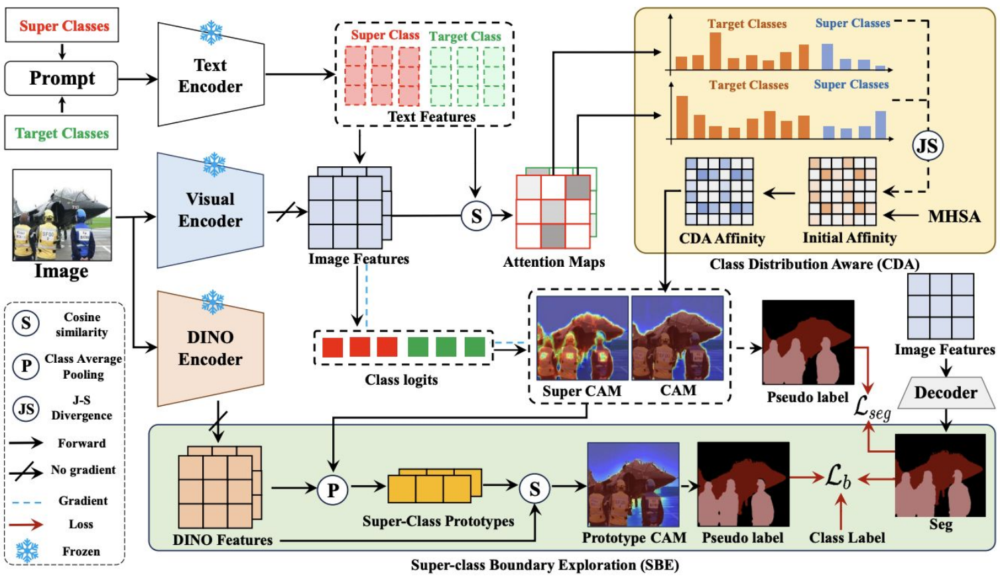

그림 읽는 법 (범례부터):
- 기호: **S** = Cosine similarity, **P** = Class Average Pooling, **JS** = J-S Divergence
- 화살표: 검정 = Forward, 빗금 = No gradient, 파란 점선 = Gradient, 빨강 = Loss
- 눈꽃 = Frozen. **Text Encoder, Visual Encoder, DINO Encoder 셋 다 frozen**이야.

위에서 아래로 읽으면 이래.

1. **CLIP 쪽 (위 가운데)**: Super Classes + Target Classes를 prompt로 만들어 Text Encoder에 넣어 → Text Features. Image는 Visual Encoder → Image Features. 둘의 cosine similarity가 **Attention Maps**(patch × class 점수표)야.
2. **CDA (오른쪽 위 노란 상자)**: Attention Maps에서 patch 두 개의 분포를 **JS**로 비교 → MHSA의 **Initial Affinity**를 고쳐서 **CDA Affinity** → 이걸로 CAM을 다듬어.
3. **CAM → Pseudo label → $\mathcal{L}_{seg}$**: 다듬은 CAM으로 pseudo label을 만들고, Decoder의 출력 Seg를 거기에 맞춰.
4. **SBE (아래 초록 상자)**: Image → DINO Encoder → DINO Features. CLIP의 **Super CAM**으로 DINO feature를 평균 내서 **Super-Class Prototypes** → 다시 DINO feature와 비교해서 **Prototype CAM** → Pseudo label → $\mathcal{L}_b$.

학습되는 건 **Decoder**야 (빨간 Loss 화살표가 Seg로 가). 아래 질문 "How can we determine whether two patches belong to the same semantic region?"(p.66)이 CDA의 질문이야.

> 보충 (논문 본문, 시험 범위 아님): Visual Encoder = frozen CLIP ViT-B/16, DINO Encoder = frozen DINOv2 ViT-B/14, Decoder = WeCLIP식 가벼운 transformer decoder야. 파란 점선 "Gradient"는 CAM을 만들 때 class logit의 gradient로 feature map 가중치를 정한다는 표시야 ("$W^c_k$ … derived from the gradient between class logits and feature maps"). encoder를 학습시키는 gradient가 아니야.

#### 6.1.4 CDA 1단계: patch마다 class 분포 (p.67)

$$\mathbf{S_a} = \text{Min-max}(\text{CosSim}(\mathbf{F}, \mathbf{T}_{all}))$$

- $\mathbf{F}$: CLIP Visual Encoder의 **patch별 image feature**.
- $\mathbf{T}_{all}$: **모든 class**(target class + super-class)의 text feature. 이름의 "all"이 핵심이야.
- $\text{CosSim}$: cosine similarity. patch와 class 이름의 방향이 비슷할수록 커.
- $\text{Min-max}$: 값을 0–1로 맞추는 정규화, $(x-\min)/(\max-\min)$.
- $\mathbf{S_a}$: patch × class 점수표 (그림의 Attention Maps). **한 줄 = 한 patch의 class 점수 묶음**이야.

super-class를 왜 넣나 (p.67):
- "Target classes provide specific semantics." → dog, cat 같은 구체적인 뜻
- "Super-classes provide broader semantic relationships." → animal 같은 넓은 관계
- "Each patch is represented by its scores over all classes." → 칸이 늘어서 분포가 더 풍부해져

> 보충 (논문): $\mathbf{T}_{all} \in \mathbb{R}^{|C+N| \times d}$ (C = target class 수, N = super-class 수, d = feature 차원).

#### 6.1.5 CDA 2–3단계: JS divergence → affinity 고치기 → CAM 퍼뜨리기 (p.68–69)

p.68은 "How are similar class distributions used to complete the CAM?"라는 질문만 던지고, 답은 p.69에 있어.

**어떻게** (p.69의 세 단계)

1. **Compare two patch distributions**
   - "Small JS divergence: similar class distributions"
   - "Large JS divergence: different class distributions"
2. **Correct the original affinity**
   - "Distribution similarity filters unreliable relationships in the original affinity."
3. **Propagate CAM activation**
   - "The head is strongly activated in the initial CAM."
   - "The body has a similar class distribution."
   - "CDA propagates activation from the head to the body."

**수식** (p.69)

$$\mathbf{S_d} = \frac{1 - \mathbf{D_{JS}}\big(\text{Softmax}(\mathbf{S_a}) \,\|\, \text{Softmax}(\mathbf{S_a})^{\mathrm{T}}\big)}{\tau}$$

$$\mathbf{A}_d = \text{Softmax}(\mathbf{S_d}) \cdot \mathbf{A}_{init}$$

$$\mathbf{M}^c_{re} = \mathbf{M}^c_{init} \cdot (\mathbf{A}_d)^t$$

한 줄씩 풀면 이래.

- **첫 줄 = 분포 유사도 $\mathbf{S_d}$**
  - $\text{Softmax}(\mathbf{S_a})$: patch마다 점수를 **확률 분포**로 바꿔 (합이 1).
  - (슬라이드엔 정의 없음, 해석) $\text{Softmax}(\mathbf{S_a})$와 그 전치 $(\cdot)^{\mathrm{T}}$를 비교한다는 건 **모든 patch 쌍**을 비교한다는 표기야. 그래서 $\mathbf{S_d}$는 patch × patch 표야.
  - $1 - D_{JS}$: JS가 작을수록(분포가 비슷할수록) 큰 값이 돼. 즉 **유사도**야.
  - $\tau$: temperature. 다음 줄의 softmax가 얼마나 뾰족할지 정해. 작을수록 비슷한 쌍만 크게 남아 (논문: "the temperature to control the softness").
- **둘째 줄 = 고친 affinity $\mathbf{A}_d$** (CDA affinity)
  - $\mathbf{A}_{init}$: MHSA attention으로 만든 원래 affinity야. 겉모습 기준이라 틀린 연결이 섞여 있어.
  - 분포 유사도에 softmax를 씌워서 곱하면, 분포가 다른 patch 쌍의 연결은 작아져. 이게 "filters unreliable relationships"야.
  - 슬라이드·논문 모두 '·' 연산을 따로 정의하진 않아. '필터' 설명상 patch 쌍별(element-wise) 곱으로 읽는 게 자연스럽고, 셋째 줄의 $(\mathbf{A}_d)^t$는 행렬 거듭제곱이야.
- **셋째 줄 = 다듬은 CAM $\mathbf{M}^c_{re}$**
  - $\mathbf{M}^c_{init}$: class $c$의 처음 CAM. $\mathbf{M}^c_{re}$: 다듬은(refined) CAM.
  - $(\mathbf{A}_d)^t$: affinity를 $t$번 곱해. 한 번 곱할 때마다 활성값이 "분포가 비슷한 patch"로 한 칸씩 퍼져. $t$는 논문 표현으로 "refining iterations"야.
  - 머리(강하게 켜짐)와 몸통(분포가 비슷함)이 $\mathbf{A}_d$에서 이어져 있으니까, 머리의 활성이 몸통으로 넘어가.

> **핵심 문장 (p.69)**: "CDA connects semantically similar patches and propagates activation to missing object regions."

**JS divergence(Jensen–Shannon divergence) 처음부터** (기초 정의, 슬라이드엔 기호만 있음)

먼저 **KL divergence**:
$$D_{KL}(P\|Q) = \sum_k P_k \log\frac{P_k}{Q_k}$$
- 분포 $P$가 $Q$와 얼마나 다른지 재. 같으면 0이야.
- **비대칭**이야: $D_{KL}(P\|Q) \ne D_{KL}(Q\|P)$. 그리고 $Q_k = 0$인데 $P_k > 0$이면 무한대가 돼.

JS는 이 두 약점을 고친 버전이야:
$$D_{JS}(P\|Q) = \tfrac12 D_{KL}(P\|M) + \tfrac12 D_{KL}(Q\|M), \qquad M = \tfrac12(P+Q)$$
- $M$ = 두 분포의 **평균**이야. 두 분포를 각각 평균과 비교해서 반씩 더해.
- $P$와 $Q$를 바꿔도 식이 같아서 **대칭**이야. $M$은 $P$나 $Q$가 0보다 큰 곳에서 항상 0보다 커서 **유한**해 (log 밑이 2면 0–1).
- 같은 분포면 0, 겹치는 데가 하나도 없으면 최대야.
- 논문도 JS를 "a finite and symmetric metric"이라고 적어. patch 쌍의 유사도는 순서가 없으니까 대칭인 게 자연스러워.

> **예시로 보면** (설명용 숫자, 슬라이드 수치 아님): class 4개 [person, bicycle, motorbike, sky].
> - 머리 patch = [0.40, 0.30, 0.20, 0.10]
> - 몸통 patch = [0.25, 0.35, 0.25, 0.15]
> - 하늘 patch = [0.05, 0.05, 0.05, 0.85]
>
> person 점수만 보면 머리 0.40 vs 몸통 0.25로 꽤 달라. 그런데 log 밑 2로 JS를 재면 $D_{JS}$(머리, 몸통) ≈ 0.02이고 $D_{JS}$(머리, 하늘) ≈ 0.46이야. $1 - D_{JS}$로 바꾸면 0.98 vs 0.54야. 그래서 머리–몸통 연결은 살고 머리–하늘 연결은 약해져.

> 보충 (논문): $\mathbf{A}_{init} = (\text{Sinkhorn}(\mathbf{A}) + \text{Sinkhorn}(\mathbf{A})^{\mathrm{T}})/2$. MHSA attention $\mathbf{A}$를 Sinkhorn으로 정규화하고 대칭으로 만든 거야.

**차이**
- §2의 SEAM(p.36)도 PCM으로 "pixel-wise affinity among CNN features"를 써서 CAM을 퍼뜨려. 하지만 그건 **feature(겉모습) 유사도**야.
- CD-CLIP CDA는 **class 분포 유사도**로 affinity를 **고친 뒤** 퍼뜨려. p.65의 "Similar appearance does not always imply the same class"가 바로 이 차이를 겨냥한 문장이야.

#### 6.1.6 SBE: super-class prototype으로 경계 잡기 (p.70–71)

**문제**: "CDA expands activation—but where should it stop?" (p.70). CDA로 넓혔더니 다시 Problem 2(번짐)가 걱정돼. 슬라이드 제목도 "Complete CAMs Can Cross Boundaries"야.

**어떻게** (p.70)

1. **Construct a super-class prototype**
   - "Use the **CLIP** super-class **CAM** as a semantic seed and average the corresponding DINO features."
   $$\mathbf{f}^n_s = \text{CAP}(\mathbf{M}^n_s \odot \mathbf{F}_d)$$
   - $\mathbf{M}^n_s$: CLIP으로 만든 super-class $n$의 CAM (그림의 Super CAM). "animal이 있는 자리" 표시야.
   - $\mathbf{F}_d$: DINO feature.
   - $\odot$: 원소별 곱. CAM을 마스크처럼 써서 그 자리 feature만 남겨.
   - $\text{CAP}$: Class Average Pooling (그림 범례 P). 남긴 feature를 평균 내서 **벡터 하나**로 만들어.
   - $\mathbf{f}^n_s$: super-class $n$의 **prototype**.
2. **Generate a prototype CAM**
   - "Compare the prototype with every **DINO** patch to recover a complete and structurally coherent super-class region."
   $$\mathbf{M}^n_p = \text{ReLU}(\text{CosSim}(\mathbf{f}^n_s, \mathbf{F}_d))$$
   - prototype을 모든 DINO patch와 cosine similarity로 비교해. 음수는 ReLU로 0이 돼.
   - $\mathbf{M}^n_p$: super-class $n$의 **prototype CAM**. 여기서 super-class pseudo label $\mathbf{Y}_s$를 만들어 (논문).

**왜 돼? 역할 분담** (p.71 제목): "**CLIP gives the prototype a semantic identity, and DINO expands it into a coherent region**"
- **CLIP** = 이름표. "이 덩어리는 animal이야."
- **DINO** = 모양. DINO feature는 물체 구조가 잘 갈려서, prototype과 비교하면 빈틈없고 모양이 맞는 영역이 나와.
- 둘이 필요한 이유: DINO는 class 이름을 모르고, CLIP CAM은 모양이 거칠어.

> 보충 (논문): "DINO features cannot provide class-specific" 정보라서 CLIP의 super-class CAM을 class-specific mask로 쓴다고 설명해. 또 DINO feature가 "superior representational capacity for super-class region segmentation"을 보인다고 해. target class가 아니라 super-class 단위로 prototype을 만드는 이유가 이거야.

#### 6.1.7 Training objective: boundary-enhanced loss (p.72)

$$\mathcal{L} = \mathcal{L}_{seg} + \lambda_1 \mathcal{L}_b$$

$$\mathcal{L}_b = \begin{cases} \text{Dice}(\mathbf{P}, \mathbf{Y}_s) & \text{if } |\mathbf{C}_p| \ge 2, \\ 0, & \text{otherwise.} \end{cases}$$

- $\mathcal{L}_{seg}$: decoder 출력을 **CDA로 다듬은 CAM**에서 나온 pseudo label에 맞춰 (p.66 그림).
- $\mathcal{L}_b$: **boundary-enhanced loss**. decoder 출력 $\mathbf{P}$를 **prototype CAM**에서 나온 super-class pseudo label $\mathbf{Y}_s$에 맞춰.
- $\lambda_1$: 두 loss의 비율 (논문 본문 값 0.6, 시험 범위 아님).
- $|\mathbf{C}_p|$: 그 사진에 **있는 super-class의 개수**야. image label의 class를 super-class로 바꿔서 세 (예: 'cat' → 'animal') (논문).
- **Dice loss**: 슬라이드의 $\text{Dice}(\mathbf{P}, \mathbf{Y}_s)$는 이미 **Dice loss**야 (논문: "Dice(·, ·) represents the Dice loss"). 바탕이 되는 Dice coefficient는 $\dfrac{2|P \cap Y|}{|P| + |Y|}$ (두 영역이 겹칠수록 1)이고, loss는 보통 $1 -$ coefficient 꼴이라 많이 겹칠수록 loss가 작아.

**왜 super-class가 2개 이상일 때만?**
- 슬라이드: "Apply boundary loss only when there are two or more distinct superclasses." (p.72)
- 이유: 경계 supervision은 **서로 다른 super-class가 맞닿은 곳**에서 의미가 있어. "Boundary supervision is most meaningful when different semantic super-classes coexist." (p.73)
- super-class가 하나뿐이면(예: 개 한 마리) 가를 경계가 없으니까 0으로 꺼.

#### 6.1.8 Does Each Component Help? (p.73) — 수치는 비중 낮음

| # | CAA | RFM | CDA | SBE | M | Seg. |
|---|---|---|---|---|---|---|
| 0 | No CAM refinement | | | | 70.1 | 68.8 |
| 1 | ✓ | | | | 73.2 | 72.8 |
| 2 | | ✓ | | | 77.4 | 76.1 |
| 3 | | | ✓ | | 80.3 | 80.2 |
| 4 | ✓ | | ✓ | | 76.8 | 76.4 |
| 5 | | ✓ | ✓ | | 80.1 | 80.2 |
| 6 | | | ✓ | ✓ | 80.8 | 81.6 |

- 열 뜻: "'M' denotes the mIoU (%) of CAM performance. 'Seg.' denotes the mIoU (%) of segmentation performance."
- **CDA → CAM(M)**: "CDA significantly improves the CAM mIoU from 70.1 to 80.3." (#0 → #3)
- **SBE → 최종 Seg.**: "SBE provides a greater improvement to the final segmentation performance than the CAM itself." M은 80.3 → 80.8이고, Seg.는 80.2 → 81.6이야 (#3 → #6).
- **이유**: "This is because SBE contributes to boundary learning within the decoder, rather than to activation expansion."
- 다른 모듈과 합친다고 항상 오르는 건 아니야: CAA+CDA(#4)는 CDA 단독(#3)보다 낮아 (M 76.8 < 80.3, Seg. 76.4 < 80.2). RFM+CDA(#5)는 CDA 단독과 거의 같아 (80.1 / 80.2). 슬라이드는 이유를 안 적었고, 논문은 "When combined with the CAA, the performance increase is limited (Setting #4), as the CAA module contains the regional constraint mask"라고 설명해.
- CAA, RFM은 비교용 다른 CAM 보정 모듈이야. 슬라이드엔 이름 풀이가 없어.

> 보충 (논문): CAA = Class-aware Attention-based Affinity (CLIP-ES의 모듈), RFM = Frozen CLIP CAM Refinement module (WeCLIP의 모듈). Figure 4는 PASCAL VOC 2012 train split에서 CLIP / +CAA / +RFM / +CDA CAM을 비교한 그림이야.

#### 6.1.9 Takeaway와 정리 (p.74)

"CD-CLIP addresses two complementary problems:"
1. **CDA: CAM completeness** — "Class distributions → better patch affinity → complete CAM"
2. **SBE: Boundary accuracy** — "DINO structure → super-class prototypes → boundary supervision"

> **핵심 문장 (p.74)**: "Better WSSS requires both knowing which patches belong together and knowing where their relationship should stop."

p.74 정성 비교 그림은 ToCo, WeCLIP, Ours, GT를 "Single Class"(앞 2열)와 "Multiple Classes"(뒤 5열)로 나눠 보여 줘. Multiple Classes 열엔 고양이와 의자, 식탁과 사람들 같은 사진이 있어 (논문 본문: "'dining table' with 'people' and 'chair' with 'cat'"). (해석, 슬라이드가 직접 연결하진 않음: class가 여러 개인 장면에서 경계를 가르는 게 p.73 "Boundary supervision is most meaningful when different semantic super-classes coexist"가 말하는 상황이야.)

**CDA vs SBE 한눈에**

| | CDA (Class Distribution Aware) | SBE (Super-class Boundary Exploration) |
|---|---|---|
| 푸는 문제 (p.64) | Problem 1 **Incomplete activation** | Problem 2 **Inaccurate boundaries** (leakage) |
| 목표 (p.74) | **CAM completeness** | **Boundary accuracy** |
| 질문 (p.74) | which patches **belong together** | where their relationship should **stop** |
| 쓰는 정보 | **CLIP** patch의 class 분포 (target + super) | **CLIP** super CAM(이름) + **DINO** feature(구조) |
| 핵심 연산 | JS divergence → $\mathbf{A}_d$ → $\mathbf{M}_{init}\cdot\mathbf{A}_d^t$ | CAP로 prototype → CosSim → prototype CAM |
| 결과가 들어가는 곳 | 다듬은 CAM → pseudo label → $\mathcal{L}_{seg}$ | super-class pseudo label $\mathbf{Y}_s$ → $\mathcal{L}_b$ (Dice) |
| 효과 (p.73) | CAM mIoU(M) 크게 ↑ | 최종 Seg. ↑ (decoder의 경계 학습) |
| 켜지는 조건 | 항상 | super-class **≥ 2**개일 때만 |

**이전 방법과 차이 (§2와 연결)**
- SEC(p.31)의 Constrain loss는 **CRF**로 경계를 맞췄어. CD-CLIP SBE는 **DINO prototype CAM**과 **Dice**로 경계를 가르쳐.
- SEAM(p.36)의 PCM과 기존 MHSA affinity는 **feature 유사도**로 퍼뜨려. CDA는 **class 분포 유사도**로 affinity를 먼저 걸러.
- §2 방법들은 CNN classifier 하나에서 다 짜냈어. CD-CLIP은 **frozen 큰 모델 두 개(CLIP, DINO)** 의 지식을 빌려 와. "Beyond CAM"의 뜻이 이거야.

> **RL로 번역** (슬라이드 밖 = 시험 범위 아님)
> - target 점수 하나 대신 분포 전체로 비교 ↔ 두 state를 greedy action 하나의 Q값이 아니라 **policy 분포 $\pi(\cdot|s)$ 전체**로 비교하기. policy 사이 거리를 KL·JS로 재는 것과 같은 도구야.
> - $\mathbf{M}_{init}\cdot\mathbf{A}_d^t$ ↔ 분포에 **transition matrix를 $t$번 곱하기**(Markov chain $t$-step). 활성값이 "비슷한 patch"로 random walk하듯 퍼져. 단 $\mathbf{A}_d$의 줄 합이 정확히 1이라고 슬라이드가 말하진 않아서 모양만 닮은 거야.
> - CDA가 넓히고 SBE가 멈추게 함 ↔ exploration을 키우면서 constraint로 안전한 범위를 지키는 것. 두 힘이 반대 방향이라 둘 다 필요해.

### 6.2 Learning from the Web: web 이미지로 새 class를 배우고 옛 class를 복습하기 (p.75–85) — Liu et al., ECCV 2024

> 논문: "Learning from the Web: Language Drives Weakly-Supervised Incremental Learning for Semantic Segmentation" (Chang Liu, Giulia Rizzoli, Pietro Zanuttigh, Fu Li, Yi Niu), ECCV 2024 (p.76 cite 그대로, 웹으로 확인함).

**section 질문 (p.75)**: "Can a segmentation model learn new classes from the web without storing its original training images?"

#### 6.2.0 먼저 깔 용어

- **incremental learning** = model을 한 번 학습하고 끝내지 않고, **step마다 새 class를 추가로** 배우는 설정이야. 예: step 0에서 class 1–10을 배우고, step 1에서 class 11–20을 더 배워.
- **catastrophic forgetting** = 새 class data로만 학습하면 **옛 class 성능이 급격히 무너지는** 현상이야. 슬라이드 표현은 "Learning new classes causes forgetting of old classes." (p.78)
- **rehearsal** = 새 class를 배울 때 **옛 class 사진을 같이 섞어** 보여 줘서 잊지 않게 하는 거야. 보통은 옛 사진 일부를 memory에 저장해 둬야 해.
- **WILSS** = 제목의 Weakly-supervised Incremental Learning for Semantic Segmentation 설정이야 (p.79 "Conventional WILSS"). 새 class엔 **image-level label만** 주고, 출력은 pixel 단위 segmentation이야.
- **curated dataset** = 사람이 직접 고르고 정리한 dataset이야 (PASCAL VOC 같은 것). 사진이 깨끗하고 분포가 고르지.
- **caption / caption model** = caption은 사진을 설명하는 문장이야 (예: "a dog and a cat laying on a couch"). caption model은 사진을 넣으면 caption을 써 주는 model이야 ($M_{CAP}$).
- **domain gap / out-of-distribution (OOD)** = 두 사진 집합의 생김새 분포 차이야. web엔 흰 배경 상품 사진, 그림, 만화처럼 dataset과 분포가 다른(OOD) 사진이 섞여.
- **localizer** = image-level label로 학습해서 물체 위치를 대략 칠해 주는 부분이야. 기존 WILSS에서 pseudo segmentation label을 만들어 (p.79). §2의 CAM이 하는 일과 같은 역할이야.
- **frozen** = 학습 중 weight를 바꾸지 않는 model이야. target만 만들어.

#### 6.2.1 한눈에

- **한 줄**: 옛 학습 사진을 버린 상태에서, 새 class는 **web 검색**으로 배우고 옛 class는 저장해 둔 **caption으로 web에서 비슷한 사진을 다시 받아** 복습하는 방법이야.
- **문제**: 기존 WILSS는 새 class마다 사람이 고른 curated dataset과 사람이 단 image label이 필요해. 옛 class를 복습하려면 옛 사진도 저장해야 해.
- **핵심**: 두 가지를 바꿔치기해. "**Web images** replace curated incremental data, while **captions** replace reliable manual image labels." (p.79) 그리고 언어(class 이름, caption)를 "querying, labeling, filtering, and rehearsal" 네 군데에 다 써 (p.80).
- **차이**: §3 Webly(Shen CVPR 2018)에선 web 사진이 curated dataset을 **보충**했어. 여기선 web 사진이 dataset을 **대체**하고, 옛 class 복습용 **memory 역할**까지 해.

#### 6.2.2 설정: web이 training dataset을 대신할 수 있나 (p.77)

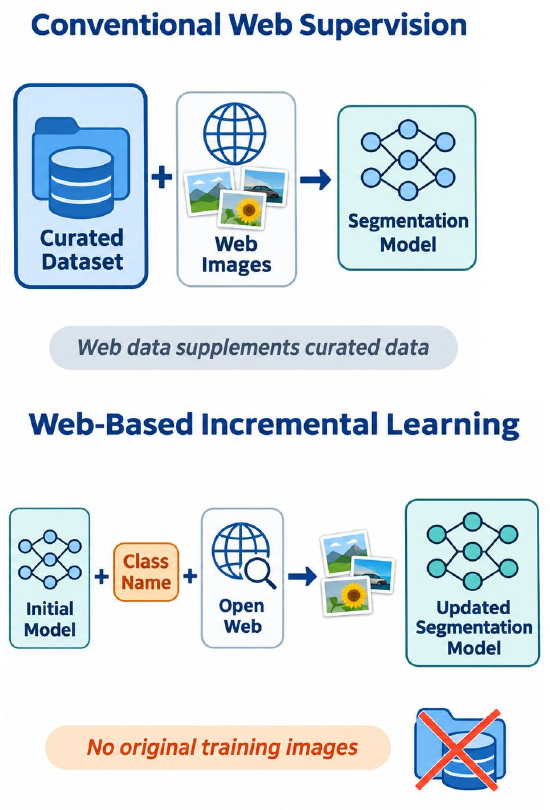

*위 줄이 기존 web supervision이야. curated dataset에 web 사진을 더해서 학습해. 아래 줄이 이 논문의 설정이야. initial model + 새 class 이름 + open web만 쓰고, 빨간 X가 쳐진 DB 아이콘은 원래 training image를 못 쓴다는 뜻이야. (p.77)*

| | Conventional web supervision | New scenario (이 논문) |
|---|---|---|
| web의 역할 | "Web images **supplement** a curated training dataset." | web이 curated dataset을 **대체** |
| class | "Target classes are fixed." | step마다 새 class 추가 |
| 옛 학습 사진 | "Previous training images remain available." | "Original training images are no longer accessible." "Only the initial model is retained." |
| 무엇을 web에서 배우나 | 보충분 | "**New and old** classes must be learned from web images." |

#### 6.2.3 어려움 세 개와 처방 (p.78)

"The web must provide both **new knowledge** and **memory of old knowledge**." (p.78) web이 새 class 학습 재료이자 옛 class 기억 장치가 돼야 한다는 뜻이야.

| 슬라이드의 challenge | 무슨 뜻 | 처방 (페이지) |
|---|---|---|
| 1. Web images have a **different distribution**. | web 사진은 dataset 사진과 생김새가 달라 | **Domain filtering**: dataset 같은 사진만 남김 (p.81) |
| 2. Search queries provide **noisy single-class** labels. | 검색어 "dog"로 받은 사진엔 label이 dog 하나뿐이야. 같이 찍힌 cat·sofa는 label에 없어 | **Caption → multi-label** (p.81) |
| 3. Learning new classes causes **forgetting** of old classes. | 새 class만 보면 옛 class를 잊어 | **Caption 기반 rehearsal** + **Caption filtering** (p.82–83) |

#### 6.2.4 Conventional WILSS vs Proposed Setting (p.79)

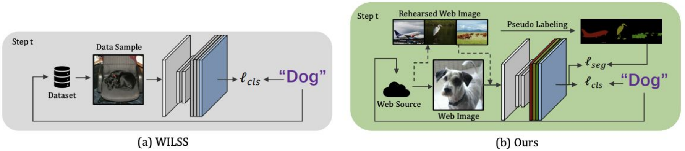

*왼쪽 (a) 회색 박스가 기존 WILSS야. dataset 샘플 하나에 "Dog" 같은 image-level label을 붙여 $\ell_{cls}$만 걸어. 오른쪽 (b) 초록 박스가 제안 설정이야. Web Source에서 받은 사진에 $\ell_{cls}$를 걸고, 위쪽 rehearsed web image(옛 class 사진을 web에서 다시 받은 것)엔 pseudo labeling으로 만든 mask로 $\ell_{seg}$를 걸어. (p.79)*

**Conventional WILSS**
- A new class is introduced at step t.
- Curated dataset images are available.
- Only image-level labels are given for new classes.
- The localizer generates pseudo segmentation labels.

**Proposed Setting**
- New images are downloaded from the **web**.
- Old-class web images are also retrieved for rehearsal.
- **Caption** models provide richer image-level supervision.
- **No original** image is **stored** after the initial step.

← 두 목록은 행끼리 짝이 아니야. 제안 설정에도 localizer는 남아 있어 (p.80 그림의 Localizer).

- $\ell_{cls}$ = image-level classification loss(어떤 class가 있나), $\ell_{seg}$ = pixel 단위 segmentation loss야. 슬라이드엔 기호만 있어.

#### 6.2.5 전체 흐름: Language-Driven Web Learning (p.80)

"Web retrieval → Filtering → Caption labeling → Pseudo labeling → Incremental training" (p.80)

**어떻게**
1. **Retrieve web images**: "Query the web using new class names." / "Retrieve rehearsal images using stored captions."
2. **Filter noisy web images**: "Domain filtering removes out-of-distribution images." / "Caption filtering removes semantically irrelevant images."
3. **Generate supervision**: "Captions are converted into multi-label supervision." / "The previous model produces pixel-level pseudo-labels."
4. **Update the segmentation model**: "Learn new classes from web images." / "Rehearse old classes without storing original images."

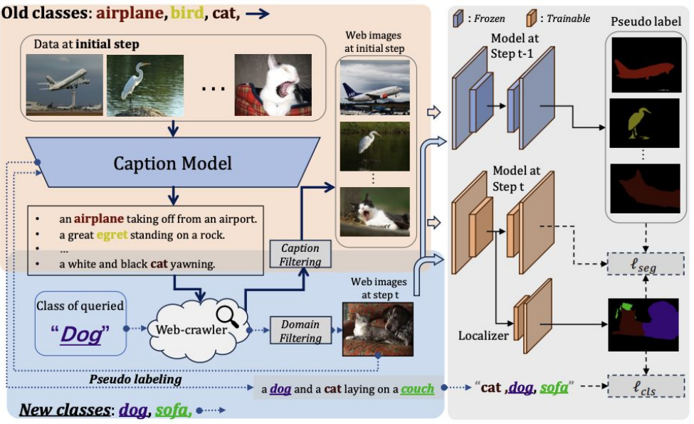

*주황 영역이 옛 class(airplane, bird, cat), 파란 영역이 새 class(dog, sofa)야. 옛 data는 Caption Model로 caption만 남기고, 그 caption으로 web에서 rehearsal 사진을 다시 찾아 Caption Filtering을 거쳐. 새 class는 "Dog"로 Web-crawler를 돌리고 Domain Filtering을 거쳐. 그 사진의 caption "a dog and a cat laying on a couch"가 label "cat, dog, sofa"가 돼. 오른쪽 회색 영역에서 파란(frozen) Step t−1 model이 pseudo label을 만들고, 주황(trainable) Step t model이 $\ell_{seg}$와 $\ell_{cls}$로 학습해. Localizer의 mask도 $\ell_{seg}$·$\ell_{cls}$로 연결돼 있어. (p.80)*

- **언어가 쓰이는 네 곳** ("Language is used for querying, labeling, filtering, and rehearsal."):

| 쓰임 | 언어 | 하는 일 |
|---|---|---|
| querying | 새 class **이름**, 옛 사진의 **caption** | web 검색어 |
| labeling | 새 사진의 **caption** | 단어 → multi-label |
| filtering | 받아 온 사진의 **새 caption** | 저장 caption과 명사 비교 (p.83) |
| rehearsal | 저장해 둔 **caption** | 옛 사진 대신 기억 장치 |

- **target은 어디서 오나**: 새 class의 image-level label은 **caption**에서 와. pixel 단위 pseudo label은 **이전 step model(frozen)**이 옛 class에 대해 만들어 (슬라이드 글: "The previous model produces pixel-level pseudo-labels."). 그림에선 새 class 쪽 mask는 step t model 안의 **Localizer**가 내서 $\ell_{seg}$와 $\ell_{cls}$ 양쪽으로 가는 것으로 그려져 있어 (그림 해석).
- 그림의 작은 디테일: caption 단어 "**couch**"가 label "**sofa**"로 바뀌어. caption 단어를 dataset의 class 이름으로 옮기는 단계가 있다는 뜻이야.

#### 6.2.6 새 class 배우기: Domain filtering + caption multi-label (p.81)

**1. Select Dataset-Like Web Images**: "Query the web using a new class name." "Remove web images with a **large domain gap**." "**Keep** images that **resemble** the original dataset."

$$(p_{ds},\ p_{web}) = \big(p(\mathbf{x}\in\mathcal{X}),\ p(\mathbf{x}\in\mathcal{X}^{web})\big) = M_D\big(|\mathcal{F}(\mathbf{x})|\big), \qquad \text{keep } \mathbf{x} \text{ if } \frac{p_{ds}}{p_{web}} > 1$$

- $\mathbf{x}$: web에서 받은 사진 한 장
- $\mathcal{X}$: 원래 dataset 사진 집합, $\mathcal{X}^{web}$: web 사진 집합
- $p_{ds}$: 이 사진이 **dataset 쪽**일 확률, $p_{web}$: **web 쪽**일 확률
- $M_D$: domain을 맞히는 판별기(discriminator) (논문 보충, 슬라이드엔 기호만)
- $|\mathcal{F}(\mathbf{x})|$: 사진의 Fourier 변환 크기(amplitude) (논문 보충, 슬라이드엔 기호만)
- 판정: $p_{ds}/p_{web} > 1$, 즉 **dataset 쪽일 확률이 더 크면 남겨**.

> 보충 (논문, 슬라이드엔 기호만 있음): $M_D$는 논문에서 **Fourier 기반 domain discriminator**야. Fourier amplitude는 색감·질감 같은 "스타일"을 많이 담아서 domain 차이를 잡기 좋다는 게 직관이야. 원래 사진을 버리기 전(initial step)에 판별기를 학습해 둬야 비교가 가능할 거야 (논문 확인은 안 함, 시험 범위 밖). 시험에선 "a domain discriminator keeps web images that resemble the original dataset" 수준이면 충분해.

**2. Recover Multi-Label Supervision**: "A search query provides only one label." "A caption describes all visible objects." "**Caption** words are **converted** into **image-level labels**."

- 예 (p.80–81 그림): 검색어 "Dog" → label {dog} 하나. caption "a dog and a cat laying on a couch" → label {cat, dog, sofa}.
- 한 줄: "The class name **retrieves** images; the caption **determines** their labels." (p.81)

#### 6.2.7 옛 class 복습: Store Captions, Not Images (p.82)

"Original training images are unavailable after the initial step. The method stores their captions instead. Stored captions are used to retrieve rehearsal images from the web." (p.82)

$$\mathcal{X}_r^{web} = \{\,\mathbf{x} = \mathcal{D}^{web}(q') \mid q' = M_{CAP}(\mathbf{x}) : \mathbf{x}\in\mathcal{X}\,\}$$

- 오른쪽부터 읽어: 옛 사진 $\mathbf{x}\in\mathcal{X}$ → caption model $M_{CAP}$로 caption $q'$ 만들기 → $q'$로 web 검색 $\mathcal{D}^{web}(q')$ → 받은 사진들의 집합이 rehearsal용 $\mathcal{X}_r^{web}$ ($r$ = rehearsal).
- 슬라이드 요약: "Old image → Stored caption q' → Web search → Rehearsal image" / "q': caption of an old training image"
- ← 식에서 $\mathbf{x}$가 "받아 온 web 사진"과 "옛 사진" 두 뜻으로 같이 쓰였어 (슬라이드 표기 그대로).
- **왜 class 이름 대신 caption으로 검색해?** caption이 장면을 더 자세히 말해서 옛 사진과 **더 닮은** 사진이 와. "Caption queries retrieve semantically richer images than class-name queries." (p.84)
- **왜 돼?** 사진은 web에 이미 있어. 내가 들고 있을 건 그걸 다시 찾아올 **열쇠**뿐이야. 그래서 제목이 "The Web as **External Memory**"야.

#### 6.2.8 받아 온 사진 검증: Caption filtering (p.83)

**어떻게** ("Verify the Retrieved Image")
1. "Generate a new caption q'' for the retrieved image."
2. "Compare the nouns in q' and q''."
3. "Keep the image if they belong to a similar semantic family."

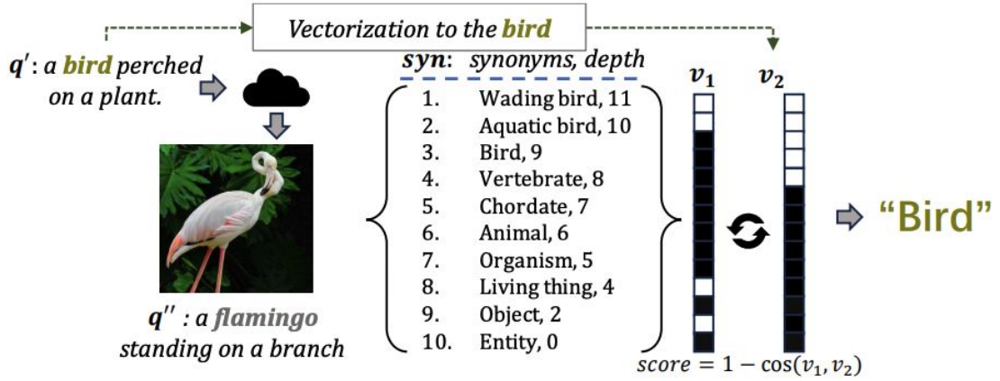

*왼쪽에서 오른쪽으로 읽어. 저장된 caption q'("a bird perched on a plant")로 검색했더니 플라밍고 사진이 왔고, 그 사진에 새 caption q''("a flamingo standing on a branch")를 달아. 가운데는 명사를 상위 개념 사슬(Wading bird → Aquatic bird → Bird → … → Entity, 숫자 = depth)로 펼친 목록이고, 이걸로 벡터 v1, v2를 만들어 score = 1 − cos(v1, v2)로 비교해. 둘이 같은 계열(Bird)이라 사진을 남겨. 목록 머리말은 슬라이드에 "syn: synonyms, depth"라고 적혀 있고, 위 상자엔 "Vectorization to the bird"(= q'의 bird 기준으로 벡터화)라고 쓰여 있어. 내용이 상위어 사슬이라는 건 해석이야. (p.83)*

- bird와 flamingo는 단어가 달라. 그림 해석 (슬라이드엔 설명 없음): 목록은 flamingo에서 **Bird**를 거쳐 Entity로 올라가는 상위어 사슬로 보이고, $v_1$·$v_2$는 두 명사를 이 계층 위에 vectorize한 것으로 보여. 그래서 둘이 "같은 의미 계열"로 판정돼("Bird"). 슬라이드에 글로 적힌 건 "Keep the image if they belong to a similar semantic family."와 score 식까지야.
- depth 숫자는 계층 깊이야. 클수록 구체적이고, Entity(0)가 제일 일반적이야.
- $\text{score} = 1 - \cos(v_1, v_2)$는 **거리**라서 작을수록 비슷해. ← 남기는 기준값은 슬라이드에 없어.
- 한 줄: "Captions serve as **retrieval keys**, and the web serves as **external memory**." (p.83)

> 보충: 이런 상위어(hypernym) 계층은 보통 WordNet 같은 어휘 사전에서 와. 슬라이드엔 사전 이름이 없어. 목록에서 "Object, 2" 다음이 "Entity, 0"이라 depth 1이 빠져 있어 (그림 원문 그대로).

#### 6.2.9 실험 (p.84–85) — 숫자는 비중 낮음

- 설정 이름 읽는 법: "10-10" = 처음 class 10개 → 다음 step에 10개 더. "15-5" = 15 → 5. "10-1" = 10개 뒤에 **하나씩** 10 step. 열은 10-10이면 1-10(옛)/11-20(새)/All, 15-5면 1-15(옛)/16-20(새)/All이야 (지표 이름은 슬라이드에 없어).
- **새 class 학습 (Table 4)**: "Domain filtering reduces the web-to-dataset gap." "Caption labeling corrects incomplete single-class supervision." "The two components are complementary." 둘 다 쓰면 10-10 All 62.1 → 65.0 (**+2.9**). 하나만 쓰면 63.1(domain filtering) / 63.6(caption labeling).
- **web rehearsal (Table 5)**: "Caption filtering removes irrelevant retrievals." "Querying and filtering work best together." 둘 다 쓰면 15-5 All 69.8 → 73.4 (**+3.6**). 하나만 쓰면 72.6(caption query) / 71.9(caption filtering).
- **forgetting이 얼마나 심한가 (p.85 Table 3)**: memory 없이 학습하면 10-1 All이 WILSON **0.1**, RaSP **1.3**이야. 옛 class는 물론 앞 step에서 배운 새 class까지 거의 다 잊어서 성능이 0 근처야 (WILSON: 1-10 0.0, 11-20 0.2).
- **이 논문 (p.85)**: 같은 WEB+WEB 조건에서 10-1 All이 WILSON 42.9 → Ours **54.4**. "The proposed method improves the challenging 10–1 result substantially." "Caption-based rehearsal is particularly valuable in multi-step learning."
- 결론: "The web is not only a source of new data. It can serve as an **external semantic memory**." (p.85)
- ← p.85 표 caption은 "single-step multi-class"인데 15-1·10-1은 class 하나씩 여러 step 추가하는 설정이라 이름이 반대로 보여 (원문 유지).
- ← p.84 왼쪽 아래에 p.87의 "Homogeneous Supervision" 글상자가 잘린 채로 남아 있어 (편집 잔여물로 보여. p.84 내용 아님).

> 보충: "Overlapped"는 incremental segmentation 쪽 용어로, step t 사진에 옛 class나 아직 안 배운 class가 (배경으로) 같이 찍혀 있어도 되는 설정이야 (슬라이드엔 설명 없음, 시험 범위 밖). WILSON, RaSP는 표의 비교 대상(이전 WILSS 방법)이고 슬라이드엔 설명이 없어.

> RL로 번역 (슬라이드 밖, 시험 범위 아님)
> - rehearsal ↔ **replay buffer**. 단 이 논문은 buffer에 transition이 아니라 "다시 찾아올 검색어(caption)"만 넣어. 다시 받은 사진은 원본과 같지 않아.
> - catastrophic forgetting ↔ 새 task로 fine-tuning한 policy가 옛 task에서 무너지는 **policy drift** (continual RL).
> - frozen step t−1 model이 pseudo label을 만들어 주는 것 ↔ **policy distillation**. 옛 model의 출력을 (hard) target으로 써서 잊지 않게 하는 self-distillation 느낌이야.
> - domain filtering ↔ off-policy data 중 현재 분포와 너무 다른 sample을 버리는 것. 단 importance weight를 곱하는 게 아니라 비율 > 1로 **잘라** 버려.

---

### 6.3 WISH: Weakly Supervised Instance Segmentation using Heterogeneous Labels (p.86–95) — Kweon & Yoon, CVPR 2025

> ← 슬라이드엔 cite가 없어. 웹으로 확인한 원 논문은 Hyeokjun Kweon, Kuk-Jin Yoon, "WISH: Weakly Supervised Instance Segmentation using Heterogeneous Labels", CVPR 2025야. 이름 WISH는 제목 앞부분 그대로야. 글자를 맞춰 읽으면 **W**eakly supervised **I**nstance **S**egmentation using **H**eterogeneous labels로 읽혀 (논문이 글자별로 풀었는지는 확인 안 함).

**section 질문 (p.86)**: "Under a fixed annotation budget, should every image receive the same type of weak label?"

#### 6.3.0 먼저 깔 용어

- **semantic vs instance segmentation**: semantic은 pixel마다 class만 칠해서 붙어 있는 사람 둘이 한 덩어리 "person"이야. **instance segmentation**은 물체 **하나하나**를 따로 mask로 내서 사람 1, 사람 2가 구분돼. 이 논문은 instance segmentation이야 (앞 §1–§6.2는 semantic).
- **WSIS** = Weakly Supervised Instance Segmentation (p.95 "Conventional WSIS").
- **weak label 세 종류** (instance 기준):
  - **tag** = 사진에 어떤 class가 있는지만 (image-level label). 제일 싸고, 위치가 **없어**.
  - **point** = 물체마다 안쪽에 점 하나. 정보와 비용이 중간이야.
  - **box** = 물체마다 bounding box. 정보가 많고 비싸.
- **annotation budget** = label 다는 데 쓸 수 있는 총비용(시간·돈)이야.
- **SAM (Segment Anything Model)** = 사진과 **prompt**(점이나 box)를 주면 그 물체의 mask를 내 주는 대형 pretrained segmentation model이야. prompt를 벡터로 바꾸는 **prompt encoder**와 mask를 그리는 **mask decoder**가 있어. 점 하나로는 "셔츠"인지 "사람 전체"인지 모호해서 prompt 하나에 mask 후보를 **3개** 줘 ("SAM returns three masks for each prompt", p.94).
- **prompt latent / prompt space** = prompt encoder가 점·box를 바꾼 벡터가 prompt latent고, 그 벡터들이 사는 공간이 prompt space야.
- **Mask2Former / object query** = Mask2Former는 학습되는 벡터 $N$개(**object queries**)를 갖고, query 하나가 물체 하나를 맡아서 그 class와 mask를 내는 segmentation model이야.
- **Hungarian matching** = 예측 $N$개와 정답 $M$개를 **1:1로** 짝지을 때, 짝들의 cost 합이 **최소**가 되는 조합을 찾는 알고리즘이야. 물체 집합엔 순서가 없어서 "몇 번 query가 몇 번 물체를 맡나"를 이걸로 정해.
- **KLD** = KL(Kullback–Leibler) divergence, 두 분포가 얼마나 다른지 재는 값이야. ← 슬라이드엔 prompt latent를 어떻게 분포로 보는지 정의가 없어.
- **AP / mAP** = Average Precision, detection·instance segmentation의 대표 성능 지표야. 높을수록 좋아.

#### 6.3.1 한눈에

- **한 줄**: tag·point·box가 **섞인** dataset을 한 model로 학습하는 instance segmentation 방법이야. SAM의 prompt space를 weak label들의 **공용어**로 써.
- **문제**: 기존 WSIS는 dataset 전체에 label 종류를 **하나만** 정하고, tag·point·box를 따로따로 다뤘어 (p.95). 그런데 tag는 싸지만 위치가 없고, box는 정확하지만 비싸.
- **핵심**: "SAM's prompt space serves as a common representation for heterogeneous supervision." (p.88) 모든 weak label을 SAM prompt latent로 바꾸고, query가 그 latent를 예측하게 해. tag는 CAM 봉우리로 point prompt를 만들어 같은 공간에 넣어 (p.91).
- **차이**: Homogeneous(모든 사진이 같은 label 종류) → **Heterogeneous**(사진마다 종류가 달라도 됨). 같은 예산에서 섞은 쪽이 한 종류만 쓴 쪽보다 좋아 (p.92).

#### 6.3.2 Homogeneous vs Heterogeneous Supervision (p.86–87)

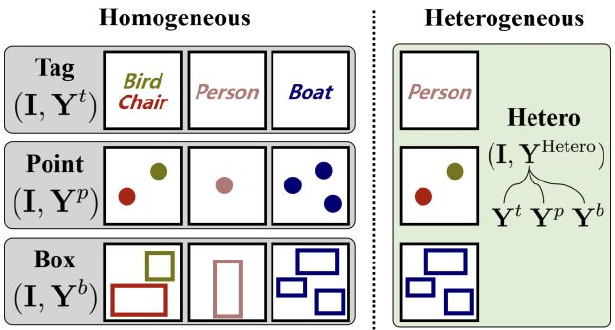

*왼쪽 회색 칸이 homogeneous야. 행 하나가 label 종류 하나(Tag / Point / Box)고, 사진 세 장이 전부 같은 종류야. 오른쪽 초록 칸이 heterogeneous야. 사진마다 tag, point, box 중 하나씩만 붙어. 색은 class를 뜻해. (p.87)*

| | Homogeneous Supervision | Heterogeneous Supervision |
|---|---|---|
| 정의 | "Every training image uses the same weak label type." | "Different images may use **different weak label** types." |
| 특징 | "Tags are cheap but provide no localization." "Boxes are informative but expensive." "Points provide an intermediate level of supervision." | "**Cheap** labels provide **broad** data coverage." "**Strong** labels provide **accurate** localization." |
| model | label 종류마다 따로 (p.95 "separate settings"에서 추론, 슬라이드 문장 아님) | "A **single model** learns from **all label types**." |

$$\mathbf{Y}_i^{\text{Hetero}} = \mathbf{Y}_i^t \ \text{ or } \ \mathbf{Y}_i^p \ \text{ or } \ \mathbf{Y}_i^b$$

- 사진 $i$의 label은 tag($t$), point($p$), box($b$) **중 하나**라는 뜻이야.
- ← p.87 왼쪽 아래 작은 글씨("Class matching identifies …" 네 줄)는 p.90 본문과 같은 글이 남은 거야 (편집 잔여물로 보여).

#### 6.3.3 공용어: SAM prompt space (p.88)

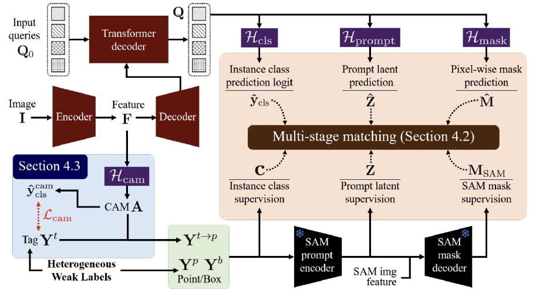

*위쪽이 Mask2Former 구조야. Image → Encoder → Feature F → Decoder가 있고, Transformer decoder가 object query Q를 만들어. Q에서 세 head(H_cls, H_prompt, H_mask)가 class logit, prompt latent, mask를 예측해. 아래쪽 얼음 표시(frozen) SAM prompt encoder와 mask decoder가 weak label(point/box)에서 정답 격인 C, Z, M_SAM을 만들고, 가운데 Multi-stage matching이 예측과 이 supervision을 짝지어. 왼쪽 아래 파란 상자(Section 4.3)는 tag를 CAM으로 point prompt($\mathbf{Y}^{t\to p}$)로 바꾸는 가지야. 그림 글자 "Prompt laent"는 latent의 오타야. (p.88)*

- **왜 공용어가 필요해?** tag는 단어, point는 좌표 하나, box는 좌표 네 개라서 생김새가 달라. 그대로는 한 loss로 비교하기 어려워.
- **어떻게**: SAM의 prompt encoder가 공용 번역기야.
  - "Point prompt → point latent"
  - "Box prompt → box latent"
  - "Tag → converted point prompt" (p.91에서 point로 바꾼 뒤 point latent로)
  - 그래서 "Weak labels with different formats become comparable in one space."
- **query가 latent를 예측**: query마다 prompt head를 하나 더 달아.

$$\hat{\mathbf{Z}} = \mathcal{H}_{\text{prompt}}(\mathbf{Q})$$

  - $\mathbf{Q}$: Mask2Former object queries, $\mathcal{H}_{\text{prompt}}$: prompt prediction head, $\hat{\mathbf{Z}}$: predicted prompt latent (p.88)
  - 이 예측이 weak label의 latent $\mathbf{Z}$와 맞으면, query는 "내가 **어느 instance**를 맡는지" 배워. "The model learns what instance each query should represent."
- **target은 어디서 오나**: class target $\mathbf{C}$는 weak label의 class에서, prompt target $\mathbf{Z}$는 **frozen SAM prompt encoder**에서, mask target $\mathbf{M}_{SAM}$은 **frozen SAM mask decoder**에서 와. SAM 두 부분은 frozen이고, 나머지(Mask2Former 쪽과 CAM head)가 학습돼 (그림의 얼음 표시 기준).

> 보충 (논문, 슬라이드엔 없음): 논문 abstract 기준으로 WISH는 SAM의 prompt latent space를 weak label 공통 표현으로 쓰고, multi-stage matching으로 tag에 없는 spatial 정보를 보완해. 다른 방법과의 대비는 확인 못 했어 (시험 범위 아님).

#### 6.3.4 Multi-stage matching: 어느 query가 어느 weak label을 맡나 (p.89–90)

**왜 matching부터?** query는 $N$개인데 사진 속 weak label은 몇 개뿐이야. 짝을 정해야 짝끼리 loss를 걸 수 있어.

$$\text{Cost}^{i,j}_{\text{cls}} = \hat{\mathbf{y}}^i_{\text{cls}}(\mathbf{c}^j)$$

- **Class matching**: "Does query $i$ predict the class of weak label $j$?" query $i$가 weak label $j$의 class $\mathbf{c}^j$에 주는 예측값이야. ← 슬라이드 식 그대로면 확률이라 **클수록 좋은** 값이야. 최소 cost를 찾는 matching이라면 보통 음수 부호(−확률)를 붙여 써. 슬라이드엔 부호가 없어 (원문 유지).

$$\text{Cost}^{i,j}_{\text{prompt}} = \text{KLD}(\hat{\mathbf{Z}}^i, \mathbf{Z}^j)$$

- **Prompt matching**: "Does the predicted query represent a similar point or box prompt?" 예측 latent와 weak label latent 사이의 KL divergence야. 작을수록 같은 점·box를 가리켜.

$$\text{Cost}^{i,j}_{\text{mask}} = \min_{n\in\{1,2,3\}} d\big(\hat{\mathbf{M}}^i, \mathbf{M}^{j,n}_{\text{SAM}}\big)$$

- **Mask matching**: "Select the SAM candidate mask closest to the predicted instance mask." SAM이 weak label $j$의 prompt로 낸 mask 후보 3개($n = 1, 2, 3$) 중 예측 mask $\hat{\mathbf{M}}^i$와 **제일 가까운** 것과의 거리야. $d$는 mask 사이 거리고, 슬라이드엔 정의가 없어.

$$\text{Cost}^{i,j} = \alpha\,\text{Cost}^{i,j}_{\text{cls}} + \beta\,\text{Cost}^{i,j}_{\text{prompt}} + \gamma\,\text{Cost}^{i,j}_{\text{mask}}$$

- $\alpha, \beta, \gamma$는 세 항의 비중이야. ← 이 $\beta$는 p.92의 $\beta_t, \beta_p, \beta_b$(label 종류별 비용)와 **다른 뜻**이야.

**세 질문으로 외우기** (p.90):

| matching | 묻는 것 | 슬라이드 문장 |
|---|---|---|
| Class | **what** it is | "Class matching identifies the **semantic category**." |
| Prompt | **where** it is | "Prompt matching identifies the approximate instance **location**." |
| Mask | **which SAM mask** fits it best | "Mask matching transfers **SAM's** segmentation **knowledge**." |
| Hungarian | 최종 1:1 배정 | "Hungarian matching assigns predictions to weakly labeled instances." |

- 한 줄: "WISH matches an instance by asking **what** it is, **where** it is, and **which SAM mask** fits it best." (p.90)

**예시로 보면** (설명용 숫자, 슬라이드 값 아님): query 3개, weak label 2개(개의 point, 고양이의 box)인 사진.

| | label 1 (dog, point) | label 2 (cat, box) |
|---|---|---|
| query 1 | **0.2** | 0.9 |
| query 2 | 0.8 | **0.3** |
| query 3 | 0.7 | 0.6 |

- Hungarian matching은 합이 최소인 1:1 짝을 골라: query 1 ↔ label 1, query 2 ↔ label 2 (합 0.5). query 3은 짝이 없어서 "물체 없음"으로 학습돼 (Mask2Former 일반 동작, 보충).
- 짝이 정해지면 같은 세 항목으로 loss를 걸어: class, prompt latent($\mathcal{L}_{prompt}$), SAM mask($\mathcal{L}_{mask}$). p.88 그림의 supervision 세 개와 p.94 표의 loss 이름이 이거야.

#### 6.3.5 Tag를 instance prompt로 바꾸기 (p.91)

tag엔 위치가 없어서 prompt space로 바로 못 보내. 그래서 **CAM으로 위치를 만들어서 point prompt로 바꿔**.

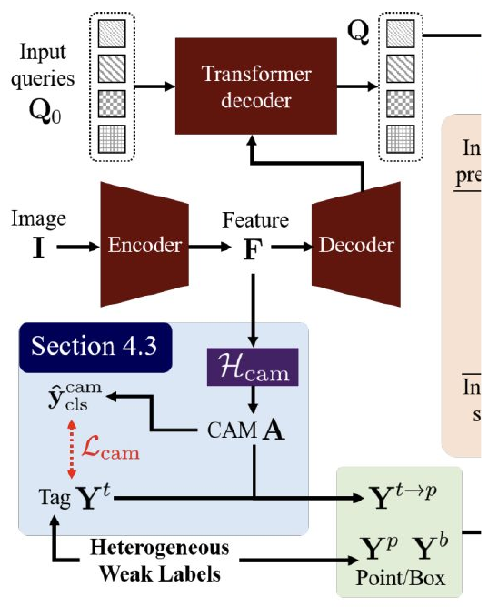

*위에서 아래로 읽어. 사진이 Encoder를 지나 feature F가 되고, F가 H_cam을 거쳐 CAM A가 돼. tag $\mathbf{Y}^t$는 CAM의 class 예측($\hat{\mathbf{y}}^{cam}_{cls}$)을 $\mathcal{L}_{cam}$으로 학습시키고, CAM A의 봉우리에서 point prompt $\mathbf{Y}^{t\to p}$를 만들어. 오른쪽 초록 칸에서 이게 진짜 point/box label($\mathbf{Y}^p, \mathbf{Y}^b$)과 같은 자리로 들어가. (p.91)*

**어떻게**
1. **Generate CAMs**: "CAM provides rough **class-specific localization**." "**Local maxima** are extracted from each class activation map."

$$\mathbf{A} = \mathcal{H}_{\text{cam}}(\mathbf{F})$$

   - $\mathbf{F}$: encoder feature, $\mathcal{H}_{\text{cam}}$: CAM head, $\mathbf{A}$: class별 activation map. §2.3(p.24–26)의 CAM이야.
2. **Convert CAM peaks into point prompts**: "Each selected **CAM peak** becomes a positive point prompt." "**SAM** generates an **instance mask** from each point." "Overlapping masks are grouped to identify individual instances."

$$\mathbf{Y}_i^{t\to p} = \{(\mathbf{X}_i^1, \mathbf{c}_i^1), \dots, (\mathbf{X}_i^{k'_i}, \mathbf{c}_i^{k'_i})\}$$

   - 사진 $i$의 tag가 (점 위치 $\mathbf{X}$, class $\mathbf{c}$) 쌍 $k'_i$개로 바뀌었어. $t\to p$ = tag → point.
   - 봉우리 하나 = 물체 하나일 가능성이 커. 같은 물체에 봉우리가 여러 개면 SAM mask가 많이 겹치니까 묶어서 하나로 쳐.
3. **Improve CAMs with model predictions (self-enhancement)**:

$$\mathcal{L}_{\text{self}} = \mathcal{L}_{\text{bce}}(\mathbf{A}, \hat{\mathbf{M}}_c)$$

   - model이 지금 예측한 class $c$의 instance mask $\hat{\mathbf{M}}_c$를 target으로 CAM $\mathbf{A}$를 BCE(binary cross-entropy)로 다시 학습시켜.
   - p.94 설명: "Current instance masks refine the CAM. Improved CAMs generate better point prompts for tag supervision."
   - ← p.91의 3번 아래 bullet 세 줄은 2번 bullet을 그대로 복사한 거라 3번 내용과 안 맞아 (원문 유지). 3번의 실제 뜻은 위 식과 p.94 문장이야.

- 한 줄: "**CAM** supplies missing **spatial cues**, and **SAM** turns those cues into **instance-level masks**." (p.91)
- **§2와 연결**: CAM의 약점은 discriminative part만 켜지고 경계가 거칠다는 거였어 (§2.5, p.28). point prompt를 만들 땐 CAM의 **봉우리 위치**만 쓰고 mask 모양은 SAM이 그려 (보충). CAM 자체는 $\mathcal{L}_{cam}$, $\mathcal{L}_{self}$로 계속 학습·개선돼. CAM이 "어디쯤"을, SAM이 "어디까지"를 맡는 분업이야.

#### 6.3.6 어떤 label을 살까: 예산 제약 (p.92)

"Tags are cheap, so many images can be labeled." "Boxes are expensive, so fewer images can be labeled." "Strong supervision and broad data coverage must be balanced." "WISH searches for effective heterogeneous combinations." (p.92)

$$N_t\beta_t + N_p\beta_p + N_b\beta_b = \zeta$$

- $N_t, N_p, N_b$: tag / point / box가 달린 사진 수, $\zeta$: 고정된 총 annotation 예산
- $\beta_t, \beta_p, \beta_b$: label 종류별 장당 비용 ← 슬라이드 목록엔 $\beta$ 설명이 빠져 있어.
- 표 (PASCAL VOC val, 같은 예산, 비중 낮음):
  - tag만 46.0, point만 44.7, box만 45.1
  - tag + point 섞은 최고 **47.3**, tag + box 섞은 최고 **48.3**
  - 양 끝보다 **가운데**가 높아. "A balanced mixture can outperform either weak label alone under the same annotation cost." (p.92)
- 설명용 계산 (표에서 거꾸로 구한 비율, 슬라이드에 적힌 값 아님): tag 2,646장 대신 point 441장 또는 box 약 220장을 살 수 있어. point 1장 ≈ tag 6장, box 1장 ≈ tag 12장 값으로 설정한 셈이야.

#### 6.3.7 왜 섞으면 되나 (p.93)

| | Tags | Points and Boxes | Heterogeneous |
|---|---|---|---|
| 사진 수 | "Many images can be labeled." | "Fewer images can be annotated." | 둘 다 |
| 주는 것 | **Coverage**: "The model observes diverse appearances and contexts." | **Localization**: "Object locations are explicitly provided." "Boxes provide stronger spatial constraints." | "Tags improve data coverage." "Points and boxes anchor instance localization." |
| 약점 | "Localization is weak." | 사진이 적어 | — |

- 섞은 효과가 한 model 안에서 이어지는 이유: "**SAM's prompt space transfers information across label types.**" (p.93)
- 한 줄: "Cheap labels provide **breadth**, while strong labels provide **spatial precision**." (p.93)

#### 6.3.8 부품별 효과 (p.94) — 숫자는 비중 낮음

| 부품 | 무엇을 위해 있나 (슬라이드) | 빼면 (Table 4, mAP) |
|---|---|---|
| **Prompt matching** ($\mathcal{L}_{prompt}$) | "Aligns object queries with weak annotations in SAM's latent space." "Helps the model learn instance identity **without mask ground truth**." | 46.0 → 43.6 (A) |
| **Adaptive SAM mask matching** ($\mathcal{L}_{mask}$) | "SAM returns three masks for each prompt." "WISH selects the candidate **closest to the current prediction**." "Adaptive selection outperforms using a fixed mask level." | 고정 level Lv1/Lv2/Lv3: 36.2 / 40.7 / 42.8 (B–D) |
| **Self-enhancement** ($\mathcal{L}_{self}$) | "Current instance masks refine the CAM." "Improved CAMs generate better point prompts for tag supervision." | 46.0 → 41.5 (E) |

- 셋 다 쓴 WISH(F)가 **46.0**으로 제일 높아. ← 이 46.0은 p.92 표의 tag-only 값과 같아서 tag-only 설정의 실험으로 보여 (추정). 섞은 설정 최고치는 48.3(p.92)이야. "Prompt matching, adaptive mask selection, and self-enhancement are **complementary**." (p.94)

#### 6.3.9 정리: 한 종류의 label에서 label portfolio로 (p.95)

| Conventional WSIS | WISH |
|---|---|
| "Chooses one weak label type for the entire dataset." | "Combines different label types in one model." |
| "Treats tags, points, and boxes as separate settings." | "Uses SAM's prompt space as a common representation." |
| | "Matches predictions using class, prompt, and mask information." |
| | "Achieves better cost–performance trade-offs." |

- 결론: "The optimal supervision strategy may be a **portfolio** of weak labels, not a single annotation type." (p.95) portfolio = 투자에서 여러 자산을 섞어 담듯, label도 한 종류에 몰지 말고 **섞어 사라**는 뜻이야.

> RL로 번역 (슬라이드 밖, 시험 범위 아님)
> - Hungarian matching ↔ 여러 agent와 여러 task를 1:1로 배정하는 **assignment problem** (multi-agent task allocation). Hungarian 알고리즘의 원래 문제가 이거야.
> - heterogeneous label mix ↔ 대량의 저품질 play data + 소량의 전문가 demo를 섞는 로봇 학습 data mix. 싼 data는 coverage, 비싼 data는 precision을 줘.
> - self-enhancement (model 예측 → CAM target → 더 좋은 prompt) ↔ 자기 예측을 target으로 다시 쓰는 bootstrapping. 처음 예측이 틀리면 오차가 쌓일 수 있다는 위험도 같아 (L07 confirmation bias).
> - frozen SAM이 target 생성 ↔ 고정된(frozen) pretrained reward model / teacher가 학습 신호를 주는 구도. 단 RL의 target network는 천천히 갱신된다는 점이 달라.

#### 6.3.10 두 최신 논문 비교 (6.2 vs 6.3)

| | 6.2 Learning from the Web (Liu, ECCV 2024) | 6.3 WISH (Kweon & Yoon, CVPR 2025) |
|---|---|---|
| task | semantic segmentation, class **incremental** | **instance** segmentation |
| 아끼려는 것 | curated dataset + 사람 image label + 옛 사진 저장 | 비싼 label (box) |
| 대신 쓰는 것 | **web** 사진 + **caption** (언어) | **싼 label을 섞은** 예산 배분 + **SAM** |
| 공용 표현 | 언어 (검색어·label·필터·memory) | SAM **prompt space** |
| CAM의 역할 | localizer가 pseudo segmentation label을 만듦 (기존 WILSS 틀) | tag → **CAM peak** → point prompt |
| 핵심 문장 | "The web … can serve as an external semantic memory." | "The optimal supervision strategy may be a portfolio of weak labels." |

- 공통점: 둘 다 **큰 pretrained model**(caption model, SAM)을 빌려서 모자란 supervision을 메워. §2–§4가 "label 하나로 pixel label을 짜내는" 방법이었다면, 여기선 "**밖에 있는 지식**(web, 언어, foundation model)을 끌어오는" 쪽이야.

## 7. Next (p.96)

- "Next Week.. / Active learning .." (p.96). 다음 강의(W12 11/19)는 **Active learning**이야.
- 연결 고리: WISH는 "예산 안에서 **어떤 종류의** label을 살까"를 물었어. active learning은 "**어느 사진**에 label을 달까"를 묻는 쪽일 거야 (예고, 내용은 다음 강의에서 확인).

---

## 시험 대비 핵심 정리

### 꼭 외울 수식

"어디 있나" 열이 **보충**이면 슬라이드엔 식이 없어서 비중을 낮게 둬. 그래도 개념 설명엔 바로 쓰여.

| 이름 | 식 | 기억할 것 | 어디 있나 |
|---|---|---|---|
| Gradient saliency (p.21) | $\left.\dfrac{\partial S_c}{\partial I}\right\vert_{I_0}$ | 입력에 대한 class 점수의 gradient야. pixel 단위라 noisy (salt-and-pepper) | 그림 안 |
| SmoothGrad (p.22) | $\hat M_c(I) = \frac{1}{n}\sum_{i=1}^{n} M_c(I+\epsilon_i)$, $\epsilon_i \sim \mathcal N(0,\sigma^2)$ | noise 넣고 **50번** 반복한 뒤 **average**해 (max·sum 아님) | 단계만 (식은 보충) |
| CAM (p.25) | $M_c(x,y) = \sum_k w_k^c f_k(x,y)$ | feature map은 같고 weight만 class마다 달라 → per-class map | 그림만 (식은 보충) |
| 점수 = CAM 평균 (p.24–25) | $S_c = \frac{1}{Z}\sum_{x,y} M_c(x,y)$ | GAP와 선형 결합이 둘 다 선형이라 순서를 바꿀 수 있어 (bias 무시) | 유도는 보충 |
| Seed threshold (p.27) | $\mathbf M'_k > \tau_{loc} \Rightarrow \mathbf B_k$ | $\tau_{loc}$ = **threshold** (temperature·EMA 계수 아님). 이 그림에선 $k$ = class, $C$ = channel | 그림 안 |
| GWRP (p.31 이름만) | $G_c = \frac{1}{Z(d_c)}\sum_j (d_c)^{j-1} f_{i_j,c}$ (내림차순) | $d_c=0$이면 max, $d_c=1$이면 average, 그 사이면 적당히 넓힘 | 논문 보충 |
| SEC 전체 (p.31) | $L = L_{seed} + L_{expand} + L_{constrain}$ | seed loss는 **seed pixel에서만** 걸려. constrain = KL(CRF 출력 $Q$ ‖ 예측 $f$) | 논문 보충 |
| Equivariance (p.35) | $F(A(I)) = A(F(I))$ ↔ invariance $F(A(I)) = F(I)$ | CAM·segmentation = equivariant, 분류 = invariant | 정의는 보충 |
| SEAM (p.36 loss 이름) | $L_{ER} = \Vert A(\hat y^o) - \hat y^t\Vert_1$, $L_{ECR} = \Vert A(y^o) - \hat y^t\Vert_1 + \Vert A(\hat y^o) - y^t\Vert_1$ | ER은 PCM 거치기 전 CAM끼리 (원본 갈래 ↔ 변환 갈래), ECR은 PCM 출력 ↔ 반대 갈래의 CAM | 논문 보충 |
| Adversarial Erasing (p.39) | $I_{t+1} = I_t \ominus F_t$ | 가장 센 영역 $F_t$를 지우고 다시 학습. $F_1, F_2, \dots$를 합친 게 object region | 그림 안 |
| CD-CLIP 분포 (p.67) | $\mathbf S_a = \text{Min-max}(\text{CosSim}(\mathbf F, \mathbf T_{all}))$ | patch마다 **모든 class**(target + super)에 대한 점수 | 슬라이드 |
| CD-CLIP CDA (p.69) | $\mathbf S_d = \big(1 - D_{JS}(\text{Softmax}(\mathbf S_a)\,\Vert\,\text{Softmax}(\mathbf S_a)^{\mathrm T})\big)/\tau$, $\mathbf A_d = \text{Softmax}(\mathbf S_d)\cdot\mathbf A_{init}$, $\mathbf M^c_{re} = \mathbf M^c_{init}\cdot(\mathbf A_d)^t$ | JS가 **작을수록** 유사도가 커. initial affinity를 고친 뒤 $t$번 퍼뜨려 | 슬라이드 |
| JS divergence (기초) | $D_{JS}(P\Vert Q) = \frac12 D_{KL}(P\Vert M) + \frac12 D_{KL}(Q\Vert M)$, $M = \frac12(P+Q)$ | 대칭이고 유한해. 같은 분포면 0 | 기초 정의 |
| CD-CLIP SBE (p.70) | $\mathbf f^n_s = \text{CAP}(\mathbf M^n_s \odot \mathbf F_d)$, $\mathbf M^n_p = \text{ReLU}(\text{CosSim}(\mathbf f^n_s, \mathbf F_d))$ | CLIP super CAM으로 **DINO** feature를 평균 → prototype → prototype CAM | 슬라이드 |
| CD-CLIP loss (p.72) | $\mathcal L = \mathcal L_{seg} + \lambda_1\mathcal L_b$, $\mathcal L_b = \text{Dice}(\mathbf P, \mathbf Y_s)$ if $\vert\mathbf C_p\vert \ge 2$, else 0 | super-class가 **2개 이상**일 때만 boundary loss | 슬라이드 |
| Domain filtering (p.81) | $(p_{ds}, p_{web}) = M_D(\vert\mathcal F(\mathbf x)\vert)$, keep if $p_{ds}/p_{web} > 1$ | dataset 쪽일 확률이 더 크면 **남겨** | 슬라이드 |
| Caption rehearsal (p.82) | $\mathcal X_r^{web} = \{\mathbf x = \mathcal D^{web}(q') \mid q' = M_{CAP}(\mathbf x) : \mathbf x\in\mathcal X\}$ | 옛 사진 → caption → web 검색 → rehearsal 사진 | 슬라이드 |
| Caption filtering (p.83) | $\text{score} = 1 - \cos(v_1, v_2)$ | 거리라서 **작을수록** 비슷해 | 그림 안 |
| WISH label · head (p.87–88) | $\mathbf Y_i^{\text{Hetero}} = \mathbf Y_i^t$ or $\mathbf Y_i^p$ or $\mathbf Y_i^b$, $\hat{\mathbf Z} = \mathcal H_{\text{prompt}}(\mathbf Q)$ | 사진마다 label 종류 하나. query가 prompt latent를 예측 | 슬라이드 |
| WISH matching (p.89) | $\text{Cost} = \alpha\,\text{Cost}_{cls} + \beta\,\text{Cost}_{prompt} + \gamma\,\text{Cost}_{mask}$, $\text{Cost}_{prompt} = \text{KLD}(\hat{\mathbf Z}^i, \mathbf Z^j)$, $\text{Cost}_{mask} = \min_{n\in\{1,2,3\}} d(\hat{\mathbf M}^i, \mathbf M^{j,n}_{SAM})$ | what / where / which SAM mask. 이 $\beta$는 p.92의 비용 $\beta$와 **다른 뜻** | 슬라이드 |
| WISH tag → point (p.91) | $\mathbf A = \mathcal H_{cam}(\mathbf F)$, $\mathcal L_{self} = \mathcal L_{bce}(\mathbf A, \hat{\mathbf M}_c)$ | CAM peak → point prompt. 예측 mask가 CAM을 다시 가르쳐 (self-enhancement) | 슬라이드 |
| WISH budget (p.92) | $N_t\beta_t + N_p\beta_p + N_b\beta_b = \zeta$ | 고정 예산 안에서 label 종류를 배분해 | 슬라이드 |

### 꼭 외울 정의 (슬라이드 원문)

**Part 1 (p.3–17)**
- **Fully vs weakly**: "Fully supervised" → **Directly** supervised / "Weakly supervised" → **Indirectly** supervised (p.4, 그림 안 글자)
- **Priors**: "what do I believe to be true independent of any particular image sample" (p.5)
- **Hints**: "indirect supervision received for each image" (p.5) ← "There are only two sources of information"
- **Priors 목록** (p.6–10): Size, Location, Shape / Number of instances, Contrast / Boundaries, saliency / Class Distribution / Similarity across images / Similarity with external images
- **Hints 목록** (p.11–17): Image (video) label / Image caption / Click inside object / Object bound boxes / Object extreme points / Scribbles / Eye gaze

**Part 2 (p.18–42)**
- **목표** (p.19): "Image-level labels at training time" → "Pixel-level labels at test time"
- **Gray box** (p.20): "Utilize the internal information in the network." / "it identifies which areas the model focused on for classification by leveraging the activations or gradients within the CNN."
- **Gradient saliency의 문제** (p.21): "it is extremely noisy" / "the gradient measures sensitivity at the level of individual pixels, resulting in a "salt-and-pepper" appearance."
- **SmoothGrad** (p.22): "calculating the gradient multiple times and averaging it removes noise and yields a more meaningful saliency map."
- **근본 한계** (p.23): "Asking apples from the oranges tree" / "Classifier was not built nor trained to segment objects." / "it highlights only the specific regions necessary for classification rather than the entire object."
- **White box** (p.24): "Step 1) eliminate the FC layer / Step 2) add GAP (Global Average Pooling) / Step 3) add a 1×1 convolution that performs a linear combination of the features"
- **CAM** (p.25): "since the network itself is designed to preserve spatial information, activation maps can be obtained directly without the need for separate gradient calculations."
- **Per-class** (p.26): "Designed to Generate Per-Class Maps"
- **Seeds** (p.27): "The Class Maps are Thresholded, to Generate Training Data" / "High value scores → Foreground areas" / "Low value scores → Background areas" / "(This confident regions are commonly named "seeds")" ← 원문 문법 그대로
- **두 문제** (p.28): "1. Resulting masks are not sharp" / "2. Focused on discriminative area only"
- **SEC** (p.31): "Seed: Preserve reliable CAM activations." / "Expand: Grow seeds to cover the entire object using image-level supervision." / "Constrain: Refine object boundaries with CRF-based regularization."
  - Expansion loss: "Use image-level labels via Global Weighted Rank Pooling (GWRP)"
  - Constrain-to-boundary: "Refine predictions using CRF", "Encourage masks to align with image boundaries"
- **Oh et al.** (p.34): CAM "Provides class-specific localization", "Covers only discriminative regions" / Saliency "Provides complete object extent", "Class-agnostic foreground estimation" / "Combine CAM and saliency to generate class-specific pseudo masks"
- **SEAM** (p.35–36): "Activation maps should be equivariant to the input" / "Enforce consistency after compensating for the transformation"
  - **PCM**: "propagates CAM activations to other pixels within the same object by utilizing pixel-wise affinity among CNN features"
  - Classification Loss "Preserve image-level classification performance" / ER Loss "Encourage transformation-consistent CAMs" / ECR Loss "Align CAMs across different views"
- **Hide-and-Seek** (p.37): "Randomly hide image patches during training." / "The classifier is forced to discover other visible object parts." / "Random hiding encourages the network to discover complementary object parts instead of relying on a single discriminative region."
- **Adversarial Erasing** (p.39): "(adversarial instead of random erasures)"
- **Takeaways** (p.42): "Training a classifier, and hoping to get segmentations out of it" **✗** / "Using spatial continuity priors will help, but to a limit" **~** / "The training can be modified to promote covering the object extent" **✔** / "With careful changes it is possible to obtain significant improvements" **~**

**Part 3–4 (p.43–61)**
- **Webly** (p.44): "A learning method that uses data collected from the web as supervision." / "trading annotation cost for label noise" / "Labels are noisy, ambiguous, and incomplete." / "Learning must be robust to noisy supervision."
- **Webly pipeline** (p.45): 1. Train Model-T on clean image-level labels → 2. Model-T filters noisy web images → 3. Train Web-SEC (pixel labeler) on filtered web images → 4. Web-SEC generates pixel labels for the target images → 5. Model-T produces CAMs on the target images → 6. Fuse the two label sources and train the final segmentation model.
- **Web-SEC** (p.47): "Unlike CAM-based methods, Web-SEC actually learns a pixel classifier." / web images "typically containing a single centered object" / "learns generic object shapes and can later be transferred to the target dataset."
- **Boxly** (p.54): "Box-level labels at training time" → "Pixel-level per instance labels at test time"
- **Khoreva** (p.56): "Convnets are robust to noise. Let us use that !" / "the CNN's predictions are then used as pseudo-labels for retraining" / "Approximate masks are sufficient for training." / "Better masks lead to better segmentation."
- **Summary** (p.61): "Many priors and hints have been explored" / "Exploit all available priors, explore new information sources" / "Do not underestimate the power of transfer learning (and webly supervision)" / "ride the wave of better network architectures"

**넓히기 (p.62–95)**
- **CD-CLIP** (p.65): "Similar appearance does not always imply the same class." / "A patch is characterized not only by its target-class score, but by its distribution over all classes."
  - (p.69) "Small JS divergence: similar class distributions" / "Distribution similarity filters unreliable relationships in the original affinity." / "CDA propagates activation from the head to the body."
  - (p.70–71) "Use the CLIP super-class CAM as a semantic seed and average the corresponding DINO features." / "CLIP gives the prototype a semantic identity, and DINO expands it into a coherent region"
  - (p.72) "Apply boundary loss only when there are two or more distinct superclasses."
  - (p.74) "Better WSSS requires both knowing which patches belong together and knowing where their relationship should stop."
- **Learning from the Web** (p.78): "The web must provide both new knowledge and memory of old knowledge."
  - (p.79) "Web images replace curated incremental data, while captions replace reliable manual image labels."
  - (p.80) "Language is used for querying, labeling, filtering, and rehearsal."
  - (p.81) "The class name retrieves images; the caption determines their labels."
  - (p.82–83) "Store Captions, Not Images" / "Captions serve as retrieval keys, and the web serves as external memory."
- **WISH** (p.87): Homogeneous "Every training image uses the same weak label type." / Heterogeneous "Different images may use different weak label types." "A single model learns from all label types."
  - (p.88) "SAM's prompt space serves as a common representation for heterogeneous supervision."
  - (p.90) "WISH matches an instance by asking what it is, where it is, and which SAM mask fits it best."
  - (p.91) "CAM supplies missing spatial cues, and SAM turns those cues into instance-level masks."
  - (p.93) "Cheap labels provide breadth, while strong labels provide spatial precision."
  - (p.95) "The optimal supervision strategy may be a portfolio of weak labels, not a single annotation type."

### 비교 포인트 (뒤집기 쉬운 짝)

| 짝 | 맞는 쪽 |
|---|---|
| prior ↔ hint | prior = **independent of any particular image sample**, hint = **received for each image** (p.5) |
| image label은? | **hint**. boundaries·saliency·class distribution은 **prior** (p.8–11) |
| fully ↔ weakly | fully = **directly**, weakly = **indirectly** supervised (p.4) |
| saliency 두 뜻 | p.8 · p.34 = class-**agnostic** 물체 영역 ↔ p.21–22 = 점수의 **gradient** map |
| class distribution 두 뜻 | p.9 = data 전체 class 비율 (prior) ↔ p.65 = patch 하나의 class 점수 분포 |
| gray box ↔ white box | gray = 구조 **그대로**, activations **or** gradients를 엿봄 / white = 구조를 **바꿈** (FC 제거, GAP, 1×1 conv) (p.20, 24) |
| gray box는 gradient만? | 아니야. 정의는 "activations **or** gradients" (p.20). 슬라이드 예시가 gradient일 뿐이야 |
| CAM과 gradient | map을 얻을 때 **별도 gradient 계산 불필요** (p.25). classifier 학습엔 backprop을 써 |
| Simonyan ↔ SmoothGrad | 한 번 ↔ noise 넣고 **50번 평균** (p.22). SmoothGrad는 noise만 줄이고 p.23 한계는 그대로야 |
| CAM: FC 추가? | FC를 **없애고** GAP를 **더해** (p.24). Global **Average** Pooling (max 아님) |
| seed 방향 | **high → foreground, low → background**. seed = **confident** regions (물체 전체 아님) (p.27) |
| $\tau_{loc}$ | **threshold** (temperature·EMA 계수 아님) (p.27) |
| 문제 1 ↔ 문제 2 (슬라이드 헤더) | not sharp: resolution · SEC · saliency(transfer) · SEAM / discriminative only: HaS · AE (p.29–41) |
| 헤더 ↔ 본문 | SEC expansion loss(p.31)와 Oh의 saliency(p.34)는 본문에서 **2번도** 다뤄. "SEC는 2번을 안 푼다"는 위험해 |
| SEC 세 loss | Seeding = 확실한 seed 지키기 / **Expansion = GWRP + image label로 넓히기** / **Constrain = CRF로 경계 맞추기** (p.31). Expand ↔ Constrain 역할 뒤바꾸기 조심 |
| seed loss 범위 | **seed pixel에서만** (모든 pixel 아님) |
| GWRP | max(d=0)와 average(d=1) 사이. max만 쓰면 discriminative part 하나로 충분해서 안 넓혀 |
| CAM ↔ saliency (Oh) | CAM = **class-specific**, partial / saliency = **class-agnostic**, complete extent (p.34) |
| equivariant ↔ invariant | SEAM은 **equivariant** ("compensating for the transformation") (p.35–36) |
| ER ↔ ECR | ER = 원본 CAM끼리 ($\hat y^o$ ↔ $\hat y^t$) / ECR = PCM 출력 ↔ 반대 갈래 CAM. ECR 풀네임: 슬라이드 "Cross-view Consistency" ← 논문 "Equivariant Cross Regularization" |
| SEC CRF ↔ L08 CRF | SEC는 node = **pixel**, L08 p.25는 node = **image**. 이름만 같아 |
| HaS ↔ AE | HaS = **random** hiding, 한 번 학습 / AE = CAM이 **가장 센 곳**을 지우고 **여러 step** 재학습 (p.37, 39) |
| AE ↔ L08 Ren | 둘 다 most relevant region을 지움. Ren은 지울 곳을 min-max로 **학습**하고, AE는 CAM threshold로 **단계마다** 지워 |
| AE erased regions | 물체의 넓은 부분을 덮지만 **전부는 아니야** (p.40) |
| Takeaways 표시 | classifier만 학습 **✗** / spatial continuity priors **~** / training을 바꾸기 **✔** / careful changes **~** (p.42) |
| webly 거래 | annotation cost를 **아끼고** label noise를 **받아들여** ("trading annotation cost for label noise", p.44) |
| Model-T ↔ Web-SEC | filter · CAM = **Model-T** (1, 2, 5단계) / pixel classifier = **Web-SEC** (3, 4단계) (p.45–47) |
| 학습 data | Model-T = target의 **clean image-level labels** / Web-SEC = **filter된 web 사진**으로 학습 → **target**에 적용 |
| 최종 label | 두 label source를 **fuse** (Web-SEC mask + Model-T CAM) (p.50) |
| web 사진이 쉬운 이유 | **single centered object** (p.47) |
| boxly train ↔ test | train = **box**, test = **pixel-level per instance** (p.54) |
| recursive training | 첫 round만 직사각형, 그 뒤는 **CNN predictions**이 pseudo-label (p.56) |
| ~95% | **GrabCut++ / M ∩ G+** 기준 (Rectangles 아님) (p.60) |
| transfer learning | "Do **not underestimate**" (p.61) |
| JS small ↔ large | **small** = similar → 연결 유지 (p.69) |
| CDA ↔ SBE | CDA = **completeness** (Problem 1, 넓히기) / SBE = **boundary accuracy** (Problem 2, 멈추기) (p.74) |
| CLIP ↔ DINO (SBE) | CLIP = **semantic identity** (super CAM) / DINO = **coherent region** (prototype은 DINO feature의 평균) (p.70–71) |
| boundary loss 조건 | super-class **≥ 2** (p.72) |
| SBE 효과 | CAM 넓히기가 아니라 **decoder의 경계 학습** → 최종 Seg.를 더 올려 (p.73) |
| CD-CLIP encoder | CLIP · DINO 모두 **frozen** (p.66 그림) |
| 기존 affinity ↔ CDA | 겉모습(feature·attention) 유사도 ↔ **class 분포** 유사도로 affinity를 **고침** (p.65, 69) |
| 저장하는 것 (Liu) | **captions, not images** (p.82) |
| class name ↔ caption | class name이 **retrieves**, caption이 **determines labels** (p.81) |
| web의 역할 | conventional = **supplement** / Liu = **replace** + external memory (p.77) |
| domain ↔ caption filtering | domain = **out-of-distribution** 제거 (dataset 닮은 것 keep) / caption = **semantically irrelevant** 제거 (명사가 비슷한 계열이면 keep) (p.80–83) |
| pixel pseudo-label (Liu) | **previous model** (frozen step t−1)이 만들어. caption model이 아니야 (p.80) |
| tag ↔ box (WISH) | tag = cheap, **coverage**, no localization / box = expensive, **localization** / point = intermediate (p.87, 93) |
| homogeneous ↔ heterogeneous | 모든 사진 같은 종류 ↔ 사진마다 다름 + **single model** (p.87) |
| WISH matching 셋 | class = **what** (semantic category) / prompt = **where** (location) / mask = **which SAM mask** (SAM knowledge) (p.90) |
| tag 변환 | tag → **CAM peaks** → **point** prompts (box 아님) → SAM mask (p.91) |
| SAM mask 선택 | 3개 중 **current prediction에 가장 가까운** 것 (adaptive). fixed level보다 나아 (p.94) |
| self-enhancement 방향 | **instance masks가 CAM을** 고쳐 (CAM이 mask를 고치는 게 아님) (p.91, 94) |
| SAM | **frozen** (그림 얼음 표시, p.88) |
| 같은 예산 | **balanced mixture** > 한 종류만 (p.92) |
| WISH의 β | p.89 = cost **weight** / p.92 = label **비용** |

**슬라이드 표기 주의** (원문 유지, 시험 지문은 슬라이드 표기를 따를 수 있어)
- p.37–38 Hide-and-Seek cite "Wang et al. CVPR 2020" ← 실제 Singh & Lee ICCV 2017
- p.36 "Cross-view Consistency (ECR)" ← 약자와 풀네임이 안 맞아
- p.60 "GrabCut++" ↔ 그래프 "Grabcut+" ↔ 그림 "M ∩ G+"
- p.91 3번 bullet은 2번 bullet 복사 (3번의 실제 뜻은 p.94 self-enhancement)
- p.84 · p.87 왼쪽 아래 다른 슬라이드 글상자가 남아 있어. p.88–89 그림의 "Prompt laent" ← latent 오타

### 예상 질문 + 모범답안 방향

**Q1. What are the two sources of information in WSSS?**
Priors and hints. Priors are what we believe to be true independent of any particular image sample, such as size, boundaries, or class distribution. Hints are indirect supervision received for each image, such as image labels, clicks, boxes, or scribbles. (p.5)

**Q2. [T/F] "Priors are indirect supervision received for each image."**
**False.**
- Why: That is the definition of hints. Priors are beliefs that hold independent of any particular image sample.
- Corrected: Hints are indirect supervision received for each image. (p.5)

**Q3. What is the difference between the gray box and the white box approaches?**
A gray box approach keeps the trained classifier as it is and uses its internal activations or gradients to find the areas it focused on, as in gradient-based saliency. A white box approach changes the architecture: it removes the FC layer and adds GAP and a 1×1 convolution, so class activation maps can be read directly. (p.20, 24–25)

**Q4. Why are gradient-based saliency maps noisy, and how does SmoothGrad help?**
The gradient measures sensitivity at the level of individual pixels, so the map looks like salt and pepper. SmoothGrad adds small random noise to the image, computes the gradient for each noisy copy (50 times on the slide), and averages them, which cancels the noise. It does not fix the fundamental limitation that a classifier highlights only regions necessary for classification. (p.21–23)

**Q5. How is a CAM computed, and why does it need no separate gradient calculation?**
The classifier ends with GAP followed by a linear layer (a 1×1 convolution). The CAM of class c is the weighted sum of the last convolutional feature maps, using the weights that connect the GAP outputs to class c. Because the network preserves spatial information, the map is obtained directly in the forward pass. Backprop is still used to train the classifier, but not to get the map. (p.24–25)

**Q6. [T/F] "When class maps are thresholded to make training data, low-score regions are used as foreground seeds."**
**False.**
- Why: High scores give foreground areas and low scores give background areas. These confident regions are the seeds.
- Corrected: High CAM scores are used as foreground seeds and low scores as background seeds. (p.27)

**Q7. What are the two problems of CAM-based masks?**
First, the resulting masks are not sharp, because the last feature map is small and coarse (14×14 pixels, p.29), which gives poor object boundaries (p.31). Second, they focus on the discriminative area only, because the classifier needs only the most discriminative part to classify. (p.28–29)

**Q8. What are the three losses of SEC, and what is each for?**
The seeding loss trains the network only on reliable CAM seeds. The expansion loss uses image-level labels through Global Weighted Rank Pooling, which pushes predictions to grow beyond the seeds. The constrain-to-boundary loss refines predictions with a CRF so that masks align with image boundaries. (p.31)

**Q9. Why does Oh et al. combine CAM with saliency?**
CAM provides class-specific localization but covers only discriminative regions. Saliency provides the complete object extent but is class-agnostic. Fusing the two cues gives class-specific pseudo masks for training a segmentation CNN. (p.34)

**Q10. [T/F] "SEAM forces the CAM of a transformed image to be identical to the CAM of the original image, because activation maps should be invariant to the input."**
**False.**
- Why: SEAM enforces equivariance. The CAM of the transformed image should match the transformed CAM of the original, compared after compensating for the transformation.
- Corrected: SEAM enforces that activation maps are equivariant to the input. (p.35–36)

**Q11. How do Hide-and-Seek and adversarial erasing differ?**
Hide-and-Seek randomly hides image patches during training, so the classifier must discover other visible object parts. Adversarial erasing erases the most discriminative region found by the classifier's heatmap, retrains on the erased image, and repeats. The regions erased over the steps are merged into the object region. (p.37, 39)

**Q12. [T/F] "According to the takeaways, training a classifier and hoping to get segmentations out of it is effective."**
**False.**
- Why: It is marked ✗. The training should be modified to promote covering the object extent (✔).
- Corrected: Training a classifier and hoping to get segmentations out of it does not work well. (p.42)

**Q13. Explain the webly supervised pipeline (Shen et al.).**
Model-T, a classifier trained on clean image-level labels of the target dataset, filters noisy web images. Web-SEC, a pixel labeler, is trained on the filtered web images, whose masks can be generated automatically because each usually has a single centered object. Web-SEC then labels the target images, Model-T produces CAMs on them, and the two label sources are fused to train the final segmentation model. (p.45–50)

**Q14. [T/F] "In the webly pipeline, Web-SEC filters the noisy web images."**
**False.**
- Why: Model-T, trained on clean image-level labels, filters the web images. Web-SEC is trained afterwards on the filtered images.
- Corrected: Model-T filters the noisy web images, and Web-SEC is trained on the filtered images. (p.45–46)

**Q15. How do Khoreva et al. learn segmentation from bounding boxes?**
They fill the boxes to get rough masks and train a segmentation network on them, relying on the fact that convnets are robust to noisy supervision. The network's predictions are then used as pseudo-labels for retraining, so the masks are refined over several rounds. Better input masks from the boxes (GrabCut+, MCG ∩ GrabCut+) give better results, reaching about 95% of full supervision. (p.56–60)

**Q16. What do CDA and SBE do in CD-CLIP?**
CDA compares patches by their class distributions with JS divergence and uses this similarity to filter unreliable relationships in the initial affinity, so CAM activation spreads to missing object regions (completeness). SBE builds super-class prototypes by averaging DINO features under the CLIP super-class CAM, and uses the prototype CAM as boundary supervision (boundary accuracy). (p.69–74)

**Q17. [T/F] "In CD-CLIP, two patches with a large JS divergence between their class distributions are treated as the same semantic region."**
**False.**
- Why: A small JS divergence means similar class distributions, so those patches stay connected. A large divergence weakens the affinity.
- Corrected: Patches with a small JS divergence are treated as belonging to the same semantic region. (p.69)

**Q18. How does the method of Liu et al. avoid forgetting without storing the original images?**
After the initial step, it stores only captions of the old training images. At each new step, it uses those captions as web queries to retrieve similar images, and keeps an image if the nouns of the stored and newly generated captions belong to a similar semantic family. It then rehearses old classes on these images with pseudo-labels from the previous model. (p.80, 82–83)

**Q19. [T/F] "In Liu et al., the class name determines the image labels, and the caption is used only to retrieve images."**
**False.**
- Why: The roles are swapped. A search query gives only one label, while a caption describes all visible objects.
- Corrected: The class name retrieves images; the caption determines their labels. (p.81)

**Q20. How does WISH use images that have only tags?**
A CAM head trained with the tags gives rough class-specific maps. Local maxima of each map become positive point prompts, SAM turns each point into an instance mask, and overlapping masks are grouped into instances. The model's current instance masks are then used to refine the CAM (self-enhancement). (p.91, 94)

**Q21. What is SAM's prompt space for in WISH?**
It serves as a common representation for heterogeneous supervision. Points, boxes, and tags converted to points are mapped into prompt latents, so weak labels of different formats become comparable in one space. Each object query predicts a prompt latent, which tells it which instance it should represent. (p.88)

**Q22. [T/F] "Under a fixed annotation budget, labeling every image with boxes always gives the best result."**
**False.**
- Why: Boxes are expensive, so fewer images can be labeled. A balanced mixture of cheap and strong labels can outperform either weak label alone under the same cost.
- Corrected: A balanced mixture of weak labels can outperform any single label type under the same annotation cost. (p.92)

> 코드 빈칸 · 과정 설명(CAM 계산, seed threshold, adversarial erasing 루프 등)은 `exam/pseudocode_final.md`의 L09 카드에 있어.

### 숫자 체크리스트 (비중 낮음, 중간고사엔 표 수치가 안 나왔음)

- SmoothGrad: **50**번 반복 (p.22)
- CAM 마지막 conv: **14×14** pixels (p.29)
- p.41 (VOC 2012 test mIoU): AE-PSL **55.7** (image label만 쓴 방법 중 최고), SEC 51.7 / box: WSSL 62.2, BoxSup 64.2
- p.51 (VOC 2012 mIoU val/test): Fully supervised 63.7 / 66.4, Ours-Res50 (Web) **63.0** / 63.9, SEC 50.7 / 51.7
- p.60: **~95%** of full supervision
- p.73: CDA로 CAM mIoU **70.1 → 80.3**. SBE로 Seg. 80.2 → 81.6 (M은 80.3 → 80.8)
- p.84: domain filtering + caption labeling **+2.9** (10-10) / caption query + caption filtering **+3.6** (15-5)
- p.85: 10-1 All, WILSON 42.9 → Ours **54.4** (memory 없는 WILSON은 0.1)
- p.92 (같은 예산, AP): tag만 46.0 / point만 44.7 / box만 45.1 / 섞은 최고 tag + point 47.3, tag + box **48.3**
- p.94 (mAP): WISH **46.0** / w/o prompt matching 43.6 / w/o self-enhancement 41.5 / fixed SAM level 36.2 · 40.7 · 42.8

### 모르는 용어 목록

| 용어 | 뜻 | 처음 나온 곳 |
|---|---|---|
| semantic segmentation | 모든 pixel에 class를 매기는 task. 같은 class 개체는 안 나눠 | 1.0 |
| instance segmentation | 개체마다 따로 mask를 내는 task | 1.0, p.54 |
| mask / pixel-level label | pixel마다 class(또는 물체 여부)를 적은 지도 | 1.0 |
| foreground / background | 물체 pixel / 배경 pixel | 1.0 |
| image-level label (tag) | 사진 전체에 붙은 class 목록. 위치 없음 | p.11 |
| WSSS | Weakly-Supervised Semantic Segmentation | 1.0 |
| prior / hint | 사진과 무관한 믿음 / 사진마다 받는 간접 supervision | p.5 |
| saliency | 눈에 띄는 물체 영역 (p.8, 34) 또는 점수 gradient map (p.21) | p.8 |
| extreme points | 물체의 가장 왼쪽·위·오른쪽·아래 점 4개 | p.15 |
| scribble | 물체 위에 대충 그은 선 | p.16 |
| gray box / white box | 구조 그대로 엿보기 / 구조를 바꿔 map을 바로 읽기 | p.20 |
| sensitivity, salt-and-pepper | 입력을 바꿀 때 출력이 바뀌는 정도 / 점이 흩뿌려진 noise 모양 | p.21 |
| SmoothGrad | noise 넣은 gradient 여러 개를 평균 | p.22 |
| FC layer | 위치를 섞어 버리는 fully-connected layer | p.24 |
| GAP | channel마다 feature map 평균 하나 | p.24 |
| 1×1 convolution | 위치마다 channel끼리만 섞는 conv | p.24 |
| CAM | class weight × 마지막 feature map의 합 | p.25 |
| seed | CAM에서 확실한(confident) foreground/background 영역 | p.27 |
| threshold ($\tau_{loc}$) | 넘으면 1로 두는 기준값 | p.27 |
| discriminative area | class를 가르는 데 결정적인 부분 | p.28 |
| CRF | 이웃 pixel끼리 label을 맞추는 graph model (여기선 node = pixel) | p.31 |
| GWRP | 순위가 내려갈수록 weight를 줄여 평균 내는 pooling | p.31 |
| pseudo mask / pseudo-label | 사람이 아니라 모델·알고리즘이 만든 정답 | p.34, 56 |
| transfer learning | 다른 data로 배운 지식을 가져다 씀 | p.33 |
| equivariance / invariance | 입력 변환을 출력이 따라감 / 출력이 안 변함 | p.35 |
| affine transform | 크기·회전·뒤집기·이동 같은 기하 변환 | p.36 |
| Siamese network | weight를 공유하는 두 갈래 network | p.35 |
| PCM, affinity | affinity로 CAM을 퍼뜨리는 module / 두 pixel(patch)이 같은 물체일 정도 | p.36 |
| mIoU | class별 IoU(겹친 넓이 ÷ 합친 넓이)의 평균 | p.41 |
| webly supervised | web에서 모은 data를 supervision으로 씀 | p.44 |
| Model-T / Web-SEC | target image label로 학습한 classifier / web 사진으로 학습한 pixel labeler | p.45 |
| domain (target / web) | data가 나온 분포 | p.45 |
| recursive training, training round | 예측을 다음 label로 쓰며 반복 / 반복 한 번 | p.56 |
| GrabCut, MCG | box 안 전경 분리 고전 방법 / 물체 segment 후보 생성 고전 방법 | p.59 |
| patch | ViT가 사진을 자른 작은 조각 | p.65 |
| CLIP / DINO feature | image–text 모델 (L05) / label 없이 학습한 ViT feature, 구조를 잘 따라감 (L04) | p.66 |
| MHSA | ViT의 multi-head self-attention. initial affinity로 씀 | p.65 |
| super-class | target class를 묶은 상위 class | p.67 |
| JS / KL divergence | 대칭·유한한 분포 거리 / 비대칭 분포 거리 | p.69 |
| prototype | 한 그룹 feature의 평균 벡터 | p.70 |
| Dice loss | 두 영역의 겹침(Dice coefficient)으로 만든 loss | p.72 |
| incremental learning | step마다 새 class를 추가로 배우는 설정 | p.77 |
| catastrophic forgetting | 새 class를 배우면서 옛 class 성능이 무너짐 | p.78 |
| rehearsal | 옛 class 사진을 섞어 다시 보여 주기 | p.79 |
| WILSS | Weakly(-supervised) Incremental Learning for Semantic Segmentation. 슬라이드엔 약자만 있어 (p.79), 풀네임은 Liu 논문 제목에서 따온 거야 | p.79 |
| caption model | 사진을 설명하는 문장을 써 주는 모델 | p.80 |
| domain filtering / caption filtering | dataset 닮은 web 사진만 남김 / 명사 계열이 맞는 사진만 남김 | p.80 |
| homogeneous / heterogeneous supervision | 모든 사진이 같은 label 종류 / 사진마다 다른 종류 | p.87 |
| SAM, prompt, prompt latent | 점·box를 주면 mask를 내는 큰 모델 / 그 입력 / prompt encoder가 바꾼 벡터 | p.88 |
| object query (Mask2Former) | 물체 하나를 맡는 학습 벡터 | p.88 |
| Hungarian matching | cost 합이 최소인 1:1 짝짓기 | p.90 |
| annotation budget | label 다는 데 쓸 총비용 | p.92 |
| AP / mAP | detection·instance segmentation의 평균 정밀도 지표 | p.92 |
| active learning | 어느 사진에 label을 달지 고르는 방법 (다음 강의) | p.96 |
