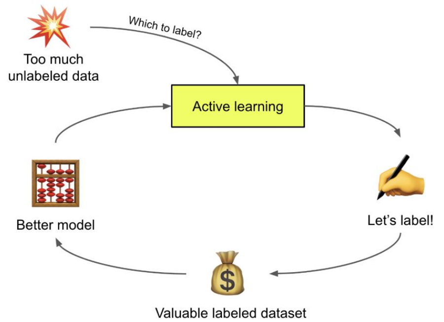
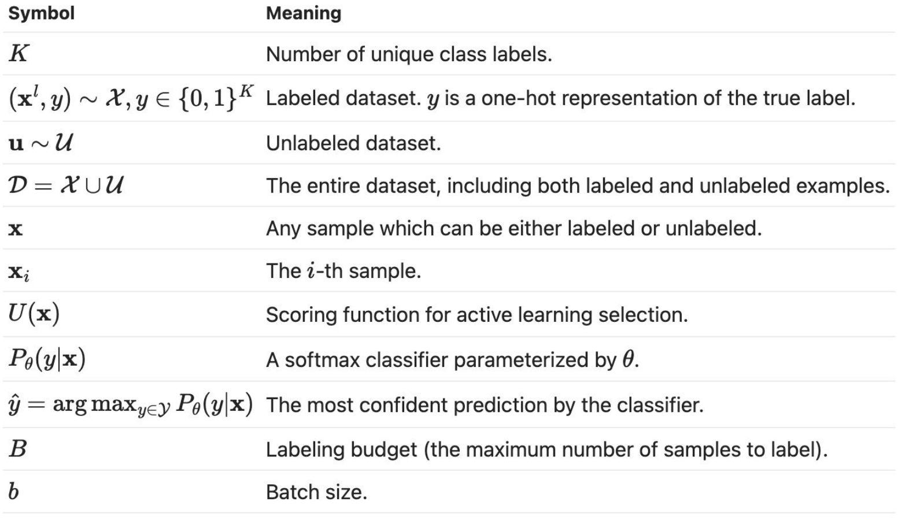
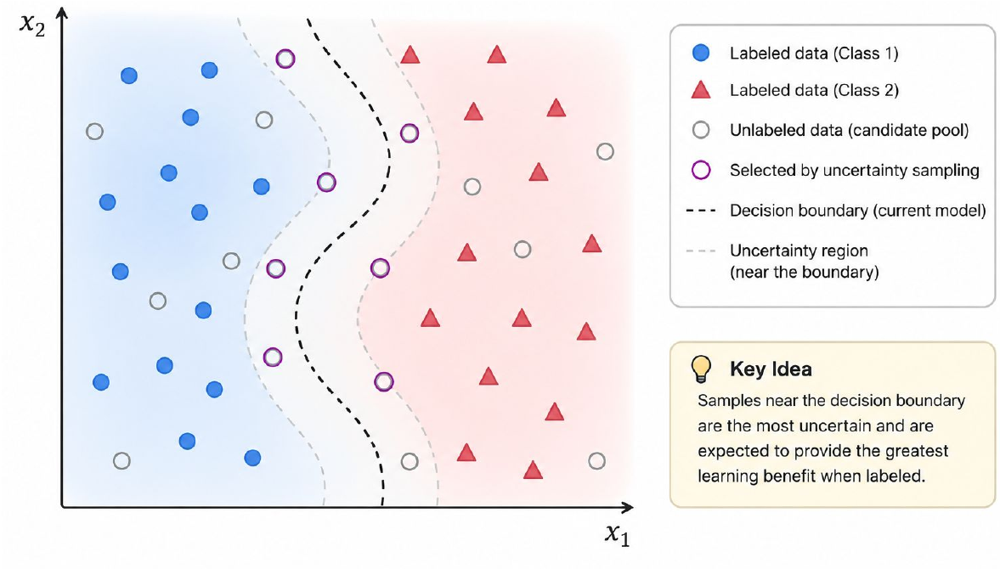
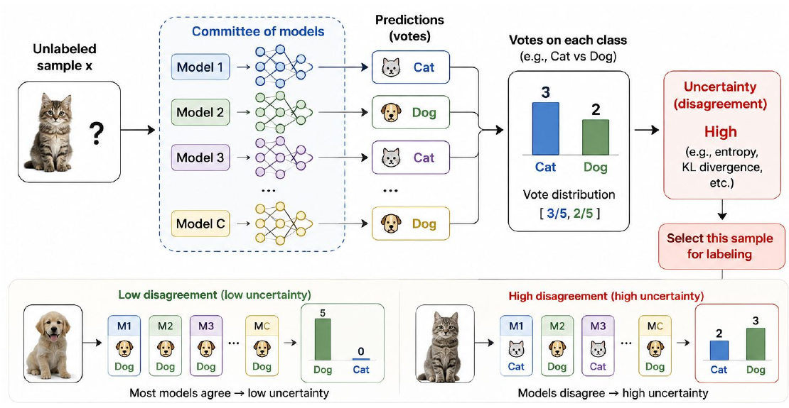
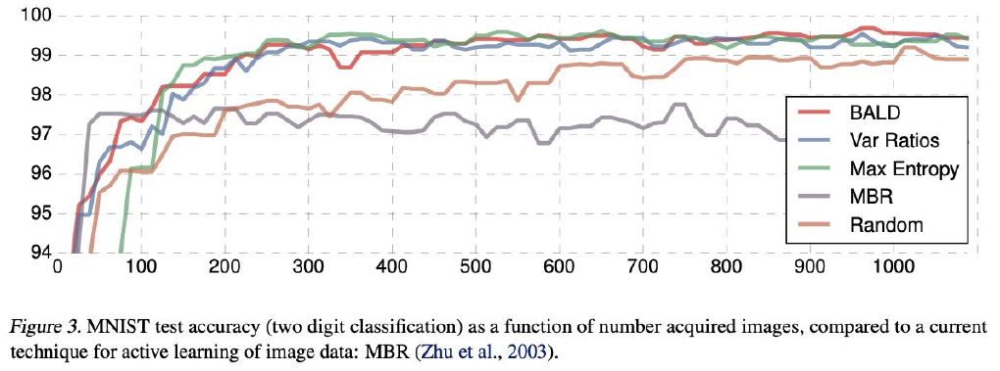
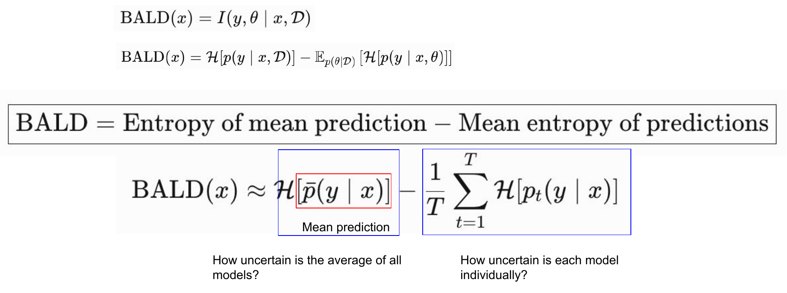
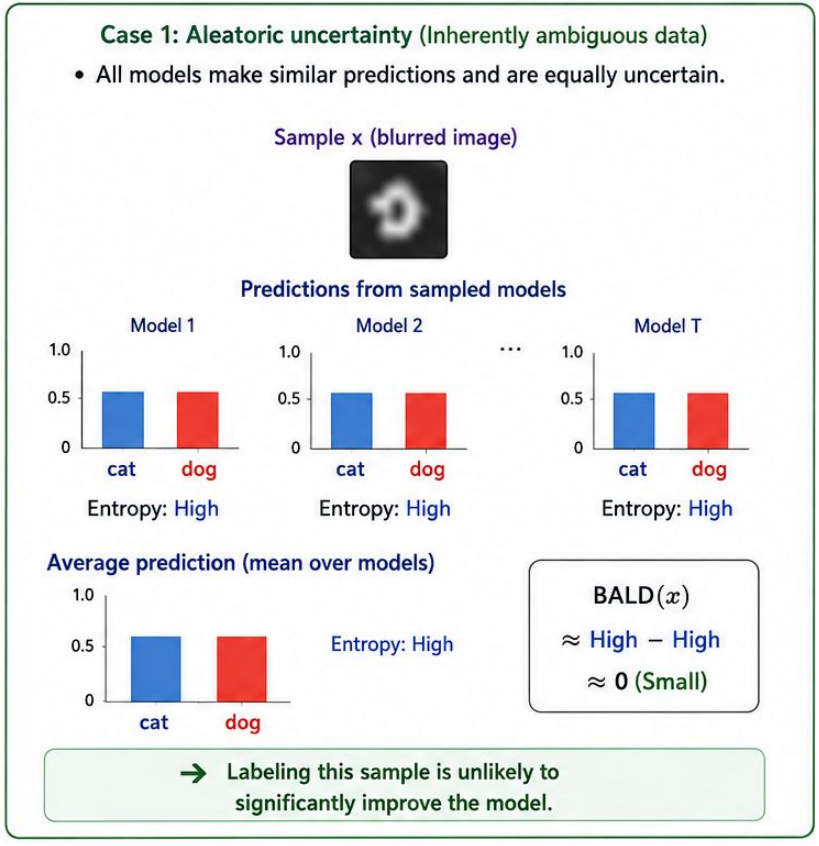
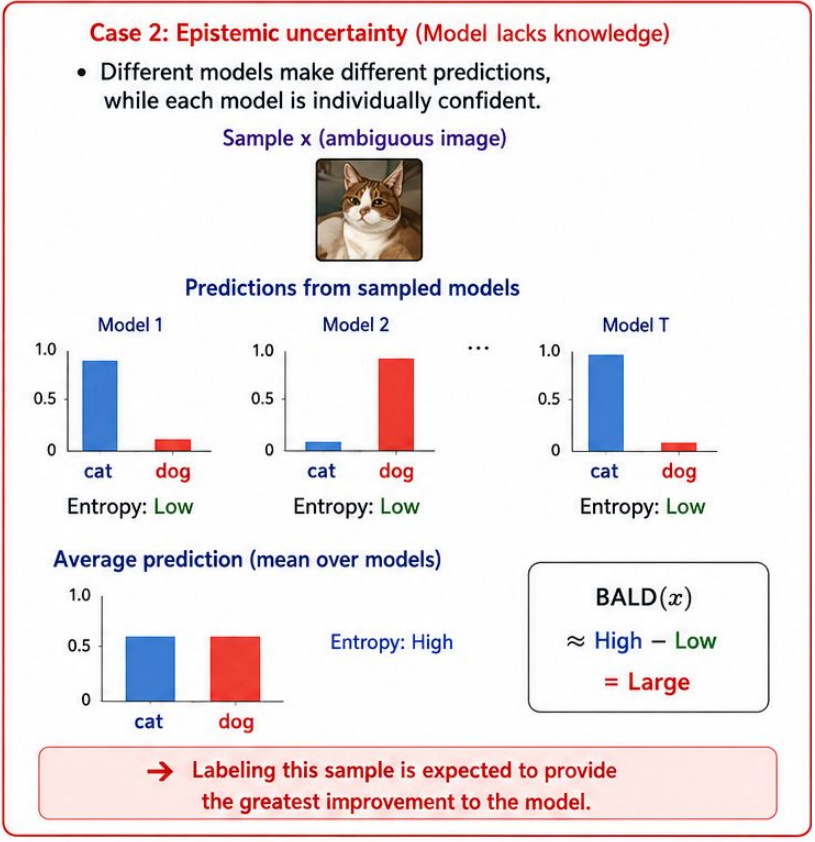
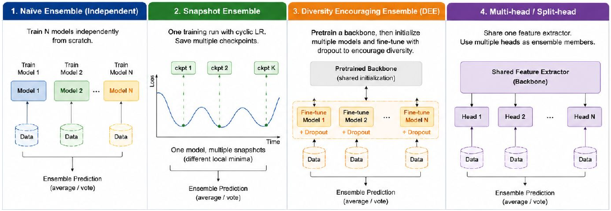

# 10. Active Learning I — Query Strategies & Deep Bayesian Active Learning

> **한 줄 요약**: unlabeled data는 많은데 label 예산은 적어. 이 강의는 **어느 sample에 사람 label을 달지 모델이 고르는 법**을 다뤄.
> - 틀은 select → human annotation → retrain → repeat이고, 고르는 점수가 **acquisition function** $U(\mathbf x)$야 (p.4–7).
> - 고전 query strategy는 세 갈래야 (p.8–22).
>   - 한 모델의 **uncertainty**: Least Confidence · Margin · Entropy (p.9–13)
>   - 여러 모델의 **disagreement**: Query-by-Committee의 Voter Entropy · Consensus Entropy · KL (p.14–19)
>   - **diversity** · **expected model change** · 둘 이상 섞는 **hybrid** (p.20–22)
> - 이 점수들은 손으로 만든 거라 한계가 있어 (p.23).
> - Deep AL에선 uncertainty를 **aleatoric**(data noise)과 **epistemic**(모델이 몰라서)으로 나누고, AL은 epistemic을 노려 (p.25).
> - ensemble은 비싸니 **MC Dropout**으로 근사해 (p.26–27). **DBAL**은 MC Dropout + **BALD**(평균 예측의 entropy − 예측 entropy의 평균)로 epistemic만 골라 (p.28–32).
> - 마지막은 Snapshot · DEE · Multi-head로 ensemble을 싸게 흉내 내기야. MC Dropout이 여전히 좋은 절충이야 (p.33–35).

> 출처: Donghyeon Cho 교수, 고급표현학습 강의자료 `lectures/10_Active_Learning_I.pdf` (36p).
> - PDF 메타데이터 제목은 `[2026][W10] Active Learning I.pptx`인데, 일정표(`exam/PLAYBOOK.md` 0.2)엔 **W12 11/19**로 적혀 있어. L08·L09처럼 두 칸 밀려 있어. 슬라이드 본문엔 주차 표기가 없어서 시험과는 무관해.
> - 슬라이드 cite는 p.27 (Gal et al., ICML 2016)과 p.28·32 (Gal et al., ICML 2017) 두 개뿐이야. 나머지 방법은 cite 없이 개념으로 나와.

**기말 흐름에서 이 강의의 자리**: L08–L09는 label을 **약하게** 주고, 모자란 정보를 모델과 외부 단서로 메웠어 ("어느 box", "어느 pixel"이 target인가). L10은 방향이 반대야.
1. label은 사람이 **정확하게** 달아. 대신 예산이 적어서 몇 개밖에 못 달아.
2. 그래서 질문이 **"label budget이 한정돼 있을 때, 어느 unlabeled sample에 label을 달아야 하나?"**로 바뀌어.
3. 답은 "지금 모델이 모르는 것"이야. 그 "모름"을 재는 방법이 이 강의의 전부야: 한 모델의 확률 → 여러 모델의 의견 차이 → Bayesian 근사(MC Dropout)로 epistemic만 골라내기(BALD).

---

## 이 강의의 큰 그림

```
문제: unlabeled data는 많고 label 예산(B)은 적어. 사람 label은 비싸
      → 어느 sample에 label을 달아야 정확도가 제일 많이 오르나?

Part 1. Introduction to Active Learning Framework (p.3–7)
 │  Goal: most informative samples · minimum annotation cost (p.4)
 │  loop: select → human annotation → retrain → repeat (p.5)
 │  acquisition function U(x): unlabeled sample마다 informativeness 점수 (p.6–7)
 │     고르는 절차 = "sampling strategy" = "query strategy"
 │
Part 2. Sampling Strategy (Query Strategies) (p.8–23)
 │  ① Uncertainty sampling: 지금 모델이 제일 헷갈리는 것 (decision boundary 근처) (p.9)
 │       Least Confidence   U = 1 − P(ŷ|x)          top-1만      클수록 먼저
 │       Margin             U = P(ŷ1|x) − P(ŷ2|x)   top-2        작을수록 먼저 (!)
 │       Entropy            U = −Σ_y P log P        분포 전체     클수록 먼저
 │  ② Query-by-Committee (QBC): 모델 여러 개의 의견이 갈리는 것 (p.14)
 │       Voter Entropy      H(V(y)/C)               표(label)만
 │       Consensus Entropy  H(P_C), P_C = 평균 확률  확률 분포 전체
 │       KL Divergence      (1/C) Σ KL(P_θc ‖ P_C)  각 모델 ↔ 평균 의견의 거리
 │  ③ Diversity (대표성, 중복 피하기) · Expected Model Change (label 달면 모델이
 │     제일 많이 바뀔 것) · Hybrid (기준 섞기, 요즘 대부분) (p.20–22)
 │  한계 (p.23): hand-crafted · computationally expensive · separate objectives
 │     → "Can we learn the acquisition function directly using deep neural networks?"
 │
Part 3. Deep Active Learning (Ensemble-based Estimation) (p.24–35)
 │  uncertainty 두 종류 (p.25)
 │     Aleatoric : data noise (sensor noise, occlusion, blur, ambiguity)
 │                 label을 더 모아도 안 줄어
 │     Epistemic : 모델 지식 부족. label을 더 모으면 줄어   ← AL의 target
 │  Ensemble: 따로 학습한 모델들이 엇갈리면 informative. 단 network 여러 개라 비쌈 (p.26)
 │  MC Dropout: inference 때도 dropout ON → T번 forward = 싼 ensemble (p.27)
 │  DBAL: dropout으로 학습 → T번 forward → BALD → 고르기 → 사람 label → retrain (p.28)
 │     BALD = H[평균 예측] − 평균 H[각 예측] = I(y; θ | x, D) (p.29)
 │       case 1 aleatoric : 모두 똑같이 헷갈림       High − High ≈ 0   → label 가치 낮음 (p.30)
 │       case 2 epistemic : 각자는 확신, 서로 다름    High − Low = Large → label 가치 큼 (p.31)
 │     결과: MC Dropout(BALD 등) > random sampling (MNIST, p.32)
 │  Beyond MC Dropout (p.33–35): Snapshot · DEE · Multi-head
 │     정확도 Naïve ensemble > 근사들, 효율 근사들 > Naïve ensemble
 │     MC Dropout = uncertainty 품질과 계산 비용 사이의 좋은 절충
 │
Next. Deep Active Learning .. (p.36)
```

**핵심 질문**
1. active learning은 무엇을 최적화해?
   - 같은 label 예산으로 정확도를 최대로: "Achieve the highest accuracy / With the fewest labeled examples" (p.5).
   - 그러려고 "the most informative unlabeled samples"를 골라 사람에게 label을 받아 (p.4).
2. "어느 sample이 informative한가"는 무엇으로 정해?
   - **acquisition function** $U(\mathbf x)$가 unlabeled sample마다 점수를 매겨. 이 절차가 sampling(query) strategy야 (p.6–7).
3. 한 모델의 확률로 uncertainty를 재는 세 방법은 뭐가 달라?
   - LC = top-1만, Margin = top-2의 차이, Entropy = 분포 전체 (p.11–13).
   - Margin만 **작을수록** 먼저 골라 (p.12).
4. 모델 여러 개를 쓰면 뭐가 달라져?
   - QBC는 committee의 **disagreement**로 uncertainty를 재 (p.14).
   - Voter = 표만, Consensus = 평균 확률의 entropy, KL = 각 모델이 평균 의견에서 떨어진 정도 (p.16–19).
5. uncertainty 말고 다른 기준은?
   - diversity (대표성), expected model change (모델 변화량), 이 둘과 uncertainty를 섞는 hybrid (p.20–22).
6. 고전 방법의 한계는?
   - hand-crafted라 task마다 최선이 다르고, 계산이 비싸고, 목표가 따로 놀아 (p.23).
7. 어떤 uncertainty에 label을 써야 해?
   - **epistemic**이야. aleatoric(data noise)은 label을 더 모아도 안 줄어 (p.25).
8. ensemble 없이 epistemic을 어떻게 재?
   - **MC Dropout**: inference 때도 dropout을 켜고 여러 번 forward해서, mask마다 다른 모델처럼 써 (p.27).
9. BALD는 왜 aleatoric을 걸러?
   - "평균 예측의 entropy"에서 "각 예측 entropy의 평균"을 빼. 모델마다 똑같이 헷갈리면 둘 다 커서 ≈ 0, 모델끼리만 엇갈리면 커 (p.29–31).
10. ensemble을 더 싸게 흉내 내는 방법은?
    - Snapshot (한 번 학습에서 checkpoint 여러 개), DEE (공유 backbone + dropout), Multi-head (몸통 하나에 head 여러 개) (p.34).
    - 정확도는 naïve ensemble이 낫고 효율은 근사들이 나아. MC Dropout이 좋은 절충이야 (p.35).

> 보충: 원 논문 (슬라이드 표기와 다르면 `← slide엔 …`)
> - **MC Dropout** = Gal & Ghahramani, "Dropout as a Bayesian Approximation: Representing Model Uncertainty in Deep Learning", ICML 2016. ← slide엔 "Gal et al., ICML 2016" (학회·연도 일치)
> - **DBAL** = Gal, Islam & Ghahramani, "Deep Bayesian Active Learning with Image Data", ICML 2017 (p.28·32, 일치).
> - **BALD** = Houlsby, Huszár, Ghahramani & Lengyel, "Bayesian Active Learning for Classification and Preference Learning", arXiv 2011. ← 슬라이드엔 cite가 없어. BALD라는 이름(**B**ayesian **A**ctive **L**earning by **D**isagreement)도 이 논문에서 나왔어.
> - **Snapshot Ensemble** = Huang et al., "Snapshot Ensembles: Train 1, Get M for Free", ICLR 2017. ← 슬라이드엔 cite가 없어.
> - p.34의 DEE(Diversity Encouraging Ensemble)와 Multi-head / Split-head Network는 슬라이드에 cite가 없어서 원 논문을 특정하지 않았어.
> - p.32 그래프의 MBR은 그림 캡션에 "(Zhu et al., 2003)"으로 적힌 비교 방법이야.

**강의 목차 (p.2)**: 1. Introduction to Active Learning Framework / 2. Sampling Strategy (Query Strategies) / 3. Deep Active Learning (Ensemble-based Estimation).
- ← 슬라이드 제목은 "Contents of Table"이야 (원문 유지, L08·L09와 같은 표기).
- 목차 밖 논문은 없어. 마지막 p.36은 "Next Week.. / Deep Active Learning .."이야.

---

## 1. Introduction to Active Learning Framework (p.3–7)

이 섹션은 방법이 아니라 **문제 설정과 기본 틀**이야. 무엇을 최적화하나(p.4–5), 어떤 순서로 도나(p.5), 기호(p.6), 그리고 "고르는 점수" acquisition function(p.7)을 깔아. 방법은 2장부터 나와.

### 1.0 먼저 깔 용어

- **labeled / unlabeled data**: 정답(label)이 달린 data / 안 달린 data야. 사진은 긁어 오면 끝이라 unlabeled는 많고, labeled는 사람이 달아야 해서 적어.
- **annotation**: 사람이 data에 정답을 다는 일이야. "Human annotation is expensive and time-consuming" (p.4).
- **labeling budget**: label을 달 수 있는 최대 개수(또는 비용)야. 기호로 $B$ (p.6).
- **informative**: 그 sample의 label을 알게 되면 **모델이 많이 나아진다**는 뜻이야. active learning은 informative한 sample을 고르는 기술이야.
- **softmax classifier**: 입력 $\mathbf{x}$를 받아 class마다 확률을 내는 모델이야. $P_\theta(y \mid \mathbf{x})$, 합이 1인 길이 $K$ 벡터야 (p.6).
- **one-hot**: 정답 class 칸만 1이고 나머지는 0인 벡터야. $y \in \{0,1\}^K$ (p.6).
- **decision boundary**: classifier가 class를 나누는 경계야. 경계 위에선 두 class 확률이 거의 같아 (p.9는 경계 그림만, 이 성질은 일반 상식·슬라이드 밖).
- **entropy**: 확률 분포가 얼마나 퍼져 있나야. 한 class에 몰리면 0, 고루 퍼지면 $\log K$로 최대야 (식은 p.13, 범위 값은 보충·슬라이드 밖).
- **acquisition function = scoring function $U(\mathbf{x})$**: sample마다 "label 달 가치" 점수를 매기는 함수야 (p.6–7).
- **query / sampling strategy**: 그 점수로 "다음에 어느 sample에 label을 달까"를 고르는 과정이야 (p.7).
- **round**: select → annotate → retrain 한 바퀴야 (p.5). 한 round에 고르는 개수가 $b$야 (p.6).

**기말 흐름에서 이 강의의 자리**: 기말 범위는 "annotation을 덜 쓰면서 모자란 supervision을 어떻게 메우나?"로 꿰어. 세 강의 묶음이 서로 다른 답을 줘.

| 강의 | annotation을 줄이는 방법 | label은 누가 주나 |
|---|---|---|
| L06–L07 Semi-supervised | label 없는 data는 **모델이** consistency · pseudo label로 씀 | 일부는 사람, 나머지는 모델 |
| L08–L09 Weakly-supervised | label을 **더 싸고 약한 모양**으로 줌 (image label, box) | 사람, 단 약하게 |
| **L10 Active learning** | label의 질은 그대로, **어느 sample에 줄지를 모델이 고름** | 사람, 단 **고른 sample에만** |

### 1.1 Motivation & Goal (p.4)

**슬라이드 (p.4)**:
- "We often have… Huge amounts of **unlabeled data** / Only a **limited labeling budget** / Human annotation is **expensive and time-consuming**"
- Key question: "If we can label only a small subset, which samples should we choose?"
- Goal of Active Learning: "Select the **most informative** unlabeled samples" / "Maximize model improvement with **minimum annotation cost**"

- 상황은 세 줄이야: unlabeled는 넘치고, budget은 한정돼 있고, 사람 annotation은 비싸.
- 그래서 질문이 하나로 모여: **작은 부분집합에만 label을 달 수 있다면 어느 sample을 골라야 하나?**
- Goal 두 줄이 시험 정의 문장 후보야. **most informative**와 **minimum annotation cost**를 그대로 외워.
- 전제는 p.9의 한 줄이야: "**Not all** unlabeled samples are **equally informative**." 모든 sample이 똑같이 가치 있으면 random으로 뽑아도 돼. 그렇지 않으니까 고르는 게 의미가 있어.
- 시험 함정: "The goal of active learning is to label as many unlabeled samples as possible" → False. budget 안에서 **적게, 잘 골라서**가 목표야.

### 1.2 Objective & Workflow (p.5)

**슬라이드 (p.5)**:
- Objective: "Achieve the highest accuracy" / "With the fewest labeled examples"
- Workflow: "Select informative samples → Human annotation → Retrain the model → Repeat"
- "How do we measure which samples are the most informative?"

**한 줄**: 지금 모델이 "이거 label 좀 달아 줘" 할 sample을 고르고, 사람이 달아 주면 다시 학습하는 걸 budget이 바닥날 때까지 반복해.

**어떻게** (한 round)
1. **Select informative samples**: 지금 모델로 unlabeled sample마다 점수 $U(\mathbf{x})$를 매기고, 가장 informative한 $b$개(= $U$가 가리키는 쪽)를 골라. LC·Entropy는 $U$가 **큰** 쪽, Margin은 $U$가 **작은** 쪽이야 (2.1.3).
2. **Human annotation**: 고른 sample만 사람에게 보내 정답을 받아.
3. **Retrain the model**: 늘어난 labeled set으로 모델을 다시 학습해.
4. **Repeat**: 모은 label이 budget $B$에 닿을 때까지.



*왼쪽 위 "Too much unlabeled data"에서 시작해 시계 방향으로 읽어. "Which to label?"(1단계 select) → 가운데 Active learning → "Let's label!"(2단계 annotation) → "Valuable labeled dataset" → "Better model"(3단계 retrain) → 다시 Active learning(4단계 repeat). 단계 번호 대응은 노트의 해석이야. 고르는 주체가 **지금 모델**이라 바퀴를 돌 때마다 고르는 기준도 바뀌어. (p.5)*

**왜 round를 돌아?**
- 고르는 점수가 **지금 모델**에서 나와. 새 label로 모델이 바뀌면 "어디가 애매한가"도 바뀌어.
- 그래서 한 번에 $B$개를 다 고르지 않고, $b$개씩 고르고 → 학습하고 → 다시 고르는 걸 반복해.

**Objective 두 줄 읽기**: 같은 label 수면 정확도가 높을수록, 같은 정확도면 label이 적을수록 좋아. p.32(DBAL) 그래프가 이 objective를 그대로 그려: x축 = label 받은 이미지 수, y축 = test accuracy. 같은 x에서 더 높은 곡선이 더 좋은 전략이야.

> 보충 (슬라이드 밖): 문헌에선 label을 주는 쪽(사람)을 **oracle**이라고 불러. p.9 그림 범례의 "candidate pool"처럼 큰 unlabeled 묶음에서 골라 오는 설정을 **pool-based** active learning이라고 해. 첫 모델을 학습하려면 처음에 작은 labeled set이 있어야 해. 슬라이드엔 이 얘기가 없어.

> 보충 (RL 비유, 시험 범위 아님): 이 loop는 imitation learning의 **DAgger**와 모양이 같아. 지금 policy를 돌려 보고 → 전문가에게 정답 action을 받고 → 다시 학습하고 → 반복해. 원래 DAgger는 방문한 state 전부에 label을 받아. 사람이 개입할 때를 **uncertainty로 고르는** 변형(ThriftyDAgger 등)이 active learning과 같은 질문 "어느 sample에 label을 받나"를 풀어. robot demonstration 수집 비용을 줄이는 쪽으로 physical AI와 이어져.

### 1.3 Notations (p.6)



*p.6 기호 표 원본이야. 아래 표에서 한 줄씩 풀어 둘게. (p.6)*

| 기호 | 슬라이드 뜻 (원문) | 풀이 |
|---|---|---|
| $K$ | Number of unique class labels. | class 개수. cat / dog / fox면 $K=3$ |
| $(\mathbf{x}^l, y) \sim \mathcal{X},\ y \in \{0,1\}^K$ | Labeled dataset. $y$ is a one-hot representation of the true label. | **labeled** set의 (sample, 정답) 쌍. $l$ = labeled 표시 |
| $\mathbf{u} \sim \mathcal{U}$ | Unlabeled dataset. | **unlabeled** set의 sample. 고르는 후보가 여기 있어 |
| $\mathcal{D} = \mathcal{X} \cup \mathcal{U}$ | The entire dataset, including both labeled and unlabeled examples. | 전체 dataset |
| $\mathbf{x}$ | Any sample which can be either labeled or unlabeled. | 아무 sample |
| $\mathbf{x}_i$ | The $i$-th sample. | $i$번째 sample |
| $U(\mathbf{x})$ | Scoring function for active learning selection. | **acquisition function**. label 달 가치 점수 |
| $P_\theta(y \mid \mathbf{x})$ | A softmax classifier parameterized by $\theta$. | class별 확률 벡터 |
| $\hat{y} = \arg\max_{y \in \mathcal{Y}} P_\theta(y \mid \mathbf{x})$ | The most confident prediction by the classifier. | 모델의 예측 class |
| $B$ | Labeling budget (the maximum number of samples to label). | label 달 수 있는 **최대 개수** |
| $b$ | Batch size. | **한 round에** 고르는 개수 |

- 두 개를 이어 읽으면 (해석): round마다 가장 informative한 $b$개(LC·Entropy는 $U$ 큰 쪽, Margin은 $U$ 작은 쪽)를 골라 label을 받고, 모은 수가 $B$가 되면 멈춰. 대략 $B/b$ round야.
- ⚠️ 헷갈리는 표기
  - $\mathcal{U}$(필기체) = unlabeled **dataset**, $U(\mathbf{x})$(이탤릭) = **scoring function**. 같은 U라도 뜻이 전혀 달라.
  - $\mathcal{X}$가 여기선 **labeled dataset**이야. ML에서 흔히 $\mathcal{X}$는 "입력 공간"이니 헷갈리지 마.
  - $B$(budget, 전체 상한) ↔ $b$(batch, 한 round 개수).
- p.11–13은 $\theta$를 빼고 $P(y \mid x)$로 써. 같은 classifier 확률이야.

### 1.4 Acquisition Function (p.7)

**슬라이드 정의 (p.7)**:
- Core Question: "Which unlabeled sample should we label next?"
- Acquisition Function: "**Assigns an informativeness score to each unlabeled sample.**"
- "The process of identifying the most valuable examples to label next is referred to as **"sampling strategy"** or **"query strategy"**."

- **acquisition function** = p.6의 $U(\mathbf{x})$야. unlabeled sample 하나 → **informativeness score** 숫자 하나.
- **sampling strategy = query strategy**: 그 점수로 다음 label 달 sample을 찾는 **과정**이야. 두 이름은 같은 뜻이야.
- 2장의 모든 방법은 결국 "**$U(\mathbf{x})$를 어떻게 정의하나**"의 변형이야.

| $U(\mathbf{x})$가 재는 것 | 방법 | 슬라이드 |
|---|---|---|
| **한 모델**의 확률이 얼마나 애매한가 | Uncertainty sampling: LC, Margin, Entropy | p.9–13 |
| **여러 모델**이 얼마나 엇갈리나 | Query-by-Committee: Voter, Consensus, KL | p.14–19 |
| 얼마나 대표적이고 서로 다른가 | Diversity sampling | p.20 |
| label을 받으면 모델이 얼마나 바뀌나 | Expected model change | p.21 |
| 위 기준을 섞음 | Hybrid | p.22 |
| deep network에서 epistemic uncertainty | MC Dropout + BALD | p.25–31 |

> 보충 (RL 비유, 시험 범위 아님): acquisition function은 exploration에서 "어디를 시도할 가치가 큰가"를 매기는 점수(exploration bonus, UCB 항)와 역할이 비슷해. 둘 다 한정된 예산(label 수 / interaction 수)을 정보가 제일 많은 곳에 쓰려는 결정이야.

---

## 2. Sampling Strategy (Query Strategies) (p.8–23)

### 2.0 이 섹션의 구조 (p.8)

p.8은 섹션 구분 슬라이드야. 이 섹션은 acquisition function $U(\mathbf{x})$를 정의하는 방법들을 차례로 보여 줘.

```
uncertainty 기반 (모델이 모르는 곳)
 ├─ 한 모델의 확률    : Uncertainty sampling — LC · Margin · Entropy        (p.9–13)
 └─ 여러 모델의 의견  : Query-by-Committee  — Voter · Consensus · KL       (p.14–19)
다른 기준
 ├─ Diversity sampling      : 대표적이고 겹치지 않게                         (p.20)
 ├─ Expected model change   : label 받으면 모델이 많이 바뀌는 것              (p.21)
 └─ Hybrid                  : 섞기                                            (p.22)
Limitations → "acquisition function을 deep network로 배울 수 없나?"          (p.23)
```

### 2.1 Uncertainty Sampling: LC / Margin / Entropy (p.9–13)

#### 2.1.1 Key Idea (p.9–10)

**슬라이드 (p.9)**:
- "Label the samples that the **current model is least confident** about."
- "**Not all** unlabeled samples are **equally informative**."
- "**Samples near the decision boundary** often provide the **greatest learning benefit.**"

**한 줄**: 지금 모델이 제일 자신 없어 하는 sample에 label을 달아.

**문제**: random으로 뽑으면 이미 잘 맞히는 sample에도 label을 써. 그건 모델을 거의 안 바꿔서 budget 낭비야.

**핵심**: 모델이 애매해하는 곳 = **decision boundary 근처**야. 거기 label을 받으면 경계를 어디로 그어야 하는지 직접 알려 줘.



*가로 $x_1$, 세로 $x_2$인 입력 공간이야. 파란 점 = labeled class 1, 빨간 삼각형 = labeled class 2, 회색 빈 원 = unlabeled 후보(candidate pool). 가운데 검은 점선이 지금 모델의 decision boundary고, 양옆 회색 점선 사이가 uncertainty region이야. **보라색 원(선택된 sample)은 전부 경계 근처**에 있고, 덩어리 한가운데 회색 원은 안 골라. (p.9)*

**왜 돼?** (해석, 슬라이드엔 "often provide the greatest learning benefit"까지만 있어)
- 경계에서 먼 sample은 이미 확실하게 맞혀. label을 받아도 "역시 class 1이네"라서 모델이 거의 안 바뀌어.
- 경계 근처 sample은 label 하나가 **경계의 위치**를 바로잡아. 같은 비용으로 얻는 게 커.

**어떻게 재나 (p.10)**: 모델이 내는 건 확률 벡터 $P_\theta(y \mid \mathbf{x})$ 하나야. "How uncertain is this probability?"를 숫자 하나로 바꾸는 흔한 방법이 세 개야: **Least Confidence, Margin Sampling, Entropy**. 셋 다 **모델 하나**의 확률만 써 (해석: p.10엔 $P_\theta(y \mid \mathbf{x})$ 하나만 나와).

> 보충 (L07 연결): L07에서 본 두 방법과 방향이 정반대야.
> - **Entropy minimization** (L07 p.5–7): unlabeled data의 예측 entropy를 **줄여서** decision boundary를 data가 적은 곳(low-density region)으로 밀어내.
> - **FixMatch** (L07 p.45–46): confidence가 threshold $\tau$를 **넘는** 확실한 sample만 pseudo label로 써.
> - **Active learning**: confidence가 **가장 낮은** sample을 골라 **사람에게** 보내.
> - 같은 confidence $\max_y P(y \mid x)$를 보는데, semi-supervised는 확실한 쪽을 모델이 스스로 쓰고, active learning은 애매한 쪽을 사람에게 맡겨. 시험에서 "active learning selects the most confident samples" 같은 뒤집기가 나오면 False야.

#### 2.1.2 Least Confidence (p.11)

$$\hat{y} = \arg\max_y P(y \mid x), \qquad U(x) = 1 - P(\hat{y} \mid x)$$

- $\hat{y}$: 확률이 제일 큰 class (모델의 예측).
- $P(\hat{y} \mid x)$: 그 1등 확률 = **confidence**.
- $U(x)$: 1에서 confidence를 뺀 값. confidence가 낮을수록 커.
- 슬라이드: "Uses **only the highest** predicted probability", "**Lower confidence → Higher priority**".
- **$U$가 큰 sample부터** 골라.
- 범위 (보충, 슬라이드 밖): 1등 확률은 최소 $1/K$(완전 균등), 최대 1. 그래서 $0 \le U(x) \le 1 - 1/K$.
- **약점**: 1등만 봐서 나머지가 어떻게 나뉘었는지 몰라. (0.5, 0.49, 0.01)과 (0.5, 0.25, 0.25)는 LC 점수가 둘 다 0.5야. 앞쪽은 두 class 사이에서 망설이고 뒤쪽은 셋에 퍼졌는데도 구분 못 해.

#### 2.1.3 Margin Sampling (p.12)

$$U(x) = P(\hat{y}_1 \mid x) - P(\hat{y}_2 \mid x)$$

- $\hat{y}_1$ = 1등 class, $\hat{y}_2$ = 2등 class. **margin** = 1등 확률 − 2등 확률.
- 슬라이드: "Use the **top two** probabilities", "**Small margin → High uncertainty**".
- margin이 작으면 모델이 **두 후보 사이에서 망설이는** 중이야.
- ⚠️ **방향 함정 (시험 1순위)**
  - LC와 Entropy는 $U$가 **큰** sample을 골라.
  - Margin은 슬라이드 식 그대로면 $U$가 **작은** sample을 골라 (argmin).
  - p.6은 $U(\mathbf{x})$를 그냥 "Scoring function for active learning selection"이라고만 해서, 어느 쪽이 선택인지는 측도마다 따로 기억해야 해.
  - 구현에선 보통 margin의 최소를 고르거나, $-U$ 또는 $1-U$를 점수로 써서 최대를 골라 (슬라이드 밖).
  - "Margin sampling selects the samples with the largest margin" → **False**.
- **LC와 차이**: (0.5, 0.49, 0.01)은 margin 0.01로 매우 불확실, (0.5, 0.25, 0.25)는 margin 0.25로 덜 불확실해. LC로는 같던 둘을 구분해.

#### 2.1.4 Entropy Sampling (p.13)

$$U(x) = -\sum_y P(y \mid x)\log P(y \mid x)$$

- class마다 $P\log P$를 더하고 부호를 뒤집어. $\log P \le 0$이라서 앞에 $-$를 붙여 양수로 만든 거야.
- 값의 범위 (보충, 슬라이드 밖, 식에서 계산):
  - 한 class에 확률 1이 몰리면 (one-hot) $-1\cdot\log 1 = 0$ → **최소 0**.
  - 모든 class가 $1/K$면 $\log K$ → **최대**.
- 슬라이드: "Uses the **entire** probability distribution", "**Higher entropy → Higher uncertainty**".
- **$U$가 큰 sample부터** 골라.
- **차이**: 세 측도 중 유일하게 **분포 전체**를 봐. class가 많을 때 2등 아래 class들이 얼마나 퍼졌는지도 반영해.

#### 2.1.5 세 측도 비교

| | Least Confidence | Margin | Entropy |
|---|---|---|---|
| 식 | $1 - P(\hat{y} \mid x)$ | $P(\hat{y}_1 \mid x) - P(\hat{y}_2 \mid x)$ | $-\sum_y P(y \mid x)\log P(y \mid x)$ |
| 쓰는 정보 (슬라이드) | **only the highest** probability | **top two** probabilities | **entire** distribution |
| 불확실할수록 $U$는 | 커짐 | **작아짐** | 커짐 |
| 고르는 쪽 | $U$ 최대 | $U$ **최소** | $U$ 최대 |
| 확실한 one-hot일 때 $U$ (보충) | 0 | 1 | 0 |
| 완전 균등일 때 $U$ (보충) | $1 - 1/K$ | 0 | $\log K$ |

**예시로 보면** (설명용 숫자, 슬라이드 수치 아님 / 3-class, 자연로그)

| sample | $P(y \mid x)$ | LC ↑ | Margin ↓ | Entropy ↑ |
|---|---|---|---|---|
| S1 | (0.90, 0.05, 0.05) | 0.10 | 0.85 | 0.39 |
| S2 | (0.45, 0.45, 0.10) | 0.55 | **0.00** | 0.95 |
| S3 | (0.40, 0.30, 0.30) | **0.60** | 0.10 | **1.09** |

- 셋 다 S1은 안 골라. 확실하니까.
- **LC와 Entropy는 S3**를 골라. 1등 확률이 제일 낮고, 분포가 세 class에 고루 퍼졌어 (최대 $\ln 3 \approx 1.10$에 거의 닿음).
- **Margin은 S2**를 골라. 1등과 2등이 동률이라 margin이 0이야. "두 class 중 어느 쪽?"에 특화된 측도라서 그래.
- 그래서 측도마다 고르는 sample이 **다를 수 있어**. "No single strategy works best for all tasks"(p.23)와 이어져.

> 보충 (슬라이드 밖, 직접 확인한 사실): class가 **2개**면 세 측도가 항상 **같은 순서**로 골라. 1등 확률을 $p \ (\ge 0.5)$라 하면 LC $= 1-p$, Margin $= 2p-1$이고, Entropy도 $p$가 커질수록 줄어들어. 셋 다 $p$ 하나로 정해지니 순서가 같아. 차이는 $K \ge 3$에서만 생겨.

> 보충 (RL 비유, 시험 범위 아님): Entropy 식은 SAC의 **policy entropy** $\mathcal{H}(\pi(\cdot \mid s))$와 같은 식이야. 다만 쓰임이 달라. SAC는 policy entropy를 **보너스로 키워** exploration을 유지하고, 여기선 classifier entropy가 큰 sample을 **골라서** label을 받아.

### 2.2 Query-by-Committee: Voter / Consensus / KL (p.14–19)

#### 2.2.1 Key Idea (p.14–15)

**슬라이드 (p.14)**:
- "Instead of relying on a single model, measure uncertainty by **disagreement among multiple models**."
- "Train multiple models (committee)" / "Each model predicts independently" / "Select samples with the largest disagreement"

**한 줄**: 모델 여러 개(committee, 위원회)에게 따로 물어보고, **답이 제일 엇갈리는** sample에 label을 달아.

**문제** (해석, 슬라이드엔 "Instead of relying on a single model"까지만 있어): uncertainty sampling은 모델 **하나**의 자신감에 기대. 그 모델이 틀린 채로 자신만만하면(overconfident) 애매한 곳을 못 찾아.

**핵심**: 같은 data로 학습한 모델들이 **서로 다른 답**을 낸다면, 그 sample 근처는 아직 data가 답을 정해 주지 못한 곳이야. label을 받으면 committee 의견을 하나로 모아 줘.

**어떻게**
1. **Train multiple models (committee)**: 모델 $C$개를 학습해. parameter는 $\theta_1, \dots, \theta_C$.
2. **Each model predicts independently**: unlabeled sample $x$를 각자 따로 예측해.
3. **Measure disagreement**: 엇갈림을 숫자 하나로 바꿔 (p.15: Voter Entropy, Consensus Entropy, KL Divergence).
4. **Select samples with the largest disagreement**.



*위 줄을 왼쪽에서 오른쪽으로 읽어. 고양이 사진 하나를 Model 1…C가 따로 예측해서 Cat, Dog, Cat, …, Dog 표를 내. 표를 세면 Cat 3, Dog 2, 투표 분포 [3/5, 2/5]라서 disagreement가 High → label 대상이야. 아래 두 칸은 대비야: 왼쪽 강아지는 5명 전원 Dog(5 : 0)라 low uncertainty, 오른쪽 고양이는 2 : 3으로 갈려서 high uncertainty. (p.14)*

**차이 (vs. uncertainty sampling)**: uncertainty sampling은 "**한 모델의 확률**이 애매한가", QBC는 "**여러 모델의 답**이 서로 다른가"를 봐.

- committee를 서로 다르게 만드는 방법(다른 초기값, 다른 bootstrap 표본 등)은 슬라이드에 없어. 3장 p.26의 ensemble 예시(AdaBoost, Bootstrapping, Random forests)와 p.27의 MC Dropout(모델 여러 개 대신 dropout mask 여러 개)이 이 질문으로 이어져.
- 비용: 모델을 $C$개 학습하고 매 sample마다 $C$번 예측해. p.23 Limitations의 "Committee models"가 이 비용이야.

> 보충: 슬라이드엔 cite가 없어. QBC라는 이름은 Seung, Opper & Sompolinsky, "Query by committee" (COLT 1992)에서 나왔어.

> 보충 (RL 비유, 시험 범위 아님): ensemble dynamics model의 **disagreement를 intrinsic reward(exploration bonus)**로 쓰는 것과 같은 발상이야 (Pathak et al., "Self-Supervised Exploration via Disagreement"). 모델들이 엇갈리는 곳 = 아직 모르는 곳 = 가 볼(label 받을) 가치가 있는 곳. Bootstrapped DQN도 Q head 여러 개로 "아직 모름"을 표현하지만, disagreement를 점수로 쓰진 않고 episode마다 head 하나를 뽑아 행동해서 메커니즘은 달라.

#### 2.2.2 Voter Entropy (p.16)

$$U(x) = H\left(\frac{V(y)}{C}\right)$$

| 기호 (슬라이드 표) | 뜻 |
|---|---|
| $\mathbf{x}$ | Unlabeled sample |
| $C$ | Number of models in the committee |
| $V(y)$ | Number of committee members voting for class $y$ |
| $V(y)/C$ | Fraction of votes for class $y$ |
| $\mathcal{H}(\cdot)$ | Shannon entropy |

- 계산 순서
  1. 각 모델의 예측 label(보통 argmax, 슬라이드는 "predicted label"이라고만 함)을 **한 표**로 세.
  2. class마다 표 수 $V(y)$를 $C$로 나눠 **투표 비율**을 만들어. 합이 1인 분포야.
  3. 그 분포의 entropy: $U(x) = -\sum_y \frac{V(y)}{C}\log\frac{V(y)}{C}$.
- 슬라이드: "Count committee votes.", "**Only considers the predicted label** of each model", "**High vote diversity → High uncertainty**".
- p.14 그림 숫자로: Cat 3, Dog 2 → $H(0.6, 0.4) \approx 0.67$ (자연로그). 전원 Dog(5 : 0) → 0.
- **약점**: 모델이 cat을 0.51로 겨우 찍었든 0.99로 확신했든 **똑같은 한 표**야. 확신의 정도가 버려져.
- 표기: 식은 $H$, 표는 $\mathcal{H}(\cdot)$. 같은 Shannon entropy야.

> 보충: 슬라이드 이름은 "Voter Entropy"고 문헌에선 보통 **vote entropy**라고 불러. 시험엔 슬라이드 표기로 나올 거야.

#### 2.2.3 Consensus Entropy (p.17)

$$U(x) = H(P_C), \qquad P_C(y) = \frac{1}{C}\sum_{c=1}^{C} P_{\theta_c}(y \mid \mathbf{x})$$

| 기호 (슬라이드 표) | 뜻 |
|---|---|
| $\theta_c$ | Parameters of model $c$ |
| $P_C(y)$ | Average probability over all committee members |
| $\mathcal{H}(\cdot)$ | Shannon entropy |

- 계산 순서
  1. 모델 $c$마다 확률 분포 $P_{\theta_c}(y \mid \mathbf{x})$를 받아.
  2. class별로 **평균** 내서 committee의 합의 분포 **consensus** $P_C$를 만들어.
  3. 그 평균 분포의 entropy를 재.
- 슬라이드: "Average prediction probabilities.", "Uses the **full probability distribution**", "Measures uncertainty of the **committee consensus**".
- **Voter와 차이**: 확률을 통째로 평균 내니까 확신의 정도가 들어가. 0.51짜리 cat과 0.99짜리 cat이 다르게 반영돼.
- 함정: $P_C$의 아래첨자 $C$는 **committee**야. class 개수는 $K$야.
- ⚠️ **약점** (슬라이드 밖 분석, 3장 BALD로 이어짐): 평균의 entropy는 아래 **두 경우 모두** 커.
  - 모든 모델이 **똑같이 애매**한 경우 (다 (0.5, 0.5)).
  - 모델마다 **확신하는데 답이 서로 다른** 경우 (반은 cat 0.99, 반은 dog 0.99).
  - 앞은 모델끼리 의견이 같아서 disagreement가 아니야. consensus entropy 하나로는 둘을 구분 못 해.

#### 2.2.4 KL Divergence (p.18)

$$U(x) = \frac{1}{C}\sum_{c=1}^{C} D_{KL}\left(P_{\theta_c} \,\|\, P_C\right)$$

- **KL divergence**(Kullback–Leibler divergence): $D_{KL}(P \| Q) = \sum_y P(y)\log\dfrac{P(y)}{Q(y)}$. 분포 $P$가 $Q$와 얼마나 다른가야. 같으면 0, 다를수록 커. 대칭이 아니라서 순서를 바꾸면 값이 달라.
- 계산 순서
  1. consensus $P_C$를 p.17처럼 만들어.
  2. 모델마다 **자기 분포가 평균에서 얼마나 떨어졌나** $D_{KL}(P_{\theta_c} \| P_C)$를 재.
  3. $C$개를 평균 내.
- 슬라이드: "Measures disagreement between **each model and the committee average**", "**Larger KL → Larger disagreement**", "How far each model's prediction is from the committee average."
- 방향: 앞이 **각 모델** $P_{\theta_c}$, 뒤가 **평균** $P_C$야.
- 모든 모델이 같은 분포를 내면 (아무리 애매해도) 각자 평균과 같아서 **KL = 0**이야. Consensus의 약점을 이게 메워.

> 보충 (슬라이드 밖 유도, 숫자로도 검산함): 이 KL 평균은 정확히 이렇게 풀려.
> $$\frac{1}{C}\sum_{c} D_{KL}(P_{\theta_c} \| P_C) = \underbrace{H(P_C)}_{\text{consensus entropy}} - \underbrace{\frac{1}{C}\sum_{c} H(P_{\theta_c})}_{\text{각 모델 entropy의 평균}}$$
> 1. $D_{KL}(P_{\theta_c}\|P_C) = \sum_y P_{\theta_c}(y)\log P_{\theta_c}(y) - \sum_y P_{\theta_c}(y)\log P_C(y) = -H(P_{\theta_c}) - \sum_y P_{\theta_c}(y)\log P_C(y)$
> 2. $c$에 대해 평균을 내면 둘째 항 안의 $\frac{1}{C}\sum_c P_{\theta_c}(y)$가 $P_C(y)$가 돼서 $-\sum_y P_C(y)\log P_C(y) = H(P_C)$가 남아.
> 3. 합치면 위 식이야.
> - **p.29 BALD 근사식** $\mathcal{H}[\bar p(y \mid x)] - \frac{1}{T}\sum_t \mathcal{H}[p_t(y \mid x)]$과 **같은 모양**이야. committee 멤버 $C$개를 MC Dropout으로 뽑은 모델 $T$개로 바꾸면 BALD가 돼 (3.5).
> - 두 분포짜리 JS divergence(Jensen–Shannon, L09 CD-CLIP p.69에서 나옴)가 정의상 "평균 분포에 대한 KL의 평균"이라, 이 KL 평균은 그걸 $C$개로 넓힌 **generalized JS divergence**야.

#### 2.2.5 세 disagreement 측도 비교 (p.19)

**슬라이드 표 (p.19)** — 시험에 매칭·"What is X for?" 문제로 나오기 좋은 표야.

| Method | Uses | 슬라이드 한 줄 질문 |
|---|---|---|
| **Voter Entropy** | **Final class labels only** | "How many people chose which class?" |
| **Consensus Entropy** | **Full probability distributions** | "How much uncertainty is there on average?" |
| **KL Divergence** | **Distance between distributions** | "How much does each model differ from the average opinion?" |

**예시로 보면** (설명용 숫자, 슬라이드 수치 아님 / 2-class, committee 5명, 자연로그)

| 경우 | 각 모델 예측 (cat, dog) | Voter | Consensus | KL 평균 |
|---|---|---|---|---|
| A. 다 같이 애매함 | 5명 모두 (0.51, 0.49) | **0** (5 : 0) | **0.69** (최대 ln 2 ≈ 0.693에 거의 닿음) | **0** |
| B. 각자 확신, 서로 다름 | 3명 (0.99, 0.01), 2명 (0.01, 0.99) | 0.67 (3 : 2) | 0.67 | **0.62** |

- A: 표가 한쪽으로 몰려서 Voter는 0이야. 평균 분포가 거의 반반이라 Consensus는 최대에 가까워. 모델끼리 **같은 말**을 해서 KL은 0이야.
- B: 셋 다 커. 모델끼리 진짜로 **엇갈려**.
- **Consensus는 A와 B를 거의 같은 값으로 봐.** Voter는 이 예시에선 A/B를 가르지만 label만 봐서 확신도(0.51 vs 0.99)를 못 봐. **확률을 쓰면서** "모델끼리 다른가"를 골라내는 건 **KL**이야 (B의 KL 0.62 = Consensus 0.67 − 각 모델 entropy 평균 0.06).
- 이 A/B가 3장의 **aleatoric vs epistemic**, **BALD Case 1 vs Case 2**(p.30–31)와 같은 그림이야. A는 "모두가 똑같이 애매" = Case 1, B는 "각자 확신하는데 엇갈림" = Case 2.

**uncertainty 측도 전체 한 장 요약 (p.11–19)**

| 측도 | 모델 수 | 입력으로 받는 것 | 불확실할수록 |
|---|---|---|---|
| Least Confidence | 1 | 1등 확률 | $U$ ↑ |
| Margin | 1 | 1등·2등 확률 | $U$ **↓** |
| Entropy | 1 | 분포 전체 | $U$ ↑ |
| Voter Entropy | $C$ | 각 모델의 **label** | $U$ ↑ |
| Consensus Entropy | $C$ | 각 모델 분포의 **평균** | $U$ ↑ |
| KL Divergence | $C$ | 각 모델 분포와 평균의 **거리** | $U$ ↑ |

> 보충 (시험 함정 모음, 이 절):
> - "Voter entropy uses the full probability distribution of each member" → False (labels only, p.16, p.19).
> - "Consensus entropy measures how far each model is from the average" → False (그건 KL, p.18–19).
> - "If all committee members output the same uncertain distribution, the KL-based disagreement is high" → False (KL = 0).
> - "QBC relies on a single model's confidence" → False ("Instead of relying on a single model", p.14).

---

### 2.3 Diversity Sampling (p.20)

**한 줄**: 헷갈리는 sample 대신, 데이터 분포를 **골고루 대표하는** sample을 고르는 전략.

**정의** (슬라이드 원문): "Select **representative** samples that cover the data distribution."
- Avoid selecting **redundant** samples
- Cover different regions of the **feature space**
- Improve **generalization**

**용어**
- **representative sample**: 하나가 주변의 비슷한 sample 여럿을 대신할 수 있는 sample. 분포의 한 구역을 대표해.
- **redundant sample**: 이미 고른 것과 거의 같은 sample. label을 달아도 새로 배우는 게 거의 없어.
- **feature space**: 모델이 sample을 바꿔 놓은 embedding 벡터들의 공간. 여기서 가까우면 모델 눈에 비슷한 sample이야.

**문제 (왜 필요해?)**
- p.6 notation엔 **b = batch size**가 있어. 한 round에 b개를 한꺼번에 고른다는 뜻이야.
- uncertainty 점수(2.1–2.2)로 top-b를 뽑으면, decision boundary의 **같은 구역**에서 거의 같은 sample이 여러 개 뽑힐 수 있어. 예산 b개 중 대부분이 같은 정보야.
- diversity sampling은 "feature space의 **다른 구역**을 덮자"로 이걸 막아. 모델이 분포 전체를 보고 배우니까 generalization이 좋아져.

**차이**: uncertainty sampling은 "모델이 **어디를 모르나**", diversity sampling은 "**분포를 얼마나 덮나**"를 봐. 앞은 모델 출력(확률)을, 뒤는 sample끼리의 관계(feature space 거리)를 써.

> 보충 (슬라이드 밖, 시험 범위 아님): 대표적인 diversity 방법이 Core-set (Sener & Savarese, ICLR 2018)이야. 고른 집합에서 가장 먼 unlabeled 점까지의 거리가 최소가 되도록 골라. 이런 거리 계산이 2.6 Limitations의 "Pairwise similarity computation" 비용이야.

---

### 2.4 Expected Model Change (p.21)

**한 줄**: label을 달면 **모델을 가장 많이 바꿀** sample을 고르는 전략.

**정의** (슬라이드 원문): "Select samples expected to **change the model the most** after labeling."
- Large parameter update
- Large loss reduction
- High training impact

**핵심**
- "모델이 많이 바뀐다" = 그 sample에서 배울 게 많다는 뜻이야. 바뀌는 정도를 parameter update 크기, loss 감소량, 학습 영향으로 재.
- 왜 "**expected**"야? (슬라이드엔 이유가 없어서 notes 해석이야, 아래 EGL 보충 참고) 고르는 시점엔 label을 **아직 몰라**. 그래서 가능한 label마다 "이 label이면 얼마나 바뀔까"를 계산하고, 모델의 예측 확률로 가중 평균해.

**식** (notes 보충, 슬라이드엔 식 없음 → 시험 범위 아님. 대표 구현 Expected Gradient Length, Settles, Craven & Ray, NIPS 2007):
$$U_{\text{EGL}}(x) = \sum_{y} P_\theta(y \mid x)\, \big\lVert \nabla_\theta \ell(x, y) \big\rVert$$
- $\ell(x,y)$: $x$에 label $y$를 달았을 때의 loss.
- $\nabla_\theta \ell(x,y)$: 그 loss의 gradient. 학습 한 step에서 parameter가 움직일 방향·크기야.
- $\lVert\cdot\rVert$: gradient 길이. 길수록 "Large parameter update".
- $\sum_y P_\theta(y \mid x)\,\cdot$: label을 모르니까 예측 확률로 평균 → "expected".

**비용** (notes 해석): 후보 sample × 가능한 label마다 gradient를 계산해야 해 → 2.6의 "Expected model update estimation"이 비싼 항목으로 나와.

**차이**: uncertainty는 **출력이 얼마나 애매한가**, expected model change는 **학습에 넣으면 parameter가 얼마나 움직이나**를 봐.

---

### 2.5 Hybrid Strategy (p.22)

**한 줄**: 기준 여러 개(uncertainty + diversity …)를 **섞어서** 고르는 전략. 요즘 방법 대부분이 여기 속해.

**정의** (슬라이드 원문): "**Combine multiple criteria** for better sample selection."
- Uncertain and representative
- Informative and diverse
- **Most modern active learning methods**

**왜 섞나?**
- uncertainty만: 같은 구역의 비슷한 sample이 몰려 뽑혀 (2.3).
- diversity만: 골고루 뽑지만, 모델이 이미 잘 아는 쉬운 sample에도 예산이 새.
- 둘을 섞으면 "헷갈리면서 대표성도 있는" sample을 골라.

**예시로 보면** (설명용, 슬라이드엔 구체적인 방법 없음): uncertainty 상위 후보를 넉넉히(예: 10b개) 뽑고, 그 안에서 feature space의 서로 다른 구역에 있는 b개를 골라.

> 보충 (슬라이드 밖, 시험 범위 아님): 대표 예가 BADGE (Ash et al., ICLR 2020)야. last layer gradient embedding의 **크기**가 uncertainty를 반영하고, 그 공간에서 k-means++ 식으로 **흩어지게** 골라 diversity를 얻어.

---

### 2.6 Limitations (p.23)

고전 전략(2.1–2.5)의 한계를 세 묶음으로 정리해. 각 줄이 **어느 방법의 비용인지** 짝지어 봐 (짝짓기는 notes 해석, 슬라이드엔 항목만 있음).

| 묶음 | 슬라이드 원문 | 무엇 때문에 (notes 해석) |
|---|---|---|
| **Hand-crafted acquisition functions** | Entropy, Margin, Diversity, … | 사람이 손으로 정한 점수 식 |
| | No single strategy works best for all tasks | task마다 최선이 달라 |
| | Difficult to adapt across datasets | dataset이 바뀌면 다시 골라야 해 |
| **Computationally expensive** | Committee models | QBC (2.2): model C개 학습 |
| | Pairwise similarity computation | Diversity (2.3): sample 쌍마다 거리 |
| | Expected model update estimation | Expected Model Change (2.4): 후보·label마다 update |
| | Retraining after every acquisition round | 모든 방법 공통: p.5 workflow의 Retrain을 round마다 |
| **Separate objectives** | Uncertainty / Diversity / Expected model change | 목표가 따로 놀아서 하나로 안 묶임 |

- "Separate objectives"의 뜻: 세 기준이 서로 다른 것을 재. hybrid(2.5)로 섞어도 **어떻게 섞을지**를 또 사람이 정해야 해. 결국 hand-crafted 문제로 돌아와.
- 마지막 질문 (굵게): "**Can we learn the acquisition function directly using deep neural networks?**" → §3으로 넘어가는 다리야.

> 보충 (해석): §3(p.24–35)은 "deep network로 uncertainty를 **어떻게 믿을 만하게 재나**"(ensemble, MC Dropout, BALD)를 다뤄. acquisition function **자체를 학습**하는 방법은 이 강의 슬라이드엔 아직 없어. p.36 "Next Week.. Deep Active Learning .."으로 이어질 것 같아 (예고, 다음 강의에서 확인).

---

## 3. Deep Active Learning (Ensemble-based Estimation) (p.24–35)

> 질문이 바뀌어: §2는 "**어떤 점수로** 고를까"였고, §3은 "deep network에서 그 uncertainty를 **어떻게 믿을 만하게 재나**"야. 괄호 속 "Ensemble-based Estimation"이 답의 방향이야: 여러 model(또는 그 흉내)의 예측이 **엇갈리는 정도**로 재.

```
3.1 uncertainty는 두 종류 ── aleatoric (data noise, 못 줄임)
                          └─ epistemic (모델의 무지, label로 줄임) ← AL의 target
3.2 epistemic 재기: ensemble disagreement ── 정확하지만 비쌈
3.3 MC Dropout: dropout mask = model 하나 ── network 하나로 ensemble 흉내
3.4–3.5 DBAL = MC Dropout + BALD ── 평균의 entropy − entropy의 평균 = epistemic만
3.6 Beyond MC Dropout: Snapshot / DEE / Multi-head ── 정확도 ↔ 비용 trade-off
```

### 3.0 먼저 깔 용어

- **ensemble**: model 여러 개를 따로 학습해서 예측을 평균(또는 투표)으로 합치는 방법.
- **dropout**: 학습 중 forward마다 neuron을 확률 $p$로 무작위로 꺼(0으로 만들어). 어느 neuron을 끌지 정한 0/1 패턴이 **dropout mask**야. 원래 목적은 overfitting 방지고, 보통 test 땐 꺼.
- **Monte Carlo (MC)**: 무작위 sample을 여러 번 뽑아 평균으로 기댓값을 근사하는 방법.
- **Bayesian inference**: model parameter $\theta$를 값 하나가 아니라 **확률분포**로 다뤄.
  - **posterior** $p(\theta \mid \mathcal{D})$: data $\mathcal{D}$를 본 뒤 "parameter가 이 값일 가능성"의 분포.
  - **predictive distribution** $p(y \mid x, \mathcal{D}) = \int p(y \mid x, \theta)\,p(\theta \mid \mathcal{D})\,d\theta$: 가능한 모든 model의 예측을 posterior로 가중 평균한 것 (식은 notes 보충, 슬라이드엔 p.29에 기호만).
- **Shannon entropy** $\mathcal{H}[p] = -\sum_y p(y)\log p(y)$: 분포가 고를수록 커 (2.1 Entropy Sampling에서 본 그 식). 2-class면 최대값은 $\ln 2 \approx 0.693$.
- **mutual information** $I(A, B)$: $A$를 알면 $B$의 불확실성이 얼마나 줄어드나. 대칭이라 $B$를 알면 $A$에 대해 얼마나 알게 되나와 같아. $I(A,B) = \mathcal{H}[B] - \mathbb{E}_A\,\mathcal{H}[B \mid A]$.

---

### 3.1 Aleatoric vs Epistemic Uncertainty (p.25)

**한 줄**: uncertainty는 **data 탓**(aleatoric)과 **모델 탓**(epistemic) 두 종류고, label을 달아서 줄일 수 있는 건 epistemic뿐이야.

**정의** (슬라이드 원문)
- "**Aleatoric** Uncertainty: Uncertainty caused by **data noise**" — Sensor noise, Occlusion, Motion blur, Intrinsic ambiguity. "**Cannot be reduced by collecting more data**"
- "**Epistemic** Uncertainty: Uncertainty caused by **limited model knowledge**" — Model has not seen similar examples, Large uncertainty in model parameters. "**Can be reduced with more labeled data**"
- "**Active Learning mainly targets Epistemic Uncertainty.**"

| | Aleatoric | Epistemic |
|---|---|---|
| 어원 | "주사위의" (우연) | "지식의" |
| 원인 | data noise | limited model knowledge |
| 슬라이드 예 | sensor noise, occlusion(가려짐), motion blur(번짐), intrinsic ambiguity(원래 애매함) | 비슷한 sample을 본 적 없음, parameter uncertainty가 큼 |
| data를 더 모으면 | **안 줄어듦** | **줄어듦** |
| AL이 노리나 | 아니 | **맞아** |

**왜 중요해?**
- 번진 사진에 label을 100개 달아도 사진은 여전히 번져 있어 → aleatoric은 예산을 써도 안 줄어.
- 본 적 없는 종류는 몇 개만 보여 줘도 배워 → epistemic은 label로 줄어. 그래서 AL 예산은 epistemic이 큰 sample에 써야 해.
- **§2와의 연결**: LC·Margin·Entropy(2.1)는 model 하나의 확률만 봐서, 확률이 애매한 이유가 noise인지 무지인지 **구분을 못 해**. 번진 사진에 예산을 쓸 수 있어. 이걸 BALD(3.5)가 풀어.

**시험 함정**
- "Aleatoric uncertainty can be reduced by collecting more labeled data" → **False** (epistemic이 그래).
- "Active learning mainly targets aleatoric uncertainty" → **False**.
- "Intrinsic ambiguity"는 슬라이드에서 **aleatoric**의 예야 (3.5의 "ambiguous image" 표기와 헷갈리지 마).

> RL 비유 (슬라이드 밖, 시험 범위 아님): aleatoric = 환경의 stochasticity(같은 state·action에도 결과가 매번 다름), epistemic = 아직 덜 탐험해서 모르는 것. exploration bonus는 epistemic만 보상해야 해. prediction error를 그대로 curiosity로 쓰면 무작위로 바뀌는 화면("noisy TV")처럼 aleatoric만 큰 곳에 agent가 붙잡혀. 못 줄이는 noise에 예산을 쓰는 것과 같은 실패야.

---

### 3.2 Ensemble-based Estimation (p.26)

**한 줄**: model 여러 개를 따로 학습해서, 예측이 **엇갈리는** sample을 informative로 보는 방법.

**슬라이드 원문**
- Idea: "Train multiple models **independently**. If they **disagree**, → the sample is likely informative." EX) AdaBoost, Bootstrapping, Random forests
- Problems: Need multiple networks / High training cost / High inference cost

**왜 돼?** 학습 data가 많은 구역에선 model들이 다 같은 답으로 수렴해. data가 없는 구역에선 각자 다르게 추측해. 그래서 **엇갈림 = 모델이 아직 모르는 구역 = epistemic**이야. (직관 설명, 슬라이드 p.26은 "likely informative"까지만; epistemic과의 연결은 p.27에 나와)

**예시 세 개** (ensemble 학습의 고전 기법)
- **Bootstrapping**: 학습 data에서 복원 추출로 data set을 여러 벌 만들어 model마다 다르게 학습 (bagging의 바탕).
- **Random forests**: bootstrapping한 data로 decision tree를 여럿 만들고, 갈라 볼 feature도 무작위로 골라 다양성을 키워.
- **AdaBoost**: 앞 model이 틀린 sample에 가중치를 더 줘서 다음 model을 학습하는 boosting. ← 다음 model이 앞 model의 오류를 보고 학습되니까 엄밀히는 "independently"가 아니야. 슬라이드엔 같은 예시 줄에 있어서 원문 유지.

**문제**: deep network 하나도 학습이 오래 걸리는데 그걸 여러 번 해야 해. 추론도 network 수만큼. 2.6의 "Committee models" 비용과 같은 얘기야.

**차이 (QBC와)**: 아이디어는 QBC(2.2)와 같아 (committee의 disagreement). 여기선 committee가 **deep network**라서 비용 문제가 훨씬 커져. 이게 3.3 MC Dropout의 동기야.

---

### 3.3 MC Dropout (p.27) — Gal & Ghahramani, ICML 2016

> 원 논문: Gal & Ghahramani, "Dropout as a Bayesian Approximation: Representing Model Uncertainty in Deep Learning", ICML 2016. 슬라이드 cite "Gal et al., ICML 2016"과 일치 (저자 두 명).

**한 줄**: inference 때도 dropout을 켜고 여러 번 forward해서, network **하나**로 ensemble을 흉내 내는 방법.

**문제**: 3.2 ensemble은 정확하지만 network를 여러 개 학습·추론해야 해서 비싸.

**핵심** (슬라이드 원문): "Instead of training multiple networks, **apply dropout during inference**." / "**Different dropout masks ≈ Different models**"
- 보통 test 땐 dropout을 꺼서 같은 입력엔 늘 같은 출력이 나와.
- MC Dropout은 test 때도 켜 둬. 같은 입력을 $T$번 넣으면 mask가 매번 달라서 출력도 조금씩 달라.
- mask 하나 = 일부 neuron이 꺼진 **sub-network 하나** = ensemble member 하나.

**어떻게**
1. dropout이 들어간 network를 평소처럼 학습해.
2. inference 때 dropout을 **켠 채로** 같은 입력 $x$를 $T$번 forward해 → 예측 $p_1(y \mid x), \dots, p_T(y \mid x)$.
3. 평균 $\bar{p}(y \mid x) = \frac{1}{T}\sum_t p_t(y \mid x)$를 최종 예측으로, 예측들이 **퍼진 정도**를 epistemic uncertainty로 써.

**Advantages** (슬라이드 원문): Single network / Low memory / Good approximation to Bayesian inference

**왜 "Bayesian inference의 근사"야?**
- Bayesian 예측은 $p(y \mid x, \mathcal{D}) = \int p(y \mid x, \theta)\,p(\theta \mid \mathcal{D})\,d\theta$ (3.0)인데 deep network에선 이 적분을 못 해.
- dropout mask마다 parameter 한 벌 $\theta_t$를 (dropout이 만드는 근사 posterior에서) 뽑았다고 보면, $\frac{1}{T}\sum_t p(y \mid x, \theta_t)$가 그 적분의 **Monte Carlo 근사**야. 그래서 이름이 MC Dropout이야.
- 원 논문은 dropout 학습이 Bayesian 모델의 variational inference 근사로 해석된다는 걸 보였어 (보충).

**슬라이드 마지막 문장 (굵게)**: "MC Dropout performs multiple stochastic forward passes with different dropout masks, approximating an ensemble of neural networks. The **variance of their predictions** is used as an estimate of epistemic uncertainty."
- 주의: 여기선 epistemic 추정이 "**variance**"야. 3.4 DBAL은 같은 $T$개 예측에서 **BALD(mutual information)** 를 계산해. 둘 다 "예측이 얼마나 엇갈리나"를 재지만 식이 달라. 시험에서 섞어 묻지 않는지 조심해.

**차이**

| | Naïve ensemble (3.2) | MC Dropout |
|---|---|---|
| 학습 | network $N$개 | **1개** |
| 추론 | $N$개 각각 1번 | 1개를 $T$번 (mask 바꿔서) |
| memory | weight $N$벌 | weight **1벌** |
| 다양성의 출처 | 서로 다른 학습 | 서로 다른 dropout mask |
| uncertainty 질 | 가장 믿을 만함 (p.33) | 근사 (one of the best trade-offs, p.35) |

> 구현 보충 (시험 범위 아님): PyTorch `model.eval()`은 dropout을 꺼. MC Dropout은 dropout layer만 train mode로 켜고 `torch.no_grad()`로 $T$번 forward해. BatchNorm까지 train mode로 켜면 통계가 batch마다 바뀌어 다른 문제가 생겨.

> RL 비유 (슬라이드 밖, 시험 범위 아님): model-based RL 연구 일부(Gal et al. 2016의 PILCO 확장 등)도 dynamics model의 epistemic uncertainty를 dropout을 켠 채 여러 번 sampling해서 재. ensemble을 여럿 학습하는 대신 network 하나로 근사한다는 동기가 같아. (실제로는 ensemble이 더 잘 되는 경우가 많아.)

---

### 3.4 DBAL: Deep Bayesian Active Learning (p.28, p.32) — Gal, Islam & Ghahramani, ICML 2017

> 원 논문: Gal, Islam & Ghahramani, "Deep Bayesian Active Learning with Image Data", ICML 2017 (PMLR 70). 슬라이드 cite와 일치. MNIST와 피부암 병변 이미지(ISIC 2016)로 실험.

**한 줄**: MC Dropout으로 uncertainty를 재고 **BALD**로 점수를 매겨 고르는 active learning loop.

**문제** (원 논문 동기, 슬라이드엔 Goal만): 고전 acquisition function은 model uncertainty가 필요한데, 보통 deep network는 확률 하나만 내고 "얼마나 모르는지"(epistemic)를 따로 표현하지 못해.

**핵심** (슬라이드 원문)
- Goal: We want to find "**samples that the model is truly unsure about.**" (뜻) "truly" = 확률이 그냥 애매한 게 아니라 모델이 진짜 몰라서(epistemic).
- Approximate Bayesian inference using **MC Dropout**
- Estimate epistemic uncertainty by running multiple forward passes with different dropout masks
- Query samples with the highest uncertainty

**어떻게** (Pipeline, 순서 그대로)
1. Train a classifier **with dropout**
2. Perform multiple **stochastic forward passes**
3. Estimate predictive uncertainty (**BALD**)
4. Select the most informative unlabeled samples
5. Query labels and retrain → 1로

- p.5 workflow(Select → Human annotation → Retrain → Repeat)와 같은 loop야. 바뀐 건 Select 단계의 점수가 **MC Dropout + BALD**라는 것뿐이야.
- 시험 함정: 순서 바꾸기 (예: BALD 계산 후에 stochastic forward), "dropout은 학습 때만" (DBAL은 inference 때도 켜, p.27 "apply dropout during inference").

#### 실험 (p.32)



*x축은 지금까지 label을 단 이미지 수(쓴 예산), y축은 MNIST test accuracy(94–100%)야. 같은 x에서 위에 있을수록 같은 예산으로 잘 고른 거야. BALD(빨강) · Var Ratios(파랑) · Max Entropy(초록)는 MC Dropout 예측으로 계산한 점수고, Random(주황)은 무작위, MBR(회색)은 비교 대상인 기존 방법(Zhu et al., 2003)이야. MC Dropout 기반 세 선이 Random보다 꾸준히 위에 있어. (p.32)*

- Observation (슬라이드 원문): "MC Dropout consistently outperforms random sampling." / "Bayesian uncertainty leads to better sample selection."
- 굵은 결론: "**More informative samples → Higher accuracy with the same labeling budget**"
- 굵은 결론: "BALD measures how much the models **disagree** with each other. It selects samples with high **epistemic** uncertainty, where acquiring labels is expected to provide the greatest improvement in model performance."
- 그래프에서 볼 것: 세 MC Dropout 기반 선끼리는 가까워. 이 그래프에서 BALD가 Max Entropy를 크게 앞서진 않아. 슬라이드의 주장은 "Bayesian uncertainty로 고르면 **random보다** 낫다"야.
- 수치는 비중 낮음. y축 범위가 94–100%로 좁아서 차이가 커 보이는 것도 감안해.

> 보충 (슬라이드 밖, 시험 범위 아님): Var Ratios(variation ratios)는 $T$번 예측 중 가장 많이 나온 class 비율을 1에서 뺀 값이야. MC Dropout판 Voter Entropy(2.2)처럼 "표가 얼마나 갈리나"를 봐. Max Entropy는 MC Dropout 평균 예측 $\bar{p}$에 Entropy Sampling(2.1)을 적용한 것 = BALD의 첫 항이야.

---

### 3.5 BALD Acquisition Function (p.29–31)

> BALD = **B**ayesian **A**ctive **L**earning by **D**isagreement (슬라이드엔 풀이 없음). 원래 Houlsby, Huszár, Ghahramani & Lengyel, "Bayesian Active Learning for Classification and Preference Learning" (arXiv 2011)의 이름이고, DBAL이 이걸 MC Dropout으로 계산해. 슬라이드엔 이 cite가 없어.

**한 줄**: "평균 예측의 entropy − 각 예측 entropy의 평균"으로 **model끼리 엇갈리는 정도(epistemic)만** 재는 acquisition function.

**문제**: Consensus Entropy(2.2)나 평균 예측에 적용한 Entropy Sampling(DBAL의 Max Entropy)은 평균 예측의 entropy만 봐서, 번진 사진(aleatoric)과 모델이 모르는 사진(epistemic)을 **같은 점수**로 봐. model 하나의 Entropy Sampling(2.1)은 거꾸로, 각 model이 확신하면 점수가 낮아서 epistemic sample을 놓칠 수 있어 (notes 해석).

**정의** (슬라이드 원문): "BALD measures the **mutual information** between the label $y$ of sample $x$ and the model parameters $\theta$."

$$\mathrm{BALD}(x) = I(y, \theta \mid x, \mathcal{D})$$
$$\mathrm{BALD}(x) = \mathcal{H}\big[p(y \mid x, \mathcal{D})\big] - \mathbb{E}_{p(\theta \mid \mathcal{D})}\Big[\mathcal{H}\big[p(y \mid x, \theta)\big]\Big]$$

**BALD = Entropy of mean prediction − Mean entropy of predictions**

$$\mathrm{BALD}(x) \approx \mathcal{H}\big[\bar{p}(y \mid x)\big] - \frac{1}{T}\sum_{t=1}^{T} \mathcal{H}\big[p_t(y \mid x)\big]$$



*위 두 줄이 정의(mutual information)와 그 전개, 박스가 말로 쓴 요약, 맨 아래가 MC Dropout $T$번으로 계산하는 근사식이야. 빨간 박스 $\bar{p}$ = "Mean prediction", 파란 박스 왼쪽(첫 항) = "How uncertain is the average of all models?", 오른쪽(둘째 항) = "How uncertain is each model individually?" (p.29)*

**기호 풀이**
- $I(y, \theta \mid x, \mathcal{D})$: "label $y$를 알면 parameter $\theta$에 대해 얼마나 알게 되나". active learning으로 읽으면 **이 sample의 label을 받을 가치** 그 자체야.
- $p(y \mid x, \mathcal{D})$: posterior로 평균 낸 예측 = 모든 model의 평균 예측 (3.0).
- $p(y \mid x, \theta)$: parameter $\theta$인 model **하나**의 예측.
- $\mathbb{E}_{p(\theta \mid \mathcal{D})}[\cdot]$: posterior에서 $\theta$를 뽑아 평균.
- $T$: MC Dropout forward 횟수. $p_t(y \mid x)$: $t$번째 mask의 예측. $\bar{p}(y \mid x) = \frac{1}{T}\sum_t p_t(y \mid x)$: 평균 예측.
- 근사식은 "$\theta$를 posterior에서 뽑기"를 "dropout mask $T$개 뽑기"로 바꾼 거야 (3.3).

**두 항의 뜻**
- **첫 항** $\mathcal{H}[\bar{p}]$ (Entropy of mean prediction): 평균 예측이 얼마나 애매한가. 원인 상관없이 **모든 uncertainty**가 들어 있어.
- **둘째 항** $\frac{1}{T}\sum_t \mathcal{H}[p_t]$ (Mean entropy of predictions): model 하나하나가 이미 얼마나 애매한가. data noise면 모든 model이 다 애매하니까 이 항이 커 → **aleatoric 몫**.
- **빼면**: 평균은 애매한데 각자는 확신하는 정도 = **model끼리 엇갈리는 정도** = epistemic.

> 보충 (슬라이드 밖, 시험 범위 아님): 유도와 분해
> 1. mutual information 정의: $I(y,\theta) = \mathcal{H}[y] - \mathbb{E}_\theta\,\mathcal{H}[y \mid \theta]$
> 2. 조건 $x, \mathcal{D}$를 붙이면 슬라이드 둘째 줄이 돼.
> 3. 옮기면 (근사적으로): $\underbrace{\mathcal{H}[\bar{p}]}_{\text{total}} = \underbrace{\tfrac{1}{T}\textstyle\sum_t \mathcal{H}[p_t]}_{\approx\ \text{aleatoric}} + \underbrace{\mathrm{BALD}(x)}_{\approx\ \text{epistemic}}$
> 4. entropy는 concave라서 평균의 entropy ≥ entropy의 평균 (Jensen) → **BALD ≥ 0**. 두 항 순서를 뒤집으면 값이 0 이하가 돼.

- 순서 함정: "Entropy **of mean**" − "Mean **of entropy**". 두 항의 순서를 바꾸면 안 돼.

#### Case 1: Aleatoric (p.30)



*위에서 아래로 읽어. 번진 사진 하나를 Model 1, 2, …, T가 보는데 모두 cat·dog 막대가 같은 높이야 (막대가 0.5 눈금보다 살짝 위로 그려졌지만 반반으로 읽어). 각자 entropy High, 평균도 반반이라 entropy High → BALD ≈ High − High ≈ 0. 초록 띠: label을 달아도 모델이 크게 안 좋아져. (p.30)*

- 슬라이드 원문: "All models make **similar** predictions and are **equally uncertain**." / "BALD(x) ≈ High − High ≈ 0 (Small)" / "→ Labeling this sample is **unlikely** to significantly improve the model."

#### Case 2: Epistemic (p.31)



*Model 1은 cat, Model 2는 dog, Model T는 cat을 각자 확신해 (막대 하나가 1.0 가까이, entropy Low). 평균을 내면 반반이 돼서 entropy High → BALD ≈ High − Low = Large. 빨간 띠: 이 sample의 label이 모델을 가장 많이 좋게 만들 거야. (p.31)*

- 슬라이드 원문: "**Different** models make different predictions, while each model is **individually confident**." / "BALD(x) ≈ High − Low = Large" / "→ Labeling this sample is expected to provide the **greatest improvement** to the model."
- ← 표기 주의: 슬라이드는 이 epistemic case의 sample을 "**(ambiguous image)**"라고 불러. 그런데 p.25에선 "**Intrinsic ambiguity**"가 **aleatoric**의 예야. 원문 유지. 시험에선 p.25 정의대로 "intrinsic ambiguity = aleatoric"으로 답하는 게 안전해.

**예시로 보면** (설명용 숫자, 슬라이드 수치 아님. $T = 4$, 2-class (cat, dog), 자연로그 ln)

| | Case 1 (aleatoric) | Case 2 (epistemic) | (비교) 모두 같은 답을 확신 |
|---|---|---|---|
| 각 예측 $p_t$ | 네 개 모두 (0.5, 0.5) | (0.9, 0.1), (0.1, 0.9), (0.9, 0.1), (0.1, 0.9) | 네 개 모두 (0.9, 0.1) |
| 평균 $\bar{p}$ | (0.5, 0.5) | (0.5, 0.5) | (0.9, 0.1) |
| 첫 항 $\mathcal{H}[\bar{p}]$ | 0.693 High | 0.693 High | 0.325 Low |
| 둘째 항 $\frac{1}{T}\sum_t \mathcal{H}[p_t]$ | 0.693 High | 0.325 Low | 0.325 Low |
| **BALD** | **0** | **0.368** | 0 |
| 평균 예측의 Entropy (= 첫 항, DBAL의 Max Entropy) | 최고 | 최고 | 낮음 |
| model 하나의 Entropy (2.1) | 최고 | 낮음 (각 model이 확신) | 낮음 |
| 고를까? | 아니 (noise) | **응** | 아니 (이미 앎) |

- 계산: $\mathcal{H}[(0.5, 0.5)] = \ln 2 \approx 0.693$, $\mathcal{H}[(0.9, 0.1)] = -(0.9\ln 0.9 + 0.1\ln 0.1) \approx 0.095 + 0.230 = 0.325$.
- **핵심 관찰**: Case 1과 2는 **첫 항이 똑같아** (0.693). 첫 항만 쓰는 Consensus Entropy·평균 예측 Entropy(Max Entropy)는 두 sample을 구분 못 해. model 하나의 Entropy는 Case 2에서 낮게 나와서 epistemic sample을 놓쳐. 둘째 항을 빼야 aleatoric(Case 1)이 0으로 떨어져.

**왜 돼?**: model들이 엇갈린다 = 이 구역 data가 부족해서 parameter가 아직 안 정해졌다(epistemic). label 하나가 "어느 model이 맞나"를 정해 주니까 정보가 커. 반대로 model들이 다 같이 헷갈리면 label을 받아도 model 사이에서 고를 게 없어.

**차이**

| 점수 | 무엇을 보나 | aleatoric sample (Case 1) | epistemic sample (Case 2) |
|---|---|---|---|
| Entropy Sampling (2.1), model 하나 | model 하나의 예측 entropy | 높음 → 고름 (낭비) | 낮음 → 놓침 (각 model이 확신) |
| Entropy Sampling을 평균 예측에 (DBAL의 Max Entropy) | 평균 예측의 entropy (= BALD 첫 항) | 높음 → 고름 (낭비) | 높음 → 고름 |
| Consensus Entropy (2.2) | committee 평균 예측의 entropy (= BALD 첫 항) | 높음 → 고름 (낭비) | 높음 → 고름 |
| **BALD** | 첫 항 − 각 entropy 평균 | **≈ 0 → 안 고름** | **큼 → 고름** |

> (notes 보충) model 하나의 entropy만 보면 Case 2는 각자 확신(Low)이라 낮게 나와. "BALD 첫 항과 같다"는 건 MC Dropout/ensemble **평균 예측**에 적용했을 때야.

> 보충 (슬라이드 밖 유도, 시험 범위 아님): QBC의 KL disagreement(2.2, p.18)를 전개하면
> $$\frac{1}{C}\sum_{c=1}^{C} D_{KL}(P_{\theta_c} \,\|\, P_C) = \mathcal{H}[P_C] - \frac{1}{C}\sum_{c=1}^{C} \mathcal{H}[P_{\theta_c}]$$
> 이 돼 ($P_C$ = committee 평균). committee member를 posterior에서 뽑은 model로 보면 **BALD와 같은 식**이야. 그래서 KL disagreement도 Case 1을 0으로 걸러. 반면 Consensus Entropy는 첫 항 $\mathcal{H}[P_C]$만 써서 못 걸러.

> RL 비유 (슬라이드 밖, 시험 범위 아님): BALD는 "이 data를 보면 model parameter에 대해 얼마나 배우나"라는 **information gain**이야. RL의 information-gain 기반 exploration(예: VIME)도 같은 양을 bonus로 줘서, noise만 큰 state(aleatoric)가 아니라 dynamics model이 모르는 state(epistemic)로 agent를 보내.

---

### 3.6 Beyond MC Dropout: Efficient Ensemble Approximations (p.33–35)

**한 줄**: naïve ensemble은 가장 정확하지만 비싸서, 다양성은 살리고 비용은 줄이는 근사들이 있어. 그중 MC Dropout이 여전히 좋은 균형이야.

**문제** (p.33 슬라이드 원문)
- "**Naïve ensembles** provide the **most reliable** uncertainty estimates."
- "However, training many independent networks is **computationally expensive**."
- **naïve ensemble** = 꾀를 안 부린 ensemble: network $N$개를 처음부터 따로 학습 (3.2).

**세 가지 근사** (p.34 슬라이드 원문)
- **Snapshot Ensemble**: "Save multiple checkpoints from one training run using a **cyclic learning rate**." / "Different **local minima** act as an implicit ensemble."
- **Diversity Encouraging Ensemble (DEE)**: "Initialize multiple models from a **shared backbone**." / "Encourage prediction diversity with **dropout**."
- **Multi-head / Split-head Network**: "Share **one feature extractor**." / "Use **multiple prediction heads** as lightweight ensemble members."



*왼쪽부터 네 칸이야. 1 Naïve Ensemble: model N개를 각자 data로 처음부터 학습. 2 Snapshot: 학습 run 하나에서 cyclic LR로 loss가 오르내리고, 골짜기(local minimum)마다 ckpt를 저장. 3 DEE: pretrained backbone 하나로 model N개를 초기화하고 dropout을 넣어 fine-tune. 4 Multi-head: backbone 하나에 head N개. 네 칸 모두 마지막엔 예측을 평균하거나 투표해 (average / vote). (p.34)*

**하나씩**
- **Snapshot Ensemble**:
  - **cyclic learning rate** = learning rate를 크게 → 작게를 주기적으로 반복하는 schedule이야. 작아질 때 model이 어떤 local minimum(loss 골짜기)에 내려앉고, 다시 커지면 튀어나와 다른 골짜기로 가.
  - 골짜기마다 checkpoint를 저장하면 서로 다른 model $K$개가 생겨. 학습은 **한 번**이야. 추론은 여전히 $K$번.
- **DEE**:
  - backbone을 한 번 pretrain하고, 그걸로 model 여러 개를 **초기화**한 뒤 dropout을 넣고 fine-tune해.
  - 같은 출발점이라 model끼리 비슷해지기 쉬워서 dropout으로 일부러 다양성을 키워.
- **Multi-head / Split-head**:
  - feature extractor는 **하나를 공유**하고 끝의 head만 여러 개. head 하나 = ensemble member 하나.
  - backbone이 하나라 memory·계산 둘 다 아껴 (head는 작으니까 "lightweight").

| | 학습 | 무엇을 공유하나 | 다양성은 어디서 |
|---|---|---|---|
| Naïve Ensemble | $N$번, 처음부터 따로 | 없음 | 서로 다른 초기화·학습 |
| Snapshot Ensemble | **1번** (cyclic LR) | 학습 run 하나 | 서로 다른 local minima |
| DEE | pretrain 1번 + fine-tune $N$번 | pretrained backbone (초기값) | fine-tune 때 dropout |
| Multi-head / Split-head | 1번 | **feature extractor** | head마다 다른 weight |
| MC Dropout (3.3) | 1번 | network 전체 | inference 때 dropout mask |

*(표는 notes 정리야. 슬라이드 원문은 위 bullet과 p.34 그림.)*

**Takeaway** (p.35 슬라이드 원문, 부등호 방향 그대로 외워)
- **Accuracy**: Naïve Ensemble **>** Efficient Approximations
- **Efficiency**: Efficient Approximations **>** Naïve Ensemble
- "**MC Dropout** remains one of the **best trade-offs** between uncertainty quality and computational cost."

**시험 함정**
- "MC Dropout provides the most reliable uncertainty estimates" → **False**. most reliable은 naïve ensemble (p.33). MC Dropout은 "**one of the best trade-offs**" (p.35).
- 두 부등호 뒤집기: "Accuracy: Efficient Approximations > Naïve Ensemble" → **False**.
- Snapshot Ensemble은 "여러 run"이 아니라 "**one training run**"이야.
- Multi-head가 공유하는 건 **feature extractor**(backbone), DEE가 공유하는 건 backbone의 **초기값**이야. DEE는 fine-tune 후 model마다 weight가 따로야.

> 보충: 슬라이드엔 세 방법 모두 cite가 없어. Snapshot Ensemble은 Huang et al., "Snapshot Ensembles: Train 1, Get M for Free", ICLR 2017로 확인돼. "Diversity Encouraging Ensemble (DEE)"라는 이름의 논문은 웹에서 찾지 못했어 → 슬라이드 설명대로만 외워. "naïve ensemble이 MC Dropout보다 낫다"는 결론은 Beluch et al., "The Power of Ensembles for Active Learning in Image Classification", CVPR 2018과 같은 방향이야 (슬라이드엔 cite 없음, 시험 범위 아님).

> RL 비유 (슬라이드 밖, 시험 범위 아님): Bootstrapped DQN이 multi-head 구조야. torso 하나에 Q-head $K$개를 달아. head들이 엇갈리는 정도가 그 state의 epistemic uncertainty를 나타내고, episode마다 head 하나를 뽑아 행동해서 exploration해. "공유 backbone + 여러 head = 싼 ensemble"이 p.34 multi-head와 같은 모양이야. VLA·robot 쪽에서도 ensemble disagreement가 크면 사람에게 개입을 요청하는 interactive imitation learning(예: ThriftyDAgger)이 있어. "어느 sample에 label을 달까"를 "어느 순간에 사람 demonstration을 받을까"로 바꾼 active learning이야.

**§3 흐름 한 줄**: 정확한 ensemble은 비싸다(3.2) → network 하나로 흉내 낸다(MC Dropout, 3.3) → 그 예측들로 epistemic만 골라 잰다(BALD, 3.5) → active learning에 넣으니 random보다 낫다(DBAL, 3.4) → 다른 싼 근사도 있지만 MC Dropout이 여전히 좋은 균형(3.6).

---

## 4. Next (p.36)

- "Next Week.. / Deep Active Learning .." (p.36). 다음 강의(W13 11/26, Active Learning II)도 **Deep Active Learning**이야.
- 연결 고리: 2.6의 질문 "Can we learn the acquisition function directly using deep neural networks?"가 아직 열려 있어. 이번 강의 §3은 "deep network로 uncertainty를 어떻게 재나"까지 했어. 다음 강의에서 어떻게 이어지는지 확인할 것 (예고, 내용 추측 아님).

---

## 한눈에 비교: 이 강의의 query strategy 전체

| 방법 | 무엇을 보나 | 점수 | 먼저 고르는 쪽 | 모델 수 | 비용 | 어디 |
|---|---|---|---|---|---|---|
| Least Confidence | 한 모델의 top-1 확률 | $1-P(\hat y \mid x)$ | **큰** $U$ (확신 낮음) | 1 | 싸 | p.11 |
| Margin | 한 모델의 top-2 차이 | $P(\hat y_1 \mid x)-P(\hat y_2 \mid x)$ | **작은** $U$ (1·2등 비슷) | 1 | 싸 | p.12 |
| Entropy | 한 모델의 분포 전체 | $-\sum_y P\log P$ | **큰** $U$ | 1 | 싸 | p.13 |
| Voter Entropy (QBC) | committee의 표(label)만 | $H(V(y)/C)$ | 표가 고르게 갈림 | $C$ | committee 학습 | p.16 |
| Consensus Entropy (QBC) | committee 평균 확률 | $H(P_C)$ | 평균 분포가 퍼짐 | $C$ | committee 학습 | p.17 |
| KL (QBC) | 각 모델 ↔ 평균 의견 | $\frac1C\sum_c D_{KL}(P_{\theta_c}\Vert P_C)$ | 평균에서 멀리 떨어짐 | $C$ | committee 학습 | p.18 |
| Diversity | 고른 집합이 분포를 덮나 | (슬라이드에 식 없음) | 대표적, 중복 없음 | — | pairwise similarity | p.20, 23 |
| Expected Model Change | label 달면 모델이 얼마나 바뀌나 | (슬라이드에 식 없음) | parameter update·loss 감소가 큼 | — | 모델 변화 추정 | p.21, 23 |
| Hybrid | 기준 여러 개 | (슬라이드에 식 없음) | uncertain **and** representative | — | — | p.22 |
| Ensemble-based | 따로 학습한 network들의 disagreement | — | 엇갈림 | $N$ network | 학습·추론 둘 다 비쌈 | p.26 |
| MC Dropout + BALD (DBAL) | dropout mask $T$개의 예측 | $\mathcal H[\bar p]-\frac1T\sum_t\mathcal H[p_t]$ | **epistemic** 큼 | 1 network, $T$ pass | 싼 편 | p.27–31 |
| Snapshot / DEE / Multi-head | 싼 ensemble 근사 | (슬라이드에 식 없음) | 엇갈림 | 1 run / 공유 backbone / 공유 몸통 | 효율 ↑, 정확도는 naïve보다 ↓ | p.34–35 |

**같은 질문의 세 단계** (보충, 노트의 정리)
1. 한 모델이 **얼마나 헷갈리나** (LC · Margin · Entropy): aleatoric과 epistemic이 섞여 있어.
2. 모델들이 **얼마나 엇갈리나** (QBC · ensemble): 모델 지식의 차이를 봐.
3. 엇갈림만 **따로 떼어 내기** (BALD): 전체 uncertainty에서 각 모델이 혼자 가진 uncertainty를 빼.

> 보충 (슬라이드 밖 유도): QBC의 KL 평균은 $\frac1C\sum_c D_{KL}(P_{\theta_c}\|P_C) = H(P_C)-\frac1C\sum_c H(P_{\theta_c})$야.
> - 한 줄 유도: $D_{KL}(P_{\theta_c}\|P_C) = -H(P_{\theta_c}) - \sum_y P_{\theta_c}(y)\log P_C(y)$이고, $c$에 대해 평균 내면 두 번째 항이 $-\sum_y P_C(y)\log P_C(y) = H(P_C)$가 돼.
> - 즉 "consensus entropy − member entropy의 평균"이라서, BALD(p.29)에서 MC Dropout sample 대신 committee member를 넣은 것과 같은 식이야.
> - 그래서 Part 2의 KL과 Part 3의 BALD는 같은 아이디어(전체 − 각자)를 다른 모델 집합으로 계산한 거야.

---

## 시험 대비 핵심 정리

### 꼭 외울 수식

"어디 있나" 열이 **보충**이면 슬라이드엔 식이 없어서 비중을 낮게 둬.

| 이름 | 식 | 기억할 것 | 어디 있나 |
|---|---|---|---|
| 가장 확신하는 예측 (p.6, 11) | $\hat y=\arg\max_{y} P_\theta(y \mid \mathbf x)$ | $P_\theta(y \mid \mathbf x)$ = softmax classifier | 슬라이드 |
| Least Confidence (p.11) | $U(x)=1-P(\hat y \mid x)$ | top-1만. **Lower confidence → Higher priority** | 슬라이드 |
| Margin (p.12) | $U(x)=P(\hat y_1 \mid x)-P(\hat y_2 \mid x)$ | top-2. **Small margin → High uncertainty** → 작은 쪽을 골라 | 슬라이드 |
| Entropy (p.13) | $U(x)=-\sum_y P(y \mid x)\log P(y \mid x)$ | 분포 전체. 최대값은 uniform일 때 $\log K$ | 슬라이드 (최대값은 보충) |
| Voter Entropy (p.16) | $U(x)=H\!\left(\frac{V(y)}{C}\right)$ | $V(y)$ = $y$에 투표한 member 수, $C$ = committee 크기 | 슬라이드 |
| Consensus Entropy (p.17) | $P_C(y)=\frac1C\sum_{c=1}^{C}P_{\theta_c}(y \mid \mathbf x)$, $U(x)=H(P_C)$ | **평균 먼저, entropy 나중** | 슬라이드 |
| KL (QBC, p.18) | $U(x)=\frac1C\sum_{c=1}^{C}D_{KL}(P_{\theta_c}\Vert P_C)$ | 각 member ‖ 평균. **Larger KL → Larger disagreement** | 슬라이드 |
| KL = 전체 − 각자 | $\frac1C\sum_c D_{KL}(P_{\theta_c}\Vert P_C)=H(P_C)-\frac1C\sum_c H(P_{\theta_c})$ | BALD와 같은 꼴 | 보충 (유도) |
| BALD 정의 (p.29) | $\mathrm{BALD}(x)=I(y,\theta\mid x,\mathcal D)$ | label $y$와 parameter $\theta$의 **mutual information** | 슬라이드 |
| BALD 전개 (p.29) | $\mathcal H[p(y \mid x,\mathcal D)]-\mathbb E_{p(\theta \mid \mathcal D)}\big[\mathcal H[p(y \mid x,\theta)]\big]$ | 앞 = 평균 모델의 uncertainty, 뒤 = 각 모델의 uncertainty의 기댓값 | 슬라이드 |
| BALD 근사 (p.29) | $\mathrm{BALD}(x)\approx\mathcal H[\bar p(y \mid x)]-\frac1T\sum_{t=1}^{T}\mathcal H[p_t(y \mid x)]$ | "Entropy of mean prediction − Mean entropy of predictions". $T$ = MC Dropout pass 수 | 슬라이드 |
| BALD 두 case (p.30–31) | case 1: High − High ≈ 0 / case 2: High − Low = Large | aleatoric은 걸러지고 epistemic만 남아 | 슬라이드 |
| BALD ≥ 0 | $\mathcal H[\bar p]\ge\frac1T\sum_t\mathcal H[p_t]$ | entropy가 concave라서 (Jensen). 모든 pass가 같으면 0 | 보충 |

**기호 주의**
- $U$가 두 뜻이야: $U(\mathbf x)$ = acquisition score (p.6) / $\mathcal U$ = unlabeled dataset (p.6).
- $C$가 두 뜻이야: committee 크기 (p.16) / $P_C$의 아래 첨자 = committee 평균 (p.17). class 수는 $K$야 (p.6).
- $B$ = labeling budget, $b$ = batch size (p.6). $T$ = MC Dropout forward pass 수 (p.29).
- $H$와 $\mathcal H$는 둘 다 Shannon entropy야 (p.16 식은 $H$, 기호표는 $\mathcal H$).

### 꼭 외울 정의 (슬라이드 원문)

**Part 1 (p.3–7)**
- **Motivation** (p.4): "Huge amounts of unlabeled data" / "Only a limited labeling budget" / "Human annotation is expensive and time-consuming"
- **Key question** (p.4): "If we can label only a small subset, which samples should we choose?"
- **Goal** (p.4): "Select the most informative unlabeled samples" / "Maximize model improvement with minimum annotation cost"
- **Objective** (p.5): "Achieve the highest accuracy" / "With the fewest labeled examples"
- **Workflow** (p.5): "Select informative samples" / "Human annotation" / "Retrain the model" / "Repeat"
- **Notation** (p.6): $U(\mathbf x)$ "Scoring function for active learning selection" / $B$ "Labeling budget (the maximum number of samples to label)" / $b$ "Batch size"
- **Acquisition Function** (p.7): "Assigns an informativeness score to each unlabeled sample." / "The process of identifying the most valuable examples to label next is referred to as "sampling strategy" or "query strategy"."

**Part 2 (p.8–23)**
- **Uncertainty Sampling** (p.9): "Label the samples that the current model is least confident about." / "Not all unlabeled samples are equally informative." / "Samples near the decision boundary often provide the greatest learning benefit."
- **Three measures** (p.10): "Least Confidence / Margin Sampling / Entropy"
- **Least Confidence** (p.11): "Uses only the highest predicted probability" / "Lower confidence → Higher priority"
- **Margin** (p.12): "Use the top two probabilities" / "Small margin → High uncertainty"
- **Entropy** (p.13): "Uses the entire probability distribution" / "Higher entropy → Higher uncertainty"
- **QBC** (p.14): "Instead of relying on a single model, measure uncertainty by disagreement among multiple models." / "Train multiple models (committee)" / "Each model predicts independently" / "Select samples with the largest disagreement"
- **Voter Entropy** (p.16): "Count committee votes." / "Only considers the predicted label of each model" / "High vote diversity → High uncertainty"
- **Consensus Entropy** (p.17): "Average prediction probabilities." / "Uses the full probability distribution" / "Measures uncertainty of the committee consensus"
- **KL Divergence** (p.18): "Measures disagreement between each model and the committee average" / "Larger KL → Larger disagreement" / "How far each model's prediction is from the committee average."
- **세 측정 비교** (p.19): Voter "Final class labels only" — "How many people chose which class?" / Consensus "Full probability distributions" — "How much uncertainty is there on average?" / KL "Distance between distributions" — "How much does each model differ from the average opinion?"
- **Diversity** (p.20): "Select representative samples that cover the data distribution." / "Avoid selecting redundant samples" / "Cover different regions of the feature space" / "Improve generalization"
- **Expected Model Change** (p.21): "Select samples expected to change the model the most after labeling." / "Large parameter update" / "Large loss reduction" / "High training impact"
- **Hybrid** (p.22): "Combine multiple criteria for better sample selection." / "Uncertain and representative" / "Informative and diverse" / "Most modern active learning methods"
- **Limitations** (p.23): "Hand-crafted acquisition functions" (No single strategy works best for all tasks / Difficult to adapt across datasets) / "Computationally expensive" (Committee models / Pairwise similarity computation / Expected model update estimation / Retraining after every acquisition round) / "Separate objectives" (Uncertainty / Diversity / Expected model change) / "Can we learn the acquisition function directly using deep neural networks?"

**Part 3 (p.24–35)**
- **Aleatoric** (p.25): "Uncertainty caused by data noise" (Sensor noise / Occlusion / Motion blur / Intrinsic ambiguity) / "Cannot be reduced by collecting more data"
- **Epistemic** (p.25): "Uncertainty caused by limited model knowledge" ("Model has not seen similar examples" / "Large uncertainty in model parameters") / "Can be reduced with more labeled data"
- **AL의 target** (p.25): "Active Learning mainly targets Epistemic Uncertainty."
- **Ensemble-based Estimation** (p.26): "Train multiple models independently." / "If they disagree, → the sample is likely informative." / "EX) AdaBoost, Bootstrapping, Random forests" / Problems "Need multiple networks / High training cost / High inference cost"
- **MC Dropout** (p.27): "Instead of training multiple networks, apply dropout during inference." / "Different dropout masks ≈ Different models" / Advantages "Single network / Low memory / Good approximation to Bayesian inference" / "MC Dropout performs multiple stochastic forward passes with different dropout masks, approximating an ensemble of neural networks. The variance of their predictions is used as an estimate of epistemic uncertainty."
- **DBAL** (p.28): Goal "We want to find "samples that the model is truly unsure about."" / "Approximate Bayesian inference using MC Dropout" / "Estimate epistemic uncertainty by running multiple forward passes with different dropout masks" / "Query samples with the highest uncertainty" / Pipeline "Train a classifier with dropout → Perform multiple stochastic forward passes → Estimate predictive uncertainty (BALD) → Select the most informative unlabeled samples → Query labels and retrain"
- **BALD** (p.29): "BALD measures the mutual information between the label y of sample x and the model parameters θ." / "BALD = Entropy of mean prediction − Mean entropy of predictions" / 앞 항 "How uncertain is the average of all models?" / 뒤 항 "How uncertain is each model individually?"
- **Case 1** (p.30): "Aleatoric uncertainty (Inherently ambiguous data)" / "All models make similar predictions and are equally uncertain." / "BALD(x) ≈ High − High ≈ 0 (Small)" / "Labeling this sample is unlikely to significantly improve the model."
- **Case 2** (p.31): "Epistemic uncertainty (Model lacks knowledge)" / "Different models make different predictions, while each model is individually confident." / "BALD(x) ≈ High − Low = Large" / "Labeling this sample is expected to provide the greatest improvement to the model."
- **DBAL 결과** (p.32): "MC Dropout consistently outperforms random sampling." / "Bayesian uncertainty leads to better sample selection." / "More informative samples → Higher accuracy with the same labeling budget" / "BALD measures how much the models disagree with each other. It selects samples with high epistemic uncertainty, where acquiring labels is expected to provide the greatest improvement in model performance."
- **Beyond MC Dropout** (p.33): "Naïve ensembles provide the most reliable uncertainty estimates." / "However, training many independent networks is computationally expensive."
- **Efficient Ensemble Approximations** (p.34): Snapshot "Save multiple checkpoints from one training run using a cyclic learning rate." "Different local minima act as an implicit ensemble." / DEE "Initialize multiple models from a shared backbone." "Encourage prediction diversity with dropout." / Multi-head / Split-head "Share one feature extractor." "Use multiple prediction heads as lightweight ensemble members."
- **Takeaway** (p.35): "Accuracy: Naïve Ensemble > Efficient Approximations" / "Efficiency: Efficient Approximations > Naïve Ensemble" / "MC Dropout remains one of the best trade-offs between uncertainty quality and computational cost."

### 비교 포인트 (뒤집기 쉬운 짝)

| 짝 | 맞는 쪽 |
|---|---|
| labeled ↔ unlabeled | acquisition score는 **unlabeled** sample마다 (p.7) |
| 누가 label을 다나 | **human annotation** (p.5). 모델의 예측을 label로 쓰면 pseudo label(L07)이야 (보충) |
| AL ↔ pseudo label의 고르는 방향 | AL(uncertainty sampling)은 **확신 낮은** sample을 사람에게 / FixMatch류는 **확신 높은** sample만 pseudo label로 (L07 비교, 보충) |
| least ↔ most confident | uncertainty sampling = **least** confident, decision boundary **근처** (p.9) |
| LC 우선순위 | **Lower** confidence → **Higher** priority (p.11) |
| LC ↔ Margin ↔ Entropy가 보는 것 | top-1 **only** / top **two** / **entire** distribution (p.11–13) |
| Margin 방향 | **Small** margin → **High** uncertainty. $U$가 **작은** 쪽을 골라 (LC·Entropy와 반대) (p.12) |
| Entropy 방향 | **Higher** entropy → **Higher** uncertainty (p.13) |
| K = 2일 때 | LC·Margin·Entropy가 같은 순위 (보충). class 3개 이상이면 갈릴 수 있어 |
| single model ↔ committee | uncertainty sampling = **한** 모델 / QBC = **여러** 모델의 **disagreement** (p.14) |
| largest disagreement ↔ agreement | QBC는 **largest disagreement**를 골라 (p.14) |
| Voter ↔ Consensus | Voter = **final class labels only** (표 세기) / Consensus = **full probability distributions** (평균 확률) (p.16–17, 19) |
| Consensus = 평균의 entropy? | **평균 먼저, entropy 나중** ($H(P_C)$). entropy의 평균이 아니야 (p.17) |
| KL 방향 | 각 member $P_{\theta_c}$ ‖ committee 평균 $P_C$, **Larger KL → Larger disagreement** (p.18) |
| Diversity ↔ EMC | Diversity = **representative**, 분포를 덮고 중복을 피함 / EMC = label 달면 모델이 **most** 바뀔 것 (p.20–21) |
| Hybrid | **multiple** criteria, **most modern** methods (p.22) |
| Limitations | **No single** strategy works best for all tasks (p.23) |
| aleatoric ↔ epistemic | aleatoric = **data noise**, **cannot** be reduced / epistemic = **limited model knowledge**, **can** be reduced with more labeled data (p.25) |
| AL의 target | **epistemic** (p.25) |
| Ensemble 비용 | multiple networks, **high training** AND **high inference** cost (p.26) |
| MC Dropout: 언제 dropout? | **inference** 때도 켜 둬 (training에만 쓰는 게 아님) (p.27) |
| MC Dropout: network 수 | **single** network, low memory (p.27) |
| MC Dropout의 uncertainty 추정 | slide p.27은 예측의 **variance**, DBAL은 **BALD** (mutual information)로 재 (p.28–29) |
| BALD 순서 | **Entropy of mean** − **Mean of entropy** (p.29). 뒤집으면 음수가 돼 |
| BALD가 재는 것 | label $y$와 parameter $\theta$의 **mutual information** (p.29). "models disagree with each other" (p.32) |
| case 1 ↔ case 2 | 모두 똑같이 헷갈림 = **aleatoric**, BALD ≈ 0 / 각자 확신 + 서로 다름 = **epistemic**, BALD **Large** (p.30–31) |
| 두 case의 평균 예측 entropy | **둘 다 High** (p.30–31). 그래서 **평균 예측의** entropy(consensus entropy, Max Entropy)만으론 둘을 못 갈라 (보충). 모델 하나의 entropy는 case 2에서 **Low**야 (각자 확신) |
| DBAL 결과 | MC Dropout이 **random**보다 **consistently** 나아 (p.32) |
| Naïve ↔ Efficient | 정확도 **Naïve >** Efficient / 효율 **Efficient >** Naïve (p.35) |
| 최고의 절충 | **MC Dropout** ("one of the best trade-offs") (p.35) |
| Snapshot ↔ DEE ↔ Multi-head | **one training run + cyclic LR**, checkpoint 여러 개 / **shared backbone**에서 init + **dropout**으로 diversity / **one feature extractor** + **여러 head** (p.34) |
| Snapshot의 "ensemble" | 서로 다른 **local minima**의 checkpoint가 implicit ensemble (p.34) |

**슬라이드 표기 주의** (원문 유지, 시험 지문은 슬라이드 표기를 따를 수 있어)
- p.2 "Contents of Table" ← "Table of Contents"의 순서가 바뀐 표기
- p.31 case 2(epistemic)의 sample을 "(ambiguous image)"라고 적었는데, p.25는 "Intrinsic ambiguity"를 **aleatoric** 예로 들었어 ← 단어가 겹쳐. 시험에선 "모델끼리 엇갈리고 각자는 확신 = epistemic"으로 판단해.
- p.11–13 식은 $P(y|x)$로 $\theta$를 생략했어. p.6 기호표는 $P_\theta(y|\mathbf x)$야. 같은 거야.
- p.16 식은 $H$, 기호표는 $\mathcal H(\cdot)$ "Shannon entropy"야. 같은 거야.
- p.27 끝 문장은 epistemic 추정으로 "variance of their predictions"를 말하고, p.29 BALD는 entropy 차이(mutual information)를 써. (보충) 모순은 아니고, 퍼짐을 재는 방법이 여러 개라는 뜻이야 (p.32 그래프의 Var Ratios · Max Entropy · BALD).

### 예상 질문 + 모범답안 방향

**Q1. What is the goal of active learning, and what is its workflow?**
Active learning selects the most informative unlabeled samples so as to maximize model improvement with minimum annotation cost, i.e. the highest accuracy with the fewest labeled examples. The workflow repeats four steps: select informative samples, get human annotation, retrain the model, and repeat. (p.4–5)

**Q2. What is an acquisition function for?**
It assigns an informativeness score to each unlabeled sample, so that we can decide which sample to label next. The process of identifying the most valuable examples to label next is called the sampling strategy or query strategy. (p.7)

**Q3. [T/F] "In the active learning workflow, the model labels the selected samples with its own predictions."**
**False.**
- Why: Active learning reduces the number of labels by choosing which samples to label; the labels themselves still come from a human annotator.
- Corrected: The selected samples are labeled by human annotation, and then the model is retrained. (p.5)

**Q4. Compare least confidence, margin sampling, and entropy sampling.**
Least confidence uses only the highest predicted probability, $U(x)=1-P(\hat y|x)$, and lower confidence gives higher priority. Margin sampling uses the top two probabilities, $U(x)=P(\hat y_1|x)-P(\hat y_2|x)$, and a small margin means high uncertainty, so the smallest margin is selected first. Entropy sampling uses the entire probability distribution, $-\sum_y P(y|x)\log P(y|x)$, and higher entropy means higher uncertainty. (p.11–13)

**Q5. [T/F] "In margin sampling, samples with a large margin are selected first."**
**False.**
- Why: A large margin means the model clearly prefers one class. A small margin means the top two classes are almost tied, which is high uncertainty.
- Corrected: In margin sampling, a small margin means high uncertainty, so the samples with the smallest margin are selected first. (p.12)

**Q6. What is query-by-committee, and how is disagreement measured?**
Instead of relying on a single model, QBC trains multiple models (a committee), lets each model predict independently, and selects the samples with the largest disagreement. Voter entropy counts the votes and uses only the final class labels; consensus entropy is the entropy of the averaged probabilities and uses the full distributions; the KL measure averages how far each model's prediction is from the committee average. (p.14–19)

**Q7. [T/F] "Voter entropy uses the full probability distribution of each committee member."**
**False.**
- Why: Voter entropy only counts which class each member votes for.
- Corrected: Voter entropy only considers the predicted label of each model; consensus entropy uses the full probability distribution. (p.16–17)

**Q8. What are diversity sampling, expected model change, and hybrid strategies?**
Diversity sampling selects representative samples that cover the data distribution and avoids redundant samples. Expected model change selects samples expected to change the model the most after labeling, such as a large parameter update or loss reduction. A hybrid strategy combines multiple criteria, for example uncertain and representative samples, and most modern active learning methods are hybrid. (p.20–22)

**Q9. What are the limitations of classic query strategies?**
The acquisition functions are hand-crafted, so no single strategy works best for all tasks and they are difficult to adapt across datasets. They are computationally expensive, for example committee models, pairwise similarity computation, expected model update estimation, and retraining after every acquisition round. Uncertainty, diversity, and expected model change are also separate objectives. This raises the question of whether the acquisition function can be learned with deep neural networks. (p.23)

**Q10. What is the difference between aleatoric and epistemic uncertainty, and which one does active learning target?**
Aleatoric uncertainty is caused by data noise, such as sensor noise, occlusion, motion blur, or intrinsic ambiguity, and it cannot be reduced by collecting more data. Epistemic uncertainty is caused by limited model knowledge, for example when the model has not seen similar examples, and it can be reduced with more labeled data. Active learning mainly targets epistemic uncertainty, because only that part can be fixed by new labels. (p.25)

**Q11. [T/F] "Aleatoric uncertainty can be reduced with more labeled data."**
**False.**
- Why: Aleatoric uncertainty comes from noise in the data itself, so more data of the same kind does not remove it.
- Corrected: Epistemic uncertainty can be reduced with more labeled data; aleatoric uncertainty cannot be reduced by collecting more data. (p.25)

**Q12. What is MC Dropout, and why is it used instead of an ensemble?**
An ensemble trains multiple networks independently and treats their disagreement as informativeness, but it needs many networks and has high training and inference cost. MC Dropout keeps dropout on during inference and performs multiple stochastic forward passes, so different dropout masks act like different models. It uses a single network with low memory and gives a good approximation to Bayesian inference; the spread of the predictions estimates epistemic uncertainty. (p.26–27)

**Q13. [T/F] "MC Dropout applies dropout only during training."**
**False.**
- Why: Turning dropout off at inference would make every forward pass identical, so there would be no spread to measure.
- Corrected: MC Dropout applies dropout during inference and performs multiple stochastic forward passes with different dropout masks. (p.27)

**Q14. Describe the DBAL pipeline.**
DBAL trains a classifier with dropout, performs multiple stochastic forward passes with different dropout masks on the unlabeled samples, estimates predictive uncertainty with BALD, selects the most informative unlabeled samples, and queries their labels and retrains. MC Dropout approximates Bayesian inference, so the selected samples have high epistemic uncertainty, and it consistently outperforms random sampling. (p.28, 32)

**Q15. What does BALD measure, and how is it computed?**
BALD measures the mutual information between the label $y$ of a sample and the model parameters $\theta$. With $T$ MC Dropout samples it is approximated as the entropy of the mean prediction minus the mean entropy of the predictions: $\mathcal H[\bar p(y|x)]-\frac1T\sum_t\mathcal H[p_t(y|x)]$. The first term asks how uncertain the average of all models is, and the second asks how uncertain each model is individually. (p.29)

**Q16. Why is BALD small for an inherently ambiguous image but large when the models disagree?**
For an inherently ambiguous image, such as a blurred one, all models make similar predictions and are equally uncertain, so BALD ≈ high − high ≈ 0, and labeling it is unlikely to improve the model much (aleatoric). When different models make different predictions while each model is individually confident, the average is uncertain but each model is not, so BALD ≈ high − low = large, and labeling it is expected to give the greatest improvement (epistemic). (p.30–31)

**Q17. [T/F] "BALD is the mean entropy of the predictions minus the entropy of the mean prediction."**
**False.**
- Why: The order is reversed. The entropy of the mean prediction is always at least the mean entropy, so the reversed difference would be zero or negative.
- Corrected: BALD = entropy of the mean prediction − mean entropy of the predictions. (p.29)

**Q18. Compare a naive ensemble with efficient ensemble approximations.**
A naive ensemble trains many independent networks and gives the most reliable uncertainty estimates, but it is computationally expensive. Efficient approximations are cheaper: a snapshot ensemble saves multiple checkpoints from one training run with a cyclic learning rate, DEE initializes multiple models from a shared backbone and encourages diversity with dropout, and a multi-head network shares one feature extractor with multiple prediction heads. Naive ensembles win on accuracy and the approximations win on efficiency; MC Dropout remains one of the best trade-offs. (p.33–35)

> 코드 빈칸 · 과정 설명(acquisition loop, LC / margin / entropy 점수, QBC 측정, MC Dropout + BALD)은 `exam/pseudocode_final.md`의 L10 카드(AL-1–)와 `exam/_parts/10_Active_Learning_I.md`의 D(F3·F4·F8·F9·F10)에 있어.

### 숫자 체크리스트 (비중 낮음, 중간고사엔 표 수치가 안 나왔음)

- p.14 그림: committee 5명 중 Cat 3 · Dog 2 → vote distribution **[3/5, 2/5]** → high disagreement. 5명 모두 Dog면 low.
- p.32 그래프: **MNIST** test accuracy vs number of acquired images (0–1000쯤), 곡선 5개 = BALD · Var Ratios · Max Entropy · MBR · Random. 세 점수(BALD · Var Ratios · Max Entropy)가 대체로 Random보다 위야 (초반 ~150장은 겹쳐). MBR은 뒤로 갈수록 제일 낮아.
- 설명용 계산 (슬라이드 수치 아님): $H(3/5, 2/5)\approx0.67$ nats (0.97 bits), class 2개 uniform entropy = $\log 2\approx0.69$ nats.

### 모르는 용어 목록

| 용어 | 뜻 | 처음 나온 곳 |
|---|---|---|
| active learning | label을 달 sample을 모델이 고르고, 사람이 그것만 label하는 학습 | p.4 |
| labeling budget ($B$) | label을 달 수 있는 최대 sample 수 | p.4, 6 |
| annotation / annotator | 사람이 label을 다는 일 / 다는 사람 (oracle이라고도 해) | p.4 |
| informative | label을 달면 모델이 많이 배우는 | p.4 |
| one-hot | 정답 class 자리만 1, 나머지는 0인 벡터 | p.6 |
| softmax classifier $P_\theta(y \mid \mathbf x)$ | class별 확률을 내는 분류기, $\theta$는 parameter | p.6 |
| acquisition function $U(\mathbf x)$ | unlabeled sample마다 informativeness 점수를 매기는 함수 | p.6–7 |
| sampling strategy / query strategy | 다음에 label 달 sample을 고르는 절차 | p.7 |
| decision boundary | class를 가르는 경계. 그 근처 sample이 제일 헷갈려 | p.9 |
| least confidence | $1-$(1등 확률) | p.11 |
| margin | 1등 확률 − 2등 확률 | p.12 |
| (Shannon) entropy | $-\sum P\log P$. 분포가 퍼질수록 커 | p.13 |
| committee | 같은 sample에 각자 예측하는 모델 여러 개 | p.14 |
| query-by-committee (QBC) | committee의 의견이 갈리는 sample을 고르는 방법 | p.14 |
| vote entropy / consensus entropy | 표 비율의 entropy / 평균 확률의 entropy | p.16–17 |
| KL divergence | 한 분포가 다른 분포에서 얼마나 떨어졌나. 비대칭이야 | p.18 |
| representative / redundant | 분포를 대표하는 / 이미 고른 것과 겹치는 | p.20 |
| feature space | network가 만든 feature 벡터들이 사는 공간 | p.20 |
| expected model change | label을 달면 모델이 바뀔 양의 기댓값 | p.21 |
| hand-crafted | 사람이 직접 설계한 (학습하지 않은) | p.23 |
| pairwise similarity | 모든 sample 쌍 사이의 유사도. sample 수의 제곱만큼 계산해 | p.23 |
| aleatoric uncertainty | data noise에서 오는 uncertainty. label을 더 모아도 안 줄어 | p.25 |
| epistemic uncertainty | 모델 지식 부족에서 오는 uncertainty. label을 더 모으면 줄어 | p.25 |
| occlusion / motion blur | 물체가 가려짐 / 움직임 때문에 번진 사진 | p.25 |
| ensemble | 여러 모델의 예측을 합치는 것 (average / vote) | p.26 |
| AdaBoost / bootstrapping / random forest | 고전 ensemble 방법: 틀린 sample에 가중치를 주며 순차 학습 / 복원 추출한 data로 각자 학습 / bootstrapping한 decision tree 여러 개 | p.26 |
| dropout | 학습 중 뉴런을 무작위로 0으로 끄는 regularization | p.27 |
| dropout mask | 이번 forward에서 어떤 뉴런을 끌지 정한 0/1 패턴 | p.27 |
| MC (Monte Carlo) Dropout | inference 때도 dropout을 켜고 여러 번 forward해서 평균·퍼짐을 보는 것 | p.27 |
| stochastic forward pass | 무작위성(여기선 dropout)이 들어간 forward. 매번 결과가 달라 | p.27 |
| Bayesian inference | parameter를 하나의 값이 아니라 분포 $p(\theta \mid \mathcal D)$로 다루는 추론 | p.27 |
| posterior $p(\theta \mid \mathcal D)$ | data를 본 뒤 parameter에 대한 믿음의 분포 | p.29 |
| DBAL | Deep Bayesian Active Learning | p.28 |
| mutual information $I(y,\theta)$ | $\theta$를 알면 $y$에 대한 불확실성이 얼마나 줄어드나 | p.29 |
| BALD | **B**ayesian **A**ctive **L**earning by **D**isagreement (풀네임은 Houlsby et al. 2011, 슬라이드엔 약자만) | p.28–29 |
| random sampling | acquisition 없이 무작위로 label할 sample을 고르는 baseline | p.32 |
| naïve ensemble | network N개를 처음부터 따로 학습한 ensemble | p.33 |
| snapshot ensemble | 한 번 학습하면서 cyclic LR로 여러 local minimum의 checkpoint를 모은 ensemble | p.34 |
| cyclic learning rate | learning rate를 주기적으로 올렸다 내리는 schedule | p.34 |
| local minima | loss가 주변보다 낮은 지점들 | p.34 |
| checkpoint | 학습 중 저장한 모델 parameter | p.34 |
| backbone / feature extractor | 입력에서 feature를 뽑는 몸통 network | p.34 |
| DEE | Diversity Encouraging Ensemble: 공유 backbone에서 여러 모델을 만들고 dropout으로 다양하게 | p.34 |
| multi-head / split-head network | 몸통 하나에 예측 head 여러 개를 붙인 가벼운 ensemble | p.34 |
| trade-off | 한쪽(정확도)을 얻으면 다른 쪽(비용)을 잃는 관계 | p.35 |
