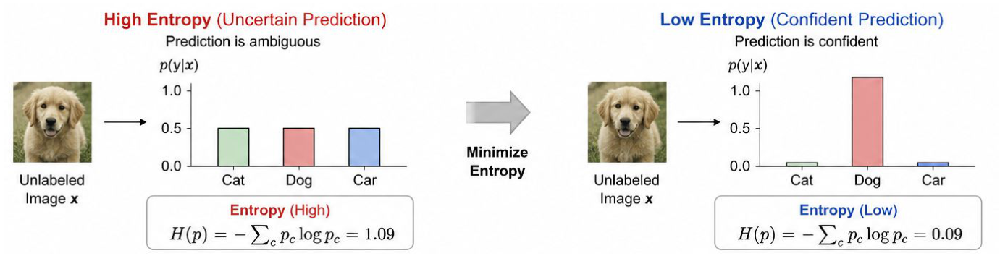
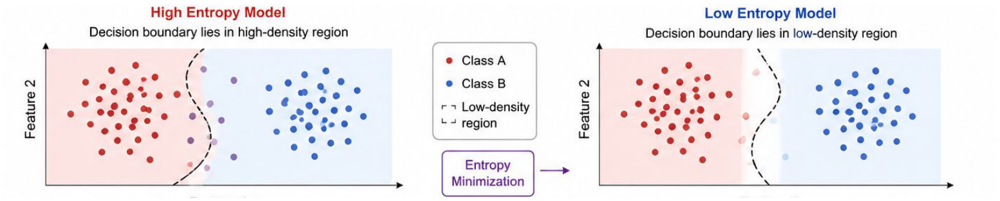
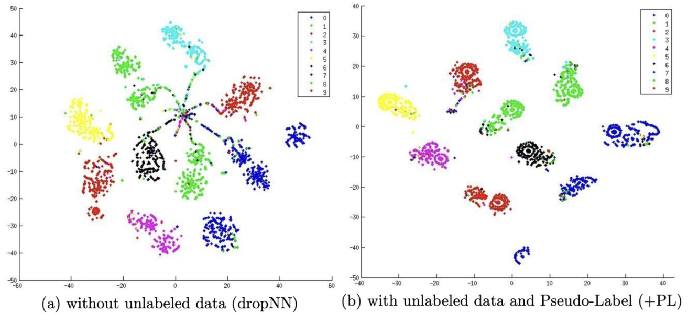
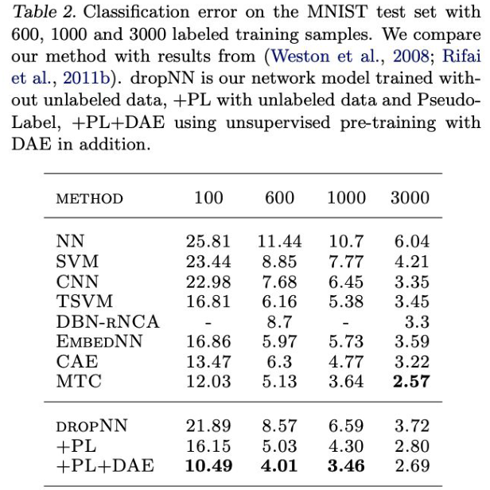

<!-- DRAFT | lecture: 07_Semi_Supervised_Learning_II | chunk: 01 | pages 1–9 -->
<!-- VERIFIED | fixes: 4 | verifier: sonnet -->

## Title (p.1)

슬라이드 텍스트:
- Advanced Representation Learning (고급표현학습)
- Instructor: Donghyeon Cho
- The Department of Computer Science, Hanyang University

**설명**
- 강의 07 표지. 06(Consistency Regularization 중심)에 이어지는 **Semi-Supervised Learning II** — 이번 강의 주제는 **Pseudo Labeling**과 그걸 consistency regularization과 결합한 방법들 (MixMatch → FixMatch 등).
- 슬라이드 소속이 "Department of Computer Science"로 되어 있음 ← 학과명 표기 불일치? (시험과 무관, 원문 유지)

---

## Contents of Table (p.2)

슬라이드 텍스트:
- 1. Pseudo Labeling
  - Label propagation
  - Self-Training
  - Reducing confirmation bias
- 2. Pseudo Labeling with Consistency Regularization
  - MixMatch
  - ReMixMatch
  - FixMatch
  - DivideMix

**설명**
- 강의 로드맵: **Part 1 = 순수 pseudo labeling 계열** (label propagation, self-training, confirmation bias 줄이는 방법), **Part 2 = pseudo labeling + consistency regularization 하이브리드** (MixMatch, ReMixMatch, FixMatch, DivideMix).
- 시험 관점: 방법 이름 ↔ 계열(Part 1 / Part 2) 매칭 문제가 나올 수 있음. **MixMatch/ReMixMatch/FixMatch/DivideMix는 전부 "pseudo label + consistency" 하이브리드**.
- 이 chunk(p.3–9)는 Part 1의 도입부: pseudo labeling의 **기본 아이디어 + 왜 작동하는가(entropy minimization)**.

---

## Section: Pseudo Labeling (p.3)

슬라이드 텍스트:
- 섹션 구분 슬라이드: "Pseudo Labeling"

**설명**
- Part 1 시작. 이 섹션에서 pseudo labeling의 정의 → 이론적 근거(entropy regularization) → Lee 2013 실험 순으로 감.

---

## Pseudo Labeling: Key Idea & Advantages (p.4)

슬라이드 텍스트:
- Key Idea
  - Predict labels for unlabeled samples using the current model.
  - Treat high-confidence predictions as pseudo labels.
  - Train the model on both labeled and pseudo-labeled data.
- Advantages
  - Simple and easy to implement.
  - Scales well to large unlabeled datasets.
  - Foundation of many modern SSL methods.

**설명**
- **Pseudo labeling 3단계 루프**:
  1. **현재 모델**로 unlabeled sample $\mathbf{u}$의 label을 예측 ($\hat y = \mathrm{softmax}(f_\theta(\mathbf u))$).
  2. 예측이 **high-confidence**인 것만 → 그 예측을 정답처럼 취급하는 **pseudo label**로 채택. ← 06 notation의 confidence threshold $\tau$가 여기서 쓰임 (FixMatch류).
  3. labeled data + pseudo-labeled data 둘 다로 모델 재학습 → 모델이 좋아지면 다시 1로.
- 핵심은 **모델이 자기 자신의 예측을 supervision으로 쓴다**는 것 (self-training의 본질). label 없는 데이터가 loss에 들어오는 통로가 "모델 예측 → hard label"인 셈.
- **장점**: 구현이 단순 (loss 하나 더 붙이면 끝), unlabeled data가 아무리 커도 forward만 하면 되니 **scalable**, 그리고 이후 SSL 방법(FixMatch 등)의 **기반 구조**.
- **단점 (슬라이드 p.4엔 없음; 강의 Part 1의 "Reducing confirmation bias"가 이걸 다룸)**: 모델이 틀린 예측을 high-confidence로 pseudo label 삼으면 그 오류를 스스로 강화.
> 보충: Consistency regularization(06)은 "같은 입력의 두 view 예측이 같아야 함"이라는 **상대적** 제약이고, pseudo labeling은 "예측을 **hard label(one-hot)**로 굳혀 cross entropy로 학습"하는 **절대적** target 방식. 이 차이가 Part 2에서 둘을 합치는 동기.

---

## Why Does Pseudo Labeling Work? Entropy Regularization (p.5)

슬라이드 텍스트:
- Why Does Pseudo Labeling Work?
  - Pseudo Labeling is approximately equivalent to **Entropy Regularization**.
  - It encourages low-density separation between classes.
- Entropy Regularization?
  - High entropy → uncertain prediction
  - Low entropy → confident prediction
  - → Minimize the prediction entropy.
- 그림 (좌): **High Entropy (Uncertain Prediction)** — "Prediction is ambiguous". Unlabeled Image $x$ (golden retriever 사진) → $p(y|x)$ bar chart: Cat, Dog, Car 모두 0.5 부근 (거의 균등). 박스: "Entropy (High): $H(p) = -\sum_c p_c \log p_c = 1.09$".
- 화살표: "Minimize Entropy".
- 그림 (우): **Low Entropy (Confident Prediction)** — "Prediction is confident". 같은 이미지 → Dog 막대가 매우 높고(그려진 높이가 y축 1.0을 넘어감 ← 그림 부정확) Cat, Car는 ~0.0. 박스: "Entropy (Low): $H(p) = -\sum_c p_c \log p_c = 0.09$".
- 출처: Bengio et al., NeurIPS 2004, Semi-supervised Learning by Entropy Minimization ← 오타?: 실제 논문은 **Grandvalet & Bengio** (1저자 Grandvalet), NIPS 2004. 슬라이드엔 "Bengio et al."로만 표기.

**설명**
- **Entropy**는 예측 분포 $p(y|\mathbf x)$의 **불확실성 척도**: $H(p) = -\sum_{c=1}^{L} p_c \log p_c$.
  - 균등분포일수록 최대 (**high entropy = uncertain**), one-hot에 가까울수록 0 (**low entropy = confident**).
  - 그림 검산: 3-class 균등분포 $[\tfrac13,\tfrac13,\tfrac13]$이면 $H=\ln 3\approx 1.0986$ → 슬라이드의 **1.09**와 일치 (natural log 사용, 소수 2자리로 **버림**한 값). 이미지의 막대는 모두 ~0.5로 그려져 있지만 (확률 합이 1이 아님) 개념적으로 "거의 균등"이라는 뜻의 그림 ← 합이 1.5로 그려져 있어 엄밀하진 않음.
  - confident 쪽 0.09는 Dog ≈ 0.98~0.99 근처 분포에 해당하는 값 (정확한 분포는 슬라이드에 안 나옴).
- **Entropy Regularization = unlabeled data의 예측 entropy를 loss에 넣어 최소화**. label이 없어도 계산 가능 ($y$가 수식에 없음) → unlabeled data 활용.
- **슬라이드 핵심 주장 2개**:
  1. **Pseudo labeling ≈ entropy regularization** (근사적으로 동등).
  2. 그래서 **low-density separation (06의 H3 가정)** 을 장려함.
- 왜 entropy를 낮추면 low-density separation?  → 다음 슬라이드 p.6에서 설명.
> 보충: Entropy minimization 목적식(Grandvalet & Bengio 2004)은 대략 $\mathcal{L} = \mathcal{L}_s(\theta) + \lambda \sum_{u} H\big(p_\theta(y|u)\big)$ 꼴 (슬라이드엔 없음). 즉 labeled엔 CE, unlabeled엔 **예측 entropy를 penalty**로 추가. $\lambda$는 unlabeled loss weight (06의 unsupervised loss weight와 같은 역할).

---

## Why Does It Help? Decision Boundary → Low-Density Region (p.6)

슬라이드 텍스트:
- Why Does It Help?
  - Minimizing entropy moves decision boundaries toward low-density regions, producing better-separated clusters.
- 그림 (좌): **High Entropy Model** — "Decision boundary lies in high-density region". Feature 2 축. 빨간 점(Class A) cluster와 파란 점(Class B) cluster 사이에 두 class의 점이 **섞여 있는 영역**을 구불구불한 점선 decision boundary가 지나감 (경계 근처 점은 보라/연한 색 = 애매한 예측).
- 가운데 범례: Class A (red), Class B (blue), Low-density region (점선 괄호). 보라색 박스 "Entropy Minimization →".
- 그림 (우): **Low Entropy Model** — "Decision boundary lies in low-density region". 경계가 두 cluster 사이 **빈 공간(흰 영역)** 한가운데로 이동, 경계 근처에 점이 거의 없음.
- 출처: Bengio et al., NeurIPS 2004.

**설명**
- **논리 흐름**: unlabeled 점의 예측 entropy를 낮추려면 모델이 각 점에 대해 **한 class를 확신**해야 함. 그런데 decision boundary 근처에서는 두 class 확률이 비슷 (= high entropy). 그래서 entropy를 줄이려면 **boundary 근처에 unlabeled 점이 없어야** 함 → boundary가 **데이터가 몰려 있는 곳을 피해** 밀도 낮은 곳으로 이동.
- 즉 **entropy minimization = low-density separation (H3)을 구현하는 수단**. 결과로 cluster들이 **better-separated**됨 (H2 cluster assumption과 같은 방향).
- 그림 비교 포인트: 좌측은 boundary가 **high-density 영역**을 통과 → 경계 주변 점들이 high entropy. 우측은 boundary가 **low-density 영역** 통과 → 모든 점이 confident (low entropy).
- 시험 포인트: "entropy minimization이 **무엇을 이동**시키나? → **decision boundary를 low-density region으로**". (cluster center나 data point 자체가 아님.)
> 보충: 이 해석은 **self-reinforcing** 성질도 있음 — boundary가 잘못된 low-density 위치로 가도 모델이 그걸 확신해 버리면 못 고침 (confirmation bias, 이후 슬라이드 주제).

---

## Connection to Pseudo Labeling: Hard-Label Approximation (p.7)

슬라이드 텍스트:
- Connection to Pseudo Labeling
  - Entropy Regularization encourages
    - (Once the prediction is sufficiently confident)
    - Soft prediction can be converted into a hard label.
    - ex) $p(y|x) = [0.96, 0.03, 0.01] \rightarrow y^* = \arg\max p(y|x)$
- **Pseudo Labeling can be viewed as the hard-label approximation of Entropy Regularization.**
- 출처: Lee, ICML 2013, Pseudo-Label: The Simple and Efficient Semi-Supervised Learning Method for Deep Neural Networks

**설명**
- Entropy minimization 하에서는 예측이 점점 **one-hot에 가까워짐** → 이미 $[0.96, 0.03, 0.01]$처럼 충분히 confident하면 soft 분포를 **argmax로 hard label로 굳혀도** 정보 손실이 거의 없음: $y^* = \arg\max_c\, p(y=c|x)$.
- 그러면 그 hard label $y^*$로 **cross entropy**를 걸어 학습하는 것 = pseudo labeling.
- 왜 "근사"인가 — 직관 유도 (슬라이드엔 없는 보충):
  - $y^*$가 one-hot이면 $-\sum_c y^*_c \log p_c = -\log p_{y^*}$. 이걸 최소화하면 $p_{y^*}\to 1$이 되어 **entropy도 같이 감소** → entropy minimization과 같은 방향의 gradient.
  - 차이: entropy 최소화는 **soft한 전체 분포**를 쓰는 smooth한 penalty, pseudo labeling은 **argmax로 hard하게 이산화**한 target을 쓰는 것. 그래서 "hard-label approximation".
- **외워둘 한 문장**: *Pseudo labeling = hard-label approximation of entropy regularization.* (soft↔hard 뒤바꾸기 함정 주의: entropy regularization이 soft, pseudo labeling이 hard.)
> 보충: Lee (2013)의 pseudo label: $y'_i = 1$ if $i = \arg\max_{i'} f_{i'}(x)$, else $0$. 전체 loss는 $L = \frac1n\sum_{m}\sum_{i} L(y_i^m, f_i^m) + \alpha(t)\frac1{n'}\sum_{m}\sum_{i} L(y_i'^m, f_i'^m)$ (labeled + unlabeled/pseudo), $\alpha(t)$는 **0에서 시작해 점진 증가**하는 weight (MNIST 실험: $T_1=100$, $T_2=600$ epoch, $\alpha_f=3$). 슬라이드엔 이 수식 없음. 또 Lee 논문은 **Dropout 적용 네트워크**를 사용하고 pseudo label은 매 weight update마다 현재 모델로 **다시 계산**함.

---

## Pseudo Labeling: Embedding Space Segregation (p.8)

슬라이드 텍스트:
- Pseudo labeling leads to better segregation in the learned embedding space.
- 그림: t-SNE 두 개 (MNIST test set 출력, 0–9 숫자별 색).
  - (a) **without unlabeled data (dropNN)**: cluster들이 있긴 하지만 가운데에서 방사형으로 **점들이 이어진 줄기**(색이 섞인 점들)가 퍼지고, 일부 class(예: 초록·파랑)는 여러 조각으로 갈라짐.
  - (b) **with unlabeled data and Pseudo-Label (+PL)**: 각 class cluster가 더 **조밀하고 서로 분리**되어 있고 중앙의 섞인 줄기가 거의 사라짐.
- 캡션: "t-SNE visualization of outputs on MNIST test set by models training (a) without and (b) with pseudo labeling on **60000 unlabeled samples**, in addition to **600 labeled data**."
- 출처: Lee, ICML 2013.

**설명**
- **설정**: labeled 600개 + unlabeled 60000개 (MNIST). 같은 네트워크를 (a) labeled만 (dropNN), (b) +PL로 학습 → test set 출력 임베딩을 t-SNE로 시각화.
- 결론: pseudo labeling을 쓰면 **class 간 분리(segregation)가 좋아지고** cluster가 compact해짐 ← p.5–6에서 말한 "low-density separation / better-separated clusters"의 **실험적 증거**.
- 퀴즈 포인트: 수치 **600 labeled / 60000 unlabeled**, 비교 대상은 **dropNN**(unlabeled 안 쓰는 baseline) vs **+PL**.
> 보충: t-SNE는 시각화용 비선형 차원축소 기법이라 정량 근거는 아님. 정량 결과는 다음 슬라이드 Table 2.

---

## Pseudo Labeling: MNIST Filters & Results (p.9)

슬라이드 텍스트:
- 그림 Figure 2: "Some filters on layer 1 of the network trained with or without unlabeled data on MNIST. 600 labeled data is used for supervised training."
  - (a) without unlabeled data (dropNN): 노이즈가 많은 필터
  - (b) with unlabeled data and Pseudo-Label (+PL): 좀 더 구조가 보이는 필터
  - (c) using unsupervised pre-training with DAE (+PL+DAE): 가장 깨끗한 stroke/edge 형태 필터
- Table 2 (원문 캡션): "Classification error on the MNIST test set with 600, 1000 and 3000 labeled training samples. We compare our method with results from (Weston et al., 2008; Rifai et al., 2011b). dropNN is our network model trained without unlabeled data, +PL with unlabeled data and Pseudo-Label, +PL+DAE using unsupervised pre-training with DAE in addition."
- Table 2 수치 (classification error %, 열 = # labeled samples):

| METHOD | 100 | 600 | 1000 | 3000 |
|---|---|---|---|---|
| NN | 25.81 | 11.44 | 10.7 | 6.04 |
| SVM | 23.44 | 8.85 | 7.77 | 4.21 |
| CNN | 22.98 | 7.68 | 6.45 | 3.35 |
| TSVM | 16.81 | 6.16 | 5.38 | 3.45 |
| DBN-rNCA | - | 8.7 | - | 3.3 |
| EmbedNN | 16.86 | 5.97 | 5.73 | 3.59 |
| CAE | 13.47 | 6.3 | 4.77 | 3.22 |
| MTC | 12.03 | 5.13 | 3.64 | **2.57** |
| dropNN | 21.89 | 8.57 | 6.59 | 3.72 |
| +PL | 16.15 | 5.03 | 4.30 | 2.80 |
| +PL+DAE | **10.49** | **4.01** | **3.46** | 2.69 |

- 출처: Lee, ICML 2013.
- ← 슬라이드 캡션은 "600, 1000 and 3000"이라 쓰지만 표에는 **100 열도 포함** (원논문 캡션 그대로; 슬라이드 오타라기보다 논문 캡션 불일치).

**설명**
- **Figure 2 (필터)**: layer-1 필터를 보면 dropNN(a)은 **noisy**, +PL(b)은 조금 더 구조적, +PL+DAE(c)는 **가장 깨끗**. ← unlabeled data가 **더 좋은 feature(필터)** 를 학습하게 돕는다는 정성적 증거. labeled 600개만으로는 필터가 overfit/noisy.
- **Table 2 읽는 법**: 숫자는 **test error(%)** → **낮을수록 좋음**. 열은 labeled 샘플 수.
  - **dropNN → +PL**: 모든 열에서 개선 (100: 21.89→16.15, **600: 8.57→5.03**, 1000: 6.59→4.30, 3000: 3.72→2.80). **labeled가 적을수록 개선 폭이 큼** (SSL의 효용이 label이 적을 때 큼).
  - **+PL+DAE** (DAE로 unsupervised pre-training 추가): 100/600/1000에서 **전체 best** (10.49 / 4.01 / 3.46). 3000에서는 **MTC (2.57)** 가 best이고 +PL+DAE는 2.69.
  - +PL(DAE 없이)도 600 labeled에서 5.03으로 TSVM(6.16), EmbedNN(5.97), CAE(6.3)보다 좋고 MTC(5.13)와 근접(살짝 더 좋음).
- 요점: **단순한 pseudo labeling이 훨씬 복잡한 SSL 방법(CAE, MTC 등)과 경쟁/능가** → "Simple and Efficient" (논문 제목).
> 보충: DAE = Denoising Auto-Encoder. MTC = Manifold Tangent Classifier, CAE = Contractive Auto-Encoder (Rifai et al., 2011), TSVM = Transductive SVM. 슬라이드엔 약어 설명 없음.

---

<!-- p.6 이미지 하단에 'Feature 1' 축 라벨이 살짝 잘린 흔적이 있으나 내용 이해엔 무관 -->

## FIGURES

- p.5 `assets/lecture07/p005_entropy_example.png`: High vs Low entropy 예측 예시 (Cat/Dog/Car, H=1.09 vs 0.09) — 중요도 상
- p.6 `assets/lecture07/p006_boundary_shift.png`: Entropy minimization으로 decision boundary가 low-density region으로 이동 — 중요도 상
- p.8 `assets/lecture07/p008_tsne_mnist.png`: t-SNE (dropNN vs +PL, 600 labeled + 60000 unlabeled) — 중요도 중
- p.9 `assets/lecture07/p009_mnist_table.png`: Table 2 MNIST classification error — 중요도 중하 (수치 암기보다 "+PL이 dropNN보다 낮다, +PL+DAE가 best(100/600/1000)" 정도)
- p.9 필터 그림(Figure 2)은 crop 안 함 — 중요도 하

## EXAM POINTS

1. **Pseudo labeling key idea (p.4)**: 현재 모델로 unlabeled 샘플 예측 → **high-confidence** 예측만 pseudo label로 채택 → labeled + pseudo-labeled 둘 다로 학습. 함정: "모든 unlabeled 예측을 쓴다"(X, high-confidence만), "정답 label을 사람이 부여"(X).
2. **장점 3가지 (p.4)**: simple/easy to implement, scales well to large unlabeled datasets, foundation of many modern SSL methods.
3. **Why it works (p.5)**: Pseudo labeling ≈ **Entropy Regularization**, encourages **low-density separation**. 함정: consistency regularization / smoothness와 바꿔치기.
4. **Entropy 정의 (p.5)**: $H(p)=-\sum_c p_c\log p_c$. **High entropy = uncertain**, **low entropy = confident**; entropy regularization은 unlabeled 예측 entropy를 **minimize**. 함정: maximize로 뒤집기, high↔low 뒤집기. 3-class 균등분포 $H\approx1.09$ (=ln 3), confident 예시 $H\approx0.09$.
5. **Entropy minimization의 효과 (p.6)**: **decision boundary를 low-density region으로 이동**시켜 cluster를 더 잘 분리. 함정: "boundary를 high-density region으로 이동" (X).
6. **한 문장 정의 (p.7)**: Pseudo labeling = **hard-label approximation of entropy regularization**. $p(y|x)=[0.96,0.03,0.01]\rightarrow y^*=\arg\max p(y|x)$. 함정: soft-label approximation이라고 뒤집기 / "entropy regularization이 hard label을 쓴다" (X).
7. **출처 매칭**: Entropy minimization = Bengio et al., **NeurIPS 2004** (슬라이드 표기; 실제 Grandvalet & Bengio). Pseudo-Label = Lee, **ICML 2013**, 제목 "The Simple and Efficient Semi-Supervised Learning Method for Deep Neural Networks". 함정: 연도/학회 바꾸기.
8. **MNIST 실험 설정 (p.8)**: **600 labeled + 60000 unlabeled**. dropNN(baseline, unlabeled 미사용) vs +PL: t-SNE에서 +PL이 class **segregation** 더 좋음.
9. **Table 2 (p.9)**: 값은 **error rate(낮을수록 good)**. +PL < dropNN (모든 열). 600 labeled: dropNN 8.57 → +PL 5.03 → +PL+DAE **4.01**. +PL+DAE는 100/600/1000에서 best (10.49/4.01/3.46), 3000에서는 **MTC 2.57**이 best. 함정: error↔accuracy 해석 뒤집기, DAE 없는 +PL이 best라고 하기.
10. **강의 구성 (p.2)**: Part 1 Pseudo Labeling (Label propagation, Self-Training, Reducing confirmation bias) / Part 2 Pseudo Labeling with Consistency Regularization (MixMatch, ReMixMatch, FixMatch, DivideMix). "which is NOT" 유형: Π-model, Mean Teacher, VAT 등은 06 consistency 계열이지 이 목록에 없음.
11. **그림 수치 (p.5)**: High-entropy 예시 = Cat/Dog/Car 균등 → $H=1.09$, low = $0.09$ (Dog만 높음). 함정: 1.09와 0.09 뒤바꾸기, "entropy가 높을수록 confident"(X).
12. **p.8 그림**: (a) without unlabeled (dropNN)엔 중앙에서 뻗는 섞인 줄기가 있고 (b) +PL은 cluster가 더 분리. 함정: (a)/(b) 뒤바꾸기.
13. **개념 연결**: Pseudo labeling/entropy minimization은 06의 **H3 Low-Density Separation** (및 cluster assumption)에 대응. 함정: H1 smoothness와 혼동 (smoothness는 consistency regularization의 근거).
