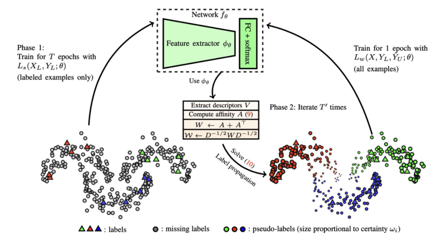
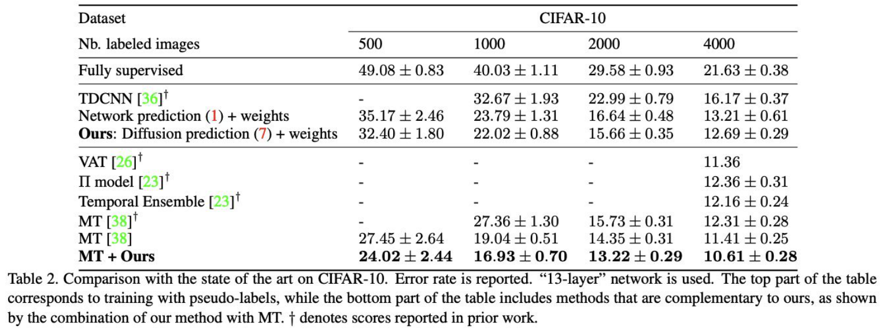
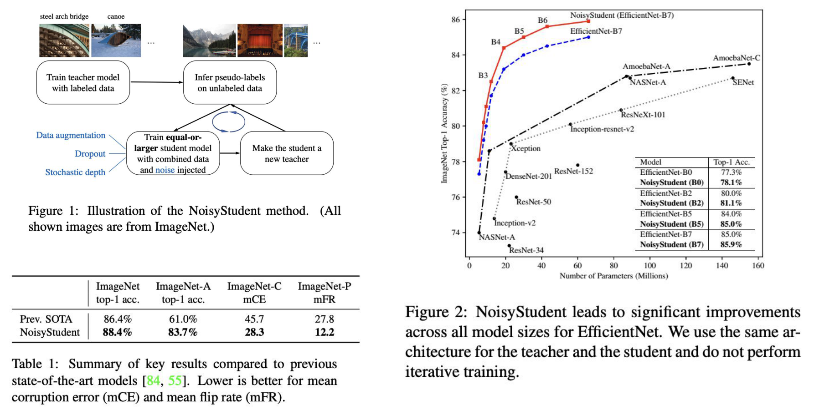

<!-- DRAFT | lecture: 07_Semi_Supervised_Learning_II | chunk: 02 | pages 10–19 -->
<!-- VERIFIED | fixes: 4 | verifier: sonnet -->

## Label Propagation: Key Idea & Pipeline (p.10)

슬라이드 텍스트:
- Label Propagation
- Key Idea
  - Construct a similarity graph in the feature space.
  - **Propagate** labels from **labeled samples to nearby unlabeled** samples.
  - Assign pseudo labels based on **neighborhood relationships**.
- How does it work?
  - Learn feature embeddings.
  - Build a similarity graph.
  - Propagate labels through graph connections.
  - Use propagated labels for training.
- 그림 (논문 Fig.): 가운데 위 **Network $f_\theta$** = Feature extractor $\phi_\theta$ + FC + softmax.
  - 왼쪽 화살표 "**Phase 1**: Train for $T$ epochs with $L_s(X_L, Y_L;\theta)$ (labeled examples only)" — 점들 대부분 회색(missing labels), 삼각형(labels)만 소수.
  - 가운데 박스 "Use $\phi_\theta$ → Extract descriptors $V$ → Compute affinity $A$ (9) → $W \leftarrow A + A^\top$ → $\mathcal{W} \leftarrow D^{-1/2} W D^{-1/2}$", "**Phase 2**: Iterate $T'$ times", "Solve (10) = Label propagation".
  - 오른쪽: 모든 점이 빨강/초록/파랑 pseudo-label로 채워짐 (크기 ∝ certainty $\omega_i$) → "Train for 1 epoch with $L_w(X, Y_L, \hat Y_U;\theta)$ (all examples)" 후 네트워크로 되돌아감.
  - 범례: 삼각형 = labels, 회색 원 = missing labels, 색 원 = pseudo-labels (size proportional to certainty $\omega_i$).
- 출처: Iscen, et. al., CVPR 2019, Label Propagation for Deep Semi-supervised Learning

**설명**
- **Label Propagation (LP)** 은 pseudo labeling을 **sample 하나씩 독립적으로** 하지 않고, **feature space에서 similarity graph**를 만들어 **labeled 점의 label이 그래프 edge를 타고 근처 unlabeled 점으로 번지게** 하는 방법. ← 06 강의의 H2 cluster / H4 manifold 가정을 그대로 구현한 것 (**graph = manifold의 근사**).
- 전체 흐름 (4단계 = 슬라이드의 How does it work):
  1. **Learn feature embeddings** — 먼저 labeled data만으로 $T$ epoch 학습 (Phase 1). feature extractor $\phi_\theta$가 쓸 만한 embedding을 주게 만드는 단계.
  2. **Build a similarity graph** — 모든 샘플(labeled+unlabeled)의 descriptor $\mathbf v_i=\phi_\theta(x_i)$로 kNN affinity graph 구성.
  3. **Propagate labels** — graph 위에서 diffusion으로 unlabeled 점들의 label 분포 $Z$ 계산 → argmax = pseudo label.
  4. **Use propagated labels for training** — pseudo label을 **certainty로 가중**해서 전체 데이터로 1 epoch 학습 ($L_w$). 이 Phase 2를 $T'$번 반복 → **embedding이 좋아지면 graph도 좋아지고 pseudo label도 좋아지는 선순환**.
- 그림의 "size proportional to certainty $\omega_i$": 경계 근처(서로 다른 label 사이) 점은 pseudo label이 불확실해서 작게(=낮은 weight) 그려짐.
> 보충: 네트워크 예측 확률이 아니라 **graph diffusion 결과**로 pseudo label을 만든다는 게 핵심 차별점. 이 방법은 고전적 graph 기반 label propagation(Zhou et al., NIPS 2003 "Learning with local and global consistency")을 deep SSL의 학습 루프 안에 넣은 것.

---

## Label Propagation: Algorithm & Equations (p.11)

슬라이드 텍스트:
- **Algorithm 1** Label propagation for deep SSL — `procedure LPDSSL(Training examples X, labels $Y_L$)`
  1. $\theta \leftarrow$ initialize randomly
  2. for epoch $\in [1,\dots,T]$: $\theta \leftarrow \text{OPTIMIZE}(L_s(X_L, Y_L;\theta))$ ▷ mini-batch optimization
  3. for epoch $\in [1,\dots,T']$:
     - for $i\in\{1,\dots,n\}$: $\mathbf v_i \leftarrow \phi_\theta(x_i)$ ▷ extract descriptors
     - for $(i,j)\in\{1..n\}^2$: $a_{ij}\leftarrow$ affinity values (9)
     - $W \leftarrow A + A^\top$ ▷ symmetric affinity
     - $\mathcal W \leftarrow D^{-1/2} W D^{-1/2}$ ▷ symmetrically normalized affinity
     - $Z \leftarrow$ solve (10) with CG ▷ diffusion
     - for $(i,j)\in U\times C$: $\hat z_{ij}\leftarrow z_{ij}/\sum_k z_{ik}$ ▷ normalize $Z$
     - for $i\in U$: $\hat y_i \leftarrow \arg\max_j\hat z_{ij}$ ▷ pseudo-label
     - for $i\in U$: $\omega_i \leftarrow$ certainty of $\hat y_i$ (11) ▷ pseudo-label weight
     - for $j\in C$: $\zeta_j \leftarrow (|L_j|+|U_j|)^{-1}$ ▷ class weight/balancing
     - $\theta \leftarrow \text{OPTIMIZE}(L_w(X, Y_L, \hat Y_U;\theta))$ ▷ mini-batch optimization
- **Nearest neighbor graph.** Given a network with parameters $\theta$, we construct the descriptor set $V=(\mathbf v_1,\dots,\mathbf v_l,\mathbf v_{l+1},\dots,\mathbf v_n)$, where $\mathbf v_i := \phi_\theta(x_i)$. A sparse *affinity matrix* $A\in\mathbb R^{n\times n}$ with elements
$$a_{ij} := \begin{cases} [\mathbf v_i^\top \mathbf v_j]_+^\gamma, & \text{if } i\neq j \wedge \mathbf v_i \in \mathrm{NN}_k(\mathbf v_j) \\ 0, & \text{otherwise}\end{cases} \quad (9)$$
- **Label propagation.** Estimating matrix $Z$ by (6) is impractical for large $n$ because the inverse matrix $(I-\alpha\mathcal W)^{-1}$ is not sparse. We rather use the conjugate gradient (CG) method to solve linear system
$$(I-\alpha\mathcal W)Z = Y, \quad (10)$$

**설명**
- **Step 1 — kNN affinity matrix (9).**
  - $\mathbf v_i=\phi_\theta(x_i)$ : CNN feature extractor의 descriptor.
  - $[\mathbf v_i^\top\mathbf v_j]_+^\gamma$ : descriptor 내적(descriptor가 L2-normalize 되어 있으면 **cosine similarity**)을 0 이하는 잘라내고($[\cdot]_+$ = ReLU) $\gamma$제곱 → 유사도가 높은 이웃은 더 강조, 낮은 건 더 약하게.
  - 조건 $\mathbf v_i\in\mathrm{NN}_k(\mathbf v_j)$ : **$k$-nearest neighbor인 경우만** 값을 줌, 나머지는 0 → **sparse** matrix ($n\times n$ 이지만 행당 대략 $k$개만 nonzero). $i\ne j$ : self-loop 제거.
- **Step 2 — symmetrize & normalize.** kNN 관계는 비대칭($i$가 $j$의 이웃이어도 반대는 아닐 수 있음)이라 $W=A+A^\top$ 로 **대칭화**. 그 뒤 $\mathcal W=D^{-1/2}WD^{-1/2}$ ($D$ = degree matrix, $D_{ii}=\sum_j W_{ij}$) 로 **symmetric normalization** → degree가 큰 hub 노드가 diffusion을 지배하지 않도록 함.
- **Step 3 — diffusion (10).**
  - $Y$ : $n\times C$ 초기 label matrix. **labeled 점의 행만 one-hot**, unlabeled 행은 0.
  - $Z$ : diffusion 결과 label 분포 ($n\times C$). 식 $(I-\alpha\mathcal W)Z=Y$ 를 풀면 $Z=(I-\alpha\mathcal W)^{-1}Y$.
  - **직관**: $(I-\alpha\mathcal W)^{-1}=\sum_{t\ge0}\alpha^t\mathcal W^t$ (Neumann series, $0<\alpha<1$) → $\mathcal W^t Y$ = label이 그래프를 $t$ hop 걸어 퍼진 양, $\alpha^t$로 멀수록 감쇠. 즉 **labeled 점에서 출발해 graph 위를 걷다가 도달하는 정도**가 $Z$.
  - 왜 CG? 역행렬 $(I-\alpha\mathcal W)^{-1}$ 은 **sparse하지 않아서**(슬라이드 원문) $n$이 크면 직접 구하는 게 비현실적. 대신 sparse linear system $(I-\alpha\mathcal W)Z=Y$ 를 **conjugate gradient**로 푼다.
- **Step 4 — pseudo-label & weighting.**
  - $\hat z_{ij}=z_{ij}/\sum_k z_{ik}$ : $Z$의 각 행을 합 1로 **normalize** → 확률 분포처럼. $\hat y_i=\arg\max_j\hat z_{ij}$ → **hard pseudo label**.
  - $\omega_i$ : pseudo label의 **certainty weight** (식 (11)). 확신 낮은 pseudo label은 loss에서 덜 반영.
  - $\zeta_j=(|L_j|+|U_j|)^{-1}$ : **class balancing weight** — 클래스 $j$에 속하는 (labeled + pseudo-labeled) 샘플 수의 역수 → 샘플 많은 클래스가 loss를 지배하지 않게.
  - 최종 loss $L_w$ = weight($\omega_i$, $\zeta_j$)를 곱한 loss를 labeled+pseudo-labeled 전체에 적용 (슬라이드에 $L_w$ 식은 없음).
- 알고리즘 구조 요약: **(line 3–5) $T$ epoch supervised pre-training → (line 6–17) 매 epoch마다 [descriptor 재추출 → graph → diffusion → pseudo label → 1 epoch 학습]**. 즉 graph/pseudo label이 **매 epoch 갱신**됨.
> 보충: 슬라이드에는 식 (11)이 안 나옴 (line 14에서 참조만). Iscen 논문에서는 정규화된 $\hat z_i$의 **entropy 기반 certainty** $\omega_i = 1 - H(\hat z_i)/\log(c)$ ($c$ = class 수)로 기억함 — entropy 낮을수록(확신↑) weight↑. 슬라이드 밖 내용이라 확실하진 않음; 시험 포인트는 "certainty로 가중한다"까지.
> 보충: $\alpha\in[0,1)$ 는 diffusion 감쇠 hyperparameter (슬라이드에 값 없음). p.12 표의 "Diffusion prediction (7)"은 $Z$ 기반 pseudo label, "Network prediction (1)"은 네트워크 softmax 출력으로 만든 pseudo label.

---

## Label Propagation: Results on CIFAR-10 (p.12)

슬라이드 텍스트 (Table 2, CIFAR-10, error rate (%), "13-layer" network, † = scores reported in prior work):

| Nb. labeled images | 500 | 1000 | 2000 | 4000 |
|---|---|---|---|---|
| Fully supervised | 49.08 ± 0.83 | 40.03 ± 1.11 | 29.58 ± 0.93 | 21.63 ± 0.38 |
| TDCNN [36]† | - | 32.67 ± 1.93 | 22.99 ± 0.79 | 16.17 ± 0.37 |
| Network prediction (1) + weights | 35.17 ± 2.46 | 23.79 ± 1.31 | 16.64 ± 0.48 | 13.21 ± 0.61 |
| **Ours**: Diffusion prediction (7) + weights | 32.40 ± 1.80 | 22.02 ± 0.88 | 15.66 ± 0.35 | 12.69 ± 0.29 |
| VAT [26]† | - | - | - | 11.36 |
| Π model [23]† | - | - | - | 12.36 ± 0.31 |
| Temporal Ensemble [23]† | - | - | - | 12.16 ± 0.24 |
| MT [38]† | - | 27.36 ± 1.30 | 15.73 ± 0.31 | 12.31 ± 0.28 |
| MT [38] | 27.45 ± 2.64 | 19.04 ± 0.51 | 14.35 ± 0.31 | 11.41 ± 0.25 |
| **MT + Ours** | **24.02 ± 2.44** | **16.93 ± 0.70** | **13.22 ± 0.29** | **10.61 ± 0.28** |

- 캡션: "Comparison with the state of the art on CIFAR-10. Error rate is reported. '13-layer' network is used. The top part of the table corresponds to training with pseudo-labels, while the bottom part of the table includes methods that are complementary to ours, as shown by the combination of our method with MT. † denotes scores reported in prior work."

**설명**
- **숫자는 error rate** → **낮을수록 좋음** (accuracy 아님! 함정 주의).
- 읽는 법 (표 윗부분 = pseudo-label 기반 방법: TDCNN / Network prediction / Ours, 캡션 "training with pseudo-labels"):
  - **Fully supervised** (labeled만 사용): 500장 49.08 → 4000장 21.63. 라벨이 적을수록 error가 크게 올라감.
  - **Network prediction (1) + weights** : 네트워크 softmax로 만든 pseudo label (= 일반 pseudo labeling) → 4000장에서 13.21.
  - **Ours: Diffusion prediction (7) + weights** : graph diffusion으로 만든 pseudo label → 모든 설정에서 위보다 error 낮음 (500: 35.17→**32.40**, 1000: 23.79→**22.02**, 4000: 13.21→**12.69**). ← **같은 weighting을 쓰고 pseudo label 생성법만 바꿔서 얻은 이득** = label propagation의 효과.
- 표 아랫부분 (consistency regularization 계열 VAT, Π model, Temporal Ensemble, MT)은 **LP와 상호보완적(complementary)** → **MT + Ours**가 모든 label 수에서 best (500: 27.45→**24.02**, 4000: 11.41→**10.61**). 즉 **pseudo label(LP)과 consistency regularization(MT)은 같이 쓰면 이득**.
- 같은 MT인데 † 행(prior work 보고값, 4000에서 12.31)과 † 없는 행(11.41)이 다름 ← 후자는 저자 측 결과로 보임 (슬라이드엔 설명 없음).
- 라벨이 적을수록 SSL 이득이 큼: 500장에서 49.08 (fully supervised) → 24.02 (MT+Ours).

---

## Label Propagation vs Pseudo Labeling (p.13)

슬라이드 텍스트:
- Compared with Pseudo Labeling (표)

| Pseudo Labeling | Label Propagation |
|---|---|
| Predict each sample independently | Exploit neighborhood relationships |
| Confidence-based | Similarity-based |
| Ignores data manifold | Leverages manifold structure |

- Advantages
  - Produces smoother pseudo labels.
  - Better utilizes unlabeled data.
  - Exploits the cluster assumption.

**설명**
- **핵심 대비**: Pseudo Labeling은 **각 샘플을 독립적으로** 모델이 예측 → **confidence(최대 softmax 확률)** 로 걸러냄. Label Propagation은 **이웃 관계/유사도**로 label을 정함 → **manifold 구조 활용**.
- 장점 세 가지:
  - **Smoother pseudo labels** : 가까운 점들이 비슷한 label을 받음 (H1 smoothness와 직결).
  - **Better utilizes unlabeled data** : confidence 기반이면 확신 낮은 unlabeled 점은 버리게 되는데, LP는 graph 연결을 통해 unlabeled 점이 label 정보를 받음.
  - **Exploits the cluster assumption** : cluster 안에서 label이 퍼짐 (H2).
- 시험 함정: "Label Propagation is **confidence-based**" ← 틀림 (그건 pseudo labeling). LP는 **similarity-based**.

---

## Label Propagation: Limitations (p.14)

슬라이드 텍스트:
- Limitations
  - Requires constructing a similarity graph.
    - Expensive for large datasets.
  - Performance depends on feature quality.
- (강조 문장) Label Propagation improves pseudo labels by leveraging the geometric structure of the feature space rather than treating each sample independently.

**설명**
- **단점 1**: similarity graph를 만들어야 함 → kNN 탐색 비용이 **큰 dataset에서 비쌈** (알고리즘상 매 epoch 재구축하므로 더 부담).
- **단점 2**: **feature 품질에 의존** — embedding이 나쁘면 이웃이 엉뚱하게 잡혀서 **틀린 label이 graph를 타고 퍼짐**. 그래서 Phase 1에서 labeled data로 먼저 학습해 feature를 만들어두는 것.
- 한 줄 요약: **LP = feature space의 geometric structure를 이용해 pseudo label을 개선**.

---

## Pseudo Labeling (Self-Training) as Teacher–Student (p.15)

슬라이드 텍스트:
- Pseudo Labeling is naturally performed as an iterative teacher–student process.
- **Teacher**
  - Predicts pseudo labels for unlabeled samples.
  - Provides supervision for the student.
  - Often the previous model or an EMA model.
- **Student**
  - Learns from labeled data and pseudo labels.
  - Produces a better model after training.
  - Becomes the teacher in the next iteration.
- (강조) As the model improves, the pseudo labels become more accurate, leading to further improvements.

**설명**
- Pseudo labeling을 **teacher–student 루프**로 재해석: **teacher가 unlabeled data에 label을 달고, student가 (labeled + pseudo-labeled)로 학습 → student가 다음 iteration의 teacher**가 됨.
- **Teacher 정체**: "often the **previous model** or an **EMA model**" (Mean Teacher의 weight EMA와 연결 ← 06강).
- **선순환**: 모델이 좋아지면 pseudo label 품질↑ → 다음 student 더 좋아짐.
- 함정 포인트: **teacher = pseudo label 생성자 / student = 학습 대상**. 둘 뒤바꾸기 주의.
> 보충: 반대로 pseudo label에 **오류가 있으면 student가 그걸 학습해 강화**하는 **confirmation bias** 위험이 있음 (슬라이드에는 없는 일반 지식). Noisy Student의 noise가 이를 완화하는 장치로도 해석 가능.

---

## Self-Training: Key Idea (p.16)

슬라이드 텍스트:
- Self-Training
- Key Idea
  - Train a model using labeled data.
  - Predict pseudo labels for unlabeled samples.
  - Add **high-confidence** predictions to the labeled set.
  - Repeat the process iteratively.
- Characteristics
  - Iterative learning framework.
  - Gradually expands the labeled dataset.
  - The teacher improves over iterations, producing better pseudo labels.
- 출처: Nigam, et. al., CIKM 2000, Analyzing the Effectiveness and Applicability of Co-training

**설명**
- **Self-training 알고리즘** (고전적 형태):
  1. labeled data로 모델 학습
  2. unlabeled data에 예측 → pseudo label
  3. **confidence가 높은 예측만** labeled set에 추가 (보통 confidence threshold를 둠 ← 슬라이드엔 값/기호 없음)
  4. 1–3 반복 → **labeled set이 점점 커짐**
- 특징: iterative framework, labeled set의 점진적 확장 (**gradually expands**). teacher가 반복마다 좋아져 pseudo label 품질도 올라감.
- p.13의 "Pseudo Labeling: confidence-based"가 여기서 나옴 (high-confidence만 추가).
> 보충: 인용된 Nigam & Ghani (CIKM 2000)는 제목 그대로 **co-training**에 관한 논문 — 슬라이드가 self-training의 출처로 이 논문을 인용한 것.

---

## Noisy Student: Idea & Why Add Noise (p.17)

슬라이드 텍스트:
- Self-Training
- **Noisy Student (Xie et al., 2020)**
  - Use the teacher to generate pseudo labels.
  - Train the student with **additional noise**.
  - The student becomes more robust than the teacher.
- **Why Add Noise?**
  - Noise prevents the student from simply copying the teacher.
  - Instead, it learns a more robust decision boundary.
    - RandAugment
    - Dropout
    - Stochastic Depth
- 출처: Xie, et. al., CVPR 2020, Self-training with Noisy Student improves ImageNet classification

**설명**
- **Noisy Student = self-training + student에 noise 주입**. teacher는 pseudo label을 만들고, **student는 noise 하에서 그 label을 맞추도록** 학습.
- **왜 noise?** noise 없이 student가 teacher의 출력을 학습하면 **teacher를 그대로 복사**할 뿐 더 얻을 게 없음. noise가 있으면 student는 **perturbation에 불변한 예측**을 해야 하므로 **더 robust한 decision boundary**를 학습 → teacher보다 좋아짐. ← **consistency regularization(H1 smoothness)과 pseudo labeling을 결합**한 것.
- 사용하는 noise 3종:
  - **RandAugment** (input noise, data augmentation)
  - **Dropout** (model noise)
  - **Stochastic Depth** (model noise, layer를 확률적으로 건너뜀)
- **중요 비대칭**: pseudo label을 만드는 **teacher는 noise 없이(clean)**, **student만 noise** (p.19: student는 teacher보다 stronger perturbation).
> 보충: 논문 맥락 — teacher/student 모두 EfficientNet 계열, unlabeled data는 대규모 JFT-300M 이미지 (슬라이드엔 없는 내용, 일반 지식).

---

## Noisy Student: Method Figure & Results (p.18)

슬라이드 텍스트:
- **Figure 1**: Illustration of the NoisyStudent method. (All shown images are from ImageNet.)
  - 흐름도: [Train teacher model with labeled data] → [Infer pseudo-labels on unlabeled data] → [Train **equal-or-larger** student model with combined data and **noise** injected] (noise 종류: Data augmentation / Dropout / Stochastic depth) → [Make the student a new teacher] → 다시 "Infer pseudo-labels"로 순환 화살표. (labeled 이미지 예: steel arch bridge, canoe)
- **Table 1**: Summary of key results compared to previous state-of-the-art models [84, 55]. Lower is better for mean corruption error (mCE) and mean flip rate (mFR).

| | ImageNet top-1 acc. | ImageNet-A top-1 acc. | ImageNet-C mCE | ImageNet-P mFR |
|---|---|---|---|---|
| Prev. SOTA | 86.4% | 61.0% | 45.7 | 27.8 |
| NoisyStudent | **88.4%** | **83.7%** | **28.3** | **12.2** |

- **Figure 2**: NoisyStudent leads to significant improvements across all model sizes for EfficientNet. We use the same architecture for the teacher and the student and do not perform iterative training.
  - x축 Number of Parameters (Millions), y축 ImageNet Top-1 Accuracy (%). 빨강 실선 = NoisyStudent (B3–B7), 파랑 점선 = EfficientNet. 모든 크기에서 빨강이 위. 검정 일점쇄선(AmoebaNet 등), 점선(SENet/ResNeXt 등)은 기타 모델.
  - 내장 표: EfficientNet-B0 77.3% → NoisyStudent(B0) **78.1%**; B2 80.0% → **81.1%**; B5 84.0% → **85.0%**; B7 85.0% → **85.9%**.

**설명**
- **Figure 1 읽기**: ① labeled data로 teacher 학습 → ② unlabeled data에 pseudo label 생성 → ③ **equal-or-larger** student를 (labeled + pseudo-labeled) **combined data**로, **noise를 넣어** 학습 → ④ student를 새 teacher로 → ②로 돌아가 반복. 이게 p.15의 teacher–student iteration 그대로.
- **"equal-or-larger"**: student가 teacher와 **같거나 더 큼**. ← **distillation(큰 teacher → 작은 student)과 반대 방향**이라는 점이 함정 포인트.
- **Table 1**: 모든 지표에서 이전 SOTA 능가.
  - ImageNet top-1: 86.4 → **88.4%** (+2.0).
  - **robustness 벤치마크 향상이 훨씬 큼**: ImageNet-A 61.0 → **83.7%**, ImageNet-C mCE 45.7 → **28.3**, ImageNet-P mFR 27.8 → **12.2**. ← **mCE, mFR는 낮을수록 좋음** (accuracy와 방향 반대 — 함정). noise로 학습했기 때문에 corruption/perturbation에 강하다는 주장을 뒷받침.
- **Figure 2**: EfficientNet 모든 크기에서 일관된 향상 (표의 4개 모델 기준 +0.8 ~ +1.1%p). 캡션 주의: **teacher와 student가 같은 구조**이고 **iterative training 없이** 한 결과 → 그래도 개선됨.

---

## Noisy Student: Key Findings (p.19)

슬라이드 텍스트:
- Key Findings
  - **Larger student > teacher**
  - **Soft pseudo labels > hard labels**
  - **Strong augmentation improves generalization**
  - Achieved state-of-the-art ImageNet performance
- (강조) Noisy Student extends self-training by making the student learn under **stronger perturbations than the teacher**, leading to progressively better models.
- 출처 표기: Xie, et. al., **CVPR 2000** ← 오타? (p.17·18에서는 CVPR 2020, 2020이 맞음)

**설명**
- **네 가지 발견**:
  1. **Larger student > teacher** — student 용량을 키우면 더 좋음 (equal-or-larger 설계의 근거).
  2. **Soft pseudo labels > hard labels** — pseudo label을 **확률 분포 그대로(soft)** 쓰는 게 argmax one-hot(hard)보다 좋음. (p.11 LP 알고리즘은 argmax **hard** pseudo label을 쓰는 것과 대비.)
  3. **Strong augmentation improves generalization** — RandAugment 같은 강한 augmentation이 student의 일반화를 향상.
  4. ImageNet **SOTA** 달성 (88.4% top-1, p.18).
- **핵심 한 문장**: student가 **teacher보다 더 강한 perturbation** 아래에서 학습하면서 **점진적으로 더 좋은 모델**이 됨.

---

## FIGURES

- p.10: `assets/lecture07/p010_lp_pipeline.png` — LP 2-phase pipeline (Phase 1 supervised → graph/propagation → pseudo-label로 재학습), 중요도 상
- p.11: `assets/lecture07/p011_lp_algorithm.png` — Algorithm 1 + 식 (9), (10), 중요도 중 (식 의미 이해 필요, 암기는 낮음)
- p.12: `assets/lecture07/p012_lp_cifar_table.png` — CIFAR-10 error table (Network vs Diffusion prediction, MT+Ours), 중요도 중하 (수치는 비중 낮게)
- p.13: Pseudo Labeling vs Label Propagation 비교 표 (텍스트로 transcribe함), 중요도 상
- p.18: `assets/lecture07/p018_noisy_student.png` — Noisy Student 흐름도 + Table 1 + Figure 2, 중요도 상

## EXAM POINTS

1. **Label Propagation 정의** (p.10): similarity graph in **feature space** → labeled sample의 label을 nearby unlabeled sample로 propagate → neighborhood relationships 기반 pseudo label. 4단계: learn embeddings → build graph → propagate → train with propagated labels. *함정*: graph를 input pixel space에서 만든다고 하면 틀림.
2. **LP vs Pseudo Labeling 표** (p.13): PL = predict each sample **independently**, **confidence-based**, ignores manifold / LP = **neighborhood** relationships, **similarity-based**, leverages manifold structure. *함정*: 두 열 뒤바꾸기 ("LP is confidence-based" = False).
3. **LP 장점/단점** (p.13–14): 장점 = smoother pseudo labels, better utilizes unlabeled data, exploits **cluster assumption**. 단점 = similarity graph 구축 필요(큰 dataset에서 **expensive**), **performance depends on feature quality**. *"Which is NOT a limitation?"* 유형 가능.
4. **LP 수식** (p.11): $a_{ij}=[\mathbf v_i^\top\mathbf v_j]_+^\gamma$ (kNN일 때만, 아니면 0), $W=A+A^\top$, $\mathcal W=D^{-1/2}WD^{-1/2}$, $(I-\alpha\mathcal W)Z=Y$, **CG로 풀이** (역행렬이 sparse하지 않아서). pseudo label은 $\arg\max_j\hat z_{ij}$ (**hard**), certainty weight $\omega_i$ + class weight $\zeta_j=(|L_j|+|U_j|)^{-1}$.
5. **CIFAR-10 결과** (p.12): error rate이므로 낮을수록 좋음. Diffusion prediction이 Network prediction보다 모든 label 수에서 낮음 (예: 500장 32.40 vs 35.17). **MT + Ours가 best** (4000장 10.61, 500장 24.02) → LP와 consistency regularization은 **complementary**.
6. **Self-training 절차** (p.16): labeled로 학습 → unlabeled에 pseudo label → **high-confidence** 예측만 labeled set에 추가 → 반복. labeled set이 gradually expand.
7. **Teacher–Student 역할** (p.15): teacher = pseudo label 생성 (often previous model or **EMA model**), student = labeled + pseudo label로 학습, **다음 iteration의 teacher가 됨**. *함정*: teacher↔student 뒤바꾸기.
8. **Noisy Student 정의** (p.17): teacher가 pseudo label 생성, **student에 additional noise**를 주며 학습 → student가 teacher보다 robust. noise 3종 = **RandAugment, Dropout, Stochastic Depth**. 이유 = student가 teacher를 단순 복사하지 않고 more robust decision boundary 학습. *함정*: noise를 teacher에 준다고 하면 틀림 / noise 종류에 MixUp 등 끼워넣는 보기.
9. **Noisy Student Key Findings** (p.19): **larger student > teacher**, **soft > hard** pseudo labels, **strong augmentation** helps, ImageNet SOTA. *함정*: "smaller student", "hard labels better", "weak augmentation"으로 비틀기. student는 teacher와 **equal-or-larger** (distillation처럼 작은 student 아님, p.18).
10. **Noisy Student 수치** (p.18): ImageNet top-1 **86.4 → 88.4%**, ImageNet-A **61.0 → 83.7%**, ImageNet-C mCE **45.7 → 28.3**, ImageNet-P mFR **27.8 → 12.2** (mCE/mFR는 **lower is better**). EfficientNet-B7: 85.0 → 85.9%. Fig.2는 같은 구조 teacher/student, **non-iterative**.
11. **오타 주의**: p.19 출처가 "CVPR 2000"으로 적혀 있으나 p.17·18의 CVPR 2020이 맞음.
12. **LP 알고리즘 구조** (p.10–11): Phase 1 = labeled만으로 $T$ epoch ($L_s$) → Phase 2 = $T'$회 반복 [descriptor 추출 → graph → CG로 diffusion → pseudo label → **all examples** 1 epoch ($L_w$)]. *함정*: "Phase 1에서 unlabeled도 사용"(X) / "graph를 한 번만 만들고 고정"(X, 매 epoch 재구성) / "pseudo label은 soft"(X, argmax hard, 확신도는 $\omega_i$로 따로 반영).
13. **Self-training** (p.16): *함정*: **모든** 예측을 추가(X) → **high-confidence만** 추가. 인용 논문(Nigam, CIKM 2000)은 제목이 co-training.
14. **soft vs hard** (p.19 vs p.11): Noisy Student는 soft > hard라고 하고, LP 알고리즘은 argmax hard. 방법 간 비교 문제 가능.
15. **개념 연결**: Noisy Student = **self-training (pseudo labeling) + noise/consistency (strong augmentation, dropout, stochastic depth)**; LP = **pseudo labeling + cluster/manifold assumption**. 가정 ↔ 방법 매칭 문제 가능.
