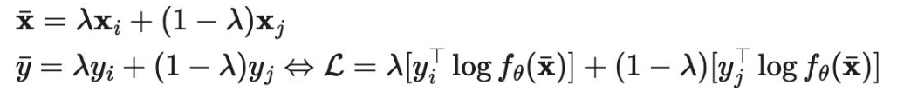
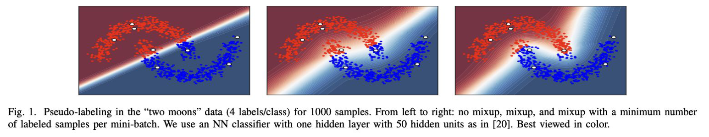
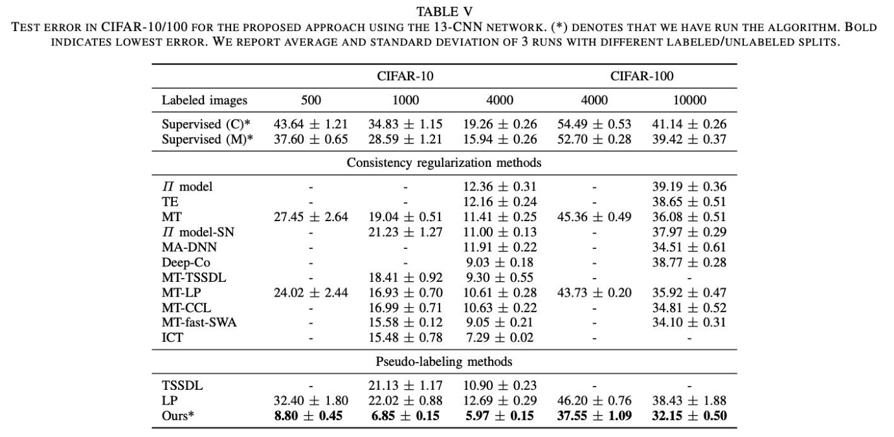
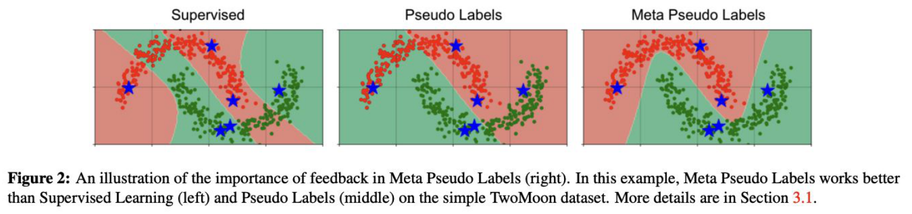
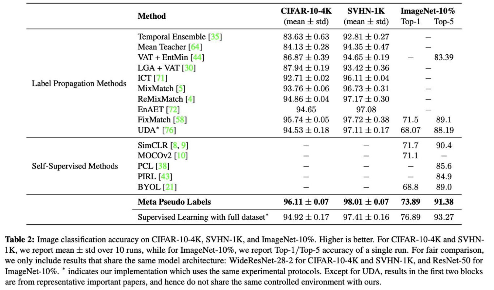

<!-- DRAFT | lecture: 07_Semi_Supervised_Learning_II | chunk: 03 | pages 20–29 -->
<!-- VERIFIED | fixes: 4 | verifier: sonnet -->

## Reducing Confirmation Bias: Problem (p.20)

슬라이드 텍스트:
- Reducing Confirmation Bias
  - Problem
    - Pseudo labels generated by an imperfect teacher can be incorrect.
    - The student is then trained to imitate these incorrect labels.
  - Why is it harmful?
    - Incorrect pseudo labels accumulate.
    - The student reinforces the teacher's mistakes.
    - Performance gradually degrades.

**설명**
- **Confirmation bias** = 모델이 **자기가 만든 (틀릴 수도 있는) pseudo label을 정답처럼 믿고 다시 학습**해서 자기 실수를 점점 강화하는 현상. Pseudo-labeling은 $\hat y = \arg\max f_\theta(u)$ 를 target으로 쓰는데, 이 target을 만든 주체(teacher)가 완벽하지 않으니 생기는 구조적 문제.
- 슬라이드의 인과 흐름: (1) imperfect teacher → **incorrect pseudo label** 생성 → (2) student가 그걸 **imitate** → (3) 틀린 label이 **accumulate** (student가 다시 teacher 역할을 하면 오류가 증폭) → (4) **performance gradually degrades**.
- 직관: labeled data가 극소수일 때는 초기 모델이 거의 random → pseudo label 대부분이 오답 → **오답이 self-reinforcing loop**를 만들어 틀린 decision boundary에 "확신"까지 생김. ← 확신(confident)이 붙은 오답은 hard label일수록 더 고착됨. 그래서 다음 슬라이드의 해법들이 **soft label / regularization** 쪽으로 감.
> 보충: 슬라이드엔 없지만, 이 문제는 앞 강의(06)의 Mean Teacher 등 consistency 방법에서 teacher를 EMA로 안정화한 동기와도 맞닿아 있음 (teacher의 noise를 줄여 student가 덜 틀린 target을 받게 함).

---

## Reducing Confirmation Bias: How to Reduce It (p.21)

슬라이드 텍스트:
- Reducing Confirmation Bias
  - How can we reduce it?
    - MixUp with soft labels
      - Given two samples, and their corresponding true or pseudo labels
      $$\bar{\mathbf{x}} = \lambda \mathbf{x}_i + (1-\lambda)\mathbf{x}_j$$
      $$\bar{y} = \lambda y_i + (1-\lambda) y_j \;\Leftrightarrow\; \mathcal{L} = \lambda\,[y_i^\top \log f_\theta(\bar{\mathbf{x}})] + (1-\lambda)\,[y_j^\top \log f_\theta(\bar{\mathbf{x}})]$$
    - Oversampling labeled data
    - Strong data augmentation
    - Dropout regularization
- 출처: Arazo, et. al., IJCNN 2020, *Pseudo-Labeling and Confirmation Bias in Deep Semi-Supervised Learning*

**설명**
- Confirmation bias를 줄이는 **네 가지 처방**: (1) **MixUp with soft labels**, (2) **Oversampling labeled data**, (3) **Strong data augmentation**, (4) **Dropout regularization**. (이 중 슬라이드가 수식까지 주는 건 MixUp.)
- **MixUp 수식 읽기**
  - $\lambda$ 는 [0,1] 사이 mixing 계수 (슬라이드엔 분포 언급 없음; 원 MixUp 논문에서는 $\mathrm{Beta}(\alpha,\alpha)$ 에서 샘플링). 두 샘플 $(\mathbf x_i,y_i)$, $(\mathbf x_j,y_j)$ 를 **입력과 label 둘 다 같은 $\lambda$로 선형 보간**: $\bar{\mathbf x}=\lambda\mathbf x_i+(1-\lambda)\mathbf x_j$, $\bar y=\lambda y_i+(1-\lambda)y_j$.
  - 여기서 $y_i,y_j$ 는 **true label 또는 pseudo label** ("true or pseudo labels"). labeled 샘플이면 one-hot 정답, unlabeled 샘플이면 모델이 만든 pseudo label (Arazo 방식에서는 soft).
  - $\Leftrightarrow$ 의 의미: cross entropy는 target에 대해 **선형**이므로, 섞은 target $\bar y$ 에 대한 CE는 각 label CE의 convex combination과 같음.
    $$\mathrm{CE}(\bar y, f_\theta(\bar{\mathbf x})) = -\bar y^\top\log f_\theta(\bar{\mathbf x}) = -\lambda\, y_i^\top\log f_\theta(\bar{\mathbf x}) - (1-\lambda)\, y_j^\top\log f_\theta(\bar{\mathbf x})$$
    ← **(슬라이드 오타 확인됨)** 슬라이드 수식은 앞의 마이너스 부호가 빠져 있어서 $\mathcal{L}=\lambda[y_i^\top\log f]+\dots$ 는 사실 log-likelihood. 그대로 loss로 minimize하면 부호가 반대 → 실제 loss는 $-\,$를 붙인 CE. (시험 지문에서 부호는 크게 안 중요하지만 "CE = −Σ y log f" 로 기억.)
  - 핵심: 두 번 forward 하지 않고 **섞은 입력 $\bar{\mathbf x}$ 에 대한 하나의 출력** $f_\theta(\bar{\mathbf x})$ 가 $y_i$ 와 $y_j$ 둘 다를 $\lambda$ 비율로 맞추도록 학습.
- **왜 confirmation bias에 도움이 되나** (직관): (1) **soft label** 이라 틀린 pseudo label에 대한 "과신(overconfidence)"이 줄어듦. (2) 섞은 입력은 decision boundary 근처의 **interpolation 영역**을 정규화해서 틀린 label을 **memorize하기 어렵게** 함 (p.22 two moons 그림이 이걸 시각화).
- 나머지 세 가지의 역할 (슬라이드는 이름만 나열):
  - **Oversampling labeled data**: labeled 샘플은 소수라 mini-batch 안에서 pseudo-labeled 샘플에 **묻힘** → labeled 샘플을 더 자주 뽑아 **정답 신호 비중을 유지**. (p.22 캡션의 "minimum number of labeled samples per mini-batch"가 이것.)
  - **Strong data augmentation / Dropout**: 모델이 틀린 pseudo label을 **그대로 memorize하지 못하게 하는 regularization**.
> 보충: Arazo et al.은 hard가 아니라 **soft pseudo-label**을 쓰고 MixUp을 pseudo-labeling과 결합한 것이 논문의 핵심. MixUp 원논문은 Zhang et al., ICLR 2018. 슬라이드는 이 부분을 설명하지 않음.

---

## Reducing Confirmation Bias: Two Moons Example (p.22)

슬라이드 텍스트:
- Reducing Confirmation Bias (그림 슬라이드)
- 그림 (Fig. 1 of the paper): 'two moons' 데이터에서 세 개의 decision-region 그림 (왼쪽부터 **no mixup / mixup / mixup with a minimum number of labeled samples per mini-batch**). 빨강/파랑 점이 두 moon, 흰 점이 labeled 샘플 (class당 4개). 배경색은 모델의 예측 확률.
- 캡션: "Fig. 1. Pseudo-labeling in the "two moons" data (4 labels/class) for 1000 samples. From left to right: no mixup, mixup, and mixup with a minimum number of labeled samples per mini-batch. We use an NN classifier with one hidden layer with 50 hidden units as in [20]. Best viewed in color."

**설명**
- 설정: 1000개 샘플, **class당 labeled 4개**뿐인 극단적 low-label 상황. 모델은 hidden unit 50개의 1-hidden-layer NN.
- 그림 읽기 (슬라이드 그림에서 보이는 것):
  - **왼쪽 (no mixup)**: decision boundary가 **직선에 가깝게 대각선으로** 두 moon을 가로지름 → 한 moon 안의 점들이 서로 다른 class로 분류됨. 틀린 pseudo label이 자기 강화되어 **confirmation bias로 잘못된 boundary가 굳어진** 사례.
  - **가운데 (mixup)**: boundary가 moon 모양을 따라 **구부러지지만** 아직 완전히 깨끗하진 않음.
  - **오른쪽 (mixup + min # labeled per mini-batch)**: boundary가 두 moon **사이 low-density 영역**을 지나 가장 자연스럽게 분리 → 두 처방(MixUp, oversampling)을 **같이 쓰면 가장 좋음**.
- 연결: 이 그림은 06의 **H3 Low-Density Separation / H2 Cluster assumption**을 pseudo-labeling이 만족하게 되는 과정으로도 볼 수 있음. ← no mixup은 cluster를 쪼개는 boundary(H3 위반), 오른쪽은 H3를 만족.
> 보충: 위 가운데/오른쪽의 미묘한 차이 해석은 그림 육안 기준이므로 정확한 정량 수치는 슬라이드에 없음. 핵심 메시지는 "MixUp과 labeled oversampling이 모두 필요하다"로 보면 안전.

---

## Reducing Confirmation Bias: Results (p.23)

슬라이드 텍스트:
- Reducing Confirmation Bias (표 슬라이드)
- **TABLE V**: Test error in CIFAR-10/100 for the proposed approach using the 13-CNN network. (*) denotes that we have run the algorithm. Bold indicates lowest error. We report average and standard deviation of 3 runs with different labeled/unlabeled splits.
- 열: CIFAR-10 (labeled 500 / 1000 / 4000), CIFAR-100 (labeled 4000 / 10000). 값은 **test error (%)**, 낮을수록 좋음.

| Method | C10-500 | C10-1000 | C10-4000 | C100-4000 | C100-10000 |
|---|---|---|---|---|---|
| Supervised (C)* | 43.64±1.21 | 34.83±1.15 | 19.26±0.26 | 54.49±0.53 | 41.14±0.26 |
| Supervised (M)* | 37.60±0.65 | 28.59±1.21 | 15.94±0.26 | 52.70±0.28 | 39.42±0.37 |
| *Consistency regularization methods* | | | | | |
| Π model | - | - | 12.36±0.31 | - | 39.19±0.36 |
| TE | - | - | 12.16±0.24 | - | 38.65±0.51 |
| MT | 27.45±2.64 | 19.04±0.51 | 11.41±0.25 | 45.36±0.49 | 36.08±0.51 |
| Π model-SN | - | 21.23±1.27 | 11.00±0.13 | - | 37.97±0.29 |
| MA-DNN | - | - | 11.91±0.22 | - | 34.51±0.61 |
| Deep-Co | - | - | 9.03±0.18 | - | 38.77±0.28 |
| MT-TSSDL | - | 18.41±0.92 | 9.30±0.55 | - | - |
| MT-LP | 24.02±2.44 | 16.93±0.70 | 10.61±0.28 | 43.73±0.20 | 35.92±0.47 |
| MT-CCL | - | 16.99±0.71 | 10.63±0.22 | - | 34.81±0.52 |
| MT-fast-SWA | - | 15.58±0.12 | 9.05±0.21 | - | 34.10±0.31 |
| ICT | - | 15.48±0.78 | 7.29±0.02 | - | - |
| *Pseudo-labeling methods* | | | | | |
| TSSDL | - | 21.13±1.17 | 10.90±0.23 | - | - |
| LP | 32.40±1.80 | 22.02±0.88 | 12.69±0.29 | 46.20±0.76 | 38.43±1.88 |
| **Ours*** | **8.80±0.45** | **6.85±0.15** | **5.97±0.15** | **37.55±1.09** | **32.15±0.50** |

**설명**
- 표 구성: **Supervised baseline** / **Consistency regularization methods** (06 강의에서 배운 Π model, TE (Temporal Ensembling), MT (Mean Teacher), ICT 등과 그 변형) / **Pseudo-labeling methods** (TSSDL, LP, 그리고 Ours).
- **핵심 결과**: Arazo의 단순한 pseudo-labeling ("Ours", MixUp + labeled oversampling 등으로 confirmation bias를 줄인 것)이 **전 열에서 최저 error (bold)**. 예: CIFAR-10 500 labels에서 **8.80%** (MT 27.45, ICT는 500열 값 없음), 4000 labels에서 **5.97%** (ICT 7.29, MT 11.41).
- 메시지: **"pseudo-labeling은 consistency regularization보다 약하다"는 통념은 confirmation bias를 제대로 처리하면 틀림** → 잘 정규화한 pseudo-labeling은 SOTA급. ← labeled 수가 적을수록(500) 격차가 훨씬 큼 (8.80 vs 24~27).
- **Supervised (C) vs (M)**: 같은 supervised 학습인데 (M) 쪽 error가 더 낮음 (예: 4000 labels에서 19.26 → 15.94). ← 슬라이드엔 (C), (M)의 정의가 없음.
> 보충: 논문에서는 (M)이 supervised 학습에 MixUp을 적용한 baseline으로 보이나 슬라이드로는 확인 불가 — 시험에 나올 가능성 낮음. 이 표는 **test error**(낮을수록 좋음)이고, p.27의 Meta Pseudo Labels 표는 **accuracy**(높을수록 좋음)라서 혼동 주의.

---

## Meta Pseudo Labels: Motivation & Key Idea (p.24)

슬라이드 텍스트:
- Meta Pseudo Labels
  - Motivation
    - Conventional self-training assumes the teacher generates good pseudo labels.
    - However, an imperfect teacher can produce incorrect supervision.
  - Key Idea
    - Instead of fixing the teacher,
    - learn the teacher to generate better pseudo labels.
    - The teacher is optimized based on how much the student improves.
- 출처: Pham, et. al., 2000, Meta Pseudo Labels ← 오타? 연도 "2000"은 2021 (CVPR 2021)의 오타로 보임

**설명**
- **Motivation**: 기존 **self-training / pseudo-labeling**은 teacher를 **한 번 학습한 뒤 고정**해두고, 그 teacher가 "충분히 좋은 pseudo label을 만든다"고 **가정**함. 하지만 teacher가 불완전하면 p.20의 confirmation bias가 생김.
- **Key Idea**: teacher를 **고정하지 않고 학습**시킴 — 단, teacher의 목표는 "teacher 자신이 정확해지는 것"이 아니라 **"student가 잘 배우도록 pseudo label을 만드는 것"**. teacher는 **student가 얼마나 좋아졌는지(how much the student improves)** 로 평가·최적화됨.
- Arazo(p.21)와의 접근 차이: Arazo는 student/모델의 **regularization 기법으로 증상을 완화**, Meta Pseudo Labels는 **teacher 자체를 feedback으로 개선** (pseudo label 생성 과정을 학습 대상으로 만듦).
> 보충: Pham, Dai, Xie, Luong, Le, *Meta Pseudo Labels*, **CVPR 2021**. Teacher-student 구조는 knowledge distillation과 비슷해 보이지만 **student → teacher로 feedback이 되돌아오는** 것이 핵심 차이.

---

## Meta Pseudo Labels: Two-Step Optimization (p.25)

슬라이드 텍스트:
- Instead of directly evaluating the Teacher,
  - the Teacher is updated based on how well the Student performs after learning with the pseudo-labels created by the Teacher.
- **Step 1. Student Update (Inner Optimization)**
  - Train the student using pseudo labels generated by the teacher
  $$\theta_S^{\mathrm{PL}}(\theta_T) = \arg\min_{\theta_S} \mathcal{L}_u(\theta_T,\theta_S) = \arg\min_{\theta_S}\ \mathbb{E}_{\mathbf{u}\sim\mathcal{U}}\ \mathrm{CE}\big[(f_{\theta_T}(\mathbf{u}),\, f_{\theta_S}(\mathbf{u}))\big]$$
- **Step 2. Teacher Update (Outer Optimization)**
  - Update the teacher so that the resulting student achieves lower supervised loss on labeled data
  - Evaluation is performed using correct answers (labels)
  $$\min_{\theta_T}\ \mathcal{L}_s\big(\theta_S^{\mathrm{PL}}(\theta_T)\big) = \min_{\theta_T}\ \mathbb{E}_{(\mathbf{x}^l,y)\in\mathcal{X}}\ \mathrm{CE}\big[y,\, f_{\theta_S}(\mathbf{x}^l)\big]$$

**설명**
- 구조는 **bi-level optimization**: 안쪽(inner) = student 학습, 바깥쪽(outer) = teacher 학습.
- **Step 1 (Inner)**: teacher $f_{\theta_T}$ 가 unlabeled $\mathbf u$ 에 내놓은 출력을 target으로, student $f_{\theta_S}$ 가 **cross entropy**로 따라 배움.
  - $\theta_S^{\mathrm{PL}}(\theta_T)$ 표기: "teacher가 만든 pseudo label(PL)로 학습한 student의 최적 weight"이고, **$\theta_T$ 의 함수**임 ← 이게 핵심. teacher가 바뀌면 student의 결과가 바뀌므로 teacher로 gradient가 흐를 **통로**가 생김.
  - ← 슬라이드 수식의 `CE[(f_T(u), f_S(u))]` 는 괄호가 중복되어 있음 (표기 오타 수준). 의미는 teacher 출력이 target, student 출력이 prediction인 CE.
- **Step 2 (Outer)**: 그 student를 **labeled data $\mathcal X$ 의 진짜 label $y$** 로 평가 → 그 supervised CE가 낮아지도록 **teacher의 $\theta_T$** 를 업데이트.
  - **"Evaluation is performed using correct answers (labels)"**: teacher를 평가하는 기준이 teacher 자신의 pseudo label이 아니라 **ground truth** → confirmation bias의 순환(자기가 만든 label로 자기 평가)을 끊음.
  - $\min_{\theta_T}\mathcal{L}_s(\theta_S^{\mathrm{PL}}(\theta_T))$ : 최적화 변수는 **$\theta_T$**, 목적 함수는 **student의 labeled loss**. ← 우변의 $f_{\theta_S}$ 는 사실상 $\theta_S^{\mathrm{PL}}(\theta_T)$ 를 가진 student.
- 직관: teacher는 "내 pseudo label이 student를 labeled set에서 더 잘하게 만들었나?" 라는 **feedback**을 받음. 틀린 pseudo label을 주면 student가 labeled set에서 못하게 되므로 teacher가 패널티를 받음.
- **"Instead of directly evaluating the Teacher"**: teacher의 pseudo label이 맞는지 직접 채점할 수 없으니(unlabeled이므로 정답 없음) **간접적으로, student의 성능을 통해** 평가한다는 뜻.
> 보충: 이 bi-level 문제를 정확히 풀기는 비싸서, 논문은 student를 **한 번의 gradient step**만 가정해 근사하고 teacher/student를 **번갈아 업데이트(alternating)** 함. 또한 teacher에는 별도로 UDA 방식의 loss와 labeled data supervised loss도 같이 사용함 (논문 내용, 슬라이드엔 없음). student는 최종 모델로서 나중에 labeled data로 fine-tune됨.

---

## Meta Pseudo Labels: Two Moons Illustration (p.26)

슬라이드 텍스트:
- Meta Pseudo Labels (그림 슬라이드)
- 그림 (Figure 2 of the paper): TwoMoon 데이터에서 세 패널 — **Supervised / Pseudo Labels / Meta Pseudo Labels**. 파란 별(★)이 labeled 샘플 (6개), 빨강·초록 점이 두 moon, 배경색이 decision region.
- 캡션: "Figure 2: An illustration of the importance of feedback in Meta Pseudo Labels (right). In this example, Meta Pseudo Labels works better than Supervised Learning (left) and Pseudo Labels (middle) on the simple TwoMoon dataset. More details are in Section 3.1."

**설명**
- 캡션의 키워드는 **"importance of feedback"**: Meta Pseudo Labels의 이득은 student → teacher **feedback**에서 옴.
- 그림 읽기:
  - **Supervised (왼쪽)**: labeled 점(별) 몇 개만으로 학습 → boundary가 moon 구조를 무시하고 **구불구불하게** 지나가 moon 일부가 오분류됨.
  - **Pseudo Labels (가운데)**: 초기 학습된 teacher의 pseudo label을 그대로 쓰면 **teacher의 오류를 그대로 학습** → boundary가 거의 supervised와 비슷한 틀린 모양 유지 (confirmation bias).
  - **Meta Pseudo Labels (오른쪽)**: teacher가 student의 labeled 성능 feedback으로 pseudo label을 고쳐서 boundary가 **두 moon을 거의 올바르게 분리**.
- 이전 슬라이드(p.22 Arazo)도 같은 two moons 장난감 데이터를 쓴 것 → 두 논문 모두 **"pseudo labeling의 기본 문제를 two moons로 시연"**.
> 보충: 세 패널의 "정확히 어디가 틀렸는지"는 슬라이드 그림 육안 해석이고, 핵심 메시지(feedback이 있는 Meta PL이 가장 좋음)만 시험용으로 기억하면 충분.

---

## Meta Pseudo Labels: Results (p.27)

슬라이드 텍스트:
- Meta Pseudo Labels (표 슬라이드)
- **Table 2**: Image classification accuracy on CIFAR-10-4K, SVHN-1K, and ImageNet-10%. Higher is better. For CIFAR-10-4K and SVHN-1K, we report mean ± std over 10 runs, while for ImageNet-10%, we report Top-1/Top-5 accuracy of a single run. For fair comparison, we only include results that share the same model architecture: WideResNet-28-2 for CIFAR-10-4K and SVHN-1K, and ResNet-50 for ImageNet-10%. * indicates our implementation which uses the same experimental protocols. Except for UDA, results in the first two blocks are from representative important papers, and hence do not share the same controlled environment with ours.

| Block | Method | CIFAR-10-4K | SVHN-1K | ImageNet-10% Top-1 / Top-5 |
|---|---|---|---|---|
| Label Propagation Methods | Temporal Ensemble | 83.63±0.63 | 92.81±0.27 | – |
| | Mean Teacher | 84.13±0.28 | 94.35±0.47 | – |
| | VAT + EntMin | 86.87±0.39 | 94.65±0.19 | – / 83.39 |
| | LGA + VAT | 87.94±0.19 | 93.42±0.36 | – |
| | ICT | 92.71±0.02 | 96.11±0.04 | – |
| | MixMatch | 93.76±0.06 | 96.73±0.31 | – |
| | ReMixMatch | 94.86±0.04 | 97.17±0.30 | – |
| | EnAET | 94.65 | 97.08 | – |
| | FixMatch | 95.74±0.05 | 97.72±0.38 | 71.5 / 89.1 |
| | UDA* | 94.53±0.18 | 97.11±0.17 | 68.07 / 88.19 |
| Self-Supervised Methods | SimCLR | – | – | 71.7 / 90.4 |
| | MOCOv2 | – | – | 71.1 / – |
| | PCL | – | – | – / 85.6 |
| | PIRL | – | – | – / 84.9 |
| | BYOL | – | – | 68.8 / 89.0 |
| | **Meta Pseudo Labels** | **96.11±0.07** | **98.01±0.07** | **73.89 / 91.38** |
| | Supervised Learning with full dataset* | 94.92±0.17 | 97.41±0.16 | 76.89 / 93.27 |

**설명**
- 표 구조: **Label Propagation Methods** (= 슬라이드 분류 이름; 06의 consistency 계열 Temporal Ensemble, Mean Teacher, VAT, ICT, UDA 및 MixMatch/ReMixMatch/FixMatch 등) / **Self-Supervised Methods** (SimCLR, MOCOv2, PCL, PIRL, BYOL) / **Meta Pseudo Labels** / full-label supervised 상한.
- **핵심 수치 (accuracy, 높을수록 좋음)**:
  - **CIFAR-10-4K: 96.11%**, **SVHN-1K: 98.01%** → 둘 다 표 내 최고. 직전 best는 FixMatch (95.74 / 97.72).
  - **ImageNet-10%: Top-1 73.89 / Top-5 91.38** → SimCLR (71.7 / 90.4), FixMatch (71.5 / 89.1) 보다 높음.
  - 놀라운 점: CIFAR-10-4K의 Meta PL (96.11)이 **"Supervised Learning with full dataset" (94.92)보다 높음** (SVHN도 98.01 > 97.41). 단 **ImageNet-10%는 full supervised (76.89 / 93.27)에 못 미침**.
- 비교 조건: CIFAR/SVHN은 **WideResNet-28-2**, ImageNet은 **ResNet-50** 동일 아키텍처 (fair comparison). 캡션 단서: 처음 두 block은 **대표 논문 결과를 가져온 것**이라 완전히 동일한 환경은 아님 (UDA만 직접 구현).
- ← 슬라이드에서 "Label Propagation Methods"라는 block 이름은 SSL 방법들을 넓게 묶은 이름 (표 그대로). 실제로는 consistency / pseudo-labeling 계열 기법들이 들어 있음. **Meta Pseudo Labels 행은 Self-Supervised block이 아니라 별도 행** (표 맨 아래, bold).
- ← ICT의 SVHN-1K 수치 (96.11±0.04)가 Meta PL의 CIFAR-10-4K 수치 (96.11±0.07)와 우연히 같음 → 열 매칭 문제에서 헷갈리지 말 것.
- 실험 설정: CIFAR-10-4K / SVHN-1K는 **10 runs mean±std**, ImageNet-10%는 **single run** Top-1/Top-5.
- 주의: p.23은 **test error** 표, p.27은 **accuracy** 표.

---

## Section: Pseudo Labeling with Consistency Regularization (p.28)

슬라이드 텍스트:
- 섹션 구분 슬라이드: "Pseudo Labeling with Consistency Regularization" (제목만 있는 section title).

**설명**
- 다음 파트의 주제는 **Pseudo-labeling 계열(이번 강의 앞부분)과 Consistency regularization 계열(06)을 합친 방법들** (이후 슬라이드에서 다룰 방법들의 도입부).

---

## Pseudo Labeling with Consistency Regularization: Idea (p.29)

슬라이드 텍스트:
- Pseudo Labeling with Consistency Regularization
  - It is possible to combine the above two approaches together, running semi-supervised learning with both pseudo labeling and consistency training.

**설명**
- 요지: **두 접근을 합칠 수 있다** — "pseudo labeling" (p.20~27: 예측으로 label을 만들어 학습) + "consistency training" (06: perturbation에도 예측 일관성 유지).
- 왜 합치나 (직관): consistency regularization은 **perturbation에 대한 smoothness (H1)**, pseudo-labeling은 **low-density separation / entropy minimization (H3)** 을 각각 강제 → **서로 보완**. pseudo label을 **한 view(weak augmented)** 에서 만들고, **다른 view(strong augmented)** 의 예측이 그 label과 일치하도록 하면 둘이 한 loss에 합쳐짐. ← 이 형태가 이후 방법(FixMatch류)의 틀로 이어질 것으로 보임.
> 보충: 슬라이드에는 구체 방법 이름이 없음. 대표적으로 MixMatch, ReMixMatch, FixMatch 등이 이 결합 계열로 알려져 있고 (p.27 표에도 이름이 나옴), 구체 내용은 이어지는 chunk 슬라이드에서 확인할 것.

---

## FIGURES

- p.21: MixUp 수식 (`assets/lecture07/p021_mixup_eq.png`) — 중요도 상 (수식 암기)
- p.22: Arazo two moons Fig.1 (`assets/lecture07/p022_two_moons_mixup.png`) — no mixup / mixup / mixup + min labeled per batch 비교, 중요도 중
- p.23: Arazo Table V test error (`assets/lecture07/p023_arazo_table.png`) — 중요도 중하 (수치 비중 낮음; "Ours가 전 열 best")
- p.26: Meta PL Figure 2 two moons (`assets/lecture07/p026_meta_two_moons.png`) — Supervised / PL / Meta PL, 중요도 중
- p.27: Meta PL Table 2 accuracy (`assets/lecture07/p027_mpl_results.png`) — 중요도 중 (96.11 / 98.01 / 73.89 정도만)

## EXAM POINTS

1. **Confirmation bias 정의/원인** (p.20): imperfect teacher → incorrect pseudo label → student imitates → mistakes accumulate → performance gradually degrades. 함정: "incorrect pseudo labels cancel out" (X, **accumulate**).
2. **Reducing confirmation bias의 네 가지** (p.21, Arazo IJCNN 2020): **MixUp with soft labels, oversampling labeled data, strong data augmentation, dropout regularization**. "which is NOT" 유형에서 *hard label thresholding*, *teacher weight EMA* 등을 오답 선택지로 낼 수 있음.
3. **MixUp 수식** (p.21): $\bar{\mathbf x}=\lambda\mathbf x_i+(1-\lambda)\mathbf x_j$, $\bar y=\lambda y_i+(1-\lambda)y_j$, loss = $\lambda$·CE($y_i$) + $(1-\lambda)$·CE($y_j$) with the **same output $f_\theta(\bar{\mathbf x})$**. 함정: $\lambda$ 를 입력과 label에 서로 다르게 쓴다, label은 섞지 않는다, **soft ↔ hard** 뒤바꿈.
4. **MixUp의 label은 "true or pseudo labels"** (p.21): labeled 샘플뿐 아니라 pseudo-labeled 샘플의 (soft) label도 섞음.
5. **Two moons 실험** (p.22): class당 **4 labels**, 1000 samples, 1 hidden layer 50 units; no mixup → mixup → **mixup + min # labeled per mini-batch** 순으로 개선.
6. **Arazo 결과** (p.23): 단순 pseudo-labeling ("Ours")이 consistency regularization 방법들(Π, TE, MT, ICT 등)보다 **더 낮은 test error**. CIFAR-10 500/1000/4000 labels: **8.80 / 6.85 / 5.97**, CIFAR-100 4000/10000: **37.55 / 32.15**. 함정: error ↔ accuracy 혼동.
7. **Meta Pseudo Labels의 motivation/key idea** (p.24): conventional self-training은 teacher가 **좋은 pseudo label을 만든다고 가정**; Meta PL은 **teacher를 고정하지 않고 학습**하며, teacher는 **student의 improvement**로 최적화됨 (Pham et al., CVPR 2021 ← 슬라이드엔 2000으로 오타).
8. **Inner vs Outer optimization** (p.25): **Step 1 (inner) = student update** on unlabeled data with teacher's pseudo labels (CE between $f_{\theta_T}(\mathbf u)$ and $f_{\theta_S}(\mathbf u)$); **Step 2 (outer) = teacher update** to minimize the student's **supervised loss on labeled data** ($\mathcal L_s(\theta_S^{\mathrm{PL}}(\theta_T))$). 함정: teacher↔student 뒤바꿈, "student is updated with labeled data's true labels in step 1"(X), "teacher is evaluated by its own pseudo labels" (X — **evaluation uses correct labels**).
9. **Meta PL의 핵심 차별점**: **feedback** (student → teacher). Teacher가 직접 평가되지 않고(Instead of directly evaluating the Teacher) student의 labeled 성능을 통해 평가됨.
10. **Meta PL 수치** (p.27): CIFAR-10-4K **96.11±0.07**, SVHN-1K **98.01±0.07**, ImageNet-10% Top-1/Top-5 **73.89 / 91.38**. WRN-28-2 (CIFAR/SVHN), ResNet-50 (ImageNet). CIFAR-10-4K, SVHN-1K에서는 **full-dataset supervised (94.92 / 97.41)보다도 높음**, ImageNet-10%는 못 미침 (76.89 / 93.27).
10b. **표 조건 매칭** (p.23, p.27): Arazo Table V = **test error (낮을수록 좋음)**, 13-CNN, **3 runs**, Ours가 5개 열 전부 bold(best). Meta PL Table 2 = **accuracy (높을수록 좋음)**, **10 runs** (ImageNet은 single run), WRN-28-2 / ResNet-50. 함정: "Meta PL는 ImageNet-10%에서 full supervised보다 높다" (X, 73.89 < 76.89), "CIFAR-10-4K에서 full supervised보다 높다" (O, 96.11 > 94.92).
10c. **Two moons 그림 2종** (p.22 vs p.26): p.22 = Arazo (no mixup / mixup / mixup + min labeled per batch, 흰 점 labeled, 빨강·파랑 moon); p.26 = Meta PL (Supervised / Pseudo Labels / Meta Pseudo Labels, 파란 별 labeled, 빨강·초록 moon). 캡션 키워드: p.26 "importance of **feedback**".
11. **Pseudo labeling + Consistency regularization 결합** (p.29): 두 접근을 함께 쓰는 것이 가능 — pseudo labeling과 consistency training을 동시에.
12. **주의할 trap 한 줄**: Arazo(p.20-23)는 **regularization으로 증상 완화** (MixUp 등), Meta PL(p.24-27)은 **teacher 자체를 feedback으로 학습** — 방법 매칭 문제에서 서로 뒤바꾸기 쉬움.
