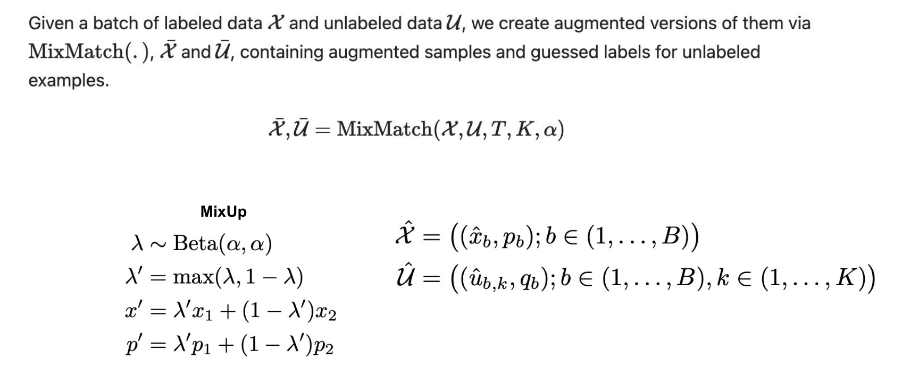
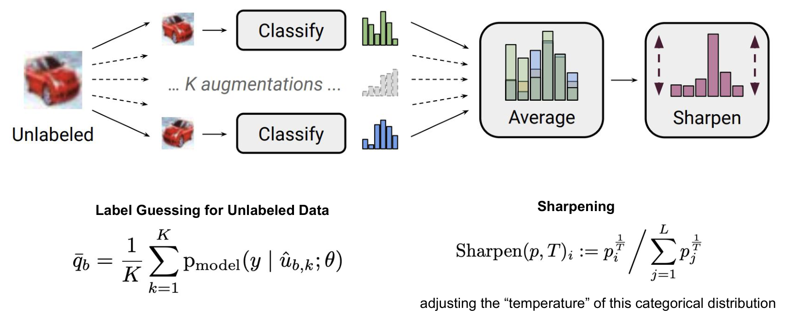
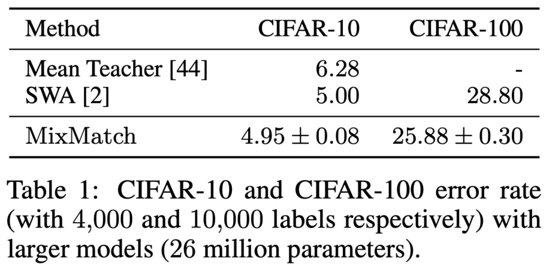
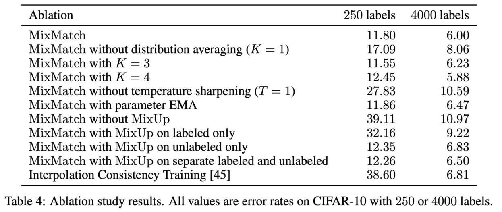

<!-- DRAFT | lecture: 07_Semi_Supervised_Learning_II | chunk: 04 | pages 30–35 -->
<!-- VERIFIED | fixes: 7 | verifier: sonnet -->

## MixMatch: Key Idea & Main Components (p.30)

슬라이드 텍스트:
- Key Idea
  - Rather than proposing a new component,
  - MixMatch unifies several successful semi-supervised learning techniques into a single framework.
- Main Components
  - 1. Consistency Regularization — Encourage consistent predictions under perturbations.
  - 2. Entropy Minimization — Encourage confident predictions on unlabeled data.
  - 4. Pseudo Labeling — Generate targets for unlabeled samples. ← 번호 오타? (3이어야 함, 슬라이드엔 "4."로 표기)
  - 4. Label Sharpening — Convert soft predictions into confident targets.
  - 5. MixUp — Interpolate labeled and unlabeled samples.
- (굵게) MixMatch is the first holistic framework that combines multiple SSL ideas into a unified training pipeline.
- 출처: Berthelot et al., NeurIPS 2019, MixMatch: A Holistic Approach to Semi-Supervised Learning

**설명**
- **MixMatch의 핵심 아이디어**: 새로운 부품을 발명한 게 아니라, 이미 잘 되던 SSL 기법들을 **하나의 파이프라인으로 통합(holistic)** 한 것. 논문 제목의 "Holistic Approach"가 이 뜻.
- 5개 구성요소를 앞 강의/이번 강의 흐름과 연결하면:
  1. **Consistency Regularization** ← 같은 unlabeled 입력의 여러 augmentation 예측이 일관되도록 (06 강의: Π-model, Mean Teacher, UDA 계열).
  2. **Entropy Minimization** ← unlabeled 예측이 **confident(낮은 entropy)** 하도록 → H3 Low-Density Separation(boundary를 low-density 영역으로 밀기)를 구현.
  3. **Pseudo Labeling** ← unlabeled 샘플에 모델이 만든 target(guessed label)을 부여.
  4. **Label Sharpening** ← soft prediction을 temperature $T$로 뾰족하게 만들어 confident target으로. (entropy minimization을 구현하는 실제 장치)
  5. **MixUp** ← labeled/unlabeled 샘플을 섞어서 interpolation 기반 regularization.
- **슬라이드 번호 오타**: "1, 2, 4, 4, 5" — 두 번째 "4."는 원래 3번이어야 함 (Pseudo Labeling = 3). 원문 유지.
- **시험 포인트**: "MixMatch가 **새 loss/새 모듈을 제안**했다" 같은 지문은 **False** — 기존 기법의 통합이 핵심. 또 "first holistic framework" 문구가 슬라이드 강조 문장.
> 보충: 논문 abstract 기준으로 MixMatch는 "data augmentation을 통한 consistency, entropy minimization, MixUp 정규화"를 단일 loss로 묶고, 구성요소 단순함에 비해 SOTA를 큰 폭으로 갱신했다고 주장. 슬라이드에는 없음.

---

## MixMatch: Augmentation, MixUp, Output Sets (p.31)

슬라이드 텍스트:
- Given a batch of labeled data $\mathcal{X}$ and unlabeled data $\mathcal{U}$, we create augmented versions of them via MixMatch(·), $\bar{\mathcal{X}}$ and $\bar{\mathcal{U}}$, containing augmented samples and guessed labels for unlabeled examples.
$$\bar{\mathcal{X}}, \bar{\mathcal{U}} = \mathrm{MixMatch}(\mathcal{X}, \mathcal{U}, T, K, \alpha)$$
- **MixUp** (왼쪽 박스):
$$\lambda \sim \mathrm{Beta}(\alpha,\alpha)$$
$$\lambda' = \max(\lambda,\, 1-\lambda)$$
$$x' = \lambda' x_1 + (1-\lambda') x_2$$
$$p' = \lambda' p_1 + (1-\lambda') p_2$$
- 오른쪽 (augmented 출력 집합):
$$\hat{\mathcal{X}} = \big((\hat{x}_b, p_b);\ b \in (1,\dots,B)\big)$$
$$\hat{\mathcal{U}} = \big((\hat{u}_{b,k}, q_b);\ b \in (1,\dots,B),\ k \in (1,\dots,K)\big)$$

**설명**
- **입출력**: 입력은 labeled batch $\mathcal{X}$, unlabeled batch $\mathcal{U}$, 하이퍼파라미터 $T$ (sharpening temperature), $K$ (unlabeled 샘플당 augmentation 수), $\alpha$ (MixUp의 Beta 파라미터). 출력은 **증강+혼합된** $\bar{\mathcal{X}}$ (labeled쪽, 라벨은 mixed label)와 $\bar{\mathcal{U}}$ (unlabeled쪽, 라벨 = **guessed label**).
- **MixUp 수식 해석**:
  - $\lambda\sim\mathrm{Beta}(\alpha,\alpha)$: 섞는 비율을 Beta 분포에서 샘플. $\alpha$가 작으면 0 또는 1 근처(거의 안 섞임), $\alpha=1$이면 uniform.
  - $\lambda'=\max(\lambda,1-\lambda)$: **항상 $\lambda'\ge 0.5$** 가 되게 만듦 → 섞은 결과 $x'$ 가 **첫 번째 샘플 $x_1$ 에 더 가깝다**.
  - $x'=\lambda' x_1+(1-\lambda')x_2$, $p'=\lambda' p_1+(1-\lambda')p_2$: **입력과 라벨(확률 벡터)을 같은 비율로 선형 보간**. 여기서 $p$는 labeled면 one-hot, unlabeled면 guessed label.
  - **왜 $\max$를 쓰나**: $x'$ 가 항상 $x_1$ 쪽에 가깝게 되므로, $\mathcal{X}'$ 는 (labeled 샘플이 $x_1$ 자리에 오기 때문에) labeled 쪽에, $\mathcal{U}'$ 는 (unlabeled 샘플이 $x_1$ 자리에 오기 때문에) unlabeled 쪽에 가깝게 유지됨. 그래서 $\mathcal{L}_s$(cross entropy)와 $\mathcal{L}_u$(squared error)를 각각 따로 적용해도 의미가 유지됨. ← 논문 설명 기준 (슬라이드엔 $\max$의 이유 언급 없음)
- **$\hat{\mathcal{X}}$ / $\hat{\mathcal{U}}$ 구조** (MixUp **이전**의 중간 산물):
  - $\hat{\mathcal{X}}$: labeled 샘플을 **1번만 augment**한 $\hat{x}_b$와 그 (true) label $p_b$. 크기 $B$.
  - $\hat{\mathcal{U}}$: 각 unlabeled 샘플 $b$를 **$K$번 augment**한 $\hat{u}_{b,k}$ 전부에, **같은 guessed label $q_b$** 를 부여. 크기 $B\times K$.
  - **$q_b$ 는 $k$에 의존하지 않음** ← $K$개 augmentation 예측을 평균해서 하나의 label을 만들기 때문 (다음 슬라이드 p.32).
> 보충: 논문 Algorithm 1에서 이후 단계는 $\hat{\mathcal{X}}$와 $\hat{\mathcal{U}}$를 concat해서 shuffle한 $\mathcal{W}$를 만들고, $\mathcal{X}'=\mathrm{MixUp}(\hat{\mathcal{X}}_i,\mathcal{W}_i)$, $\mathcal{U}'=\mathrm{MixUp}(\hat{\mathcal{U}}_i,\mathcal{W}_{i+|\hat{\mathcal{X}}|})$ 로 섞음. 즉 labeled와 unlabeled가 **서로** 섞인다 (슬라이드 p.30의 "Interpolate labeled and unlabeled samples"). 슬라이드에는 이 단계 자체는 없음. 논문 기본 하이퍼파라미터는 $T=0.5,\ K=2,\ \alpha=0.75$ (CIFAR-10).
> 보충: 슬라이드 p.31은 $\hat{\mathcal U}$의 라벨을 $q_b$로, p.32는 평균 라벨을 $\bar q_b$로 표기 — 논문에서 $\bar q_b$(평균) → Sharpen → $q_b$. 슬라이드 표기가 약간 섞여 있으니 "평균 → sharpen → $q_b$"로 이해할 것.

---

## MixMatch: Label Guessing & Sharpening (p.32)

슬라이드 텍스트:
- 그림: 왼쪽 **Unlabeled** 이미지(빨간 자동차) → 화살표로 **… K augmentations …** (실선 2개 + 점선 여러 개; 위아래 두 augmented 자동차 이미지) → 각각 **Classify** 박스 → 클래스별 예측 막대그래프(초록, 회색 점선(생략), 파랑) → **Average** 박스(막대들이 쌓여 하나의 평균 분포) → **Sharpen** 박스(위아래 화살표로 분포가 뾰족해짐; 한 클래스 막대가 크게 튀어나옴).
- **Label Guessing for Unlabeled Data**
$$\bar{q}_b = \frac{1}{K}\sum_{k=1}^{K} \mathrm{p}_{\mathrm{model}}(y \mid \hat{u}_{b,k};\theta)$$
- **Sharpening**
$$\mathrm{Sharpen}(p,T)_i := p_i^{\frac{1}{T}} \Big/ \sum_{j=1}^{L} p_j^{\frac{1}{T}}$$
- adjusting the "temperature" of this categorical distribution

**설명**
- **Label guessing (pseudo labeling 단계)**: unlabeled 샘플 하나를 $K$번 서로 다르게 augment → 모델이 각각 예측 → **평균**: $\bar q_b=\frac1K\sum_k p_{\text{model}}(y|\hat u_{b,k};\theta)$.
  - 평균의 효과: 각 augmentation 예측은 noisy하지만 **평균하면 variance가 줄고**, 이게 곧 **consistency regularization** (여러 perturbation에 대한 예측을 하나로 묶음)의 구현. 그림의 Average 박스에서 서로 다른 막대들이 겹쳐 하나의 분포가 되는 것.
  - 이 guessed label은 **target**일 뿐 gradient를 흘리지 않는 상수로 취급됨 (아래 보충).
- **Sharpening 수식 유도·직관**: 분포 $p$의 각 성분을 $1/T$ 제곱한 뒤 합이 1이 되게 정규화.
  - $T=1$ → $p_i^{1}/\sum p_j=p_i$: **변화 없음** (sharpening 없음).
  - $T\to 0$ → 지수 $1/T\to\infty$ 라 가장 큰 $p_i$가 지배 → **one-hot (argmax)** 에 수렴.
  - $0<T<1$: 큰 확률은 상대적으로 더 커지고 작은 건 더 작아짐 → **entropy가 감소** (뾰족해짐). 반대로 $T>1$이면 평평해짐.
  - 예: $p=(0.6,0.4)$, $T=0.5$ → $p^2=(0.36,0.16)$ → 정규화 $(0.692,0.308)$. 0.6이 0.69로 올라감.
  - 소프트맥스의 temperature 스케일링과 같은 꼴: $\mathrm{softmax}(z/T)$ 는 $p_i^{1/T}$ 정규화와 동일 ($p_i\propto e^{z_i}$ 이므로).
- **왜 sharpen**: 평균을 내면 분포가 **평평해지기** 쉬움 (여러 예측이 서로 다른 클래스를 가리키면). 평평한 target은 학습 신호가 약하고, **entropy minimization** 효과도 없음. sharpening으로 **confident target** 을 만들어 모델이 unlabeled data에서도 낮은 entropy 예측을 하도록 유도 → **low-density separation** (H3)에 부합.
- **Hard pseudo-label(argmax) vs MixMatch**: MixMatch는 hard one-hot이 아니라 **sharpened soft label**을 사용. (뒤의 $\mathcal{L}_u$가 CE가 아닌 L2인 이유는 p.33 참고 — bounded라 noisy guess에 강건.)
> 보충: 논문에서 $\bar q_b$ 계산 시 gradient는 **전파하지 않음** (target으로만 사용). 슬라이드엔 명시 없음. 논문 기본값 $T=0.5$, $K=2$.
> 보충: 슬라이드 p.33의 "$T$ is the sharpening temperature to **reduce the guessed label overlap**" 표현은 논문의 "to reduce the entropy of the label distribution"에 해당하는 의미로 이해하면 됨 (overlap = 클래스 간 확률 질량의 겹침/평평함).

---

## MixMatch: Losses (p.33)

슬라이드 텍스트:
- Losses for both label and unlabeled data.
$$\mathcal{L}_s^{\mathrm{MM}} = \frac{1}{|\bar{\mathcal{X}}|}\sum_{(\bar{\mathbf{x}}^l, y)\in\bar{\mathcal{X}}} D\big[y,\ p_\theta(y\mid \bar{\mathbf{x}}^l)\big]$$
$$\mathcal{L}_u^{\mathrm{MM}} = \frac{1}{L\,|\bar{\mathcal{U}}|}\sum_{(\bar{\mathbf{u}},\hat{y})\in\bar{\mathcal{U}}} \big\|\hat{y} - p_\theta(y\mid \bar{\mathbf{u}})\big\|_2^2$$
- where $T$ is the sharpening temperature to reduce the guessed label overlap; $K$ is the number of augmentations generated per unlabeled example; $\alpha$ is the parameter in MixUp.
- MixMatch combines several successful SSL techniques into a unified training framework.

**설명**
- **$\mathcal{L}_s^{\mathrm{MM}}$ (labeled loss)**: mixed labeled batch $\bar{\mathcal{X}}$ 에 대해 모델 출력과 (mixed) label $y$ 사이의 거리 $D$ — 논문에서는 **cross entropy** ($D$ = CE). $\bar{\mathbf x}^l$ 는 augmentation + MixUp이 적용된 입력, $y$는 mix된 label (soft). 평균은 샘플 수 $|\bar{\mathcal X}|$ 로.
- **$\mathcal{L}_u^{\mathrm{MM}}$ (unlabeled loss)**: mixed unlabeled batch $\bar{\mathcal{U}}$ 에서 guessed label $\hat y$ 와 모델 예측 $p_\theta(y|\bar{\mathbf u})$ 의 **squared L2 norm** ($\|\cdot\|_2^2$), 평균은 $L|\bar{\mathcal U}|$ ($L$=클래스 수)로 나눔.
  - **왜 MSE (L2)냐**: cross entropy는 **unbounded** 라서 틀린 guessed label이 있으면 loss가 폭발할 수 있음. squared error는 **bounded** (확률 벡터 간 차이는 최대 2) 이라 **noisy한 guessed label에 덜 민감**. ← 이게 MixMatch가 unlabeled에 MSE를 쓰는 설계 이유 (논문에서 이 근거 설명, 슬라이드엔 없음).
  - $1/L$ 로 클래스 수에 대해 평균 → $\mathcal L_u$ 의 크기를 정규화 (CE와 달리 클래스별 평균 L2).
- **전체 loss** (06 강의 p.10 notation과 연결, 이 슬라이드(p.33)엔 합친 식 없음): $\mathcal{L}=\mathcal{L}_s^{\mathrm{MM}}+\mu(t)\,\mathcal{L}_u^{\mathrm{MM}}$ — $\mu(t)$ 는 시간에 따라 **증가하는** unsupervised weight (ramp-up).
> 보충: 논문 식은 $\mathcal{L}_{\mathcal X}=\frac{1}{|\mathcal X'|}\sum H(p,p_{\text{model}}(y|x;\theta))$, $\mathcal{L}_{\mathcal U}=\frac{1}{L|\mathcal U'|}\sum \|q-p_{\text{model}}(y|u;\theta)\|_2^2$, $\mathcal L=\mathcal L_{\mathcal X}+\lambda_{\mathcal U}\mathcal L_{\mathcal U}$ (CIFAR-10에서 $\lambda_{\mathcal U}=100$). 슬라이드의 $D$ = 논문의 cross entropy $H$.
> 보충: 슬라이드 수식에서 $\mathcal L_u$ 합 아래 $(\bar{\mathbf u},\hat y)\in\bar{\mathcal U}$ 의 $\hat y$ 는 p.32의 sharpened guessed label $q_b$에 해당 (p.10 notation의 $\hat y=\mathrm{softmax}(\mathbf z)$ 와는 다른 의미 — 기호 충돌 주의).

---

## MixMatch: Results — CIFAR-10 / CIFAR-100 (p.34)

슬라이드 텍스트 (Table 1: CIFAR-10 and CIFAR-100 **error rate** (with 4,000 and 10,000 labels respectively) with larger models (26 million parameters).):

| Method | CIFAR-10 | CIFAR-100 |
|---|---|---|
| Mean Teacher [44] | 6.28 | - |
| SWA [2] | 5.00 | 28.80 |
| **MixMatch** | **4.95 ± 0.08** | **25.88 ± 0.30** |

**설명**
- 숫자는 **error rate (%) — 낮을수록 좋음**. CIFAR-10은 **4,000 labels**, CIFAR-100은 **10,000 labels** 사용, 큰 모델(**26M parameters**).
- MixMatch가 두 데이터셋 모두 1등: CIFAR-10 4.95 (Mean Teacher 6.28, SWA 5.00보다 낮음), CIFAR-100 25.88 (SWA 28.80보다 낮음). Mean Teacher는 CIFAR-100 결과 없음("-").
- 시험에선 "CIFAR-10 4000 labels에서 MixMatch ≈ 4.95% error" 정도만 기억하면 충분 (교수님 기준 난이도 낮음).
> 보충: 논문에서 이 큰 모델은 Wide ResNet-28-135 (슬라이드엔 없음). SWA = Stochastic Weight Averaging (Athiwaratkun et al., "There Are Many Consistent Explanations of Unlabeled Data", ICLR 2019). 슬라이드에는 [2]로만 표기.

---

## MixMatch: Ablation Study (p.35)

슬라이드 텍스트 (Table 4: Ablation study results. All values are **error rates on CIFAR-10 with 250 or 4000 labels.**):

| Ablation | 250 labels | 4000 labels |
|---|---|---|
| MixMatch | 11.80 | 6.00 |
| MixMatch without distribution averaging ($K=1$) | 17.09 | 8.06 |
| MixMatch with $K=3$ | 11.55 | 6.23 |
| MixMatch with $K=4$ | 12.45 | 5.88 |
| MixMatch without temperature sharpening ($T=1$) | 27.83 | 10.59 |
| MixMatch with parameter EMA | 11.86 | 6.47 |
| MixMatch without MixUp | 39.11 | 10.97 |
| MixMatch with MixUp on labeled only | 32.16 | 9.22 |
| MixMatch with MixUp on unlabeled only | 12.35 | 6.83 |
| MixMatch with MixUp on separate labeled and unlabeled | 12.26 | 6.50 |
| Interpolation Consistency Training [45] | 38.60 | 6.81 |

**설명**
- **읽는 법**: 각 요소를 하나씩 뺐을 때 error가 얼마나 **올라가는지**로 그 요소의 기여를 평가.
- **Distribution averaging ($K=1$)**: 11.80 → 17.09 (250 labels). 평균을 안 내면 나빠짐 → **K개 augmentation 평균이 중요**. $K=3,4$ 는 baseline($K=2$)과 비슷 → **K를 더 키워도 큰 이득 없음** (K=4는 250 labels에서 오히려 12.45로 약간 나쁨, 4000에선 5.88로 약간 좋음).
- **Temperature sharpening 제거 ($T=1$)**: 11.80 → **27.83** (4000: 6.00 → 10.59). **sharpening이 매우 중요** — entropy minimization 효과를 잃으면 크게 하락.
- **Parameter EMA 추가**: 11.86 / 6.47 → baseline(11.80 / 6.00)과 큰 차이 없음 (오히려 약간 나쁨). → MixMatch는 Mean Teacher식 EMA 없이도 충분.
- **MixUp 제거**: 11.80 → **39.11** (4000: 6.00 → 10.97). **가장 큰 하락** → MixUp이 가장 핵심 요소. 특히 label이 적은 250 설정에서 영향이 극적.
- **MixUp 적용 범위**: labeled only 32.16 / unlabeled only 12.35 / separate labeled & unlabeled 12.26 / (둘 다 섞는 기본 MixMatch) 11.80. → **unlabeled 쪽 MixUp이 핵심**, labeled only는 크게 나쁨. **labeled와 unlabeled를 함께 섞는 게 가장 좋음** (separate보다 근소 우위, 11.80 vs 12.26).
- **Interpolation Consistency Training (ICT)**: 250 labels 38.60 (매우 나쁨), 4000 labels 6.81 (MixMatch 6.00보다 열세). ← MixMatch는 label guessing + sharpening + 평균이 더 들어가 있어서 label이 적을 때 훨씬 우수.
> 보충: ICT는 MixUp 기반 consistency를 쓰지만 MixMatch식 sharpening/다중 augmentation 평균(label guessing)은 없다고 이해하면 됨 (논문 해석, 슬라이드엔 없음). MixMatch의 baseline 하이퍼파라미터는 $K=2$ (표의 "$K=3$, $K=4$" 행은 그와 비교). 슬라이드에 $K=2$ 명시는 없음.

---

## FIGURES

- p.31: MixUp 수식 ($\lambda\sim\mathrm{Beta}$, $\lambda'=\max(\lambda,1-\lambda)$, $x'$, $p'$) + $\hat{\mathcal X}, \hat{\mathcal U}$ 정의 — `assets/lecture07/p031_mixmatch_mixup_def.png`, 중요도 상
- p.32: Label guessing (K augmentations → Classify → Average → Sharpen) 파이프라인 그림 + 수식 — `assets/lecture07/p032_label_guessing_sharpen.png`, 중요도 상 (MixMatch의 핵심 그림)
- p.34: CIFAR-10/100 error rate 표 — `assets/lecture07/p034_cifar_table.png`, 중요도 하~중
- p.35: Ablation 표 (Table 4) — `assets/lecture07/p035_ablation_table.png`, 중요도 중 (어떤 요소가 가장 중요한지 질문 가능)
- p.33: loss 수식 (그림 없이 수식만, 노트 본문에 LaTeX로 옮김), 중요도 상

## EXAM POINTS

1. **MixMatch의 정체** (p.30): 새 component 제안이 아니라 **기존 SSL 기법 통합** (Consistency Regularization + Entropy Minimization + Pseudo Labeling + Label Sharpening + MixUp). "first holistic framework". 함정: "MixMatch introduces a novel loss unrelated to prior work" → False.
2. **MixMatch 입력 파라미터**: $\mathrm{MixMatch}(\mathcal X,\mathcal U,T,K,\alpha)$ — $T$ = sharpening temperature, $K$ = number of augmentations per unlabeled example, $\alpha$ = MixUp (Beta) parameter (p.31, p.33). 함정: $K$↔$T$ 뒤바꾸기.
3. **MixUp 수식** (p.31): $\lambda\sim\mathrm{Beta}(\alpha,\alpha)$, $\lambda'=\max(\lambda,1-\lambda)$, $x'=\lambda'x_1+(1-\lambda')x_2$, $p'=\lambda'p_1+(1-\lambda')p_2$. **입력과 label 모두** 같은 비율로 섞음. 함정: $\lambda'=\min(\cdot)$, 또는 "label은 안 섞는다".
4. **Label guessing** (p.32): unlabeled 샘플의 $K$개 augmentation 예측을 **평균** → $\bar q_b=\frac1K\sum_k p_{\text{model}}(y|\hat u_{b,k};\theta)$. 평균 후에 **sharpen**. 함정: "sharpen 후 평균"으로 순서 뒤바꾸기, 또는 labeled 데이터에 label guessing을 한다는 지문.
5. **Sharpening 정의** (p.32): $\mathrm{Sharpen}(p,T)_i=p_i^{1/T}/\sum_j p_j^{1/T}$. $T\to0$ → one-hot에 가까워짐(entropy 감소), $T=1$ → 변화 없음, $T$ 클수록 평평. 함정: "T가 클수록 sharper"로 뒤바꾸기.
6. **Sharpening의 역할**: soft prediction → confident target, **entropy minimization** 구현 (p.30). hard argmax가 아니라 sharpened **soft** label임.
7. **Loss 형태** (p.33): $\mathcal L_s^{\mathrm{MM}}$ = labeled에 $D$ (cross entropy)로 label과 예측 비교, $\mathcal L_u^{\mathrm{MM}}$ = unlabeled에 **squared L2** $\|\hat y-p_\theta(y|\bar{\mathbf u})\|_2^2$, 앞에 $\frac{1}{L|\bar{\mathcal U}|}$. 함정: labeled↔unlabeled의 loss 종류 뒤바꾸기 (unlabeled에 CE, labeled에 MSE), MSE↔KL.
8. **왜 unlabeled에 MSE?**: bounded이고 noisy한 guessed label에 덜 민감 (CE는 unbounded) — 보충 근거.
9. **Table 1 수치** (p.34): CIFAR-10 (4,000 labels) MixMatch **4.95 ± 0.08** vs Mean Teacher 6.28, SWA 5.00. CIFAR-100 (10,000 labels) MixMatch **25.88 ± 0.30** vs SWA 28.80. 26M-parameter 모델, 수치는 **error rate**(낮을수록 좋음). 함정: accuracy로 오독, labels 수 뒤바꾸기.
10. **Ablation 핵심** (p.35): **MixUp 제거 시 가장 큰 하락** (250 labels: 11.80 → 39.11), **sharpening 제거($T=1$)** 도 큼 (27.83), **distribution averaging 제거($K=1$)**: 17.09. **Parameter EMA 추가는 이득 없음** (11.86 / 6.47). $K=3,4$ 는 큰 변화 없음. 함정: "EMA가 성능을 크게 올린다", "K를 키울수록 항상 좋아진다" (K=4는 250 labels에서 12.45로 오히려 악화), "sharpening 제거가 가장 큰 하락" (가장 큰 건 MixUp 제거).
11. **MixUp 적용 범위 ablation**: labeled only(32.16)는 크게 나쁨, unlabeled only(12.35)는 baseline에 근접, labeled+unlabeled **함께 섞기**(11.80)가 최선. 함정: "MixUp on labeled only is sufficient".
12. **ICT와 비교**: Interpolation Consistency Training은 250 labels에서 38.60으로 매우 나쁨 (MixMatch 11.80) — 4000 labels에선 6.81 vs 6.00으로 차이 작음. label이 적을수록 MixMatch 장점이 큼.
13. **슬라이드 오타 주의**: p.30 구성요소 번호 "1, 2, 4, 4, 5" (3이 빠짐).
