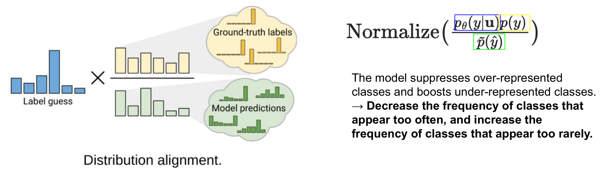
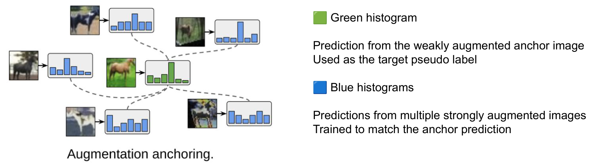
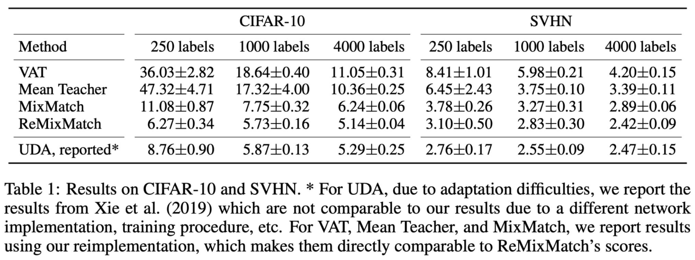

<!-- DRAFT | lecture: 07_Semi_Supervised_Learning_II | chunk: 05 | pages 36–41 -->
<!-- VERIFIED | fixes: 4 | verifier: sonnet -->

## ReMixMatch: Motivation (p.36)

슬라이드 텍스트:
- Motivation
  - Although MixMatch achieved strong performance, it still suffers from two limitations:
    - 1. Class imbalance in pseudo labels.
      - → Distribution Alignment
        - Align pseudo-label distribution with the expected class distribution.
    - 2. Unstable pseudo labels under strong augmentations.
      - → Augmentation Anchoring
        - Generate pseudo labels from weak augmentations and enforce consistency on strong augmentations.
    - 3. Additional Regularization
      - Rotation prediction (self-supervised learning)
- 출처: Berthelot, et. al., 2020, ReMixMatch: Semi-Supervised Learning with Distribution Alignment and Augmentation Anchoring

**설명**
- ReMixMatch = **MixMatch의 개선판**. MixMatch(label guessing + sharpening + MixUp + consistency loss)가 이미 강했지만 두 가지 한계가 있다고 함. ← 슬라이드는 "two limitations"라면서 번호는 1, 2, 3으로 3개를 나열함. 3번은 한계가 아니라 추가 regularization (표현 불일치, 오타성).
- 한계 → 해결책 매핑 (시험에서 짝 맞추기로 나오기 쉬움):
  - **Class imbalance in pseudo labels** → **Distribution Alignment** (pseudo label의 class 분포를 기대 분포에 맞춤)
  - **Unstable pseudo labels under strong augmentations** → **Augmentation Anchoring** (**weak** aug으로 pseudo label 생성, **strong** aug 쪽에 consistency 강제)
  - 추가 regularization → **Rotation prediction** (self-supervised)
> 보충: 논문은 ICLR 2020. MixMatch와 같은 Google Research 팀 (Berthelot, Carlini, Cubuk, Kurakin, Sohn, Zhang, Raffel). 슬라이드엔 연도(2020)만 있음.

---

## Distribution Alignment (p.37)

슬라이드 텍스트:
- Pseudo labels may not follow the true class distribution.
- 그림 "Distribution alignment.": 왼쪽 **파란 histogram (Label guess)** — 6개 bar, 4번째가 가장 큼. 그 옆에 $\times$ 와 분수: 분자는 **노란 histogram** (6개 bar, 거의 균일), 분모는 **초록 histogram** (6개 bar, 1·3번째가 큼). 노란색은 구름 "Ground-truth labels" (뾰족한 작은 histogram들 모음), 초록색은 구름 "Model predictions"로 연결됨.
- 수식:
$$\text{Normalize}\left(\frac{p_\theta(y|\mathbf{u})\,p(y)}{\tilde{p}(\hat{y})}\right)$$
  - $p_\theta(y|\mathbf u)$ 는 파란색 박스, $p(y)$ 는 노란색 박스, $\tilde p(\hat y)$ 는 초록색 박스로 강조.
- 우측 설명: The model suppresses over-represented classes and boosts under-represented classes. → **Decrease the frequency of classes that appear too often, and increase the frequency of classes that appear too rarely.**
- 범례:
  - Blue histogram : prediction for one unlabeled sample (label guess)
  - Green histogram : estimated class distribution of all pseudo labels
  - Yellow histogram : class distribution of the labeled dataset (target prior)
- Distribution Alignment rescales the blue prediction using the ratio between the yellow and green distributions.

**설명**
- **문제**: unlabeled data에 대한 pseudo label들을 모아 보면 class 분포가 **실제 분포와 다를 수 있음** (모델이 쉬운 class 쪽으로 편향되면 그 class가 과대표현). 반복되면 confirmation bias가 커짐.
- **해결**: 한 unlabeled sample $\mathbf u$ 의 예측 $q = p_\theta(y|\mathbf u)$ (파랑)에 **$p(y)/\tilde p(\hat y)$ 비율을 곱하고 renormalize**:
$$\tilde q = \text{Normalize}\left(q \cdot \frac{p(y)}{\tilde p(\hat y)}\right),\quad \text{Normalize}(v)_i = \frac{v_i}{\sum_j v_j}$$
  - $p(y)$ (노랑): **labeled set의 class 분포 = target prior** (기대 정답 분포).
  - $\tilde p(\hat y)$ (초록): 모델이 unlabeled data에 대해 낸 **예측들의 평균 (= pseudo label 분포 추정)**.
  - 비율 $p(y)/\tilde p(\hat y)$: 모델이 **너무 자주 예측하는 class는 $<1$ (억제)**, **너무 드물게 예측하는 class는 $>1$ (증폭)**. 그림에서 초록 1·3번째 bar가 크므로 해당 class는 분모가 커서 줄어듦.
  - Normalize는 곱한 결과의 합이 1이 되도록 다시 확률분포로 만드는 단계.
- 한마디로 **"labeled set에서 본 prior에 맞게 pseudo label의 class 비율을 보정"**. 
> 보충: 논문에서는 DA로 보정한 뒤 MixMatch처럼 sharpening을 적용해 최종 guess를 만듦 (슬라이드엔 없음).
> 보충: 논문에서 $\tilde p(\hat y)$ 는 **최근 몇 개 batch 예측의 moving average**로 추정하고, $p(y)$ 는 labeled data의 empirical class 분포. 슬라이드에는 구현 디테일 없음.
> 보충: "Ground-truth labels" 구름은 $p(y)$ 가 개별 라벨들의 평균임을, "Model predictions" 구름은 $\tilde p(\hat y)$ 가 개별 예측들의 평균임을 뜻하는 그림.

---

## Augmentation Anchoring (p.38)

슬라이드 텍스트:
- Motivation
  - Strong augmentations improve robustness, but they often produce unreliable pseudo labels.
- Key Idea
  - Generate pseudo labels from a weakly augmented image (anchor),
  - and enforce consistency on strongly augmented versions.
- 그림 "Augmentation anchoring.": 가운데 **초록 histogram** (weakly augmented 말 이미지 → 예측, 4번째 bar 최대). 주변에 **파란 histogram 5개** (강하게 변형된 말 이미지들 → 각각의 예측), 점선이 각 파란 histogram에서 가운데 초록 histogram으로 연결됨.
- 🟩 Green histogram: Prediction from the weakly augmented anchor image. Used as the target pseudo label.
- 🟦 Blue histograms: Predictions from multiple strongly augmented images. Trained to match the anchor prediction.
- The pseudo label is generated **once** from the anchor image and shared across all strong augmentations.

**설명**
- **Motivation**: strong augmentation은 **robustness / augmentation invariance**를 키워주지만, strong하게 변형된 이미지에서 직접 pseudo label을 만들면 **예측이 불안정/부정확** (이미지가 심하게 깨졌으니까).
- **Key idea**: **anchor = weakly augmented 이미지**. 여기서 pseudo label을 **한 번만** 만들고, 같은 원본에서 나온 **여러 strong augmented view 전부**가 이 하나의 target을 맞추도록 학습 (consistency).
  - target 생성(weak, 신뢰 높음)과 consistency 학습(strong, 어려움)의 **역할 분리**.
  - 그림에서 점선 방향: 파랑(strong view 예측) → 초록(anchor)으로 **당겨짐**. 초록이 target. (시험 함정: anchor↔strong 역할 뒤바꾸기 주의)
- **MixMatch와의 차이**: MixMatch는 같은 수준의 augmentation을 K번 적용한 예측 평균으로 guess를 만듦. ReMixMatch는 **weak 하나 → strong 여러 개**의 비대칭 구조.
> 보충: 논문은 strong augmentation으로 **CTAugment (Control Theory Augment)** 를 제안해 사용함 — AutoAugment류 augmentation policy를 **labeled data에 대한 모델 예측 정확도**를 신호로 **online**으로 학습해 각 augmentation magnitude의 sampling 분포를 갱신 (별도 RL/proxy task 불필요). **이 슬라이드 범위(p.36–41)에는 CTAugment가 직접 등장하지 않음** → 개념만 알아둘 것.
> 보충: 논문에서 weak = flip + crop 정도, strong = CTAugment (또는 RandAugment). 슬라이드엔 없음.

---

## ReMixMatch: Why does it help? (p.39)

슬라이드 텍스트:
- Why does it help?
  - Weak augmentations provide stable pseudo labels.
  - Strong augmentations improve augmentation invariance.
  - Decouples target generation from consistency training.
- (강조 문장) **Use a reliable weakly augmented image as an anchor to supervise multiple strongly augmented views.**

**설명**
- 세 줄 요약:
  1. **Weak aug → stable pseudo label** (원본에 가까워 예측 신뢰도 높음).
  2. **Strong aug → augmentation invariance 향상** (어려운 view에서도 같은 출력을 내도록 강제).
  3. **Decouples target generation from consistency training**: "어떤 이미지로 target을 만드는가"와 "어떤 이미지에 consistency를 거는가"를 **분리**.
- 이 구조가 이후 **FixMatch** (weak → pseudo label, strong → 예측 맞추기)의 직접적 원형.
> 보충: FixMatch는 augmentation anchoring + consistency를 단순화 (confidence threshold $\tau$, hard pseudo label)한 방법. 이 슬라이드 범위에는 FixMatch 언급 없음 (일반 지식).

---

## MixMatch vs. ReMixMatch (p.40)

슬라이드 텍스트 (2열 표, 헤더: MixMatch / ReMixMatch):

| MixMatch 열 (= 구성요소 이름) | ReMixMatch 열 |
|---|---|
| Label Guessing | ✓ |
| Sharpening | ✓ |
| MixUp | ✓ |
| Consistency Loss | ✓ |
| Distribution Alignment | ✓ (New) |
| Augmentation Anchoring | ✓ (New) |
| Self-Supervised Rotation Loss | ✓ (New) |

(슬라이드 표는 헤더가 "MixMatch | ReMixMatch"인데 **왼쪽 칸에 구성요소 이름이 들어가고 오른쪽 칸에만 ✓**가 있는 어색한 형식. ← 별도의 MixMatch ✓ 열은 없음. 의도상 첫 4개는 MixMatch와 공통, (New) 3개는 ReMixMatch만의 추가 요소. 아래 설명은 이 해석에 기반.)

**설명**
- **공통 (MixMatch 유래)**: Label Guessing, Sharpening, MixUp, Consistency Loss.
- **ReMixMatch 신규 3가지**: **Distribution Alignment**, **Augmentation Anchoring**, **Self-Supervised Rotation Loss**.
- 시험에서 "which is NOT a new component of ReMixMatch?" → MixUp / Sharpening / Label Guessing / Consistency Loss는 **MixMatch에도 있음**.
> 보충: Rotation loss는 이미지를 $\{0°, 90°, 180°, 270°\}$ 중 하나로 회전시켜 **회전 각도를 맞히는 4-way 분류**를 보조 task로 추가하는 self-supervised loss (Gidaris et al.). 슬라이드에는 "Rotation prediction (self-supervised learning)"까지만 있음.

---

## ReMixMatch: Results (p.41)

슬라이드 텍스트 (Table 1: Results on CIFAR-10 and SVHN, mean±std):

| Method | C10 250 | C10 1000 | C10 4000 | SVHN 250 | SVHN 1000 | SVHN 4000 |
|---|---|---|---|---|---|---|
| VAT | 36.03±2.82 | 18.64±0.40 | 11.05±0.31 | 8.41±1.01 | 5.98±0.21 | 4.20±0.15 |
| Mean Teacher | 47.32±4.71 | 17.32±4.00 | 10.36±0.25 | 6.45±2.43 | 3.75±0.10 | 3.39±0.11 |
| MixMatch | 11.08±0.87 | 7.75±0.32 | 6.24±0.06 | 3.78±0.26 | 3.27±0.31 | 2.89±0.06 |
| ReMixMatch | 6.27±0.34 | 5.73±0.16 | 5.14±0.04 | 3.10±0.50 | 2.83±0.30 | 2.42±0.09 |
| UDA, reported* | 8.76±0.90 | 5.87±0.13 | 5.29±0.25 | 2.76±0.17 | 2.55±0.09 | 2.47±0.15 |

- 캡션: Table 1: Results on CIFAR-10 and SVHN. * For UDA, due to adaptation difficulties, we report the results from Xie et al. (2019) which are not comparable to our results due to a different network implementation, training procedure, etc. For VAT, Mean Teacher, and MixMatch, we report results using our reimplementation, which makes them directly comparable to ReMixMatch's scores.

**설명**
- 수치는 **error rate (%)** 라서 **낮을수록 좋음**. ← 슬라이드엔 "error"라는 단어가 없음. 논문 Table 1이 test error rate.
- **핵심 관찰**:
  - **ReMixMatch가 재구현한 VAT, Mean Teacher, MixMatch보다 모든 설정에서 낮음** (CIFAR-10 250 labels: **6.27** vs MixMatch 11.08, 거의 절반).
  - **label이 적을수록 격차가 커짐**: CIFAR-10 250 labels 11.08 → 6.27, 4000 labels 6.24 → 5.14.
  - Mean Teacher는 CIFAR-10 250 labels에서 **47.32±4.71**로 매우 나쁘고 variance도 큼 (극소 label에서 불안정).
  - **UDA**는 재구현이 아니라 **논문 보고치**라 직접 비교 불가 (다른 network/training). CIFAR-10에서는 ReMixMatch가 UDA보다 낮음 (6.27 vs 8.76, 5.73 vs 5.87, 5.14 vs 5.29). SVHN에서는 250/1000 labels에서 UDA가 더 낮고 (2.76 vs 3.10, 2.55 vs 2.83), 4000 labels에서만 ReMixMatch가 약간 낮음 (2.42 vs 2.47).
  - SVHN에서 4000 labels만 ReMixMatch가 최저 (2.42±0.09), 250/1000은 UDA가 최저.
- 방법 순서 **VAT → Mean Teacher → MixMatch → ReMixMatch** 로 대체로 error가 줄어듦 = 연구 흐름.

---

## FIGURES

- p.37: Distribution Alignment 그림 + $\text{Normalize}(p_\theta(y|\mathbf u)p(y)/\tilde p(\hat y))$ 수식 (`assets/lecture07/p037_distribution_alignment.png`), 중요도 상 (파랑/초록/노랑 histogram 역할 구분)
- p.38: Augmentation Anchoring 그림 (`assets/lecture07/p038_augmentation_anchoring.png`), 중요도 상 (anchor = weak → target, strong views가 맞춤)
- p.40: MixMatch vs ReMixMatch 구성요소 표 (크롭 안 함, md 표로 재현), 중요도 상
- p.41: Table 1 CIFAR-10/SVHN 결과 (`assets/lecture07/p041_results_table.png`), 중요도 중 (수치 암기보단 경향 위주)

## EXAM POINTS

1. **ReMixMatch의 3가지 신규 요소**: Distribution Alignment, Augmentation Anchoring, Self-Supervised Rotation Loss (p.40). 함정: MixUp / Sharpening / Label Guessing / Consistency Loss를 "new"로 제시 (MixMatch에도 있음).
2. **한계 ↔ 해결책 매칭** (p.36): class imbalance in pseudo labels → Distribution Alignment; unstable pseudo labels under strong augmentations → Augmentation Anchoring. 함정: 둘을 뒤바꾸기.
3. **Distribution Alignment 수식** (p.37): $\text{Normalize}\!\left(\frac{p_\theta(y|\mathbf u)\,p(y)}{\tilde p(\hat y)}\right)$. $p(y)$ = **labeled set의 class 분포 (target prior)**, $\tilde p(\hat y)$ = **pseudo label (모델 예측) 분포**. 함정: 분자/분모 뒤바꾸기.
4. **DA의 효과** (p.37): over-represented class **억제**, under-represented class **증폭**. 함정: 반대로 서술.
5. **색 구분** (p.37): Blue = 한 unlabeled sample의 label guess, Green = 모든 pseudo label의 추정 class 분포, Yellow = labeled dataset의 class 분포. "rescales the blue prediction using the ratio between yellow and green".
6. **Augmentation Anchoring 정의** (p.38): pseudo label은 **weakly** augmented image (anchor)에서, consistency는 **strongly** augmented versions에 강제. 함정: weak↔strong 뒤바꾸기.
7. **Pseudo label은 anchor에서 한 번만 생성**, 모든 strong augmentation이 공유 (p.38). 함정: "각 strong view마다 따로 생성"은 False.
8. **Why it helps** (p.39): weak = stable pseudo labels, strong = augmentation invariance, **decouples target generation from consistency training**.
9. **Motivation** (p.38): strong augmentations improve robustness **but** often produce unreliable pseudo labels.
10. **결과** (p.41): error rate이므로 낮을수록 좋음. ReMixMatch가 VAT / Mean Teacher / MixMatch를 전 설정에서 능가 (CIFAR-10 250 labels: 6.27 vs MixMatch 11.08, Mean Teacher 47.32, VAT 36.03). UDA (reported*)는 직접 비교 불가. 함정: "높을수록 좋음", UDA가 직접 비교 가능하다는 지문.
11. **Rotation prediction**은 self-supervised 보조 regularization (p.36).
12. **p.40 표** 형식: 헤더 "MixMatch | ReMixMatch"에 구성요소 이름 + ReMixMatch ✓만 있음. MixMatch 대비 (New)는 DA / AA / Rotation loss 3개뿐 ("Label Guessing·Sharpening·MixUp·Consistency Loss가 New"는 False). 보충: rotation은 4-way 회전 각도 분류.
13. **p.41 결과 함정**: "UDA가 모든 설정에서 ReMixMatch보다 높다/낮다"는 False (CIFAR-10은 ReMixMatch 우세, SVHN 250/1000은 UDA 우세, SVHN 4000은 ReMixMatch 2.42 < UDA 2.47). VAT/Mean Teacher/MixMatch는 **직접 재구현**이라 비교 가능, UDA는 Xie et al. (2019) 보고치.
14. 함정 모음: weak↔strong, $p(y)$ ↔ $\tilde p(\hat y)$ 위치, "ReMixMatch는 MixUp을 제거했다" (False, 유지).
