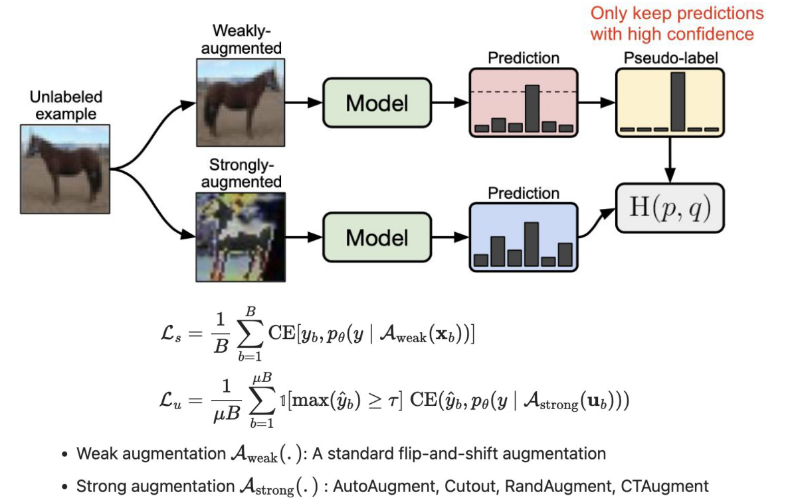
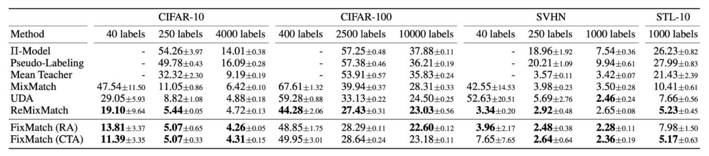

<!-- DRAFT | lecture: 07_Semi_Supervised_Learning_II | chunk: 06 | pages 42–48 -->
<!-- VERIFIED | fixes: 6 | verifier: sonnet -->

## FixMatch: Motivation — 왜 더 단순한 방법이 필요한가 (p.42)

슬라이드 텍스트:
- FixMatch
- Previous SSL Methods
  - MixMatch and ReMixMatch combine multiple components.
    - Label Guessing
    - Sharpening
    - MixUp
    - Distribution Alignment
    - Multiple Augmentations
- They achieve strong performance, but the training pipeline becomes increasingly complicated.
- **Can we achieve similar or even better performance with a much simpler framework?**
- 출처 각주: Sohn, et. al., NeurIPS 2021, FixMatch: Simplifying Semi-Supervised Learning with Consistency and Confidence ← 오타? FixMatch는 **NeurIPS 2020** (슬라이드 전 페이지 공통 각주)

**설명**
- 앞 슬라이드들의 **MixMatch / ReMixMatch**는 성능은 좋지만 부품이 너무 많음: **label guessing**(여러 augmentation 예측 평균으로 pseudo-label 생성), **sharpening**(temperature $T$로 분포를 뾰족하게), **MixUp**, **distribution alignment**(ReMixMatch; 예측 분포를 label 분포에 맞춤), **multiple augmentations**(K개 view).
- 부품이 많으면 (1) 구현·튜닝할 hyperparameter가 늘고, (2) **어떤 부품이 실제로 성능에 기여하는지 불분명**해짐. FixMatch의 문제의식은 "**비슷하거나 더 좋은 성능을 훨씬 단순한 framework로 낼 수 있나?**" 
- 그 답이 **consistency regularization + pseudo-labeling** 두 가지 핵심만 남긴 것 (논문 부제 "Consistency and Confidence"가 이 둘: consistency = weak→strong 일관성, confidence = threshold).

> 보충: FixMatch = Sohn et al., **NeurIPS 2020** (Google Research). 슬라이드엔 "NeurIPS 2021"로 되어 있는데 잘못된 연도로 보임 (슬라이드 원문은 그대로 유지).
> 보충: 이 슬라이드의 "MixMatch/ReMixMatch의 구성요소 리스트"는 FixMatch가 **무엇을 제거했는지** 보여주는 목록 → "FixMatch는 sharpening·MixUp·distribution alignment·multiple augmentation 없이 …"식 문제가 나올 수 있음.

---

## FixMatch: Three Simple Ideas (p.43)

슬라이드 텍스트:
- Instead of combining many techniques, FixMatch relies on only **three simple ideas**.
  - ① Weak Augmentation
    - Generate a reliable pseudo label
  - ② Confidence Threshold
    - Discard uncertain predictions
  - ③ Strong Augmentation
    - Train the model to predict the same label

**설명**
- FixMatch의 3단계를 순서대로 읽으면 **알고리즘 한 줄 요약**:
  1. unlabeled 샘플 $u$에 **weak augmentation** → 모델 예측 → 이게 "믿을 만한" pseudo-label 후보.
  2. 예측의 **최대 확률(confidence)이 threshold $\tau$ 이상**일 때만 채택, 불확실한 건 **버림(mask)**.
  3. 같은 $u$에 **strong augmentation**을 걸어 모델이 **방금 만든 그 pseudo-label을 똑같이 예측**하도록 학습 (**hard label** 대상 cross entropy).
- 즉 **pseudo-labeling**(hard label + confidence threshold)과 **consistency regularization**(weak view ↔ strong view 예측 일치)을 **합친 것**이 FixMatch.
- **MixMatch와의 핵심 차이**: sharpening(soft label을 temperature로 뾰족하게) 대신 **argmax hard label + threshold**를 씀 → p.48 ablation에서 이 선택을 정당화.

> 보충: 논문 수식으로 pseudo-label은 $\hat y_b = \arg\max(q_b)$ 의 one-hot, 여기서 $q_b = p_\theta(y \mid \mathcal{A}_{weak}(u_b))$. 슬라이드 p.46 수식의 $\hat y_b$가 이 hard pseudo-label. 아래 p.46 설명 참고.

---

## Weak vs. Strong Augmentation (p.44)

슬라이드 텍스트:
- Weak augmentation
  - produces a stable prediction
  - easier classification
- Strong augmentation
  - much harder input
  - improves robustness
- **Predict on an easy example, learn from a difficult one.**

**설명**
- **역할 분담**이 포인트:
  - **Weak augmentation** (flip & shift 정도) → 원본과 거의 같아서 모델이 **안정적이고 정확한 예측**을 냄 → **pseudo-label 생성(teacher 역할)** 에 사용.
  - **Strong augmentation** (RandAugment, CTAugment, Cutout 등) → 이미지가 크게 망가져서 **분류가 훨씬 어려움** → 이걸 맞히도록 학습시키면 **robustness 향상** → **loss를 거는 쪽(student 역할)** 에 사용.
- 한 줄로: "**쉬운 예제로 예측(label 만들기), 어려운 예제로 학습**". 같은 모델이 두 view를 모두 처리하지만 **gradient는 strong view 쪽 예측에만** 흐름 (pseudo-label은 상수 target).
- 직관: 어려운 view에서도 쉬운 view의 정답을 맞히게 하면, 모델은 **augmentation에 불변인 feature**를 배우게 됨 (← 큰 perturbation에서도 예측이 유지되는 consistency / smoothness 가정과 연결).
> 보충: 별도 teacher 네트워크(Mean Teacher식 EMA)가 **없음**. 같은 모델 $p_\theta$가 weak view에서 pseudo-label을 만들고(gradient 차단, no grad) strong view에서 학습됨. "teacher/student"는 **역할**일 뿐 별개 모델이 아님.

---

## FixMatch Framework Diagram (p.45)

슬라이드 텍스트:
- A simpler framework using weak→strong consistency and confidence filtering.
  - High confidence leads to high-quality pseudo labels.
- 그림 (좌→우 pipeline): **Unlabeled example**(말 이미지) → 두 갈래
  - 위: **Weakly-augmented** 이미지 → **Model** → **Prediction**(6개 bar, 하나가 크고 **점선 threshold** 위로 올라옴) → (빨간 글씨 "**Only keep predictions with high confidence**") → **Pseudo-label**(한 bar만 큰 one-hot 형태)
  - 아래: **Strongly-augmented** 이미지(색·모양이 심하게 왜곡) → **Model** → **Prediction**(bar가 비교적 평평하게 분산)
  - 두 출력이 **H(p, q)** (cross entropy) 박스로 들어감: pseudo-label(위)이 target, strong 쪽 Prediction(아래)이 입력.
- 하단 bullet:
  - Weak augmentation $\mathcal{A}_{weak}(\cdot)$: A standard flip-and-shift augmentation
  - Strong augmentation $\mathcal{A}_{strong}(\cdot)$: AutoAugment, Cutout, RandAugment, CTAugment

**설명**
- 그림 읽는 법: **위 branch = 라벨 만들기**, **아래 branch = 학습 신호**. threshold(점선)를 넘는 예측만 pseudo-label이 되고, 못 넘으면 그 샘플은 **unsupervised loss에서 제외**됨.
- 위 Prediction은 soft 확률인데 Pseudo-label은 **one-hot(hard)** 로 표시됨 → **argmax로 hard label화** 한다는 뜻.
- 아래 Prediction은 strong aug 때문에 **덜 확신**하는 모양 → $H(p,q)$를 최소화하면 이 분포가 pseudo-label 쪽으로 끌려감.
- $\mathcal{A}_{weak}$: **flip-and-shift** (랜덤 수평 flip + 약간의 translation). $\mathcal{A}_{strong}$: **AutoAugment, Cutout, RandAugment (RA), CTAugment (CTA)** 중 하나 (+ Cutout).
> 보충: 논문에서 CIFAR는 weak = random horizontal flip(SVHN 제외) + 최대 12.5% 이동. Strong = RandAugment 또는 CTAugment 뒤에 Cutout. 슬라이드엔 구체 수치 없음.
> 보충: 이 슬라이드(p.45)와 다음 p.46은 **같은 그림**이고 p.46에서 loss 수식이 추가됨.

---

## FixMatch Loss (p.46)

슬라이드 텍스트:
- (p.45와 같은 그림 + 수식 추가)
$$\mathcal{L}_s = \frac{1}{B}\sum_{b=1}^{B} \mathrm{CE}\big[y_b,\ p_\theta(y \mid \mathcal{A}_{weak}(\mathbf{x}_b))\big]$$
$$\mathcal{L}_u = \frac{1}{\mu B}\sum_{b=1}^{\mu B} \mathbb{1}\big[\max(\hat{y}_b) \ge \tau\big]\ \mathrm{CE}\big(\hat{y}_b,\ p_\theta(y \mid \mathcal{A}_{strong}(\mathbf{u}_b))\big)$$
- Weak augmentation $\mathcal{A}_{weak}(\cdot)$: A standard flip-and-shift augmentation
- Strong augmentation $\mathcal{A}_{strong}(\cdot)$: AutoAugment, Cutout, RandAugment, CTAugment

**설명**
- **Supervised loss $\mathcal{L}_s$**: labeled batch $\{(\mathbf{x}_b, y_b)\}_{b=1}^{B}$에 **weak augmentation**을 걸고 정답 $y_b$와의 cross entropy를 평균. 보통의 supervised 학습과 동일 (※ labeled엔 weak aug만).
- **Unsupervised loss $\mathcal{L}_u$**: unlabeled batch $\{\mathbf{u}_b\}_{b=1}^{\mu B}$ (**$\mu$ = unlabeled batch가 labeled batch의 몇 배인지**, $\mu B$개) 에 대해
  1. $\hat{y}_b$ = **weak view 예측으로 만든 pseudo-label** (논문: $q_b=p_\theta(y\mid\mathcal{A}_{weak}(\mathbf{u}_b))$ 의 $\arg\max$ one-hot). ← 슬라이드는 $\hat y_b$의 정의를 따로 안 적음.
  2. $\mathbb{1}[\max(\hat{y}_b) \ge \tau]$ : **indicator(mask)**. 예측의 **최대 확률(confidence)** 이 threshold $\tau$ 이상이면 1, 아니면 0 → **불확실한 샘플은 loss에서 제외**.
     ← 엄밀히는 threshold 비교는 **argmax 이전 soft 확률 $q_b$의 max** 에 대해 하는 것 (one-hot의 max는 항상 1). 슬라이드 표기 $\max(\hat y_b)$는 이를 느슨하게 쓴 것으로 보임.
  3. $\mathrm{CE}(\hat{y}_b,\ p_\theta(y\mid\mathcal{A}_{strong}(\mathbf{u}_b)))$ : **strong view의 예측**이 pseudo-label과 같아지도록 cross entropy.
- 분모 $\mu B$: **mask된 샘플도 포함해 전체 unlabeled 개수로 나눔** (통과한 샘플 수로 나누는 게 아님). → threshold를 넘는 샘플이 적은 학습 초기엔 $\mathcal{L}_u$가 자연스레 작아짐 = 일종의 **암묵적 curriculum / ramp-up**.
- 전체 loss: $\mathcal{L} = \mathcal{L}_s + \lambda_u \mathcal{L}_u$. ← 슬라이드에는 없음 (아래 보충).
- **정리 포인트**: ($\mathcal{L}_s$) weak ↔ GT, ($\mathcal{L}_u$) **weak가 만든 pseudo-label → strong 예측을 맞추게 함**. 방향이 바뀌면 안 됨 (**strong에서 label 생성 X**).
- 다른 방법과 비교: **Pseudo-Labeling**(Lee 2013)은 pseudo-label을 같은 view에서 만들고 같은 view에 loss를 검 (consistency 없음). **UDA**는 soft 분포 + KL, sharpening / confidence mask 사용. **MixMatch**는 K개 augmentation 평균 + sharpening(soft label) + MSE + MixUp. **FixMatch**는 **hard label + threshold + CE + weak→strong**.
> 보충: 논문의 전체 loss는 $\mathcal{L}_s + \lambda_u \mathcal{L}_u$ 이며 $\lambda_u=1$ 로 고정해도 잘 됨 (ramp-up 불필요). 논문 hyperparameter: $\tau = 0.95$, $\mu = 7$, $B = 64$. 슬라이드엔 수치 없음.
> 보충: 논문에서 loss는 **hard label**을 쓰며 sharpening이 필요 없다. (p.48 ablation 참고).

---

## FixMatch Results (p.47)

슬라이드 텍스트:
- 표 (슬라이드 제목 "FixMatch" + 논문 표 캡처), 각주: "RA: RandAugment, CTA: CTAugment"
- 열: CIFAR-10 (40 / 250 / 4000 labels), CIFAR-100 (400 / 2500 / 10000 labels), SVHN (40 / 250 / 1000 labels), STL-10 (1000 labels). 수치는 **error rate (%)** ← 슬라이드에 단위 표기 없음, 논문 기준 낮을수록 좋음.

| Method | C10 40 | C10 250 | C10 4000 | C100 400 | C100 2500 | C100 10000 | SVHN 40 | SVHN 250 | SVHN 1000 | STL-10 1000 |
|---|---|---|---|---|---|---|---|---|---|---|
| Π-Model | - | 54.26±3.97 | 14.01±0.38 | - | 57.25±0.48 | 37.88±0.11 | - | 18.96±1.92 | 7.54±0.36 | 26.23±0.82 |
| Pseudo-Labeling | - | 49.78±0.43 | 16.09±0.28 | - | 57.38±0.46 | 36.21±0.19 | - | 20.21±1.09 | 9.94±0.61 | 27.99±0.83 |
| Mean Teacher | - | 32.32±2.30 | 9.19±0.19 | - | 53.91±0.57 | 35.83±0.24 | - | 3.57±0.11 | 3.42±0.07 | 21.43±2.39 |
| MixMatch | 47.54±11.50 | 11.05±0.86 | 6.42±0.10 | 67.61±1.32 | 39.94±0.37 | 28.31±0.33 | 42.55±14.53 | 3.98±0.23 | 3.50±0.28 | 10.41±0.61 |
| UDA | 29.05±5.93 | 8.82±1.08 | 4.88±0.18 | 59.28±0.88 | 33.13±0.22 | 24.50±0.25 | 52.63±20.51 | 5.69±2.76 | **2.46±0.24** | 7.66±0.56 |
| ReMixMatch | **19.10±9.64** | **5.44±0.05** | 4.72±0.13 | **44.28±2.06** | **27.43±0.31** | **23.03±0.56** | **3.34±0.20** | 2.92±0.48 | 2.65±0.08 | **5.23±0.45** |
| FixMatch (RA) | **13.81±3.37** | **5.07±0.65** | **4.26±0.05** | 48.85±1.75 | 28.29±0.11 | **22.60±0.12** | **3.96±2.17** | **2.48±0.38** | **2.28±0.11** | 7.98±1.50 |
| FixMatch (CTA) | **11.39±3.35** | **5.07±0.33** | **4.31±0.15** | 49.95±3.01 | 28.64±0.24 | 23.18±0.11 | 7.65±7.65 | **2.64±0.64** | **2.36±0.19** | **5.17±0.63** |

(굵은 글씨는 슬라이드 표의 bold를 그대로 옮긴 것 (이미지 대조 확인함). ← bold가 "열 최저값"과 정확히 일치하진 않음 (예: CIFAR-10 250에서 ReMixMatch 5.44가 bold인데 FixMatch 5.07이 더 낮음; CIFAR-100 10000은 22.60과 23.03 둘 다 bold). 시험에서는 bold가 아니라 **숫자 자체**로 비교할 것.)

**설명**
- 표 읽는 법: **숫자 = error rate**, 낮을수록 좋음. 열이 갈수록 **label 수가 적을수록(예: CIFAR-10 40 labels = 클래스당 4장)** 어려운 설정.
- 핵심 관찰:
  1. **FixMatch는 CIFAR-10에서 모든 label 수(40/250/4000)에서 최고 성능**. 40 labels에서 **13.81% (RA) / 11.39% (CTA)** vs MixMatch 47.54, UDA 29.05, ReMixMatch 19.10 → **label이 극단적으로 적을 때 특히 강함**.
  2. 250 labels에서 **5.07%**, 4000 labels에서 **4.26% (RA)** — 4000 labels에서도 CIFAR-10 최저 error.
  3. 구세대(Π-Model, Pseudo-Labeling, Mean Teacher)는 특히 label이 적을 때 크게 뒤짐 (예: CIFAR-10 250 labels: 54.26 / 49.78 / 32.32).
  4. **ReMixMatch**가 일부 셀(CIFAR-100 400/2500 labels: 44.28/27.43 vs RA 48.85/28.29, SVHN 40 labels: 3.34 vs RA 3.96, STL-10 RA 7.98 vs ReMix 5.23)에서 FixMatch보다 낫다 → FixMatch가 **항상 1등은 아님**. 그래도 **훨씬 단순한데 비슷하거나 더 좋은 수준**이라는 게 주장.
  5. **RA vs CTA**: 대체로 비슷. 둘 다 strong augmentation의 한 구현일 뿐이라 큰 차이 없음.
- 낮은 label 수에서 표준편차가 큼 (예: SVHN 40 labels CTA ±7.65, UDA ±20.51) → label 몇 개 뽑느냐에 따른 variance 큼.
> 보충: 논문 abstract 기준 CIFAR-10 **250 labels에서 94.93% accuracy**, **클래스당 4 labels (40 labels) 에서 88.61% accuracy** (≈ error 11.39%, 표의 CTA 값과 일치). 슬라이드엔 없음.
> 보충: 시험에는 정확한 수치보다 **"FixMatch가 MixMatch/UDA보다 좋다, 특히 적은 label에서"** 수준의 비교가 나올 가능성이 큼. 정확한 숫자는 비중 낮게.

---

## Why Does FixMatch Work? Ablation Findings (p.48)

슬라이드 텍스트:
- Why Does FixMatch Work?
- According to the ablation studies of FixMatch,
  - **Confidence** thresholding is more effective than temperature sharpening.
    - Once low-confidence predictions are filtered out, sharpening provides little additional benefit.
  - **Weak augmentation** should be used for pseudo-label generation.
    - Strong augmentation introduces excessive perturbations, leading to unreliable pseudo labels.
  - **Strong augmentation** is essential for consistency learning.
    - Training with strongly augmented images significantly improves robustness and generalization.
  - The combination of weak→strong augmentation and confidence filtering is the key to FixMatch.
- (밑줄 표시: "pseudo-label", "consistency")

**설명**
- **(1) Threshold > Sharpening**: pseudo-label의 품질을 올리는 방법으로 **temperature sharpening($T$)** 과 **confidence threshold($\tau$)** 를 비교했더니 threshold가 더 효과적. **저신뢰 예측을 이미 걸러냈다면 sharpening은 추가 이득이 거의 없음**. 이유: sharpening은 틀린 예측도 뾰족하게 만들어 **잘못된 확신(confirmation bias)** 을 키울 수 있는 반면, threshold는 **틀리기 쉬운 샘플 자체를 배제**함. → FixMatch가 sharpening을 **제거**한 근거.
- **(2) Pseudo-label은 weak에서**: strong aug 이미지에서 pseudo-label을 만들면 **perturbation이 너무 커서** 예측이 부정확 → **noisy label**로 학습이 망가짐. (밑줄 "pseudo-label" = 이 행은 **label 생성 단계**에 관한 이야기.)
- **(3) Consistency 학습 target은 strong**: strong aug로 학습해야 **robustness·generalization이 크게 향상**. (밑줄 "consistency" = **loss를 걸 단계**.) weak끼리만 맞추면 너무 쉬운 문제라 얻는 게 적음.
- **(4) 결론**: 키는 **weak→strong 방향 + confidence filtering** 의 조합. 한 가지만 빼도 성능 하락.
- 시험용 정리표:

| 단계 | 사용하는 view | 이유 |
|---|---|---|
| Pseudo-label 생성 | **Weak** | 안정적·정확한 예측 |
| Loss를 거는 입력 | **Strong** | 어려운 입력 → robustness |
| 저신뢰 샘플 | **Threshold $\tau$로 제거** | 잘못된 pseudo-label 방지 |
| Sharpening | **불필요** | threshold가 있으면 추가 이득 거의 없음 |

> 보충: 논문 ablation도 threshold가 있을 때 sharpening 효과가 거의 없다는 방향 (슬라이드 p.48과 동일). $\tau$ 민감도 등 구체 결과는 슬라이드에 없고 기억이 불확실해 생략.
> 보충: 논문은 "threshold가 높을수록 pseudo-label은 정확하지만 사용되는 unlabeled 샘플이 줄어드는" trade-off를 분석 (정확도 ↔ 양). 슬라이드엔 없음.

---

## FIGURES

- p.45 / p.46: FixMatch 전체 pipeline (weak→pseudo-label→threshold, strong→CE) + loss 수식 $\mathcal{L}_s$, $\mathcal{L}_u$ — 중요도 **최상** (crop: `assets/lecture07/p046_fixmatch_diagram_loss.png`, 그림+수식 포함)
- p.47: 비교 표 (CIFAR-10/100, SVHN, STL-10 error rate) — 중요도 **중하** (crop: `assets/lecture07/p047_fixmatch_results_table.png`)
- p.43, p.44, p.48: 텍스트만 (3 ideas, weak vs strong, ablation 결론) — 중요도 상 (개념 문제 출제 가능)

## EXAM POINTS

1. **FixMatch의 3 ideas** (p.43): ① Weak augmentation → reliable pseudo-label 생성, ② Confidence threshold → uncertain prediction 폐기, ③ Strong augmentation → 같은 label을 예측하도록 학습. *함정*: weak/strong 역할 맞바꾸기 ("pseudo-label is generated from strongly augmented image" = **False**).
2. **FixMatch의 동기** (p.42): MixMatch/ReMixMatch는 label guessing, sharpening, MixUp, distribution alignment, multiple augmentations를 조합해 복잡 → 더 단순한 framework 제안. *함정*: "FixMatch는 MixUp과 distribution alignment를 사용한다" = False.
3. **Weak vs Strong** (p.44): weak = stable prediction, easier classification; strong = much harder input, improves robustness. 슬로건 "**Predict on an easy example, learn from a difficult one.**"
4. **Augmentation 종류** (p.45–46): $\mathcal{A}_{weak}$ = standard **flip-and-shift**; $\mathcal{A}_{strong}$ = **AutoAugment, Cutout, RandAugment, CTAugment**. *함정*: weak에 RandAugment를 붙이는 보기.
5. **$\mathcal{L}_u$ 수식** (p.46): $\frac{1}{\mu B}\sum \mathbb{1}[\max(\hat y_b)\ge\tau]\,\mathrm{CE}(\hat y_b, p_\theta(y\mid\mathcal{A}_{strong}(u_b)))$ — **indicator(confidence mask) + cross entropy (hard pseudo-label) + strong view 예측**. 분모는 $\mu B$ (unlabeled batch 크기, labeled batch $B$의 $\mu$배). *함정*: CE ↔ MSE/KL 뒤바꾸기, $\mathcal{A}_{strong}$ ↔ $\mathcal{A}_{weak}$, $\ge\tau$ ↔ $<\tau$.
6. **$\mathcal{L}_s$** (p.46): labeled 데이터에 **weak aug** + 정답 $y_b$와의 CE. (strong aug가 아님.)
7. **Pseudo-label의 형태**: 그림(p.45)에서 pseudo-label은 **one-hot (hard)**, threshold 이상일 때만 사용. *함정*: "soft label을 sharpening해서 사용" = MixMatch의 방식, FixMatch가 아님.
8. **Ablation 결론** (p.48): (a) **Confidence thresholding > temperature sharpening**; threshold가 있으면 sharpening 추가 이득 거의 없음. (b) **Weak aug → pseudo-label**; strong은 perturbation 과다로 unreliable pseudo label. (c) **Strong aug → consistency learning에 필수**, robustness·generalization 향상. (d) **weak→strong + confidence filtering 조합이 핵심**.
9. **FixMatch는 별도 teacher/EMA 없음**: 같은 모델이 weak view에서 pseudo-label(상수 target), strong view에서 학습. *함정*: Mean Teacher와 혼동 (EMA teacher 사용한다 = False).
10. **결과 표** (p.47): metric = error rate (낮을수록 좋음). FixMatch는 CIFAR-10에서 모든 label 수에서 최고 (40 labels: 13.81 (RA) / 11.39 (CTA); 250 labels: 5.07; 4000 labels: 4.26 / 4.31). 구방법(Π-Model, Pseudo-Labeling, Mean Teacher)은 label이 적을수록 훨씬 나쁨. ReMixMatch가 CIFAR-100 일부 설정에서는 더 좋음 → "항상 최고" 주장은 False. 수치 매칭은 비중 낮게.
11. **인용 오류 주의**: 슬라이드 각주 "NeurIPS 2021" ← 실제는 **NeurIPS 2020**. 시험에서 연도가 나오면 슬라이드 기준 vs 실제가 다를 수 있으니 주의.
12. **p.47 표 함정**: "FixMatch가 모든 데이터셋·label 수에서 최저 error" = False (CIFAR-100 400/2500, SVHN 40, STL-10 RA 등은 ReMixMatch가 더 낮음). "수치는 accuracy" = False (error rate).
13. **$\mu$, $\tau$ 의미** (p.46): $\mu B$ = unlabeled batch 크기, $\tau$ = confidence threshold. $\mathcal{L}_s$ 분모는 $B$, $\mathcal{L}_u$ 분모는 $\mu B$. *함정*: 분모를 "threshold 통과 샘플 수"라고 하는 보기.
14. **FixMatch = consistency regularization + pseudo-labeling**의 결합 (논문 부제 "Consistency and Confidence"). consistency = weak↔strong 예측 일치, confidence = threshold $\tau$.
