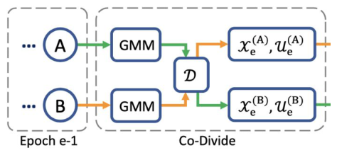
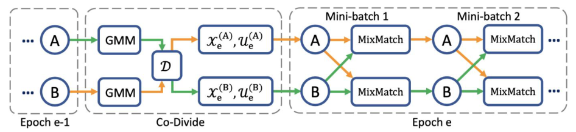
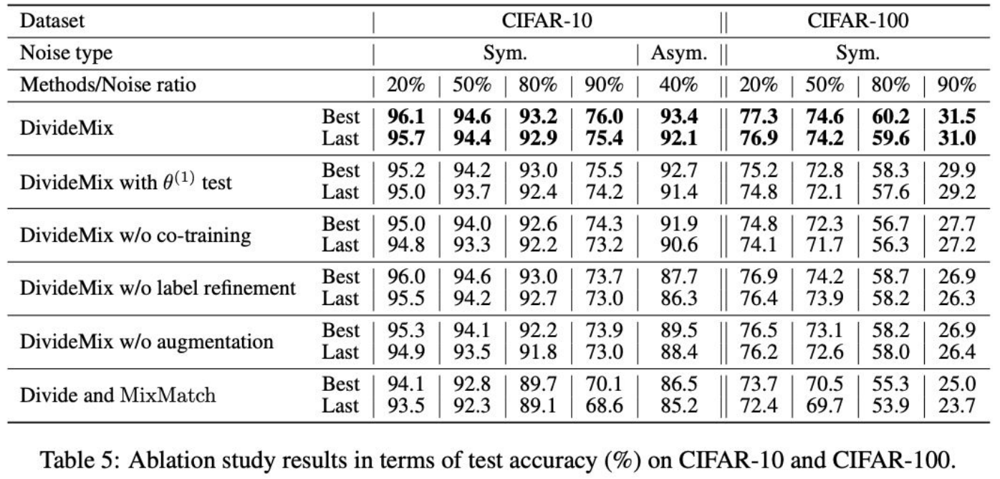

<!-- DRAFT | lecture: 07_Semi_Supervised_Learning_II | chunk: 07 | pages 49–55 -->
<!-- VERIFIED | fixes: 8 | verifier: sonnet -->

## DivideMix: Motivation — Noisy Labels (p.49)

슬라이드 텍스트:
- DivideMix
- Existing SSL methods assume that
  - labeled samples are clean
  - only unlabeled data are unreliable
- But in Practice... Labeled datasets may also contain incorrect labels.
- **Can semi-supervised learning be used to handle noisy labels?**
  → Instead of trusting all labeled samples, identify unreliable labels and treat them as unlabeled data.
- 출처 (각 페이지 하단): Li, et. al., ICML 2020, DivideMix: Learning with Noisy Labels as Semi-supervised Learning ← 실제 논문은 ICLR 2020 (아래 보충 참고)

**설명**
- 지금까지 본 SSL(consistency regularization, Pseudo-Labeling 등)은 **"labeled = 깨끗(clean), unlabeled = 믿을 수 없음"** 이라는 암묵적 가정 위에 있었음. 실전에선 crowd-sourcing·web crawling 등으로 만든 **labeled set 자체에 wrong label**이 섞여 있음 → 이게 **Learning with Noisy Labels (LNL)** 문제.
- 핵심 발상 (역발상): **SSL 도구를 LNL에 가져다 쓰자.** "labeled data 전부를 믿지 말고, **믿을 수 없는 label을 골라내서 그 sample을 unlabeled data로 취급**"하면 → 남은 문제는 그냥 SSL.
- 즉 **노이즈 있는 label = 없는 label보다 나쁨** (틀린 label은 적극적으로 모델을 잘못 학습시킴). 차라리 label을 버리고 이미지만 쓰는 게 낫다는 논리.
> 보충: DivideMix = Junnan Li, Richard Socher, Steven Hoi, ICLR 2020 (arXiv 1902.07379). 슬라이드는 "ICML 2020"으로 표기 ← 오타? (원 논문은 ICLR 2020; 시험에선 슬라이드 표기를 따르되 인지해둘 것.)
> 보충: Noise type — **symmetric (sym.)** noise = label을 uniform하게 아무 클래스로 랜덤 교체, **asymmetric (asym.)** = 비슷한 클래스끼리(예: truck→automobile, bird→airplane) 교체 (더 현실적, 더 어려움). p.55 표에서 사용.

---

## DivideMix: Key Idea (p.50)

슬라이드 텍스트:
- Key Idea
  - Divide the labeled dataset into
    - Clean samples
    - Noisy samples
    - using the training loss.
- Discard unreliable labels and treat those samples as unlabeled data.
  - Then optimize the model using MixMatch.
- ● MixMatch is a strong SSL framework that effectively utilizes unlabeled data.
- ● DivideMix reformulates noisy-label learning as a semi-supervised learning problem.

**설명**
- 한 줄 요약: **"Divide (clean/noisy로 나눔) + MixMatch (SSL로 학습)"** = DivideMix. 이름 그대로.
- **나누는 기준 = training loss (per-sample loss)**. 이유는 p.53 Q1에서 설명 (clean sample은 loss가 빨리 줄고 noisy sample은 loss가 높게 남음 ← DNN의 **early-learning / memorization** 성질).
- **MixMatch**: 06 강의에서 다룬 **holistic SSL** 계열 (MixUp + sharpening + guessed label + consistency). labeled set $\mathcal{X}$와 unlabeled set $\mathcal{U}$ 두 개를 입력받아 학습. DivideMix는 이 MixMatch의 **입력 두 set을 자동으로 만들어주는 front-end**임 (p.52에서 명시).
- 흐름: 원래 labeled dataset $(\mathcal{X},\mathcal{Y})$ → (loss 기반 divide) → **clean 부분 = labeled set $\mathcal{X}_e$** (label 유지), **noisy 부분 = unlabeled set $\mathcal{U}_e$** (label 버리고 이미지만 사용).
> 보충: MixMatch (Berthelot et al., NeurIPS 2019)의 핵심 구성: K번 augmentation한 unlabeled의 평균 예측 → sharpen → guessed label, 그 후 labeled+unlabeled를 섞어 MixUp. loss = labeled에 cross-entropy, unlabeled에 MSE(L2). 구체 내용은 강의 해당 chunk 참고.

---

## DivideMix: (1) Two Networks, (2) Co-Divide (p.51)

슬라이드 텍스트:
- (1) Train Two Networks
  - Network A, Network B
  - To reduce confirmation bias by judging clean/noisy from different perspectives.
- (2) Co-Divide
  - A ──► GMM, B ──► GMM
  - Each network calculates the sample loss at the current epoch.
  - By fitting a 2-component GMM to the loss distribution,
    - Low-loss → Clean
    - High-loss → Noisy
  - It separates into.
    - Instead of using its own judgment, it relies on the "clean" or "noisy" classification determined by the other party.
- 그림 (우측 하단, 작은 diagram): 왼쪽 점선 박스 "Epoch e-1" 안에 네트워크 **A**, **B** (앞에 `···`). 오른쪽 점선 박스 "Co-Divide": A → GMM, B → GMM, 두 GMM 출력이 가운데 **$\mathcal{D}$** 노드에서 **교차(cross)** 되어 A쪽 GMM 결과가 아래쪽 $(\mathcal{X}_e^{(B)}, \mathcal{U}_e^{(B)})$로, B쪽 GMM 결과가 위쪽 $(\mathcal{X}_e^{(A)}, \mathcal{U}_e^{(A)})$로 감 (초록=A 유래, 주황=B 유래 화살표).

**설명**
- **왜 네트워크 2개?** 한 네트워크가 **자기가 판단한 clean/noisy**로 자기를 다시 학습하면, 초기에 생긴 오판이 계속 강화됨 = **confirmation bias** (자기 예측을 자기 target으로 쓰는 self-training의 고질병). → 서로 **다른 초기화**를 가진 두 네트워크 A, B가 **서로 다른 관점(perspective)** 으로 판단하게 해서 이걸 줄임.
- **Co-Divide 절차** (매 epoch 시작):
  1. 각 네트워크가 **전체 training sample에 대해 per-sample loss** (보통 cross-entropy w.r.t. given label)를 계산 — "current epoch" 기준.
  2. 이 loss 분포에 **2-component GMM (Gaussian Mixture Model)** 을 fit: 평균이 작은 component = **clean**, 큰 component = **noisy**.
  3. 각 sample의 **clean probability** $w_i$ = (평균 작은 쪽 component의 posterior). $w_i \ge \tau$ → clean (labeled set), $w_i < \tau$ → noisy (unlabeled set). ($\tau$ = clean probability threshold, p.54 알고리즘 입력)
- **핵심 포인트: cross-over** — **네트워크 A가 학습에 쓸 데이터 분할은 네트워크 B의 GMM이 만든다 (그 반대도 마찬가지)**. 그림에서 $\mathcal{D}$ 노드에서 화살표가 엇갈리는 이유. 슬라이드 표현: "Instead of using its own judgment, it relies on the clean/noisy classification determined by the other party."
  - 직관: A가 자기 오류를 스스로 강화하는 **self-confirmation 경로를 끊음**. A의 실수는 B가 걸러주고, B의 실수는 A가 걸러줌 → 두 네트워크가 서로 다른 오류를 가지므로 **error flow를 줄임**.
  - 이름이 **Co-Divide** ("co-" = 두 네트워크가 협력해서 divide). 이후 나오는 Label **Co**-Refinement, Label **Co**-Guessing도 같은 "co" 접두.
> 보충: 두 네트워크는 **독립 초기화** (다른 random init)이고, co-training과 유사한 발상. 논문은 이 co-divide가 "two diverged networks filter each other's errors"라고 설명. ablation(p.55)에서 "w/o co-training"으로 효과를 확인.
> 보충: GMM은 loss를 min-max normalize한 뒤 EM으로 fit (논문). 또 GMM이 loss를 bimodal하게 만들도록 warm-up 시 **confidence penalty (negative entropy)** 를 줌 — 특히 asymmetric noise에서 필요. 슬라이드 알고리즘 line 2에 "standard training (with confidence penalty)"로만 언급됨.

---

## DivideMix: (3) Training Sets, (4) MixMatch, (5) Repeat (p.52)

슬라이드 텍스트:
- (3) Construct Training Sets
  - It automatically generates the labeled and unlabeled datasets required for MixMatch.
- (4) MixMatch Training
  - DivideMix does not create a new learning algorithm;
  - rather, it is a method for generating the labeled and unlabeled sets used by MixMatch.
- (5) Repeat
- 그림 (하단 전체 파이프라인): 왼쪽 "Epoch e-1" (A, B) → "Co-Divide" (A→GMM, B→GMM, 가운데 $\mathcal{D}$에서 교차, 출력 $\mathcal{X}_e^{(A)},\mathcal{U}_e^{(A)}$ 와 $\mathcal{X}_e^{(B)},\mathcal{U}_e^{(B)}$) → "Epoch e": Mini-batch 1에서 A와 B 각각 **MixMatch** 박스로 들어감 (A의 MixMatch에 B의 예측 화살표가 교차로 들어가고 그 반대도 마찬가지), 이어서 Mini-batch 2에서 반복 (`···`).

**설명**
- **전체 파이프라인 5단계 정리** (시험용):
  1. **Train two networks** A, B (warm-up 후).
  2. **Co-Divide**: 각 네트워크의 loss → 2-GMM → clean prob. → **상대 네트워크용** labeled/unlabeled split.
  3. **Construct training sets**: network $k$ 용 $\mathcal{X}_e^{(k)}$ (clean, label 유지) / $\mathcal{U}_e^{(k)}$ (noisy, label 폐기).
  4. **MixMatch training**: 각 mini-batch마다 한 네트워크를 update (알고리즘 line 6 "train the two networks one by one"). 이때 **label co-refinement**(labeled 쪽), **label co-guessing**(unlabeled 쪽)이 MixMatch 입력을 가공 (p.54).
  5. **Repeat** every epoch (divide를 매 epoch 새로 계산 → 네트워크가 좋아질수록 divide도 정확해지는 선순환).
- 슬라이드가 강조하는 문장: **"DivideMix does not create a new learning algorithm; it is a method for generating the labeled and unlabeled sets used by MixMatch."** ← 시험에 그대로 T/F로 나올 만함. (엄밀히는 label co-refinement/co-guessing 등 MixMatch를 수정한 부분도 있지만, 슬라이드 프레이밍은 "set generator".)
- 그림에서 Mini-batch 단계의 교차 화살표: 한 네트워크의 MixMatch가 **다른 네트워크의 prediction**을 사용 (co-guessing에서 두 네트워크 예측 평균, co-refinement에서 상대의 clean prob. $w_b$ 사용).

---

## DivideMix: Q&A — Why GMM? Are noisy samples discarded? (p.53)

슬라이드 텍스트:
- Q1. Why use GMM?
  - During the early stages of training:
    - Clean samples show a rapid decrease in loss.
    - Noisy samples retain a high loss.
  - This is because the loss histogram
    - roughly appears as two clusters:
  - ← (슬라이드에는 "two clusters:" 뒤에 내용 없음, 그림 없음)
- Q2. Are noisy samples discarded?
  - No.
  - Only the ground-truth labels are discarded.
  - In other words, they are treated as unlabeled data.

**설명**
- **Q1. Why GMM?**
  - DNN은 **clean sample을 먼저 (빠르게) fit**하고 noisy label은 **나중에 memorize**함 (early-learning / memorization 현상, 보충: Arpit et al. 2017 등 연구에서 알려진 성질). 그래서 학습 초기엔 clean sample의 loss는 작고, 잘못 라벨된 sample의 loss는 큼.
  - 그 결과 **per-sample loss histogram이 대략 두 덩어리(bimodal)**: 낮은 loss 덩어리(clean) + 높은 loss 덩어리(noisy) → **2-component GMM**이 자연스러운 모델.
  - 왜 단순 threshold가 아니라 GMM? **GMM은 확률 $w_i$(clean probability)를 soft하게 줌** + 두 component 비율·분산을 데이터에서 학습하므로 **noise ratio가 달라져도 threshold를 hand-tune할 필요 없음** (←  슬라이드엔 없는 이유, 보충). 또 hard 판정이 아닌 $w_i$ 를 이후 label refinement의 가중치로 재사용함 (p.54).
  - 문장 "This is because the loss histogram roughly appears as two clusters"는 인과가 뒤집혀 있음 ← 원인/결과 표현 어색 (실제론 "clean은 loss 빨리↓, noisy는 높게 유지 → histogram이 두 cluster처럼 보임 → GMM 사용"). 슬라이드 문장 그대로 외우지 말고 논리 순서로 이해.
- **Q2. Noisy samples 버리나? → No.**
  - **버리는 건 label (ground-truth label)뿐**, **이미지 $x$는 unlabeled data로 계속 사용**. 즉 sample 자체는 MixMatch의 unlabeled set $\mathcal{U}_e$에 들어가서 **consistency / co-guessed pseudo-label** 로 학습됨.
  - 이게 단순 "noisy sample filtering/removal" 방법들과의 **차별점**: 데이터 효율을 높임 (특히 noise ratio가 80~90% 처럼 높을 때, sample을 버리면 거의 남는 게 없음 → SSL로 다 활용).
> 보충: 논문 Figure 1 류의 loss 분포 그림은 슬라이드에는 없음. clean/noisy 두 모드의 분리는 CIFAR-10 sym. 50% noise 등에서 보임.

---

## DivideMix: Algorithm — Label Co-Refinement & Co-Guessing (p.54)

슬라이드 텍스트:
- (그림) **Algorithm 1: DivideMix.** Line 4-8: co-divide; Line 17-18: label co-refinement; Line 20: label co-guessing.
- 우측 설명:
  - **Label Co-Refinement**: Refines labels for samples classified as "Clean" by combining the ground-truth (GT) label with the model's prediction.
  - **Label Co-Guessing**: Generates pseudo-labels for noisy (unlabeled) samples by averaging the predictions from the two networks.

알고리즘 핵심 줄 (그림 내용 전사):
- Input: $\theta^{(1)},\theta^{(2)}$, training dataset $(\mathcal{X},\mathcal{Y})$, clean probability threshold $\tau$, number of augmentations $M$, sharpening temperature $T$, unsupervised loss weight $\lambda_u$, Beta distribution parameter $\alpha$ for MixMatch.
- 2: $\theta^{(1)},\theta^{(2)} = \text{WarmUp}(\mathcal{X},\mathcal{Y},\theta^{(1)},\theta^{(2)})$ — standard training (with confidence penalty)
- 3: while $e <$ MaxEpoch do
- 4: $\mathcal{W}^{(2)} = \text{GMM}(\mathcal{X},\mathcal{Y},\theta^{(1)})$ — model per-sample loss with $\theta^{(1)}$ to obtain clean probability for $\theta^{(2)}$ (**Co-divide**) ← 슬라이드 원문은 "proabability" 오타 (line 4, 5 모두)
- 5: $\mathcal{W}^{(1)} = \text{GMM}(\mathcal{X},\mathcal{Y},\theta^{(2)})$ — model per-sample loss with $\theta^{(2)}$ to obtain clean probability for $\theta^{(1)}$
- 6: for $k=1,2$ do — train the two networks one by one
- 7: $\mathcal{X}_e^{(k)} = \{(x_i,y_i,w_i)\mid w_i \ge \tau\}$ — labeled training set for $\theta^{(k)}$
- 8: $\mathcal{U}_e^{(k)} = \{x_i \mid w_i < \tau\}$ — unlabeled training set for $\theta^{(k)}$
- 9: for iter = 1 to num_iters do; 12: for b = 1 to B do
- 10–11: mini-batch $\{(x_b,y_b,w_b)\}$ from $\mathcal{X}_e^{(k)}$, $\{u_b\}$ from $\mathcal{U}_e^{(k)}$
- 13–15: for $m=1..M$: $\hat x_{b,m}=\text{Augment}(x_b)$, $\hat u_{b,m}=\text{Augment}(u_b)$
- 17: $p_b = \frac{1}{M}\sum_m p_{\text{model}}(\hat x_{b,m};\theta^{(k)})$ — average predictions across augmentations of $x_b$ (**Label co-refine**)
- 18: $\bar y_b = w_b y_b + (1-w_b)\,p_b$ — refine GT label guided by the clean probability produced by the other network
- 19: $\hat y_b = \text{Sharpen}(\bar y_b, T)$ — apply temperature sharpening to the refined label
- 20: $\bar q_b = \frac{1}{2M}\sum_m \big(p_{\text{model}}(\hat u_{b,m};\theta^{(1)}) + p_{\text{model}}(\hat u_{b,m};\theta^{(2)})\big)$ — co-guessing: average predictions from both networks across augmentations of $u_b$ (**Label co-guessing**)
- 21: $q_b = \text{Sharpen}(\bar q_b, T)$ — apply temperature sharpening to the guessed label
- 23–24: $\hat{\mathcal{X}}=\{(\hat x_{b,m},\hat y_b)\}$, $\hat{\mathcal{U}}=\{(\hat u_{b,m},q_b)\}$ — augmented labeled/unlabeled mini-batch
- 25: $\mathcal{L}_{\mathcal{X}},\mathcal{L}_{\mathcal{U}} = \text{MixMatch}(\hat{\mathcal{X}},\hat{\mathcal{U}})$
- 26: $\mathcal{L} = \mathcal{L}_{\mathcal{X}} + \lambda_u\mathcal{L}_{\mathcal{U}} + \lambda_r\mathcal{L}_{\text{reg}}$ — total loss
- 27: $\theta^{(k)} = \text{SGD}(\mathcal{L},\theta^{(k)})$

**설명**
- **Co-divide (line 4–8)**: line 4에서 **$\theta^{(1)}$의 loss로 GMM → $\mathcal{W}^{(2)}$** (네트워크 2를 위한 clean prob). 위첨자가 **엇갈림**이 포인트 (p.51 cross-over의 수식 표현). line 7–8에서 threshold $\tau$로 labeled / unlabeled 분할.
- **Label Co-Refinement (line 17–19)** — **clean (labeled) sample용**:
  $$\bar y_b = w_b\,y_b + (1-w_b)\,p_b$$
  - $y_b$: 주어진 (GT) one-hot label, $p_b$: 현재 네트워크 $\theta^{(k)}$의 **augmentation 평균 예측** ($M$개 augmentation에 대한 평균), $w_b$: **상대 네트워크가 계산한 clean probability**.
  - **linear combination**: clean일 확률이 높으면($w_b\to1$) 주어진 label을 신뢰, 낮으면($w_b\to0$) 모델 예측을 더 신뢰. → clean으로 분류된 샘플 안에도 **남아있는 label noise를 부드럽게 정정**.
  - 그 후 **Sharpen**($T$)으로 분포를 뾰족하게 만든 $\hat y_b$를 target으로 사용 (MixMatch의 sharpening과 동일).
  - 이름의 "co": clean prob. $w_b$를 **다른 네트워크**가 만들었기 때문.
- **Label Co-Guessing (line 20–21)** — **noisy (unlabeled) sample용**:
  $$\bar q_b = \frac{1}{2M}\sum_{m=1}^{M}\Big(p_{\text{model}}(\hat u_{b,m};\theta^{(1)}) + p_{\text{model}}(\hat u_{b,m};\theta^{(2)})\Big),\quad q_b=\text{Sharpen}(\bar q_b,T)$$
  - **두 네트워크 모두**의 예측을 **$M$개 augmentation에 걸쳐 평균** ($2M$개의 예측 평균 → 분모 $2M$). MixMatch의 label guessing은 한 네트워크의 $K$ augmentation 평균이었는데 **DivideMix는 두 네트워크 ensemble로 확장**한 것 → 더 신뢰할 수 있는 pseudo-label.
  - 슬라이드 요약: "Generates pseudo-labels for noisy (unlabeled) samples by averaging the predictions from the two networks."
- **둘 비교** (시험 포인트):

| | Co-Refinement | Co-Guessing |
|---|---|---|
| 대상 | **clean** ($w\ge\tau$, labeled set) | **noisy** ($w<\tau$, unlabeled set) |
| 입력 | GT label $y_b$ + 자기 예측 $p_b$ | **두 네트워크**의 예측 평균 |
| 가중치 | **clean prob. $w_b$** (상대 net이 계산) | 균등 평균 |
| 후처리 | Sharpen($T$) | Sharpen($T$) |

- **Total loss (line 26)**: $\mathcal{L}=\mathcal{L}_\mathcal{X}+\lambda_u\mathcal{L}_\mathcal{U}+\lambda_r\mathcal{L}_{\text{reg}}$. $\mathcal{L}_\mathcal{X}$ = labeled에 cross-entropy, $\mathcal{L}_\mathcal{U}$ = unlabeled에 MSE (MixMatch). $\lambda_u$ = unsupervised loss weight (슬라이드 input에 명시). $\lambda_r$, $\mathcal{L}_{\text{reg}}$는 슬라이드에 정의 없음.
> 보충: 논문에서 $\mathcal{L}_{\text{reg}} = \sum_c \pi_c \log\!\big(\pi_c / \tfrac{1}{|\mathcal{B}|}\sum_x p_c(x)\big)$, $\pi_c = 1/C$ (uniform prior와의 KL) — **모든 샘플을 한 클래스로 몰아 예측하는 trivial solution 방지** (특히 high noise에서 필요). 슬라이드에는 $\lambda_r\mathcal{L}_{\text{reg}}$ 항만 등장하고 정의는 없음. 또 $\lambda_u$ 등 hyperparameter 값은 슬라이드에 없음.
> 보충: 논문은 **테스트 시 두 네트워크 출력을 평균(ensemble)** 해서 예측. p.55 표의 "DivideMix with $\theta^{(1)}$ test"는 이 ensemble 대신 한 네트워크만 쓴 결과.

---

## DivideMix: Ablation Results (p.55)

슬라이드 텍스트:
- 표: **Table 5: Ablation study results in terms of test accuracy (%) on CIFAR-10 and CIFAR-100.**
- 열: Dataset = CIFAR-10 (Noise type: **Sym.** 20% / 50% / 80% / 90%; **Asym.** 40%) | CIFAR-100 (**Sym.** 20% / 50% / 80% / 90%). 각 방법마다 Best / Last 두 줄.

| Method | | C10 Sym 20% | 50% | 80% | 90% | C10 Asym 40% | C100 Sym 20% | 50% | 80% | 90% |
|---|---|---|---|---|---|---|---|---|---|---|
| **DivideMix** | Best | **96.1** | **94.6** | **93.2** | **76.0** | **93.4** | **77.3** | **74.6** | **60.2** | **31.5** |
| | Last | **95.7** | **94.4** | **92.9** | **75.4** | **92.1** | **76.9** | **74.2** | **59.6** | **31.0** |
| DivideMix with $\theta^{(1)}$ test | Best | 95.2 | 94.2 | 93.0 | 75.5 | 92.7 | 75.2 | 72.8 | 58.3 | 29.9 |
| | Last | 95.0 | 93.7 | 92.4 | 74.2 | 91.4 | 74.8 | 72.1 | 57.6 | 29.2 |
| DivideMix w/o co-training | Best | 95.0 | 94.0 | 92.6 | 74.3 | 91.9 | 74.8 | 72.3 | 56.7 | 27.7 |
| | Last | 94.8 | 93.3 | 92.2 | 73.2 | 90.6 | 74.1 | 71.7 | 56.3 | 27.2 |
| DivideMix w/o label refinement | Best | 96.0 | 94.6 | 93.0 | 73.7 | 87.7 | 76.9 | 74.2 | 58.7 | 26.9 |
| | Last | 95.5 | 94.2 | 92.7 | 73.0 | 86.3 | 76.4 | 73.9 | 58.2 | 26.3 |
| DivideMix w/o augmentation | Best | 95.3 | 94.1 | 92.2 | 73.9 | 89.5 | 76.5 | 73.1 | 58.2 | 26.9 |
| | Last | 94.9 | 93.5 | 91.8 | 73.0 | 88.4 | 76.2 | 72.6 | 58.0 | 26.4 |
| Divide and MixMatch | Best | 94.1 | 92.8 | 89.7 | 70.1 | 86.5 | 73.7 | 70.5 | 55.3 | 25.0 |
| | Last | 93.5 | 92.3 | 89.1 | 68.6 | 85.2 | 72.4 | 69.7 | 53.9 | 23.7 |

**설명**
- **표 읽는 법**: 숫자 = **test accuracy (%)**. **Best** = 학습 중 최고 epoch, **Last** = 마지막 epoch 성능 (noisy label에선 오래 학습하면 memorization으로 Last가 Best보다 떨어질 수 있어 둘 다 보고). **noise ratio가 커질수록 성능 하락**, CIFAR-100이 CIFAR-10보다 어려움 (10 vs 100 classes).
- **풀 DivideMix가 모든 설정에서 최고** (굵게 표시). 대표 수치: CIFAR-10 sym 20% **96.1/95.7**, 50% 94.6/94.4, 80% 93.2/92.9, **90% 76.0/75.4**, asym 40% 93.4/92.1; CIFAR-100 sym 20% 77.3/76.9, 50% 74.6/74.2, 80% 60.2/59.6, 90% 31.5/31.0.
- **Ablation 각 행의 의미 & 해석**:
  - **with $\theta^{(1)}$ test**: 테스트 때 **한 네트워크만** 사용 → 두 네트워크 ensemble보다 약간 낮음 (예: C10 asym 93.4→92.7; C100 90% 31.5→29.9). 즉 **ensemble of two networks가 도움**.
  - **w/o co-training**: 한 네트워크가 **자기 자신으로 divide**(co-divide 제거, co-guessing도 단일 net). 전반적 하락, 특히 고 noise에서 (C100 90%: 31.5→27.7). → **두 네트워크가 confirmation bias를 줄인다**는 근거.
  - **w/o label refinement**: clean sample에 GT label을 그대로 사용. 대칭 noise 저·중간에선 거의 동일하나 **asymmetric 40%에서 크게 하락 (93.4→87.7)**, C100 90%도 31.5→26.9. → **label refinement는 asym. noise / 고 noise에서 중요**.
  - **w/o augmentation**: label refinement/co-guessing 시 multiple augmentation 평균을 쓰지 않음. asym 40%에서 93.4→89.5 등 하락 → **augmentation 평균으로 더 정확한 예측/label** 필요.
  - **Divide and MixMatch**: co-training·refinement·co-guessing 등 **DivideMix 고유 요소를 모두 빼고 "divide + 기본 MixMatch"만** 쓴 baseline. **가장 낮음** (C10 90%: 76.0→70.1, C100 90%: 31.5→25.0). → 단순히 "SSL 갖다 쓰기"만으로는 부족하고 **co-X 요소들이 각각 기여**.
- **큰 그림**: 가장 효과가 크게 드러나는 곳은 **high noise (80–90%)** 와 **asymmetric noise**. 저 noise (20%)에선 방법 간 차이가 작음 (C10 최대 ~2%p, C100 최대 ~3.6%p; 예: Best 기준 96.1 vs 94.1, 77.3 vs 73.7).
- 단, "w/o label refinement"는 **C10 sym 20/50/80%에서 거의 손실 없음** (96.0/94.6/93.0 vs 96.1/94.6/93.2) — refinement의 효과는 asym 40%·고 noise에서만 큼.
> 보충: 논문 본문엔 이 표 외에도 CIFAR-10/100 비교표(Table 1–2), Clothing1M, WebVision 결과가 있으나 슬라이드(p.49–55 범위)에는 없음.

---

## FIGURES

- p.51 `assets/lecture07/p051_codivide.png` — Co-Divide diagram (A/B → GMM → $\mathcal{D}$ cross → $(\mathcal{X}^{(k)}_e,\mathcal{U}^{(k)}_e)$). 중요도 **상** (교차 구조 = 핵심 아이디어)
- p.52 `assets/lecture07/p052_pipeline.png` — 전체 파이프라인 (Epoch e-1 → Co-Divide → Epoch e: mini-batch별 MixMatch, 네트워크 간 교차 화살표). 중요도 **상**
- p.54 `assets/lecture07/p054_algorithm.png` — Algorithm 1 전문 (co-divide line 4–8, co-refine line 17–18, co-guess line 20). 중요도 **상** (수식 $\bar y_b = w_by_b+(1-w_b)p_b$ 출처)
- p.55 `assets/lecture07/p055_ablation.png` — Table 5 ablation (CIFAR-10/100, sym/asym). 중요도 **중** (수치 암기보다 경향: 풀 모델 최고, "Divide and MixMatch" 최저)

## EXAM POINTS

1. **DivideMix의 문제 설정 / 동기** (p.49): 기존 SSL은 *labeled = clean*을 가정하지만 실제 labeled data에도 **incorrect labels**가 있음 → noisy-label learning을 **SSL 문제로 reformulate** (p.50). 함정: "DivideMix는 unlabeled data 중 noisy한 것을 걸러낸다"(X) — 걸러내는 대상은 **labeled** dataset의 noisy label.
2. **Divide 기준 = training (per-sample) loss** (p.50–51): **low loss → clean, high loss → noisy**. 함정: low↔high 뒤바꾸기, "prediction confidence/entropy로 나눈다"(X, 슬라이드는 loss).
3. **GMM**: **2-component GMM**을 loss 분포에 fit (p.51). 이유 (p.53): 초기 학습에서 clean sample은 loss가 빠르게 감소, noisy sample은 high loss 유지 → loss histogram이 **두 cluster**. 함정: "3-component", "per-class threshold".
4. **Two networks (A, B)의 목적** (p.51): **confirmation bias** 감소 — 서로 다른 관점으로 clean/noisy 판단. 함정: "연산량을 줄이기 위해"(X), "teacher–student EMA 관계"(X, A/B는 대등하고 EMA 아님; Mean Teacher와 혼동 주의).
5. **Co-Divide의 교차 구조** (p.51, p.54 line 4–5): 한 네트워크의 GMM 결과(clean/noisy 분할)를 **상대 네트워크 학습**에 사용. "Instead of using its own judgment, it relies on the classification determined by the other party." 함정: "각 네트워크가 자기 GMM으로 자기 데이터를 나눈다"(X).
6. **Noisy sample은 버려지지 않는다** (p.53 Q2): **ground-truth label만 폐기**, sample은 **unlabeled data**로 MixMatch에 사용. 함정: "noisy samples are removed from training"(X), "labels are kept but down-weighted"(X, noisy 쪽은 label 폐기).
7. **DivideMix는 새 학습 알고리즘이 아님** (p.52): MixMatch가 쓰는 **labeled/unlabeled set을 만들어주는 방법**; 실제 학습은 **MixMatch**. 함정: "FixMatch/UDA를 사용"(X) — MixMatch (p.50).
8. **Label Co-Refinement** (p.54 line 17–18): **clean(labeled)** sample에 적용, $\bar y_b = w_b y_b + (1-w_b)\,p_b$ (GT label과 모델 예측의 linear combination, 가중치 $w_b$ = **다른 네트워크가 낸 clean probability**) → 이후 **Sharpen**. 함정: $w_b$와 $(1-w_b)$ 위치 바꾸기, "noisy sample에 적용"(X).
9. **Label Co-Guessing** (p.54 line 20): **noisy(unlabeled)** sample에 대해 **두 네트워크 예측(× $M$ augmentations) 평균**, $\frac{1}{2M}$, 이후 Sharpen. 함정: "한 네트워크의 예측만 사용"(X), refinement↔guessing 대상 뒤바꾸기 (refinement=clean, guessing=noisy).
10. **알고리즘 요소**: input에 clean prob. threshold $\tau$, #augmentations $M$, sharpening temperature $T$, $\lambda_u$, Beta param $\alpha$ (MixUp용). **WarmUp**은 standard training (with confidence penalty). total loss $=\mathcal{L}_\mathcal{X}+\lambda_u\mathcal{L}_\mathcal{U}+\lambda_r\mathcal{L}_{\text{reg}}$. "Which is NOT an input to DivideMix?" 류 문제 대비.
11. **Ablation (p.55)**: 풀 DivideMix가 최고 (예: CIFAR-10 sym 90% **76.0/75.4**, CIFAR-100 sym 90% **31.5/31.0**, CIFAR-10 asym 40% **93.4/92.1**); "Divide and MixMatch"가 최저 (C10 90%: 70.1/68.6). **label refinement 제거는 (단일 요소 제거 중) asym 40%에서 가장 크게 하락** (93.4→87.7; Last 92.1→86.3). 전체 최저인 "Divide and MixMatch"는 asym 40% 86.5/85.2. C100 90%에서 w/o label refinement와 w/o augmentation은 둘 다 Best 26.9로 동일. **$\theta^{(1)}$ test** = 단일 네트워크 평가 (ensemble 아님) → 소폭 하락. Best vs Last 구분 (Last ≤ Best). 함정: noise ratio가 높을수록 정확도 **증가**(X), CIFAR-100이 CIFAR-10보다 쉬움(X).
12. **서지 정보 주의** (p.49–55 하단): "Li et al., ICML 2020" ← 슬라이드 표기 (실제 논문은 ICLR 2020; 시험에선 슬라이드 표기 따름).
13. **Co-Divide 방향 (수식)** (p.54 line 4–5): $\mathcal{W}^{(2)}=\text{GMM}(\cdot,\theta^{(1)})$ — $\theta^{(1)}$의 loss로 만든 clean prob.는 **$\theta^{(2)}$용**. 함정: 위첨자 (1)↔(2) 일치시키기 (자기 자신용 X).
14. **Ablation 이름 매칭** (p.55): "w/o co-training" = 단일 네트워크, "with $\theta^{(1)}$ test" = 테스트만 한 네트워크, "Divide and MixMatch" = 최저 baseline. 표 수치: 풀 모델 Best/Last 모두 굵게 (최고).
15. **Noise type** (p.55): Sym. 20/50/80/90% (C10, C100), **Asym. 40%는 CIFAR-10에만** 있음. 함정: "CIFAR-100 asym 40%" (X, 표에 없음).
