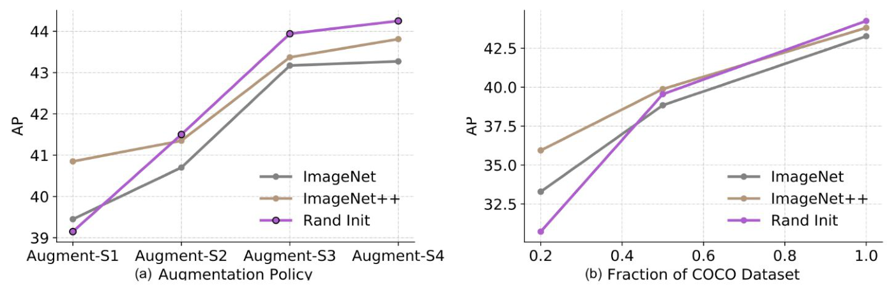
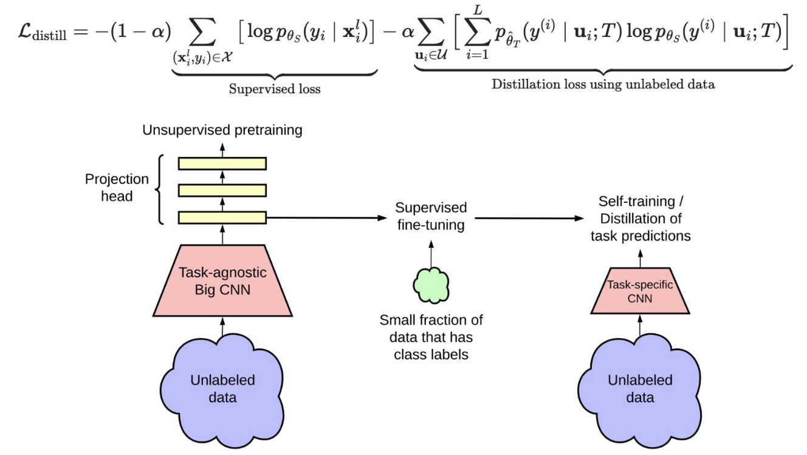

<!-- DRAFT | lecture: 07_Semi_Supervised_Learning_II | chunk: 08 | pages 56–63 -->
<!-- VERIFIED | fixes: 5 | verifier: sonnet -->

## Combined with Powerful Pre-Training: Overview (p.56)

슬라이드 텍스트:
- Combined with Powerful Pre-Training
  - Recent studies show that self-supervised pre-training and semi-supervised learning are highly complementary.
  - Key Observations
    - Pre-training provides a strong feature representation.
    - Semi-supervised learning further adapts the model using limited labeled data.
    - Combining both often achieves better performance than either approach alone.
  - Practical Implications
    - SSL is not a replacement for pre-training.
    - Modern vision systems often use both:
      - Self-supervised pre-training
      - Semi-supervised fine-tuning
- 하단 요약문: "Pre-training learns general representations, while semi-supervised learning adapts them to downstream tasks with limited annotations."

**설명**
- 지금까지 본 SSL(pseudo-labeling, consistency 등)은 **from scratch**로 labeled + unlabeled를 같이 쓰는 방법들이었는데, 이 슬라이드부턴 **"그럼 big pre-trained model이 있으면 SSL은 의미가 없나?"** 에 대한 답. 결론은 **아니다, 서로 보완(complementary)** 이라는 것.
- 역할 분담이 핵심: **pre-training = general representation** (task-agnostic, 대규모 unlabeled/다른 데이터에서), **SSL = downstream task에 adapt** (소량 label + unlabeled 활용).
- **"SSL is not a replacement for pre-training"** ← 시험에서 "SSL makes pre-training unnecessary" 같은 지문으로 비틀 수 있음 (False).
- 현대 vision system 파이프라인 = **Self-supervised pre-training → Semi-supervised fine-tuning**. (p.59~60에서 3-step으로 구체화)
> 보충: p.56 자체엔 인용이 없고, 이어지는 p.57–58의 Zoph et al.과 p.59–61의 SimCLRv2 (Chen et al.)가 이 주장의 근거 논문으로 제시됨.

---

## Zoph et al.: Strong Augmentation & Labeled Data Size (p.57)

슬라이드 텍스트:
- Source: Zoph, et. al., NeurIPS 2020, Rethinking Pre-training and Self-training
- 그림: 두 개의 line plot (y축 모두 **AP**), 세 곡선 = **ImageNet** (회색, ImageNet pre-training), **ImageNet++** (갈색), **Rand Init** (보라색, pre-training 없이 random init).
  - (a) **Augmentation Policy** (x축: Augment-S1, S2, S3, S4 — 오른쪽일수록 stronger augmentation). 대략 값: S1에서 Rand Init ≈ 39.2 < ImageNet ≈ 39.5 < ImageNet++ ≈ 40.8; S2에서 세 곡선이 ≈ 40.7 (ImageNet) / 41.4 (ImageNet++) / 41.5 (Rand Init)로 거의 만남; S3에서 Rand Init ≈ 43.9 > ImageNet++ ≈ 43.4 > ImageNet ≈ 43.2; S4에서 Rand Init ≈ 44.2 > ImageNet++ ≈ 43.8 > ImageNet ≈ 43.3.
  - (b) **Fraction of COCO Dataset** (x축 0.2, 0.5, 1.0). 0.2에서 Rand Init ≈ 30.7 ≪ ImageNet ≈ 33.3 < ImageNet++ ≈ 35.9; 0.5에서 ≈ 39.5 (Rand Init) / 38.8 (ImageNet) / 39.9 (ImageNet++)로 근접; 1.0에서 Rand Init ≈ 44.2 > ImageNet++ ≈ 43.8 > ImageNet ≈ 43.3 (Rand Init가 오히려 최고).
- (Left) Effect of Strong Data Augmentation
  - As augmentation becomes stronger, the benefit of pre-training decreases.
  - Strong augmentation can partially compensate for the lack of pre-training.
- (Right) Effect of Labeled Data Size
  - Pre-training is most beneficial when labeled data are scarce.
  - As more labeled data become available, the performance gap gradually narrows.

**설명**
- 이 실험은 **object detection (COCO)** 에서 "ImageNet pre-training이 정말 도움이 되나"를 본 것 (AP = average precision이라 높을수록 좋음).
- **(a) Augmentation 강도 ↑ → pre-training 이득 ↓**:
  - 가장 약한 S1에서는 pre-trained(ImageNet, ImageNet++)가 Rand Init보다 확실히 높음 (특히 ImageNet++ +1.7 AP 정도).
  - augmentation을 세게 하면 Rand Init가 **빠르게 올라가서** S3~S4에서는 오히려 pre-trained를 **앞지름** ← 강한 augmentation이 **regularization** 역할을 해서 pre-training이 주던 "과적합 방지/좋은 prior" 이득을 대신하기 때문.
  - 슬라이드 문구는 "partially compensate"라고 순화했지만 그림 상으론 S3·S4에서 Rand Init가 최고.
- **(b) Labeled data 비율**:
  - 20% 데이터에선 Rand Init가 pre-trained보다 **큰 폭으로 낮음** (≈ 30.7 vs 33.3~35.9) → **label이 적을수록 pre-training이 중요**.
  - 데이터가 늘수록 격차가 **좁아지고** (100%에선 역전) → label이 충분하면 pre-training 이득 감소.
- 두 축을 합친 직관: pre-training은 **"데이터/regularization이 부족할 때 그 빈자리를 메우는 prior"** 라서, 부족함이 사라질수록 (더 많은 label, 더 강한 augmentation) 이득이 줄어듦.
- 이 그림 자체는 **pre-training의 한계**를 보여주는 것 → 다음 p.58에서 "그럼 self-training은?"으로 이어짐.
> 보충: ImageNet++는 슬라이드에 정의가 없음. 논문에선 일반 ImageNet pre-training보다 더 강한(더 높은 ImageNet 정확도의) pre-trained checkpoint로 기억되지만 확실하지 않음 → 시험은 "ImageNet vs Rand Init" 대비 위주로 보면 충분.

---

## Zoph et al.: Key Findings (p.58)

슬라이드 텍스트:
- Source: Zoph, et. al., NeurIPS 2020, Rethinking Pre-training and Self-training
- Key Findings
  - **Pre-training** is most <u>beneficial</u> when labeled data are **scarce**.
    - Its benefit gradually diminishes as more labeled data become available.
  - **Self-training** remains **effective** even with <u>strong augmentation</u> and <u>abundant labeled data</u>.
    - It can improve performance beyond pre-training alone.
  - Pre-training and self-training are **complementary**.
    - Combining both generally yields better performance than using either individually.
  - Task **mismatch** <u>limits</u> the effectiveness of pre-training.
    - Joint supervised and self-supervised training helps reduce this mismatch.
  - **Self-training** is computationally more <u>expensive</u> than conventional fine-tuning.

**설명**
- p.57 결과를 4 + 1 포인트로 정리한 슬라이드. 정리하면:
  1. **Pre-training**: label 적을 때 ↑↑, label 많아지면 이득 ↓ (p.57 right).
  2. **Self-training**: pre-training과 달리 **strong augmentation, abundant labeled data에서도 계속 효과** → pre-training만으로 도달 못하는 성능 가능. ← pre-training의 이득은 사라지는 조건(p.57)에서도 self-training은 살아남는다는 **대비**가 핵심.
  3. **Complementary**: 둘을 같이 쓰면 보통 각각보다 낫다.
  4. **Task mismatch**: pre-training task (예: ImageNet classification)와 downstream task (예: detection/segmentation)가 다르면 pre-training 효과 제한. **Joint supervised + self-supervised training**이 이 mismatch를 줄임.
  5. **Cost**: self-training은 teacher로 pseudo label을 만들고 student를 다시 학습해야 해서 **일반 fine-tuning보다 계산량 큼**.
- 시험 관점: "~는 ~할 때 가장 유용" 형태의 T/F가 나오기 쉬움. **조건(scarce ↔ abundant)과 방법(pre-training ↔ self-training)을 뒤바꾼 지문**에 주의.
> 보충: Zoph et al. 논문(NeurIPS 2020)은 COCO object detection / PASCAL segmentation 등에서 ImageNet pre-training과 self-training을 비교한 연구로, 슬라이드 요약의 "task mismatch"는 ImageNet classification pre-training이 detection 등에 항상 맞지는 않는다는 논지. (슬라이드 외 일반 지식)

---

## Towards Modern Learning Paradigms: Three-Step Procedure (p.59, p.60)

> p.59와 p.60은 **슬라이드 내용이 완전히 동일** (중복 페이지). 아래는 한 번만 정리.

슬라이드 텍스트:
- Source: Chen, et. al., NeurIPS 2020, Big Self-Supervised Models are Strong Semi-Supervised Learners
- Recent vision systems combine pre-training, fine-tuning, and self-training into a unified pipeline.
- Three-Step Procedure
  - 1. **Self-Supervised Pre-training**
    - Learn general visual representations from large-scale unlabeled data.
    - Build a strong task-agnostic backbone.
  - 2. **Supervised Fine-tuning**
    - Adapt the pretrained model using a small labeled dataset.
    - Larger models typically benefit more from pre-training.
  - 3. **Self-Training**
    - Generate pseudo labels for additional unlabeled data.
    - Further improve task-specific performance through knowledge distillation.
- Key Insight
  - **Pre-training learns general representations**, **fine-tuning adapts them to the target task**, and **self-training further exploits unlabeled data for additional gains**.

**설명**
- 이게 **SimCLRv2**의 3단계 recipe ("**unsupervised pretrain → supervised fine-tune → distill with unlabeled data**"):
  1. **Self-supervised pre-training**: label 없이 대규모 unlabeled data로 **task-agnostic big backbone** 학습 (SimCLR식 contrastive learning).
  2. **Supervised fine-tuning**: 소량 labeled data로 task에 맞춤. **큰 모델일수록 pre-training 이득이 큼** ← "big self-supervised models" 라는 논문 제목의 의미. label이 적을수록 모델이 클수록 더 label-efficient.
  3. **Self-training (distillation)**: fine-tune된 모델 = **teacher**, 이걸로 **unlabeled data에 pseudo label**을 만들고 (task-specific) **student**를 학습 → "knowledge distillation".
- Pseudo-labeling(이 강의 앞 파트)과의 연결: 3단계는 **pseudo-labeling을 teacher→student distillation 형태로 한 것**. 단 hard label이 아니라 **teacher의 soft prediction(temperature T 적용)** 을 target으로 씀 (p.61 식).
- Key insight 한 문장은 그대로 외울 것: pre-training = general, fine-tuning = adapt to target, self-training = extra gains from unlabeled data.
> 보충: SimCLRv2 논문(Chen et al., NeurIPS 2020)은 pre-training에서 **더 깊고 넓은 ResNet** 사용, **projection head를 더 깊게(3-layer)** 하고 fine-tuning 시 head 첫 층부터 사용, 마지막에 distillation에 unlabeled data 활용 — 이 세 가지가 주요 변경점으로 알려져 있음 (슬라이드 외 일반 지식, 시험 비중 낮음). 슬라이드엔 p.61 그림에서 projection head 층만 시각적으로 나옴.

---

## SimCLRv2: Pipeline & Distillation Loss (p.61)

슬라이드 텍스트:
- Source: Chen, et. al., NeurIPS 2020, Big Self-Supervised Models are Strong Semi-Supervised Learners
- 수식:
$$\mathcal{L}_{\text{distill}} = -(1-\alpha)\sum_{(\mathbf{x}_i^l, y_i)\in\mathcal{X}}\Big[\log p_{\theta_S}(y_i\mid \mathbf{x}_i^l)\Big] \;-\; \alpha\sum_{\mathbf{u}_i\in\mathcal{U}}\Big[\sum_{i=1}^{L} p_{\hat\theta_T}(y^{(i)}\mid \mathbf{u}_i;T)\,\log p_{\theta_S}(y^{(i)}\mid \mathbf{u}_i;T)\Big]$$
  - 첫 항 밑 label: **Supervised loss**
  - 둘째 항 밑 label: **Distillation loss using unlabeled data**
- 그림 (pipeline, 왼쪽→오른쪽):
  - 왼쪽: **Unlabeled data** (구름) → **Task-agnostic Big CNN** (분홍 사다리꼴) → **Projection head** (노란 박스 3개 stack) → 위쪽 화살표 "**Unsupervised pretraining**".
  - 가운데: 맨 아래 projection head 층에서 나온 화살표 → "**Supervised fine-tuning**", 아래에서 "**Small fraction of data that has class labels**" (초록 구름)가 입력.
  - 오른쪽: "**Self-training / Distillation of task predictions**", **Task-specific CNN** (작은 분홍 사다리꼴) 아래에 **Unlabeled data**.

**설명**
- **그림**: 3-step이 그대로 시각화됨. 핵심 디테일 둘:
  - fine-tuning은 **projection head 전체가 아니라 그 일부(첫 층, 그림에서 가장 아래 노란 박스)에서 시작** ← 그림의 화살표가 맨 아래 박스에서 나감. (SimCLRv2의 "fine-tune from a middle layer of projection head" 설계; 슬라이드엔 말로 설명 없음)
  - 마지막 단계에서 **big task-agnostic CNN과 다른 작은 "Task-specific CNN"** 을 쓰는 건 **distillation의 student**가 더 작을 수도 있기 때문 (큰 모델 → 작은 모델로 지식 이전, 또는 같은 크기로 self-distillation).
- **수식 읽기**:
  - $\theta_S$ = **student** 파라미터, $\hat\theta_T$ = **teacher** 파라미터 (hat은 teacher가 고정/학습된 값임을 암시, 즉 gradient가 student쪽으로만).
  - **첫 항 (supervised)**: labeled $(\mathbf{x}^l_i, y_i)\in\mathcal{X}$ 에 대한 **cross-entropy** $-\log p_{\theta_S}(y_i|\mathbf{x}_i^l)$. ($y_i$ 가 true class일 때 one-hot CE와 같음.)
  - **둘째 항 (distillation)**: unlabeled $\mathbf{u}_i\in\mathcal{U}$ 에 대해 **teacher의 soft label $p_{\hat\theta_T}(y^{(i)}|\mathbf{u}_i;T)$ 를 target으로, student의 $\log p_{\theta_S}$ 와 곱해 클래스 $L$개에 대해 합** → 이건 **soft target cross-entropy** $-\sum_c p_T(c)\log p_S(c)$ 와 동일 (KL과 teacher entropy 상수만큼 차이이므로 gradient는 같음).
  - **$T$** = **temperature**: softmax $p(y^{(i)}|\mathbf{u};T)=\exp(z_i/T)/\sum_j\exp(z_j/T)$. teacher와 student 모두 같은 $T$ 사용 (식에 둘 다 ";T").
  - **$\alpha$** = 두 loss의 **가중치** (balance). $(1-\alpha)$ supervised, $\alpha$ distillation. 식에 마이너스가 앞에 붙어 있는 건 log-likelihood를 **minimize할 loss**로 바꾼 것.
- **왜 이렇게 설계?**
  - hard pseudo-label (argmax)을 쓰면 teacher의 불확실성 정보가 날아가고 잘못된 label을 확신하게 됨 → **soft label distillation**은 클래스 간 유사도 정보("dark knowledge")를 student에 전달.
  - 같은 unlabeled set에서 label이 **없어도** loss 계산 가능 (teacher가 label 대신). 즉 label 정보는 teacher를 거쳐 간접적으로 전해짐.
  - labeled 항을 같이 둬서 true label 신호도 유지.
- **노트 맥락의 비교**: 앞 파트 FixMatch류는 **hard pseudo-label + confidence threshold $\tau$**, SimCLRv2는 **soft pseudo-label (teacher distribution) + temperature $T$, threshold 없음**. (슬라이드에 threshold 언급 없음)
> 보충: 슬라이드 식에서 inner sum의 인덱스가 $i$ 로 바깥 샘플 인덱스 $\mathbf{u}_i$ 의 $i$ 와 겹침 ← 표기 중복(오타 수준)이라 **클래스 인덱스 $i=1..L$** 로 읽어야 함. $L$은 클래스 수로 읽으면 됨 (슬라이드엔 정의 없음, 문맥상 추정).
> 보충: 슬라이드 p.59–61엔 "teacher/student"라는 단어가 직접 나오지 않고 식의 $\theta_S$, $\hat\theta_T$ 표기로만 등장 (fine-tuned 모델 = teacher는 논문 기준 해석).
> 보충: 논문에선 distillation을 **unlabeled data만 쓰는 버전**($\alpha=1$ 상당)과 **labeled + unlabeled 버전** 둘 다 소개. 슬라이드는 혼합 버전 수식. 또한 student가 teacher와 **같은 구조일 때 self-distillation**, 더 작을 때 **big-to-small distillation**으로 부름. (슬라이드 외 일반 지식)

---

## Common Design Principles in Modern SSL Methods (p.62)

슬라이드 텍스트:
- Towards Modern Learning Paradigms
- Common design principles in modern SSL methods
  - **Strong and diverse data augmentation** (UDA, ReMixMatch, FixMatch)
  - **Confidence-based pseudo-label filtering** (FixMatch)
  - **MixUp for regularization** (MixMatch, Arazo et al.)
  - **A minimum number of labeled samples per mini-batch** (Arazo et al.)
  - **Sharpening the pseudo-label distribution** (MixMatch, ReMixMatch)

**설명**
- Consistency regularization(06)과 pseudo-labeling(07 앞부분) 방법들을 가로질러 **공통으로 나오는 5개 요소**를 정리한 슬라이드. **"원칙 ↔ 대표 방법" 매칭**이 시험 포인트.

| Design principle | 대표 방법 | 왜 / 직관 |
|---|---|---|
| Strong & diverse augmentation | UDA, ReMixMatch, FixMatch | 약한 perturbation만으론 consistency target이 너무 쉬워서 정보가 적음; 강한 변형에도 같은 예측을 하라고 요구하면 더 큰 regularization 효과 (p.57에서도 strong augmentation이 pre-training을 대체) |
| Confidence-based pseudo-label filtering | FixMatch | confidence가 threshold $\tau$ 이상인 예측만 pseudo-label로 → **noisy label의 confirmation bias** 완화 |
| MixUp for regularization | MixMatch, Arazo et al. | 입력/label을 $\lambda$로 섞어 decision boundary를 smooth하게 → 잘못된 pseudo label의 memorization 방지 |
| Minimum number of labeled samples per mini-batch | Arazo et al. | 미니배치에 unlabeled만 있으면 pseudo-label 오류가 증폭되며 collapse/drift 가능 → 매 배치에 **최소 k개 labeled 보장** |
| Sharpening pseudo-label distribution | MixMatch, ReMixMatch | 낮은 temperature로 분포를 뾰족하게 → **entropy minimization** 효과(low-density separation, H3) |

- 주의할 매칭: **Confidence filtering = FixMatch** (MixMatch 아님), **Sharpening = MixMatch, ReMixMatch** (FixMatch는 hard label + threshold), **Min labeled per batch = Arazo et al.**, **MixUp = MixMatch + Arazo et al.**
> 보충: Arazo et al. = "Pseudo-Labeling and Confirmation Bias in Deep Semi-Supervised Learning" (IJCNN 2020)로 알려져 있음; 슬라이드에는 연도/제목 없음. 위 표의 "왜/직관" 열은 슬라이드 외 일반적인 해설이며 슬라이드 원문은 방법 이름 나열만 있음.

---

## Conclusion Slide (p.63)

슬라이드 텍스트:
- Towards Modern Learning Paradigms
- Today's state-of-the-art models rarely rely on a single learning paradigm.
- Instead, they integrate **self-supervised pre-training, supervised fine-tuning, and semi-supervised self-training** into a unified training pipeline.

**설명**
- **강의 07 전체의 take-home message**: SOTA는 **하나의 paradigm만 쓰지 않음**. **SSL pre-training + supervised fine-tuning + semi-supervised self-training**을 한 파이프라인으로 합침.
- p.56 (complementary) → p.57–58 (Zoph: pre-training과 self-training 상호보완) → p.59–61 (SimCLRv2: 그 3단계 구현) → p.62 (공통 설계 요소) → p.63 (결론)으로 흐름이 이어짐.
- 앞서 배운 SSL(consistency / pseudo-label)이 사라진 게 아니라 **마지막 self-training 단계의 부품**으로 들어간다는 그림.

---

## FIGURES

- p.57: Zoph et al. 두 개 AP plot — (a) augmentation 강도 vs AP, (b) COCO fraction vs AP. 세 곡선(ImageNet / ImageNet++ / Rand Init). 중요도 중상. `assets/lecture07/p057_zoph_curves.png`
- p.61: SimCLRv2 pipeline 그림 + $\mathcal{L}_{\text{distill}}$ 수식. 중요도 상. `assets/lecture07/p061_simclrv2_pipeline.png`
- p.59/60: 3-step procedure bullet (텍스트만, 이미지 없음; 두 페이지 내용 동일). 중요도 상 (텍스트로 충분)
- p.62: 공통 design principle 5개 ↔ 방법 이름 매칭. 중요도 상 (텍스트로 충분)

## EXAM POINTS

1. **Pre-training과 SSL은 complementary** (p.56): "SSL is not a replacement for pre-training." 현대 시스템은 self-supervised pre-training + semi-supervised fine-tuning 사용. **트랩**: "SSL makes pre-training unnecessary" → False.
2. **Pre-training이 가장 유용한 조건** (p.57–58): **labeled data가 scarce할 때**; label이 많아질수록 이득 diminish. **트랩**: "pre-training benefit grows as labeled data increases" → False.
3. **Strong augmentation의 효과** (p.57): augmentation이 강해질수록 pre-training의 benefit **감소** (strong augmentation이 pre-training 부재를 부분적으로 보상). **트랩**: stronger ↔ weaker 뒤바꾸기 / "benefit increases".
4. **Self-training은 strong augmentation과 abundant labeled data에서도 effective** (p.58) → pre-training alone보다 성능 향상 가능. pre-training은 그 조건에서 이득이 줄어든다는 것과 **대비**해서 출제될 가능성. **트랩**: self-training ↔ pre-training 주어 바꾸기.
5. **Pre-training + self-training = complementary** (p.58): 둘을 합친 것이 보통 각각보다 낫다. **Task mismatch**가 pre-training 효과를 제한; **joint supervised + self-supervised training**이 mismatch를 줄임. Self-training은 conventional fine-tuning보다 **computationally expensive**.
6. **3-step procedure (SimCLRv2, Chen et al. NeurIPS 2020)** (p.59–60): (1) Self-supervised pre-training (task-agnostic backbone, unlabeled data) → (2) Supervised fine-tuning (small labeled set; **larger models benefit more**) → (3) Self-training (pseudo labels for unlabeled data via **knowledge distillation**). **트랩**: 순서 바꾸기, "supervised pre-training"으로 바꾸기, "smaller models benefit more".
7. **Key insight 문장** (p.59): pre-training = general representations, fine-tuning = adapt to target task, self-training = exploit unlabeled data for extra gains.
8. **$\mathcal{L}_{\text{distill}}$ 구조** (p.61): $-(1-\alpha)\sum_{\mathcal{X}}\log p_{\theta_S}(y_i|\mathbf{x}^l_i)$ (**supervised CE on labeled**) $-\ \alpha\sum_{\mathcal{U}}\sum_{c}p_{\hat\theta_T}(c|\mathbf{u};T)\log p_{\theta_S}(c|\mathbf{u};T)$ (**distillation: teacher soft prediction이 target, student가 맞춤**). $\theta_S$ = student, $\theta_T$ = teacher, $T$ = temperature, $\alpha$ = 가중치. **트랩**: student ↔ teacher, supervised ↔ distillation 항 뒤바꾸기, hard label vs soft label (SimCLRv2는 **soft**), "labels are required for the distillation term" (False, unlabeled data에 teacher 예측 사용).
9. **그림 상 detail** (p.61): "Unsupervised pretraining"에 **projection head**, fine-tuning은 labeled 소량 데이터, 마지막 단계에서 **Task-specific CNN**이 unlabeled data로 distillation. 큰 모델(**Task-agnostic Big CNN**) → 작은 task-specific CNN으로 지식 이전 가능.
10. **Common design principles 5개 ↔ 방법 매칭** (p.62): Strong & diverse augmentation = **UDA, ReMixMatch, FixMatch**; Confidence-based pseudo-label filtering = **FixMatch**; MixUp = **MixMatch, Arazo et al.**; Minimum # labeled samples per mini-batch = **Arazo et al.**; Sharpening = **MixMatch, ReMixMatch**. **트랩**: "which is NOT..." 유형 — 예: "Sharpening in FixMatch" / "confidence filtering in MixMatch" 같이 방법 이름 바꾸기.
11. **결론** (p.63): SOTA는 rarely rely on a single paradigm → self-supervised pre-training + supervised fine-tuning + semi-supervised self-training 통합 파이프라인.
12. **p.59 vs p.60**: 두 페이지 내용 동일 → 같은 문장이 어느 쪽에서 나와도 출처는 Chen et al. NeurIPS 2020. **출처 매칭** 트랩: p.57–58 = Zoph et al. (*Rethinking Pre-training and Self-training*), p.59–61 = Chen et al. (*Big Self-Supervised Models are Strong Semi-Supervised Learners*), 둘 다 NeurIPS 2020.
13. **ImageNet++ / Rand Init** (p.57): 세 곡선은 ImageNet / ImageNet++ / Rand Init, y축은 AP. **트랩**: "Rand Init가 항상 가장 낮다" → False (S3–S4, 100% COCO에서 최고). "Strong augmentation은 pre-training 이득을 키운다" → False.
14. **수치** (p.57, 비중 낮음): S1(가장 약한 aug)에서는 pre-trained가 Rand Init보다 AP 높음, S3–S4에서는 Rand Init가 가장 높음 (≈ 44 AP); 20% COCO에서는 Rand Init ≈ 30.7 AP로 pre-trained(33~36)보다 크게 낮고, 100%에서는 격차가 사라지거나 역전. 정확한 수치보다 **추세 방향**이 중요.
