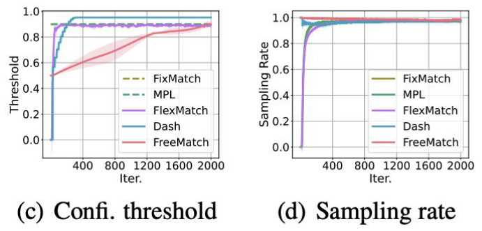
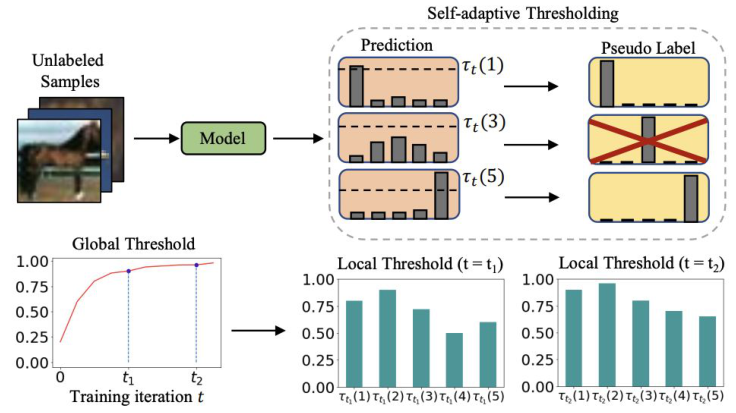
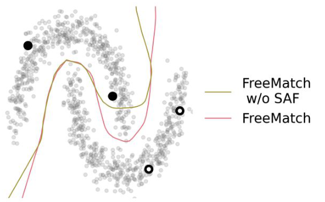
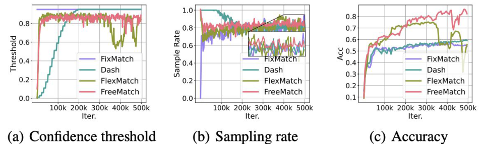
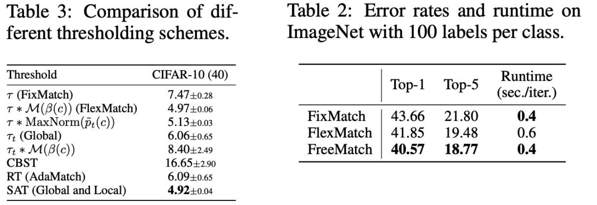

<!-- DRAFT | lecture: 07_Semi_Supervised_Learning_II | chunk: 09 | pages 64–75 -->
<!-- VERIFIED | fixes: 8 | verifier: sonnet -->

## Section: Should the confidence threshold remain fixed throughout training? (p.64)

슬라이드 텍스트:
- (섹션 구분 슬라이드, 진한 남색 배경) "Should the confidence threshold remain fixed throughout training?"

**설명**
- 여기서부터 **FreeMatch** 파트. 앞의 FixMatch가 쓰던 **고정 confidence threshold $\tau$ (=0.95)** 가 정말 최선인가? 라는 질문으로 시작.
- 이 질문이 이 chunk 전체를 관통함: **threshold를 hyperparameter가 아니라 학습 과정의 일부로 만들자**.

---

## FreeMatch paper (p.65)

슬라이드 텍스트:
- 논문 첫 페이지 캡처: "Published as a conference paper at ICLR 2023" — **FreeMatch: Self-adaptive Thresholding for Semi-supervised Learning**
- 저자: Yidong Wang, Hao Chen, Qiang Heng, Wenxin Hou, Yue Fan, Zhen Wu, Jindong Wang, Marios Savvides, Takahiro Shinozaki, Bhiksha Raj, Bernt Schiele, Xing Xie (Microsoft Research Asia, Tokyo Tech, CMU, NC State, Max-Planck-Institut für Informatik, Nanjing Univ. 등)
- 하단 인용: "Wang, et. al., ICML 2023, FreeMatch: Self-adaptive Thresholding for Semi-supervised Learning" ← 오타?: 캡처 이미지는 **ICLR 2023**인데 슬라이드 하단 인용은 **ICML 2023**이라 서로 불일치.

**설명**
- 논문 제목에 **Self-adaptive Thresholding**이 핵심 키워드로 박혀 있음 → 방법 이름(SAT)과 연결.
- 시험에서 venue를 묻는다면 혼동 소지가 있지만, 논문 원본 기준은 **ICLR 2023**.
> 보충: 실제 FreeMatch는 ICLR 2023 논문이 맞음 (슬라이드 하단의 "ICML"이 오타로 보임).

---

## Should the Confidence Threshold Remain Fixed? (p.66)

슬라이드 텍스트:
- FixMatch uses a fixed confidence threshold.
  - The same threshold is used throughout training.
  - The same threshold is used for every class.
  - Low-confidence samples are excluded from training.
- 수식 (FixMatch loss):
$$\mathcal{L}_s = \frac{1}{B}\sum_{b=1}^{B} \mathrm{CE}\big[y_b,\ p_\theta(y \mid \mathcal{A}_{\text{weak}}(\mathbf{x}_b))\big]$$
$$\mathcal{L}_u = \frac{1}{\mu B}\sum_{b=1}^{\mu B} \mathbb{1}\big[\max(\hat y_b) \ge \tau\big]\ \mathrm{CE}\big(\hat y_b,\ p_\theta(y \mid \mathcal{A}_{\text{strong}}(\mathbf{u}_b))\big)$$
- where $\hat y_b$ is the pseudo label for an unlabeled example; $\mu$ is a hyperparameter that determines the relative sizes of $\mathcal{X}$ and $\mathcal{U}$.
- Weak augmentation $\mathcal{A}_{\text{weak}}(\cdot)$: A standard flip-and-shift augmentation
- Strong augmentation $\mathcal{A}_{\text{strong}}(\cdot)$: AutoAugment, Cutout, RandAugment, CTAugment
- 하단 질문: "Should the confidence threshold remain fixed as the model improves?"

**설명**
- FixMatch 복습: labeled batch $B$개엔 **weak augmentation** + CE ($\mathcal{L}_s$), unlabeled batch $\mu B$개엔 **weak view의 예측으로 pseudo-label $\hat y_b$를 만들고, 그 confidence가 $\tau$ 이상일 때만** **strong augmentation view**가 그 pseudo-label을 맞추도록 CE ($\mathcal{L}_u$).
- $\mathbb{1}[\max(\hat y_b)\ge\tau]$ = **mask**. $\max(\hat y_b)$ 는 모델이 가장 높게 본 클래스의 확률 = **confidence**. $\tau$ 미만이면 그 sample은 loss에서 **제외(low-confidence samples are excluded)**.
- 문제 제기: 이 $\tau$가 (1) **학습 내내 동일**, (2) **모든 클래스에 동일**, (3) 사람이 수동으로 정함. 모델은 학습하면서 계속 변하는데 기준이 고정이라는 게 이상하지 않냐는 것.
- $\mu$: unlabeled batch가 labeled batch의 $\mu$배라는 뜻 (그래서 $\mathcal{L}_u$는 $\mu B$로 평균).
> 보충: FixMatch 논문에서 보통 $\tau=0.95$, $\mu=7$. 슬라이드 수식에서 $\hat y_b$는 마스크에선 확률벡터(max를 취함), CE에선 target으로 쓰이는데, FixMatch에서는 이 target이 **hard label** ($\arg\max$의 one-hot).

---

## The Problem with a Fixed Threshold (p.67)

슬라이드 텍스트:
- Early training
  - Model confidence is still low.
  - A high threshold rejects most unlabeled samples.
  - The model receives little unsupervised supervision.
- Later training
  - Model confidence becomes higher.
  - A higher threshold helps filter incorrect pseudo-labels.
  - Different classes may require different thresholds.
- 그림 (오른쪽, 논문 Fig.1 (c),(d)):
  - 설명 텍스트: "FixMatch: Fixed at 0.95 throughout training" / "FreeMatch: Starts with a low threshold — The threshold increases as the model's confidence rises"
  - (c) **Confi. threshold** — x축 Iter. (0~2000), y축 Threshold (0~1.0). FixMatch/MPL은 수평선(점선, 그림상 ~0.9) ← 슬라이드 텍스트는 "Fixed at 0.95"인데 그림의 FixMatch 점선은 ~0.9 부근 (불일치, 시험은 텍스트 기준 0.95), FlexMatch(~0.9)·Dash(~0.95)는 0에서 출발해 초반에 급상승 후 고정, **FreeMatch(빨강)는 ~0.5에서 시작해 완만하게 ~0.9까지 점진 상승** (음영 = 변동 범위, 2000 iter까지).
  - (d) **Sampling rate** — x축 Iter. (0~2000), y축 0~1.0. FreeMatch는 처음부터 ~1.0, 나머지(FixMatch/MPL/FlexMatch/Dash)는 0 근처에서 출발해 빠르게 ~1.0으로 수렴.
- 하단: "The desirable threshold depends on the model's learning status."

**설명**
- **Trade-off 구조**가 핵심:
  - **초반**: 모델이 아직 못 맞힘 → confidence 자체가 낮음 → **높은 고정 threshold(0.95)는 거의 모든 unlabeled sample을 reject** → unlabeled data가 학습에 거의 안 쓰임 (**low quantity**, $\mathcal{L}_u\approx 0$).
  - **후반**: 모델이 자신감 있음 → **높은 threshold가 틀린 pseudo-label을 걸러줌** (**quality** 확보). 그래서 후반엔 높은 threshold가 좋음.
  - 따라서 **"좋은 threshold는 모델의 learning status에 따라 달라진다"** → 초반엔 낮게, 후반엔 높게 = **threshold가 시간에 따라 증가**해야 함.
- 클래스마다 학습 난이도가 다르므로 **class별로 다른 threshold**도 필요 → p.70.
- 그림: FreeMatch만 ~0.5의 낮은 값에서 출발해 점진적으로 오름. FixMatch는 처음부터 고정. 이 그림(Fig.1 c,d 기준)의 sampling rate는 FreeMatch가 처음부터 ~1.0이라 초반 quantity 이점이 보임.
> 보충: Dash는 사전에 정한 schedule로 threshold를 조정하고, FlexMatch는 class별 학습 상태로 threshold를 scale하는 기존 방법들. 슬라이드엔 방법별 상세 없음.

---

## FreeMatch: Two Components (p.68)

슬라이드 텍스트:
- FreeMatch contains two main components.
- **Self-Adaptive Thresholding, SAT**
  - Estimates the model's learning status
  - Adjusts the global threshold over time
  - Assigns a different threshold to each class
- **Self-Adaptive Fairness, SAF**
  - Prevents predictions from concentrating on a few classes
  - Encourages diverse class predictions
- 그림 (논문 Fig.2 "Self-adaptive Thresholding"):
  - 위: Unlabeled Samples (말 이미지) → Model → class별 **Prediction** bar chart 3개, 각각 dashed line으로 $\tau_t(1)$, $\tau_t(3)$, $\tau_t(5)$ → **Pseudo Label**: class 1은 통과, **class 3은 빨간 X로 reject** (그림상 예측 bar가 $	au_t(3)$ dashed line 아래로 보임), class 5는 통과.
  - 아래 왼쪽: **Global Threshold** — x축 Training iteration $t$, y축 0~1.0, 빨간 곡선이 ~0.2에서 시작해 빠르게 올라 ~0.95+ 로 포화 ($t_1, t_2$ 표시).
  - 아래 오른쪽: **Local Threshold ($t=t_1$)** 5개 class bar (대략 0.8, 0.9, 0.72, 0.5, 0.6), **Local Threshold ($t=t_2$)** (대략 0.9, 0.95, 0.8, 0.7, 0.65) → 시간이 지나며 전체적으로 올라가고 class별 편차가 줄어듦.
- 하단: "The model determines its thresholds from predictions on unlabeled data."

**설명**
- FreeMatch = **SAT (pseudo-label을 선택할 threshold를 자동 조절) + SAF (선택이 소수 class로 쏠리지 않게 regularize)**.
- SAT는 두 층위: **global threshold** (시간에 따른 전체 추세) × **local (class-specific) scaling** (class별 학습 속도 차이).
- **"Free"**: threshold를 사람이 손으로 정하지 않고, **unlabeled data에 대한 모델 자신의 예측 통계**에서 추정 → 수동 tuning 불필요.
- 그림 해석: 같은 sample이라도 **어느 class로 예측했느냐에 따라 적용되는 threshold가 달라짐**. class 3은 threshold가 높아 reject된 예. $t_1\to t_2$에서 local threshold가 전반적으로 상승.
> 보충: 논문 abstract 요지 — 모델의 learning status에 따라 confidence threshold를 self-adaptive하게 조절하고, self-adaptive class fairness regularization penalty로 학습 초기에 다양한 class 예측을 장려. 라벨이 극소수일 때 효과가 크다고 주장.

---

## Self-Adaptive Global Threshold (p.69)

슬라이드 텍스트:
- Compute the average confidence of unlabeled samples.
- Accumulate it with an exponential moving average.
- Use the result as the global threshold.
- The threshold increases as the model becomes more confident.
$$\tau_t=\begin{cases}\dfrac{1}{C}, & \text{if } t=0,\\[2mm] \lambda\,\tau_{t-1}+(1-\lambda)\dfrac{1}{\mu B}\sum_{b=1}^{\mu B}\max(q_b), & \text{otherwise,}\end{cases}$$
- $C$: number of classes
- $t$: training iteration
- $q_b$: prediction on a weakly augmented unlabeled image
- $\max(q_b)$: confidence of sample $b$
- $\mu B$: number of unlabeled samples in the minibatch
- $\lambda$: EMA momentum
- $\tau_t$: global threshold at iteration $t$
- 하단: "The global threshold follows the model's overall confidence."

**설명**
- **초기값 $\tau_0 = 1/C$**: $C$개 class에서 **uniform 분포일 때의 confidence** (= 완전 무지 상태). 즉 처음엔 거의 모든 sample을 통과시킴 (예: CIFAR-10이면 $0.1$).
- **업데이트 (EMA)**: 현재 minibatch의 **평균 confidence** $\bar c_t = \frac{1}{\mu B}\sum_b \max(q_b)$ 를 계산해 $\tau_t = \lambda\tau_{t-1} + (1-\lambda)\bar c_t$.
  - 전개하면 $\tau_t$ = 과거 batch 평균 confidence들의 **지수 가중 평균**. 모델이 학습하며 confidence가 커지면 $\tau_t$도 따라서 **증가**.
  - **EMA를 쓰는 이유**: minibatch 하나의 평균 confidence는 noisy → 매끄럽게 만들어 **threshold가 요동치지 않게** 함. $\lambda$가 클수록 더 느리고 안정적.
- 핵심: **threshold가 사람이 정한 값이 아니라 "모델의 현재 평균 confidence"** 를 그대로 추적. **$q_b$는 weak augmentation view의 예측** (strong 아님) ← 함정 포인트.
- ← 주의: 여기서 EMA는 **threshold(통계량)에 대한 EMA**이지 Mean Teacher의 **weight EMA**가 아님 (L06과 혼동 주의).
> 보충: 논문 기본값은 $\lambda=0.999$로 기억 (슬라이드에는 수치 없음, 확실하지 않음). $\max(q_b)$ 는 label 없이도 계산 가능.

---

## Self-Adaptive Class-Specific Thresholds (p.70)

슬라이드 텍스트:
- Easy classes receive relatively high thresholds.
- Difficult classes receive relatively low thresholds.
- Every class shares the same global learning trend.
- Local scaling accounts for different learning speeds.
$$\tilde p_t(c)=\begin{cases}\dfrac{1}{C}, & \text{if } t=0,\\[2mm] \lambda\,\tilde p_{t-1}(c)+(1-\lambda)\dfrac{1}{\mu B}\sum_{b=1}^{\mu B} q_b(c), & \text{otherwise,}\end{cases}$$
$$\tau_t(c)=\mathrm{MaxNorm}\big(\tilde p_t(c)\big)\cdot\tau_t=\frac{\tilde p_t(c)}{\max\{\tilde p_t(c): c\in[C]\}}\cdot\tau_t,$$
- 하단: "One global threshold is modulated by class-specific learning progress."

**설명**
- **$\tilde p_t(c)$**: class $c$에 대한 **평균 예측 확률의 EMA** = "모델이 class $c$를 얼마나 잘 (자주, 강하게) 예측하는가"를 나타내는 **class별 learning status 추정치**. 초기값 $1/C$ (uniform).
  - global과의 차이: global은 $\max(q_b)$ (스칼라 confidence)의 평균, local은 **class별 확률 $q_b(c)$ 자체**의 평균.
- **MaxNorm**: $\tilde p_t(c)$ 를 **가장 큰 값으로 나눠서** 최댓값 1로 정규화 → 가장 잘 학습된 class는 비율 1, 나머지는 $<1$.
- **최종 threshold**: $\tau_t(c)=\text{(비율)}\times\tau_t$.
  - **가장 잘 학습된 (easy) class** → 비율 1 → $\tau_t(c)=\tau_t$ (**가장 높음 = global threshold 그대로**).
  - **덜 학습된 (difficult) class** → 비율 $<1$ → **낮은 threshold** → 더 쉽게 pseudo-label을 받아 학습 기회를 얻음.
- **직관**: **global $\tau_t$ = 전체 추세 (시간축)**, **MaxNorm 비율 = class별 상대 속도 (class축)**. 어려운 class에 낮은 threshold를 줘서 **그 class의 sample이 계속 배제되는 악순환**을 막음.
- ← 모든 $\tau_t(c)\le\tau_t$: MaxNorm 비율이 $\le1$이므로 class threshold는 global threshold를 **넘지 못함**.
> 보충: 같은 동기의 선행 연구가 FlexMatch (Zhang et al., NeurIPS 2021)의 class별 curriculum threshold. FlexMatch는 고정 $\tau$에 class별 학습효과 함수 $\mathcal{M}(\beta(c))$ 를 곱하는 반면, FreeMatch는 **예측 확률의 EMA만으로** class scaling을 추정 (p.75 표에서 비교 항목으로 등장).

---

## Pseudo-Label Selection in FreeMatch (p.71)

슬라이드 텍스트:
$$\mathcal{L}_u=\frac{1}{\mu B}\sum_{b=1}^{\mu B}\mathbb{1}\big(\max(q_b)>\tau_t(\arg\max(q_b))\big)\cdot\mathcal{H}(\hat q_b,\ Q_b).$$
- 표 (FixMatch vs FreeMatch):

| FixMatch | FreeMatch |
|---|---|
| Fixed tau | Adaptive tau_t(c) |
| Same for all iterations | Changes during training |
| Same for all classes | Different for each class |
| Manually selected | Estimated from unlabeled predictions |

- 하단: "Each sample is evaluated using the threshold of its predicted class."

**설명**
- FixMatch의 $\mathcal{L}_u$와 **형태는 동일**, 단 mask 조건이 $\max(q_b)\ge\tau$ → $\max(q_b)>\tau_t\big(\arg\max(q_b)\big)$ 로 바뀜 (고정 상수 → **예측된 class의 시점 $t$ class-specific threshold**).
  - 순서: weak view 예측 $q_b$ → 예측 class $\hat c=\arg\max q_b$ → 그 class의 threshold $\tau_t(\hat c)$ 와 confidence $\max(q_b)$ 비교 → 통과하면 loss에 포함.
- $\mathcal{H}(\hat q_b, Q_b)$: **cross entropy**. $\hat q_b$ = weak view에서 만든 **(hard) pseudo-label**, $Q_b$ = **strong augmentation view의 예측**.
  ← 슬라이드엔 $\hat q_b$, $Q_b$ 정의가 없음. FixMatch와 동일하게 **weak → pseudo-label, strong → prediction** 구조.
- 표 4행 요약: **고정↔적응, iteration 불변↔변화, class 공통↔class별, 수동 선택↔unlabeled 예측에서 추정**.
> 보충: 논문에서 $\hat q_b=\arg\max(q_b)$ (hard one-hot), $Q_b$ = strong augmentation view에 대한 예측 (논문 기억 기준, 슬라이드엔 생략).

---

## Why Is Class Fairness Needed? (p.72)

슬라이드 텍스트:
- With very few labeled samples:
  - Early predictions can favor a small number of classes.
  - Dominant classes receive more pseudo-labels.
  - More pseudo-labels further strengthen these classes.
  - The initial bias can reinforce itself.
- 그림 (two-moons toy): 회색 점으로 된 **두 개의 반달(moon)** 데이터, labeled 점은 moon당 2개 (검은 채운 원 / 빈 원). 두 decision boundary: 노란/올리브 선 = **FreeMatch w/o SAF**, 분홍 선 = **FreeMatch**. w/o SAF는 boundary가 위쪽 moon 쪽으로 치우쳐 moon 구조를 덜 따르고, FreeMatch(SAF 포함)는 두 moon을 더 잘 분리 (차이는 미세).
- 하단: "Adaptive thresholds require meaningful prediction statistics for every class."

**설명**
- **Confirmation bias의 self-reinforcing loop**: 라벨이 매우 적으면 초기 예측이 몇몇 class에 쏠림 → 그 class들이 pseudo-label을 더 받음 → 더 강화됨 → 초기 편향이 **스스로 증폭**.
- **SAT와의 연결 (마지막 문장)**: SAT의 class threshold $\tau_t(c)$ 는 $\tilde p_t(c)$ (class별 예측 통계)에 의존하는데, 예측이 몇몇 class에만 몰리면 **나머지 class의 통계가 의미 없어져서** adaptive threshold가 제대로 작동 못함. 그래서 **SAF로 모든 class에 의미 있는 통계가 쌓이도록** 해야 함.
- 그림은 ablation (정성적 비교): 두 boundary가 대체로 비슷하지만, SAF 포함(분홍)이 w/o SAF(올리브)보다 moon 사이를 더 잘 가름 → **SAF의 효과 시각화**. 차이가 미세하므로 슬라이드 수준에서는 "SAF 있는 쪽이 더 낫다" 정도만 기억.
> 보충: 그림의 정확한 label 수 / 어느 선이 정답 경계인지는 슬라이드만으로 확정하기 어려움 (정성적 비교로만 이해).

---

## Self-Adaptive Fairness (p.73)

슬라이드 텍스트:
$$\mathcal{L}_f=-\mathcal{H}\left(\mathrm{SumNorm}\left(\frac{\tilde p_t}{\tilde h_t}\right),\ \mathrm{SumNorm}\left(\frac{\bar p}{\bar h}\right)\right),$$
$$\mathcal{L}=\mathcal{L}_s+w_u\mathcal{L}_u+w_f\mathcal{L}_f,$$
- $\tilde p_t$: EMA of predicted class probabilities
- $\tilde h_t$: EMA of pseudo-label histogram
- $\bar p$: predictions selected in the current minibatch
- $\bar h$: pseudo-label histogram of the current minibatch
- $\mathrm{SumNorm}$: normalize values so that they sum to one
- $\mathcal{L}_s$: labeled-data loss
- $\mathcal{L}_u$: adaptive pseudo-label loss
- $\mathcal{L}_f$: self-adaptive fairness loss
- 하단: "SAT selects samples. SAF prevents the selection process from collapsing toward a few classes."

**설명**
- **총 loss**: $\mathcal{L}=\mathcal{L}_s+w_u\mathcal{L}_u+w_f\mathcal{L}_f$ — **supervised + (adaptive) unsupervised pseudo-label + fairness**, 세 항의 가중합.
- **$\mathcal{L}_f$ 읽는 법**: $\mathcal{L}_f=-\mathcal{H}(a,b)$, $a=\mathrm{SumNorm}(\tilde p_t/\tilde h_t)$, $b=\mathrm{SumNorm}(\bar p/\bar h)$. $\mathcal{H}$는 cross entropy. 앞에 **마이너스 부호**가 붙어 있음에 주의.
- 각 항의 의미:
  - $\tilde p_t$ : 전체 unlabeled data에 대한 **모델 예측 확률의 EMA** (p.70의 $\tilde p_t$, class별 평균 확률).
  - $\tilde h_t$ : **지금까지 선택된 pseudo-label의 class histogram(EMA)** — 어떤 class가 pseudo-label을 얼마나 받았는가.
  - $\bar p, \bar h$ : 같은 양을 **현재 minibatch (threshold 통과한 sample)** 에서 계산한 것.
  - $\tilde p_t/\tilde h_t$ : **"예측 확률 ÷ pseudo-label 비율"** 로 **histogram 정규화** → pseudo-label을 **많이 받은 class의 비중을 깎고 적게 받은 class는 키움** (class 빈도 보정).
- **직관**: $a$ = 전체 기대 분포(보정된), $b$ = 현재 batch의 (보정된) 분포. 이 둘 사이 CE에 마이너스를 붙인 항으로 **현재 batch의 예측이 특정 class로 쏠리는 것을 억제**하고 **다양한 class가 골고루 예측되도록** 유도 = **class fairness** (슬라이드 요약 기준).
  ← SumNorm은 합을 1로 만들어 **확률분포**로 비교 가능하게 하는 연산.
- **SAT vs SAF 역할 분담** (슬라이드 하단 요약): **SAT는 "어떤 sample을 고를지" (threshold), SAF는 "선택 과정이 몇 class로 collapse하지 않게" (분포 정규화)**.
> 보충: 논문 해석에 따르면 이 항은 minibatch 예측이 class-balanced에 가깝게 되도록 만드는 regularizer이며, histogram 정규화로 현재의 over-/under-selection만 보정한다는 취지. 슬라이드에는 없는 해석이므로 정확한 부호·최적화 방향 해석은 논문 확인 필요 (시험은 슬라이드 문장 "prevents predictions from concentrating on a few classes"만 알면 충분).

---

## How Does the Threshold Change During Training? (p.74)

슬라이드 텍스트:
- Early training
  - FreeMatch uses a lower threshold.
  - More unlabeled samples enter training.
  - Accuracy improves faster.
- Later training
  - The threshold increases with confidence.
  - Incorrect pseudo-labels are filtered.
  - The sampling rate remains relatively high.
- 그림 (3개 plot, x축 Iter. 0~500k): FixMatch, Dash, FlexMatch, FreeMatch 비교.
  - (a) **Confidence threshold**: FixMatch는 ~0.95 수평선. FreeMatch는 초반 급상승 후 ~0.85–0.9 부근. Dash는 0부터 완만히 상승해 ~200k에서 0.95. FlexMatch는 ~0.9 근처이나 400k 근처에서 크게 요동(~0.55까지 하락).
  - (b) **Sampling rate**: 대체로 0.7–0.9 근처, Dash는 초기 1.0에서 감소.
  - (c) **Accuracy**: **FreeMatch가 약 0.8–0.85로 가장 높음**, FixMatch/Dash는 ~0.55–0.6, FlexMatch는 ~0.75 근처까지 갔다가 후반 불안정하게 하락.
- 하단: "FreeMatch changes both the quality and quantity of pseudo-labels during training."

**설명**
- **초반**: FreeMatch는 낮은 threshold → **더 많은 unlabeled sample이 학습에 참여 (quantity ↑)** → accuracy가 더 빨리 올라감.
- **후반**: threshold가 모델 confidence를 따라 올라감 → **틀린 pseudo-label 걸러냄 (quality ↑)**, 그러면서도 **sampling rate는 상대적으로 높게 유지**.
- 즉 한 메커니즘으로 **quality와 quantity를 둘 다** 시간에 따라 조절 — FixMatch는 초반 quantity 부족 (고정 높은 $\tau$).
- ← p.67 그림은 초반 2000 iter, p.74는 500k iter까지 (x축 스케일이 다름; 같은 실험인지는 슬라이드에 명시 안 됨). 공통 메시지: FreeMatch는 낮게 시작해 모델 confidence를 따라 상승.
> 보충: Sampling rate는 threshold를 통과해 loss에 들어간 unlabeled sample 비율로 해석됨. 슬라이드엔 데이터셋 설정이 명시되어 있지 않음.

---

## Does Adaptive Thresholding Matter? (p.75)

슬라이드 텍스트:
- Global and local adaptation work better together.
- FreeMatch improves accuracy without additional model inference.
- The gain is especially large when labeled data are extremely limited.
- **Table 3: Comparison of different thresholding schemes.** (CIFAR-10 (40) error rate)

| Threshold | CIFAR-10 (40) |
|---|---|
| $\tau$ (FixMatch) | 7.47±0.28 |
| $\tau * \mathcal{M}(\beta(c))$ (FlexMatch) | 4.97±0.06 |
| $\tau * \mathrm{MaxNorm}(\tilde p_t(c))$ | 5.13±0.03 |
| $\tau_t$ (Global) | 6.06±0.65 |
| $\tau_t * \mathcal{M}(\beta(c))$ | 8.40±2.49 |
| CBST | 16.65±2.90 |
| RT (AdaMatch) | 6.09±0.65 |
| **SAT (Global and Local)** | **4.92±0.04** |

- **Table 2: Error rates and runtime on ImageNet with 100 labels per class.**

| | Top-1 | Top-5 | Runtime (sec./iter.) |
|---|---|---|---|
| FixMatch | 43.66 | 21.80 | **0.4** |
| FlexMatch | 41.85 | 19.48 | 0.6 |
| FreeMatch | **40.57** | **18.77** | **0.4** |

- 하단: "The threshold becomes part of the learning process, rather than a fixed hyperparameter."

**설명**
- **Table 3 (ablation, CIFAR-10 with 40 labels = class당 4개)**: 숫자는 **error rate**라 낮을수록 좋음.
  - **고정 $\tau$ (FixMatch)**: 7.47 → baseline.
  - **Global만 ($\tau_t$)**: 6.06 → 개선되지만 variance 큼 (±0.65).
  - **Local만 ($\tau*\mathrm{MaxNorm}(\tilde p_t(c))$, 고정 $\tau$에 class scaling)**: 5.13 → 더 큰 개선.
  - **Global + Local = SAT**: **4.92±0.04 (최저, 분산도 매우 작음)** ← "**global and local adaptation work better together**".
  - **$\tau_t*\mathcal{M}(\beta(c))$ (global + FlexMatch식 scaling)**: 8.40±2.49 — FixMatch보다 오히려 나쁘고 불안정. CBST 16.65 (최악), AdaMatch(RT) 6.09.
- **Table 2 (ImageNet, class당 100 labels)**: FreeMatch가 FixMatch/FlexMatch보다 **Top-1 40.57, Top-5 18.77로 가장 낮은 error**. **Runtime은 FixMatch와 같은 0.4 sec/iter**, FlexMatch는 0.6 → **추가 연산 없이 성능 개선** ("without additional model inference").
- 결론: **threshold를 고정 hyperparameter가 아니라 학습 과정의 일부로** 만드는 게 효과적, 특히 **label이 극도로 적을 때** 이득이 큼.
> 보충: 슬라이드 수치로 계산하면 CIFAR-10 (40) FixMatch → SAT: 7.47 → 4.92 (약 2.5%p 개선). ImageNet Top-1: 43.66 → 40.57 (약 3.1%p).

---

## FIGURES

- p.67: Confidence threshold & Sampling rate plot (FixMatch 고정 vs FreeMatch 점진 상승, 초반 2000 iter) — `assets/lecture07/p067_threshold_plots.png`, 중요도 중
- p.68: FreeMatch overview (SAT: global threshold 곡선 + 시점별 local class threshold bar, reject 예시) — `assets/lecture07/p068_sat_diagram.png`, 중요도 상
- p.69–70: Global threshold EMA 식, class-specific threshold (MaxNorm) 식 — 이미지 없음, **노트에 LaTeX로 직접 기재**, 중요도 상
- p.72: two-moons에서 FreeMatch w/o SAF vs FreeMatch decision boundary — `assets/lecture07/p072_saf_moons.png`, 중요도 중
- p.73: $\mathcal{L}_f$ SAF 수식, 총 loss — 이미지 없음 (LaTeX), 중요도 중상
- p.74: threshold / sampling rate / accuracy 학습 곡선 (500k iter) — `assets/lecture07/p074_threshold_dynamics.png`, 중요도 중
- p.75: Table 3 (thresholding scheme ablation, CIFAR-10 (40)) + Table 2 (ImageNet 100 labels/class) — `assets/lecture07/p075_ablation_tables.png`, 중요도 중 (수치 비중은 낮게)

## EXAM POINTS

1. **FixMatch의 threshold는 fixed (보통 0.95)**: 학습 내내 + 모든 class에 동일 + 수동 선택. FreeMatch는 **adaptive $\tau_t(c)$**: iteration마다 변하고, class마다 다르고, unlabeled 예측에서 추정 (p.66, 67, 71 표).
2. **고정 threshold의 문제**: 초반엔 confidence가 낮아 **높은 threshold가 대부분의 unlabeled sample을 reject** → unsupervised signal 부족; 후반엔 높은 threshold가 틀린 pseudo-label 필터링에 유리 → **"좋은 threshold는 모델의 learning status에 의존"** (p.67). 함정: "초반에 높은 threshold가 좋다" (X) / "초반엔 낮게, 후반엔 높게" (O).
3. **FreeMatch 두 컴포넌트**: **SAT (Self-Adaptive Thresholding)** = global + class-specific threshold, **SAF (Self-Adaptive Fairness)** = 예측이 소수 class로 쏠리는 것 방지, 다양한 class 예측 유도 (p.68, 73). 함정: SAT↔SAF 역할 바꾸기.
4. **FixMatch 그림 vs 텍스트**: p.67 텍스트는 "Fixed at 0.95", 그림의 점선은 ~0.9로 보임 (시험은 텍스트 0.95 기준).
4-b. **Global threshold**: $\tau_0=1/C$, 이후 $\tau_t=\lambda\tau_{t-1}+(1-\lambda)\frac{1}{\mu B}\sum_b\max(q_b)$ = **unlabeled sample 평균 confidence의 EMA**; $q_b$는 **weakly augmented** unlabeled sample의 예측 (p.69). 함정: strong aug 사용, labeled data의 confidence 사용, "EMA of weights"로 혼동.
5. **Class-specific threshold**: $\tau_t(c)=\mathrm{MaxNorm}(\tilde p_t(c))\cdot\tau_t=\frac{\tilde p_t(c)}{\max_c\tilde p_t(c)}\tau_t$, $\tilde p_t(c)$는 class $c$ 예측확률의 EMA (p.70). **Easy class → 높은 threshold, difficult class → 낮은 threshold**. 함정: easy↔difficult 뒤바꾸기. 모든 class가 같은 global trend를 공유하고 local scaling으로 학습 속도 차이를 반영.
6. **Pseudo-label 선택 규칙**: 각 sample은 **자신의 predicted class ($\arg\max q_b$)의 threshold**와 비교 (p.71). $\mathcal{L}_u$ 형태는 FixMatch와 같되 $\tau\to\tau_t(\arg\max q_b)$.
7. **Class fairness가 필요한 이유**: 라벨이 매우 적을 때 초기 예측이 일부 class에 쏠림 → 그 class가 더 많은 pseudo-label → 더 강해지는 **self-reinforcing bias**; adaptive threshold는 모든 class의 의미 있는 prediction statistics를 필요로 함 (p.72).
8. **SAF loss**: $\mathcal{L}_f=-\mathcal{H}(\mathrm{SumNorm}(\tilde p_t/\tilde h_t),\mathrm{SumNorm}(\bar p/\bar h))$, **pseudo-label histogram ($\tilde h$)으로 정규화**, 총 loss $\mathcal{L}=\mathcal{L}_s+w_u\mathcal{L}_u+w_f\mathcal{L}_f$ (p.73). "SAT selects samples. SAF prevents the selection process from collapsing toward a few classes."
9. **Threshold dynamics**: FreeMatch는 **초반 낮은 threshold → 더 많은 샘플 + 빠른 accuracy 향상**, 후반엔 threshold 상승으로 incorrect pseudo-label 필터링, **sampling rate는 상대적으로 높게 유지** → quality와 quantity를 모두 조절 (p.74). 함정: "threshold가 후반에 낮아진다"(X), "sampling rate가 크게 떨어진다"(X).
10. **Ablation 핵심**: **Global + Local 결합 (SAT) 이 최고** (CIFAR-10 (40) error **4.92±0.04**, FixMatch 7.47, FlexMatch 4.97, Local만 5.13, Global만 6.06, CBST 16.65 최악, RT(AdaMatch) 6.09, $	au_t*\mathcal{M}(eta(c))$ 8.40±2.49 = FixMatch보다 나쁨) (p.75). 함정: global만 / local만이 가장 좋다는 지문, 낮을수록 좋은 error를 accuracy로 오독, FlexMatch(4.97)와 SAT(4.92) 차이는 근소.
11. **ImageNet (100 labels/class)**: FreeMatch Top-1 error **40.57**, Top-5 **18.77** (FixMatch 43.66/21.80, FlexMatch 41.85/19.48); **runtime 0.4 sec/iter — FixMatch와 동일, FlexMatch(0.6)보다 빠름** → 추가 inference 없음 (p.75). 함정: error rate를 accuracy로 오독, FreeMatch가 더 느리다는 지문.
12. **Venue 표기**: 슬라이드 캡처는 ICLR 2023, 하단 인용은 "ICML 2023" (p.65) — 슬라이드 내 불일치, 논문 원본은 ICLR 2023.
13. **Take-home 문장**: "The threshold becomes part of the learning process, rather than a fixed hyperparameter." (p.75)
