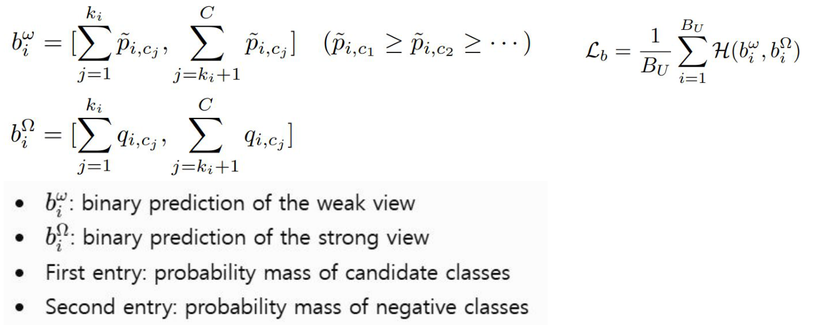
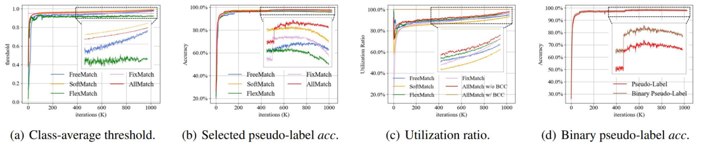
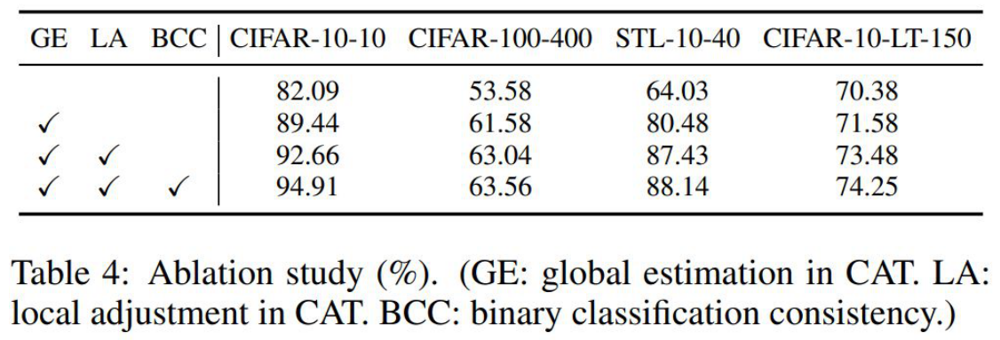
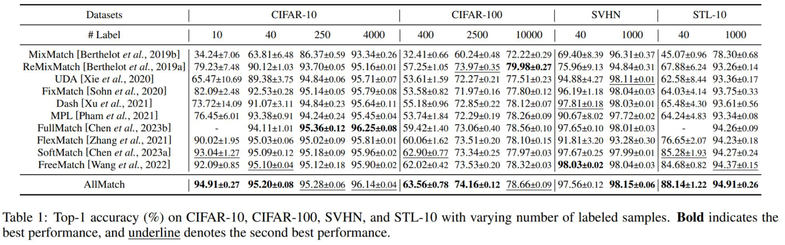
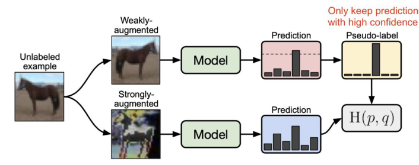

<!-- DRAFT | lecture: 07_Semi_Supervised_Learning_II | chunk: 11 | pages 86–96 -->
<!-- VERIFIED | fixes: 7 | verifier: sonnet -->

## Consistency Between Candidate and Negative Classes (p.86)

슬라이드 텍스트:
- Candidate classes are determined from the weak view.
- The same candidate-negative division is applied to the strong view.
- The strong view should preserve the binary semantic decision.
- BCC is applied to every unlabeled sample.
- 수식 (weak view의 binary prediction):
$$b_i^{\omega} = \Big[\sum_{j=1}^{k_i} \tilde{p}_{i,c_j},\ \sum_{j=k_i+1}^{C} \tilde{p}_{i,c_j}\Big] \quad (\tilde{p}_{i,c_1} \ge \tilde{p}_{i,c_2} \ge \cdots)$$
- 수식 (strong view의 binary prediction):
$$b_i^{\Omega} = \Big[\sum_{j=1}^{k_i} q_{i,c_j},\ \sum_{j=k_i+1}^{C} q_{i,c_j}\Big]$$
- 수식 (BCC loss):
$$\mathcal{L}_b = \frac{1}{B_U}\sum_{i=1}^{B_U} \mathcal{H}(b_i^{\omega}, b_i^{\Omega})$$
- $b_i^{\omega}$: binary prediction of the weak view / $b_i^{\Omega}$: binary prediction of the strong view
- First entry: probability mass of candidate classes
- Second entry: probability mass of negative classes
- 하단 강조 문구: "weak candidate membership = strong candidate membership" / "Uncertain samples receive coarse but reliable supervision"

**설명**
- 앞 chunk의 AllMatch 흐름 이어서: **CAT**(threshold 쪽)이 "어떤 sample을 믿고 pseudo-label로 쓸까"를 정한다면, **BCC (Binary Classification Consistency)** 는 "**threshold를 못 넘어 버려질 sample**에게 뭘 시킬까"에 대한 답.
- 정의 순서대로 읽기:
  1. weak view 예측 $\tilde{p}_i$ 를 확률 내림차순으로 정렬: $\tilde{p}_{i,c_1}\ge\tilde{p}_{i,c_2}\ge\cdots$ ($c_j$ = $j$번째로 확률 높은 class).
  2. 상위 $k_i$개 class = **candidate classes** (정답일 가능성이 남은 후보), 나머지 $C-k_i$개 = **negative classes** (정답이 아니라고 보는 class). $k_i$ 결정 방식은 p.87 (confident하면 $k_i=1$, 아니면 $k_i>1$).
  3. 두 집합 각각의 **probability mass를 합쳐서** 2차원 벡터 $b_i^\omega=[\text{candidate mass},\ \text{negative mass}]$ 를 만듦. 합이 1이니까 **C-way 분포 → 2-way (binary) 분포로 collapse**한 것.
  4. strong view 예측 $q_i$ 에도 **weak view에서 정한 같은 분할(같은 $c_1..c_{k_i}$)** 을 그대로 적용해서 $b_i^\Omega$ 를 만듦. ← 분할 기준은 항상 weak view. strong view에서 다시 sorting하는 게 **아님** (함정 포인트).
  5. $\mathcal{L}_b=\frac{1}{B_U}\sum_i \mathcal{H}(b_i^\omega,b_i^\Omega)$: 두 binary 분포 사이의 cross-entropy ($\mathcal{H}$), **$B_U$ = unlabeled batch size**. 여기에 **indicator가 없음** → threshold와 무관하게 **모든 unlabeled sample에 적용**.
- 의미: 정확히 어떤 class인지는 모르겠어도 "**후보 안에 있는 class 중 하나**"라는 **coarse한 semantic 판단**은 weak/strong view 간에 유지돼야 함 ("weak candidate membership = strong candidate membership"). **fine class-level 정보는 포기하되 coarse하지만 신뢰 가능한(reliable) supervision**을 줌.
- 왜 reliable? 예: 10-class에서 top-1 확률이 0.4라 top-1 pseudo-label은 틀릴 수 있어도, top-3 안에 정답이 있을 확률은 훨씬 높음 → "후보 vs 비후보" 이진 결정이 훨씬 맞을 확률이 높음 (p.88 (d)에서 binary pseudo-label accuracy가 더 높게 나옴).
> 보충: 슬라이드 수식에서 weak 쪽은 $\tilde{p}$ (tilde), strong 쪽은 $q$ 로 표기가 다름. $\tilde{p}$ 는 (추정) 앞 chunk에서 쓰던 weak-view 예측 확률(조정된 것일 수 있음, 슬라이드에 정의 없음)이며, $q$ 는 strong-view 예측. 슬라이드에서 $q$ 정의는 명시 안 됨. 윗첨자 $\omega$/$\Omega$ 는 각각 weak/strong view.
> 보충: 후보 집합의 확률 질량을 묶어 다루는 건 partial-label(candidate label) learning과 비슷한 발상 (슬라이드에는 없음, 참고용).

---

## Two Levels of Supervision (p.87)

슬라이드 텍스트:
- **High-confidence sample**: $\max(\tilde{p}_i) \ge \tau_t(c_i)$
  - Candidate set size: $k_i = 1$
  - Standard pseudo-label consistency
  - Fine class-level supervision
- **Low-confidence sample**: $\max(\tilde{p}_i) < \tau_t(c_i)$
  - Candidate set size: $k_i > 1$
  - Binary classification consistency
  - Coarser semantic supervision
- 하단: "AllMatch changes the strength of supervision rather than discarding uncertain samples."

**설명**
- 핵심은 **confidence에 따라 supervision의 granularity가 2단계**로 나뉜다는 것:

| | High-confidence | Low-confidence |
|---|---|---|
| 조건 | $\max(\tilde p_i)\ge\tau_t(c_i)$ | $\max(\tilde p_i)<\tau_t(c_i)$ |
| candidate size | $k_i=1$ | $k_i>1$ |
| loss | standard pseudo-label consistency (FixMatch식 CE) | BCC (binary) |
| supervision | **fine** class-level | **coarser** semantic |

- $\tau_t(c_i)$: **time $t$, class $c_i$ 별 threshold** (FreeMatch/CAT처럼 global estimate + class-wise local adjustment 으로 만든 adaptive threshold, 앞 슬라이드 내용). $c_i$ 는 sample $i$의 예측 class.
- $k_i=1$ 이면 candidate = top-1 class 하나뿐 → 슬라이드상 이 경우엔 **standard pseudo-label consistency**(class-level, fine)를 씀. 반대로 $k_i>1$ 이면 "여러 후보 vs 나머지" binary 판단이라 **더 느슨**(coarser). ← 두 경우를 후보 집합 크기 $k_i$ 하나로 묶은 게 AllMatch의 포인트.
- **한 줄 요약**: AllMatch는 uncertain sample을 **버리지(discard) 않고, supervision의 세기만 낮춰서** 사용한다. FixMatch류는 threshold 미달 sample을 loss에서 완전히 mask(0)했던 것과 대조.
> 보충: 슬라이드는 $k_i$를 어떻게 정하는지(예: 누적 확률이 threshold를 넘을 때까지 상위 class를 추가) 여기서 명시하지 않음 → 앞 chunk(p.80 전후)에서 확인할 것.

---

## Does AllMatch Really Use All Samples? (p.88)

슬라이드 텍스트:
- CAT
  - Improves selected pseudo-label accuracy
  - Maintains a high utilization ratio
- BCC
  - Provides supervision for rejected samples
  - Reaches a 100% unlabeled-data utilization ratio
  - Candidate-negative accuracy exceeds top-1 accuracy
- 그림 (학습 곡선 4개, x축 iterations (K), 0~1000):
  - (a) **Class-average threshold**: FreeMatch, SoftMatch, FlexMatch, FixMatch, AllMatch의 class 평균 threshold 변화. (FixMatch는 고정 ~0.95 직선, FlexMatch는 낮게 ~0.9 근처에서 요동, 나머지는 서서히 상승해 ~1.0 근처)
  - (b) **Selected pseudo-label acc.**: 선택된 pseudo-label의 정확도. inset 확대에서 AllMatch(빨강)가 가장 높고(~85% 근처), SoftMatch > FixMatch/FreeMatch > FlexMatch 순으로 낮음. 후반부에 대부분 감소.
  - (c) **Utilization ratio**: FreeMatch, SoftMatch, FlexMatch, FixMatch, AllMatch w/o BCC, **AllMatch w/ BCC**. AllMatch w/ BCC는 **100%로 평평한 선**, 나머지는 ~85–95%로 서서히 상승 (AllMatch w/o BCC가 가장 높은 편).
  - (d) **Binary pseudo-label acc.**: Pseudo-Label vs Binary Pseudo-Label. inset에서 binary pseudo-label(갈색, ~80%)이 일반 pseudo-label(빨강, ~65–70%)보다 높음.

**설명**
- 그림 해석 주의: (c)에서 **AllMatch w/ BCC만 100% 직선**, w/o BCC는 다른 방법들처럼 ~85–95%.
- 질문 "AllMatch는 정말 **모든** unlabeled sample을 쓰나?"에 두 컴포넌트가 각각 답함:
  - **CAT** (threshold 설계): (a),(b) → 선택된 pseudo-label의 **정확도를 올리면서**, (c) utilization ratio도 **높게 유지**. 보통 threshold를 높이면 accuracy↑ utilization↓ 의 **trade-off**인데 CAT는 둘 다 챙김.
  - **BCC**: (c)에서 **utilization ratio = 100%**. 버려지던 sample이 binary consistency loss로 전부 loss에 기여하므로 당연히 100%. (d)에서는 **binary pseudo-label accuracy > ordinary (top-1) pseudo-label accuracy**.
- 용어: **utilization ratio** = 전체 unlabeled sample 중 loss에 실제로 기여하는(마스크되지 않은) sample 비율. **w/o BCC** 일 때는 threshold를 넘는 sample만 쓰므로 100%가 안 됨.
- (d)의 의미: "candidate vs negative" 이진 판단이 "top-1 class" 판단보다 정확하다 → 저확신 sample에도 **신뢰 가능한 정보**가 있다는 근거. ← 그래서 BCC가 noisy pseudo-label을 주는 게 아니라 reliable한 coarse supervision이라는 논리.
> 보충: 위 그림 수치 묘사(~85%, ~65–70% 등)는 슬라이드 그림에서 눈대중으로 읽은 근사치이며 정확한 값은 아님.

---

## Ablation Study (p.89)

슬라이드 텍스트:
- Global adaptive thresholding provides the largest initial gain.
- Class-specific adjustment further improves difficult classes.
- BCC consistently improves the complete CAT model.
- The gains are largest in extremely low-label settings.
- 범례: GE: global estimation / LA: local adjustment / BCC: binary classification consistency
- Table 4: Ablation study (%). (GE: global estimation in CAT. LA: local adjustment in CAT. BCC: binary classification consistency.)

| GE | LA | BCC | CIFAR-10-10 | CIFAR-100-400 | STL-10-40 | CIFAR-10-LT-150 |
|---|---|---|---|---|---|---|
| | | | 82.09 | 53.58 | 64.03 | 70.38 |
| ✓ | | | 89.44 | 61.58 | 80.48 | 71.58 |
| ✓ | ✓ | | 92.66 | 63.04 | 87.43 | 73.48 |
| ✓ | ✓ | ✓ | 94.91 | 63.56 | 88.14 | 74.25 |

**설명**
- 데이터셋 이름 읽는 법: **CIFAR-10-10** = CIFAR-10에 label 10개, CIFAR-100-400 = label 400개, STL-10-40 = label 40개, **CIFAR-10-LT-150** = long-tailed CIFAR-10 (imbalance ratio 150으로 추정). ← LT 표기는 슬라이드에 설명 없어 추정.
- 행 순서가 **누적(cumulative) ablation**: baseline(모두 ✗) → +GE → +LA → +BCC (full AllMatch).
- 각 단계 gain (CIFAR-10-10 기준): 82.09 → 89.44 (**+7.35, GE가 가장 큼**) → 92.66 (+3.22, LA) → 94.91 (+2.25, BCC). STL-10-40: 64.03 → 80.48 (+16.45, GE) → 87.43 → 88.14 (BCC는 +0.71로 작음).
- 슬라이드 문장과 매칭:
  - "Global adaptive thresholding provides the **largest initial gain**" ← GE 행에서 점프가 제일 큼.
  - "Class-specific adjustment further improves difficult classes" ← LA. long-tail / 어려운 class에서 class-wise threshold가 효과.
  - "BCC consistently improves the complete CAT model" ← 4개 데이터셋 모두 마지막 행이 최고 (consistent).
  - "gains are largest in extremely low-label settings" ← CIFAR-10-10(label 10개)에서 BCC 이득 +2.25로 가장 큼, CIFAR-100-400은 +0.52.
- 예외 주의: **CIFAR-10-LT-150**에서는 단계별 gain이 GE +1.20, LA +1.90, BCC +0.77로 **LA가 가장 큼** (GE가 가장 큰 건 나머지 3개). "gains largest in extremely low-label"도 STL-10-40에서는 BCC +0.71로 작음 → 슬라이드 문장은 경향성.
- 마지막 행 CIFAR-10-10 94.91, CIFAR-100-400 63.56, STL-10-40 88.14 는 p.90 메인 표의 AllMatch 값과 **일치**.
> 보충: baseline(첫 행)은 CAT 요소가 전혀 없는 상태로, 아마 fixed threshold 기반 FixMatch류에 해당 (슬라이드에 명시 안 됨).

---

## Comparison with Recent SSL Methods (p.90)

슬라이드 텍스트:
- AllMatch consistently improves over FreeMatch.
- The largest gain appears when labels are extremely scarce.
- Low-confidence samples are most useful in difficult SSL settings.
- Table 1: Top-1 accuracy (%) on CIFAR-10, CIFAR-100, SVHN, and STL-10 with varying number of labeled samples. **Bold** indicates the best performance, and underline denotes the second best performance.
- 표 (Label 수: CIFAR-10 = 10/40/250/4000, CIFAR-100 = 400/2500/10000, SVHN = 40/1000, STL-10 = 40/1000). 주요 행만 발췌 (CIFAR-10 10 / 40 / 250 / 4000 | CIFAR-100 400 / 2500 / 10000 | SVHN 40 / 1000 | STL-10 40 / 1000):
  - MixMatch: 34.24 / 63.81 / 86.37 / 93.34 | 32.41 / 60.24 / 72.22 | 69.40 / 96.31 | 45.07 / 78.30
  - ReMixMatch: 79.23 / 90.12 / 93.70 / 95.16 | 57.25 / 73.97 / **79.98** | 75.96 / 94.84 | 67.88 / 93.26
  - UDA: 65.47 / 89.38 / 94.84 / 95.71 | 53.61 / 72.27 / 77.51 | 94.88 / 98.11 | 62.58 / 93.36
  - FixMatch: 82.09 / 92.53 / 95.14 / 95.79 | 53.58 / 71.97 / 77.80 | 96.19 / 98.04 | 64.03 / 93.75
  - Dash: 73.72 / 91.07 / 94.84 / 95.64 | 55.18 / 72.85 / 78.12 | 97.81 / 98.03 | 65.48 / 93.61
  - MPL: 76.45 / 93.38 / 94.24 / 95.45 | 53.74 / 72.29 / 78.26 | 90.67 / 97.72 | 64.24 / 93.34
  - FullMatch: - / 94.11 / **95.36** / **96.25** | 59.42 / 73.06 / 78.56 | 97.65 / 98.01 | - / 94.26
  - FlexMatch: 90.02 / 95.03 / 95.02 / 95.81 | 60.06 / 73.51 / 78.10 | 91.81 / 93.28 | 76.65 / 94.23
  - SoftMatch: 93.04 / 95.09 / 95.18 / 95.96 | 62.90 / 73.34 / 77.97 | 97.67 / 97.99 | 85.28 / 94.27
  - FreeMatch: 92.09 / 95.10 / 95.12 / 95.90 | 62.02 / 73.53 / 78.32 | **98.03** / 98.04 | 84.68 / 94.37
  - **AllMatch: 94.91 / 95.20 / 95.28 / 96.14 | 63.56 / 74.16 / 78.66 | 97.56 / 98.15 | 88.14 / 94.91**
  - (AllMatch의 굵은 글씨: CIFAR-10 10·40, CIFAR-100 400·2500, SVHN 1000, STL-10 40·1000 / 밑줄(2등): CIFAR-10 250·4000, CIFAR-100 10000)
- 하단 강조: "A low-confidence sample may not provide a class label, but it can still provide class-exclusion information."

**설명**
- **Top-1 accuracy**를 label 수를 바꿔가며 비교. AllMatch vs FreeMatch (이번 강의의 핵심 baseline):
  - CIFAR-10-10: 94.91 vs 92.09 (**+2.82**), CIFAR-100-400: 63.56 vs 62.02 (+1.54), STL-10-40: 88.14 vs 84.68 (**+3.46**).
  - label이 충분한 경우 (CIFAR-10 4000: 96.14 vs 95.90) gain은 **+0.24** 정도로 작음 → "**label이 극단적으로 적을수록 gain이 큼**".
- 이유: label이 적으면 모델이 불확실한 sample이 많고 threshold를 넘는 sample 수가 적음 → FixMatch/FreeMatch류는 그 sample들을 버려서 손해가 큼. AllMatch는 BCC로 **class-exclusion information** ("이 class들은 아니다")을 뽑아 씀.
- 주의: metric은 **Top-1 accuracy(%)** (높을수록 좋음, error rate 아님) → flag 유효. "consistently improves over FreeMatch"라는 슬라이드 문구와 달리 표에서 **SVHN-40은 FreeMatch 98.03 > AllMatch 97.56**. 즉 FreeMatch를 모든 설정에서 이기는 건 아님 (대부분에서 이김). 또 CIFAR-10 250/4000에서는 FullMatch(95.36/96.25)가 1등이고, CIFAR-100-10000에서는 ReMixMatch(79.98)가 1등. ← 슬라이드 문구는 약간 과장. 시험에서는 슬라이드 문구("consistently improves over FreeMatch, largest gain when labels extremely scarce")를 그대로 따르는 쪽이 안전.
- 가장 중요한 한 문장: "A low-confidence sample may not provide a class label, but it can still provide **class-exclusion information**."
> 보충: 표에 나온 방법 인용 연도는 슬라이드 표 그대로 (MixMatch 2019b, ReMixMatch 2019a, UDA 2020, FixMatch 2020, Dash 2021, MPL 2021, FullMatch 2023b, FlexMatch 2021, SoftMatch 2023a, FreeMatch 2022). MixMatch/ReMixMatch가 둘 다 Berthelot et al., 2019 (a/b 구분)인 점이 표 표기.

---

## FreeMatch vs AllMatch: Recap (p.91)

슬라이드 텍스트:
- FreeMatch
  - How should we select reliable pseudo-labels?
  - Adaptive threshold
- AllMatch
  - What should we do with the samples that are not selected?
  - Candidate-negative consistency

**설명**
- 두 방법이 **답하는 질문이 다름** (이 대비가 시험 단골):
  - **FreeMatch**: "믿을 만한 pseudo-label을 **어떻게 골라낼까**?" → **self-adaptive threshold** (selection 단계 개선).
  - **AllMatch**: "**선택되지 않은** sample은 어떻게 할까?" → **candidate-negative consistency (BCC)** (rejected sample 활용 단계 개선).
- 즉 FreeMatch = *selection*, AllMatch = *non-selected 활용*. AllMatch는 FreeMatch식 adaptive threshold(CAT) 위에 BCC를 얹은 구조라 서로 보완적.
- 이후 IFMatch는 또 다른 질문 "**선택된** sample에게 모두 같은 강도의 augmentation을 줘도 되나?" 로 넘어감 (p.92~).

---

## Should Every Pseudo-Label Face the Same Level of Perturbation? (section title, p.92)

슬라이드 텍스트:
- Should Every Pseudo-Label Face the Same Level of Perturbation?
- (Pseudo-Labeling with Consistency Regularization)

**설명**
- 새 파트 시작. 앞의 FreeMatch/AllMatch가 **"어떤 sample을 쓰나(selection / non-selected)"** 를 다뤘다면, 여기서는 **"선택된 sample에 어떤 난이도의 perturbation(augmentation)을 줄까"** 로 관점이 바뀜.
- 부제 "Pseudo-Labeling with Consistency Regularization" ← FixMatch 계열 (pseudo-label + consistency의 결합)이 출발점.

---

## IFMatch: Paper Title Slide (p.93)

슬라이드 텍스트:
- 논문 첫 페이지 캡처: "Image-Feature Weak-to-Strong Consistency: An Enhanced Paradigm for Semi-Supervised Learning" — Zhiyu Wu and Jinshi Cui, National Key Laboratory of General Artificial Intelligence, School of Intelligence Science and Technology, Peking University.
- 하단 인용: "Wu, et. al., ECCV 2024, Image-Feature Weak-to-Strong Consistency: An Enhanced Paradigm for Semi-Supervised Learning"

**설명**
- 이 강의의 **IFMatch** 소개 논문. 제목의 **Image-Feature Weak-to-Strong Consistency**: 기존 weak-to-strong consistency를 **image level** (입력 이미지 augmentation)뿐 아니라 **feature level**(중간 feature perturbation)로도 확장한다는 뜻으로 읽힘. 
- 저자: Zhiyu Wu, Jinshi Cui (Peking Univ.).
> 보충: 위 "feature level 확장" 해석은 논문 제목 기반이며, 이번 chunk(p.92–96)에서는 image-level 한계(문제 제기)만 다룸. 구체적 방법(feature-level perturbation, 난이도에 따른 강도 조절 등)은 다음 chunk 참고.
> 보충: ECCV = European Conference on Computer Vision (2024는 슬라이드 하단 인용 기준).

---

## Should Every Pseudo-Label Face the Same Level of Perturbation? (p.94)

슬라이드 텍스트:
- Pseudo-labeling with consistency regularization
  - A weakly augmented view generates a pseudo-label.
  - A strongly augmented view is trained to match it.
  - The same consistency task is applied to every selected sample.
- In the original FixMatch,
  - The same strong augmentation is applied to all samples that exceed the confidence threshold.
  - However, surpassing the threshold does not mean that all such samples possess the same level of difficulty.
- 그림 (FixMatch diagram): Unlabeled example → (위) Weakly-augmented → Model → Prediction (bar chart, 점선 threshold 위로 한 bar가 높음) → "Only keep prediction with high confidence" ← 원문은 prediction 단수 → Pseudo-label (one-hot) / (아래) Strongly-augmented → Model → Prediction → $\mathrm{H}(p,q)$ (pseudo-label과 strong prediction 사이 cross entropy).
- 하단 강조: "But are all selected samples equally difficult to learn?"

**설명**
- **FixMatch 복습** (Pseudo-labeling + Consistency regularization):
  1. unlabeled $u$ 에 **weak augmentation** → 모델 예측 → confidence가 threshold 이상이면 **one-hot pseudo-label** (hard label).
  2. 같은 $u$ 에 **strong augmentation** → 모델 예측이 위 pseudo-label과 같아지도록 cross-entropy $\mathrm{H}(p,q)$ 로 학습.
  - 방향 주의: **weak view가 target(pseudo-label), strong view가 학습 대상(prediction)**. (weak↔strong 뒤바꾸기 함정)
- **문제 제기**: FixMatch에선 threshold를 넘은 모든 sample에 **똑같은 strong augmentation**을 줌. 그런데 threshold 통과 = "pseudo-label을 믿을 만하다"일 뿐 **학습 난이도가 같다는 뜻이 아님**.
- 어떤 sample은 쉽고(강한 augmentation에도 예측 유지), 어떤 sample은 어려움 → "**모든 selected sample이 똑같이 배우기 어려운가?**" 가 질문. 이게 IFMatch의 motivation.
> 보충: 원 FixMatch (Sohn et al., NeurIPS 2020)의 strong augmentation은 RandAugment/CTAugment + Cutout. 슬라이드엔 없음.

---

## Image-Level Weak-to-Strong Consistency (p.95)

슬라이드 텍스트:
- The threshold decides whether to use a pseudo-label, but not how much perturbation the sample needs.
- 수식:
$$\mathcal{L}_u = \frac{1}{B_U}\sum_{i=1}^{B_U} \mathbb{1}\big(\max(p_i^{\mathcal{I}_w}) \ge \tau_t\big)\,\mathcal{H}\big(\hat{p}_i^{\mathcal{I}_w},\ p_i^{\mathcal{I}_s}\big)$$
- $p_i^{\mathcal{I}_w}$: prediction from the weakly augmented image
- $\hat{p}_i^{\mathcal{I}_w}$: one-hot pseudo-label
- $p_i^{\mathcal{I}_s}$: prediction from the strongly augmented image
- $\tau_t$: pseudo-label selection threshold
- $\mathcal{H}$: cross-entropy consistency loss

**설명**
- 이게 **FixMatch의 unsupervised loss** (image-level weak-to-strong consistency). 윗첨자 $\mathcal{I}$ = **image level** (나중에 feature level과 구분하려는 표기; $\mathcal{I}_w$ = weak image aug, $\mathcal{I}_s$ = strong image aug).
- 수식 읽기:
  - $\mathbb{1}(\max(p_i^{\mathcal{I}_w})\ge\tau_t)$: weak view 최대 확률이 threshold 이상이면 1, 아니면 0 → **confidence mask**. 이게 "pseudo-label을 **쓸지 말지**"를 결정.
  - $\hat p_i^{\mathcal{I}_w}=\mathrm{one\text{-}hot}(\arg\max p_i^{\mathcal{I}_w})$: weak 예측의 **hard pseudo-label** (target).
  - $\mathcal{H}(\hat p_i^{\mathcal{I}_w},p_i^{\mathcal{I}_s})$: pseudo-label과 **strong view 예측** 간 cross entropy.
  - $\frac{1}{B_U}\sum_{i=1}^{B_U}$: unlabeled batch 평균. (mask된 sample은 0 기여 — 분모는 $B_U$ 그대로.)
- 슬라이드 핵심 문장: "threshold는 **pseudo-label을 쓸지**만 정하지, **그 sample에 얼마나 강한 perturbation이 필요한지**는 정하지 않는다." → 모든 selected sample에 동일한 $\mathcal{I}_s$ 가 적용되는 구조적 한계.
- 같은 형태의 수식이 p.86의 $\mathcal{L}_b$ 와 대조됨: FixMatch loss = **indicator 있음 + one-hot target (fine)**, BCC loss = **indicator 없음 + binary target (coarse)**.
> 보충: FixMatch 원 논문 수식은 $\frac{1}{\mu B}\sum \mathbb{1}(\max q_b\ge\tau)\,\mathrm{H}(\hat q_b, p_m(y|\mathcal{A}(u_b)))$ 로 같은 구조 (슬라이드 표기만 다름).

---

## The Problem: Too Many Naive Samples (p.96)

슬라이드 텍스트:
- Naive sample
  - The model predicts the pseudo-label correctly even after strong augmentation.
  - Its confidence remains high.
  - Its consistency loss becomes nearly zero.
  - 수식: $\mathcal{H}\big(\hat{p}_i^{\mathcal{I}_w},\ p_i^{\mathcal{I}_s}\big) \approx 0$
- Challenging sample
  - Strong augmentation already makes prediction difficult.
  - Additional perturbation may destroy useful information.
  - Its loss is already sufficiently large.
- 하단 강조: "Naive samples need a stronger task, while challenging samples do not."

**설명**
- selected sample을 **난이도로 둘로 나눔**:
  - **Naive sample (easy)**: strong augmentation을 줘도 모델이 pseudo-label을 그대로 맞힘 → confidence 높고 → $\mathcal{H}\approx 0$ → **gradient가 거의 없음 → 더 배울 게 없음**. 즉 **학습 신호를 못 주는 낭비된 sample**.
  - **Challenging sample (hard)**: 이미 strong augmentation만으로 예측이 어려워 loss가 충분히 큼 → 여기에 perturbation을 더 주면 **유용한 정보까지 파괴**될 수 있음 → 더 세게 줄 필요 없음 (오히려 해로움).
- **결론 (design rationale)**: **naive sample에는 더 강한 task(perturbation)** 가 필요하고, **challenging sample에는 필요 없다** → "sample마다 perturbation 강도를 달리 해야 한다"는 IFMatch의 동기. ← **too many naive samples**가 문제: threshold를 통과한 sample 중 상당수가 naive라서 loss가 ~0, 학습 효율 저하.
- 직관: cross entropy $\mathcal{H}(\hat p, p)=-\log p_{\hat y}$ 이므로 strong view에서도 pseudo-label class 확률 $p_{\hat y}\to 1$ 이면 loss $\to 0$.
> 보충: 이 chunk 범위에서는 해결책(예: naive sample에 feature-level perturbation 추가 등)이 아직 나오지 않음. 제목 "Image-Feature" 로 보아 feature-level perturbation이 해법의 일부일 가능성이 크지만, 슬라이드 근거는 다음 chunk에서 확인.

---

## FIGURES

- p.86: BCC 수식 ($b_i^\omega$, $b_i^\Omega$, $\mathcal{L}_b$) — `p086_bcc_eq.png`, 중요도 상
- p.88: 4-panel 학습곡선 (threshold, selected pseudo-label acc, utilization ratio, binary pseudo-label acc) — `p088_utilization_plots.png`, 중요도 중 (utilization 100%, binary acc > top-1 acc 결론만 기억)
- p.89: Ablation Table 4 (GE/LA/BCC 누적) — `p089_ablation_table.png`, 중요도 중
- p.90: Table 1 Top-1 accuracy 비교 — `p090_comparison_table.png`, 중요도 중하 (수치 전체 암기 불필요, AllMatch vs FreeMatch 경향 위주)
- p.94: FixMatch diagram (weak → pseudo-label, strong → H(p,q)) — `p094_fixmatch_diagram.png`, 중요도 상
- p.87 (표 대신 위 설명에서 재구성), p.95–96 수식은 이미지 없이 LaTeX로 옮김.

## EXAM POINTS

1. **BCC 정의 (p.86)**: candidate classes는 **weak view**에서 정해지고, 같은 candidate/negative 분할을 **strong view**에 적용. 각 view에서 candidate mass와 negative mass를 합한 2-d binary prediction $b$ 를 만들고 $\mathcal{L}_b=\frac{1}{B_U}\sum\mathcal{H}(b^\omega,b^\Omega)$ 로 일치시킴. *트랩*: 분할 기준을 strong view로 바꾸기 / BCC가 "threshold 넘은 sample에만" 적용된다고 쓰기 (정답: **every unlabeled sample**).
2. **Two levels of supervision (p.87)**: high-confidence ($\max\tilde p\ge\tau_t(c_i)$) → $k_i=1$, standard pseudo-label consistency, **fine** class-level; low-confidence → $k_i>1$, BCC, **coarser** semantic supervision. *트랩*: $k_i=1$ ↔ $k_i>1$, fine ↔ coarse 뒤바꾸기.
3. **AllMatch의 핵심 (p.87)**: uncertain sample을 **버리지 않고 supervision의 세기(strength)를 바꾼다**. FixMatch/FreeMatch는 threshold 미달 sample 폐기.
4. **Utilization ratio (p.88)**: BCC 덕에 AllMatch는 **100% unlabeled-data utilization**. CAT은 selected pseudo-label accuracy를 높이고 utilization을 높게 유지. Binary (candidate-negative) accuracy가 **top-1 accuracy보다 높음**. *트랩*: "CAT이 100% utilization를 달성" (정답은 BCC) / "binary accuracy < top-1 accuracy".
5. **Ablation (p.89)**: Global estimation (GE)이 **가장 큰 initial gain** → local adjustment (LA)로 어려운 class 개선 → BCC가 full CAT 모델을 **consistently** 개선, **extremely low-label** 설정에서 gain 최대. 수치: CIFAR-10-10: 82.09 → 89.44 → 92.66 → 94.91; STL-10-40: 64.03 → 80.48 → 87.43 → 88.14. GE=global estimation, LA=local adjustment, BCC=binary classification consistency.
6. **AllMatch vs FreeMatch 수치 (p.90, metric = Top-1 accuracy)**: CIFAR-10-10 94.91 vs 92.09, CIFAR-100-400 63.56 vs 62.02, STL-10-40 88.14 vs 84.68; label이 충분하면 gain 작음 (CIFAR-10-4000: 96.14 vs 95.90). SVHN-40은 FreeMatch(98.03)가 더 높음 (예외). *트랩*: "largest gain with abundant labels"는 False / "AllMatch is best in every setting"도 False (FullMatch: CIFAR-10 250·4000, ReMixMatch: CIFAR-100-10000, FreeMatch: SVHN-40 1등).
7. **Key insight 문장 (p.90)**: "A low-confidence sample may not provide a class label, but it can still provide **class-exclusion information**."
8. **FreeMatch vs AllMatch (p.91)**: FreeMatch = "How should we **select** reliable pseudo-labels?" → **adaptive threshold**. AllMatch = "What should we do with the samples that are **not selected**?" → **candidate-negative consistency**. *트랩*: 두 질문/방법을 서로 바꿔 쓰기.
9. **IFMatch 출처 (p.93)**: Wu & Cui, **ECCV 2024**, "Image-Feature Weak-to-Strong Consistency: An Enhanced Paradigm for Semi-Supervised Learning" (Peking University).
10. **FixMatch 구조 (p.94–95)**: **weak view → pseudo-label (one-hot, confidence ≥ $\tau_t$일 때만)**, **strong view가 이를 match** (cross-entropy). $\mathcal{L}_u=\frac{1}{B_U}\sum\mathbb{1}(\max p^{\mathcal{I}_w}\ge\tau_t)\mathcal{H}(\hat p^{\mathcal{I}_w},p^{\mathcal{I}_s})$. 원 FixMatch는 threshold 넘은 **모든 sample에 같은 strong augmentation**. *트랩*: weak ↔ strong, one-hot(hard) ↔ soft, "threshold가 perturbation 강도를 결정한다"(오답: threshold는 **사용 여부**만 결정).
11. **Naive vs challenging sample (p.96)**: naive = strong aug 후에도 정답 유지, confidence 높음, **loss ≈ 0**; challenging = strong aug만으로 이미 예측이 어렵고 loss가 충분히 큼, 추가 perturbation은 유용한 정보를 파괴할 수 있음. 결론: **naive sample은 더 강한 task 필요, challenging sample은 불필요**. *트랩*: 두 정의/결론 뒤바꾸기 ("challenging samples need a stronger task"는 False).
12. **IFMatch motivation (p.92–96)**: "Should every pseudo-label face the same level of perturbation?" — image-level weak-to-strong consistency는 모든 selected sample에 동일한 perturbation을 적용하는 것이 한계 (too many naive samples).
13. **BCC 슬로건 (p.86)**: "weak candidate membership = strong candidate membership", "Uncertain samples receive coarse but reliable supervision". *트랩*: "fine-grained" / "BCC는 high-confidence sample에만".
14. **Ablation 예외 (p.89)**: CIFAR-10-LT-150에서는 LA gain(+1.90)이 GE(+1.20)보다 큼. 4개 데이터셋 모두 마지막 행(GE+LA+BCC)이 최고.
