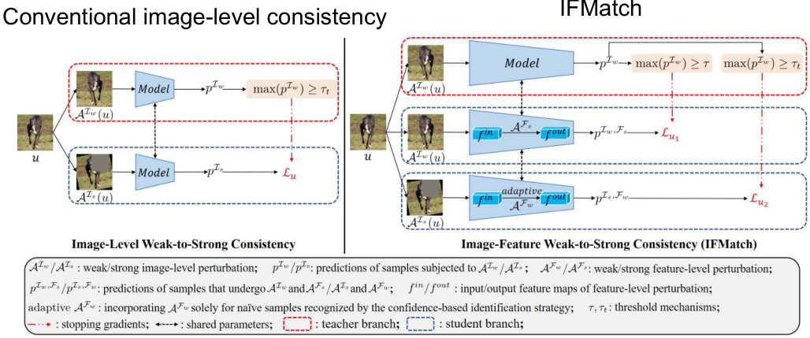
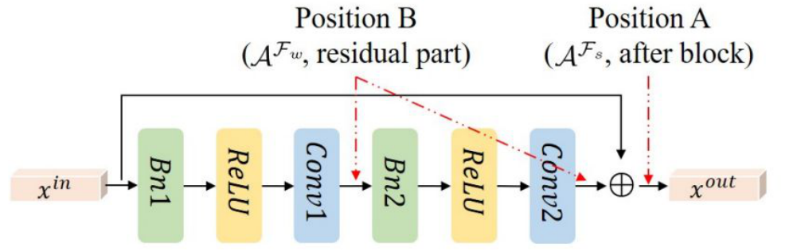
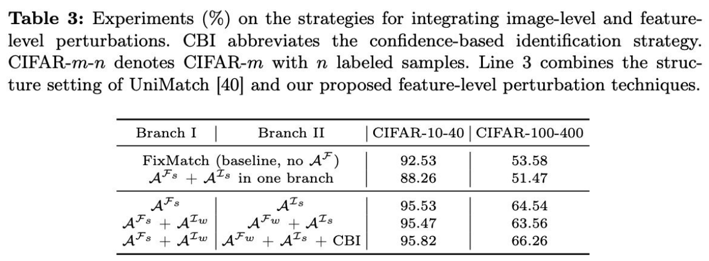
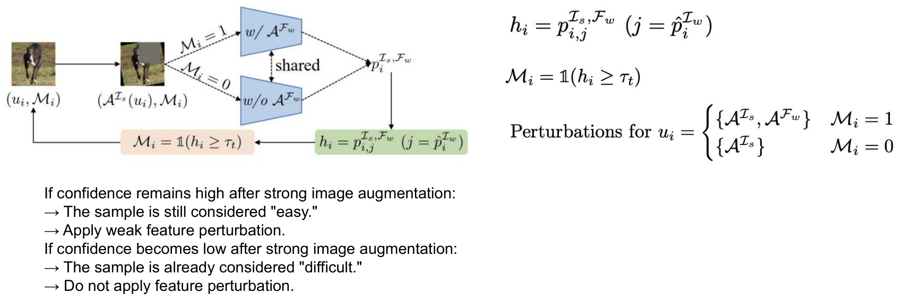
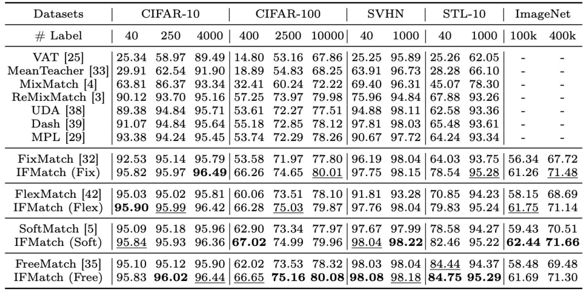
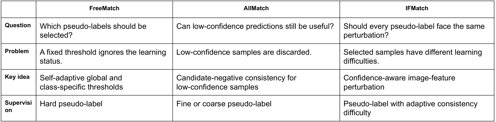

<!-- DRAFT | lecture: 07_Semi_Supervised_Learning_II | chunk: 12 | pages 97–106 -->
<!-- VERIFIED | fixes: 9 | verifier: sonnet -->

## IFMatch: Image-Feature Weak-to-Strong Consistency (p.97)

슬라이드 텍스트:
- IFMatch: Image-Feature Weak-to-Strong Consistency
- Teacher branch
  - Generates the pseudo-label.
- Student Branch I
  - Weak image perturbation + strong feature perturbation.
- Student Branch II
  - Strong image perturbation + optional weak feature perturbation.
- 그림 (좌) **Conventional image-level consistency** (Image-Level Weak-to-Strong Consistency): 입력 $u$ → (teacher, 빨간 점선 박스) weak augmentation $\mathcal{A}^{\mathcal{I}_w}(u)$ → Model → $p^{\mathcal{I}_w}$ → $\max(p^{\mathcal{I}_w}) \ge \tau_t$ 통과 여부 → (stop-gradient 빨간 점선 화살표) → $\mathcal{L}_u$. (student, 파란 점선 박스) strong augmentation $\mathcal{A}^{\mathcal{I}_s}(u)$ (일부 patch가 가려진 이미지) → Model(teacher와 shared parameters) → $p^{\mathcal{I}_s}$ → $\mathcal{L}_u$.
- 그림 (우) **IFMatch** (Image-Feature Weak-to-Strong Consistency): 입력 $u$에서 세 갈래. (1) teacher branch: weak image → Model → $p^{\mathcal{I}_w}$ → 임계값 박스 **두 개** ($\max(p^{\mathcal{I}_w}) \ge \tau$ 와 $\max(p^{\mathcal{I}_w}) \ge \tau_t$). (2) student branch I: weak image → $f^{in}$ → $\mathcal{A}^{\mathcal{F}_s}$ (strong feature perturbation) → $f^{out}$ → $p^{\mathcal{I}_w,\mathcal{F}_s}$ → $\mathcal{L}_{u_1}$ (threshold $\tau$로 mask). (3) student branch II: strong image → $f^{in}$ → **adaptive** $\mathcal{A}^{\mathcal{F}_w}$ (weak feature perturbation) → $f^{out}$ → $p^{\mathcal{I}_s,\mathcal{F}_w}$ → $\mathcal{L}_{u_2}$ (threshold $\tau_t$로 mask). 세 branch 모두 parameter 공유(양방향 점선 화살표).
- 범례: $\mathcal{A}^{\mathcal{I}_w}/\mathcal{A}^{\mathcal{I}_s}$ = weak/strong image-level perturbation, $\mathcal{A}^{\mathcal{F}_w}/\mathcal{A}^{\mathcal{F}_s}$ = weak/strong feature-level perturbation, $f^{in}/f^{out}$ = input/output feature maps of feature-level perturbation, "adaptive $\mathcal{A}^{\mathcal{F}_w}$: incorporating $\mathcal{A}^{\mathcal{F}_w}$ solely for naïve samples recognized by the confidence-based identification strategy", $\tau, \tau_t$ = threshold mechanisms, 빨간 점선 화살표 = stopping gradients, 양방향 점선 = shared parameters, 빨간 박스 = teacher branch, 파란 박스 = student branch.
- 하단 굵은 글씨: "IFMatch expands consistency regularization from the image space to the feature space. Not to replace image perturbation with feature perturbation, but rather to incorporate both types of perturbation"

**설명**
- 배경: FixMatch류 **weak-to-strong consistency**는 *image-level* perturbation만 씀 — weak augmentation view에서 만든 hard pseudo-label을 strong augmentation view가 맞추도록 학습 (좌측 그림). **IFMatch**는 여기에 **feature-level perturbation**(네트워크 중간 feature map을 건드림)을 추가한 것. 즉 consistency regularization의 perturbation 공간을 **image space → image + feature space**로 확장.
- **세 역할**:
  - **Teacher branch** : weak image로 예측 → **pseudo-label 생성**만 담당 (gradient 안 흐름, stop-gradient). ← 별도 EMA 모델이 아니라 같은 모델의 weak view 예측 (그림의 shared parameters).
  - **Student Branch I** : **weak image + strong feature perturbation** → feature-level consistency.
  - **Student Branch II** : **strong image + (optional) weak feature perturbation** → 기존 image-level consistency 유지.
- **핵심 포인트**: feature perturbation이 image perturbation을 **대체(replace)** 하는 게 아니라 **둘 다 쓴다(incorporate both)**. Branch II가 기존 FixMatch/FreeMatch식 strong image consistency를 그대로 유지하고, Branch I이 거기에 feature-level 학습 신호를 더함.
- **왜 두 branch로 나누나?** strong image + strong feature를 한 view에 같이 걸면 신호가 파괴됨 (p.101) → 서로 다른 view에 나눠서 걸되, **같은 pseudo-label**을 target으로 공유.
- 그림 읽는 법: teacher branch 끝에 임계값 박스가 둘 — $\tau$ (Branch I용, 높은 고정 threshold)와 $\tau_t$ (Branch II용, base method의 threshold). 빨간 점선 화살표는 pseudo-label이 stop-gradient로 각 loss $\mathcal{L}_{u_1}, \mathcal{L}_{u_2}$에 들어간다는 뜻 (p.100 수식 참고).
> 출처: IFMatch = Wu et al., ECCV 2024, "Image-Feature Weak-to-Strong Consistency: An Enhanced Paradigm for Semi-Supervised Learning" (p.93 슬라이드에 표기). p.98 그림은 Bn-ReLU-Conv 순서의 residual block.

---

## Weak and Strong Feature Perturbations — Position A / B (p.98)

슬라이드 텍스트:
- Position A: Strong Feature Perturbation
  - Applied **after** the **residual** block.
  - **Directly** perturbs the block output.
  - **Every** subsequent layer **receives** the **perturbed** feature.
  - Produces a relatively **strong** effect.
- Position B: Weak Feature Perturbation
  - Applied **inside** the **residual** branch.
  - The **identity** connection remains **unchanged**.
  - Its effect is **partially moderated** by the residual connection.
  - Produces a relatively **weak** effect.
- 그림: residual block — 입력 $x^{in}$ → Bn1 → ReLU → Conv1 → Bn2 → ReLU → Conv2 → $\oplus$ → $x^{out}$, 위쪽 skip(identity) 화살표가 $\oplus$로 연결. **Position B** ($\mathcal{A}^{\mathcal{F}_w}$, residual part)는 빨간 점선 화살표 **두 개**로 residual branch 내부를 가리킴 (하나는 Conv1과 Bn2 사이, 다른 하나는 Conv2 출력 직후 $\oplus$ 직전), **Position A** ($\mathcal{A}^{\mathcal{F}_s}$, after block)는 $\oplus$ 이후(= $\oplus$와 $x^{out}$ 사이)를 가리킴. skip(identity) 경로 쪽에는 화살표 없음.

**설명**
- 이 슬라이드의 요점: **perturbation 강도는 "무슨 연산을 하느냐"보다 "어디에 넣느냐(position)"로 조절**한다 (p.99 첫 줄과 연결).
- **Position A (after the block, strong)**: residual block의 합산($\oplus$) **이후** 출력 $x^{out}$을 직접 교란 → 이후 **모든 layer가 교란된 feature**를 받음 → 영향이 그대로 전파돼 **strong**.
- **Position B (inside residual branch, weak)**: skip connection(identity path)은 **건드리지 않음**. residual branch $F(x)$만 교란되고 출력은 $x^{out} = x^{in} + F_{\text{perturbed}}(x^{in})$ 꼴 → **깨끗한 $x^{in}$이 그대로 더해져서** 교란이 **부분적으로 완화(moderated)**. 그래서 **weak**.
- 직관: ResNet에서 identity path는 "원본 정보 고속도로" → 그 길을 우회해서 residual 쪽만 흔들면 충격이 흡수됨.
- 매칭: **Branch I → Position A (strong)**, **Branch II (조건부) → Position B (weak)**. ← 시험 함정: A/B 뒤바꾸기, "identity connection이 교란된다" 같은 지문.
> 보충: Position B의 정확한 삽입 지점(Conv1–Bn2 사이 / Conv2 출력)보다 "residual branch 안쪽 = weak, block 출력(⊕ 이후) = strong"이라는 원리만 기억하면 충분.

---

## Weak and Strong Feature Perturbations — Types (p.99)

슬라이드 텍스트:
- Perturbation strength is controlled by where the feature is modified.
- 표:

| Type | Feature-level operation |
|---|---|
| Movement | Translation, shearing |
| Dropout | Channel-wise, spatial-wise dropout |
| Value | Local smoothing using random convolution |

**설명**
- 세 가지 **feature-level operation 종류**:
  - **Movement** : feature map을 **공간적으로 이동/기울임** (translation, shearing) ← image augmentation의 geometric transform(shift, shear)의 feature 버전.
  - **Dropout** : **channel-wise** (channel 통째로 끄기), **spatial-wise** (위치 단위로 끄기) dropout.
  - **Value** : feature 값 자체를 바꿈 — **random convolution으로 local smoothing**.
- 중요: 표는 *연산 종류*이고, **strong vs weak는 연산이 아니라 위치(A vs B)** 로 결정됨 (p.98~99). 같은 연산도 Position A에 넣으면 strong, B에 넣으면 weak.
- > 보충: dropout은 원래 모델 stochasticity로 consistency의 perturbation 출처 중 하나인데, 여기선 feature에 대한 의도적 perturbation 연산 중 하나로 들어가 있음.

---

## Two Complementary Consistency Branches (p.100)

슬라이드 텍스트:
- Branch I: Feature-Level Consistency
  - Weak image + strong feature perturbation
    - Focuses on feature-level consistency.
    - Uses a **high** fixed threshold
    - Only highly reliable pseudo-labels supervise strong feature perturbation.
- Branch II: Image-Level Consistency
  - Strong image + conditional weak feature perturbation
    - Retains conventional image-level consistency.
    - Uses the threshold mechanism of the base method.
    - Weak feature perturbation is added only when appropriate.
- 수식:
$$\mathcal{L}_{u_1} = \frac{1}{B_U}\sum_{i=1}^{B_U} \mathbb{1}\big(\max(p_i^{\mathcal{I}_w}) \ge \tau\big)\,\mathcal{H}\big(\hat{p}_i^{\mathcal{I}_w},\ p_i^{\mathcal{I}_w,\mathcal{F}_s}\big)$$
$$\mathcal{L}_{u_2} = \frac{1}{B_U}\sum_{i=1}^{B_U} \mathbb{1}\big(\max(p_i^{\mathcal{I}_w}) \ge \tau_t\big)\,\mathcal{H}\big(\hat{p}_i^{\mathcal{I}_w},\ p_i^{\mathcal{I}_s,\mathcal{F}_w}\big)$$
- 하단: "Both branches use the same pseudo-label, but impose different consistency tasks."

**설명**
- **수식 읽기** (FixMatch의 unsupervised loss 구조와 동일, 달라지는 건 threshold와 student 쪽 view):
  - $B_U$ : unlabeled batch size → $\frac{1}{B_U}\sum_i$ 는 batch 평균.
  - $p_i^{\mathcal{I}_w}$ : sample $i$의 **weak image** 예측 분포 (teacher). $\max(p_i^{\mathcal{I}_w})$ = **confidence**.
  - $\mathbb{1}(\max(p_i^{\mathcal{I}_w}) \ge \tau)$ : confidence가 threshold 이상일 때만 loss에 기여하는 **mask**.
  - $\hat{p}_i^{\mathcal{I}_w}$ : weak 예측에서 만든 **pseudo-label** (hat = target; FixMatch처럼 $\arg\max$의 one-hot hard label로 이해). ← 슬라이드 p.105 FreeMatch 열에 "Hard pseudo-label"로 표기.
  - $\mathcal{H}(\cdot,\cdot)$ : **cross-entropy**. 두 번째 인자가 student 예측.
  - $p_i^{\mathcal{I}_w,\mathcal{F}_s}$ : weak image + **strong feature** perturbation한 student 예측 (Branch I). $p_i^{\mathcal{I}_s,\mathcal{F}_w}$ : strong image + weak feature (Branch II).
- **$\mathcal{L}_{u_1}$ vs $\mathcal{L}_{u_2}$ 차이 두 가지**: (1) threshold: $\tau$ (**고정, 높음**) vs $\tau_t$ (**base method의 threshold**, FlexMatch/SoftMatch/FreeMatch 등 dynamic, p.103); (2) student view: ($\mathcal{I}_w$, $\mathcal{F}_s$) vs ($\mathcal{I}_s$, $\mathcal{F}_w$).
- **역할 분담 (complementary)**: Branch I은 **feature-level** consistency를 담당하되 오염에 취약하니 **아주 믿을 만한 pseudo-label만** 사용. Branch II는 기존 **image-level** weak-to-strong consistency를 그대로 유지하면서, 쉬운 sample에는 weak feature perturbation을 **조건부**로 덧붙임 (p.102).
- **Both branches use the same pseudo-label** : target은 하나(teacher의 weak 예측), **요구하는 consistency task만 다름**. ← 시험 함정: "각 branch가 서로 다른 pseudo-label을 만든다" → False.
- 전체 loss는 보통 $\mathcal{L} = \mathcal{L}_s + \lambda(\mathcal{L}_{u_1} + \mathcal{L}_{u_2})$ 꼴로 합산하는 구조로 이해.
> 보충: 위 합산식과 $\lambda$ 가중은 슬라이드에 없음. 슬라이드에서 확인되는 것은 $\mathcal{L}_{u_1}, \mathcal{L}_{u_2}$ 두 항뿐 — 최종 total loss 형태는 논문 확인 필요.

---

## Why Not Simply Combine Strong Perturbations? (p.101)

슬라이드 텍스트:
- More perturbation is not always better.
- Strong image and strong feature perturbations can destroy the semantic signal.
- Even weak feature perturbation is harmful when applied to every challenging sample.
- Confidence-based identification is therefore required.
- 표 (Table 3: Experiments (%) on the strategies for integrating image-level and feature-level perturbations. CBI abbreviates the confidence-based identification strategy. CIFAR-$m$-$n$ denotes CIFAR-$m$ with $n$ labeled samples. Line 3 combines the structure setting of UniMatch [40] and our proposed feature-level perturbation techniques.):

| Branch I | Branch II | CIFAR-10-40 | CIFAR-100-400 |
|---|---|---|---|
| FixMatch (baseline, no $\mathcal{A}^{\mathcal{F}}$) | | 92.53 | 53.58 |
| $\mathcal{A}^{\mathcal{F}_s}+\mathcal{A}^{\mathcal{I}_s}$ in one branch | | 88.26 | 51.47 |
| $\mathcal{A}^{\mathcal{F}_s}$ | $\mathcal{A}^{\mathcal{I}_s}$ | 95.53 | 64.54 |
| $\mathcal{A}^{\mathcal{F}_s}+\mathcal{A}^{\mathcal{I}_w}$ | $\mathcal{A}^{\mathcal{F}_w}+\mathcal{A}^{\mathcal{I}_s}$ | 95.47 | 63.56 |
| $\mathcal{A}^{\mathcal{F}_s}+\mathcal{A}^{\mathcal{I}_w}$ | $\mathcal{A}^{\mathcal{F}_w}+\mathcal{A}^{\mathcal{I}_s}$ + CBI | 95.82 | 66.26 |
  (원 표 구조: 위 두 행은 baseline / 한 branch 합치기(Branch 열 구분 없음), 아래 세 행이 two-branch 설정. 마지막 행만 CBI 추가. 슬라이드 표에는 굵은 글씨 표시 없음 — 최고값은 마지막 행.)
- 하단: "Improved performance is not simply applying a large amount of perturbation But rather adjusting the intensity and tailoring it to each individual sample."

**설명**
- **주장**: perturbation을 **많이** 넣는다고 좋아지는 게 아님. **강도를 조절하고 sample별로 맞춤(tailor)** 해야 함.
- 표에서 읽을 것 (CIFAR-10-40 기준):
  1. **FixMatch baseline 92.53** (feature perturbation 없음).
  2. **strong feature + strong image를 한 branch에 같이 → 88.26**: baseline보다 **오히려 하락**. ← "strong+strong이 semantic signal을 파괴"의 증거. (CIFAR-100-400도 53.58 → 51.47로 하락)
  3. **branch를 분리**하면 (Branch I: $\mathcal{A}^{\mathcal{F}_s}$ / Branch II: $\mathcal{A}^{\mathcal{I}_s}$) **95.53** — 같은 perturbation 종류를 합치지 않고 나눠 쓰는 것만으로 큰 폭 상승.
  4. Branch II에 weak feature perturbation을 **모든 sample에** 무조건 적용하면 95.47 (CIFAR-10-40: 95.53 → 95.47, CIFAR-100-400: 64.54 → 63.56로 **하락**) ← "weak feature perturbation도 모든 challenging sample에 적용하면 해롭다".
  5. **+ CBI** (confidence-based identification)로 선택적 적용 → **95.82 / 66.26** 최고 (CIFAR-100-400에서 무조건 weak feature 대비 +2.7).
- 즉 개선 순서: *한 view에 몰아넣기(나쁨) → 분리(좋음) → 무조건 weak feature 추가(약간 나쁨) → 쉬운 sample에만 추가(CBI, 최고)*.
- ← 표 제목에 "Line 3 combines the structure setting of UniMatch [40]..." 이라고 있는데, 3번째 줄 = Branch I $\mathcal{A}^{\mathcal{F}_s}$ / Branch II $\mathcal{A}^{\mathcal{I}_s}$ (UniMatch식 two-branch 구조에 feature perturbation 결합)로 해석.
> 보충: UniMatch는 semi-supervised segmentation 쪽 방법 (Yang et al., CVPR 2023)으로, image-level strong augmentation과 feature-level perturbation(dropout)을 함께 쓰는 dual-stream 구조로 알고 있음 (세부는 슬라이드에 없고 [40]이라는 인용만 있음).

---

## Confidence-Based Identification (p.102)

슬라이드 텍스트:
- Step 1. Measure Target Confidence
- Step 2. Identify the Sample
- Step 3. Assign Perturbations
- 그림: 입력 $(u_i, \mathcal{M}_i)$ → strong image augmentation (patch 가려진 이미지) $(\mathcal{A}^{\mathcal{I}_s}(u_i), \mathcal{M}_i)$ → 두 갈래: $\mathcal{M}_i = 1$이면 "w/ $\mathcal{A}^{\mathcal{F}_w}$" 네트워크, $\mathcal{M}_i = 0$이면 "w/o $\mathcal{A}^{\mathcal{F}_w}$" 네트워크 (두 네트워크 shared) → $p_i^{\mathcal{I}_s,\mathcal{F}_w}$ → $h_i = p_{i,j}^{\mathcal{I}_s,\mathcal{F}_w}\ (j = \hat{p}_i^{\mathcal{I}_w})$ → $\mathcal{M}_i = \mathbb{1}(h_i \ge \tau_t)$ → 다시 $\mathcal{M}_i$로 피드백(루프).
- 수식:
$$h_i = p_{i,j}^{\mathcal{I}_s,\mathcal{F}_w}\quad (j = \hat{p}_i^{\mathcal{I}_w})$$
$$\mathcal{M}_i = \mathbb{1}(h_i \ge \tau_t)$$
$$\text{Perturbations for } u_i = \begin{cases} \{\mathcal{A}^{\mathcal{I}_s}, \mathcal{A}^{\mathcal{F}_w}\} & \mathcal{M}_i = 1 \\ \{\mathcal{A}^{\mathcal{I}_s}\} & \mathcal{M}_i = 0 \end{cases}$$
- 텍스트 박스:
  - If confidence remains high after strong image augmentation: → The sample is still considered "easy." → Apply weak feature perturbation.
  - If confidence becomes low after strong image augmentation: → The sample is already considered "difficult." → Do not apply feature perturbation.
- 하단: "The process of deciding whether to add additional feature perturbations"

**설명**
- **목적**: Branch II에서 weak feature perturbation을 **어떤 sample에 줄지** 결정 (sample-wise, adaptive).
- **3 step**:
  1. **Measure Target Confidence** : strong image augmentation을 가한 뒤, **teacher의 pseudo-label 클래스 $j=\hat p_i^{\mathcal{I}_w}$ 에 대해 모델이 주는 확률** $h_i = p_{i,j}^{\mathcal{I}_s,\mathcal{F}_w}$ 를 계산. ← "target confidence" = **pseudo-label(target)에 대한 student의 confidence**.
  2. **Identify the Sample** : $\mathcal{M}_i = \mathbb{1}(h_i \ge \tau_t)$ — $\tau_t$ 이상이면 $\mathcal{M}_i = 1$ ("easy"), 아니면 0 ("difficult").
  3. **Assign Perturbations** : $\mathcal{M}_i = 1$ → $\{\mathcal{A}^{\mathcal{I}_s}, \mathcal{A}^{\mathcal{F}_w}\}$ (strong image + weak feature), $\mathcal{M}_i = 0$ → $\{\mathcal{A}^{\mathcal{I}_s}\}$ (strong image만).
- **직관**: strong image augmentation만으로도 이미 confidence가 떨어졌다면 그 sample은 이미 "어려움" → 거기에 feature perturbation까지 얹으면 신호가 더 망가짐 (p.101). 반대로 strong image를 받고도 confidence가 높은 "easy" sample은 여유가 있으니 **추가 난이도(weak feature)** 를 줘서 더 학습시킴. → **curriculum / difficulty-aware** 사고방식.
- 두 종류 confidence 구분 (시험 함정): 
  - **Pseudo-label confidence** $\max(p^{\mathcal{I}_w})$ : target이 **믿을 만한가**를 판단 (selection) — p.104 하단.
  - **Target confidence** $h_i$ : sample을 **얼마나 세게 교란할지** 판단 (perturbation intensity).
- 그림이 보여주는 순서: $(u_i, \mathcal{M}_i)$ → strong image aug → $\mathcal{M}_i=1$이면 **w/ $\mathcal{A}^{\mathcal{F}_w}$**, $\mathcal{M}_i=0$이면 **w/o $\mathcal{A}^{\mathcal{F}_w}$** 네트워크(shared)로 통과 → $p_i^{\mathcal{I}_s,\mathcal{F}_w}$ → $h_i$ (pseudo-label 클래스 $j$의 확률) → $\mathcal{M}_i=\mathbb{1}(h_i\ge\tau_t)$ → 화살표가 $(u_i,\mathcal{M}_i)$로 **되돌아감**(피드백 루프). 즉 sample마다 들고 다니는 flag $\mathcal{M}_i$가 forward에서 weak feature perturbation 적용 여부를 정하고, 그 결과 예측으로 $\mathcal{M}_i$가 갱신되는 구조로 읽힘. 이 갱신이 같은 step인지 다음 step/epoch인지, gradient 사용 여부는 슬라이드에 없음 → 논문 확인 필요.
- 임계값 $\tau_t$는 Branch II의 threshold와 동일한 기호 (p.100 $\mathcal{L}_{u_2}$) — 즉 base method의 dynamic threshold를 재사용.

---

## Different Branches Prefer Different Thresholds (p.103)

슬라이드 텍스트:
- Branch I
  - Strong feature perturbation can severely change the representation.
  - Incorrect pseudo-labels are especially harmful.
  - Therefore, it uses a conservative fixed threshold
- Branch II
  - Mainly follows the existing image-level consistency branch.
  - It inherits the dynamic threshold of FlexMatch, SoftMatch, or FreeMatch.
  - The threshold balances pseudo-label quality and utilization.
- 표 (Table 5: Exploration (%) for the threshold strategy in the first branch.):

| Branch I | Branch II | CIFAR-10-40 | CIFAR-100-400 |
|---|---|---|---|
| FlexMatch | FlexMatch | 95.28 | 63.38 |
| $\tau = 0.95$ | FlexMatch | **95.90** | **66.28** |
| SoftMatch | SoftMatch | 95.39 | 63.80 |
| $\tau = 0.95$ | SoftMatch | **95.84** | **67.02** |
| FreeMatch | FreeMatch | 95.56 | 64.45 |
| $\tau = 0.95$ | FreeMatch | **95.83** | **66.65** |

  (원 표는 각 방법마다 2행: 위 행 = Branch I도 해당 dynamic threshold 사용, 아래 행 = Branch I은 $\tau=0.95$ 고정, Branch II는 해당 방법 그대로. 아래 행 수치가 전부 굵게 표시됨. 표 캡션: "for the threshold strategy in the first branch".)
- 하단: "The appropriate threshold depends on the consistency task, not only on the dataset."

**설명**
- **왜 다른 threshold?**
  - **Branch I (strong feature)** : representation 자체를 크게 흔듦 → 틀린 pseudo-label이 target이면 피해가 큼 → **보수적인(높은) 고정 threshold $\tau = 0.95$** 로 **precision 우선**(pseudo-label quality).
  - **Branch II (image-level)** : 기존 방법의 **dynamic threshold**(FlexMatch / SoftMatch / FreeMatch) 상속 → pseudo-label **quality와 utilization의 균형**.
- 표 읽기: 같은 base method에서 **Branch I을 dynamic threshold로 → $\tau=0.95$ 고정으로 바꾸면 모든 경우에 향상** (예: FlexMatch CIFAR-100-400 63.38 → 66.28, FreeMatch 64.45 → 66.65). 즉 Branch I에는 dynamic threshold가 오히려 안 맞음.
- 결론 문장: **"적절한 threshold는 dataset뿐 아니라 consistency task에 의존한다"** ← 흔히 threshold를 dataset/학습 상태 기준으로만 생각하는데, 여기선 **task(어떤 perturbation을 supervise하는가)** 가 기준.
- 복습: FlexMatch(class-wise curriculum threshold), SoftMatch(soft weighting), FreeMatch(self-adaptive global+class-wise) — 앞 chunk들에서 다룬 내용.
> 보충: 표의 Branch I 열 "FlexMatch" 등은 "Branch I도 해당 base의 threshold"로 해석한 것 (슬라이드는 "$\tau=0.95$"와 base 이름만 표기).

---

## IFMatch Improves Existing Pseudo-Labeling Methods (p.104)

슬라이드 텍스트:
- IFMatch is not a new pseudo-label generation method.
- It can be applied to different thresholding methods.
- It improves how selected pseudo-labels are used for consistency learning.
- The benefit is especially large under scarce-label settings.
- 표 (정확도 %, datasets × # Label; 슬라이드 하단 표 전체):

| Method | C10-40 | C10-250 | C10-4000 | C100-400 | C100-2500 | C100-10000 | SVHN-40 | SVHN-1000 | STL-40 | STL-1000 | ImNet-100k | ImNet-400k |
|---|---|---|---|---|---|---|---|---|---|---|---|---|
| VAT | 25.34 | 58.97 | 89.49 | 14.80 | 53.16 | 67.86 | 25.25 | 95.89 | 25.26 | 62.05 | - | - |
| MeanTeacher | 29.91 | 62.54 | 91.90 | 18.89 | 54.83 | 68.25 | 63.91 | 96.73 | 28.28 | 66.10 | - | - |
| MixMatch | 63.81 | 86.37 | 93.34 | 32.41 | 60.24 | 72.22 | 69.40 | 96.31 | 45.07 | 78.30 | - | - |
| ReMixMatch | 90.12 | 93.70 | 95.16 | 57.25 | 73.97 | 79.98 | 75.96 | 94.84 | 67.88 | 93.26 | - | - |
| UDA | 89.38 | 94.84 | 95.71 | 53.61 | 72.27 | 77.51 | 94.88 | 98.11 | 62.58 | 93.36 | - | - |
| Dash | 91.07 | 94.84 | 95.64 | 55.18 | 72.85 | 78.12 | 97.81 | 98.03 | 65.48 | 93.61 | - | - |
| MPL | 93.38 | 94.24 | 95.45 | 53.74 | 72.29 | 78.26 | 90.67 | 97.72 | 64.24 | 93.34 | - | - |
| FixMatch | 92.53 | 95.14 | 95.79 | 53.58 | 71.97 | 77.80 | 96.19 | 98.04 | 64.03 | 93.75 | 56.34 | 67.72 |
| **IFMatch (Fix)** | 95.82 | 95.97 | 96.49 | 66.26 | 74.65 | 80.01 | 97.75 | 98.15 | 78.54 | 95.28 | 61.26 | 71.48 |
| FlexMatch | 95.03 | 95.02 | 95.81 | 60.06 | 73.51 | 78.10 | 91.81 | 93.28 | 70.85 | 94.23 | 58.15 | 68.69 |
| **IFMatch (Flex)** | 95.90 | 95.99 | 96.42 | 66.28 | 75.03 | 79.87 | 97.76 | 98.04 | 79.83 | 95.24 | 61.75 | 71.14 |
| SoftMatch | 95.09 | 95.18 | 95.96 | 62.90 | 73.34 | 77.97 | 97.67 | 97.99 | 78.58 | 94.27 | 59.43 | 70.51 |
| **IFMatch (Soft)** | 95.84 | 95.93 | 96.36 | 67.02 | 74.99 | 79.96 | 98.04 | 98.22 | 82.46 | 95.22 | 62.44 | 71.66 |
| FreeMatch | 95.10 | 95.12 | 95.90 | 62.02 | 73.53 | 78.32 | 98.03 | 98.04 | 84.44 | 94.37 | 58.48 | 69.48 |
| **IFMatch (Free)** | 95.83 | 96.02 | 96.44 | 66.65 | 75.16 | 80.08 | 98.08 | 98.18 | 84.75 | 95.29 | 61.69 | 71.30 |

  (VAT, MeanTeacher 등 앞쪽 baseline 7줄은 ImageNet 열이 "-". 원 표의 bold/underline은 최고/차점 표시.)
- 하단: "Pseudo-label confidence determines whether a target is reliable. Target confidence determines how strongly the sample should be perturbed."

**설명**
- **IFMatch는 plug-in**: 새 pseudo-label 생성법이 아니라, FixMatch / FlexMatch / SoftMatch / FreeMatch 등 **thresholding 방법 위에 얹어서** 선택된 pseudo-label을 **consistency learning에 쓰는 방식**을 개선. 표에서 각 base(`FixMatch` → `IFMatch (Fix)` 식)가 쌍으로 나란히 있는 이유.
- **scarce-label에서 이득이 가장 큼** (라벨 수가 적은 열): 
  - CIFAR-100-400: FixMatch 53.58 → IFMatch(Fix) **66.26** (+12.7), FlexMatch 60.06 → 66.28, SoftMatch 62.90 → 67.02, FreeMatch 62.02 → 66.65.
  - CIFAR-10-40: FixMatch 92.53 → 95.82, FlexMatch 95.03 → 95.90.
  - STL-10-40: FixMatch 64.03 → 78.54 (+14.5), FlexMatch 70.85 → 79.83.
  - 라벨이 많은 CIFAR-10-4000에서는 차이가 작음(95.79 → 96.49 정도).
- ImageNet(100k / 400k labels)에서도 향상: FixMatch 56.34/67.72 → 61.26/71.48.
- 표의 12개 열 모두에서 IFMatch 변형이 대응 base보다 높음. IFMatch 변형끼리는 CIFAR-10-40에서 95.82~95.90처럼 가까운 값을 보이는 열이 많지만, STL-10-40(78.54~84.75)처럼 차이가 큰 열도 있음.
- 하단 두 문장 = 이 강의의 핵심 구분:
  - **Pseudo-label confidence** → target이 믿을 만한지 (**selection**).
  - **Target confidence** → sample을 얼마나 세게 교란할지 (**perturbation intensity**, p.102 CBI).
- ← 일부 셀(예: IFMatch (Flex) CIFAR-100-10000 79.87 < IFMatch(Fix) 80.01)처럼 IFMatch 변형 사이 순위는 일정하지 않음. 시험에선 "IFMatch가 baseline을 일관되게 개선, 특히 라벨이 적을 때" 정도가 핵심.

---

## From Selecting to Using Pseudo-Labels (p.105)

슬라이드 텍스트:
- 표 (FreeMatch vs AllMatch vs IFMatch):

| | FreeMatch | AllMatch | IFMatch |
|---|---|---|---|
| Question | Which pseudo-labels should be selected? | Can low-confidence predictions still be useful? | Should every pseudo-label face the same perturbation? |
| Problem | A fixed threshold ignores the learning status. | Low-confidence samples are discarded. | Selected samples have different learning difficulties. |
| Key idea | Self-adaptive global and class-specific thresholds | Candidate-negative consistency for low-confidence samples | Confidence-aware image-feature perturbation |
| Supervision | Hard pseudo-label | Fine or coarse pseudo-label | Pseudo-label with adaptive consistency difficulty |

- 하단 굵은 글씨:
  - "Modern pseudo-labeling is not only about generating labels."
  - "It decides which information to trust, how much information to use, and how strongly each sample should be perturbed."
  - "The key question has shifted from "What is the pseudo-label?" to "How should its information be used?""

**설명**
- 세 방법을 **"질문 → 문제점 → 핵심 아이디어 → supervision 형태"** 로 비교한 **이 lecture의 정리 슬라이드** (시험 단골 후보).
- **FreeMatch — "어떤 pseudo-label을 *고를* 것인가"** : 고정 threshold는 학습 상태(learning status)를 무시 → **self-adaptive global + class-specific threshold**로 해결. supervision은 **hard pseudo-label**.
- **AllMatch — "low-confidence 예측도 쓸모 있나"** : threshold 아래의 sample을 **버리는(discard)** 게 문제 → **candidate-negative consistency**로 low-confidence sample도 활용. supervision은 **fine or coarse pseudo-label** (정확한 클래스를 못 정해도 "후보 집합/부정 클래스" 수준의 coarse한 정보를 씀).
- **IFMatch — "모든 pseudo-label에 같은 perturbation을 줘야 하나"** : 선택된 sample도 난이도가 제각각 → **confidence-aware image-feature perturbation**. supervision은 **pseudo-label + adaptive consistency difficulty**.
- **흐름**: select(FreeMatch) → use more (AllMatch: 버리던 것까지) → use better (IFMatch: 난이도 맞춤). 큰 그림은 질문이 **"What is the pseudo-label?" → "How should its information be used?"** 로 이동.
- 세 축으로 요약: **which information to trust / how much information to use / how strongly to perturb**. ← 각각 FreeMatch / AllMatch / IFMatch에 대응 (시험 함정: 매칭 바꿔치기).
> 보충: "candidate-negative"는 AllMatch의 용어로, 확률이 낮은 클래스들을 "이 sample은 이 클래스가 아닐 것" 식의 negative 후보로 쓰는 아이디어로 알려져 있음. 정확한 정의는 슬라이드에 없으니 AllMatch 슬라이드(앞 chunk)에서 확인.

---

## Next Week.. (p.106)

슬라이드 텍스트:
- Next Week..
- Weakly supervised ..

**설명**
- 다음 주 주제는 **Weakly Supervised Learning**. 이번 lecture(Semi-supervised II, pseudo-labeling)는 여기서 끝.

---

## FIGURES

- p.97: IFMatch 전체 구조 (conventional vs IFMatch, teacher/student I/II, $\tau$/$\tau_t$ 두 threshold, stop-gradient) — `assets/lecture07/p097_ifmatch_arch.png`, 중요도 **상**
- p.98: Residual block에서 Position A (after block, strong) / Position B (residual branch 내부, weak) — `assets/lecture07/p098_feat_pos.png`, 중요도 **상**
- p.101: Table 3 (perturbation 통합 전략 ablation: 88.26 vs 95.53 vs 95.82 등) — `assets/lecture07/p101_table3.png`, 중요도 중
- p.102: Confidence-Based Identification 흐름도 + $h_i$, $\mathcal{M}_i$ 수식 — `assets/lecture07/p102_cbi.png`, 중요도 **상**
- p.104: IFMatch plug-in 결과 표 (VAT~FreeMatch vs IFMatch 변형) — `assets/lecture07/p104_results.png`, 중요도 중 (수치 암기보다 "라벨 적을수록 이득 큼" 경향)
- p.105: FreeMatch vs AllMatch vs IFMatch 비교 표 — `assets/lecture07/p105_compare.png`, 중요도 **상**
- (p.99 Movement/Dropout/Value 표는 텍스트로 충분해서 crop 안 함, p.100 $\mathcal{L}_{u_1}, \mathcal{L}_{u_2}$ 수식도 본문에 LaTeX로 전사)

## EXAM POINTS

1. **IFMatch 구성 (p.97)**: Teacher branch = pseudo-label 생성. Student Branch I = **weak image + strong feature perturbation**. Student Branch II = **strong image + optional (conditional) weak feature perturbation**. 핵심은 feature perturbation으로 image perturbation을 **대체**하는 게 아니라 **둘 다 포함**. 함정: Branch I/II의 weak↔strong 뒤바꾸기, "image perturbation을 feature perturbation으로 대체한다" → False.
2. **Feature perturbation 위치 (p.98)**: **Position A = after the residual block → strong** (모든 이후 layer가 교란된 feature 수신), **Position B = inside the residual branch → weak** (identity connection은 그대로, residual이 효과를 완화). 함정: A↔B 뒤바꾸기, "identity connection이 교란된다".
3. **강도는 위치로 조절 (p.99)**: 연산 종류 3가지 — Movement (translation, shearing), Dropout (channel-wise/spatial-wise), Value (random convolution으로 local smoothing). 강도(strong/weak)를 정하는 건 연산이 아니라 **where**.
4. **두 branch의 threshold (p.100, 103)**: Branch I = **high fixed threshold ($\tau=0.95$)**, 이유 = strong feature perturbation이 representation을 크게 바꿔서 틀린 pseudo-label이 특히 해로움. Branch II = **base method(FlexMatch/SoftMatch/FreeMatch)의 dynamic threshold $\tau_t$ 상속** (quality–utilization balance). 함정: 두 branch 모두 dynamic / 모두 fixed, 혹은 둘이 **다른 pseudo-label**을 쓴다 → False. **Both branches use the same pseudo-label**, different consistency tasks.
5. **Loss 구조 (p.100)**: $\mathcal{L}_{u_1}$ = $\mathbb{1}(\max p^{\mathcal{I}_w} \ge \tau)\,\mathcal{H}(\hat p^{\mathcal{I}_w}, p^{\mathcal{I}_w,\mathcal{F}_s})$, $\mathcal{L}_{u_2}$ = $\mathbb{1}(\max p^{\mathcal{I}_w} \ge \tau_t)\,\mathcal{H}(\hat p^{\mathcal{I}_w}, p^{\mathcal{I}_s,\mathcal{F}_w})$. 둘 다 target은 teacher의 weak 예측에서 온 pseudo-label, $\mathcal{H}$ = cross-entropy.
6. **"More perturbation is not always better" (p.101)**: strong image + strong feature를 한 branch에 → 성능 **하락** (CIFAR-10-40: FixMatch 92.53 → **88.26**). Branch 분리 시 95.53, CBI 추가 시 **95.82** 최고 (CIFAR-100-400: 66.26). 함정: "combine 하면 항상 향상" → False; "weak feature perturbation을 모든 sample에 적용하는 게 최선" → False.
7. **Confidence-Based Identification (p.102)**: strong image aug 후 target(pseudo-label 클래스) confidence $h_i \ge \tau_t$이면 "easy" → weak feature perturbation 추가 ($\mathcal{M}_i = 1$: $\{\mathcal{A}^{\mathcal{I}_s}, \mathcal{A}^{\mathcal{F}_w}\}$); 낮으면 "difficult" → feature perturbation 없음 ($\{\mathcal{A}^{\mathcal{I}_s}\}$). 함정: 어려운 sample에 더 강한 perturbation, easy/difficult 뒤바꾸기.
8. **Pseudo-label confidence vs target confidence (p.104)**: 전자 = 그 target이 **믿을 만한가**(선택), 후자 = sample을 **얼마나 세게 교란할지**. 둘을 혼동하는 지문 주의.
9. **IFMatch = plug-in (p.104)**: 새 pseudo-label 생성법이 **아님**; FixMatch/FlexMatch/SoftMatch/FreeMatch 등에 적용 가능, 선택된 pseudo-label을 **consistency learning에 쓰는 방식**을 개선. 이득은 **scarce-label** 설정에서 특히 큼 (예: CIFAR-100-400 FixMatch 53.58 → 66.26, STL-10-40 64.03 → 78.54, CIFAR-10-40 92.53 → 95.82).
10. **FreeMatch / AllMatch / IFMatch 비교 (p.105)**: FreeMatch = 어떤 pseudo-label을 *선택*? → self-adaptive global & class-specific thresholds, hard pseudo-label. AllMatch = low-confidence도 유용? → candidate-negative consistency, fine or coarse pseudo-label. IFMatch = 모든 pseudo-label에 같은 perturbation? → confidence-aware image-feature perturbation, pseudo-label with adaptive consistency difficulty. 함정: 방법 ↔ 질문/아이디어 매칭 바꿔치기, "AllMatch는 low-confidence sample을 버린다" (Problem 칸 = AllMatch가 풀려는 문제, 즉 기존 방식에서 low-confidence가 버려지는 것), "FreeMatch의 supervision은 fine or coarse pseudo-label" (→ Hard pseudo-label).
11. **패러다임 전환 (p.105)**: 질문이 "What is the pseudo-label?" → "**How should its information be used?**" (which information to trust / how much to use / how strongly to perturb).
12. **다음 주 (p.106)**: Weakly supervised learning.
13. **Feature perturbation 종류 (p.99)**: Movement = translation, shearing / Dropout = channel-wise, spatial-wise / Value = local smoothing using **random convolution**. 함정: Value ↔ Movement 연산 바꿔치기, "강도는 연산 종류로 결정" → False (**where**로 결정).
14. **Threshold ablation (p.103, Table 5)**: Branch I을 $\tau=0.95$ 고정으로 바꾸면 FlexMatch/SoftMatch/FreeMatch 모두에서 CIFAR-10-40, CIFAR-100-400 향상 (예: FlexMatch 63.38 → 66.28). 함정: "Branch I에는 dynamic threshold가 더 좋다" → False; "appropriate threshold depends on the consistency task, not only on the dataset".
15. **Table 3 순위 (p.101, CIFAR-10-40)**: CBI 95.82 > 분리 95.53 > 무조건 weak feature 95.47 > FixMatch 92.53 > 한 branch strong+strong 88.26.
16. **Teacher / threshold 매칭 (p.97)**: teacher branch는 pseudo-label 생성만 (stop-gradient), branch들은 parameter 공유. 함정: Branch I/II의 image 강도 뒤바꾸기, $\tau$(Branch I) vs $\tau_t$(Branch II) 뒤바꾸기.
